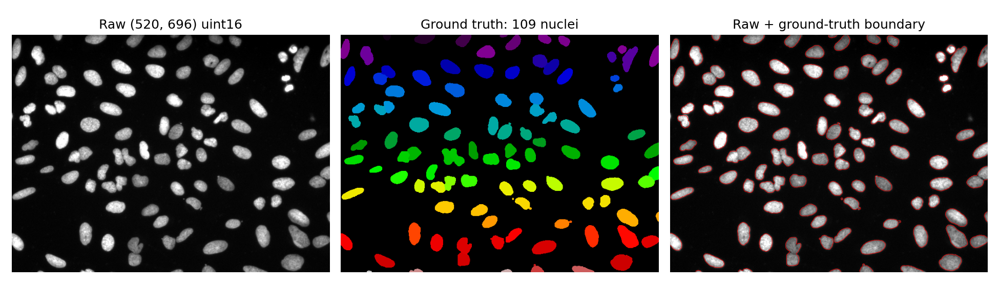
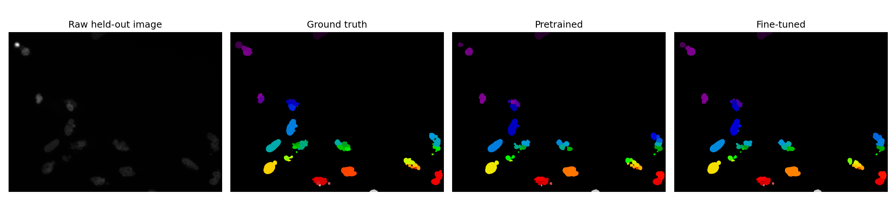
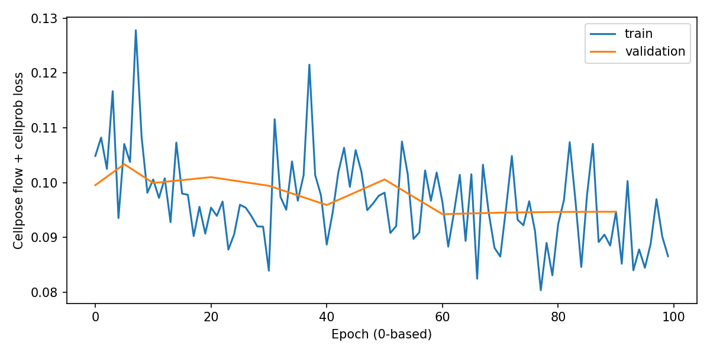
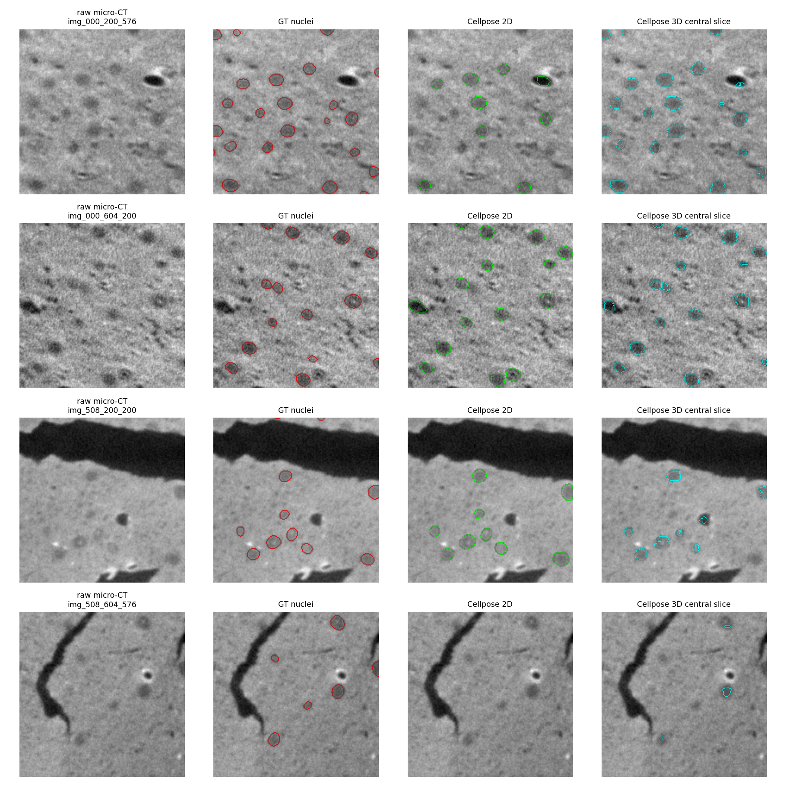

# Cellpose 최종 통합 보고서

## 1. 모델과 실제 입력

|항목|이번 실험에서 사용한 모델|
|---|---|
|체크포인트·버전|Cellpose4.2.1,cpsam_v2（Cellpose-SAM）|
|구조|SAM ViT-L 기반 이미지 분할|
|전체·구성별 파라미터 수|304,628,930개(약3.05억 개)(304.63M)|
|정밀도|추론BF16;파인튜닝FP32|
|모델 입력 → 출력|흑백 이미지 →핵/세포별 서로 다른ID의 instance mask|
|가중치와 실행 메모리의 차이|파라미터 수×dtype bytes는 이론 가중치 용량이다. 실행 peak에는 입력·중간 활성값이 더해지고,파인튜닝에는 gradient/optimizer 상태도 추가된다.|
|메모리% 정의|CUDA allocated peak / CPU·GPU 공유 RAM121.6875GiB ×100; GPU-Util과 별개. AlphaFold2는 JAX 계측을 별도로 표시|

### 실제 데이터와 학습 방식 구분

|구분|데이터·실제 처리 내용|
|---|---|
|추론 데이터|BBBC039200장520×696 uint16 핵 형광 이미지. 뇌 추가 입력은 NucMM-M192³ micro-CT patch4개|
|학습·검증·test 데이터|BBBC039 공식100/50/50;기본부분집합16/8/16. 추가 학습은 빈mask2장 제외 후 train98/validation50/test50|
|학습 입력 X / 정답 y|X:원본520×696에서 공식 무작위crop[B,3,256,256](흑백+0채널2개). y:같은 crop에 맞춰 변환한 instance mask·cell probability·flow. 세포유형 정답 아님|
|가중치 갱신 방식|cpsam_v2 사전학습 가중치에서 backbone·분할출력층 파인튜닝. 실제 일부 파라미터는 gradient가 관측되지 않아 수를 별도 기록|
|원본·변환 입력 저장 위치|`data/input_audit.json;data/images/images/*.tif;data/masks/masks/*.png;추가run/prepared/*_mask.npy`|
|해석 범위|batch26은2epoch 파인튜닝 용량 측정;전체10epoch 독립test·재로드 완료는batch1. 뇌patch는zero-shot 추론만 수행|

**용어:** 처음부터 학습=무작위 초기화에서 시작; 전체/일부 층 파인튜닝=공개 가중치에서 해당 부분 갱신; 분류기만 학습=본체를 동결하고 head만 갱신. **용량probe는 학습 방식이 아니라 짧은 자원 측정 목적**이며,실제로 수행한 가중치 갱신 방식과 함께 표기한다. 원본 전체 데이터 수와 해당 run에서 실제 사용한 부분집합 수를 구분한다.

### 실제 파일 → 전처리 → 모델 표현 → 최종 출력: 단계별 실제 예시

**Cellpose는이미지를평균임베딩하나로줄여분류하는모델이아니라 픽셀별flow·cell probability를만들어instance mask로변환한다.** 실제test이미지 `IXMtest_A09_s1_w1CE70AD49-290D-4312-82E6-CDC717F32637`를사용한다.

#### 0–1. 원본 이미지와 정답 mask

|역할|실제파일|shape·dtype|
|---|---|---|
|입력X|data/images/images/IXMtest_A09_s1_w1CE70AD49-290D-4312-82E6-CDC717F32637.tif|[520, 696] uint16|
|정답y|data/masks/masks/IXMtest_A09_s1_w1CE70AD49-290D-4312-82E6-CDC717F32637.png|[520, 696] int32|

원본은520×696 흑백uint16 TIFF,정답PNG를공식방법으로연결성분instance-ID로변환하면핵 **156개**다. mask값0은배경,양의정수각각은서로다른객체다.

#### 2. 정규화·타일화 → 네트워크 입력

공식백분위정규화와256×256타일화를적용한다. 이번CPU확인의첫실제입력은 **[1, 1, 256, 256] float32**. 추론경로의흑백1채널입력이고,파인튜닝의3채널crop(흑백+0채널2개)과구분한다. 원본520×696전체가한번에같은모양으로GPU에올라가는것은아니다.

#### 3–4. SAM encoder의 공간 특징

첫encoder block의실제출력은 **[1, 32, 32, 1024] float32**. 공간격자에채널별특징이있고, `[1,1280]`같은이미지전체임베딩이최종결과인모델이아니다. 펼친첫8값: `[-2.874520, 0.263489, -0.278038, 0.283162, -4.386965, 1.734219, 0.071460, -1.633521]`.

#### 5. 타일 합치기 → flow·cell probability

|출력|shape·dtype|의미|
|---|---|---|
|flow|[2, 520, 696] float32|각픽셀의Y/X방향흐름|
|cell probability|[520, 696] float32|cellprob_threshold를적용할네트워크점수;0~1로보정된확률로단정하지않음|

타일결과를원래이미지크기에맞춰합친다. 이후flow dynamics·threshold·크기필터를거쳐픽셀을서로다른객체로묶는다.

#### 6. 최종 instance mask와 정답 비교

최종예측은 **[520, 696] uint16**,예측객체155개다. 원래같은크기의정답mask와객체를매칭해AP50/AP75/AP90을계산한다. mask ID는객체식별번호이지세포유형라벨이아니다. 이예제CPU/GPU mask일치: **True**. 이번CPU타일batch는1이고원GPU평가는8이므로새속도비교로쓰지않는다.

#### 7. 저장 파일

|단계별 저장 배열|실제 shape·dtype|의미|
|---|---|---|
|raw_image|[520, 696] uint16|입력이미지|
|ground_truth_mask|[520, 696] int32|정답객체mask|
|first_model_input|[1, 1, 256, 256] float32|첫네트워크타일|
|first_encoder_block_features|[1, 32, 32, 1024] float32|encoder공간특징|
|flows|[2, 520, 696] float32|전체이미지flow|
|cell_probability|[520, 696] float32|전체이미지점수|
|predicted_mask|[520, 696] uint16|최종객체IDmask|
|saved_gpu_mask|[520, 696] uint16|원GPU결과대조|

로컬 전체 배열: `results/real_training_20261029_174605_142266/train_b1_e10/stage_trace_cpu/arrays.npz`. `arrays.npz::key`는 같은NPZ 파일 안의 배열이름이다. 아래 재현코드로 저장모델과 입력에서 다시 확인할 수 있다.

**값의 출처:** 저장된 모델을 CPU에서 새로 재확인한 중간값이다. 원GPU 자원계측 중에 캡처했던 것처럼 해석하지 않는다. 이 CPU 확인시간은 기존 GPU 벤치마크 시간에 포함하지 않는다.

### 모델 적재 직후 — 첫 입력 forward 이전

|적재 조건|allocated GiB(JAX는별도표기)|reserved GiB|프로세스 RSS GiB|원본 근거|
|---|---|---|---|---|
|파인튜닝 적재 기준|1.134844|2.28515625|2.116901397705078|cellpose/results/real_training_20261029_174605_142266/probe_b12_e2/summary.json|
|추론/기본 모델 적재 기준|0.568277|1.740234375|0.8921623229980469|cellpose/results/tile_batch_20261028_134130_265230/batch_12/summary.json|

위 값은 **가중치를 GPU에 적재하고 첫 입력을 계산하기 전의 프레임워크 할당량**이다. CUDA/JAX context·driver·시스템 전체 GPU사용량과 같지 않으며 CPU입력 준비 포함 여부는 해당 실행 코드를 따른다. **실행 peak와 모델 적재 기준값의 차이는 같은 run에서만 계산**한다. 파인튜닝 중 추가량에는 입력뿐 아니라 중간값·gradient·optimizer 상태가 포함된다. 서로 다른 조건/정밀도의 기준값을 하나의 모델 고유 메모리로 단정하지 않는다.

## 2. 정규화·타일화 → 네트워크 입력

<!-- ENV_MEASUREMENT_OVERVIEW_START -->
### 실행 환경·자원 측정 방법 요약

|항목|이번 보고서의 측정 기준|
|---|---|
|장비·공유메모리|DGX Spark,NVIDIA GB10,ARM64;시스템공유RAM121.6875GiB. CPU/GPU RAM을별도로더하지않음|
|환경기록출처|cellpose/results/cellpose_20261027_193331_947064/summary.json|
|Python·프레임워크|{'python': '3.12.3 (main, Mar 23 2026, 19:04:32) [GCC 13.3.0]', 'torch': '2.13.0a0+8145d630e8.nv26.06', 'cuda': '13.3', 'cellpose': '4.2.1', 'platform': 'Linux-7.0.0-1019-nvidia-aarch64-with-glibc2.39'}|
|실험병렬정책|GPU벤치마크한번에1개. 이단계별CPU검증은별도작업이며GPU측정시간과합치지않음|
|GPU-Util|nvidia-smi utilization.gpu(%);관측기간중커널활동시간비율. 최대FLOPS/메모리비율아님|
|GPU메모리|PyTorch allocated/reserved및peak;JAX는bytes_in_use/peak_bytes_in_use별도. 모델적재직후·실행구간을분리|
|프로세스·시스템메모리|psutil RSS,MemAvailable,swap;시계열의sampled peak/최소값이며정확한연속최고치아님|
|표본간격|기본0.5초대기+GPU조회시간;측정구간의평균·최대·표본수저장. 짧은실행은동일조건반복하고고유입력과반복처리량구분|
|시간동기화|PyTorch구간앞뒤CUDA synchronize;JAX block_until_ready. 비동기호출반환시간만측정하지않음|
|시간포함범위|조건별로입력준비/전송/forward/backward/optimizer/validation/save포함여부를기록. 서로다른범위의시간을직접배수비교하지않음|
|loading·compile·warmup|구간을분리한다. JAX누적allocator peak가compile/warmup을포함하는경우본문에명시하고CUDA구간peak와직접동일시하지않음|
|메모리기준값과증가량|첫forward전모델적재기준값과같은run의실행peak를비교. 증가량에는학습gradient/optimizer/중간활성값이포함|
|누락·관측한계|미지원/미관측값은N/A. 장치전체GPU-Util에는다른프로세스·디스플레이활동이섞일수있음. 단일실행은통계적반복검증으로쓰지않음|

<!-- ENV_MEASUREMENT_OVERVIEW_END -->

공식백분위정규화와256×256타일화를적용한다. 이번CPU확인의첫실제입력은 **[1, 1, 256, 256] float32**. 추론경로의흑백1채널입력이고,파인튜닝의3채널crop(흑백+0채널2개)과구분한다. 원본520×696전체가한번에같은모양으로GPU에올라가는것은아니다.

#### 3–4. SAM encoder의 공간 특징

첫encoder block의실제출력은 **[1, 32, 32, 1024] float32**. 공간격자에채널별특징이있고, `[1,1280]`같은이미지전체임베딩이최종결과인모델이아니다. 펼친첫8값: `[-2.874520, 0.263489, -0.278038, 0.283162, -4.386965, 1.734219, 0.071460, -1.633521]`.

#### 5. 타일 합치기 → flow·cell probability

|출력|shape·dtype|의미|
|---|---|---|
|flow|[2, 520, 696] float32|각픽셀의Y/X방향흐름|
|cell probability|[520, 696] float32|cellprob_threshold를적용할네트워크점수;0~1로보정된확률로단정하지않음|

타일결과를원래이미지크기에맞춰합친다. 이후flow dynamics·threshold·크기필터를거쳐픽셀을서로다른객체로묶는다.

#### 6. 최종 instance mask와 정답 비교

최종예측은 **[520, 696] uint16**,예측객체155개다. 원래같은크기의정답mask와객체를매칭해AP50/AP75/AP90을계산한다. mask ID는객체식별번호이지세포유형라벨이아니다. 이예제CPU/GPU mask일치: **True**. 이번CPU타일batch는1이고원GPU평가는8이므로새속도비교로쓰지않는다.

#### 7. 저장 파일

|단계별 저장 배열|실제 shape·dtype|의미|
|---|---|---|
|raw_image|[520, 696] uint16|입력이미지|
|ground_truth_mask|[520, 696] int32|정답객체mask|
|first_model_input|[1, 1, 256, 256] float32|첫네트워크타일|
|first_encoder_block_features|[1, 32, 32, 1024] float32|encoder공간특징|
|flows|[2, 520, 696] float32|전체이미지flow|
|cell_probability|[520, 696] float32|전체이미지점수|
|predicted_mask|[520, 696] uint16|최종객체IDmask|
|saved_gpu_mask|[520, 696] uint16|원GPU결과대조|

로컬 전체 배열: `results/real_training_20261029_174605_142266/train_b1_e10/stage_trace_cpu/arrays.npz`. `arrays.npz::key`는 같은NPZ 파일 안의 배열이름이다. 아래 재현코드로 저장모델과 입력에서 다시 확인할 수 있다.

**값의 출처:** 저장된 모델을 CPU에서 새로 재확인한 중간값이다. 원GPU 자원계측 중에 캡처했던 것처럼 해석하지 않는다. 이 CPU 확인시간은 기존 GPU 벤치마크 시간에 포함하지 않는다.

### 모델 적재 직후 — 첫 입력 forward 이전

|적재 조건|allocated GiB(JAX는별도표기)|reserved GiB|프로세스 RSS GiB|원본 근거|
|---|---|---|---|---|
|파인튜닝 적재 기준|1.134844|2.28515625|2.116901397705078|cellpose/results/real_training_20261029_174605_142266/probe_b12_e2/summary.json|
|추론/기본 모델 적재 기준|0.568277|1.740234375|0.8921623229980469|cellpose/results/tile_batch_20261028_134130_265230/batch_12/summary.json|

위 값은 **가중치를 GPU에 적재하고 첫 입력을 계산하기 전의 프레임워크 할당량**이다. CUDA/JAX context·driver·시스템 전체 GPU사용량과 같지 않으며 CPU입력 준비 포함 여부는 해당 실행 코드를 따른다. **실행 peak와 모델 적재 기준값의 차이는 같은 run에서만 계산**한다. 파인튜닝 중 추가량에는 입력뿐 아니라 중간값·gradient·optimizer 상태가 포함된다. 서로 다른 조건/정밀도의 기준값을 하나의 모델 고유 메모리로 단정하지 않는다.

## 2. 실행 조건과 측정 기준

표의실제batch·입력shape·정밀도·epoch/step를먼저확인한다. GPU-Util은연산활동시간비율이고,메모리목표80%는약97.35GiB allocated다. 모델별학습범위(전체/부분/head-only/처음부터학습/용량probe)를같은학습으로가정하지않는다. 같은run의시간·메모리를사용하고예측정확도가미평가이면그대로표시한다.

<!-- FACTOR_EFFECTS_START -->
### 시간·메모리에 영향을 주는 요인 — 통제 비교 상태

아래 원리는 모든 모델에서 정량 검증을 마쳤다는 뜻이 아니다. **실측 비교와 미실험을 구분**한다. 배치 sweep 중 정밀도·입력길이·체크포인트를 고정하며,다른 과제/다른head 결과를 같은 조건으로 섞지 않는다.

|요인|총시간·처리량 해석|최대 allocated 해석|이 모델의 실험 근거/상태|
|---|---|---|---|
|배치|한step은 길어질 수 있고step수는 줄어든다. 처리량 상승/포화는 실측으로 판단|같은입력길이·정밀도에서 동시중간값 증가가 주된영향|타일추론8→384;FP32파인튜닝crop1→26 비교|
|샘플당 실제입력 크기|GPU에들어간실제token/타일 크기가 커졌을때 계산량 변화 비교|토큰길이·패치/타일크기·attention구조에 따라 증가;원본크기와 다를수있음|추론 이미지수/크기 비교;타일256고정이면 전체이미지 확대가 동시GPU입력확대를 뜻하지 않음|
|고유 데이터수|같은batch·epoch에서 총처리step가늘어 총시간이늘어나는지 비교|고정batch의동시입력이같으면 데이터총수만으로peak가크게늘지않을수있음|입력개수비교는본문참조;새지도학습데이터수비교는아래결과가생긴조건만완료|
|epoch|같은train입력을 반복하므로 누적시간 증가;검증성능개선은 보장안됨|동일batch·입력에서epoch자체가peak를선형증가시키는요인은아님|기본100epoch와추가10epoch는 데이터수도 달라epoch의 단독효과로 직접비교 불가|
|학습방식·갱신범위|추론/본체동결head학습/부분·전체미세조정/처음부터학습은 계산범위가다름|gradient·optimizer·역전파용중간값의유무가다름|1절의가중치갱신방식과X/y를참조;다른데이터·목적의시간을단순배수비교하지않음|
|모델·정밀도·전처리|구조·dtype·토큰화·타일화·컴파일·후처리도영향|모델적재기준값과실행중추가량을분리|원인후보/고정조건으로기록;모델크기나dtype의단독영향sweep은미실험|

추가 통제 비교에서는 **batch8·FP32·공개초기weight·seed42·optimizer·원래전체pool의padding폭·검증/test를고정**하고,(1)같은train의epoch1/2/4,(2)epoch2의중첩train1/4·1/2·전체를각각실행한다. 전체데이터를바꾸면서epoch도함께바꾼행끼리는단독효과로해석하지않는다. 단일실행이며데이터부분집합의label분포변화는정확도해석의제약이다. 이비교는해당지도학습지원모델에만적용한다.


추가epoch/데이터수통제비교 수치: **아직미실험/대기**. 기존측정을추정해서채우지않는다.

<!-- FACTOR_EFFECTS_END -->

## 3. 조건별 추론·학습 결과 — 한 표

아래시간은각원본조건의실측값이다. 조건별포함/제외범위는4~5절과원본기록에서확인한다. 대부분PyTorch CUDAallocated peak이나AlphaFold2는컴파일/warmup포함JAX프로세스누적peak다. RSS와CUDA를독립메모리처럼더하지않는다.

BBBC039는실제U2OS핵형광이미지이고,NucMM-M은생쥐뇌조직micro-CT다. **원본이미지개수와동시에GPU에넣는타일개수는별개**다. 타일network구간과최종instance mask까지의전체분할시간도구분한다.

|작업|실제 입력·고유 데이터 수|동시 GPU batch·모양|학습량/반복|측정시간|처리량/step참고|최대 allocated / 공유RAM대비|성능·80% 상태|
|---|---|---|---|---|---|---|---|
|타일 network 추론|고유이미지1장(520×696),고유타일12개|최대8×1×256×256,BF16|24회반복; 총288타일|15.54초|18.53타일/초|1.491 GiB / 1.23%|mask후처리제외; 해당자원조건의정확도별도미평가; 80%미도달|
|타일 network 추론|고유이미지32장(520×696),고유타일384개|최대384×1×256×256,BF16|2회반복; 총768타일|41.40초|18.55타일/초|43.397 GiB / 35.66%|mask후처리제외; 해당자원조건의정확도별도미평가; 80%미도달|
|정답마스크 기반 파인튜닝|train16/val8/test16개 실제U2OS형광이미지|1×3×256×256 crop,FP32|100epoch/1600optimizer step|672.75초|전체wall÷1600=0.420초/step 참고값|7.985 GiB / 6.56%|저장모델test AP50 0.9138; 80%미도달|
|뇌 micro-CT 2D 전체분할|4개val volume의중앙단면4장,각192×192|요청tilebatch8; 실제tilebatch1,1×1×256×256,BF16|59회반복/총236장|15.18초|15.54장/초|0.705 GiB / 0.58%|동일4단면 AP50 0.4407; 80%미도달|
|뇌 micro-CT 3D 전체분할|4개실제val patch,각192×192×192복셀; 원본총768슬라이스|tilebatch8,8×1×256×256,BF16|각volume1회|114.89초(4개합)|0.0348volume/초|1.491 GiB / 1.23%|동일4volume 3D AP50 0.4222; 80%미도달|

|학습 용량probe(추가)|실제학습98장;256×256 crop|**26×3×256×256,FP32**|**2epoch/8steps**,196crop|**92.34초**|**2.12crop/초**|**90.520GiB / 74.39%**|짧은용량측정 성공; 이 조건의독립test미평가;80%미도달|
|전체 파인튜닝(추가)|train98/validation50/test50장|**1×3×256×256,FP32**|**10epoch/980steps**,980crop|**474.47초**|**2.07crop/초**|**7.985GiB / 6.56%**|독립test50장 AP50 **0.9278**; 저장모델재로드 동일|
|학습 용량probe 실패(추가)|같은 실제학습 이미지|28×3×256×256,FP32|2epoch예정,도중중단|완료시간/처리량N/A|N/A|성공peak로집계하지않음|**100GiB allocator 예산에서 OOM**;80% 성공을뜻하지않음|

<!-- REAL_TRAINING_V3_START -->
### 실제 데이터 추가 실험 — real_training_20261029_174605_142266

진행 중인 실행의 완료 조건만 아래에 갱신한다. probe는 짧은 용량 측정이며 전체 학습이나 평가 완료가 아니다. 메모리%는 CUDA allocated peak / 시스템 공유 RAM ×100이며 GPU-Util과 다르다. 독립 실행 1회 기준.

|조건|가중치 갱신 방식·실험 목적|상태|고유 입력|배치|epoch|optimizer steps|실측 시간(s)|입력/s|allocated peak GiB|reserved peak GiB|공유 RAM 대비 allocated %|GPU-Util 평균%|최대%|독립 test 지표|저장 모델 재로드|
|---|---|---|---|---|---|---|---|---|---|---|---|---|---|---|---|
|probe_b12_e2|본체·분할출력층 파인튜닝 /용량측정|complete|98|12|2|18|90.5178|2.1653|44.1138|46.0586|36.2517|82.6727|96.0000|N/A|N/A|
|probe_b16_e2|본체·분할출력층 파인튜닝 /용량측정|complete|98|16|2|14|91.7579|2.1361|57.2769|58.9902|47.0688|81.2695|96.0000|N/A|N/A|
|probe_b18_e2|본체·분할출력층 파인튜닝 /용량측정|complete|98|18|2|12|92.5409|2.1180|63.8616|67.4062|52.4800|80.9042|96.0000|N/A|N/A|
|probe_b1_e2|본체·분할출력층 파인튜닝 /용량측정|complete|98|1|2|196|108.6468|1.8040|7.9846|8.0938|6.5616|84.7107|96.0000|N/A|N/A|
|probe_b20_e2|본체·분할출력층 파인튜닝 /용량측정|complete|98|20|2|10|92.4709|2.1196|70.4477|73.4473|57.8923|79.7048|96.0000|N/A|N/A|
|probe_b22_e2|본체·분할출력층 파인튜닝 /용량측정|complete|98|22|2|10|92.3895|2.1215|77.1343|80.6719|63.3872|80.6121|96.0000|N/A|N/A|
|probe_b24_e2|본체·분할출력층 파인튜닝 /용량측정|complete|98|24|2|10|92.0595|2.1291|83.8269|87.8906|68.8870|79.8659|96.0000|N/A|N/A|
|probe_b26_e2|본체·분할출력층 파인튜닝 /용량측정|complete|98|26|2|8|92.3424|2.1225|90.5200|93.4883|74.3873|79.4606|96.0000|N/A|N/A|
|probe_b4_e2|본체·분할출력층 파인튜닝 /용량측정|complete|98|4|2|50|93.9772|2.0856|17.7814|18.3145|14.6123|82.2339|96.0000|N/A|N/A|
|probe_b8_e2|본체·분할출력층 파인튜닝 /용량측정|complete|98|8|2|26|92.4495|2.1201|30.9439|32.0840|25.4290|82.8988|96.0000|N/A|N/A|
|train_b1_e10|본체·분할출력층 파인튜닝|complete|98|1|10|980|474.4733|2.0654|7.9846|8.0938|6.5616|93.3083|96.0000|{'AP50_AP75_AP90': [0.9277853965759277, 0.8650861382484436, 0.6368995904922485]}|True|

BBBC039 원본 이미지 단위 공식 분리100train/50validation/50test를 확인했다. 학습100장 중 정답 객체가 없는2장은 공식 min_train_masks5 정책으로 제외하여 실제 학습98장이다. 검증50장에는 빈 마스크1장이 있으며 test는50장이다. 원본520×696 uint16 grayscale와 정답 instance mask를 공식256×256 무작위 crop/회전/크기 증강으로 학습한다. FP32,AdamW,lr1e-5,weight_decay0.1,seed42 고정. 네트워크 입력은[B,3,256,256]이며 grayscale 외 두 채널은0이다. 공식 warmup의 epoch0 학습률0이므로 probe도2epoch 실행하고 실제 가중치 변화를 확인한다. 전체 학습 비교는10epoch이고 독립 test50장의 AP50/AP75/AP90이다. CUDA allocator budget100GiB로 캐시 예약이 공유 RAM을 잠식하는 것을 제한한 별도 정책이며 모든 배치에서 동일하다. 학습 시간에는 전처리/검증/체크포인트 저장이 포함된다. flow 준비는 별도 실행으로 재사용한다.

입력 및 메모리 기준값(같은 실행에서 측정):

|조건|실제 모델 입력 모양/정책|모델 적재 직후 allocated GiB|실행 시작 allocated GiB|peak 추가 allocated GiB|프로세스 RSS sampled peak GiB|시스템 가용 RAM sampled 최소 GiB|
|---|---|---|---|---|---|---|
|probe_b12_e2|[batch,3,256,256] official grayscale+two zero channels, original images520x696|1.1348|1.1348|42.9790|4.7813|62.9792|
|probe_b16_e2|[batch,3,256,256] official grayscale+two zero channels, original images520x696|1.1348|1.1348|56.1420|4.8624|49.7959|
|probe_b18_e2|[batch,3,256,256] official grayscale+two zero channels, original images520x696|1.1348|1.1348|62.7267|4.7822|41.1127|
|probe_b1_e2|[batch,3,256,256] official grayscale+two zero channels, original images520x696|1.1348|1.1348|6.8498|4.7811|101.5013|
|probe_b20_e2|[batch,3,256,256] official grayscale+two zero channels, original images520x696|1.1348|1.1348|69.3129|4.7827|35.0286|
|probe_b22_e2|[batch,3,256,256] official grayscale+two zero channels, original images520x696|1.1348|1.1348|75.9994|4.7826|27.7193|
|probe_b24_e2|[batch,3,256,256] official grayscale+two zero channels, original images520x696|1.1348|1.1348|82.6921|4.7808|20.4540|
|probe_b26_e2|[batch,3,256,256] official grayscale+two zero channels, original images520x696|1.1348|1.1348|89.3852|4.7793|14.8376|
|probe_b4_e2|[batch,3,256,256] official grayscale+two zero channels, original images520x696|1.1348|1.1348|16.6465|4.7825|91.0841|
|probe_b8_e2|[batch,3,256,256] official grayscale+two zero channels, original images520x696|1.1348|1.1348|29.8091|4.7824|77.1176|
|train_b1_e10|[batch,3,256,256] official grayscale+two zero channels, original images520x696|1.1348|1.1348|6.8498|4.7627|101.3434|

이 Cellpose run은 학습·test 평가·저장 모델 재로드가 완료됐다. 용량probe는 배치26까지90.5200GiB(공유 RAM74.39%) 성공,배치28은100GiB allocator budget에서OOM이 발생해 종료했다. 전체10epoch 학습은 배치1만 수행했으며 80% 학습 조건은 확인되지 않았다.

실행 코드 블록의 파일은 원문SHA256으로 검증하며, 명령JSON에 기록된 실행 경로로 해당 snapshot을 복사하면 복원할 수 있다. 대용량 원본 데이터·가중치는 아래 전처리/다운로드 코드와 출처를 사용하고 로컬 원본도 보존한다.

로컬 원시 결과: `/home/hyein/ai-benchmark/cellpose/results/real_training_20261029_174605_142266`. 메모리 부족/guard 실패는 성공 조건으로 기재하지 않는다.
<!-- REAL_TRAINING_V3_END -->

## 4. 결과 해석 — 요약 결론

<!-- MODEL_SUMMARY_START -->
### 요약 결론

- **학습 방식:** cpsam_v2 사전학습 가중치에서 backbone·분할출력층 파인튜닝. 실제 일부 파라미터는 gradient가 관측되지 않아 수를 별도 기록.
- **입력 구분:** batch26은2epoch 파인튜닝 용량 측정;전체10epoch 독립test·재로드 완료는batch1. 뇌patch는zero-shot 추론만 수행.
- **최신 추가 run 최대 성공 메모리:** `probe_b26_e2` **90.520GiB /74.39%**. 이 값은 해당 최신run의 성공 조건에서의 최대이며,다른 run의 최대와 구분한다. probe이면 전체 epoch·독립test 평가 완료를 뜻하지 않는다.
- **전체 실험 구분:** 추론 타일batch384는43.397GiB/35.66%;FP32 파인튜닝 용량probe batch26은90.520GiB/74.39%. 전체10epoch·test평가·재로드는batch1에서 완료(AP50=0.9278). batch28은100GiB allocator 예산에서OOM;80% 성공은 미확인.
- **시간·정확도 해석:** 결과는 같은 행의 입력·배치·학습범위에만 연결한다. 메모리 상승 자체가 처리량·정확도 상승을 보장하지 않는다.
<!-- MODEL_SUMMARY_END -->

**이번 Cellpose 전체 실험의 최대 성공 allocated는90.520GiB(공유 RAM의74.39%)다.35.66%는 추론 타일배치384 조건의 값이며 전체 실험의 최대가 아니다.**

- **추론:** BF16,256×256 tile **batch384**에서 **43.397GiB /35.66%**. 원본520×696 이미지32장분량의384타일을 함께 처리했다. batch8→384에서 메모리는 크게 늘었지만 처리량은 **18.53→18.55타일/초**로 거의 같았다.
- **학습 용량:** FP32,256×256 crop **batch26**,실제98장으로 **2epoch/8steps**를 수행해 **90.520GiB /74.39%**까지 확인했다. batch28은 **100GiB allocator 예산에서 OOM**이 발생했다. 이는 이 설정에서의 결과이며 Cellpose의 절대적인 최대 배치나 물리 메모리 한계를 뜻하지 않는다. **80% 성공 조건은 미확인**이다.
- **전체 학습·정확도:** 같은 실제98장으로 **batch1,10epoch** 학습은 **474.47초**,최대 **7.985GiB /6.56%**였고,독립test50장 **AP50=0.9278**과 저장모델 재로드를 검증했다. **batch26으로 전체10epoch 학습·test평가를 마친 것은 아니다.**
- **메모리 증가 요인:** 모델 가중치 자체는 FP32 약1.135GiB다. 학습 시 동시 crop 수가 늘면서 중간 활성값과 역전파용 저장값이 커져 메모리가 증가했다. 원본 이미지 총수를 늘리는 것과 동시에GPU에 올리는 tile/crop 배치를 늘리는 것은 다르다.
- **뇌 데이터 범위:**192³ micro-CT patch4개에 대한 zero-shot 추론이며 전체뇌/MRI5000건 학습이 아니다. 해당3D AP50평균은0.4222로,뇌 데이터의 추가학습 성능을 입증하지 않는다.

### 시간·성능 표를 읽는 주의점

타일network시간은mask후처리를제외한다. 파인튜닝672.75초는원래공식trainer의flow전처리·validation·저장도포함한전체시간이며순수step시간이아니다. 0.420초/step는그전체를1600으로나눈참고값이므로scGPT의순수학습step시간과직접비교하지않는다. 뇌2D/3D행은정규화·network·mask후처리를포함하고다운로드/모델적재/평가지표/파일저장을제외한다.

## 5. 실험 방법·입력 예시·기본/후속·평가·저장 상세


### Cellpose-SAM: DGX Spark 실행 보고서


실행: `cellpose_20261027_193331_947064`. 상태: **complete**. 원본 측정: summary.json (원본 기록 로컬 보관: `cellpose/results/cellpose_20261027_193331_947064/summary.json`), 로그 (로컬 보관: `../results/cellpose_20261027_193331_947064/run.log`), 자원 시계열 (원본 기록 로컬 보관: `cellpose/results/cellpose_20261027_193331_947064/resources.csv`), 실제 forward 입력 (원본 기록 로컬 보관: `cellpose/results/cellpose_20261027_193331_947064/forward_calls.json`).

#### 모델과 환경

Cellpose 4.2.1, 공식 기본 체크포인트 **cpsam_v2**, SAM ViT-L 기반 Cellpose-SAM이다. Cellpose3 cyto·CPDINO와 별개다. 전체 파라미터 304,628,930, requires_grad 304,592,064. 이론적 BF16 파라미터 저장량 0.567416 GiB.

체크포인트 revision: `7c61431b5fbb078f3296754bd15d9f51b320f837`; SHA-256: `0f1cc3f7ecdd8a037a57c6c48d9d8921391be4cbce3fa9f13c3e3a2e1253c667`. 공식 파일 메타데이터 `../models/repository_files.json`의 LFS oid와 대조해 일치했다. 데이터/모델 출처 목록은 `../data/sources.json`에 보존했다.

환경: {"python": "3.12.3 (main, Mar 23 2026, 19:04:32) [GCC 13.3.0]", "torch": "2.13.0a0+8145d630e8.nv26.06", "cuda": "13.3", "cellpose": "4.2.1", "gpu": "NVIDIA GB10", "platform": "Linux-7.0.0-1019-nvidia-aarch64-with-glibc2.39", "tf32": true}

8 CPU threads, seed42. 공식 trainer는 epoch별 NumPy seed를 epoch 번호로, 검증 때42로 설정한다. GPU 작업은 한 번에 하나씩 실행했다. PyTorch NGC 26.06 ARM64 전용 venv이며 기존 환경은 보존했다. BF16 추론, 공식 학습 API가 자동 변환하는 FP32 파인튜닝이다. TF32 허용은 Cellpose 공식 코드 기본값이다.

| 적재 상태 | CUDA allocated GiB | reserved GiB | RSS GiB | system available GiB |
| --- | --- | --- | --- | --- |
| 모델 적재 직후, 첫 입력 이전 | 0.568277 | 1.740 | 0.954 | 111.969 |

적재 시간 1.129초; 적재 중 allocator peak 1.718GiB. 이는 현재 적재량과 다르다. 첫 warmup 1.377초는 초기 kernel/Numba 준비와 후처리를 포함하며 정상 반복 성능 표에서 제외했다.

#### 실제 데이터와 학습 입력

Broad BBBC039v1 공개 CC0 데이터: U2OS 세포의 Hoechst DNA 채널, 200장, uint16 흑백 TIFF 520×696. 공식 원본 이미지 분할 train100/validation50/test50에서 seed42로 16/8/16장을 선택했다. 원본 이미지 단계에서 분리한 뒤 학습 crop을 생성한다. 픽셀 크기(µm)는 확보한 메타데이터에서 확인되지 않아 N/A로 남긴다.

정답은 사람이 표시한 핵 instance PNG의 첫 채널을 공식 예제처럼 connected-component label로 변환했다. 0은 배경, 양의 정수는 개별 핵 ID이며 연속값 회귀 라벨이 아니다. 원본 영상·마스크 shape 일치, 유한값, 이미지 식별자 중복 및 split 분리를 확인했다. 전체200장에는 핵이 적은 영상도 있으나 선택한 학습16장은 모두 최소5개 기준을 충족한다.



| split | 선택 장수 | 첫 원본 ID | shape | dtype | 핵 수 | 픽셀 범위 |
| --- | --- | --- | --- | --- | --- | --- |
| training | 16 | IXMtest_B12_s9_w1ABE4C6B8-6110-4D7D-B782-94C43FDC2E1F | [520, 696] | uint16 | 109 | 119…3398 |
| validation | 8 | IXMtest_B12_s2_w19F7E0279-D087-4B5E-9899-61971C29CB78 | [520, 696] | uint16 | 120 | 125…3271 |
| test | 16 | IXMtest_A12_s7_w1EAEEA614-51ED-43B3-A4FF-088730911E4C | [520, 696] | uint16 | 69 | 112…3885 |

원본 2D grayscale은 실제 추론 forward에서 1채널로 유지된다(아래 실측 NCHW). 학습 API에서는 첫 채널 + 두 zero 채널로 변환된다. 1/99 percentile 정규화 후 float32 전처리, 추론 forward에서 BF16으로 변환한다. 학습은 영상과 flow label을 함께 random rotate/resize하여 실제 1×3×256×256 FP32 입력을 사용한다. 각 epoch마다 각 학습 이미지에서 crop을 하나 뽑는 정책이다.

실제 전체 선택 목록·파일 해시·마스크 경로: input_audit.json (원본 기록 로컬 보관: `cellpose/data/input_audit.json`). BBBC039는 DSB2018과 일부 겹치며 사전학습 Cellpose 데이터와의 중복 여부를 확정하지 못했다. 본 test는 이번 파인튜닝에서만 분리한 평가이며, 사전학습까지 완전히 독립적인 외부 성능이라고 주장하지 않는다.

#### 입력 규모에 따른 GPU 사용률과 메모리

공식 eval 기본 타일 배치 상한8, tile256, overlap0.1, augment=False, diameter/rescale 없음, flow_threshold0.4, cellprob_threshold0, min_size15, max_size_fraction0.4, 동일 사전학습 체크포인트를 고정했다. 영상별로 순차 처리하며, 실제 batch는 타일 수에 따라8보다 작을 수 있다. 개수 비교는 같은 크기의 중첩1/4/16장, 크기 비교는 같은4장의 중심128/256/512 crop이며 native520×696 비교는 count4 행이다. crop은 확대보간하지 않은 부분 시야다.

| 조건 | 원본 H×W | 고유 장수 | 반복 | 초 | 장/초 | GPU 평균/최대 % | 시작 allocated GiB | peak GiB | 같은 run 증가 GiB | 실제 forward NCHW |
| --- | --- | --- | --- | --- | --- | --- | --- | --- | --- | --- |
| count_1 | [520, 696] | 1 | 23 | 15.296 | 1.504 | 91.3 / 95 | 0.600 | 1.491 | 0.892 | ['[4, 1, 256, 256]', '[8, 1, 256, 256]'] |
| count_4 | [520, 696] | 4 | 6 | 16.512 | 1.453 | 88.9 / 95 | 0.600 | 1.491 | 0.892 | ['[4, 1, 256, 256]', '[8, 1, 256, 256]'] |
| count_16 | [520, 696] | 16 | 2 | 22.150 | 1.445 | 89.6 / 95 | 0.600 | 1.491 | 0.892 | ['[4, 1, 256, 256]', '[8, 1, 256, 256]'] |
| crop_128 | [128, 128] | 4 | 55 | 15.266 | 14.411 | 78.3 / 86 | 0.600 | 0.705 | 0.106 | ['[1, 1, 256, 256]'] |
| crop_256 | [256, 256] | 4 | 17 | 15.284 | 4.449 | 89.5 / 95 | 0.600 | 1.046 | 0.446 | ['[4, 1, 256, 256]'] |
| crop_512 | [512, 512] | 4 | 8 | 16.350 | 1.957 | 79.8 / 95 | 0.600 | 1.491 | 0.892 | ['[1, 1, 256, 256]', '[8, 1, 256, 256]'] |

실제 타일 수는 이미지당128crop=1,256crop=4,512crop=9,520×696원본=12다. 입력 padding과 overlap 때문에256crop도4타일이 된다. 공식 소스의 padding 후 타일 정책을 그대로 사용했다.

각 조건 최소15초 동안 완전한 eval 반복을 실행했다. 고유 장수와 반복 처리량을 구분한다. 측정 시간은 메모리에 읽어둔 입력의 정규화·타일링·전송·모델 forward·flow dynamics·마스크 후처리를 포함하며 원본 디스크 읽기와 결과 파일 저장은 제외한다. forward 별도 시간은 CPU↔GPU 전송과 반환 변환을 포함한다. CUDA 경계는 synchronize했다. 반복 구간의 CUDA peak는 조건마다 reset하고 empty_cache 뒤의 실제 baseline을 함께 기록한다.

원본 디스크 읽기·개별 결과 파일 저장 시간은 별도 계측하지 않아 N/A다. warmup은 초기 준비 시간을 포함하며 독립적인 compile 시간은 분리되지 않았다. 학습 총시간에는 공식 checkpoint 저장이 포함되지만 저장만의 시간은 N/A다.

GPU-Util은 nvidia-smi의 장치 활동 시간 비율이며 최대 FLOPS나 메모리 사용률이 아니다. 0.5초 대기+조회 소요의 시계열에서 조회 전체가 조건 안에 들어간 표본만 집계했다. 장치 전체에는 디스플레이 영향이 포함될 수 있다. RSS/available은 sampled 값이며 정확한 순간 peak가 아니다. 별도 CSV에 reserved peak와 sampled RSS/available, forward 시간도 저장했다.

추론 최대 GPU-Util 95%; 80% 관측 여부: 관측됨. 추론 최대 allocated 1.491GiB는 전체 공유 RAM 121.688GiB의 1.23% 참고값이다. GPU 활동 시간 90%와 공유 RAM90% 사용은 다른 뜻이다. RSS와 CUDA 수치를 더하지 않는다. 이미지가 커져도 타일 입력은256×256으로 유지되며 타일 수·마지막 batch·후처리 비용이 변한다. 입력 개수 증가가 peak를 비례 증가시킨다고 해석할 수 없다.

#### 정답 마스크 파인튜닝·검증·저장

공식 train_seg 경로, 전 학습 가능 구성의 AdamW(lr1e-5, weight_decay0.1), batch1, 100epochs, epoch당16장, rescale=False, scale_range0.5,256crop을 고정했다. 공식10epoch warmup과 마지막50epoch 감쇠를 사용했다. validation8장은 API의 test_data 인자에 넣었으며 최종 test16장은 학습에 넣지 않았다. 기본 min_train_masks5로 선택 학습 영상 모두 유지됐다.

완료 1600 optimizer steps, 총 672.75초(정답 flow 준비·검증·저장 포함). flow/정규화 준비 0.80초. 학습 진입 FP32 baseline 1.166GiB, fit peak 7.985GiB, 증가 6.819GiB. 전체 fit GPU 평균/최대 93.1/95%. 이 평균에는 flow 준비와 검증·저장도 포함한다.

실제 gradient를 관찰한 파라미터: {"parameters_with_gradient": 304394432, "names_without_gradient": ["encoder.patch_embed.proj.weight", "encoder.patch_embed.proj.bias"]}

일부 patch embedding은 공식 forward가 .data를 사용하므로 requires_grad=True여도 gradient가 없다. 실제 변경 예시(최대 절댓값): {"encoder.patch_embed.proj.weight": 0.0, "encoder.blocks.0.attn.qkv.weight": 0.001953125, "out.weight": 0.00390625}

저장 경로: `models/cellpose_20261027_193331_947064/models/cpsam_v2_bbbc039_finetuned`. 공식 trainer의 저장 가중치는 FP32이고 평가 시 BF16으로 복원한다. 별도 optimizer/RNG/epoch 상태도 저장했으나 중단 후 학습 재개는 검증하지 않았다.

| 동일 test16장 | 평균 AP@0.5 | AP@0.75 | AP@0.9 |
| --- | --- | --- | --- |
| 사전학습 | 0.9054 | 0.8545 | 0.5991 |
| 파인튜닝 | 0.9138 | 0.8515 | 0.5937 |

AP는 Cellpose instance matching의 TP/(TP+FP+FN)을 이미지별 계산한 평균으로 COCO mAP와 다르다. 작은 파인튜닝 subset과100epochs의 관찰 결과이며 향상을 보장하지 않는다. epoch 선택에 test 지표를 사용하지 않았다.

독립 새 프로세스 재로드 결과: {"checkpoint_sha256": "3acb3f69377a915bcd523e0eb5889b73674b8575a77d7c1e3c4a76c6ebfec360", "load_seconds": 1.168588638305664, "cellprob_max_abs_difference": 0.0, "flow_max_abs_difference": 0.0, "mask_exact_match": true, "independent_process": true, "shape": [520, 696], "passed": true}





#### 재현과 한계

코드: `scripts/setup.py`, `prepare_inputs.py`, `benchmark.py`, `launch.py`, `reload.py`, `report.py`. 실행 명령과 로그는 각 run 폴더에 있다. 첫 실행의 결과 기록 함수 이름 충돌은 GPU 추론 이후 발생해 해당 실패 run을 보존하고 수정 후 새 run으로 재실행했다. 가중치 구간 다운로드 조립 크기 검증이 처음 실패해 기존 다운로드를 실제 종료하고 보존 prefix 길이에 맞춰 재조립했으며 최종 공식 SHA-256 일치로 검증했다.

데이터 선택·tile 정책을 고정한 단일 장비 단일 실행 관찰이다. GPU 연산 커널만의 순수 FLOPS, 다른 장비 대비 속도 향상, 광범위한 생물학적 일반화를 주장하지 않는다. 큰 이미지의 병목은 실제 타일 batch·메모리·시간을 바탕으로 해석하며, 확인하지 않은 원인은 추정으로 남긴다.

#### 공식 출처

- [Cellpose 모델·tile 정책](https://cellpose.readthedocs.io/en/latest/models.html)
- [공식 학습 안내](https://cellpose.readthedocs.io/en/latest/train.html)
- [공식 소스](https://github.com/MouseLand/cellpose)
- [공식 체크포인트](https://huggingface.co/mouseland/cellpose-sam)
- [BBBC039 데이터 설명·분할](https://bbbc.broadinstitute.org/BBBC039)
- [공식 BBBC039 mask decoding 예](https://gist.github.com/jccaicedo/15e811722fca51e3ae90e8b43057f075)

### 3. 후속 실험 통합 — 배치 확대 및 자원 검증

### Cellpose-SAM 실제 이미지의 타일 배치별 추론 자원


실행 `tile_batch_20261028_134130_265230` · 상태 **complete** · 측정범위·제약 `predicted_reservation_exceeds_available_budget`

#### 이미지 개수와 GPU 배치의 차이

원본BBBC039v1 이미지는200개, 각520×696·1채널·uint16이다. 각이미지를공식기본백분위정규화후float32 CPU배열로보관하고, padding·tile overlap0.1·256×256 고정타일·augment=False·resize없음을유지한다. 픽셀물리크기는확인되지않아입력검사에미확인으로표기했다. Cellpose-SAM cpsam_v2 BF16가중치이며기존체크포인트SHA256은원본summary에기록했다. Cellpose버전·Torch/CUDA·전체파라미터수·모델적재직후메모리는batch별summary에있다(기본모델304628930파라미터). BF16 가중치 이론용량은304628930×2bytes≈0.567GiB이며실측적재량과구분한다. 학습가능파라미터는이번추론에서0이다.

이미지당타일12개가생긴다. **batch8은원본이미지8개가아닌한번에타일최대8개**, 실제forward는8+4로분할된다. batch24는원본2이미지의24타일을동시에처리한다. 이미지내타일은서로겹치므로독립생물학적샘플24개라는뜻은아니다. 입력shape는실제 `[타일수,1,256,256]`,모델내부변환·중간표현메모리는별도다. 큰batch는실제여러이미지의타일을함께묶으며인공확대나같은타일복제는하지않는다. 최소2회·15초이상측정반복을하므로고유이미지수와총처리량을구분한다. 원본split메타데이터는유지하며자원pool에여러split을포함하지만학습이나조건별정확도선택은하지않았다.

#### 측정 범위

공식 core.run_net의CPU타일링·padding·전송·networkforward·CPU반환·tileblending을포함한다. 입력정규화·모델로딩·warmup·mask dynamics·파일저장은제외한다. 따라서전체segmentation 처리시간이아닌타일네트워크추론구간이다. 기존작은배치전체mask추론과직접속도비교하지않는다. 모델·타일크기·dtype·전처리를고정하고각조건fresh container로allocator누적을분리했다. 각구간CUDA동기화,0.5초대기+조회시계열을사용한다. RSS와시스템가용량은sampled값이다.

|요청batch|실제최대타일batch|고유이미지|고유타일|반복|총처리타일|초|타일/초|모델적재GiB|allocated peak GiB|적재대비추가GiB|reserved peak GiB|공유RAM대비%|GPU평균/최대%|RSS sampled peak GiB|가용 sampled 최소GiB|
|---|---|---|---|---|---|---|---|---|---|---|---|---|---|---|
|8|8|1|12|24|288|15.542|18.531|0.568|1.491|0.923|1.783|1.226|91.069|95.0|1.781|110.113|
|12|12|1|12|23|276|15.117|18.258|0.568|1.938|1.369|2.354|1.592|93.714|95.0|1.648|109.92|
|24|24|2|24|12|288|15.393|18.709|0.568|3.276|2.707|4.104|2.692|94.321|95.0|1.787|108.071|
|48|48|4|48|6|288|16.113|17.874|0.568|5.949|5.381|7.549|4.889|87.733|95.0|1.84|104.572|
|96|96|8|96|3|288|16.575|17.376|0.568|11.299|10.731|14.486|9.285|85.29|96.0|1.911|97.392|
|192|192|16|192|2|384|20.291|18.924|0.568|21.998|21.43|28.361|18.078|88.0|96.0|2.102|82.89|
|384|384|32|384|2|768|41.396|18.552|0.568|43.397|42.828|56.113|35.662|89.84|96.0|2.661|54.578|

#### 결과와 검증

시험한최대성공타일batch **384**. allocated80%도달: False,90%도달: False. 다음예상예약량과가용RAM16GiB·swap증가2GiB guard에의해확대를중단한다. 건너뛴batch는실제실패나모델절대한계가아니다.

출력flow/cellprob은전체이미지에재조립돼[N,520,696,3]이며각반복전체finite를확인했다. 첫이미지출력은저장후정확재로드를검증한다. batch8의전체공식model.eval과flow값일치를검증하고실제instance mask도저장했다. 다른batch의첫이미지flow차이·cosine은각summary에보존하며BF16의batch별수치차이를비트단위동일성으로표현하지않는다. 새학습·독립정확도평가를한실험은아니며기존학습/정답mask평가결과는기본보고서에있다.

GPU-Util은GPU활동시간비율,allocated/reserved는프로세스PyTorchallocator다. 분모121.688GiB는CPU/GPU공유RAM으로전용VRAM점유율과다르며RSS와CUDA를더하지않는다. 모델적재기준값과추가메모리는같은run에서구분했다. 정확한입력·출력·실제forwardshape·로딩/warmup시간·환경·메모리시계열·명령·로그·종료코드는원본결과폴더에저장했다.

원본 `results/tile_batch_20261028_134130_265230` · 실행코드 `scripts/batch_followup`

[공식 모델](https://cellpose.readthedocs.io/en/latest/models.html) · [공식 배치/타일 API](https://cellpose.readthedocs.io/en/latest/api.html) · [기본 Cellpose 결과](Cellpose.md)

### 4. 후속 실험 통합 — 뇌 조직 2D·3D 검증

### Cellpose-SAM 추가 검증: 생쥐 뇌 조직의 세포핵


상태 **complete** · 실행 `brain_nucmm_20261029_110603_965442`

#### 어떤 뇌 이미지인가?

NucMM-M의생쥐시각피질 **마이크로CT** 공개train/val패치다. 일반적인임상뇌MRI/CT의뇌영역·종양분할과제와다르며,과제는뇌조직안의**개별세포핵instance분할**이다. 기존U2OS형광이미지와촬영방식·입력구조가다르다.

원본연구프로젝트·README_original.txt와실제HDF5를대조했다. 배포미러README.md에는EM/200³라는잘못된설명이있지만원본설명은micro-CT/192³이고실제8파일shape도192³로확인됐다. 미러HF리비전5c489be7532664b14d90f4c028c6b2f9b6fcd782와파일별URL/SHA256·두README를data/brain_nucmm/download_manifest.json에보존했다. 원본GoogleDrive와byte동일성은독립적으로검증하지않았으며실제다운로드출처는공개미러임을명시한다.

|원본분할|고유3D패치|패치당shape|원본dtype|정답|
|---|---|---|---|---|
|train|4|192×192×192|uint8|uint16,핵별instance ID|
|val|4|192×192×192|uint8|uint16,핵별instance ID|

전체8volume은1536개원본슬라이스에해당하지만5000개독립뇌영상이아니다. 2D평가는val각volume중앙1장씩총4장,3D평가는val4volume전체총768슬라이스를사용한다. 모든패치가같은parent뇌volume에서나왔으며독립donor/test는아니다. 실제물리voxel크기·해부학적축방향은확인되지않았다. 계산시배열축Z/Y/X,anisotropy1을가정하므로물리보정된정확도주장으로해석하지않는다.

#### 모델·전처리·검증 정책

기존Cellpose4.2.1 cpsam_v2 체크포인트를그대로사용했다. 전체304628930파라미터,학습갱신0,BF16가중치·공식FP32흐름/CPU전처리·TF32=False·seed42. 같은run의모델적재직후allocated/reserved·RSS·MemAvailable과SHA256은summary에있다. 추가파인튜닝은수행하지않았다.

tile256×256·tilebatch8·overlap0.1·augment=False·resize/diameter변경없음·공식백분위정규화·flow_threshold0.4·cellprob_threshold0·min_size15·max_size_fraction0.4를고정했다. 원본핵은배경보다어두워**train4패치의정답영역/배경평균만으로invert=True를선택**했다. 검증정답으로조건을선택하지않았다. train분할은가중치학습에쓰지않고이정책확인·2Dwarmup에만사용했다.

2D는중앙단면별정규화와최종mask생성을포함하고,3D는공식do_3D=True 경로로직교방향network추론후3D흐름/마스크를생성했다. 3D의flow_threshold동작은공식경로를따르며2D와같은기능이라고가정하지않는다. 원본192×192평면은network입력에맞게padding되며256×256타일입력과구분한다. 실제forwardshape·타일처리수는forward_calls.json과각행에보존했다.

#### 전체 segmentation 시간과 자원

시간은입력배열이CPU에준비된후정규화·타일링·전송·networkforward·재조립·**최종마스크후처리까지포함**한다. 다운로드/HDF5변환·모델로딩·입력검사·평가지표·파일저장은제외한다. 2D는train중앙단면warmup후15초이상반복했고,3D는volume당1회측정으로첫3D설정비용도포함한다. network·mask단계는CUDA동기화로따로계측했다. 기존후속타일forward시간과직접비교하지않는다.

|조건|고유입력|반복|전체초|network초|mask후처리초|allocated peak GiB|reserved peak GiB|GPU평균/최대%|RSS sampled peak GiB|가용 sampled 최소GiB|
|---|---|---|---|---|---|---|---|---|---|---|
|2d_central_validation_slices|4|59|15.1835|12.8156|1.9246|0.7054|0.7363|75.931|87.0|2.2465|111.5072|
|3d_img_000_200_576|1|1|28.7865|28.2204|0.2124|1.4914|1.7832|92.9245|96.0|2.5235|110.3805|
|3d_img_000_604_200|1|1|28.6605|28.1252|0.1728|1.4914|1.7852|90.7358|96.0|2.5215|110.363|
|3d_img_508_200_200|1|1|28.692|28.164|0.1704|1.4914|1.7832|89.1509|96.0|2.5214|110.3917|
|3d_img_508_604_576|1|1|28.7559|28.2129|0.1655|1.4914|1.7832|92.1698|96.0|2.5215|110.3909|

GPU-Util은커널활동시간비율이며메모리점유율이아니다. CUDAallocated/reserved는프로세스allocator,전체121.688GiB는CPU/GPU공유RAM이다. RSS와CUDA를더하지않는다. 시스템가용량·RSS는0.5초대기+조회간격의sampled값이다. 가용8GiB미만/swap+2GiBguard를사용한다.

#### 정답 마스크 대비 평가

|조건/패치|GT핵수|예측핵수|AP50|AP75|AP90|
|---|---|---|---|---|---|
|2d/img_000_200_576|23|9|0.3333|0.1852|0.0|
|2d/img_000_604_200|14|15|0.6111|0.2609|0.0357|
|2d/img_508_200_200|11|9|0.8182|0.3333|0.1111|
|2d/img_508_604_576|6|0|0.0|0.0|0.0|
|3d/img_000_200_576|282|314|0.6329|0.0643|0.0|
|3d/img_000_604_200|192|176|0.5593|0.1185|0.0|
|3d/img_508_200_200|101|78|0.2878|0.0783|0.0|
|3d/img_508_604_576|88|51|0.2087|0.0451|0.0|

3D평가는3D instance IoU,2D평가는해당단면의instance IoU를사용한다. GT의비연속ID는object를합치지않고연속재번호화했으며원래ID매핑을저장했다. AP는TP/(TP+FP+FN)인Cellpose instance평가지표다. pLDDT같은신뢰도나영상단위분류정확도가아니다. 평가4volume/같은parent뇌·외부사전학습데이터중복불확실성때문에임상/전체뇌일반화성능을입증하지않는다. 부정확한예측은정확히보고하고이미지예시와함께확인한다.

#### 실제 입력·정답·예측 예시



#### 보관 파일

원본HDF5·다운로드SHA/리비전·입력검사·정규화선택근거는data/brain_nucmm. 결과run에는원본코드snapshot·명령·exit·로그·GPU/RAM CSV·stage/forward계측·2D/3D마스크·flow/cellprob·원본GT ID·평가JSON·예시PNG를보존한다. 저장마스크는재로드해정확히같음을확인했다. 새모델을학습하지않아새학습체크포인트나학습재개를검증했다는주장은하지않는다.

[NucMM 원본 연구/데이터 설명](https://connectomics-bazaar.github.io/proj/nucMM/index.html) · [실제 배포 미러](https://huggingface.co/datasets/MedOtter/NucMM-M) · [Cellpose 공식 API](https://cellpose.readthedocs.io/en/latest/api.html)

### 기록 해석

본문의과거완료표시는해당run의실행·저장상태이다. 사용자목표인80%메모리도달여부는이문서첫표를우선한다. 미도달/미확인을불가능으로해석하지않으며,학습미실시·데이터pool제한·예상예약guard·실패run을완료된성공조건과구분한다.


## 6. 실제 실행 코드·명령어 전문

<!-- EXECUTED_SCRIPTS_START -->

### 원문과 출처 검증

아래 코드 블록은 원본 내용을 생략하거나 재작성하지 않았다. 각 파일의 원래 경로·원문 SHA256·출처 상태를 함께 기록했다. `실행 run 저장 snapshot`을 우선하고, 현재 소스만 남은 경우에는 당시 파일과 같다고 단정하지 않는다. 동일 바이트 버전은 한 번만 수록하고 해당 경로들을 함께 표시한다.

GitHub에는 `.py`/`.sh`를 별도 파일로 두지 않는다. 코드 블록을 원래 경로에 저장하거나 [복원 안내](Cellpose.md)의 코드로 로컬에서 복원한다. 라이브러리 전체 소스는 이 사용자 실행 스크립트와 구분하며 패키지 버전/출처를 따른다.

### 코드 목록

|원래 파일|원문 SHA256|출처 상태|
|---|---|---|
|`cellpose/scripts/batch_followup/launch.py`|`e33d79d4d385e1b831c4991c024816c49c041892427e7eabb8db1b2bcb5a99f2`|현재 보관 소스; 실행 당시와의 바이트 동일성은 별도 근거가 없는 경우 미검증|
|`cellpose/scripts/batch_followup/prepare.py`|`18524351c8e37842e56f80af19fad5f73724eec977c39b41d9d03e7f796b81c5`|현재 보관 소스; 실행 당시와의 바이트 동일성은 별도 근거가 없는 경우 미검증|
|`cellpose/scripts/batch_followup/report.py`|`1696a39a4bf09cd93f4be02df32e86efb9d5940501b91f2d77fc7dc6e8f8f3c3`|현재 보관 소스; 실행 당시와의 바이트 동일성은 별도 근거가 없는 경우 미검증|
|`cellpose/scripts/batch_followup/worker.py`|`dbaf2034b557ac3f6e7b44c1af00054f597788f14e9d2ff53d6f42a80c7ce154`|현재 보관 소스; 실행 당시와의 바이트 동일성은 별도 근거가 없는 경우 미검증|
|`cellpose/scripts/benchmark.py`|`92bb0bc8aa6660bb49907f9a7489e0fb0186a1e9534a4c2ac61773ffe2122064`|현재 보관 소스; 실행 당시와의 바이트 동일성은 별도 근거가 없는 경우 미검증|
|`cellpose/scripts/brain/audit.py`|`0800b4eba9381146a96f8f3a83e7ba6fb13e4d16f8af2c46e58bf7621a27b9f4`|현재 보관 소스; 실행 당시와의 바이트 동일성은 별도 근거가 없는 경우 미검증|
|`cellpose/scripts/brain/benchmark.py`|`bf1a7ffbbd62f210a25901f2a3fc63c2ba6ea95a41e886c33cc980856e13cf79`|현재 보관 소스; 실행 당시와의 바이트 동일성은 별도 근거가 없는 경우 미검증|
|`cellpose/results/brain_nucmm_20261029_110603_965442/benchmark_source.py`|`bf1a7ffbbd62f210a25901f2a3fc63c2ba6ea95a41e886c33cc980856e13cf79`|실행 run 저장 snapshot; 실패·재시도 버전도 경로 그대로 보존|
|`cellpose/scripts/brain/download.py`|`db6a3d031b4a69c6d478c98d47005a8c4ebb6d86dba455332c89d203975e0f4d`|현재 보관 소스; 실행 당시와의 바이트 동일성은 별도 근거가 없는 경우 미검증|
|`cellpose/scripts/brain/launch.py`|`6a129f4bbd1b4f9c7b53a8b296bfa8dbf587258701fd8380bec6cdea03366bbf`|현재 보관 소스; 실행 당시와의 바이트 동일성은 별도 근거가 없는 경우 미검증|
|`cellpose/scripts/brain/plot.py`|`e312391b7ab33c4d293fc352b41898d1cd88561c5d3daad6dbb496f696cec6f4`|현재 보관 소스; 실행 당시와의 바이트 동일성은 별도 근거가 없는 경우 미검증|
|`cellpose/scripts/brain/report.py`|`f450e53ccb5d0f977deb9c331c02639f62e1328d085b4a3f4af18a5be87a7566`|현재 보관 소스; 실행 당시와의 바이트 동일성은 별도 근거가 없는 경우 미검증|
|`cellpose/scripts/download.py`|`d41375c0f1b41314cca8065c9d538d6529ac44a03675b83e054957ea8753e89d`|현재 보관 소스; 실행 당시와의 바이트 동일성은 별도 근거가 없는 경우 미검증|
|`cellpose/scripts/download_ranges.py`|`e8e12fd27fdc81583f69f09f8e73cc0140214f8d206e78588938ac41dd1bbf51`|현재 보관 소스; 실행 당시와의 바이트 동일성은 별도 근거가 없는 경우 미검증|
|`cellpose/scripts/launch.py`|`c51e34d1f8266b54455565b6225b61c3ad566af1e0c14d008bc9ae6737613fe1`|현재 보관 소스; 실행 당시와의 바이트 동일성은 별도 근거가 없는 경우 미검증|
|`cellpose/scripts/prepare_inputs.py`|`fc95d36e4d480267e1581dfb7a22ad837005d9913b0cd74b3cf690e312e8dcd2`|현재 보관 소스; 실행 당시와의 바이트 동일성은 별도 근거가 없는 경우 미검증|
|`cellpose/scripts/reload.py`|`bd6883884c6fdf28df35379367163b07c5b50f00df9cff6348ebaa5a61b3ff38`|현재 보관 소스; 실행 당시와의 바이트 동일성은 별도 근거가 없는 경우 미검증|
|`cellpose/scripts/report.py`|`1418a73e6c2424df48d44c6488993adb772aeccd29bfe8a6a14f6cfe93eb9d44`|현재 보관 소스; 실행 당시와의 바이트 동일성은 별도 근거가 없는 경우 미검증|
|`cellpose/scripts/setup.py`|`60b6d7fa24925ede16a3e8d4f3d52b8d96a807e369475641e53ac88d2ccee005`|현재 보관 소스; 실행 당시와의 바이트 동일성은 별도 근거가 없는 경우 미검증|
|`scripts/gpu_support.py`|`349a7dc8855cbf32ad999ac113f97c4cf496b0b0154dd7b8e54fe00af58632d2`|실행 계측 공통 helper 현재 보관본; 버전은 각 run 기록과 대조|

<details>
<summary>cellpose/scripts/batch_followup/launch.py — 원문 전문 (4,273 bytes)</summary>


<!-- RESTORE_FILE {"path": "cellpose/scripts/batch_followup/launch.py", "sha256": "e33d79d4d385e1b831c4991c024816c49c041892427e7eabb8db1b2bcb5a99f2", "encoding": "utf-8", "added_final_newline": false} -->
```python
from pathlib import Path
import os,json,time,datetime,subprocess,shlex,sys,hashlib
import psutil
ROOT=Path('/home/hyein/ai-benchmark');R=ROOT/'cellpose';run='tile_batch_'+datetime.datetime.now().strftime('%Y%m%d_%H%M%S_%f');D=R/'results'/run;D.mkdir();(R/'results/BATCH_LATEST').write_text(run+'\n');print(run,flush=True);swap0=psutil.swap_memory().used
S={'status':'running','run_id':run,'conditions':[],'failed':[],'checkpoint':'cpsam_v2','checkpoint_sha256':hashlib.file_digest((R/'models/cpsam_v2').open('rb'),'sha256').hexdigest(),'settings':{'precision':'BF16 inference, CPU normalized data FP32','tile_size':256,'tile_overlap':.1,'seed':42,'tf32':False,'inference_only':True,'time_scope':'official core.run_net: CPU tiling/padding, transfer, forward, CPU output, tile blending; excludes normalization/load/warmup/mask dynamics/save','guard_available_gib':16,'guard_swap_increase_gib':2,'minimum_repeats':2,'minimum_measured_seconds':15,'fresh_container_each_batch':True},'largest_successful_batch':None}
def save():(D/'summary.json').write_text(json.dumps(S,indent=2))
def stage(name,script,batch=None):
 assert not subprocess.check_output(['nvidia-smi','--query-compute-apps=pid','--format=csv,noheader,nounits'],text=True).strip(),'other GPU compute job'
 container='cp-'+run.lower()+'-'+name;args=['docker','run','--rm','--name',container,'--ipc=host','--network','none','--user','1000:1000','-v',str(R)+':/work','-v',str(ROOT/'scripts')+':/shared:ro','-e','RUN_ID='+run,'-e','MPLCONFIGDIR=/work/.cache/matplotlib','-e','NUMBA_CACHE_DIR=/work/.cache/numba','-e','CELLPOSE_LOCAL_MODELS_PATH=/work/models']
 if batch is not None:args+=['--gpus','all','-e','TILE_BATCH='+str(batch)]
 args+=['nvcr.io/nvidia/pytorch:26.06-py3','/work/.venv/bin/python','-u','/work/scripts/batch_followup/'+script];(D/(name+'_command.json')).write_text(json.dumps(args,indent=2));t=time.time()
 with (D/(name+'.log')).open('w') as f:
  p=subprocess.Popen(['sg','docker','-c',shlex.join(args)],stdout=f,stderr=subprocess.STDOUT)
  reason=None
  while p.poll() is None:
   if psutil.virtual_memory().available<16*2**30 or psutil.swap_memory().used>swap0+2*2**30:reason='parent_memory_guard';subprocess.run(['sg','docker','-c',shlex.join(['docker','stop','-t','2',container])],stdout=f,stderr=subprocess.STDOUT);break
   time.sleep(.5)
  code=p.wait()
 (D/(name+'_exit.json')).write_text(json.dumps({'exit_code':code,'wall_seconds':time.time()-t,'stop_reason':reason}));print(name,'EXIT',code,flush=True);return code
save()
if stage('prepare','prepare.py')!=0:S['status']='failed_prepare';save();sys.exit(1)
audit=json.loads((D/'input_audit.json').read_text());save()
for batch in [8,12,24,48,96,192,384,576,768,960,1152,1536,1920,2400]:
 n=max(1,batch//12)
 if n>audit['unique_source_images']:S['stop_reason']='available_real_image_pool';break
 available=psutil.virtual_memory().available/2**30
 if S['conditions']:
  last=S['conditions'][-1];base=last['model_only_allocated_gib'];estimate=base+(last['memory']['peak_reserved_gib']-base)*batch/last['actual_max_tile_batch']*1.25+3
  if estimate>available-16:S['stop_reason']='predicted_reservation_exceeds_available_budget';S['skipped_next_batch']={'requested':batch,'estimated_reserved_gib':estimate,'available_gib':available};break
 code=stage('batch'+str(batch),'worker.py',batch)
 if code:S['failed'].append({'batch':batch,'exit_code':code});S['stop_reason']='worker_stopped_see_log';break
 worker=json.loads((D/f'batch_{batch}/summary.json').read_text());assert worker['status']=='complete';row=worker['condition'];row['model_only_allocated_gib']=worker['model_only_postload']['allocated_gib'];S['conditions'].append(row);S['largest_successful_batch']=row['actual_max_tile_batch'];save()
else:S['stop_reason']='planned_list_complete'
S['status']='complete' if not S['failed'] else 'stopped';S['reached80']=any(c['allocated_fraction_shared_ram']>=.8 for c in S['conditions']);S['reached90']=any(c['allocated_fraction_shared_ram']>=.9 for c in S['conditions']);save();subprocess.run([sys.executable,str(R/'scripts/batch_followup/report.py'),str(D)],check=True);(D/'exit.json').write_text(json.dumps({'exit_code':0,'scope':'controller finished; worker failures recorded separately'}));print('FINISHED',S.get('stop_reason'),flush=True)
```
<!-- END_RESTORE_FILE -->


</details>

<details>
<summary>cellpose/scripts/batch_followup/prepare.py — 원문 전문 (2,155 bytes)</summary>


<!-- RESTORE_FILE {"path": "cellpose/scripts/batch_followup/prepare.py", "sha256": "18524351c8e37842e56f80af19fad5f73724eec977c39b41d9d03e7f796b81c5", "encoding": "utf-8", "added_final_newline": false} -->
```python
from pathlib import Path
import json,os,hashlib
import numpy as np,tifffile
from cellpose import transforms,models
R=Path('/work');D=R/'results'/os.environ['RUN_ID'];audit=json.loads((R/'data/input_audit.json').read_text());rows=audit['all'];images=[];meta=[]
for r in rows:
 x=tifffile.imread(R/r['image']);assert list(x.shape)==[520,696] and str(x.dtype)=='uint16';assert hashlib.file_digest((R/r['image']).open('rb'),'sha256').hexdigest()==r['image_sha256'];y=transforms.convert_image(x,channel_axis=None,z_axis=None,do_3D=False);y=y[None] if y.ndim<4 else y;opts=dict(models.normalize_default);opts['norm3D']=False;y=transforms.normalize_img(y,**opts);assert y.shape==(1,520,696,1) and np.isfinite(y).all();images.append(y[0]);meta.append({'id':r['id'],'source_image':r['image'],'split':r['split'],'image_sha256':r['image_sha256'],'original_dtype':str(x.dtype),'original_shape':list(x.shape),'pixel_size_um':'not verified; no physical resizing applied'})
stack=np.stack(images).astype(np.float32);np.save(D/'normalized_images.npy',stack);pad=transforms.get_pad_yx(520,696,min_size=(256,256));padded=np.pad(stack[0].transpose(2,0,1),[[0,0],[pad[0],pad[1]],[pad[2],pad[3]]]);tiles,ys,xs,ly,lx=transforms.make_tiles(padded,bsize=256,augment=False,tile_overlap=.1);ntiles=tiles.shape[0]*tiles.shape[1];assert ntiles==12 and len({m['id'] for m in meta})==len(meta);s={'source_dataset':'BBBC039v1','unique_source_images':len(meta),'normalized_image_shape':list(stack.shape),'normalization':'official models.normalize_default, per image, norm3D=False, no resizing','tiles_per_image':int(ntiles),'tile_shape':[1,256,256],'tile_overlap':.1,'augment':False,'pad_yx':list(map(int,pad)),'tile_y_positions':ys,'tile_x_positions':xs,'images':meta,'labels':'instance masks retained in source dataset; resource sweep only, no training and no new accuracy claim','splits':'resource-only pool includes existing train/validation/test images; no weight updates or test-based hyperparameter selection'};(D/'input_audit.json').write_text(json.dumps(s,indent=2,default=lambda x:x.tolist() if hasattr(x,"tolist") else str(x)));print('PREPARED',stack.shape,ntiles,flush=True)
```
<!-- END_RESTORE_FILE -->


</details>

<details>
<summary>cellpose/scripts/batch_followup/report.py — 원문 전문 (5,963 bytes)</summary>


<!-- RESTORE_FILE {"path": "cellpose/scripts/batch_followup/report.py", "sha256": "1696a39a4bf09cd93f4be02df32e86efb9d5940501b91f2d77fc7dc6e8f8f3c3", "encoding": "utf-8", "added_final_newline": false} -->
```python
from pathlib import Path
import json,csv,sys
D=Path(sys.argv[1]);R=D.parents[1];S=json.loads((D/'summary.json').read_text());audit=json.loads((D/'input_audit.json').read_text());lines=['# Cellpose-SAM 실제 이미지의 타일 배치별 추론 자원','',f"실행 `{D.name}` · 상태 **{S['status']}** · 종료 사유 `{S.get('stop_reason','running')}`",'','## 이미지 개수와 GPU 배치의 차이','','원본BBBC039v1 이미지는200개, 각520×696·1채널·uint16이다. 각이미지를공식기본백분위정규화후float32 CPU배열로보관하고, padding·tile overlap0.1·256×256 고정타일·augment=False·resize없음을유지한다. 픽셀물리크기는확인되지않아입력검사에미확인으로표기했다. Cellpose-SAM cpsam_v2 BF16가중치이며기존체크포인트SHA256은원본summary에기록했다. Cellpose버전·Torch/CUDA·전체파라미터수·모델적재직후메모리는batch별summary에있다(기본모델304628930파라미터). BF16 가중치 이론용량은304628930×2bytes≈0.567GiB이며실측적재량과구분한다. 학습가능파라미터는이번추론에서0이다.','','이미지당타일12개가생긴다. **batch8은원본이미지8개가아닌한번에타일최대8개**, 실제forward는8+4로분할된다. batch24는원본2이미지의24타일을동시에처리한다. 이미지내타일은서로겹치므로독립생물학적샘플24개라는뜻은아니다. 입력shape는실제 `[타일수,1,256,256]`,모델내부변환·중간표현메모리는별도다. 큰batch는실제여러이미지의타일을함께묶으며인공확대나같은타일복제는하지않는다. 최소2회·15초이상측정반복을하므로고유이미지수와총처리량을구분한다. 원본split메타데이터는유지하며자원pool에여러split을포함하지만학습이나조건별정확도선택은하지않았다.','','## 측정 범위','','공식 core.run_net의CPU타일링·padding·전송·networkforward·CPU반환·tileblending을포함한다. 입력정규화·모델로딩·warmup·mask dynamics·파일저장은제외한다. 따라서전체segmentation 처리시간이아닌타일네트워크추론구간이다. 기존작은배치전체mask추론과직접속도비교하지않는다. 모델·타일크기·dtype·전처리를고정하고각조건fresh container로allocator누적을분리했다. 각구간CUDA동기화,0.5초대기+조회시계열을사용한다. RSS와시스템가용량은sampled값이다.','','|요청batch|실제최대타일batch|고유이미지|고유타일|반복|총처리타일|초|타일/초|모델적재GiB|allocated peak GiB|적재대비추가GiB|reserved peak GiB|공유RAM대비%|GPU평균/최대%|RSS sampled peak GiB|가용 sampled 최소GiB|','|---|---|---|---|---|---|---|---|---|---|---|---|---|---|---|'];flat=[]
for c in S['conditions']:
 m=c['memory'];base=c['model_only_allocated_gib'];r={'requested_batch':c['requested_tile_batch'],'actual_max_tile_batch':c['actual_max_tile_batch'],'unique_images':c['unique_images'],'unique_tiles':c['unique_tiles'],'repeats':c['repeats'],'processed_tiles':c['processed_tiles'],'seconds':c['seconds'],'tiles_per_second':c['tiles_per_second'],'loaded_allocated_gib':base,'peak_allocated_gib':m['peak_allocated_gib'],'additional_from_same_run_load_gib':m['peak_allocated_gib']-base,'peak_reserved_gib':m['peak_reserved_gib'],'percent_shared_ram':100*c['allocated_fraction_shared_ram'],'gpu_avg':c['gpu_util_avg'],'gpu_max':c['gpu_util_max'],'rss_sampled_peak_gib':c['rss_sampled_peak_gib'],'available_sampled_min_gib':c['available_sampled_min_gib']};flat.append(r);lines.append('|'+ '|'.join(str(round(v,3)) if isinstance(v,float) else str(v) for v in r.values())+'|')
lines+=['','## 결과와 검증','',f"시험한최대성공타일batch **{S.get('largest_successful_batch')}**. allocated80%도달: {S.get('reached80')},90%도달: {S.get('reached90')}. 다음예상예약량과가용RAM16GiB·swap증가2GiB guard에의해확대를중단한다. 건너뛴batch는실제실패나모델절대한계가아니다.",'','출력flow/cellprob은전체이미지에재조립돼[N,520,696,3]이며각반복전체finite를확인했다. 첫이미지출력은저장후정확재로드를검증한다. batch8의전체공식model.eval과flow값일치를검증하고실제instance mask도저장했다. 다른batch의첫이미지flow차이·cosine은각summary에보존하며BF16의batch별수치차이를비트단위동일성으로표현하지않는다. 새학습·독립정확도평가를한실험은아니며기존학습/정답mask평가결과는기본보고서에있다.','','GPU-Util은GPU활동시간비율,allocated/reserved는프로세스PyTorchallocator다. 분모121.688GiB는CPU/GPU공유RAM으로전용VRAM점유율과다르며RSS와CUDA를더하지않는다. 모델적재기준값과추가메모리는같은run에서구분했다. 정확한입력·출력·실제forwardshape·로딩/warmup시간·환경·메모리시계열·명령·로그·종료코드는원본결과폴더에저장했다.','',f"원본 `results/{D.name}` · 실행코드 `scripts/batch_followup`",'','[공식 모델](https://cellpose.readthedocs.io/en/latest/models.html) · [공식 배치/타일 API](https://cellpose.readthedocs.io/en/latest/api.html) · [기본 Cellpose 결과](Cellpose.md)']
(R/'reports/Cellpose_batch_memory.md').write_text('\n'.join(lines)+'\n')
if flat:
 with (R/'reports/batch_memory_comparison.csv').open('w',newline='') as f:w=csv.DictWriter(f,fieldnames=list(flat[0]));w.writeheader();w.writerows(flat)
for filename in ['STATUS.md','RESULTS.md','MEMORY_RESULTS.md']:
 with (R.parent/filename).open('a') as f:f.write('\nCellpose 타일배치후속 '+D.name+' 상태 '+S['status']+', 최대성공타일batch '+str(S.get('largest_successful_batch'))+',80%도달 '+str(S.get('reached80'))+',90%도달 '+str(S.get('reached90'))+'. [보고서](cellpose/reports/Cellpose_batch_memory.md). 추가모델실험자동시작없음.\n')
```
<!-- END_RESTORE_FILE -->


</details>

<details>
<summary>cellpose/scripts/batch_followup/worker.py — 원문 전문 (3,893 bytes)</summary>


<!-- RESTORE_FILE {"path": "cellpose/scripts/batch_followup/worker.py", "sha256": "dbaf2034b557ac3f6e7b44c1af00054f597788f14e9d2ff53d6f42a80c7ce154", "encoding": "utf-8", "added_final_newline": false} -->
```python
from pathlib import Path
import os,sys,json,time,gc,importlib.metadata
import numpy as np,torch
from cellpose import models,core,transforms
sys.path.insert(0,'/shared');from gpu_support import Meter,write_json
R=Path('/work');D=R/'results'/os.environ['RUN_ID'];B=int(os.environ['TILE_BATCH']);C=D/f'batch_{B}';C.mkdir();meter=Meter(C);S={'status':'running','task':'official run_net tiled-image network inference; excludes mask dynamics','requested_tile_batch':B}
try:
 torch.set_num_threads(8);torch.manual_seed(42);torch.backends.cuda.matmul.allow_tf32=False;torch.backends.cudnn.allow_tf32=False;torch.cuda.init();meter.phase='model_loading';t=time.time();model=models.CellposeModel(gpu=True,pretrained_model=str(R/'models/cpsam_v2'),use_bfloat16=True);torch.cuda.synchronize();S['load_seconds']=time.time()-t;S['model_only_postload']=meter.memory();S['parameters_total']=sum(p.numel() for p in model.net.parameters());S['parameters_trainable_in_run']=0;S['weights_dtype']=str(model.net.dtype);S['environment']={'cellpose':importlib.metadata.version('cellpose'),'torch':torch.__version__,'cuda':torch.version.cuda,'gpu':torch.cuda.get_device_name(0)};write_json(C/'summary.json',S)
 source=np.load(D/'normalized_images.npy',mmap_mode='r');N=max(1,B//12);imgs=np.asarray(source[:N]);assert len(imgs)==N;actual=[];original=core._forward
 def forward(net,x):
  actual.append(list(x.shape));return original(net,x)
 core._forward=forward
 def run():
  flows,styles=core.run_net(model.net,imgs,batch_size=B,augment=False,tile_overlap=.1,bsize=256,rsz=None);assert flows.shape==(N,520,696,3) and np.isfinite(flows).all();return flows
 meter.phase='warmup';t=time.time();flow=run();torch.cuda.synchronize();S['warmup_seconds']=time.time()-t;S['warmup_actual_forward_shapes']=actual[:];actual.clear();del flow;gc.collect();t,base=meter.begin('official_run_net_inference');steps=0
 while steps<2 or time.time()-t<15:flow=run();torch.cuda.synchronize();steps+=1
 r=meter.end(t,base,requested_tile_batch=B,unique_images=N,unique_tiles=N*12,repeats=steps,processed_images=N*steps,processed_tiles=N*12*steps);r['actual_forward_shapes']=actual;r['actual_max_tile_batch']=max(x[0] for x in actual);r['images_per_second']=N*steps/r['seconds'];r['tiles_per_second']=N*12*steps/r['seconds'];r['allocated_fraction_shared_ram']=r['memory']['peak_allocated_gib']/r['memory']['system_total_gib'];S['condition']=r
 np.save(C/'first_image_flow_cellprob.npy',flow[0]);saved=np.load(C/'first_image_flow_cellprob.npy');assert np.array_equal(saved,flow[0]);S['output_saved_exact_reload']=True;S['all_output_shape']=[N,520,696,3];S['all_outputs_finite']=True
 if B==8:
  audit=json.loads((D/'input_audit.json').read_text());import tifffile
  raw=tifffile.imread(R/audit['images'][0]['source_image']);mask,fl,style=model.eval(raw,batch_size=8,bsize=256,tile_overlap=.1,augment=False,normalize=True,diameter=None,flow_threshold=.4,cellprob_threshold=0.,min_size=15,max_size_fraction=.4);reference=np.concatenate([np.moveaxis(fl[1],0,-1),fl[2][...,None]],axis=-1);diff=float(np.abs(reference-flow[0]).max());S['whole_image_eval_reference_max_abs_difference']=diff;assert np.allclose(reference,flow[0],atol=1e-5,rtol=1e-5);np.save(C/'reference_segmentation_mask.npy',mask);S['reference_mask_shape']=list(mask.shape)
 else:
  ref=np.load(D/'batch_8/first_image_flow_cellprob.npy');delta=np.abs(ref-flow[0]);S['batch_invariance']={'max_abs':float(delta.max()),'mean_abs':float(delta.mean()),'cosine':float(np.dot(ref.ravel(),flow[0].ravel())/(np.linalg.norm(ref)*np.linalg.norm(flow[0])))};assert S['batch_invariance']['cosine']>.99
 S['status']='complete';write_json(C/'summary.json',S);print('BATCH_COMPLETE',B,'actual',r['actual_max_tile_batch'],'peak',r['memory']['peak_allocated_gib'],flush=True)
except BaseException as e:S['status']='failed';S['error']=repr(e);write_json(C/'summary.json',S);raise
finally:meter.close()
```
<!-- END_RESTORE_FILE -->


</details>

<details>
<summary>cellpose/scripts/benchmark.py — 원문 전문 (11,779 bytes)</summary>


<!-- RESTORE_FILE {"path": "cellpose/scripts/benchmark.py", "sha256": "92bb0bc8aa6660bb49907f9a7489e0fb0186a1e9534a4c2ac61773ffe2122064", "encoding": "utf-8", "added_final_newline": false} -->
```python
import os,time,json,csv,threading,subprocess,logging,hashlib,random,sys,gc,platform,importlib.metadata
from pathlib import Path
import numpy as np, tifffile, psutil, torch
from cellpose import models,core,train,metrics,dynamics
R=Path('/work');runid=os.environ['RUN_ID'];D=R/'results'/runid;D.mkdir(exist_ok=True);M=R/'models'/runid;M.mkdir(exist_ok=True)
logging.basicConfig(level=logging.INFO,format='%(asctime)s %(name)s %(message)s',handlers=[logging.StreamHandler()])
torch.set_num_threads(8);random.seed(42);np.random.seed(42);torch.manual_seed(42);torch.cuda.manual_seed_all(42)
phase='initialization';condition='';stop=threading.Event();events=[];samples=[];G=1024**3
S={'run_id':runid,'seed':42,'environment':{'python':sys.version,'torch':torch.__version__,'cuda':torch.version.cuda,'cellpose':importlib.metadata.version('cellpose'),'gpu':torch.cuda.get_device_name(0),'platform':platform.platform(),'tf32':torch.backends.cuda.matmul.allow_tf32},'conditions':[]}
def dump():
 (D/'summary.json').write_text(json.dumps(S,indent=2,default=str));(D/'events.json').write_text(json.dumps(events,indent=2,default=str))
def mem():
 v=psutil.virtual_memory();return {'allocated_gib':torch.cuda.memory_allocated()/G,'reserved_gib':torch.cuda.memory_reserved()/G,'peak_allocated_gib':torch.cuda.max_memory_allocated()/G,'peak_reserved_gib':torch.cuda.max_memory_reserved()/G,'rss_gib':psutil.Process().memory_info().rss/G,'system_available_gib':v.available/G,'system_total_gib':v.total/G,'swap_used_gib':psutil.swap_memory().used/G}
def event(event_name,**kw):
 e={'time_unix':time.time(),'phase':phase,'condition':condition,'event':event_name,**kw};events.append(e);print('EVENT',json.dumps(e,default=str),flush=True)
def monitor():
 with (D/'resources.csv').open('w',newline='') as f:
  cols=['query_start','query_end','phase','condition','gpu_util_percent','rss_gib','available_gib','swap_gib'];w=csv.DictWriter(f,fieldnames=cols);w.writeheader()
  while not stop.is_set():
   t=time.time();p=phase;c=condition
   try:
    q=subprocess.check_output(['nvidia-smi','--query-gpu=utilization.gpu','--format=csv,noheader,nounits'],text=True,timeout=4).strip().splitlines()[0];u=float(q)
   except Exception:u=None
   v=psutil.virtual_memory();row=dict(query_start=t,query_end=time.time(),phase=p,condition=c,gpu_util_percent=u,rss_gib=psutil.Process().memory_info().rss/G,available_gib=v.available/G,swap_gib=psutil.swap_memory().used/G);samples.append(row);w.writerow(row);f.flush()
   if v.available<8*G or psutil.swap_memory().used>initialswap+2*G:
    (D/'memory_guard.json').write_text(json.dumps(row));os._exit(86)
   stop.wait(.5)
def stats(t0,t1):
 rows=[r for r in samples if r['query_start']>=t0 and r['query_end']<=t1];us=[r['gpu_util_percent'] for r in rows if r['gpu_util_percent'] is not None]
 return {'sample_count':len(rows),'gpu_util_avg':float(np.mean(us)) if us else None,'gpu_util_max':max(us) if us else None,'rss_sampled_peak_gib':max([r['rss_gib'] for r in rows],default=None),'available_sampled_min_gib':min([r['available_gib'] for r in rows],default=None)}
initialswap=psutil.swap_memory().used;th=threading.Thread(target=monitor,daemon=True);th.start()
audit=json.loads((R/'data/input_audit.json').read_text());data={s:[tifffile.imread(R/r['image']) for r in rows] for s,rows in audit['selected'].items()};gt={s:[np.load(R/r['mask']) for r in rows] for s,rows in audit['selected'].items()};S['input_audit']='data/input_audit.json';S['settings']={'inference_dtype':'bfloat16','tile_batch_size':8,'tile_size':256,'tile_overlap':.1,'augment':False,'normalize':'official default 1st/99th percentile; inference1channel, training grayscale+two zero channels','diameter':None,'rescale':None,'flow_threshold':.4,'cellprob_threshold':0.,'min_size':15,'max_size_fraction':.4,'training_batch':1,'training_epochs':100,'learning_rate':1e-5,'weight_decay':.1,'training_dtype':'float32 (official automatic conversion)','training_augmentation':'official random rotate/resize, scale_range=.5, rescale=False, 256 crop','seed_note':'global42; official trainer resets numpy seed to epoch index and validation42'}
forwardrows=[];origforward=core._forward
def forward(net,x):
 torch.cuda.synchronize();t=time.time();y=origforward(net,x);torch.cuda.synchronize();forwardrows.append({'start':t,'end':time.time(),'phase':phase,'condition':condition,'shape':list(x.shape),'dtype':str(net.dtype)});return y
core._forward=forward
opts=dict(batch_size=8,normalize=True,diameter=None,rescale=None,flow_threshold=.4,cellprob_threshold=0.,min_size=15,max_size_fraction=.4,augment=False,tile_overlap=.1,bsize=256,do_3D=False)
def evaluate(model,imgs):return model.eval(imgs,**opts)
def infer_condition(model,name,imgs,minseconds=15):
 global phase,condition
 phase='inference';condition=name;torch.cuda.empty_cache();torch.cuda.reset_peak_memory_stats();base=mem();t=time.time();idx=len(forwardrows);repeats=0;first=None
 while repeats==0 or time.time()-t<minseconds:
  out=evaluate(model,imgs)
  if first is None:first=out
  repeats+=1
 torch.cuda.synchronize();end=time.time();fs=forwardrows[idx:];row={'name':name,'unique_images':len(imgs),'raw_shapes':[list(x.shape) for x in imgs],'repeats':repeats,'processed_images':len(imgs)*repeats,'seconds':end-t,'images_per_second':len(imgs)*repeats/(end-t),'forward_including_transfers_seconds':sum(f['end']-f['start'] for f in fs),'tile_forward_calls':len(fs),'actual_forward_shapes':sorted({str(f['shape']) for f in fs}),'processed_tiles':sum(f['shape'][0] for f in fs),'baseline':base,'memory':mem(),**stats(t,end)};row['peak_delta_allocated_gib']=row['memory']['peak_allocated_gib']-base['allocated_gib'];S['conditions'].append(row);event('condition_complete',**row);dump();return first
try:
 torch.cuda.init();torch.cuda.empty_cache();S['before_load']=mem();phase='loading';t=time.time();model=models.CellposeModel(gpu=True,pretrained_model=str(R/'models/cpsam_v2'),use_bfloat16=True);torch.cuda.synchronize();S['loading_seconds']=time.time()-t;S['model_only_postload']=mem();S['parameters']={'total':sum(p.numel() for p in model.net.parameters()),'requires_grad':sum(p.numel() for p in model.net.parameters() if p.requires_grad),'parameter_dtypes':{str(d):sum(p.numel() for p in model.net.parameters() if p.dtype==d) for d in {p.dtype for p in model.net.parameters()}},'theoretical_current_storage_gib':sum(p.numel()*p.element_size() for p in model.net.parameters())/G};event('model_loaded',**S['parameters'],memory=S['model_only_postload']);dump()
 phase='warmup';condition='native_one';t=time.time();warm=evaluate(model,data['test'][:1]);torch.cuda.synchronize();S['warmup_seconds']=time.time()-t;np.save(D/'warmup_mask.npy',warm[0][0]);assert warm[0][0].shape==data['test'][0].shape;dump()
 for n in [1,4,16]:infer_condition(model,f'count_{n}',data['test'][:n])
 for size in [128,256,512]:
  imgs=[x[(x.shape[0]-size)//2:(x.shape[0]+size)//2,(x.shape[1]-size)//2:(x.shape[1]+size)//2] for x in data['test'][:4]]
  infer_condition(model,f'crop_{size}',imgs)
 phase='evaluation';condition='pretrained_test';t=time.time();pre=evaluate(model,data['test']);torch.cuda.synchronize();S['pretrained_test_seconds']=time.time()-t
 def score(pred,name):
  ap,tp,fp,fn=metrics.average_precision(gt['test'],pred,threshold=[.5,.75,.9]);row={'mean_AP50_AP75_AP90':ap.mean(0).tolist(),'pooled_TP_FP_FN':{'tp':tp.sum(0).tolist(),'fp':fp.sum(0).tolist(),'fn':fn.sum(0).tolist()},'per_image_ap':ap.tolist(),'predicted_instances':[int(p.max()) for p in pred]};S[name]=row;return row
 score(pre[0],'pretrained_accuracy');np.savez_compressed(D/'pretrained_test_masks.npz',**{str(i):m for i,m in enumerate(pre[0])});dump()
 # Preserve exact forward values to verify a fresh-process reload after training.
 before={n:p.detach().float().cpu().clone() for n,p in model.net.named_parameters() if n in ['out.weight','encoder.blocks.0.attn.qkv.weight','encoder.patch_embed.proj.weight']}
 # Observe official conversion before preprocessing and optimizer without changing training algorithm.
 oldprocess=train._process_train_test
 def process(*a,**kw):
  global phase
  phase='training_preprocessing';torch.cuda.synchronize();S['training_fp32_baseline']=mem();t=time.time();res=oldprocess(*a,**kw);torch.cuda.synchronize();S['training_preprocessing_seconds']=time.time()-t;phase='training';event('training_preprocessing_complete');dump();return res
 train._process_train_test=process
 oldadam=torch.optim.AdamW;optimizerbox=[]
 def adam(*a,**kw):
  o=oldadam(*a,**kw);optimizerbox.append(o);return o
 torch.optim.AdamW=adam
 shapes={};gradcounts={};stepn=[0];oldnet=model.net.forward
 def netforward(x):
  global phase
  phase='training' if model.net.training else ('training_validation' if condition=='finetune' else phase)
  key=str((tuple(x.shape),str(x.dtype),model.net.training));shapes[key]=shapes.get(key,0)+1
  return oldnet(x)
 model.net.forward=netforward
 oldstep=oldadam.step
 def step(self,*a,**kw):
  if stepn[0]==1:
   gradcounts['parameters_with_gradient']=sum(p.numel() for p in model.net.parameters() if p.grad is not None);gradcounts['names_without_gradient']=[n for n,p in model.net.named_parameters() if p.requires_grad and p.grad is None]
  result=oldstep(self,*a,**kw);stepn[0]+=1
  if stepn[0]%16==0:print('TRAIN_STEP',stepn[0],flush=True)
  return result
 oldadam.step=step
 phase='training';condition='finetune';torch.cuda.empty_cache();torch.cuda.reset_peak_memory_stats();t=time.time();trained_path,losses,valloss=train.train_seg(model.net,train_data=data['training'],train_labels=gt['training'],test_data=data['validation'],test_labels=gt['validation'],batch_size=1,learning_rate=1e-5,n_epochs=100,weight_decay=.1,save_path=str(M),save_every=100,rescale=False,scale_range=.5,bsize=256,min_train_masks=5,model_name='cpsam_v2_bbbc039_finetuned');torch.cuda.synchronize();end=time.time();S['training']={'seconds_including_flow_preprocessing_validation_saves':end-t,'checkpoint':str(Path(trained_path).relative_to(R)),'steps':stepn[0],'epochs':100,'train_images':16,'validation_images':8,'input_shapes':shapes,'gradient_observation':gradcounts,'losses':losses.tolist(),'validation_losses':valloss.tolist(),'validation_epochs':[i for i in range(100) if i==5 or i%10==0],'memory':mem(),**stats(t,end)};assert np.isfinite(losses).all();np.savez(D/'training_losses.npz',training=losses,validation=valloss)
 S['parameter_change_examples']={n:float((dict(model.net.named_parameters())[n].detach().float().cpu()-v).abs().max()) for n,v in before.items()};phase='saving';torch.save({'optimizer':optimizerbox[0].state_dict(),'epoch':100,'torch_rng':torch.get_rng_state(),'cuda_rng':torch.cuda.get_rng_state_all(),'numpy_rng':np.random.get_state(),'python_rng':random.getstate(),'note':'state saved; resume not tested; official train_seg schedule needs explicit continuation'},M/'optimizer_rng.pt');dump();del optimizerbox[:];torch.optim.AdamW=oldadam;oldadam.step=oldstep;model.net.forward=oldnet;train._process_train_test=oldprocess;gc.collect();torch.cuda.empty_cache()
 phase='evaluation';condition='finetuned_test';t=time.time();post=evaluate(model,data['test']);torch.cuda.synchronize();S['finetuned_test_seconds']=time.time()-t;score(post[0],'finetuned_accuracy');np.savez_compressed(D/'finetuned_test_masks.npz',**{str(i):m for i,m in enumerate(post[0])});np.save(D/'reload_reference_cellprob.npy',post[1][0][2]);np.save(D/'reload_reference_flows.npy',post[1][0][1]);S['checkpoint_sha256']=hashlib.file_digest(Path(trained_path).open('rb'),'sha256').hexdigest();S['status']='training_and_evaluation_complete_pending_independent_reload';dump()
except BaseException as e:
 S['error']=repr(e);S['status']='failed';dump();raise
finally:
 stop.set();th.join(timeout=5);(D/'forward_calls.json').write_text(json.dumps(forwardrows,indent=2));dump()
```
<!-- END_RESTORE_FILE -->


</details>

<details>
<summary>cellpose/scripts/brain/audit.py — 원문 전문 (3,345 bytes)</summary>


<!-- RESTORE_FILE {"path": "cellpose/scripts/brain/audit.py", "sha256": "0800b4eba9381146a96f8f3a83e7ba6fb13e4d16f8af2c46e58bf7621a27b9f4", "encoding": "utf-8", "added_final_newline": false} -->
```python
from pathlib import Path
import json,hashlib
import h5py,numpy as np,matplotlib
matplotlib.use('Agg')
import matplotlib.pyplot as plt
R=Path('/work/data/brain_nucmm');manifest=json.loads((R/'download_manifest.json').read_text());rows=[];inside=[];outside=[];previews=[]
for split in ['train','val']:
 for path in sorted((R/'Image'/split).glob('*.h5')):
  lab=R/'Label'/split/path.name.replace('img_','seg_',1)
  with h5py.File(path,'r') as f:keys=list(f);assert keys==['main'];x=f['main'][:]
  with h5py.File(lab,'r') as f:y=f['main'][:]
  assert x.shape==y.shape and x.ndim==3 and np.isfinite(x).all() and np.isfinite(y).all() and y.min()==0 and np.issubdtype(y.dtype,np.integer);ids=np.unique(y);assert len(ids)>1
  prepared=R/'prepared'/split;prepared.mkdir(parents=True,exist_ok=True);np.save(prepared/(path.stem+'_image.npy'),x);np.save(prepared/(path.stem+'_label.npy'),y)
  row={'id':path.stem,'split':split,'image':str(path.relative_to(Path('/work'))),'label':str(lab.relative_to(Path('/work'))),'shape':list(x.shape),'image_dtype':str(x.dtype),'label_dtype':str(y.dtype),'image_min':float(x.min()),'image_max':float(x.max()),'nuclei_instances_in_3d_patch':int(len(ids)-1),'max_original_instance_id':int(y.max()),'image_sha256':hashlib.file_digest(path.open('rb'),'sha256').hexdigest(),'mask_sha256':hashlib.file_digest(lab.open('rb'),'sha256').hexdigest(),'foreground_mean_intensity':float(x[y>0].mean()),'background_mean_intensity':float(x[y==0].mean())};rows.append(row)
  if split=='train':inside.append(row['foreground_mean_intensity']);outside.append(row['background_mean_intensity'])
  if len(previews)<2 or (split=='val' and len(previews)<3):previews.append((row['id'],x[x.shape[0]//2].copy(),y[y.shape[0]//2].copy()))
assert len(rows)==8 and len({r['id'] for r in rows})==8
invert=bool(np.mean(inside)<np.mean(outside));audit={'dataset':'NucMM-M public train/val patches, mouse visual cortex micro-CT','source_manifest':'data/brain_nucmm/download_manifest.json','actual_unique_3d_patches':len(rows),'actual_2d_slices':sum(r['shape'][0] for r in rows),'selected_train_volumes':4,'selected_validation_volumes':4,'independence':'all patches from same parent mouse brain volume; no independent donor/test cohort; pretrained training overlap not known','axes':'HDF5 arrays used as Z/Y/X for compute; anatomical orientation not verified','voxel_size_um':None,'modality_resolution':'primary project and original release text specify micro-CT, contradicting mirror README EM claim','polarity_policy':{'invert':invert,'selection_data':'train labels only; no val-based choice','train_foreground_mean':float(np.mean(inside)),'train_background_mean':float(np.mean(outside))},'rows':rows};(R/'input_audit.json').write_text(json.dumps(audit,indent=2))
fig,axes=plt.subplots(len(previews),2,figsize=(8,4*len(previews)))
for i,(name,x,y) in enumerate(previews):
 axes[i,0].imshow(x,cmap='gray');axes[i,0].set_title(name+' raw central slice');axes[i,1].imshow(x,cmap='gray');axes[i,1].contour(y>0,levels=[.5],colors='red',linewidths=.6);axes[i,1].set_title('original nuclear annotation');axes[i,0].axis('off');axes[i,1].axis('off')
fig.tight_layout();fig.savefig(R/'input_preview.png',dpi=120);print(json.dumps({'shapes':[r['shape'] for r in rows],'invert':invert,'train_fg':float(np.mean(inside)),'train_bg':float(np.mean(outside))},indent=2))
```
<!-- END_RESTORE_FILE -->


</details>

<details>
<summary>cellpose/scripts/brain/benchmark.py — 원문 전문 (6,940 bytes)</summary>


<!-- RESTORE_FILE {"path": "cellpose/scripts/brain/benchmark.py", "sha256": "bf1a7ffbbd62f210a25901f2a3fc63c2ba6ea95a41e886c33cc980856e13cf79", "encoding": "utf-8", "added_final_newline": false} -->
```python
from pathlib import Path
import os,sys,time,json,gc,hashlib
import numpy as np,torch
from cellpose import models,core,metrics
sys.path.insert(0,'/support');from gpu_support import Meter,write_json
R=Path('/work');D=R/'results'/os.environ['RUN_ID'];audit=json.loads((R/'data/brain_nucmm/input_audit.json').read_text());meter=Meter(D);S={'status':'running','run_id':D.name,'input_audit':audit,'conditions':[],'settings':{'checkpoint':'cpsam_v2','precision':'BF16 model, native preprocessing/flows float32','seed':42,'tile_batch':8,'tile_size':256,'tile_overlap':.1,'augment':False,'rescale':None,'diameter':None,'normalize':True,'invert':audit['polarity_policy']['invert'],'inversion_selection':'training label intensity contrast only; validation not used for choice','flow_threshold':.4,'cellprob_threshold':0.,'min_size':15,'max_size_fraction':.4,'anisotropy':1.0,'anisotropy_note':'compute assumes equal voxel spacing; physical calibration not verified','training':'none, zero-shot inference with existing weights','validation':'original4val patches; same parent brain, no held-out donor or independent test'} }
frames=[];stage_times=[]
def save():write_json(D/'summary.json',S)
def data(row):
 P=R/'data/brain_nucmm/prepared'/row['split'];return np.load(P/(row['id']+'_image.npy')),np.load(P/(row['id']+'_label.npy'))
def relabel(x):
 ids,inv=np.unique(x,return_inverse=True);assert ids[0]==0;return inv.reshape(x.shape).astype(np.int32),ids.tolist()
def score(gt,pred):
 g,ids=relabel(gt);p,pids=relabel(pred);ap,tp,fp,fn=metrics.average_precision([g],[p],threshold=[.5,.75,.9]);return {'AP50_AP75_AP90':ap[0].tolist(),'TP':tp[0].tolist(),'FP':fp[0].tolist(),'FN':fn[0].tolist(),'gt_instances':len(ids)-1,'predicted_instances':len(pids)-1,'gt_original_label_ids':ids}
try:
 torch.set_num_threads(8);torch.manual_seed(42);torch.backends.cuda.matmul.allow_tf32=False;torch.backends.cudnn.allow_tf32=False;torch.cuda.init();meter.phase='model_loading';t=time.time();model=models.CellposeModel(gpu=True,pretrained_model=str(R/'models/cpsam_v2'),use_bfloat16=True);torch.cuda.synchronize();S['model_loading_seconds']=time.time()-t;S['model_only_postload']=meter.memory();S['checkpoint_sha256']=hashlib.file_digest((R/'models/cpsam_v2').open('rb'),'sha256').hexdigest();S['parameters_total']=sum(p.numel() for p in model.net.parameters());S['parameters_trained_in_run']=0;S['environment']={'torch':torch.__version__,'cuda':torch.version.cuda,'cellpose':__import__('importlib.metadata',fromlist=['version']).version('cellpose'),'gpu':torch.cuda.get_device_name(0)};save()
 oldforward=core._forward
 def forward(net,x):
  torch.cuda.synchronize();t=time.time();y=oldforward(net,x);torch.cuda.synchronize();frames.append({'phase':meter.phase,'shape':list(x.shape),'seconds':time.time()-t,'weights_dtype':str(net.dtype)});return y
 core._forward=forward
 for method in ['_run_net','_compute_masks']:
  original=getattr(model,method)
  def wrapper(*args,_method=method,_fn=original,**kw):
   torch.cuda.synchronize();t=time.time();res=_fn(*args,**kw);torch.cuda.synchronize();stage_times.append({'phase':meter.phase,'stage':_method,'seconds':time.time()-t});return res
  setattr(model,method,wrapper)
 opts={'batch_size':8,'bsize':256,'tile_overlap':.1,'augment':False,'normalize':{'normalize':True,'invert':audit['polarity_policy']['invert']},'diameter':None,'flow_threshold':.4,'cellprob_threshold':0.,'min_size':15,'max_size_fraction':.4}
 trainrow=next(r for r in audit['rows'] if r['split']=='train');x,y=data(trainrow);meter.phase='warmup_2d_train_slice';t=time.time();model.eval(x[x.shape[0]//2],do_3D=False,**opts);torch.cuda.synchronize();S['warmup_2d_seconds']=time.time()-t;S['warmup_note']='one train central slice only; first3D includes normal first-use setup';del x,y;save();vals=[r for r in audit['rows'] if r['split']=='val'];images=[];labels=[]
 for row in vals:
  x,y=data(row);images.append(x[x.shape[0]//2]);labels.append(y[y.shape[0]//2])
 startframes=len(frames);startstages=len(stage_times);t,base=meter.begin('2d_central_validation_slices');repeats=0
 while repeats<2 or time.time()-t<15:
  out=model.eval(images,do_3D=False,**opts);torch.cuda.synchronize();repeats+=1
 end=meter.end(t,base,name='2d_central_validation_slices',mode='2d',unique_images=4,repeats=repeats,processed_images=4*repeats);end['images_per_second']=4*repeats/end['seconds'];end['actual_forward_shapes']=sorted({str(f['shape']) for f in frames[startframes:]});end['processed_tiles']=sum(f['shape'][0] for f in frames[startframes:]);end['network_stage_seconds']=sum(z['seconds'] for z in stage_times[startstages:] if z['stage']=='_run_net');end['mask_stage_seconds']=sum(z['seconds'] for z in stage_times[startstages:] if z['stage']=='_compute_masks');end['scores']=[]
 for i,row in enumerate(vals):
  pred=out[0][i];assert pred.shape==images[i].shape and np.isfinite(pred).all();np.save(D/(row['id']+'_2d_mask.npy'),pred);np.save(D/(row['id']+'_2d_gt.npy'),labels[i]);np.save(D/(row['id']+'_2d_image.npy'),images[i]);np.savez_compressed(D/(row['id']+'_2d_flows.npz'),dP=out[1][i][1],cellprob=out[1][i][2]);assert np.array_equal(np.load(D/(row['id']+'_2d_mask.npy')),pred);end['scores'].append({'id':row['id'],**score(labels[i],pred)})
 S['conditions'].append(end);save();print('BRAIN_2D_COMPLETE',end['seconds'],flush=True)
 for row in vals:
  x,y=data(row);name='3d_'+row['id'];startframes=len(frames);startstages=len(stage_times);t,base=meter.begin(name);out=model.eval(x[...,None],channel_axis=3,z_axis=0,do_3D=True,anisotropy=1.,**opts);torch.cuda.synchronize();res=meter.end(t,base,name=name,mode='3d',unique_volumes=1,original_volume_shape=list(x.shape),original_slices=int(x.shape[0]),voxels=int(x.size),repeats=1);pred=out[0];assert pred.shape==x.shape and np.isfinite(pred).all();res['voxels_per_second']=x.size/res['seconds'];res['actual_forward_shapes']=sorted({str(f['shape']) for f in frames[startframes:]});res['processed_tiles']=sum(f['shape'][0] for f in frames[startframes:]);res['forward_calls']=len(frames[startframes:]);res['network_stage_seconds']=sum(z['seconds'] for z in stage_times[startstages:] if z['stage']=='_run_net');res['mask_stage_seconds']=sum(z['seconds'] for z in stage_times[startstages:] if z['stage']=='_compute_masks');res['scores']=[{'id':row['id'],**score(y,pred)}];np.save(D/(row['id']+'_3d_mask.npy'),pred);np.savez_compressed(D/(row['id']+'_3d_flows.npz'),dP=out[1][1],cellprob=out[1][2]);assert np.array_equal(np.load(D/(row['id']+'_3d_mask.npy')),pred);S['conditions'].append(res);save();print('BRAIN_3D_COMPLETE',row['id'],res['seconds'],res['scores'][0]['AP50_AP75_AP90'],flush=True);del x,y,out,pred;gc.collect();torch.cuda.empty_cache()
 S['status']='complete';S['saved_predictions_reloaded_exactly']=True;save()
except BaseException as e:S['status']='failed';S['error']=repr(e);save();raise
finally:write_json(D/'forward_calls.json',frames);write_json(D/'stage_times.json',stage_times);meter.close()
```
<!-- END_RESTORE_FILE -->

<!-- RESTORE_ALIAS {"path": "cellpose/results/brain_nucmm_20261029_110603_965442/benchmark_source.py", "source": "cellpose/scripts/brain/benchmark.py", "sha256": "bf1a7ffbbd62f210a25901f2a3fc63c2ba6ea95a41e886c33cc980856e13cf79"} -->

</details>

<details>
<summary>cellpose/scripts/brain/download.py — 원문 전문 (1,912 bytes)</summary>


<!-- RESTORE_FILE {"path": "cellpose/scripts/brain/download.py", "sha256": "db6a3d031b4a69c6d478c98d47005a8c4ebb6d86dba455332c89d203975e0f4d", "encoding": "utf-8", "added_final_newline": false} -->
```python
from pathlib import Path
import urllib.request,json,hashlib,time,concurrent.futures
R=Path('/home/hyein/ai-benchmark/cellpose/data/brain_nucmm');repo='MedOtter/NucMM-M'
with urllib.request.urlopen('https://huggingface.co/api/datasets/'+repo,timeout=30) as f:meta=json.load(f)
revision=meta['sha'];(R/'repository_metadata.json').write_text(json.dumps(meta,indent=2));files=[s['rfilename'] for s in meta['siblings'] if s['rfilename'].endswith(('.h5','.md','.txt'))]
def fetch(name):
 p=R/name;p.parent.mkdir(parents=True,exist_ok=True);url='https://huggingface.co/datasets/'+repo+'/resolve/'+revision+'/'+name
 if not p.exists():
  for attempt in range(4):
   try:
    with urllib.request.urlopen(url,timeout=90) as r,p.with_suffix(p.suffix+'.part').open('wb') as f:
     for b in iter(lambda:r.read(1024*1024),b''):f.write(b)
    p.with_suffix(p.suffix+'.part').rename(p);break
   except Exception:
    if attempt==3:raise
    time.sleep(2)
 h=hashlib.file_digest(p.open('rb'),'sha256').hexdigest();print(name,p.stat().st_size,flush=True);return {'file':name,'url':url,'bytes':p.stat().st_size,'sha256':h}
with concurrent.futures.ThreadPoolExecutor(max_workers=4) as pool:out=list(pool.map(fetch,files))
(R/'download_manifest.json').write_text(json.dumps({'source':'public third-party mirror, pinned revision; original README_original.txt and primary NucMM project used for modality and release specification','repo':repo,'revision':revision,'files':out,'primary_project':'https://connectomics-bazaar.github.io/proj/nucMM/index.html','original_release_folder':'https://drive.google.com/drive/folders/1_4CrlYvzx0ITnGlJOHdgcTRgeSkm9wT8','mirrored_readme_discrepancies':['README.md incorrectly calls mouse volume EM; primary paper and README_original.txt identify micro-CT','README.md says200cubed; original release says192cubed; actual h5 shape must be inspected']},indent=2));print('DOWNLOAD_COMPLETE',flush=True)
```
<!-- END_RESTORE_FILE -->


</details>

<details>
<summary>cellpose/scripts/brain/launch.py — 원문 전문 (1,424 bytes)</summary>


<!-- RESTORE_FILE {"path": "cellpose/scripts/brain/launch.py", "sha256": "6a129f4bbd1b4f9c7b53a8b296bfa8dbf587258701fd8380bec6cdea03366bbf", "encoding": "utf-8", "added_final_newline": false} -->
```python
from pathlib import Path
import datetime,subprocess,json,shlex,sys,time,shutil
R=Path('/home/hyein/ai-benchmark/cellpose');ROOT=R.parent;run='brain_nucmm_'+datetime.datetime.now().strftime('%Y%m%d_%H%M%S_%f');D=R/'results'/run;D.mkdir();(R/'results/BRAIN_LATEST').write_text(run+'\n');assert not subprocess.check_output(['nvidia-smi','--query-compute-apps=pid','--format=csv,noheader,nounits'],text=True).strip(),'other GPU job';shutil.copy2(R/'scripts/brain/benchmark.py',D/'benchmark_source.py');shutil.copy2(R/'data/brain_nucmm/input_audit.json',D/'input_audit.json');cmd=['docker','run','--rm','--name',run,'--gpus','all','--ipc=host','--network','none','--user','1000:1000','-v',str(R)+':/work','-v',str(ROOT/'scripts')+':/support:ro','-e','RUN_ID='+run,'-e','MPLCONFIGDIR=/work/.cache/matplotlib','-e','NUMBA_CACHE_DIR=/work/.cache/numba','-e','CELLPOSE_LOCAL_MODELS_PATH=/work/models','nvcr.io/nvidia/pytorch:26.06-py3','/work/.venv/bin/python','-u','/work/scripts/brain/benchmark.py'];(D/'command.json').write_text(json.dumps(cmd,indent=2));print(run,flush=True);t=time.time()
with (D/'run.log').open('w') as f:code=subprocess.call(['sg','docker','-c',shlex.join(cmd)],stdout=f,stderr=subprocess.STDOUT)
(D/'exit.json').write_text(json.dumps({'exit_code':code,'wall_seconds':time.time()-t}));subprocess.run([sys.executable,str(R/'scripts/brain/report.py'),str(D)],check=True);print('BRAIN_FINISHED',code,flush=True)
```
<!-- END_RESTORE_FILE -->


</details>

<details>
<summary>cellpose/scripts/brain/plot.py — 원문 전문 (1,194 bytes)</summary>


<!-- RESTORE_FILE {"path": "cellpose/scripts/brain/plot.py", "sha256": "e312391b7ab33c4d293fc352b41898d1cd88561c5d3daad6dbb496f696cec6f4", "encoding": "utf-8", "added_final_newline": false} -->
```python
from pathlib import Path
import json,os
import numpy as np,matplotlib
matplotlib.use('Agg')
import matplotlib.pyplot as plt
from skimage.segmentation import find_boundaries
R=Path('/work');D=Path(os.environ['BRAIN_RUN_DIR']);S=json.loads((D/'summary.json').read_text());rows=[r for r in S['input_audit']['rows'] if r['split']=='val'];fig,axes=plt.subplots(4,4,figsize=(13,13))
for i,r in enumerate(rows):
 x=np.load(D/(r['id']+'_2d_image.npy'));gt=np.load(D/(r['id']+'_2d_gt.npy'));p2=np.load(D/(r['id']+'_2d_mask.npy'));p3path=D/(r['id']+'_3d_mask.npy');p3=np.load(p3path,mmap_mode='r')[r['shape'][0]//2] if p3path.exists() else None
 for j,(title,mask,color) in enumerate([('raw micro-CT',None,None),('GT nuclei',gt,'red'),('Cellpose 2D',p2,'lime'),('Cellpose 3D central slice',p3,'cyan')]):
  ax=axes[i,j];ax.imshow(x,cmap='gray')
  if mask is not None:
   boundary=find_boundaries(mask,mode='outer');overlay=np.zeros((*mask.shape,4));rgb=matplotlib.colors.to_rgb(color);overlay[boundary,:3]=rgb;overlay[boundary,3]=.9;ax.imshow(overlay)
  ax.set_title(title+('\n'+r['id'] if j==0 else ''),fontsize=9);ax.axis('off')
fig.tight_layout();fig.savefig(D/'brain_prediction_examples.png',dpi=140)
```
<!-- END_RESTORE_FILE -->


</details>

<details>
<summary>cellpose/scripts/brain/report.py — 원문 전문 (8,033 bytes)</summary>


<!-- RESTORE_FILE {"path": "cellpose/scripts/brain/report.py", "sha256": "f450e53ccb5d0f977deb9c331c02639f62e1328d085b4a3f4af18a5be87a7566", "encoding": "utf-8", "added_final_newline": false} -->
```python
from pathlib import Path
import sys,json,csv,subprocess,shlex
ROOT=Path('/home/hyein/ai-benchmark');R=ROOT/'cellpose';D=Path(sys.argv[1]);S=json.loads((D/'summary.json').read_text());rows=S['input_audit']['rows'];out=[]
def a(x=''):out.append(x)
a('# Cellpose-SAM 추가 검증: 생쥐 뇌 조직의 세포핵');a();a('상태 **'+S['status']+'** · 실행 `'+D.name+'`');a();a('## 어떤 뇌 이미지인가?');a();a('NucMM-M의생쥐시각피질 **마이크로CT** 공개train/val패치다. 일반적인임상뇌MRI/CT의뇌영역·종양분할과제와다르며,과제는뇌조직안의**개별세포핵instance분할**이다. 기존U2OS형광이미지와촬영방식·입력구조가다르다.');a();a('원본연구프로젝트·README_original.txt와실제HDF5를대조했다. 배포미러README.md에는EM/200³라는잘못된설명이있지만원본설명은micro-CT/192³이고실제8파일shape도192³로확인됐다. 미러HF리비전5c489be7532664b14d90f4c028c6b2f9b6fcd782와파일별URL/SHA256·두README를data/brain_nucmm/download_manifest.json에보존했다. 원본GoogleDrive와byte동일성은독립적으로검증하지않았으며실제다운로드출처는공개미러임을명시한다.');a();a('|원본분할|고유3D패치|패치당shape|원본dtype|정답|');a('|---|---|---|---|---|');a('|train|4|192×192×192|uint8|uint16,핵별instance ID|');a('|val|4|192×192×192|uint8|uint16,핵별instance ID|');a();a('전체8volume은1536개원본슬라이스에해당하지만5000개독립뇌영상이아니다. 2D평가는val각volume중앙1장씩총4장,3D평가는val4volume전체총768슬라이스를사용한다. 모든패치가같은parent뇌volume에서나왔으며독립donor/test는아니다. 실제물리voxel크기·해부학적축방향은확인되지않았다. 계산시배열축Z/Y/X,anisotropy1을가정하므로물리보정된정확도주장으로해석하지않는다.');a();a('## 모델·전처리·검증 정책');a();a('기존Cellpose4.2.1 cpsam_v2 체크포인트를그대로사용했다. 전체304628930파라미터,학습갱신0,BF16가중치·공식FP32흐름/CPU전처리·TF32=False·seed42. 같은run의모델적재직후allocated/reserved·RSS·MemAvailable과SHA256은summary에있다. 추가파인튜닝은수행하지않았다.');a();a('tile256×256·tilebatch8·overlap0.1·augment=False·resize/diameter변경없음·공식백분위정규화·flow_threshold0.4·cellprob_threshold0·min_size15·max_size_fraction0.4를고정했다. 원본핵은배경보다어두워**train4패치의정답영역/배경평균만으로invert=True를선택**했다. 검증정답으로조건을선택하지않았다. train분할은가중치학습에쓰지않고이정책확인·2Dwarmup에만사용했다.');a();a('2D는중앙단면별정규화와최종mask생성을포함하고,3D는공식do_3D=True 경로로직교방향network추론후3D흐름/마스크를생성했다. 3D의flow_threshold동작은공식경로를따르며2D와같은기능이라고가정하지않는다. 원본192×192평면은network입력에맞게padding되며256×256타일입력과구분한다. 실제forwardshape·타일처리수는forward_calls.json과각행에보존했다.');a();a('모델 적재 직후 기준값: '+json.dumps(S.get('model_only_postload',{}),ensure_ascii=False));a();a('## 전체 segmentation 시간과 자원');a();a('시간은입력배열이CPU에준비된후정규화·타일링·전송·networkforward·재조립·**최종마스크후처리까지포함**한다. 다운로드/HDF5변환·모델로딩·입력검사·평가지표·파일저장은제외한다. 2D는train중앙단면warmup후15초이상반복했고,3D는volume당1회측정으로첫3D설정비용도포함한다. network·mask단계는CUDA동기화로따로계측했다. 기존후속타일forward시간과직접비교하지않는다.');a();a('|조건|고유입력|반복|총처리입력|입력/초|전체초|network초|mask후처리초|allocated peak GiB|reserved peak GiB|GPU평균/최대%|RSS sampled peak GiB|가용 sampled 최소GiB|');a('|---|---|---|---|---|---|---|---|---|---|---|---|---|');flat=[]
for c in S['conditions']:
 m=c['memory'];r={'condition':c['name'],'unique_inputs':c.get('unique_images',c.get('unique_volumes')),'repeats':c['repeats'],'processed_inputs':c.get('processed_images',c.get('unique_volumes',1)*c['repeats']),'inputs_per_second':c.get('processed_images',c.get('unique_volumes',1)*c['repeats'])/c['seconds'],'total_seconds':c['seconds'],'network_seconds':c['network_stage_seconds'],'mask_seconds':c['mask_stage_seconds'],'allocated_peak_gib':m['peak_allocated_gib'],'reserved_peak_gib':m['peak_reserved_gib'],'gpu_avg':c['gpu_util_avg'],'gpu_max':c['gpu_util_max'],'rss_sampled_peak_gib':c['rss_sampled_peak_gib'],'available_sampled_min_gib':c['available_sampled_min_gib']};flat.append(r);a('|'+ '|'.join(str(round(v,4)) if isinstance(v,float) else str(v) for v in r.values())+'|')
a();a('GPU-Util은커널활동시간비율이며메모리점유율이아니다. CUDAallocated/reserved는프로세스allocator,전체121.688GiB는CPU/GPU공유RAM이다. RSS와CUDA를더하지않는다. 시스템가용량·RSS는0.5초대기+조회간격의sampled값이다. 가용8GiB미만/swap+2GiBguard를사용한다.')
a();a('## 정답 마스크 대비 평가');a();a('|조건/패치|GT핵수|예측핵수|AP50|AP75|AP90|');a('|---|---|---|---|---|---|')
for c in S['conditions']:
 for v in c['scores']:a('|'+ '|'.join(map(str,[c['mode']+'/'+v['id'],v['gt_instances'],v['predicted_instances']]+[round(x,4) for x in v['AP50_AP75_AP90']]))+'|')
a();a('3D평가는3D instance IoU,2D평가는해당단면의instance IoU를사용한다. GT의비연속ID는object를합치지않고연속재번호화했으며원래ID매핑을저장했다. AP는TP/(TP+FP+FN)인Cellpose instance평가지표다. pLDDT같은신뢰도나영상단위분류정확도가아니다. 평가4volume/같은parent뇌·외부사전학습데이터중복불확실성때문에임상/전체뇌일반화성능을입증하지않는다. 부정확한예측은정확히보고하고이미지예시와함께확인한다.');a();a('## 실제 입력·정답·예측 예시');a();a(f'');a();a('## 보관 파일');a();a('원본HDF5·다운로드SHA/리비전·입력검사·정규화선택근거는data/brain_nucmm. 결과run에는원본코드snapshot·명령·exit·로그·GPU/RAM CSV·stage/forward계측·2D/3D마스크·flow/cellprob·원본GT ID·평가JSON·예시PNG를보존한다. 저장마스크는재로드해정확히같음을확인했다. 새모델을학습하지않아새학습체크포인트나학습재개를검증했다는주장은하지않는다.');a();a('[NucMM 원본 연구/데이터 설명](https://connectomics-bazaar.github.io/proj/nucMM/index.html) · [실제 배포 미러](https://huggingface.co/datasets/MedOtter/NucMM-M) · [Cellpose 공식 API](https://cellpose.readthedocs.io/en/latest/api.html)')
(R/'reports/Cellpose_brain_NucMM.md').write_text('\n'.join(out)+'\n')
if flat:
 with (R/'reports/brain_nucmm_comparison.csv').open('w',newline='') as f:w=csv.DictWriter(f,fieldnames=list(flat[0]));w.writeheader();w.writerows(flat)
cmd=['docker','run','--rm','--network','none','--user','1000:1000','-v',str(R)+':/work','-e','MPLCONFIGDIR=/work/.cache/matplotlib','-e','BRAIN_RUN_DIR=/work/results/'+D.name,'nvcr.io/nvidia/pytorch:26.06-py3','/work/.venv/bin/python','/work/scripts/brain/plot.py'];code=subprocess.call(['sg','docker','-c',shlex.join(cmd)],stdout=subprocess.DEVNULL);(D/'plot_exit.json').write_text(json.dumps({'exit_code':code}))
for name in ['STATUS.md','RESULTS.md','FOLLOWUP_RESULTS.md']:
 with (ROOT/name).open('a') as f:f.write('\n뇌이미지 추가'+' Cellpose NucMM-M '+D.name+' 상태 '+S['status']+'. [보고서](cellpose/reports/Cellpose_brain_NucMM.md). 일반뇌MRI가아닌세포핵micro-CT·정답instance검증,기본/배치실험과별도run.\n')
print('BRAIN_REPORT',S['status'],flush=True)
```
<!-- END_RESTORE_FILE -->


</details>

<details>
<summary>cellpose/scripts/download.py — 원문 전문 (1,687 bytes)</summary>


<!-- RESTORE_FILE {"path": "cellpose/scripts/download.py", "sha256": "d41375c0f1b41314cca8065c9d538d6529ac44a03675b83e054957ea8753e89d", "encoding": "utf-8", "added_final_newline": false} -->
```python
from pathlib import Path
import urllib.request,ssl,json,hashlib,shutil,zipfile,datetime
R=Path('/home/hyein/ai-benchmark/cellpose');ctx=ssl.create_default_context(cafile='/etc/ssl/certs/ca-certificates.crt');rows=[]
with urllib.request.urlopen('https://huggingface.co/api/models/mouseland/cellpose-sam',context=ctx,timeout=60) as f:meta=json.load(f)
(R/'models/repository.json').write_text(json.dumps(meta,indent=2));revision=meta['sha']
files=[('data/'+x+'.zip','https://data.broadinstitute.org/bbbc/BBBC039/'+x+'.zip') for x in ['images','masks','metadata']]+[('models/cpsam_v2','https://huggingface.co/mouseland/cellpose-sam/resolve/'+revision+'/cpsam_v2')]
for name,url in files:
 p=R/name;print('DOWNLOAD',name,flush=True)
 if not p.exists():
  with urllib.request.urlopen(url,context=ctx,timeout=180) as src,p.with_name(p.name+'.part').open('wb') as dst:headers=dict(src.headers);shutil.copyfileobj(src,dst)
  p.with_name(p.name+'.part').rename(p)
 else:headers={}
 h=hashlib.sha256()
 with p.open('rb') as f:
  for b in iter(lambda:f.read(8388608),b''):h.update(b)
 rows.append(dict(path=name,url=url,revision=revision if 'models/' in name else 'BBBC039v1',bytes=p.stat().st_size,sha256=h.hexdigest(),headers=headers,checked_utc=datetime.datetime.now(datetime.timezone.utc).isoformat(),license_note='BBBC039v1 CC0; model license notes preserved from official source'))
 (R/'data/sources.json').write_text(json.dumps(rows,indent=2))
 if p.suffix=='.zip':
  dest=R/'data'/p.stem;dest.mkdir(exist_ok=True)
  with zipfile.ZipFile(p) as z:
   for n in z.namelist():assert (dest/n).resolve().is_relative_to(dest.resolve())
   z.extractall(dest)
 print(name,p.stat().st_size,flush=True)
```
<!-- END_RESTORE_FILE -->


</details>

<details>
<summary>cellpose/scripts/download_ranges.py — 원문 전문 (2,053 bytes)</summary>


<!-- RESTORE_FILE {"path": "cellpose/scripts/download_ranges.py", "sha256": "e8e12fd27fdc81583f69f09f8e73cc0140214f8d206e78588938ac41dd1bbf51", "encoding": "utf-8", "added_final_newline": false} -->
```python
import os,signal,time,json,urllib.request,hashlib,concurrent.futures
from pathlib import Path
R=Path('/home/hyein/ai-benchmark/cellpose')
for proc in Path('/proc').iterdir():
 if proc.name.isdigit():
  try: args=(proc/'cmdline').read_bytes().split(b'\0')
  except OSError:continue
  if len(args)>1 and args[1]==b'/home/hyein/ai-benchmark/cellpose/scripts/download.py':os.kill(int(proc.name),signal.SIGTERM)
time.sleep(1)
p=R/'models/cpsam_v2'; part=p.with_name(p.name+'.part'); start=part.stat().st_size; total=1233586851
rev=json.loads((R/'models/repository.json').read_text())['sha']; url=f'https://huggingface.co/mouseland/cellpose-sam/resolve/{rev}/cpsam_v2?download=true'
chunkdir=R/'models/download_chunks';chunkdir.mkdir(exist_ok=True); step=4*1024*1024
ranges=[(s,min(s+step,total)-1) for s in range(start,total,step)]
def get(r):
 a,b=r;dest=chunkdir/f'{a}_{b}'
 if dest.exists() and dest.stat().st_size==b-a+1:return dest
 for retry in range(5):
  try:
   req=urllib.request.Request(url+f'&range_start={a}',headers={'Range':f'bytes={a}-{b}'})
   with urllib.request.urlopen(req,timeout=90) as f:
    assert f.status==206 and f.headers.get('Content-Range','').startswith(f'bytes {a}-{b}/')
    data=f.read();assert len(data)==b-a+1;dest.write_bytes(data)
   return dest
  except Exception:
   if retry==4:raise
 return dest
print('RESUME',start,'chunks',len(ranges),flush=True)
with concurrent.futures.ThreadPoolExecutor(max_workers=16) as pool:
 for i,d in enumerate(pool.map(get,ranges)):
  if i%16==0:print('chunks_done',i+1,'/',len(ranges),flush=True)
with part.open('ab') as f:
 for a,b in ranges:f.write((chunkdir/f'{a}_{b}').read_bytes())
assert part.stat().st_size==total;part.rename(p)
h=hashlib.file_digest(p.open('rb'),'sha256').hexdigest();rows=json.loads((R/'data/sources.json').read_text()); rows.append({'path':'models/cpsam_v2','url':url,'revision':rev,'bytes':total,'sha256':h,'method':'resumed verified Content-Range chunks'});(R/'data/sources.json').write_text(json.dumps(rows,indent=2));print('COMPLETE',total,h,flush=True)
```
<!-- END_RESTORE_FILE -->


</details>

<details>
<summary>cellpose/scripts/launch.py — 원문 전문 (1,042 bytes)</summary>


<!-- RESTORE_FILE {"path": "cellpose/scripts/launch.py", "sha256": "c51e34d1f8266b54455565b6225b61c3ad566af1e0c14d008bc9ae6737613fe1", "encoding": "utf-8", "added_final_newline": false} -->
```python
import subprocess,os,datetime,json
from pathlib import Path
R=Path('/home/hyein/ai-benchmark/cellpose');active=subprocess.check_output(['nvidia-smi','--query-compute-apps=pid','--format=csv,noheader,nounits'],text=True).strip();assert not active,active
run='cellpose_'+datetime.datetime.now().strftime('%Y%m%d_%H%M%S_%f');D=R/'results'/run;D.mkdir();(R/'results/LATEST').write_text(run+'\n');args=['sg','docker','-c',f'docker run --rm --gpus all --ipc=host --network none --user 1000:1000 -v {R}:/work -e RUN_ID={run} -e MPLCONFIGDIR=/work/.cache/matplotlib -e NUMBA_CACHE_DIR=/work/.cache/numba -e CELLPOSE_LOCAL_MODELS_PATH=/work/models nvcr.io/nvidia/pytorch:26.06-py3 /work/.venv/bin/python -u /work/scripts/benchmark.py'];(D/'command.json').write_text(json.dumps(args,indent=2));print(run,flush=True)
with (D/'run.log').open('w') as f:code=subprocess.call(args,stdout=f,stderr=subprocess.STDOUT)
(D/'exit_code.json').write_text(json.dumps({'exit_code':code,'finished':datetime.datetime.now().isoformat()}));print('EXIT',code,flush=True)
```
<!-- END_RESTORE_FILE -->


</details>

<details>
<summary>cellpose/scripts/prepare_inputs.py — 원문 전문 (2,561 bytes)</summary>


<!-- RESTORE_FILE {"path": "cellpose/scripts/prepare_inputs.py", "sha256": "fc95d36e4d480267e1581dfb7a22ad837005d9913b0cd74b3cf690e312e8dcd2", "encoding": "utf-8", "added_final_newline": false} -->
```python
import json, hashlib
from pathlib import Path
import numpy as np
import tifffile
from skimage import io, measure
import matplotlib
matplotlib.use('Agg')
import matplotlib.pyplot as plt
R=Path('/work'); out=R/'data/prepared'; out.mkdir(exist_ok=True)
rng=np.random.default_rng(42); records=[]; selected={}
for split,n in [('training',16),('validation',8),('test',16)]:
 names=(R/f'data/metadata/metadata/{split}.txt').read_text().splitlines()
 chosen=set(rng.choice(sorted(names),n,replace=False)); selected[split]=[]
 for name in names:
  stem=Path(name).stem; ip=R/f'data/images/images/{stem}.tif'; mp=R/f'data/masks/masks/{name}'
  x=tifffile.imread(ip); rgb=io.imread(mp); mask=measure.label(rgb[:,:,0],background=0).astype(np.uint16)
  assert x.shape==mask.shape and x.ndim==2 and np.isfinite(x).all(), (name,x.shape,mask.shape)
  rec={'id':stem,'split':split,'image':str(ip.relative_to(R)),'source_mask':str(mp.relative_to(R)),'shape':list(x.shape),'dtype':str(x.dtype),'min':int(x.min()),'max':int(x.max()),'instances':int(mask.max()),'image_sha256':hashlib.sha256(ip.read_bytes()).hexdigest(),'selected':name in chosen}
  if name in chosen:
   dest=out/f'{stem}_mask.npy'; np.save(dest,mask); rec['mask']=str(dest.relative_to(R)); selected[split].append(rec)
  records.append(rec)
assert len({r['id'] for r in records})==len(records)
(R/'data/input_audit.json').write_text(json.dumps({'all':records,'selected':selected,'seed':42,'pixel_size_um':None,'mask_decode':'skimage.measure.label(PNG first channel, background=0), official BBBC039 decoding','channels':'raw grayscale; official Cellpose conversion adds two zero channels','split_policy':'official original-image split, deterministic subset before crops'},indent=2))
a=selected['training'][0]; x=tifffile.imread(R/a['image']); m=np.load(R/a['mask']); fig,ax=plt.subplots(1,3,figsize=(13,4)); ax[0].imshow(x,cmap='gray',vmin=np.percentile(x,1),vmax=np.percentile(x,99)); ax[0].set_title(f'Raw {x.shape} {x.dtype}'); ax[1].imshow(m,cmap='nipy_spectral'); ax[1].set_title(f'Ground truth: {m.max()} nuclei'); ax[2].imshow(x,cmap='gray',vmin=np.percentile(x,1),vmax=np.percentile(x,99)); ax[2].contour(m>0,levels=[.5],colors='red',linewidths=.4); ax[2].set_title('Raw + ground-truth boundary'); [a.axis('off') for a in ax]; fig.tight_layout(); fig.savefig(R/'reports/input_example.png',dpi=150); plt.close(fig)
print(json.dumps({'total':len(records),'source_split_counts':{s:sum(r['split']==s for r in records) for s in selected},'selected':{s:len(v) for s,v in selected.items()},'example':a},indent=2))
```
<!-- END_RESTORE_FILE -->


</details>

<details>
<summary>cellpose/scripts/reload.py — 원문 전문 (1,590 bytes)</summary>


<!-- RESTORE_FILE {"path": "cellpose/scripts/reload.py", "sha256": "bd6883884c6fdf28df35379367163b07c5b50f00df9cff6348ebaa5a61b3ff38", "encoding": "utf-8", "added_final_newline": false} -->
```python
import os,json,time,hashlib
from pathlib import Path
import numpy as np,tifffile,torch
from cellpose import models
R=Path('/work');D=R/'results'/os.environ['RUN_ID'];s=json.loads((D/'summary.json').read_text());audit=json.loads((R/'data/input_audit.json').read_text());x=tifffile.imread(R/audit['selected']['test'][0]['image']);torch.set_num_threads(8);torch.manual_seed(42);torch.cuda.manual_seed_all(42);t=time.time();m=models.CellposeModel(gpu=True,pretrained_model=str(R/s['training']['checkpoint']),use_bfloat16=True);torch.cuda.synchronize();load=time.time()-t
masks,flows,styles=m.eval([x],batch_size=8,normalize=True,diameter=None,rescale=None,flow_threshold=.4,cellprob_threshold=0.,min_size=15,max_size_fraction=.4,augment=False,tile_overlap=.1,bsize=256,do_3D=False)
a=np.load(D/'reload_reference_cellprob.npy');b=np.load(D/'reload_reference_flows.npy');ref=np.load(D/'finetuned_test_masks.npz')['0'];r={'checkpoint_sha256':hashlib.file_digest((R/s['training']['checkpoint']).open('rb'),'sha256').hexdigest(),'load_seconds':load,'cellprob_max_abs_difference':float(np.max(np.abs(flows[0][2]-a))),'flow_max_abs_difference':float(np.max(np.abs(flows[0][1]-b))),'mask_exact_match':bool(np.array_equal(ref,masks[0])),'independent_process':True,'shape':list(masks[0].shape)};r['passed']=r['cellprob_max_abs_difference']<=1e-5 and r['flow_max_abs_difference']<=1e-5 and r['mask_exact_match'];(D/'reload.json').write_text(json.dumps(r,indent=2));print(json.dumps(r,indent=2));assert r['passed'];s['status']='complete';s['reload']=r;(D/'summary.json').write_text(json.dumps(s,indent=2))
```
<!-- END_RESTORE_FILE -->


</details>

<details>
<summary>cellpose/scripts/report.py — 원문 전문 (14,017 bytes)</summary>


<!-- RESTORE_FILE {"path": "cellpose/scripts/report.py", "sha256": "1418a73e6c2424df48d44c6488993adb772aeccd29bfe8a6a14f6cfe93eb9d44", "encoding": "utf-8", "added_final_newline": false} -->
```python
from pathlib import Path
import json,csv,datetime
import numpy as np,tifffile
import matplotlib
matplotlib.use('Agg')
import matplotlib.pyplot as plt
R=Path('/work');run=(R/'results/LATEST').read_text().strip();D=R/'results'/run;s=json.loads((D/'summary.json').read_text());a=json.loads((R/'data/input_audit.json').read_text());src=json.loads((R/'data/sources.json').read_text());out=[]
def add(x=''):out.append(x)
def table(h,rs):
 add('| '+' | '.join(h)+' |');add('| '+' | '.join(['---']*len(h))+' |')
 for row in rs:add('| '+' | '.join(map(str,row))+' |')
 add()
def f(x,n=3):return 'N/A' if x is None else f'{x:.{n}f}'
add('# Cellpose-SAM: DGX Spark 실행 보고서');add();add(f'실행: `{run}`. 상태: **{s.get("status","running")}**. 원본 측정: [summary.json](../results/'+run+'/summary.json), [로그](../results/'+run+'/run.log), [자원 시계열](../results/'+run+'/resources.csv), [실제 forward 입력](../results/'+run+'/forward_calls.json).');add()
add('## 모델과 환경');add();p=s['parameters'];b=s['model_only_postload'];add(f'Cellpose {s["environment"]["cellpose"]}, 공식 기본 체크포인트 **cpsam_v2**, SAM ViT-L 기반 Cellpose-SAM이다. Cellpose3 cyto·CPDINO와 별개다. 전체 파라미터 {p["total"]:,}, requires_grad {p["requires_grad"]:,}. 이론적 BF16 파라미터 저장량 {f(p["theoretical_current_storage_gib"],6)} GiB.');add();checkpoint=next(r for r in src if r['path']=='models/cpsam_v2');add('체크포인트 revision: `'+checkpoint['revision']+'`; SHA-256: `'+checkpoint['sha256']+'`. 공식 파일 메타데이터 `../models/repository_files.json`의 LFS oid와 대조해 일치했다. 데이터/모델 출처 목록은 `../data/sources.json`에 보존했다.');add();add('환경: '+json.dumps(s['environment'],ensure_ascii=False));add();add('8 CPU threads, seed42. 공식 trainer는 epoch별 NumPy seed를 epoch 번호로, 검증 때42로 설정한다. GPU 작업은 한 번에 하나씩 실행했다. PyTorch NGC 26.06 ARM64 전용 venv이며 기존 환경은 보존했다. BF16 추론, 공식 학습 API가 자동 변환하는 FP32 파인튜닝이다. TF32 허용은 Cellpose 공식 코드 기본값이다.');add()
table(['적재 상태','CUDA allocated GiB','reserved GiB','RSS GiB','system available GiB'],[['모델 적재 직후, 첫 입력 이전',f(b['allocated_gib'],6),f(b['reserved_gib']),f(b['rss_gib']),f(b['system_available_gib'])]])
add(f'적재 시간 {f(s["loading_seconds"])}초; 적재 중 allocator peak {f(b["peak_allocated_gib"])}GiB. 이는 현재 적재량과 다르다. 첫 warmup {f(s["warmup_seconds"])}초는 초기 kernel/Numba 준비와 후처리를 포함하며 정상 반복 성능 표에서 제외했다.');add()
add('## 실제 데이터와 학습 입력');add();add('Broad BBBC039v1 공개 CC0 데이터: U2OS 세포의 Hoechst DNA 채널, 200장, uint16 흑백 TIFF 520×696. 공식 원본 이미지 분할 train100/validation50/test50에서 seed42로 16/8/16장을 선택했다. 원본 이미지 단계에서 분리한 뒤 학습 crop을 생성한다. 픽셀 크기(µm)는 확보한 메타데이터에서 확인되지 않아 N/A로 남긴다.');add();add('정답은 사람이 표시한 핵 instance PNG의 첫 채널을 공식 예제처럼 connected-component label로 변환했다. 0은 배경, 양의 정수는 개별 핵 ID이며 연속값 회귀 라벨이 아니다. 원본 영상·마스크 shape 일치, 유한값, 이미지 식별자 중복 및 split 분리를 확인했다. 전체200장에는 핵이 적은 영상도 있으나 선택한 학습16장은 모두 최소5개 기준을 충족한다.');add();add('');add();rs=[]
for split,rows in a['selected'].items():
 r=rows[0];rs.append([split,len(rows),r['id'],str(r['shape']),r['dtype'],r['instances'],f"{r['min']}…{r['max']}"])
table(['split','선택 장수','첫 원본 ID','shape','dtype','핵 수','픽셀 범위'],rs)
add('원본 2D grayscale은 실제 추론 forward에서 1채널로 유지된다(아래 실측 NCHW). 학습 API에서는 첫 채널 + 두 zero 채널로 변환된다. 1/99 percentile 정규화 후 float32 전처리, 추론 forward에서 BF16으로 변환한다. 학습은 영상과 flow label을 함께 random rotate/resize하여 실제 1×3×256×256 FP32 입력을 사용한다. 각 epoch마다 각 학습 이미지에서 crop을 하나 뽑는 정책이다.');add();add('실제 전체 선택 목록·파일 해시·마스크 경로: [input_audit.json](../data/input_audit.json). BBBC039는 DSB2018과 일부 겹치며 사전학습 Cellpose 데이터와의 중복 여부를 확정하지 못했다. 본 test는 이번 파인튜닝에서만 분리한 평가이며, 사전학습까지 완전히 독립적인 외부 성능이라고 주장하지 않는다.');add()
add('## 입력 규모에 따른 GPU 사용률과 메모리');add();add('공식 eval 기본 타일 배치 상한8, tile256, overlap0.1, augment=False, diameter/rescale 없음, flow_threshold0.4, cellprob_threshold0, min_size15, max_size_fraction0.4, 동일 사전학습 체크포인트를 고정했다. 영상별로 순차 처리하며, 실제 batch는 타일 수에 따라8보다 작을 수 있다. 개수 비교는 같은 크기의 중첩1/4/16장, 크기 비교는 같은4장의 중심128/256/512 crop이며 native520×696 비교는 count4 행이다. crop은 확대보간하지 않은 부분 시야다.');add();rows=[];export=[]
for r in s['conditions']:
 m=r['memory'];rows.append([r['name'],str(r['raw_shapes'][0]),r['unique_images'],r['repeats'],f(r['seconds']),f(r['images_per_second']),f(r['gpu_util_avg'],1)+' / '+f(r['gpu_util_max'],0),f(r['baseline']['allocated_gib']),f(m['peak_allocated_gib']),f(r['peak_delta_allocated_gib']),str(r['actual_forward_shapes'])]);export.append({'condition':r['name'],'unique_images':r['unique_images'],'repeats':r['repeats'],'seconds':r['seconds'],'images_per_second':r['images_per_second'],'gpu_util_avg':r['gpu_util_avg'],'gpu_util_max':r['gpu_util_max'],'baseline_allocated_gib':r['baseline']['allocated_gib'],'peak_allocated_gib':m['peak_allocated_gib'],'peak_delta_gib':r['peak_delta_allocated_gib'],'peak_reserved_gib':m['peak_reserved_gib'],'rss_sampled_peak_gib':r['rss_sampled_peak_gib'],'available_sampled_min_gib':r['available_sampled_min_gib'],'forward_seconds_including_transfers':r['forward_including_transfers_seconds'],'processed_tiles':r['processed_tiles'],'tiles_per_image':r['processed_tiles']/r['processed_images']})
table(['조건','원본 H×W','고유 장수','반복','초','장/초','GPU 평균/최대 %','시작 allocated GiB','peak GiB','같은 run 증가 GiB','실제 forward NCHW'],rows)
with (R/'reports/comparison.csv').open('w',newline='') as f0:
 w=csv.DictWriter(f0,fieldnames=list(export[0]));w.writeheader();w.writerows(export)
add('실제 타일 수는 이미지당128crop=1,256crop=4,512crop=9,520×696원본=12다. 입력 padding과 overlap 때문에256crop도4타일이 된다. 공식 소스의 padding 후 타일 정책을 그대로 사용했다.');add();add('각 조건 최소15초 동안 완전한 eval 반복을 실행했다. 고유 장수와 반복 처리량을 구분한다. 측정 시간은 메모리에 읽어둔 입력의 정규화·타일링·전송·모델 forward·flow dynamics·마스크 후처리를 포함하며 원본 디스크 읽기와 결과 파일 저장은 제외한다. forward 별도 시간은 CPU↔GPU 전송과 반환 변환을 포함한다. CUDA 경계는 synchronize했다. 반복 구간의 CUDA peak는 조건마다 reset하고 empty_cache 뒤의 실제 baseline을 함께 기록한다.');add();add('원본 디스크 읽기·개별 결과 파일 저장 시간은 별도 계측하지 않아 N/A다. warmup은 초기 준비 시간을 포함하며 독립적인 compile 시간은 분리되지 않았다. 학습 총시간에는 공식 checkpoint 저장이 포함되지만 저장만의 시간은 N/A다.');add();add('GPU-Util은 nvidia-smi의 장치 활동 시간 비율이며 최대 FLOPS나 메모리 사용률이 아니다. 0.5초 대기+조회 소요의 시계열에서 조회 전체가 조건 안에 들어간 표본만 집계했다. 장치 전체에는 디스플레이 영향이 포함될 수 있다. RSS/available은 sampled 값이며 정확한 순간 peak가 아니다. 별도 CSV에 reserved peak와 sampled RSS/available, forward 시간도 저장했다.');add();mx=max(r['memory']['peak_allocated_gib'] for r in s['conditions']);u=max(r['gpu_util_max'] or 0 for r in s['conditions']);add(f'추론 최대 GPU-Util {u:.0f}%; 80% 관측 여부: {"관측됨" if u>=80 else "미관측"}. 추론 최대 allocated {mx:.3f}GiB는 전체 공유 RAM {b["system_total_gib"]:.3f}GiB의 {mx/b["system_total_gib"]*100:.2f}% 참고값이다. GPU 활동 시간 90%와 공유 RAM90% 사용은 다른 뜻이다. RSS와 CUDA 수치를 더하지 않는다. 이미지가 커져도 타일 입력은256×256으로 유지되며 타일 수·마지막 batch·후처리 비용이 변한다. 입력 개수 증가가 peak를 비례 증가시킨다고 해석할 수 없다.');add()
if 'training' in s:
 t=s['training'];add('## 정답 마스크 파인튜닝·검증·저장');add();add('공식 train_seg 경로, 전 학습 가능 구성의 AdamW(lr1e-5, weight_decay0.1), batch1, 100epochs, epoch당16장, rescale=False, scale_range0.5,256crop을 고정했다. 공식10epoch warmup과 마지막50epoch 감쇠를 사용했다. validation8장은 API의 test_data 인자에 넣었으며 최종 test16장은 학습에 넣지 않았다. 기본 min_train_masks5로 선택 학습 영상 모두 유지됐다.');add();add(f'완료 {t["steps"]} optimizer steps, 총 {t["seconds_including_flow_preprocessing_validation_saves"]:.2f}초(정답 flow 준비·검증·저장 포함). flow/정규화 준비 {s["training_preprocessing_seconds"]:.2f}초. 학습 진입 FP32 baseline {s["training_fp32_baseline"]["allocated_gib"]:.3f}GiB, fit peak {t["memory"]["peak_allocated_gib"]:.3f}GiB, 증가 {t["memory"]["peak_allocated_gib"]-s["training_fp32_baseline"]["allocated_gib"]:.3f}GiB. 전체 fit GPU 평균/최대 {f(t["gpu_util_avg"],1)}/{f(t["gpu_util_max"],0)}%. 이 평균에는 flow 준비와 검증·저장도 포함한다.');add();add('실제 gradient를 관찰한 파라미터: '+json.dumps(t['gradient_observation'],ensure_ascii=False));add();add('일부 patch embedding은 공식 forward가 .data를 사용하므로 requires_grad=True여도 gradient가 없다. 실제 변경 예시(최대 절댓값): '+json.dumps(s['parameter_change_examples']));add();add('저장 경로: `'+t['checkpoint']+'`. 공식 trainer의 저장 가중치는 FP32이고 평가 시 BF16으로 복원한다. 별도 optimizer/RNG/epoch 상태도 저장했으나 중단 후 학습 재개는 검증하지 않았다.');add();table(['동일 test16장','평균 AP@0.5','AP@0.75','AP@0.9'],[[name,*[f(x,4) for x in s[k]['mean_AP50_AP75_AP90']]] for name,k in [('사전학습','pretrained_accuracy'),('파인튜닝','finetuned_accuracy')]])
 add('AP는 Cellpose instance matching의 TP/(TP+FP+FN)을 이미지별 계산한 평균으로 COCO mAP와 다르다. 작은 파인튜닝 subset과100epochs의 관찰 결과이며 향상을 보장하지 않는다. epoch 선택에 test 지표를 사용하지 않았다.');add();add('독립 새 프로세스 재로드 결과: '+json.dumps(s.get('reload',{'status':'pending'}),ensure_ascii=False));add()
 x=tifffile.imread(R/a['selected']['test'][0]['image']);g=np.load(R/a['selected']['test'][0]['mask']);pre=np.load(D/'pretrained_test_masks.npz')['0'];post=np.load(D/'finetuned_test_masks.npz')['0'];fig,axs=plt.subplots(1,4,figsize=(16,4))
 for ax,v,title in zip(axs,[x,g,pre,post],['Raw held-out image','Ground truth','Pretrained','Fine-tuned']):ax.imshow(v,cmap='gray' if title.startswith('Raw') else 'nipy_spectral');ax.set_title(title);ax.axis('off')
 fig.tight_layout();fig.savefig(R/'reports/prediction_example.png',dpi=150);plt.close(fig);add('');add();fig,ax=plt.subplots(figsize=(8,4));ax.plot(t['losses'],label='train');ve=t['validation_epochs'];ax.plot(ve,[t['validation_losses'][i] for i in ve],label='validation');ax.set_xlabel('Epoch (0-based)');ax.set_ylabel('Cellpose flow + cellprob loss');ax.legend();fig.tight_layout();fig.savefig(R/'reports/training_loss.png',dpi=150);plt.close(fig);add('');add()
add('## 재현과 한계');add();add('코드: `scripts/setup.py`, `prepare_inputs.py`, `benchmark.py`, `launch.py`, `reload.py`, `report.py`. 실행 명령과 로그는 각 run 폴더에 있다. 첫 실행의 결과 기록 함수 이름 충돌은 GPU 추론 이후 발생해 해당 실패 run을 보존하고 수정 후 새 run으로 재실행했다. 가중치 구간 다운로드 조립 크기 검증이 처음 실패해 기존 다운로드를 실제 종료하고 보존 prefix 길이에 맞춰 재조립했으며 최종 공식 SHA-256 일치로 검증했다.');add();add('데이터 선택·tile 정책을 고정한 단일 장비 단일 실행 관찰이다. GPU 연산 커널만의 순수 FLOPS, 다른 장비 대비 속도 향상, 광범위한 생물학적 일반화를 주장하지 않는다. 큰 이미지의 병목은 실제 타일 batch·메모리·시간을 바탕으로 해석하며, 확인하지 않은 원인은 추정으로 남긴다.');add();add('## 공식 출처');add();add('- [Cellpose 모델·tile 정책](https://cellpose.readthedocs.io/en/latest/models.html)\n- [공식 학습 안내](https://cellpose.readthedocs.io/en/latest/train.html)\n- [공식 소스](https://github.com/MouseLand/cellpose)\n- [공식 체크포인트](https://huggingface.co/mouseland/cellpose-sam)\n- [BBBC039 데이터 설명·분할](https://bbbc.broadinstitute.org/BBBC039)\n- [공식 BBBC039 mask decoding 예](https://gist.github.com/jccaicedo/15e811722fca51e3ae90e8b43057f075)');text='\n'.join(out)+'\n';(R/'reports/Cellpose.md').write_text(text);(R/'reports'/f'Cellpose_{run}.md').write_text(text);print(R/'reports/Cellpose.md')
```
<!-- END_RESTORE_FILE -->


</details>

<details>
<summary>cellpose/scripts/setup.py — 원문 전문 (914 bytes)</summary>


<!-- RESTORE_FILE {"path": "cellpose/scripts/setup.py", "sha256": "60b6d7fa24925ede16a3e8d4f3d52b8d96a807e369475641e53ac88d2ccee005", "encoding": "utf-8", "added_final_newline": false} -->
```python
from pathlib import Path
import sys,subprocess,json,importlib.metadata,datetime
R=Path('/work');O=R/'results'/('setup_'+datetime.datetime.now().strftime('%Y%m%d_%H%M%S'));O.mkdir();(R/'results/SETUP_LATEST').write_text(O.name+'\n');v={k:importlib.metadata.version(k) for k in ['torch','torchvision']};(R/'constraints.txt').write_text('\n'.join(k+'=='+x for k,x in v.items())+'\n');subprocess.run([sys.executable,'-m','venv','--system-site-packages','/work/.venv'],check=True);cmd=['/work/.venv/bin/python','-m','pip','install','--cache-dir','/work/.cache/pip','-c','/work/constraints.txt','cellpose==4.2.1','psutil'];(O/'command.json').write_text(json.dumps(cmd,indent=2))
with (O/'install.log').open('w') as f:p=subprocess.run(cmd,stdout=f,stderr=subprocess.STDOUT)
(O/'exit_code.json').write_text(json.dumps(dict(exit_code=p.returncode),indent=2));print('SETUP',O,p.returncode,flush=True);sys.exit(p.returncode)
```
<!-- END_RESTORE_FILE -->


</details>

<details>
<summary>scripts/gpu_support.py — 원문 전문 (2,858 bytes)</summary>


<!-- RESTORE_FILE {"path": "scripts/gpu_support.py", "sha256": "349a7dc8855cbf32ad999ac113f97c4cf496b0b0154dd7b8e54fe00af58632d2", "encoding": "utf-8", "added_final_newline": false} -->
```python
import time,json,csv,threading,subprocess,os
from pathlib import Path
import numpy as np,psutil,torch
G=2**30
class Meter:
 def __init__(self,root):
  self.root=Path(root);self.root.mkdir(parents=True,exist_ok=True);self.csv_path=self.root/'resources.csv';
  if self.csv_path.exists():self.csv_path=self.root/('resources_'+str(time.time_ns())+'.csv')
  self.phase='initial';self.rows=[];self.stop=threading.Event();self.swap0=psutil.swap_memory().used;self.th=threading.Thread(target=self.monitor,daemon=True);self.th.start()
 def memory(self):
  v=psutil.virtual_memory();return dict(allocated_gib=torch.cuda.memory_allocated()/G,reserved_gib=torch.cuda.memory_reserved()/G,peak_allocated_gib=torch.cuda.max_memory_allocated()/G,peak_reserved_gib=torch.cuda.max_memory_reserved()/G,rss_gib=psutil.Process().memory_info().rss/G,system_available_gib=v.available/G,system_total_gib=v.total/G)
 def monitor(self):
  with self.csv_path.open('w',newline='') as f:
   keys=['query_start','query_end','phase','gpu_util','allocated_gib','reserved_gib','rss_gib','available_gib','swap_gib'];w=csv.DictWriter(f,fieldnames=keys);w.writeheader()
   while not self.stop.is_set():
    t=time.time();phase=self.phase
    try:u=float(subprocess.check_output(['nvidia-smi','--query-gpu=utilization.gpu','--format=csv,noheader,nounits'],text=True,timeout=4).strip().splitlines()[0])
    except Exception:u=None
    v=psutil.virtual_memory();r=dict(query_start=t,query_end=time.time(),phase=phase,gpu_util=u,allocated_gib=torch.cuda.memory_allocated()/G,reserved_gib=torch.cuda.memory_reserved()/G,rss_gib=psutil.Process().memory_info().rss/G,available_gib=v.available/G,swap_gib=psutil.swap_memory().used/G);self.rows.append(r);w.writerow(r);f.flush()
    if v.available<8*G or psutil.swap_memory().used>self.swap0+2*G:(self.root/'memory_guard.json').write_text(json.dumps(r));os._exit(86)
    self.stop.wait(.5)
 def stats(self,t,end):
  rows=[r for r in self.rows if r['query_start']>=t and r['query_end']<=end];u=[r['gpu_util'] for r in rows if r['gpu_util'] is not None];return dict(samples=len(u),gpu_util_avg=float(np.mean(u)) if u else None,gpu_util_max=max(u) if u else None,rss_sampled_peak_gib=max((r['rss_gib'] for r in rows),default=None),available_sampled_min_gib=min((r['available_gib'] for r in rows),default=None))
 def begin(self,name):
  self.phase=name;torch.cuda.synchronize();torch.cuda.empty_cache();torch.cuda.reset_peak_memory_stats();return time.time(),self.memory()
 def end(self,t,base,**kw):
  torch.cuda.synchronize();end=time.time();m=self.memory();return dict(**kw,seconds=end-t,baseline=base,memory=m,peak_delta_gib=m['peak_allocated_gib']-base['allocated_gib'],**self.stats(t,end))
 def close(self):self.stop.set();self.th.join(timeout=5)
def write_json(path,obj):Path(path).write_text(json.dumps(obj,indent=2,ensure_ascii=False,default=str))
```
<!-- END_RESTORE_FILE -->


</details>

### record-fb7abfb59fad

원래 파일: `cellpose/data/brain_nucmm/download_manifest.json` · 원문 SHA256: `d8ff865456b772b62f3877a759f8f165dde02446edab30352399a7a8638a195b`

<details>
<summary>cellpose/data/brain_nucmm/download_manifest.json — 명령/설정/환경 원문</summary>


<!-- RESTORE_FILE {"path": "cellpose/data/brain_nucmm/download_manifest.json", "sha256": "d8ff865456b772b62f3877a759f8f165dde02446edab30352399a7a8638a195b", "encoding": "utf-8", "added_final_newline": true} -->
```json
{
  "source": "public third-party mirror, pinned revision; original README_original.txt and primary NucMM project used for modality and release specification",
  "repo": "MedOtter/NucMM-M",
  "revision": "5c489be7532664b14d90f4c028c6b2f9b6fcd782",
  "files": [
    {
      "file": "Image/train/img_000_200_200.h5",
      "url": "https://huggingface.co/datasets/MedOtter/NucMM-M/resolve/5c489be7532664b14d90f4c028c6b2f9b6fcd782/Image/train/img_000_200_200.h5",
      "bytes": 4872696,
      "sha256": "849264fbb6c9bf2194158583531b8705238cfff9e744a48755d6b8f8f5067496"
    },
    {
      "file": "Image/train/img_000_604_576.h5",
      "url": "https://huggingface.co/datasets/MedOtter/NucMM-M/resolve/5c489be7532664b14d90f4c028c6b2f9b6fcd782/Image/train/img_000_604_576.h5",
      "bytes": 4927505,
      "sha256": "27ca49aa6886c867a38061c74e337c4b7e9ab7d03998c87e18e1f03046887ae1"
    },
    {
      "file": "Image/train/img_508_200_576.h5",
      "url": "https://huggingface.co/datasets/MedOtter/NucMM-M/resolve/5c489be7532664b14d90f4c028c6b2f9b6fcd782/Image/train/img_508_200_576.h5",
      "bytes": 4911680,
      "sha256": "085b315a8d556dbbfb9a64ede247024db56ebdf16df31f833c08dca6af540653"
    },
    {
      "file": "Image/train/img_508_604_200.h5",
      "url": "https://huggingface.co/datasets/MedOtter/NucMM-M/resolve/5c489be7532664b14d90f4c028c6b2f9b6fcd782/Image/train/img_508_604_200.h5",
      "bytes": 4584903,
      "sha256": "a42c8d69a366e466528208e2c4560f024feb033c6a0ff0d59a0811c04faea4e6"
    },
    {
      "file": "Image/val/img_000_200_576.h5",
      "url": "https://huggingface.co/datasets/MedOtter/NucMM-M/resolve/5c489be7532664b14d90f4c028c6b2f9b6fcd782/Image/val/img_000_200_576.h5",
      "bytes": 4999520,
      "sha256": "3244aac7759166844ce67214273b99c58862eb54c123a63af7d72ff383ef3269"
    },
    {
      "file": "Image/val/img_000_604_200.h5",
      "url": "https://huggingface.co/datasets/MedOtter/NucMM-M/resolve/5c489be7532664b14d90f4c028c6b2f9b6fcd782/Image/val/img_000_604_200.h5",
      "bytes": 4858119,
      "sha256": "5e6b47df2d25c2ce0d8c8c81015abdcf41dfb3bb3b27082070e25ba7a1562513"
    },
    {
      "file": "Image/val/img_508_200_200.h5",
      "url": "https://huggingface.co/datasets/MedOtter/NucMM-M/resolve/5c489be7532664b14d90f4c028c6b2f9b6fcd782/Image/val/img_508_200_200.h5",
      "bytes": 4888814,
      "sha256": "af2d328cbb32fa9779d7d2d10def11c7ea6f41cd9c245e876bcd03c24c50ecc3"
    },
    {
      "file": "Image/val/img_508_604_576.h5",
      "url": "https://huggingface.co/datasets/MedOtter/NucMM-M/resolve/5c489be7532664b14d90f4c028c6b2f9b6fcd782/Image/val/img_508_604_576.h5",
      "bytes": 4783391,
      "sha256": "32cef757209cc2c326ebdf76620fb4312c22da93de3728e603bc524a18e14dd2"
    },
    {
      "file": "Label/train/seg_000_200_200.h5",
      "url": "https://huggingface.co/datasets/MedOtter/NucMM-M/resolve/5c489be7532664b14d90f4c028c6b2f9b6fcd782/Label/train/seg_000_200_200.h5",
      "bytes": 159571,
      "sha256": "76645ab1dfae295b5bb9d80dc1e60897b60e1960f9aff47552f4837f5260b749"
    },
    {
      "file": "Label/train/seg_000_604_576.h5",
      "url": "https://huggingface.co/datasets/MedOtter/NucMM-M/resolve/5c489be7532664b14d90f4c028c6b2f9b6fcd782/Label/train/seg_000_604_576.h5",
      "bytes": 148951,
      "sha256": "c3b04874d84689e692d6c6a21e72e9f3252770bb88aec02eafe68e165cab9917"
    },
    {
      "file": "Label/train/seg_508_200_576.h5",
      "url": "https://huggingface.co/datasets/MedOtter/NucMM-M/resolve/5c489be7532664b14d90f4c028c6b2f9b6fcd782/Label/train/seg_508_200_576.h5",
      "bytes": 133128,
      "sha256": "c183b20473c5163a7d55595ebb47980f46acebc8e0a452842434195ecf69d272"
    },
    {
      "file": "Label/train/seg_508_604_200.h5",
      "url": "https://huggingface.co/datasets/MedOtter/NucMM-M/resolve/5c489be7532664b14d90f4c028c6b2f9b6fcd782/Label/train/seg_508_604_200.h5",
      "bytes": 82292,
      "sha256": "783785237a5bb19d660a00becd2fc1620d09fd3f4b95765cc511e645df3df1a1"
    },
    {
      "file": "Label/val/seg_000_200_576.h5",
      "url": "https://huggingface.co/datasets/MedOtter/NucMM-M/resolve/5c489be7532664b14d90f4c028c6b2f9b6fcd782/Label/val/seg_000_200_576.h5",
      "bytes": 204724,
      "sha256": "8abcbf12e8c2d08d45b35b77b0e8bd5e2bde549c98975bd81a6a435b647d0c4b"
    },
    {
      "file": "Label/val/seg_000_604_200.h5",
      "url": "https://huggingface.co/datasets/MedOtter/NucMM-M/resolve/5c489be7532664b14d90f4c028c6b2f9b6fcd782/Label/val/seg_000_604_200.h5",
      "bytes": 161812,
      "sha256": "46feb3c61aba8e6d677dc4f9d498f9b8966a5a5fc74ecea87b8a2af09118e1e6"
    },
    {
      "file": "Label/val/seg_508_200_200.h5",
      "url": "https://huggingface.co/datasets/MedOtter/NucMM-M/resolve/5c489be7532664b14d90f4c028c6b2f9b6fcd782/Label/val/seg_508_200_200.h5",
      "bytes": 106157,
      "sha256": "6bb7e4022c8884141e92d57badf69feb8dc054391f90edb46b0a3a35a5bc5336"
    },
    {
      "file": "Label/val/seg_508_604_576.h5",
      "url": "https://huggingface.co/datasets/MedOtter/NucMM-M/resolve/5c489be7532664b14d90f4c028c6b2f9b6fcd782/Label/val/seg_508_604_576.h5",
      "bytes": 102388,
      "sha256": "0cca44f413b240cb61a77ab057f56e46862d61fbb470ce610204ce5c1df97aff"
    },
    {
      "file": "README.md",
      "url": "https://huggingface.co/datasets/MedOtter/NucMM-M/resolve/5c489be7532664b14d90f4c028c6b2f9b6fcd782/README.md",
      "bytes": 2106,
      "sha256": "c0215a4f25df5c98c6feab95f7919e235423ac4545cff93abfca9335d7d7b5a9"
    },
    {
      "file": "README_original.txt",
      "url": "https://huggingface.co/datasets/MedOtter/NucMM-M/resolve/5c489be7532664b14d90f4c028c6b2f9b6fcd782/README_original.txt",
      "bytes": 1198,
      "sha256": "9077bb40b77cea5541be4e855bfb93ea59ee6fc359de4503608661fe07aa70aa"
    }
  ],
  "primary_project": "https://connectomics-bazaar.github.io/proj/nucMM/index.html",
  "original_release_folder": "https://drive.google.com/drive/folders/1_4CrlYvzx0ITnGlJOHdgcTRgeSkm9wT8",
  "mirrored_readme_discrepancies": [
    "README.md incorrectly calls mouse volume EM; primary paper and README_original.txt identify micro-CT",
    "README.md says200cubed; original release says192cubed; actual h5 shape must be inspected"
  ]
}
```
<!-- END_RESTORE_FILE -->


</details>

### record-918f6bca9431

원래 파일: `cellpose/data/brain_nucmm/input_audit.json` · 원문 SHA256: `c78d401249331ebad5ccfb96bb07f7a538797d2efe37499ef5236468aa40879c`

<details>
<summary>cellpose/data/brain_nucmm/input_audit.json — 명령/설정/환경 원문</summary>


<!-- RESTORE_FILE {"path": "cellpose/data/brain_nucmm/input_audit.json", "sha256": "c78d401249331ebad5ccfb96bb07f7a538797d2efe37499ef5236468aa40879c", "encoding": "utf-8", "added_final_newline": true} -->
```json
{
  "dataset": "NucMM-M public train/val patches, mouse visual cortex micro-CT",
  "source_manifest": "data/brain_nucmm/download_manifest.json",
  "actual_unique_3d_patches": 8,
  "actual_2d_slices": 1536,
  "selected_train_volumes": 4,
  "selected_validation_volumes": 4,
  "independence": "all patches from same parent mouse brain volume; no independent donor/test cohort; pretrained training overlap not known",
  "axes": "HDF5 arrays used as Z/Y/X for compute; anatomical orientation not verified",
  "voxel_size_um": null,
  "modality_resolution": "primary project and original release text specify micro-CT, contradicting mirror README EM claim",
  "polarity_policy": {
    "invert": true,
    "selection_data": "train labels only; no val-based choice",
    "train_foreground_mean": 159.60819894495032,
    "train_background_mean": 178.92235473715925
  },
  "rows": [
    {
      "id": "img_000_200_200",
      "split": "train",
      "image": "data/brain_nucmm/Image/train/img_000_200_200.h5",
      "label": "data/brain_nucmm/Label/train/seg_000_200_200.h5",
      "shape": [
        192,
        192,
        192
      ],
      "image_dtype": "uint8",
      "label_dtype": "uint16",
      "image_min": 99.0,
      "image_max": 255.0,
      "nuclei_instances_in_3d_patch": 188,
      "max_original_instance_id": 3366,
      "image_sha256": "849264fbb6c9bf2194158583531b8705238cfff9e744a48755d6b8f8f5067496",
      "mask_sha256": "76645ab1dfae295b5bb9d80dc1e60897b60e1960f9aff47552f4837f5260b749",
      "foreground_mean_intensity": 159.73703880255505,
      "background_mean_intensity": 178.91981612894926
    },
    {
      "id": "img_000_604_576",
      "split": "train",
      "image": "data/brain_nucmm/Image/train/img_000_604_576.h5",
      "label": "data/brain_nucmm/Label/train/seg_000_604_576.h5",
      "shape": [
        192,
        192,
        192
      ],
      "image_dtype": "uint8",
      "label_dtype": "uint16",
      "image_min": 100.0,
      "image_max": 254.0,
      "nuclei_instances_in_3d_patch": 183,
      "max_original_instance_id": 8975,
      "image_sha256": "27ca49aa6886c867a38061c74e337c4b7e9ab7d03998c87e18e1f03046887ae1",
      "mask_sha256": "c3b04874d84689e692d6c6a21e72e9f3252770bb88aec02eafe68e165cab9917",
      "foreground_mean_intensity": 163.08748943990753,
      "background_mean_intensity": 182.65172273694316
    },
    {
      "id": "img_508_200_576",
      "split": "train",
      "image": "data/brain_nucmm/Image/train/img_508_200_576.h5",
      "label": "data/brain_nucmm/Label/train/seg_508_200_576.h5",
      "shape": [
        192,
        192,
        192
      ],
      "image_dtype": "uint8",
      "label_dtype": "uint16",
      "image_min": 72.0,
      "image_max": 255.0,
      "nuclei_instances_in_3d_patch": 141,
      "max_original_instance_id": 8968,
      "image_sha256": "085b315a8d556dbbfb9a64ede247024db56ebdf16df31f833c08dca6af540653",
      "mask_sha256": "c183b20473c5163a7d55595ebb47980f46acebc8e0a452842434195ecf69d272",
      "foreground_mean_intensity": 158.48636771564964,
      "background_mean_intensity": 174.99688343636848
    },
    {
      "id": "img_508_604_200",
      "split": "train",
      "image": "data/brain_nucmm/Image/train/img_508_604_200.h5",
      "label": "data/brain_nucmm/Label/train/seg_508_604_200.h5",
      "shape": [
        192,
        192,
        192
      ],
      "image_dtype": "uint8",
      "label_dtype": "uint16",
      "image_min": 89.0,
      "image_max": 247.0,
      "nuclei_instances_in_3d_patch": 58,
      "max_original_instance_id": 8934,
      "image_sha256": "a42c8d69a366e466528208e2c4560f024feb033c6a0ff0d59a0811c04faea4e6",
      "mask_sha256": "783785237a5bb19d660a00becd2fc1620d09fd3f4b95765cc511e645df3df1a1",
      "foreground_mean_intensity": 157.12189982168908,
      "background_mean_intensity": 179.12099664637623
    },
    {
      "id": "img_000_200_576",
      "split": "val",
      "image": "data/brain_nucmm/Image/val/img_000_200_576.h5",
      "label": "data/brain_nucmm/Label/val/seg_000_200_576.h5",
      "shape": [
        192,
        192,
        192
      ],
      "image_dtype": "uint8",
      "label_dtype": "uint16",
      "image_min": 96.0,
      "image_max": 247.0,
      "nuclei_instances_in_3d_patch": 282,
      "max_original_instance_id": 9002,
      "image_sha256": "3244aac7759166844ce67214273b99c58862eb54c123a63af7d72ff383ef3269",
      "mask_sha256": "8abcbf12e8c2d08d45b35b77b0e8bd5e2bde549c98975bd81a6a435b647d0c4b",
      "foreground_mean_intensity": 163.29045066160586,
      "background_mean_intensity": 185.29182151361013
    },
    {
      "id": "img_000_604_200",
      "split": "val",
      "image": "data/brain_nucmm/Image/val/img_000_604_200.h5",
      "label": "data/brain_nucmm/Label/val/seg_000_604_200.h5",
      "shape": [
        192,
        192,
        192
      ],
      "image_dtype": "uint8",
      "label_dtype": "uint16",
      "image_min": 89.0,
      "image_max": 254.0,
      "nuclei_instances_in_3d_patch": 192,
      "max_original_instance_id": 3388,
      "image_sha256": "5e6b47df2d25c2ce0d8c8c81015abdcf41dfb3bb3b27082070e25ba7a1562513",
      "mask_sha256": "46feb3c61aba8e6d677dc4f9d498f9b8966a5a5fc74ecea87b8a2af09118e1e6",
      "foreground_mean_intensity": 159.71734923252907,
      "background_mean_intensity": 179.95151567913402
    },
    {
      "id": "img_508_200_200",
      "split": "val",
      "image": "data/brain_nucmm/Image/val/img_508_200_200.h5",
      "label": "data/brain_nucmm/Label/val/seg_508_200_200.h5",
      "shape": [
        192,
        192,
        192
      ],
      "image_dtype": "uint8",
      "label_dtype": "uint16",
      "image_min": 72.0,
      "image_max": 254.0,
      "nuclei_instances_in_3d_patch": 101,
      "max_original_instance_id": 8952,
      "image_sha256": "af2d328cbb32fa9779d7d2d10def11c7ea6f41cd9c245e876bcd03c24c50ecc3",
      "mask_sha256": "6bb7e4022c8884141e92d57badf69feb8dc054391f90edb46b0a3a35a5bc5336",
      "foreground_mean_intensity": 159.45698348143404,
      "background_mean_intensity": 162.4564060757753
    },
    {
      "id": "img_508_604_576",
      "split": "val",
      "image": "data/brain_nucmm/Image/val/img_508_604_576.h5",
      "label": "data/brain_nucmm/Label/val/seg_508_604_576.h5",
      "shape": [
        192,
        192,
        192
      ],
      "image_dtype": "uint8",
      "label_dtype": "uint16",
      "image_min": 88.0,
      "image_max": 255.0,
      "nuclei_instances_in_3d_patch": 88,
      "max_original_instance_id": 8914,
      "image_sha256": "32cef757209cc2c326ebdf76620fb4312c22da93de3728e603bc524a18e14dd2",
      "mask_sha256": "0cca44f413b240cb61a77ab057f56e46862d61fbb470ce610204ce5c1df97aff",
      "foreground_mean_intensity": 153.10217013137284,
      "background_mean_intensity": 175.43365216747029
    }
  ]
}
```
<!-- END_RESTORE_FILE -->


</details>

### record-a4a8ad74e74f

원래 파일: `cellpose/data/sources.json` · 원문 SHA256: `df6b3fe619e00362866aa3c2182fe4f2f8e49464ee4eb7dfe25f604f510f9722`

<details>
<summary>cellpose/data/sources.json — 명령/설정/환경 원문</summary>


<!-- RESTORE_FILE {"path": "cellpose/data/sources.json", "sha256": "df6b3fe619e00362866aa3c2182fe4f2f8e49464ee4eb7dfe25f604f510f9722", "encoding": "utf-8", "added_final_newline": true} -->
```json
[
  {
    "path": "data/images.zip",
    "url": "https://data.broadinstitute.org/bbbc/BBBC039/images.zip",
    "revision": "BBBC039v1",
    "bytes": 77915748,
    "sha256": "6f30a5d4fe38c928ded972704f085975f8dc0d65d9aa366df00e5a9d449fddd7",
    "headers": {
      "date": "Tue, 27 Oct 2026 10:22:08 GMT",
      "server": "Apache",
      "last-modified": "Fri, 08 Jun 2018 16:52:44 GMT",
      "etag": "\"4a4e664-56e243a90cf00\"",
      "accept-ranges": "bytes",
      "content-length": "77915748",
      "access-control-allow-origin": "*",
      "content-type": "application/zip",
      "connection": "close"
    },
    "checked_utc": "2026-10-27T10:22:27.223774+00:00",
    "license_note": "BBBC039v1 CC0; model license notes preserved from official source"
  },
  {
    "path": "data/masks.zip",
    "url": "https://data.broadinstitute.org/bbbc/BBBC039/masks.zip",
    "revision": "BBBC039v1",
    "bytes": 2753811,
    "sha256": "f9e6043d8ca56344a4886f96a700d804d6ee982f31e2b2cd3194af2a053c2710",
    "headers": {
      "date": "Tue, 27 Oct 2026 10:22:28 GMT",
      "server": "Apache",
      "last-modified": "Fri, 08 Jun 2018 16:52:46 GMT",
      "etag": "\"2a0513-56e243aaf5380\"",
      "accept-ranges": "bytes",
      "content-length": "2753811",
      "access-control-allow-origin": "*",
      "content-type": "application/zip",
      "connection": "close"
    },
    "checked_utc": "2026-10-27T10:22:29.750559+00:00",
    "license_note": "BBBC039v1 CC0; model license notes preserved from official source"
  },
  {
    "path": "data/metadata.zip",
    "url": "https://data.broadinstitute.org/bbbc/BBBC039/metadata.zip",
    "revision": "BBBC039v1",
    "bytes": 17816,
    "sha256": "a2c1f900bed9ba92a99553efd4c2ae98598433691c7401d818653ab61110deb2",
    "headers": {
      "date": "Tue, 27 Oct 2026 10:22:30 GMT",
      "server": "Apache",
      "last-modified": "Fri, 08 Jun 2018 16:52:52 GMT",
      "etag": "\"4598-56e243b0ae100\"",
      "accept-ranges": "bytes",
      "content-length": "17816",
      "access-control-allow-origin": "*",
      "content-type": "application/zip",
      "connection": "close"
    },
    "checked_utc": "2026-10-27T10:22:30.461570+00:00",
    "license_note": "BBBC039v1 CC0; model license notes preserved from official source"
  },
  {
    "path": "models/cpsam_v2",
    "revision": "7c61431b5fbb078f3296754bd15d9f51b320f837",
    "sha256": "0f1cc3f7ecdd8a037a57c6c48d9d8921391be4cbce3fa9f13c3e3a2e1253c667",
    "bytes": 1233586851,
    "url": "https://huggingface.co/mouseland/cellpose-sam/resolve/7c61431b5fbb078f3296754bd15d9f51b320f837/cpsam_v2",
    "method": "Content-Range verified chunks after preserved prefix"
  }
]
```
<!-- END_RESTORE_FILE -->


</details>

### record-52cc83ed28c8

원래 파일: `cellpose/results/brain_nucmm_20261029_110603_965442/command.json` · 원문 SHA256: `219d58cf42de64cce836d967a518f1052a112cc92773d02eafa9f010607d15fc`

<details>
<summary>cellpose/results/brain_nucmm_20261029_110603_965442/command.json — 명령/설정/환경 원문</summary>


<!-- RESTORE_FILE {"path": "cellpose/results/brain_nucmm_20261029_110603_965442/command.json", "sha256": "219d58cf42de64cce836d967a518f1052a112cc92773d02eafa9f010607d15fc", "encoding": "utf-8", "added_final_newline": true} -->
```json
[
  "docker",
  "run",
  "--rm",
  "--name",
  "brain_nucmm_20261029_110603_965442",
  "--gpus",
  "all",
  "--ipc=host",
  "--network",
  "none",
  "--user",
  "1000:1000",
  "-v",
  "/home/hyein/ai-benchmark/cellpose:/work",
  "-v",
  "/home/hyein/ai-benchmark/scripts:/support:ro",
  "-e",
  "RUN_ID=brain_nucmm_20261029_110603_965442",
  "-e",
  "MPLCONFIGDIR=/work/.cache/matplotlib",
  "-e",
  "NUMBA_CACHE_DIR=/work/.cache/numba",
  "-e",
  "CELLPOSE_LOCAL_MODELS_PATH=/work/models",
  "nvcr.io/nvidia/pytorch:26.06-py3",
  "/work/.venv/bin/python",
  "-u",
  "/work/scripts/brain/benchmark.py"
]
```
<!-- END_RESTORE_FILE -->


</details>

### record-ebe77e36ea42

원래 파일: `cellpose/results/brain_nucmm_20261029_110603_965442/input_audit.json` · 원문 SHA256: `c78d401249331ebad5ccfb96bb07f7a538797d2efe37499ef5236468aa40879c`

<details>
<summary>cellpose/results/brain_nucmm_20261029_110603_965442/input_audit.json — 명령/설정/환경 원문</summary>


동일 원문은 `cellpose/data/brain_nucmm/input_audit.json` 블록에 전문 수록했다. 아래 별칭은 동일한 바이트를 원래 경로로 복원한다.
<!-- RESTORE_ALIAS {"path": "cellpose/results/brain_nucmm_20261029_110603_965442/input_audit.json", "source": "cellpose/data/brain_nucmm/input_audit.json", "sha256": "c78d401249331ebad5ccfb96bb07f7a538797d2efe37499ef5236468aa40879c"} -->


</details>

### record-c8c964ad5d14

원래 파일: `cellpose/results/cellpose_20261027_193158_772742/command.json` · 원문 SHA256: `fb93bcdd3e813e1c786353ac8c2e75d151c88fcb4faeb532f9187808c811b36a`

<details>
<summary>cellpose/results/cellpose_20261027_193158_772742/command.json — 명령/설정/환경 원문</summary>


<!-- RESTORE_FILE {"path": "cellpose/results/cellpose_20261027_193158_772742/command.json", "sha256": "fb93bcdd3e813e1c786353ac8c2e75d151c88fcb4faeb532f9187808c811b36a", "encoding": "utf-8", "added_final_newline": true} -->
```json
[
  "sg",
  "docker",
  "-c",
  "docker run --rm --gpus all --ipc=host --network none --user 1000:1000 -v /home/hyein/ai-benchmark/cellpose:/work -e RUN_ID=cellpose_20261027_193158_772742 -e MPLCONFIGDIR=/work/.cache/matplotlib -e NUMBA_CACHE_DIR=/work/.cache/numba -e CELLPOSE_LOCAL_MODELS_PATH=/work/models nvcr.io/nvidia/pytorch:26.06-py3 /work/.venv/bin/python -u /work/scripts/benchmark.py"
]
```
<!-- END_RESTORE_FILE -->


</details>

### record-ebafa3c27926

원래 파일: `cellpose/results/cellpose_20261027_193331_947064/command.json` · 원문 SHA256: `e16fd8eb865a73c4e5b369d4411dc48c4dc22d08169b1732444d1fd2b2c4394f`

<details>
<summary>cellpose/results/cellpose_20261027_193331_947064/command.json — 명령/설정/환경 원문</summary>


<!-- RESTORE_FILE {"path": "cellpose/results/cellpose_20261027_193331_947064/command.json", "sha256": "e16fd8eb865a73c4e5b369d4411dc48c4dc22d08169b1732444d1fd2b2c4394f", "encoding": "utf-8", "added_final_newline": true} -->
```json
[
  "sg",
  "docker",
  "-c",
  "docker run --rm --gpus all --ipc=host --network none --user 1000:1000 -v /home/hyein/ai-benchmark/cellpose:/work -e RUN_ID=cellpose_20261027_193331_947064 -e MPLCONFIGDIR=/work/.cache/matplotlib -e NUMBA_CACHE_DIR=/work/.cache/numba -e CELLPOSE_LOCAL_MODELS_PATH=/work/models nvcr.io/nvidia/pytorch:26.06-py3 /work/.venv/bin/python -u /work/scripts/benchmark.py"
]
```
<!-- END_RESTORE_FILE -->


</details>

### record-df408ff6e50c

원래 파일: `cellpose/results/cellpose_20261027_193331_947064/reload_command.json` · 원문 SHA256: `b37754806a246ac1970bcb28dd808ade28203c1d4f28767f1e7d350c8fe28ba1`

<details>
<summary>cellpose/results/cellpose_20261027_193331_947064/reload_command.json — 명령/설정/환경 원문</summary>


<!-- RESTORE_FILE {"path": "cellpose/results/cellpose_20261027_193331_947064/reload_command.json", "sha256": "b37754806a246ac1970bcb28dd808ade28203c1d4f28767f1e7d350c8fe28ba1", "encoding": "utf-8", "added_final_newline": true} -->
```json
[
  "sg",
  "docker",
  "-c",
  "docker run --rm --gpus all --ipc=host --network none --user 1000:1000 -v /home/hyein/ai-benchmark/cellpose:/work -e RUN_ID=cellpose_20261027_193331_947064 -e MPLCONFIGDIR=/work/.cache/matplotlib -e NUMBA_CACHE_DIR=/work/.cache/numba -e CELLPOSE_LOCAL_MODELS_PATH=/work/models nvcr.io/nvidia/pytorch:26.06-py3 /work/.venv/bin/python -u /work/scripts/reload.py"
]
```
<!-- END_RESTORE_FILE -->


</details>

### record-7d24861f708e

원래 파일: `cellpose/results/setup_20261027_102051/command.json` · 원문 SHA256: `ff2291d8a93156be58481bb4fbea47c3f4b6551fd44cc84ded1da33887f4084d`

<details>
<summary>cellpose/results/setup_20261027_102051/command.json — 명령/설정/환경 원문</summary>


<!-- RESTORE_FILE {"path": "cellpose/results/setup_20261027_102051/command.json", "sha256": "ff2291d8a93156be58481bb4fbea47c3f4b6551fd44cc84ded1da33887f4084d", "encoding": "utf-8", "added_final_newline": true} -->
```json
[
  "/work/.venv/bin/python",
  "-m",
  "pip",
  "install",
  "--cache-dir",
  "/work/.cache/pip",
  "-c",
  "/work/constraints.txt",
  "cellpose==4.2.1",
  "psutil"
]
```
<!-- END_RESTORE_FILE -->


</details>

### record-4ad30c5b4927

원래 파일: `cellpose/results/tile_batch_20261028_134130_265230/batch12_command.json` · 원문 SHA256: `ddb3cf53afa4c3afe398323847482b84d928fbcd50f17359740ee70dbaf57bee`

<details>
<summary>cellpose/results/tile_batch_20261028_134130_265230/batch12_command.json — 명령/설정/환경 원문</summary>


<!-- RESTORE_FILE {"path": "cellpose/results/tile_batch_20261028_134130_265230/batch12_command.json", "sha256": "ddb3cf53afa4c3afe398323847482b84d928fbcd50f17359740ee70dbaf57bee", "encoding": "utf-8", "added_final_newline": true} -->
```json
[
  "docker",
  "run",
  "--rm",
  "--name",
  "cp-tile_batch_20261028_134130_265230-batch12",
  "--ipc=host",
  "--network",
  "none",
  "--user",
  "1000:1000",
  "-v",
  "/home/hyein/ai-benchmark/cellpose:/work",
  "-v",
  "/home/hyein/ai-benchmark/scripts:/shared:ro",
  "-e",
  "RUN_ID=tile_batch_20261028_134130_265230",
  "-e",
  "MPLCONFIGDIR=/work/.cache/matplotlib",
  "-e",
  "NUMBA_CACHE_DIR=/work/.cache/numba",
  "-e",
  "CELLPOSE_LOCAL_MODELS_PATH=/work/models",
  "--gpus",
  "all",
  "-e",
  "TILE_BATCH=12",
  "nvcr.io/nvidia/pytorch:26.06-py3",
  "/work/.venv/bin/python",
  "-u",
  "/work/scripts/batch_followup/worker.py"
]
```
<!-- END_RESTORE_FILE -->


</details>

### record-68c94a64711c

원래 파일: `cellpose/results/tile_batch_20261028_134130_265230/batch192_command.json` · 원문 SHA256: `8d936ea50e42dba98fda52120ec8665bdbf6a190a1196a992782222160f4cd80`

<details>
<summary>cellpose/results/tile_batch_20261028_134130_265230/batch192_command.json — 명령/설정/환경 원문</summary>


<!-- RESTORE_FILE {"path": "cellpose/results/tile_batch_20261028_134130_265230/batch192_command.json", "sha256": "8d936ea50e42dba98fda52120ec8665bdbf6a190a1196a992782222160f4cd80", "encoding": "utf-8", "added_final_newline": true} -->
```json
[
  "docker",
  "run",
  "--rm",
  "--name",
  "cp-tile_batch_20261028_134130_265230-batch192",
  "--ipc=host",
  "--network",
  "none",
  "--user",
  "1000:1000",
  "-v",
  "/home/hyein/ai-benchmark/cellpose:/work",
  "-v",
  "/home/hyein/ai-benchmark/scripts:/shared:ro",
  "-e",
  "RUN_ID=tile_batch_20261028_134130_265230",
  "-e",
  "MPLCONFIGDIR=/work/.cache/matplotlib",
  "-e",
  "NUMBA_CACHE_DIR=/work/.cache/numba",
  "-e",
  "CELLPOSE_LOCAL_MODELS_PATH=/work/models",
  "--gpus",
  "all",
  "-e",
  "TILE_BATCH=192",
  "nvcr.io/nvidia/pytorch:26.06-py3",
  "/work/.venv/bin/python",
  "-u",
  "/work/scripts/batch_followup/worker.py"
]
```
<!-- END_RESTORE_FILE -->


</details>

### record-fbbca95fde31

원래 파일: `cellpose/results/tile_batch_20261028_134130_265230/batch24_command.json` · 원문 SHA256: `890dc66fd010ad1238f62f20ca9ba8d41e06a27c7568e3b3fd60c1fab2e1a01f`

<details>
<summary>cellpose/results/tile_batch_20261028_134130_265230/batch24_command.json — 명령/설정/환경 원문</summary>


<!-- RESTORE_FILE {"path": "cellpose/results/tile_batch_20261028_134130_265230/batch24_command.json", "sha256": "890dc66fd010ad1238f62f20ca9ba8d41e06a27c7568e3b3fd60c1fab2e1a01f", "encoding": "utf-8", "added_final_newline": true} -->
```json
[
  "docker",
  "run",
  "--rm",
  "--name",
  "cp-tile_batch_20261028_134130_265230-batch24",
  "--ipc=host",
  "--network",
  "none",
  "--user",
  "1000:1000",
  "-v",
  "/home/hyein/ai-benchmark/cellpose:/work",
  "-v",
  "/home/hyein/ai-benchmark/scripts:/shared:ro",
  "-e",
  "RUN_ID=tile_batch_20261028_134130_265230",
  "-e",
  "MPLCONFIGDIR=/work/.cache/matplotlib",
  "-e",
  "NUMBA_CACHE_DIR=/work/.cache/numba",
  "-e",
  "CELLPOSE_LOCAL_MODELS_PATH=/work/models",
  "--gpus",
  "all",
  "-e",
  "TILE_BATCH=24",
  "nvcr.io/nvidia/pytorch:26.06-py3",
  "/work/.venv/bin/python",
  "-u",
  "/work/scripts/batch_followup/worker.py"
]
```
<!-- END_RESTORE_FILE -->


</details>

### record-f283a0c7b38a

원래 파일: `cellpose/results/tile_batch_20261028_134130_265230/batch384_command.json` · 원문 SHA256: `19a4caa649738dc0e2659c8d8599016dbf33dbe7192e1cac28358c7975180d75`

<details>
<summary>cellpose/results/tile_batch_20261028_134130_265230/batch384_command.json — 명령/설정/환경 원문</summary>


<!-- RESTORE_FILE {"path": "cellpose/results/tile_batch_20261028_134130_265230/batch384_command.json", "sha256": "19a4caa649738dc0e2659c8d8599016dbf33dbe7192e1cac28358c7975180d75", "encoding": "utf-8", "added_final_newline": true} -->
```json
[
  "docker",
  "run",
  "--rm",
  "--name",
  "cp-tile_batch_20261028_134130_265230-batch384",
  "--ipc=host",
  "--network",
  "none",
  "--user",
  "1000:1000",
  "-v",
  "/home/hyein/ai-benchmark/cellpose:/work",
  "-v",
  "/home/hyein/ai-benchmark/scripts:/shared:ro",
  "-e",
  "RUN_ID=tile_batch_20261028_134130_265230",
  "-e",
  "MPLCONFIGDIR=/work/.cache/matplotlib",
  "-e",
  "NUMBA_CACHE_DIR=/work/.cache/numba",
  "-e",
  "CELLPOSE_LOCAL_MODELS_PATH=/work/models",
  "--gpus",
  "all",
  "-e",
  "TILE_BATCH=384",
  "nvcr.io/nvidia/pytorch:26.06-py3",
  "/work/.venv/bin/python",
  "-u",
  "/work/scripts/batch_followup/worker.py"
]
```
<!-- END_RESTORE_FILE -->


</details>

### record-b18bcd1c5239

원래 파일: `cellpose/results/tile_batch_20261028_134130_265230/batch48_command.json` · 원문 SHA256: `742ff1d1b7c41ccf6a2a2fa8fb43b5c0856a9e1d1d1ecb9794a4c9a585c651b3`

<details>
<summary>cellpose/results/tile_batch_20261028_134130_265230/batch48_command.json — 명령/설정/환경 원문</summary>


<!-- RESTORE_FILE {"path": "cellpose/results/tile_batch_20261028_134130_265230/batch48_command.json", "sha256": "742ff1d1b7c41ccf6a2a2fa8fb43b5c0856a9e1d1d1ecb9794a4c9a585c651b3", "encoding": "utf-8", "added_final_newline": true} -->
```json
[
  "docker",
  "run",
  "--rm",
  "--name",
  "cp-tile_batch_20261028_134130_265230-batch48",
  "--ipc=host",
  "--network",
  "none",
  "--user",
  "1000:1000",
  "-v",
  "/home/hyein/ai-benchmark/cellpose:/work",
  "-v",
  "/home/hyein/ai-benchmark/scripts:/shared:ro",
  "-e",
  "RUN_ID=tile_batch_20261028_134130_265230",
  "-e",
  "MPLCONFIGDIR=/work/.cache/matplotlib",
  "-e",
  "NUMBA_CACHE_DIR=/work/.cache/numba",
  "-e",
  "CELLPOSE_LOCAL_MODELS_PATH=/work/models",
  "--gpus",
  "all",
  "-e",
  "TILE_BATCH=48",
  "nvcr.io/nvidia/pytorch:26.06-py3",
  "/work/.venv/bin/python",
  "-u",
  "/work/scripts/batch_followup/worker.py"
]
```
<!-- END_RESTORE_FILE -->


</details>

### record-9cb05d1920bd

원래 파일: `cellpose/results/tile_batch_20261028_134130_265230/batch8_command.json` · 원문 SHA256: `75d7a000410ab3e1f9508ae2db4103c8527d5de6c90e33bc6ef322be564e74ae`

<details>
<summary>cellpose/results/tile_batch_20261028_134130_265230/batch8_command.json — 명령/설정/환경 원문</summary>


<!-- RESTORE_FILE {"path": "cellpose/results/tile_batch_20261028_134130_265230/batch8_command.json", "sha256": "75d7a000410ab3e1f9508ae2db4103c8527d5de6c90e33bc6ef322be564e74ae", "encoding": "utf-8", "added_final_newline": true} -->
```json
[
  "docker",
  "run",
  "--rm",
  "--name",
  "cp-tile_batch_20261028_134130_265230-batch8",
  "--ipc=host",
  "--network",
  "none",
  "--user",
  "1000:1000",
  "-v",
  "/home/hyein/ai-benchmark/cellpose:/work",
  "-v",
  "/home/hyein/ai-benchmark/scripts:/shared:ro",
  "-e",
  "RUN_ID=tile_batch_20261028_134130_265230",
  "-e",
  "MPLCONFIGDIR=/work/.cache/matplotlib",
  "-e",
  "NUMBA_CACHE_DIR=/work/.cache/numba",
  "-e",
  "CELLPOSE_LOCAL_MODELS_PATH=/work/models",
  "--gpus",
  "all",
  "-e",
  "TILE_BATCH=8",
  "nvcr.io/nvidia/pytorch:26.06-py3",
  "/work/.venv/bin/python",
  "-u",
  "/work/scripts/batch_followup/worker.py"
]
```
<!-- END_RESTORE_FILE -->


</details>

### record-8e39d7158528

원래 파일: `cellpose/results/tile_batch_20261028_134130_265230/batch96_command.json` · 원문 SHA256: `bc413dc16a5500ad0bd310f827a8f2b458d1fe21ef1917afaf0168f46e9fafed`

<details>
<summary>cellpose/results/tile_batch_20261028_134130_265230/batch96_command.json — 명령/설정/환경 원문</summary>


<!-- RESTORE_FILE {"path": "cellpose/results/tile_batch_20261028_134130_265230/batch96_command.json", "sha256": "bc413dc16a5500ad0bd310f827a8f2b458d1fe21ef1917afaf0168f46e9fafed", "encoding": "utf-8", "added_final_newline": true} -->
```json
[
  "docker",
  "run",
  "--rm",
  "--name",
  "cp-tile_batch_20261028_134130_265230-batch96",
  "--ipc=host",
  "--network",
  "none",
  "--user",
  "1000:1000",
  "-v",
  "/home/hyein/ai-benchmark/cellpose:/work",
  "-v",
  "/home/hyein/ai-benchmark/scripts:/shared:ro",
  "-e",
  "RUN_ID=tile_batch_20261028_134130_265230",
  "-e",
  "MPLCONFIGDIR=/work/.cache/matplotlib",
  "-e",
  "NUMBA_CACHE_DIR=/work/.cache/numba",
  "-e",
  "CELLPOSE_LOCAL_MODELS_PATH=/work/models",
  "--gpus",
  "all",
  "-e",
  "TILE_BATCH=96",
  "nvcr.io/nvidia/pytorch:26.06-py3",
  "/work/.venv/bin/python",
  "-u",
  "/work/scripts/batch_followup/worker.py"
]
```
<!-- END_RESTORE_FILE -->


</details>

### record-8b82928691c4

원래 파일: `cellpose/results/tile_batch_20261028_134130_265230/input_audit.json` · 원문 SHA256: `38ac5c793332d826aaa5737099e7f14113c7e49043c569da91ae7a78ea0c8c89`

<details>
<summary>cellpose/results/tile_batch_20261028_134130_265230/input_audit.json — 명령/설정/환경 원문</summary>


<!-- RESTORE_FILE {"path": "cellpose/results/tile_batch_20261028_134130_265230/input_audit.json", "sha256": "38ac5c793332d826aaa5737099e7f14113c7e49043c569da91ae7a78ea0c8c89", "encoding": "utf-8", "added_final_newline": true} -->
```json
{
  "source_dataset": "BBBC039v1",
  "unique_source_images": 200,
  "normalized_image_shape": [
    200,
    520,
    696,
    1
  ],
  "normalization": "official models.normalize_default, per image, norm3D=False, no resizing",
  "tiles_per_image": 12,
  "tile_shape": [
    1,
    256,
    256
  ],
  "tile_overlap": 0.1,
  "augment": false,
  "pad_yx": [
    12,
    12,
    12,
    12
  ],
  "tile_y_positions": [
    [
      0,
      256
    ],
    [
      0,
      256
    ],
    [
      0,
      256
    ],
    [
      0,
      256
    ],
    [
      144,
      400
    ],
    [
      144,
      400
    ],
    [
      144,
      400
    ],
    [
      144,
      400
    ],
    [
      288,
      544
    ],
    [
      288,
      544
    ],
    [
      288,
      544
    ],
    [
      288,
      544
    ]
  ],
  "tile_x_positions": [
    [
      0,
      256
    ],
    [
      154,
      410
    ],
    [
      309,
      565
    ],
    [
      464,
      720
    ],
    [
      0,
      256
    ],
    [
      154,
      410
    ],
    [
      309,
      565
    ],
    [
      464,
      720
    ],
    [
      0,
      256
    ],
    [
      154,
      410
    ],
    [
      309,
      565
    ],
    [
      464,
      720
    ]
  ],
  "images": [
    {
      "id": "IXMtest_A06_s6_w1B9577918-4973-4A87-BA73-A168AA755527",
      "source_image": "data/images/images/IXMtest_A06_s6_w1B9577918-4973-4A87-BA73-A168AA755527.tif",
      "split": "training",
      "image_sha256": "f9a51ae558e53416980ca152c740ad9dced85eedbd105261841139aada16b77d",
      "original_dtype": "uint16",
      "original_shape": [
        520,
        696
      ],
      "pixel_size_um": "not verified; no physical resizing applied"
    },
    {
      "id": "IXMtest_A15_s5_w1825174D4-ED30-490C-9635-6196417D6C9D",
      "source_image": "data/images/images/IXMtest_A15_s5_w1825174D4-ED30-490C-9635-6196417D6C9D.tif",
      "split": "training",
      "image_sha256": "79d8d52851dd1fdff52bc8b480e5201415c124f2793c6e3a7c9c9926cf5658fa",
      "original_dtype": "uint16",
      "original_shape": [
        520,
        696
      ],
      "pixel_size_um": "not verified; no physical resizing applied"
    },
    {
      "id": "IXMtest_A16_s3_w1032BE329-E21B-4E1B-B4B8-58700685EE0C",
      "source_image": "data/images/images/IXMtest_A16_s3_w1032BE329-E21B-4E1B-B4B8-58700685EE0C.tif",
      "split": "training",
      "image_sha256": "31d2264d2dcc27bb2c4aedd06805c10f9cd953e2f0893824fd070f29524e3a2a",
      "original_dtype": "uint16",
      "original_shape": [
        520,
        696
      ],
      "pixel_size_um": "not verified; no physical resizing applied"
    },
    {
      "id": "IXMtest_A18_s1_w1BFDF1C94-9C1F-4F5F-BBC1-05196333B1BF",
      "source_image": "data/images/images/IXMtest_A18_s1_w1BFDF1C94-9C1F-4F5F-BBC1-05196333B1BF.tif",
      "split": "training",
      "image_sha256": "c118bfba48188ad76d17c36135384f7658bf98c4399d97a037b3cd0623ce78ff",
      "original_dtype": "uint16",
      "original_shape": [
        520,
        696
      ],
      "pixel_size_um": "not verified; no physical resizing applied"
    },
    {
      "id": "IXMtest_A20_s4_w153DE191F-B112-471B-AC0A-FAD27990714B",
      "source_image": "data/images/images/IXMtest_A20_s4_w153DE191F-B112-471B-AC0A-FAD27990714B.tif",
      "split": "training",
      "image_sha256": "588808cacb2985263edd7afff831e1391b37b83f796a496d124b1cc3ebde59e6",
      "original_dtype": "uint16",
      "original_shape": [
        520,
        696
      ],
      "pixel_size_um": "not verified; no physical resizing applied"
    },
    {
      "id": "IXMtest_A21_s1_w1D8BF2790-C628-4109-94AF-DF6D8A3480B6",
      "source_image": "data/images/images/IXMtest_A21_s1_w1D8BF2790-C628-4109-94AF-DF6D8A3480B6.tif",
      "split": "training",
      "image_sha256": "5029f62a7cd06ad30d528ac22fa83a94ac0f2aef9d01f041ff96e80ea621ae9d",
      "original_dtype": "uint16",
      "original_shape": [
        520,
        696
      ],
      "pixel_size_um": "not verified; no physical resizing applied"
    },
    {
      "id": "IXMtest_A24_s9_w152CD6793-DA45-4975-869A-CBD49D645E37",
      "source_image": "data/images/images/IXMtest_A24_s9_w152CD6793-DA45-4975-869A-CBD49D645E37.tif",
      "split": "training",
      "image_sha256": "be0de5924e22ab3f7ff7e39cc041b8f3c71d4f0ee2f3deff9a29f7ce102133e1",
      "original_dtype": "uint16",
      "original_shape": [
        520,
        696
      ],
      "pixel_size_um": "not verified; no physical resizing applied"
    },
    {
      "id": "IXMtest_B12_s9_w1ABE4C6B8-6110-4D7D-B782-94C43FDC2E1F",
      "source_image": "data/images/images/IXMtest_B12_s9_w1ABE4C6B8-6110-4D7D-B782-94C43FDC2E1F.tif",
      "split": "training",
      "image_sha256": "6d9c79e14473510fce59f9634e25eca437dff8893de5143f8d27c3a9ece321fc",
      "original_dtype": "uint16",
      "original_shape": [
        520,
        696
      ],
      "pixel_size_um": "not verified; no physical resizing applied"
    },
    {
      "id": "IXMtest_B20_s2_w159B9FE71-035A-4DED-B0CA-C76916C968BC",
      "source_image": "data/images/images/IXMtest_B20_s2_w159B9FE71-035A-4DED-B0CA-C76916C968BC.tif",
      "split": "training",
      "image_sha256": "cf3e628f13040792d3ac0c6b07103ac9a8084afc2b01063e93867b553cb97d4b",
      "original_dtype": "uint16",
      "original_shape": [
        520,
        696
      ],
      "pixel_size_um": "not verified; no physical resizing applied"
    },
    {
      "id": "IXMtest_B21_s3_w141E785B1-44FE-4ED0-9CCE-6FF076EFE9FE",
      "source_image": "data/images/images/IXMtest_B21_s3_w141E785B1-44FE-4ED0-9CCE-6FF076EFE9FE.tif",
      "split": "training",
      "image_sha256": "ca881a90b4820efb9c29a3e21acf72809f105ba32823a0760265bd70b1643083",
      "original_dtype": "uint16",
      "original_shape": [
        520,
        696
      ],
      "pixel_size_um": "not verified; no physical resizing applied"
    },
    {
      "id": "IXMtest_B21_s4_w1521471E0-9BD7-492A-8739-9C782C2585B0",
      "source_image": "data/images/images/IXMtest_B21_s4_w1521471E0-9BD7-492A-8739-9C782C2585B0.tif",
      "split": "training",
      "image_sha256": "d57aa7128c0bbac8538ab132b25329f2367363419498e4a6560b21b81e75a9b8",
      "original_dtype": "uint16",
      "original_shape": [
        520,
        696
      ],
      "pixel_size_um": "not verified; no physical resizing applied"
    },
    {
      "id": "IXMtest_B21_s7_w1276972A2-1794-4A98-8E76-876A597C346B",
      "source_image": "data/images/images/IXMtest_B21_s7_w1276972A2-1794-4A98-8E76-876A597C346B.tif",
      "split": "training",
      "image_sha256": "67fb11766acfe130d72bfe2dab43b070613c2ef95b6b8e18697208f46b285147",
      "original_dtype": "uint16",
      "original_shape": [
        520,
        696
      ],
      "pixel_size_um": "not verified; no physical resizing applied"
    },
    {
      "id": "IXMtest_B22_s6_w19397283D-2426-4942-8A0F-EB75E1D48C2D",
      "source_image": "data/images/images/IXMtest_B22_s6_w19397283D-2426-4942-8A0F-EB75E1D48C2D.tif",
      "split": "training",
      "image_sha256": "c6f2d56a484d38e4eb59424d44ccd14e064a8a7f88e954fd96f7a08fa2307431",
      "original_dtype": "uint16",
      "original_shape": [
        520,
        696
      ],
      "pixel_size_um": "not verified; no physical resizing applied"
    },
    {
      "id": "IXMtest_B22_s8_w10754C18F-B059-47B4-A423-FF429B984D80",
      "source_image": "data/images/images/IXMtest_B22_s8_w10754C18F-B059-47B4-A423-FF429B984D80.tif",
      "split": "training",
      "image_sha256": "8158a8253e9a5d040b339123c117248259569765aa0f4296ca1b2ebab5564c0e",
      "original_dtype": "uint16",
      "original_shape": [
        520,
        696
      ],
      "pixel_size_um": "not verified; no physical resizing applied"
    },
    {
      "id": "IXMtest_B23_s1_w152C21D3B-75A9-4FF9-839A-23E6CE19AEEC",
      "source_image": "data/images/images/IXMtest_B23_s1_w152C21D3B-75A9-4FF9-839A-23E6CE19AEEC.tif",
      "split": "training",
      "image_sha256": "3dfe1d6214ce55eb2b3f288bc55b43d73574811e5c7b7c1618ac816842093f82",
      "original_dtype": "uint16",
      "original_shape": [
        520,
        696
      ],
      "pixel_size_um": "not verified; no physical resizing applied"
    },
    {
      "id": "IXMtest_C02_s4_w1661FF37C-AB9B-4038-BDF3-D21DFD2811BE",
      "source_image": "data/images/images/IXMtest_C02_s4_w1661FF37C-AB9B-4038-BDF3-D21DFD2811BE.tif",
      "split": "training",
      "image_sha256": "da771f81e81847163adf4c9810baddf28e19cf221f5f7d015c20c1684ddf71bb",
      "original_dtype": "uint16",
      "original_shape": [
        520,
        696
      ],
      "pixel_size_um": "not verified; no physical resizing applied"
    },
    {
      "id": "IXMtest_C05_s7_w1F71963FB-8F29-41CB-A5F5-07CB9584BBC5",
      "source_image": "data/images/images/IXMtest_C05_s7_w1F71963FB-8F29-41CB-A5F5-07CB9584BBC5.tif",
      "split": "training",
      "image_sha256": "fa938c297a652ff50892b7935259fc3aa7288b809215cc7080cf85ab63ec667e",
      "original_dtype": "uint16",
      "original_shape": [
        520,
        696
      ],
      "pixel_size_um": "not verified; no physical resizing applied"
    },
    {
      "id": "IXMtest_C09_s7_w1768A3B0D-47FE-4D77-B1C6-46018E29486F",
      "source_image": "data/images/images/IXMtest_C09_s7_w1768A3B0D-47FE-4D77-B1C6-46018E29486F.tif",
      "split": "training",
      "image_sha256": "7a5b200b3b8e0c6901c28e1602abb7bed046018d692c6bc3fac2aa7f6cc9cb89",
      "original_dtype": "uint16",
      "original_shape": [
        520,
        696
      ],
      "pixel_size_um": "not verified; no physical resizing applied"
    },
    {
      "id": "IXMtest_C19_s4_w1AD3DC23E-B9B5-46E9-9716-26096C672A13",
      "source_image": "data/images/images/IXMtest_C19_s4_w1AD3DC23E-B9B5-46E9-9716-26096C672A13.tif",
      "split": "training",
      "image_sha256": "04b171051f9062520d57d042be72499be9d28aed486a95b664e0f35e089247ed",
      "original_dtype": "uint16",
      "original_shape": [
        520,
        696
      ],
      "pixel_size_um": "not verified; no physical resizing applied"
    },
    {
      "id": "IXMtest_C21_s9_w1289444BE-8623-4867-86E7-01E155C6538D",
      "source_image": "data/images/images/IXMtest_C21_s9_w1289444BE-8623-4867-86E7-01E155C6538D.tif",
      "split": "training",
      "image_sha256": "ee339763471da5af6d9c4204e183d1592a603327fc385c760ee67a4f6b211baf",
      "original_dtype": "uint16",
      "original_shape": [
        520,
        696
      ],
      "pixel_size_um": "not verified; no physical resizing applied"
    },
    {
      "id": "IXMtest_D04_s2_w1E05C134E-BAFE-4FD7-8116-2D05E0839879",
      "source_image": "data/images/images/IXMtest_D04_s2_w1E05C134E-BAFE-4FD7-8116-2D05E0839879.tif",
      "split": "training",
      "image_sha256": "e0f0d573f8f1aecd4d74ae681705b19c408ccc18d8c6cb66bdc60a81709569d3",
      "original_dtype": "uint16",
      "original_shape": [
        520,
        696
      ],
      "pixel_size_um": "not verified; no physical resizing applied"
    },
    {
      "id": "IXMtest_D04_s9_w17B6268DB-8215-4DC6-943C-CC009A8A5732",
      "source_image": "data/images/images/IXMtest_D04_s9_w17B6268DB-8215-4DC6-943C-CC009A8A5732.tif",
      "split": "training",
      "image_sha256": "8cf0b9b7ed93431b71f4bdac3e0f59fc1f92a8c4c7fba4469d5b728258b3a838",
      "original_dtype": "uint16",
      "original_shape": [
        520,
        696
      ],
      "pixel_size_um": "not verified; no physical resizing applied"
    },
    {
      "id": "IXMtest_D06_s5_w13C67AAA9-6E81-42DB-AC5F-7126602F3607",
      "source_image": "data/images/images/IXMtest_D06_s5_w13C67AAA9-6E81-42DB-AC5F-7126602F3607.tif",
      "split": "training",
      "image_sha256": "a770c48972924d9040d10a383c91e8e6108596fd731948681bf8b0561d7fc9e7",
      "original_dtype": "uint16",
      "original_shape": [
        520,
        696
      ],
      "pixel_size_um": "not verified; no physical resizing applied"
    },
    {
      "id": "IXMtest_D20_s9_w1588B4C42-5A0D-4B93-9A80-A6527CC1C411",
      "source_image": "data/images/images/IXMtest_D20_s9_w1588B4C42-5A0D-4B93-9A80-A6527CC1C411.tif",
      "split": "training",
      "image_sha256": "7cdb4040907032a489f5b31457f615fdf573d166bd881073596fee852c3d2848",
      "original_dtype": "uint16",
      "original_shape": [
        520,
        696
      ],
      "pixel_size_um": "not verified; no physical resizing applied"
    },
    {
      "id": "IXMtest_E04_s4_w1F5ABC12B-FABD-4E33-AB99-82271209853E",
      "source_image": "data/images/images/IXMtest_E04_s4_w1F5ABC12B-FABD-4E33-AB99-82271209853E.tif",
      "split": "training",
      "image_sha256": "6b698da8f363a03508b4ef54bc4912c161077b3c64763aa5acb8ba047e759dd1",
      "original_dtype": "uint16",
      "original_shape": [
        520,
        696
      ],
      "pixel_size_um": "not verified; no physical resizing applied"
    },
    {
      "id": "IXMtest_E05_s2_w15CCE97F8-3F02-412E-8BF2-FC92972DDA1A",
      "source_image": "data/images/images/IXMtest_E05_s2_w15CCE97F8-3F02-412E-8BF2-FC92972DDA1A.tif",
      "split": "training",
      "image_sha256": "aa61ad91c499ed2134718bfee54ac0084f043246d6f6649fe4f804a3f915a710",
      "original_dtype": "uint16",
      "original_shape": [
        520,
        696
      ],
      "pixel_size_um": "not verified; no physical resizing applied"
    },
    {
      "id": "IXMtest_E08_s2_w1588EDEBA-1BBA-4E49-810F-2EF2064C8846",
      "source_image": "data/images/images/IXMtest_E08_s2_w1588EDEBA-1BBA-4E49-810F-2EF2064C8846.tif",
      "split": "training",
      "image_sha256": "db4d20917008c454457d906ac748aaa23df7a7c81b4eb9b8a7b6b177c05422db",
      "original_dtype": "uint16",
      "original_shape": [
        520,
        696
      ],
      "pixel_size_um": "not verified; no physical resizing applied"
    },
    {
      "id": "IXMtest_E15_s5_w1419F04CC-50C3-41FB-A87A-FB17647A2E33",
      "source_image": "data/images/images/IXMtest_E15_s5_w1419F04CC-50C3-41FB-A87A-FB17647A2E33.tif",
      "split": "training",
      "image_sha256": "18d6e8b506f0a911d1cb1cf32ca8156b8486c2e02f9adc7b78cab90d604453b9",
      "original_dtype": "uint16",
      "original_shape": [
        520,
        696
      ],
      "pixel_size_um": "not verified; no physical resizing applied"
    },
    {
      "id": "IXMtest_E19_s2_w1752F162C-2C91-4A67-BF4F-D073C3D88291",
      "source_image": "data/images/images/IXMtest_E19_s2_w1752F162C-2C91-4A67-BF4F-D073C3D88291.tif",
      "split": "training",
      "image_sha256": "a724dbd8e9323f81ff59cbb5602e6cbb40d1e663e21a21924f655a02ac1eac87",
      "original_dtype": "uint16",
      "original_shape": [
        520,
        696
      ],
      "pixel_size_um": "not verified; no physical resizing applied"
    },
    {
      "id": "IXMtest_E19_s4_w129545707-4CD3-4498-AC27-E4AE24D0253C",
      "source_image": "data/images/images/IXMtest_E19_s4_w129545707-4CD3-4498-AC27-E4AE24D0253C.tif",
      "split": "training",
      "image_sha256": "e4d6d989bfe071457d1d9b3c41a03e9dc968347fb1f096c9ec97188af0df1980",
      "original_dtype": "uint16",
      "original_shape": [
        520,
        696
      ],
      "pixel_size_um": "not verified; no physical resizing applied"
    },
    {
      "id": "IXMtest_E23_s8_w10F1F106B-057A-482C-93BB-C9A0B044C054",
      "source_image": "data/images/images/IXMtest_E23_s8_w10F1F106B-057A-482C-93BB-C9A0B044C054.tif",
      "split": "training",
      "image_sha256": "50b05db02d4646ad6d95ad4d309a5aafe04d40be016f22e0ce349972fa4db893",
      "original_dtype": "uint16",
      "original_shape": [
        520,
        696
      ],
      "pixel_size_um": "not verified; no physical resizing applied"
    },
    {
      "id": "IXMtest_F01_s2_w189F7DC13-4572-43C9-8C23-CD9AEB41B24A",
      "source_image": "data/images/images/IXMtest_F01_s2_w189F7DC13-4572-43C9-8C23-CD9AEB41B24A.tif",
      "split": "training",
      "image_sha256": "547f66e0cabbc70ebf187fde28e52647d50ba64b63e1990824b3016182e67f8d",
      "original_dtype": "uint16",
      "original_shape": [
        520,
        696
      ],
      "pixel_size_um": "not verified; no physical resizing applied"
    },
    {
      "id": "IXMtest_F07_s5_w15678F19D-6F23-4FB4-8851-5B57CF8CCCF8",
      "source_image": "data/images/images/IXMtest_F07_s5_w15678F19D-6F23-4FB4-8851-5B57CF8CCCF8.tif",
      "split": "training",
      "image_sha256": "d802552c7cb02829dad8f6dee2f0020af71c54dd5c1709ef66a9247cbcf0d0fe",
      "original_dtype": "uint16",
      "original_shape": [
        520,
        696
      ],
      "pixel_size_um": "not verified; no physical resizing applied"
    },
    {
      "id": "IXMtest_F12_s9_w1CD127D58-4641-41D3-88CC-E12B7FE77D78",
      "source_image": "data/images/images/IXMtest_F12_s9_w1CD127D58-4641-41D3-88CC-E12B7FE77D78.tif",
      "split": "training",
      "image_sha256": "ede3024d112c350aaac7f2cf8a92d79c0ddb58623fa53c7ad7558cf89d982192",
      "original_dtype": "uint16",
      "original_shape": [
        520,
        696
      ],
      "pixel_size_um": "not verified; no physical resizing applied"
    },
    {
      "id": "IXMtest_F13_s7_w13C1B1D8C-293E-454F-B0FD-6C2C3F9F5173",
      "source_image": "data/images/images/IXMtest_F13_s7_w13C1B1D8C-293E-454F-B0FD-6C2C3F9F5173.tif",
      "split": "training",
      "image_sha256": "97ecd7bcff6e74cc92e7d945f13adddb218776b0de1ac0a5bfac8bcf1a42fc95",
      "original_dtype": "uint16",
      "original_shape": [
        520,
        696
      ],
      "pixel_size_um": "not verified; no physical resizing applied"
    },
    {
      "id": "IXMtest_F21_s1_w1E2770CF6-417B-4804-9B45-6EE7D783D8CA",
      "source_image": "data/images/images/IXMtest_F21_s1_w1E2770CF6-417B-4804-9B45-6EE7D783D8CA.tif",
      "split": "training",
      "image_sha256": "15e1a158c75840cc90a19a5c4e8b03ab41641cdfab0a389bf8f85025eb589053",
      "original_dtype": "uint16",
      "original_shape": [
        520,
        696
      ],
      "pixel_size_um": "not verified; no physical resizing applied"
    },
    {
      "id": "IXMtest_F22_s6_w1D6C33377-3947-4DAC-B62D-531C2565F150",
      "source_image": "data/images/images/IXMtest_F22_s6_w1D6C33377-3947-4DAC-B62D-531C2565F150.tif",
      "split": "training",
      "image_sha256": "33c7137902b0841e597d87cc2dbe2fee5230534d113d9b0363dfb4f931e99b74",
      "original_dtype": "uint16",
      "original_shape": [
        520,
        696
      ],
      "pixel_size_um": "not verified; no physical resizing applied"
    },
    {
      "id": "IXMtest_G05_s6_w1AA0013DE-ED7A-428E-A17A-09959E7DC1A2",
      "source_image": "data/images/images/IXMtest_G05_s6_w1AA0013DE-ED7A-428E-A17A-09959E7DC1A2.tif",
      "split": "training",
      "image_sha256": "da89e4025aebadf44ccd279aebf4a6b66c3114676718fbc1b551e259bde1e969",
      "original_dtype": "uint16",
      "original_shape": [
        520,
        696
      ],
      "pixel_size_um": "not verified; no physical resizing applied"
    },
    {
      "id": "IXMtest_G06_s3_w19ABE30DE-4BFC-4CD5-AD16-6C8BD6E69F9D",
      "source_image": "data/images/images/IXMtest_G06_s3_w19ABE30DE-4BFC-4CD5-AD16-6C8BD6E69F9D.tif",
      "split": "training",
      "image_sha256": "079b69b374ece48120645e4c3b88a532a4be2c8bed16258f8621ecc3ac60bae5",
      "original_dtype": "uint16",
      "original_shape": [
        520,
        696
      ],
      "pixel_size_um": "not verified; no physical resizing applied"
    },
    {
      "id": "IXMtest_G08_s6_w1823194BE-DE9A-4638-BACD-CABE5FA4C89C",
      "source_image": "data/images/images/IXMtest_G08_s6_w1823194BE-DE9A-4638-BACD-CABE5FA4C89C.tif",
      "split": "training",
      "image_sha256": "5d09f5913592f964e6a0acaa9132dd388032006b6148d837bb7123a7db840f81",
      "original_dtype": "uint16",
      "original_shape": [
        520,
        696
      ],
      "pixel_size_um": "not verified; no physical resizing applied"
    },
    {
      "id": "IXMtest_G16_s3_w1B4690283-D75E-4DFB-92B0-29419E8292C6",
      "source_image": "data/images/images/IXMtest_G16_s3_w1B4690283-D75E-4DFB-92B0-29419E8292C6.tif",
      "split": "training",
      "image_sha256": "2fb7f07b5eb2083704bb1f353e39e30c2eb314d998166f978df2337cbeb3f480",
      "original_dtype": "uint16",
      "original_shape": [
        520,
        696
      ],
      "pixel_size_um": "not verified; no physical resizing applied"
    },
    {
      "id": "IXMtest_G16_s6_w1C3F175E2-0AF5-401C-AC5C-8E128A237B22",
      "source_image": "data/images/images/IXMtest_G16_s6_w1C3F175E2-0AF5-401C-AC5C-8E128A237B22.tif",
      "split": "training",
      "image_sha256": "bf4d24c9061b14f289aa09d30f262161dd506db80a2822eb2a7d816d79f14005",
      "original_dtype": "uint16",
      "original_shape": [
        520,
        696
      ],
      "pixel_size_um": "not verified; no physical resizing applied"
    },
    {
      "id": "IXMtest_G23_s4_w126F855D5-89CE-432B-9592-684B6E5EEF24",
      "source_image": "data/images/images/IXMtest_G23_s4_w126F855D5-89CE-432B-9592-684B6E5EEF24.tif",
      "split": "training",
      "image_sha256": "f7f8ead96da6ad1d390e478c012d93fca062c0c0bd530fca365c354d29bab379",
      "original_dtype": "uint16",
      "original_shape": [
        520,
        696
      ],
      "pixel_size_um": "not verified; no physical resizing applied"
    },
    {
      "id": "IXMtest_G23_s8_w12910C37A-C52C-45B2-A796-7C60A2247C32",
      "source_image": "data/images/images/IXMtest_G23_s8_w12910C37A-C52C-45B2-A796-7C60A2247C32.tif",
      "split": "training",
      "image_sha256": "70594c9f86df856c3b658fc3c9238cd173a557849bf187282af12d213fbf5153",
      "original_dtype": "uint16",
      "original_shape": [
        520,
        696
      ],
      "pixel_size_um": "not verified; no physical resizing applied"
    },
    {
      "id": "IXMtest_H01_s8_w13C7E7AAD-FC32-42F8-88C5-DDEA4BD8832C",
      "source_image": "data/images/images/IXMtest_H01_s8_w13C7E7AAD-FC32-42F8-88C5-DDEA4BD8832C.tif",
      "split": "training",
      "image_sha256": "ffcd46ca096acdf4079e1c38f015b656fcb42c80401cdfe0578d4ee1bd7625b4",
      "original_dtype": "uint16",
      "original_shape": [
        520,
        696
      ],
      "pixel_size_um": "not verified; no physical resizing applied"
    },
    {
      "id": "IXMtest_H01_s9_w1237AA324-894F-4C97-99F3-FEF47F52A550",
      "source_image": "data/images/images/IXMtest_H01_s9_w1237AA324-894F-4C97-99F3-FEF47F52A550.tif",
      "split": "training",
      "image_sha256": "69ca4ae509e51c290bc6e164db805297916978032a9a502d9c0456b10b3836cf",
      "original_dtype": "uint16",
      "original_shape": [
        520,
        696
      ],
      "pixel_size_um": "not verified; no physical resizing applied"
    },
    {
      "id": "IXMtest_H06_s4_w16261E805-AF5F-4785-BB65-C77B61FF39F7",
      "source_image": "data/images/images/IXMtest_H06_s4_w16261E805-AF5F-4785-BB65-C77B61FF39F7.tif",
      "split": "training",
      "image_sha256": "5f0adac2f536dd5c856ab999790bd38eef31c97886d7704bb516ebe6540f07ec",
      "original_dtype": "uint16",
      "original_shape": [
        520,
        696
      ],
      "pixel_size_um": "not verified; no physical resizing applied"
    },
    {
      "id": "IXMtest_H06_s6_w1C3C98946-0210-4D6A-831E-5681452CCD1D",
      "source_image": "data/images/images/IXMtest_H06_s6_w1C3C98946-0210-4D6A-831E-5681452CCD1D.tif",
      "split": "training",
      "image_sha256": "46f8ff1f494d5f4d1010e37006722240ee0a46b0a3aea4a762b10aed8e5bd121",
      "original_dtype": "uint16",
      "original_shape": [
        520,
        696
      ],
      "pixel_size_um": "not verified; no physical resizing applied"
    },
    {
      "id": "IXMtest_H07_s2_w1D8F30687-16A2-4A0D-BDD5-377257089055",
      "source_image": "data/images/images/IXMtest_H07_s2_w1D8F30687-16A2-4A0D-BDD5-377257089055.tif",
      "split": "training",
      "image_sha256": "f92b53194712e088ec2e6636394338555dbda4d8401f1e5d2338984accf56532",
      "original_dtype": "uint16",
      "original_shape": [
        520,
        696
      ],
      "pixel_size_um": "not verified; no physical resizing applied"
    },
    {
      "id": "IXMtest_H08_s8_w1418B93F8-515E-49A7-A9AE-CAF7A1589A38",
      "source_image": "data/images/images/IXMtest_H08_s8_w1418B93F8-515E-49A7-A9AE-CAF7A1589A38.tif",
      "split": "training",
      "image_sha256": "d8e0fe62bf709f798822d07ac76f8b209c78e0aea0fbc4db570b88213984b9cd",
      "original_dtype": "uint16",
      "original_shape": [
        520,
        696
      ],
      "pixel_size_um": "not verified; no physical resizing applied"
    },
    {
      "id": "IXMtest_H11_s5_w1612B789B-6279-41E1-B4C6-009BF5772334",
      "source_image": "data/images/images/IXMtest_H11_s5_w1612B789B-6279-41E1-B4C6-009BF5772334.tif",
      "split": "training",
      "image_sha256": "b88f1807ec029c5294cebf00230ba533343375e5838b78f8ec8994f93b6cc28e",
      "original_dtype": "uint16",
      "original_shape": [
        520,
        696
      ],
      "pixel_size_um": "not verified; no physical resizing applied"
    },
    {
      "id": "IXMtest_H16_s4_w16207B133-B3F5-4C39-87A6-D71359B27581",
      "source_image": "data/images/images/IXMtest_H16_s4_w16207B133-B3F5-4C39-87A6-D71359B27581.tif",
      "split": "training",
      "image_sha256": "a5d0ae2b4561e6c6a8e243212d775511b06f2752a76becd7ee3502c8e0b8cd87",
      "original_dtype": "uint16",
      "original_shape": [
        520,
        696
      ],
      "pixel_size_um": "not verified; no physical resizing applied"
    },
    {
      "id": "IXMtest_H17_s1_w10A751E6C-5D06-4147-AB73-7FFAE0B57CC5",
      "source_image": "data/images/images/IXMtest_H17_s1_w10A751E6C-5D06-4147-AB73-7FFAE0B57CC5.tif",
      "split": "training",
      "image_sha256": "3ab43e93497fcf4e9fa209c8d88fcba90ce325c542d6c83c61b23e3257ac2fea",
      "original_dtype": "uint16",
      "original_shape": [
        520,
        696
      ],
      "pixel_size_um": "not verified; no physical resizing applied"
    },
    {
      "id": "IXMtest_H18_s7_w1D78A9181-AF11-4219-9C1E-2DB2684E948E",
      "source_image": "data/images/images/IXMtest_H18_s7_w1D78A9181-AF11-4219-9C1E-2DB2684E948E.tif",
      "split": "training",
      "image_sha256": "f51dd75323764f869ef4eb0e112852068fa9e5d37013d40eb8243462b4547a6d",
      "original_dtype": "uint16",
      "original_shape": [
        520,
        696
      ],
      "pixel_size_um": "not verified; no physical resizing applied"
    },
    {
      "id": "IXMtest_H24_s6_w15034AA9F-051A-4BF0-A62F-ABAE599C4867",
      "source_image": "data/images/images/IXMtest_H24_s6_w15034AA9F-051A-4BF0-A62F-ABAE599C4867.tif",
      "split": "training",
      "image_sha256": "78619f3f8db166cf5c3abf2972893602fb19c5f8b01d648e86532b311dc0f012",
      "original_dtype": "uint16",
      "original_shape": [
        520,
        696
      ],
      "pixel_size_um": "not verified; no physical resizing applied"
    },
    {
      "id": "IXMtest_I15_s5_w11265571E-AA95-4E58-82CF-A75E3F240956",
      "source_image": "data/images/images/IXMtest_I15_s5_w11265571E-AA95-4E58-82CF-A75E3F240956.tif",
      "split": "training",
      "image_sha256": "c04fe31ef02382f9a93abcc63edec4ae374e1caa662be15b53984a420391e1a2",
      "original_dtype": "uint16",
      "original_shape": [
        520,
        696
      ],
      "pixel_size_um": "not verified; no physical resizing applied"
    },
    {
      "id": "IXMtest_I15_s8_w196F01FA4-CE06-44AE-AAA5-ADEC35BAE513",
      "source_image": "data/images/images/IXMtest_I15_s8_w196F01FA4-CE06-44AE-AAA5-ADEC35BAE513.tif",
      "split": "training",
      "image_sha256": "9ecef49eebc26318faca8e3093aa66841ec0ded7e0b94c9263ccbe3cae3827f2",
      "original_dtype": "uint16",
      "original_shape": [
        520,
        696
      ],
      "pixel_size_um": "not verified; no physical resizing applied"
    },
    {
      "id": "IXMtest_J02_s5_w1F53DDD35-C0B2-4E39-BA3B-9F66D289AB02",
      "source_image": "data/images/images/IXMtest_J02_s5_w1F53DDD35-C0B2-4E39-BA3B-9F66D289AB02.tif",
      "split": "training",
      "image_sha256": "0f436c4e26e8718d79977aaed3fb9034bcfe21fc8c7b1ba0695ae26c1ad4685c",
      "original_dtype": "uint16",
      "original_shape": [
        520,
        696
      ],
      "pixel_size_um": "not verified; no physical resizing applied"
    },
    {
      "id": "IXMtest_J03_s4_w1472990BF-A442-497B-8A43-8EE065002EEB",
      "source_image": "data/images/images/IXMtest_J03_s4_w1472990BF-A442-497B-8A43-8EE065002EEB.tif",
      "split": "training",
      "image_sha256": "f4fd461f351f556d174fe9c72bfa7cb8b4b2d74c0b0c7bedb7eecb01cbcfc84b",
      "original_dtype": "uint16",
      "original_shape": [
        520,
        696
      ],
      "pixel_size_um": "not verified; no physical resizing applied"
    },
    {
      "id": "IXMtest_J07_s9_w16921AB3C-1E9C-41C5-ADDA-7DE5CBF9CCBB",
      "source_image": "data/images/images/IXMtest_J07_s9_w16921AB3C-1E9C-41C5-ADDA-7DE5CBF9CCBB.tif",
      "split": "training",
      "image_sha256": "221384503a7766713648117e1fd3571557e8f573b329f893734eb72d134eceba",
      "original_dtype": "uint16",
      "original_shape": [
        520,
        696
      ],
      "pixel_size_um": "not verified; no physical resizing applied"
    },
    {
      "id": "IXMtest_J11_s2_w1177A125B-DEBE-4CB7-8F26-53A871785BA5",
      "source_image": "data/images/images/IXMtest_J11_s2_w1177A125B-DEBE-4CB7-8F26-53A871785BA5.tif",
      "split": "training",
      "image_sha256": "a0eca2e1b2ae9a1865a0765e3c30ff9a7b67a9d566ac79ff7bca168156218376",
      "original_dtype": "uint16",
      "original_shape": [
        520,
        696
      ],
      "pixel_size_um": "not verified; no physical resizing applied"
    },
    {
      "id": "IXMtest_J15_s9_w1857B395F-AE7A-4319-BC26-3A041C0E31E9",
      "source_image": "data/images/images/IXMtest_J15_s9_w1857B395F-AE7A-4319-BC26-3A041C0E31E9.tif",
      "split": "training",
      "image_sha256": "42c084e69358e35994077b9c6c454185998688517bda4accb3c641966b16e62a",
      "original_dtype": "uint16",
      "original_shape": [
        520,
        696
      ],
      "pixel_size_um": "not verified; no physical resizing applied"
    },
    {
      "id": "IXMtest_J20_s5_w15709AA91-01B9-4959-963A-9D1D574D12E4",
      "source_image": "data/images/images/IXMtest_J20_s5_w15709AA91-01B9-4959-963A-9D1D574D12E4.tif",
      "split": "training",
      "image_sha256": "b3cc4cbefefec1dcbc1a715b8216777a97a26d5c752db37afb3d25239a5c1eaa",
      "original_dtype": "uint16",
      "original_shape": [
        520,
        696
      ],
      "pixel_size_um": "not verified; no physical resizing applied"
    },
    {
      "id": "IXMtest_K02_s3_w1FE99F6CA-8D35-4496-8F52-DBE55EFAB7E6",
      "source_image": "data/images/images/IXMtest_K02_s3_w1FE99F6CA-8D35-4496-8F52-DBE55EFAB7E6.tif",
      "split": "training",
      "image_sha256": "df4106241b2d9903813a8759b2799f5da77ca80c02b0da6d3477bab415cc6adc",
      "original_dtype": "uint16",
      "original_shape": [
        520,
        696
      ],
      "pixel_size_um": "not verified; no physical resizing applied"
    },
    {
      "id": "IXMtest_K05_s7_w1816D5E2A-B9D8-48DA-9FE6-CBC35FE38C8D",
      "source_image": "data/images/images/IXMtest_K05_s7_w1816D5E2A-B9D8-48DA-9FE6-CBC35FE38C8D.tif",
      "split": "training",
      "image_sha256": "50f5fd45edf3d9287743299dfc7c4fe6770580a4015ba3c85283311048c4de0c",
      "original_dtype": "uint16",
      "original_shape": [
        520,
        696
      ],
      "pixel_size_um": "not verified; no physical resizing applied"
    },
    {
      "id": "IXMtest_K06_s9_w1787DFDA5-E2CE-40DB-9430-CC3766599BCC",
      "source_image": "data/images/images/IXMtest_K06_s9_w1787DFDA5-E2CE-40DB-9430-CC3766599BCC.tif",
      "split": "training",
      "image_sha256": "be8d0bbe1c9217d4c711c752c611906545ef39f56b86a2fe244f5393f0129f76",
      "original_dtype": "uint16",
      "original_shape": [
        520,
        696
      ],
      "pixel_size_um": "not verified; no physical resizing applied"
    },
    {
      "id": "IXMtest_K11_s4_w139A2D71E-EC27-49CC-BDA0-1118747BDC76",
      "source_image": "data/images/images/IXMtest_K11_s4_w139A2D71E-EC27-49CC-BDA0-1118747BDC76.tif",
      "split": "training",
      "image_sha256": "d7810d35d1d8975cb9eb2544c295fcf794dd9a16a5a06950fc6ea16f040ede3f",
      "original_dtype": "uint16",
      "original_shape": [
        520,
        696
      ],
      "pixel_size_um": "not verified; no physical resizing applied"
    },
    {
      "id": "IXMtest_K12_s6_w160D86D6B-648B-433E-9776-8A42DF40E5FB",
      "source_image": "data/images/images/IXMtest_K12_s6_w160D86D6B-648B-433E-9776-8A42DF40E5FB.tif",
      "split": "training",
      "image_sha256": "e88ce30fa0e7e7d5907659e7788fb6ca69ddf5b55639855c54671fd7ee137944",
      "original_dtype": "uint16",
      "original_shape": [
        520,
        696
      ],
      "pixel_size_um": "not verified; no physical resizing applied"
    },
    {
      "id": "IXMtest_K18_s8_w11FC8D3EA-E30D-46B8-A45E-0399327AA8AC",
      "source_image": "data/images/images/IXMtest_K18_s8_w11FC8D3EA-E30D-46B8-A45E-0399327AA8AC.tif",
      "split": "training",
      "image_sha256": "d2159fba3ea488b2ac79ea51f39c1594779ac3b50f0568c998f0793a0c8e496e",
      "original_dtype": "uint16",
      "original_shape": [
        520,
        696
      ],
      "pixel_size_um": "not verified; no physical resizing applied"
    },
    {
      "id": "IXMtest_L01_s2_w1E5038251-DBA3-44D0-BC37-E43E2FC8C174",
      "source_image": "data/images/images/IXMtest_L01_s2_w1E5038251-DBA3-44D0-BC37-E43E2FC8C174.tif",
      "split": "training",
      "image_sha256": "fbfe08ac0acda0a753544c77c2634919f33978aead5d51d3c2e3f45f4382c99f",
      "original_dtype": "uint16",
      "original_shape": [
        520,
        696
      ],
      "pixel_size_um": "not verified; no physical resizing applied"
    },
    {
      "id": "IXMtest_L01_s3_w1E7E0D198-5FB4-4E10-A27C-C46463DA9E06",
      "source_image": "data/images/images/IXMtest_L01_s3_w1E7E0D198-5FB4-4E10-A27C-C46463DA9E06.tif",
      "split": "training",
      "image_sha256": "182c4afb0b564785e9e9cb5e72c9c1e758c01e6a7bf40dabe3f07d37c53812d2",
      "original_dtype": "uint16",
      "original_shape": [
        520,
        696
      ],
      "pixel_size_um": "not verified; no physical resizing applied"
    },
    {
      "id": "IXMtest_L03_s6_w1BE79472D-5E2C-422F-A16E-7AC0691C0FD8",
      "source_image": "data/images/images/IXMtest_L03_s6_w1BE79472D-5E2C-422F-A16E-7AC0691C0FD8.tif",
      "split": "training",
      "image_sha256": "2273b39d4ba8dde9037b312db00e98f309fea058f6c3cdc5c6854eaa14eb2584",
      "original_dtype": "uint16",
      "original_shape": [
        520,
        696
      ],
      "pixel_size_um": "not verified; no physical resizing applied"
    },
    {
      "id": "IXMtest_L06_s4_w14DD3575A-627B-4A71-91F0-3396DE0B33C4",
      "source_image": "data/images/images/IXMtest_L06_s4_w14DD3575A-627B-4A71-91F0-3396DE0B33C4.tif",
      "split": "training",
      "image_sha256": "5697a648b4f6d1106bb8a8477b9fda7a05699a282c044fc0e2cc0d449165db09",
      "original_dtype": "uint16",
      "original_shape": [
        520,
        696
      ],
      "pixel_size_um": "not verified; no physical resizing applied"
    },
    {
      "id": "IXMtest_L13_s5_w14B7DEC0F-735B-428F-B8B4-F4FF32B6ED4A",
      "source_image": "data/images/images/IXMtest_L13_s5_w14B7DEC0F-735B-428F-B8B4-F4FF32B6ED4A.tif",
      "split": "training",
      "image_sha256": "041c7ea55e38f9438cde5d7fe6c1b3e4f7dec5ff8b12ff4d95b6656886a3ea6d",
      "original_dtype": "uint16",
      "original_shape": [
        520,
        696
      ],
      "pixel_size_um": "not verified; no physical resizing applied"
    },
    {
      "id": "IXMtest_L17_s1_w1DDC627E5-ADF1-441C-A437-D1D91CC0D498",
      "source_image": "data/images/images/IXMtest_L17_s1_w1DDC627E5-ADF1-441C-A437-D1D91CC0D498.tif",
      "split": "training",
      "image_sha256": "9d1160e8c59032261c52dcdd7b0e155c43ce036399862181cc4162de5dd6abe8",
      "original_dtype": "uint16",
      "original_shape": [
        520,
        696
      ],
      "pixel_size_um": "not verified; no physical resizing applied"
    },
    {
      "id": "IXMtest_L21_s5_w122478CD2-80DC-4B4E-9BC8-A6F6239F4103",
      "source_image": "data/images/images/IXMtest_L21_s5_w122478CD2-80DC-4B4E-9BC8-A6F6239F4103.tif",
      "split": "training",
      "image_sha256": "4195358c75873d18d9ec193821878f0c90482b74e70270ff0ccc31dabab08c65",
      "original_dtype": "uint16",
      "original_shape": [
        520,
        696
      ],
      "pixel_size_um": "not verified; no physical resizing applied"
    },
    {
      "id": "IXMtest_M04_s3_w1A599DF67-1E7F-4A09-84FD-0080767A735C",
      "source_image": "data/images/images/IXMtest_M04_s3_w1A599DF67-1E7F-4A09-84FD-0080767A735C.tif",
      "split": "training",
      "image_sha256": "0642abf507476e7555f676f908dfa9826a13ac628b4e4013ad840d3452f3da25",
      "original_dtype": "uint16",
      "original_shape": [
        520,
        696
      ],
      "pixel_size_um": "not verified; no physical resizing applied"
    },
    {
      "id": "IXMtest_M12_s5_w16D817EFA-C3C9-45DB-AC15-61BB143DEC62",
      "source_image": "data/images/images/IXMtest_M12_s5_w16D817EFA-C3C9-45DB-AC15-61BB143DEC62.tif",
      "split": "training",
      "image_sha256": "08fcf84fdc946526b2d1e2072126b7f89cc1ebd0f70b9f965c54e4c26527a587",
      "original_dtype": "uint16",
      "original_shape": [
        520,
        696
      ],
      "pixel_size_um": "not verified; no physical resizing applied"
    },
    {
      "id": "IXMtest_M15_s8_w113217199-6161-475C-A786-265D0444C84B",
      "source_image": "data/images/images/IXMtest_M15_s8_w113217199-6161-475C-A786-265D0444C84B.tif",
      "split": "training",
      "image_sha256": "312fa71552be2600659d9fd9e3b3d465f2a39ec52ce81645c4c1b35c46ca29f9",
      "original_dtype": "uint16",
      "original_shape": [
        520,
        696
      ],
      "pixel_size_um": "not verified; no physical resizing applied"
    },
    {
      "id": "IXMtest_N02_s8_w1B14E70A6-CACF-425C-A958-1285482357F3",
      "source_image": "data/images/images/IXMtest_N02_s8_w1B14E70A6-CACF-425C-A958-1285482357F3.tif",
      "split": "training",
      "image_sha256": "c4b6565eb879d908382bc730791e23619e8a045815b1bdd21b31f35f8a2b068a",
      "original_dtype": "uint16",
      "original_shape": [
        520,
        696
      ],
      "pixel_size_um": "not verified; no physical resizing applied"
    },
    {
      "id": "IXMtest_N15_s3_w148785C31-5B78-47BA-8802-FB8F2CEA6BE2",
      "source_image": "data/images/images/IXMtest_N15_s3_w148785C31-5B78-47BA-8802-FB8F2CEA6BE2.tif",
      "split": "training",
      "image_sha256": "13ca348ba4d30c83936680f9ee7899acd084b868771b7ca039edf710fdde8444",
      "original_dtype": "uint16",
      "original_shape": [
        520,
        696
      ],
      "pixel_size_um": "not verified; no physical resizing applied"
    },
    {
      "id": "IXMtest_N15_s8_w16DBEFA45-FE5A-4233-A1B9-89CA8CF81FB8",
      "source_image": "data/images/images/IXMtest_N15_s8_w16DBEFA45-FE5A-4233-A1B9-89CA8CF81FB8.tif",
      "split": "training",
      "image_sha256": "cba67f627f80977fa85442d7f509aae59eb783b1c8e5882e5f21c89fb5721cf0",
      "original_dtype": "uint16",
      "original_shape": [
        520,
        696
      ],
      "pixel_size_um": "not verified; no physical resizing applied"
    },
    {
      "id": "IXMtest_N18_s5_w1A2FA7E05-3145-461D-9111-FAB41A7F6D6F",
      "source_image": "data/images/images/IXMtest_N18_s5_w1A2FA7E05-3145-461D-9111-FAB41A7F6D6F.tif",
      "split": "training",
      "image_sha256": "3e9085463e5a40f237164a63a8822db2cfb056f5fc5ce16a1faebb071d0c5b1e",
      "original_dtype": "uint16",
      "original_shape": [
        520,
        696
      ],
      "pixel_size_um": "not verified; no physical resizing applied"
    },
    {
      "id": "IXMtest_N23_s2_w16380EDDA-E5B8-4168-8BE7-F83AD9810680",
      "source_image": "data/images/images/IXMtest_N23_s2_w16380EDDA-E5B8-4168-8BE7-F83AD9810680.tif",
      "split": "training",
      "image_sha256": "b205b43fe3e8e47607312c229172e8319df07b510e84b74008cfed2f5f86b122",
      "original_dtype": "uint16",
      "original_shape": [
        520,
        696
      ],
      "pixel_size_um": "not verified; no physical resizing applied"
    },
    {
      "id": "IXMtest_N24_s7_w1AC0733FE-E0FD-45B2-930B-FEEAB052DB36",
      "source_image": "data/images/images/IXMtest_N24_s7_w1AC0733FE-E0FD-45B2-930B-FEEAB052DB36.tif",
      "split": "training",
      "image_sha256": "cad70ce52eae471f989f2221d24cd7b7c79c0b8daf7b332e54fe57edaa81ef5a",
      "original_dtype": "uint16",
      "original_shape": [
        520,
        696
      ],
      "pixel_size_um": "not verified; no physical resizing applied"
    },
    {
      "id": "IXMtest_O07_s2_w148B3D2F0-D4D6-4F1A-88D3-F18574F52153",
      "source_image": "data/images/images/IXMtest_O07_s2_w148B3D2F0-D4D6-4F1A-88D3-F18574F52153.tif",
      "split": "training",
      "image_sha256": "71e425f04e5fd001f3c0b34cadfbeaf0baffb0a26ba0228d3257f273bd9760ce",
      "original_dtype": "uint16",
      "original_shape": [
        520,
        696
      ],
      "pixel_size_um": "not verified; no physical resizing applied"
    },
    {
      "id": "IXMtest_O07_s6_w17884A281-85EA-4DD8-9D5A-42427988AE36",
      "source_image": "data/images/images/IXMtest_O07_s6_w17884A281-85EA-4DD8-9D5A-42427988AE36.tif",
      "split": "training",
      "image_sha256": "c198903feaef39c7ea963fe9536aea18d2ee8ab90adcf5f907b6ac40e87f6e60",
      "original_dtype": "uint16",
      "original_shape": [
        520,
        696
      ],
      "pixel_size_um": "not verified; no physical resizing applied"
    },
    {
      "id": "IXMtest_O15_s6_w1A4844AB3-6D66-4B9A-8212-758E061C349F",
      "source_image": "data/images/images/IXMtest_O15_s6_w1A4844AB3-6D66-4B9A-8212-758E061C349F.tif",
      "split": "training",
      "image_sha256": "23b8285e37bcec8a96764719a3ea62f0fafcd96b525f01329002b7cb90efaa08",
      "original_dtype": "uint16",
      "original_shape": [
        520,
        696
      ],
      "pixel_size_um": "not verified; no physical resizing applied"
    },
    {
      "id": "IXMtest_O16_s3_w129E61E12-E398-496E-9408-092D2D70E74B",
      "source_image": "data/images/images/IXMtest_O16_s3_w129E61E12-E398-496E-9408-092D2D70E74B.tif",
      "split": "training",
      "image_sha256": "7fa38ac3b3b708df5e0b42886fc4c9ad95c18a0a939abad1f198a137c5db9834",
      "original_dtype": "uint16",
      "original_shape": [
        520,
        696
      ],
      "pixel_size_um": "not verified; no physical resizing applied"
    },
    {
      "id": "IXMtest_O18_s1_w1C2EE9CCF-5055-4E56-BB3A-212A63545A90",
      "source_image": "data/images/images/IXMtest_O18_s1_w1C2EE9CCF-5055-4E56-BB3A-212A63545A90.tif",
      "split": "training",
      "image_sha256": "6c2004c1ecf54041833bfe92404f747541624f73ac5f6bd50b0e7accff1ba2f8",
      "original_dtype": "uint16",
      "original_shape": [
        520,
        696
      ],
      "pixel_size_um": "not verified; no physical resizing applied"
    },
    {
      "id": "IXMtest_O18_s7_w19C30A212-58D3-4030-AA4F-B0C4482F1F8A",
      "source_image": "data/images/images/IXMtest_O18_s7_w19C30A212-58D3-4030-AA4F-B0C4482F1F8A.tif",
      "split": "training",
      "image_sha256": "c6ed48d778e7df5677ef9481f26d81c81ba20ffda807f9df2291cc7c8d278ffb",
      "original_dtype": "uint16",
      "original_shape": [
        520,
        696
      ],
      "pixel_size_um": "not verified; no physical resizing applied"
    },
    {
      "id": "IXMtest_O24_s5_w175443699-7C4C-4E5F-9C5F-57A342CC87DE",
      "source_image": "data/images/images/IXMtest_O24_s5_w175443699-7C4C-4E5F-9C5F-57A342CC87DE.tif",
      "split": "training",
      "image_sha256": "9fd46cb1a58508f58c15ef20d2a9417d2c89877311de0582fd18156e40192ee6",
      "original_dtype": "uint16",
      "original_shape": [
        520,
        696
      ],
      "pixel_size_um": "not verified; no physical resizing applied"
    },
    {
      "id": "IXMtest_P05_s5_w18FC141F8-8BCA-4851-9000-31D080922BDD",
      "source_image": "data/images/images/IXMtest_P05_s5_w18FC141F8-8BCA-4851-9000-31D080922BDD.tif",
      "split": "training",
      "image_sha256": "3a7ca22b14f76d3db0cb7b32b9eaea188c1595f790d5bc8545e19d202db6c8d5",
      "original_dtype": "uint16",
      "original_shape": [
        520,
        696
      ],
      "pixel_size_um": "not verified; no physical resizing applied"
    },
    {
      "id": "IXMtest_P09_s4_w11E382363-8C26-4A73-9D8A-8193D66E5785",
      "source_image": "data/images/images/IXMtest_P09_s4_w11E382363-8C26-4A73-9D8A-8193D66E5785.tif",
      "split": "training",
      "image_sha256": "0df845d706ea4f0fb9ab8cb148017f75a333369c249da96b1911b5281f2896ec",
      "original_dtype": "uint16",
      "original_shape": [
        520,
        696
      ],
      "pixel_size_um": "not verified; no physical resizing applied"
    },
    {
      "id": "IXMtest_P10_s2_w130B9EBAE-801C-4AAC-A3CE-1C96EE2E6FF9",
      "source_image": "data/images/images/IXMtest_P10_s2_w130B9EBAE-801C-4AAC-A3CE-1C96EE2E6FF9.tif",
      "split": "training",
      "image_sha256": "6c3b78729b0fa7ca38fabca48da788edb9d995a3a0b33448ad56eae695fe99c1",
      "original_dtype": "uint16",
      "original_shape": [
        520,
        696
      ],
      "pixel_size_um": "not verified; no physical resizing applied"
    },
    {
      "id": "IXMtest_P10_s7_w1F78192AF-7D11-4D41-80F3-8CD6DB05AB57",
      "source_image": "data/images/images/IXMtest_P10_s7_w1F78192AF-7D11-4D41-80F3-8CD6DB05AB57.tif",
      "split": "training",
      "image_sha256": "7088a3570627d321804a6b2d868f3e87da5bfd1cf31fac702348bf001a167ab3",
      "original_dtype": "uint16",
      "original_shape": [
        520,
        696
      ],
      "pixel_size_um": "not verified; no physical resizing applied"
    },
    {
      "id": "IXMtest_P13_s6_w1270AEE06-D31F-421C-8147-13644F4C5B94",
      "source_image": "data/images/images/IXMtest_P13_s6_w1270AEE06-D31F-421C-8147-13644F4C5B94.tif",
      "split": "training",
      "image_sha256": "d9071939690f818c355e7491dc96ded09915c4ec34f66e4941e28e9856d0a386",
      "original_dtype": "uint16",
      "original_shape": [
        520,
        696
      ],
      "pixel_size_um": "not verified; no physical resizing applied"
    },
    {
      "id": "IXMtest_P23_s7_w13B627CB9-6C57-4049-AAD7-6468A051DD24",
      "source_image": "data/images/images/IXMtest_P23_s7_w13B627CB9-6C57-4049-AAD7-6468A051DD24.tif",
      "split": "training",
      "image_sha256": "74b21a3855f7039a6599a740370fab0c4367f3eaf1ba7f85ba219234ac477459",
      "original_dtype": "uint16",
      "original_shape": [
        520,
        696
      ],
      "pixel_size_um": "not verified; no physical resizing applied"
    },
    {
      "id": "IXMtest_P23_s9_w1CA355675-EEC7-40B6-82C8-DC7E52A7A825",
      "source_image": "data/images/images/IXMtest_P23_s9_w1CA355675-EEC7-40B6-82C8-DC7E52A7A825.tif",
      "split": "training",
      "image_sha256": "15839e3214ee8dc2bceffea7812bbd08a9f50c4e2879cd9ab34842c6c81bc241",
      "original_dtype": "uint16",
      "original_shape": [
        520,
        696
      ],
      "pixel_size_um": "not verified; no physical resizing applied"
    },
    {
      "id": "IXMtest_P24_s9_w13AC6C03C-E8D7-4A23-B649-514BB4052F52",
      "source_image": "data/images/images/IXMtest_P24_s9_w13AC6C03C-E8D7-4A23-B649-514BB4052F52.tif",
      "split": "training",
      "image_sha256": "cc06216bade34d55db98dc5729ea3d5c503cd1bedff0ba1c34f177717377f375",
      "original_dtype": "uint16",
      "original_shape": [
        520,
        696
      ],
      "pixel_size_um": "not verified; no physical resizing applied"
    },
    {
      "id": "IXMtest_A02_s1_w1051DAA7C-7042-435F-99F0-1E847D9B42CB",
      "source_image": "data/images/images/IXMtest_A02_s1_w1051DAA7C-7042-435F-99F0-1E847D9B42CB.tif",
      "split": "validation",
      "image_sha256": "9eacee0e5a4c29af70307af4d310320632e31ed84b4d8b5fd4fce42930f780ec",
      "original_dtype": "uint16",
      "original_shape": [
        520,
        696
      ],
      "pixel_size_um": "not verified; no physical resizing applied"
    },
    {
      "id": "IXMtest_B04_s4_w1F6AEFA0F-AF87-4B3B-A334-698647CFE043",
      "source_image": "data/images/images/IXMtest_B04_s4_w1F6AEFA0F-AF87-4B3B-A334-698647CFE043.tif",
      "split": "validation",
      "image_sha256": "050eb9075826c493e83496821a9d6fdcb552661fb97ca1881342c635fcbf370e",
      "original_dtype": "uint16",
      "original_shape": [
        520,
        696
      ],
      "pixel_size_um": "not verified; no physical resizing applied"
    },
    {
      "id": "IXMtest_B12_s2_w19F7E0279-D087-4B5E-9899-61971C29CB78",
      "source_image": "data/images/images/IXMtest_B12_s2_w19F7E0279-D087-4B5E-9899-61971C29CB78.tif",
      "split": "validation",
      "image_sha256": "d7888558da0167835ee5fd0455f16316f131ec2056a37927ce240ba71ce91d59",
      "original_dtype": "uint16",
      "original_shape": [
        520,
        696
      ],
      "pixel_size_um": "not verified; no physical resizing applied"
    },
    {
      "id": "IXMtest_B17_s7_w1215A0A98-4A76-4846-B54A-F7C1EAF84E02",
      "source_image": "data/images/images/IXMtest_B17_s7_w1215A0A98-4A76-4846-B54A-F7C1EAF84E02.tif",
      "split": "validation",
      "image_sha256": "a5f3fadb772aed2c0fef49c9bd02f748d250b96476b4aafb7d97044911ea8863",
      "original_dtype": "uint16",
      "original_shape": [
        520,
        696
      ],
      "pixel_size_um": "not verified; no physical resizing applied"
    },
    {
      "id": "IXMtest_B19_s7_w1E43B84DB-39E2-4BFB-8CB4-554B32098C75",
      "source_image": "data/images/images/IXMtest_B19_s7_w1E43B84DB-39E2-4BFB-8CB4-554B32098C75.tif",
      "split": "validation",
      "image_sha256": "c983a40730eceae5668a088ae6e93cf1e5daabd2ef43483c14575ed54d0d5b58",
      "original_dtype": "uint16",
      "original_shape": [
        520,
        696
      ],
      "pixel_size_um": "not verified; no physical resizing applied"
    },
    {
      "id": "IXMtest_B24_s9_w18C4FE0DD-12CA-4711-9722-3E3105D1E691",
      "source_image": "data/images/images/IXMtest_B24_s9_w18C4FE0DD-12CA-4711-9722-3E3105D1E691.tif",
      "split": "validation",
      "image_sha256": "09576736335f5dff3de7be6de40162ce36d63d30a88c3bc0d312304e4b2a20b6",
      "original_dtype": "uint16",
      "original_shape": [
        520,
        696
      ],
      "pixel_size_um": "not verified; no physical resizing applied"
    },
    {
      "id": "IXMtest_C18_s1_w11C16FC59-2E29-496A-803A-89581FDF538A",
      "source_image": "data/images/images/IXMtest_C18_s1_w11C16FC59-2E29-496A-803A-89581FDF538A.tif",
      "split": "validation",
      "image_sha256": "08217bfcf100d86492bce0aac3af11ec376ed4b6090c87b58c56285d8227f56b",
      "original_dtype": "uint16",
      "original_shape": [
        520,
        696
      ],
      "pixel_size_um": "not verified; no physical resizing applied"
    },
    {
      "id": "IXMtest_D02_s8_w1AC6783DF-ED35-4818-8091-E6D02AF4BFBD",
      "source_image": "data/images/images/IXMtest_D02_s8_w1AC6783DF-ED35-4818-8091-E6D02AF4BFBD.tif",
      "split": "validation",
      "image_sha256": "93939f6ac7685ff69ba3b8cf08b268f1bb4f263e657cbe98894a30c9fc47b5aa",
      "original_dtype": "uint16",
      "original_shape": [
        520,
        696
      ],
      "pixel_size_um": "not verified; no physical resizing applied"
    },
    {
      "id": "IXMtest_D07_s4_w16CF58D03-0B05-41FE-AE73-7298887DEBB1",
      "source_image": "data/images/images/IXMtest_D07_s4_w16CF58D03-0B05-41FE-AE73-7298887DEBB1.tif",
      "split": "validation",
      "image_sha256": "050e1dd986cdc6b20ff32085334b4e662aea509ae1e248097b31df14aa751e9f",
      "original_dtype": "uint16",
      "original_shape": [
        520,
        696
      ],
      "pixel_size_um": "not verified; no physical resizing applied"
    },
    {
      "id": "IXMtest_D19_s6_w1EB1F11AE-4FB6-481F-94D9-40246870F0CB",
      "source_image": "data/images/images/IXMtest_D19_s6_w1EB1F11AE-4FB6-481F-94D9-40246870F0CB.tif",
      "split": "validation",
      "image_sha256": "63168d8d7c9b9551866c5846fc32d3f53597d03211a2c3b8c207c61782e3d596",
      "original_dtype": "uint16",
      "original_shape": [
        520,
        696
      ],
      "pixel_size_um": "not verified; no physical resizing applied"
    },
    {
      "id": "IXMtest_E06_s3_w1701573EB-CE9A-4D76-8668-0416996E1DCD",
      "source_image": "data/images/images/IXMtest_E06_s3_w1701573EB-CE9A-4D76-8668-0416996E1DCD.tif",
      "split": "validation",
      "image_sha256": "13a1850f8034683184c0e07000a314350b084d415925bd65537366346cb0f86d",
      "original_dtype": "uint16",
      "original_shape": [
        520,
        696
      ],
      "pixel_size_um": "not verified; no physical resizing applied"
    },
    {
      "id": "IXMtest_E12_s9_w1A811DEC0-ADD9-411A-B5D5-A654C70F253D",
      "source_image": "data/images/images/IXMtest_E12_s9_w1A811DEC0-ADD9-411A-B5D5-A654C70F253D.tif",
      "split": "validation",
      "image_sha256": "d2b35ecc6958aab89b08db6816890176b06a4357a191798137f7585374cb06de",
      "original_dtype": "uint16",
      "original_shape": [
        520,
        696
      ],
      "pixel_size_um": "not verified; no physical resizing applied"
    },
    {
      "id": "IXMtest_F08_s1_w144C3056F-C4DD-4D39-A40F-4F4576A6DBD8",
      "source_image": "data/images/images/IXMtest_F08_s1_w144C3056F-C4DD-4D39-A40F-4F4576A6DBD8.tif",
      "split": "validation",
      "image_sha256": "12c8e3d0e446b3680b49594b5f5dc5d45adf0777c49b21259aac1df16d8da22d",
      "original_dtype": "uint16",
      "original_shape": [
        520,
        696
      ],
      "pixel_size_um": "not verified; no physical resizing applied"
    },
    {
      "id": "IXMtest_F12_s5_w17F3E9DFC-6705-40A9-B5FE-C60261D73052",
      "source_image": "data/images/images/IXMtest_F12_s5_w17F3E9DFC-6705-40A9-B5FE-C60261D73052.tif",
      "split": "validation",
      "image_sha256": "0ffa34379cf2c3edb21feed483ac7ec45c26e62c6b8a5585e17656ddd801152c",
      "original_dtype": "uint16",
      "original_shape": [
        520,
        696
      ],
      "pixel_size_um": "not verified; no physical resizing applied"
    },
    {
      "id": "IXMtest_F22_s6_w1F4C7ADE4-B68D-4D30-A063-722B87AA2DA1",
      "source_image": "data/images/images/IXMtest_F22_s6_w1F4C7ADE4-B68D-4D30-A063-722B87AA2DA1.tif",
      "split": "validation",
      "image_sha256": "73fd4a27b9d45424c75154db4240d8338e6a446a7c1b488bad20b8a11294d160",
      "original_dtype": "uint16",
      "original_shape": [
        520,
        696
      ],
      "pixel_size_um": "not verified; no physical resizing applied"
    },
    {
      "id": "IXMtest_G10_s3_w1C1257E17-1DBA-4619-B06E-D6DBB8A53088",
      "source_image": "data/images/images/IXMtest_G10_s3_w1C1257E17-1DBA-4619-B06E-D6DBB8A53088.tif",
      "split": "validation",
      "image_sha256": "2443042238953c07a92ad2b0f7ce24e4039ae6cf688177c518e8536408f16979",
      "original_dtype": "uint16",
      "original_shape": [
        520,
        696
      ],
      "pixel_size_um": "not verified; no physical resizing applied"
    },
    {
      "id": "IXMtest_G12_s6_w16850371E-A405-4D73-9816-F5F68F885D38",
      "source_image": "data/images/images/IXMtest_G12_s6_w16850371E-A405-4D73-9816-F5F68F885D38.tif",
      "split": "validation",
      "image_sha256": "9cc56b55ad06165bdbdf7e1c4b25e4e7cc1328c0aa8423ddc25f6555c3bb11bb",
      "original_dtype": "uint16",
      "original_shape": [
        520,
        696
      ],
      "pixel_size_um": "not verified; no physical resizing applied"
    },
    {
      "id": "IXMtest_G13_s9_w19606195E-12B4-46FF-9B83-1F7FE11B3AFB",
      "source_image": "data/images/images/IXMtest_G13_s9_w19606195E-12B4-46FF-9B83-1F7FE11B3AFB.tif",
      "split": "validation",
      "image_sha256": "a9b65ce7310dfa949dbc2068eecfb9862833fe9613577a75f9c5caba9322aaf4",
      "original_dtype": "uint16",
      "original_shape": [
        520,
        696
      ],
      "pixel_size_um": "not verified; no physical resizing applied"
    },
    {
      "id": "IXMtest_G18_s9_w17F495AF2-03D2-4683-BD37-56887F4A3A84",
      "source_image": "data/images/images/IXMtest_G18_s9_w17F495AF2-03D2-4683-BD37-56887F4A3A84.tif",
      "split": "validation",
      "image_sha256": "18f8643fd303ff61f59517a4444f7b63b148b07419a39f758acf4fc787ee8ff3",
      "original_dtype": "uint16",
      "original_shape": [
        520,
        696
      ],
      "pixel_size_um": "not verified; no physical resizing applied"
    },
    {
      "id": "IXMtest_G22_s3_w157F2847B-C953-410E-8F60-956A6023AED4",
      "source_image": "data/images/images/IXMtest_G22_s3_w157F2847B-C953-410E-8F60-956A6023AED4.tif",
      "split": "validation",
      "image_sha256": "a461edd3f4a08f8a84f9f1867c7dfbcd53e619d2a3cd7705f0557dd2e7efd05f",
      "original_dtype": "uint16",
      "original_shape": [
        520,
        696
      ],
      "pixel_size_um": "not verified; no physical resizing applied"
    },
    {
      "id": "IXMtest_G22_s5_w1CE8AEFCD-7739-4D60-B112-9D2D73EE05E5",
      "source_image": "data/images/images/IXMtest_G22_s5_w1CE8AEFCD-7739-4D60-B112-9D2D73EE05E5.tif",
      "split": "validation",
      "image_sha256": "8b4f667ab3dafe143c1d8efebb9f422fc1be61df90a30408bec9900c0f9da23e",
      "original_dtype": "uint16",
      "original_shape": [
        520,
        696
      ],
      "pixel_size_um": "not verified; no physical resizing applied"
    },
    {
      "id": "IXMtest_H11_s6_w19DF4E879-8DE4-45D6-840B-305BDDB27076",
      "source_image": "data/images/images/IXMtest_H11_s6_w19DF4E879-8DE4-45D6-840B-305BDDB27076.tif",
      "split": "validation",
      "image_sha256": "5b90aeb50afde2d834a6e5a3f007ec232102fd0f26f833170a7d193fd3876190",
      "original_dtype": "uint16",
      "original_shape": [
        520,
        696
      ],
      "pixel_size_um": "not verified; no physical resizing applied"
    },
    {
      "id": "IXMtest_I01_s4_w1218CC565-C87E-4390-936A-4D3E51BC10DB",
      "source_image": "data/images/images/IXMtest_I01_s4_w1218CC565-C87E-4390-936A-4D3E51BC10DB.tif",
      "split": "validation",
      "image_sha256": "486f9c2e22e297b75a9bd14a806a583fa063fa550606d7b2f16b0312e9fe790c",
      "original_dtype": "uint16",
      "original_shape": [
        520,
        696
      ],
      "pixel_size_um": "not verified; no physical resizing applied"
    },
    {
      "id": "IXMtest_I04_s9_w16A5CC270-8B92-42EE-AA4A-855776F7D46B",
      "source_image": "data/images/images/IXMtest_I04_s9_w16A5CC270-8B92-42EE-AA4A-855776F7D46B.tif",
      "split": "validation",
      "image_sha256": "1c3c92a12924dba60e947692d3eddc236148ba2f6610c4f09d9a7f3799e2fe7b",
      "original_dtype": "uint16",
      "original_shape": [
        520,
        696
      ],
      "pixel_size_um": "not verified; no physical resizing applied"
    },
    {
      "id": "IXMtest_I07_s4_w1F156255A-3842-46FB-ABF2-9D041E523F86",
      "source_image": "data/images/images/IXMtest_I07_s4_w1F156255A-3842-46FB-ABF2-9D041E523F86.tif",
      "split": "validation",
      "image_sha256": "0001556fe12ae4b5a6c24edcd522c4033f7d375ba457c105e4d62d05ffbca078",
      "original_dtype": "uint16",
      "original_shape": [
        520,
        696
      ],
      "pixel_size_um": "not verified; no physical resizing applied"
    },
    {
      "id": "IXMtest_I08_s2_w11996D679-5D76-4FB8-A681-2014A8999EC8",
      "source_image": "data/images/images/IXMtest_I08_s2_w11996D679-5D76-4FB8-A681-2014A8999EC8.tif",
      "split": "validation",
      "image_sha256": "d73070d6ccdd07dfa6f333ceb856a3e137e64ac6664bf6529c5ca3fdcf9df146",
      "original_dtype": "uint16",
      "original_shape": [
        520,
        696
      ],
      "pixel_size_um": "not verified; no physical resizing applied"
    },
    {
      "id": "IXMtest_I11_s6_w1B2DC04C7-2D7D-45C6-9DC2-66D8605FBE63",
      "source_image": "data/images/images/IXMtest_I11_s6_w1B2DC04C7-2D7D-45C6-9DC2-66D8605FBE63.tif",
      "split": "validation",
      "image_sha256": "919ebf76ecdf10999dd8194c2507e8218b14e308050e014ec132938e3190163a",
      "original_dtype": "uint16",
      "original_shape": [
        520,
        696
      ],
      "pixel_size_um": "not verified; no physical resizing applied"
    },
    {
      "id": "IXMtest_I16_s9_w1582FD22A-5270-4FDC-868F-5F75808E2321",
      "source_image": "data/images/images/IXMtest_I16_s9_w1582FD22A-5270-4FDC-868F-5F75808E2321.tif",
      "split": "validation",
      "image_sha256": "63eb63b8baa8830ad778165746606ca71f8a43d27da42520cb586705b3b12e66",
      "original_dtype": "uint16",
      "original_shape": [
        520,
        696
      ],
      "pixel_size_um": "not verified; no physical resizing applied"
    },
    {
      "id": "IXMtest_I18_s3_w1544C8B7A-E092-4F9D-B8D3-C489638D770F",
      "source_image": "data/images/images/IXMtest_I18_s3_w1544C8B7A-E092-4F9D-B8D3-C489638D770F.tif",
      "split": "validation",
      "image_sha256": "b4c7879051b7044b1528186396c7b929adee3f53d1b810b1ebe9951534ca955e",
      "original_dtype": "uint16",
      "original_shape": [
        520,
        696
      ],
      "pixel_size_um": "not verified; no physical resizing applied"
    },
    {
      "id": "IXMtest_J02_s8_w1D9C198F9-ECF0-4EF7-848D-AC7782CD3C28",
      "source_image": "data/images/images/IXMtest_J02_s8_w1D9C198F9-ECF0-4EF7-848D-AC7782CD3C28.tif",
      "split": "validation",
      "image_sha256": "da8efba4b9147e82055ddaf823973c47e3e6904452321e65783e74e40c64af83",
      "original_dtype": "uint16",
      "original_shape": [
        520,
        696
      ],
      "pixel_size_um": "not verified; no physical resizing applied"
    },
    {
      "id": "IXMtest_J08_s2_w1C146DB1C-05B3-49EF-9C62-1185FD9897AC",
      "source_image": "data/images/images/IXMtest_J08_s2_w1C146DB1C-05B3-49EF-9C62-1185FD9897AC.tif",
      "split": "validation",
      "image_sha256": "aee45f7af7fb7ae7402cb98e1e91411e60860c18254511e25bb500d95a7a3de6",
      "original_dtype": "uint16",
      "original_shape": [
        520,
        696
      ],
      "pixel_size_um": "not verified; no physical resizing applied"
    },
    {
      "id": "IXMtest_J20_s1_w1EEE65E52-7AD8-47C7-A286-6E84C5D77953",
      "source_image": "data/images/images/IXMtest_J20_s1_w1EEE65E52-7AD8-47C7-A286-6E84C5D77953.tif",
      "split": "validation",
      "image_sha256": "9ea71ec947d38b393adb87ce22dba89b45783cfa8d80bcf21b2329cf6bbc106f",
      "original_dtype": "uint16",
      "original_shape": [
        520,
        696
      ],
      "pixel_size_um": "not verified; no physical resizing applied"
    },
    {
      "id": "IXMtest_K12_s1_w193D6C057-1AA9-4E2F-86EA-2E71961BE68B",
      "source_image": "data/images/images/IXMtest_K12_s1_w193D6C057-1AA9-4E2F-86EA-2E71961BE68B.tif",
      "split": "validation",
      "image_sha256": "1a179d3815932ba4b693c267b09dda50deccb1c176ee45e1bd7e55f7d77ce78b",
      "original_dtype": "uint16",
      "original_shape": [
        520,
        696
      ],
      "pixel_size_um": "not verified; no physical resizing applied"
    },
    {
      "id": "IXMtest_K12_s7_w12A7857A5-3C92-4A08-8E81-2CA8A99F67AE",
      "source_image": "data/images/images/IXMtest_K12_s7_w12A7857A5-3C92-4A08-8E81-2CA8A99F67AE.tif",
      "split": "validation",
      "image_sha256": "59203d2e3f7c5c99ffb6794af165d5d4f3dfc056933822c087b89e89f078f595",
      "original_dtype": "uint16",
      "original_shape": [
        520,
        696
      ],
      "pixel_size_um": "not verified; no physical resizing applied"
    },
    {
      "id": "IXMtest_L03_s2_w1AC4550E2-F824-4A58-9CC5-952AD9ECE76A",
      "source_image": "data/images/images/IXMtest_L03_s2_w1AC4550E2-F824-4A58-9CC5-952AD9ECE76A.tif",
      "split": "validation",
      "image_sha256": "dc9e102b6c0718aa10fb22dbb353ad151bb66d1bec22483a0d8db0fda15c3ec6",
      "original_dtype": "uint16",
      "original_shape": [
        520,
        696
      ],
      "pixel_size_um": "not verified; no physical resizing applied"
    },
    {
      "id": "IXMtest_L05_s2_w1B9C6FAC9-9D48-4184-8D9B-ABFC3BEC1125",
      "source_image": "data/images/images/IXMtest_L05_s2_w1B9C6FAC9-9D48-4184-8D9B-ABFC3BEC1125.tif",
      "split": "validation",
      "image_sha256": "01d1aa68f5bb1decebec548d739d220e617e540218f6807444b6efb8c0f4a645",
      "original_dtype": "uint16",
      "original_shape": [
        520,
        696
      ],
      "pixel_size_um": "not verified; no physical resizing applied"
    },
    {
      "id": "IXMtest_L10_s6_w12D12D64C-2639-4CA8-9BB4-99F92C9B7068",
      "source_image": "data/images/images/IXMtest_L10_s6_w12D12D64C-2639-4CA8-9BB4-99F92C9B7068.tif",
      "split": "validation",
      "image_sha256": "9cfed38c3581400464c6d29d73880b70e3fffdcd921ba6923b9788d2d0f232bf",
      "original_dtype": "uint16",
      "original_shape": [
        520,
        696
      ],
      "pixel_size_um": "not verified; no physical resizing applied"
    },
    {
      "id": "IXMtest_L11_s4_w13C057BB5-9CFB-471F-84B5-72F80654CF81",
      "source_image": "data/images/images/IXMtest_L11_s4_w13C057BB5-9CFB-471F-84B5-72F80654CF81.tif",
      "split": "validation",
      "image_sha256": "a950895ed1d5f9e94ea75b9b71f5ed9bb936878f78c583dd9dde4f2454aa9323",
      "original_dtype": "uint16",
      "original_shape": [
        520,
        696
      ],
      "pixel_size_um": "not verified; no physical resizing applied"
    },
    {
      "id": "IXMtest_L14_s5_w14B42C89E-7650-44AC-9D7B-50BE61EA307E",
      "source_image": "data/images/images/IXMtest_L14_s5_w14B42C89E-7650-44AC-9D7B-50BE61EA307E.tif",
      "split": "validation",
      "image_sha256": "bc4b16c17f8b2438dc78704daf6c51d8d6a274f258d2717e2e0680d3bf58fb91",
      "original_dtype": "uint16",
      "original_shape": [
        520,
        696
      ],
      "pixel_size_um": "not verified; no physical resizing applied"
    },
    {
      "id": "IXMtest_M20_s3_w15C73A7C7-F81B-4583-AB8F-0A64336AF070",
      "source_image": "data/images/images/IXMtest_M20_s3_w15C73A7C7-F81B-4583-AB8F-0A64336AF070.tif",
      "split": "validation",
      "image_sha256": "4ca8afb63077139fe9ae5d61dacb7a1f69734e441e9f7791da0059ed0f3e2e16",
      "original_dtype": "uint16",
      "original_shape": [
        520,
        696
      ],
      "pixel_size_um": "not verified; no physical resizing applied"
    },
    {
      "id": "IXMtest_M23_s8_w118BC311D-A998-4161-8256-22839B2421F2",
      "source_image": "data/images/images/IXMtest_M23_s8_w118BC311D-A998-4161-8256-22839B2421F2.tif",
      "split": "validation",
      "image_sha256": "98833468663e3b473ee718fb837c2d73069dc5c1afdcc565ea7c498d5c08e00c",
      "original_dtype": "uint16",
      "original_shape": [
        520,
        696
      ],
      "pixel_size_um": "not verified; no physical resizing applied"
    },
    {
      "id": "IXMtest_N12_s7_w166EF3FAB-EA33-4B28-91E3-034A1654BAAE",
      "source_image": "data/images/images/IXMtest_N12_s7_w166EF3FAB-EA33-4B28-91E3-034A1654BAAE.tif",
      "split": "validation",
      "image_sha256": "d0073eed82bfb885c193b131118a5609d026fbe46068ffbed346ac3cce4549cf",
      "original_dtype": "uint16",
      "original_shape": [
        520,
        696
      ],
      "pixel_size_um": "not verified; no physical resizing applied"
    },
    {
      "id": "IXMtest_N18_s2_w1CC5ED51D-86C5-437D-8EDD-E56E4C949B3B",
      "source_image": "data/images/images/IXMtest_N18_s2_w1CC5ED51D-86C5-437D-8EDD-E56E4C949B3B.tif",
      "split": "validation",
      "image_sha256": "a9cd80fd5f704b7bda8ccf1986314eab42bf0c9b23a0c5efcecb7a1297b4073a",
      "original_dtype": "uint16",
      "original_shape": [
        520,
        696
      ],
      "pixel_size_um": "not verified; no physical resizing applied"
    },
    {
      "id": "IXMtest_O09_s2_w133C7EDCE-1C7C-41A6-9E52-7AD499E7CDC8",
      "source_image": "data/images/images/IXMtest_O09_s2_w133C7EDCE-1C7C-41A6-9E52-7AD499E7CDC8.tif",
      "split": "validation",
      "image_sha256": "f32e0594abe3d8c2ce2b8e987bba67ddf736163b3c89a9fb9e8c578cd934108f",
      "original_dtype": "uint16",
      "original_shape": [
        520,
        696
      ],
      "pixel_size_um": "not verified; no physical resizing applied"
    },
    {
      "id": "IXMtest_O10_s8_w18F4DB020-BFB7-4F13-B99C-C39F8E54F85D",
      "source_image": "data/images/images/IXMtest_O10_s8_w18F4DB020-BFB7-4F13-B99C-C39F8E54F85D.tif",
      "split": "validation",
      "image_sha256": "8a6a917ed6b9aabccdaf42de755d0e5a4b9eba3e64157f06a15c7208cd0f7b06",
      "original_dtype": "uint16",
      "original_shape": [
        520,
        696
      ],
      "pixel_size_um": "not verified; no physical resizing applied"
    },
    {
      "id": "IXMtest_O13_s3_w12D9C1C9C-C582-4080-B9BE-4807FA3E0843",
      "source_image": "data/images/images/IXMtest_O13_s3_w12D9C1C9C-C582-4080-B9BE-4807FA3E0843.tif",
      "split": "validation",
      "image_sha256": "a19f70dc3b4b65491199c2af35286f171d34a7b51cc2d4081a60f604dfabb39f",
      "original_dtype": "uint16",
      "original_shape": [
        520,
        696
      ],
      "pixel_size_um": "not verified; no physical resizing applied"
    },
    {
      "id": "IXMtest_O16_s2_w1F6F6A3A1-99E4-4029-B734-022806CF6D42",
      "source_image": "data/images/images/IXMtest_O16_s2_w1F6F6A3A1-99E4-4029-B734-022806CF6D42.tif",
      "split": "validation",
      "image_sha256": "321ed5a5e44cd614849f0c1d3e2fd517008cb457e629db5e97eaf90dafb78b40",
      "original_dtype": "uint16",
      "original_shape": [
        520,
        696
      ],
      "pixel_size_um": "not verified; no physical resizing applied"
    },
    {
      "id": "IXMtest_P01_s3_w1A7DC2612-9C11-4656-B100-102AF8FE8B43",
      "source_image": "data/images/images/IXMtest_P01_s3_w1A7DC2612-9C11-4656-B100-102AF8FE8B43.tif",
      "split": "validation",
      "image_sha256": "204cda9a3df39092632014da5ea7024230987487517b2470a1934f847a0a2c16",
      "original_dtype": "uint16",
      "original_shape": [
        520,
        696
      ],
      "pixel_size_um": "not verified; no physical resizing applied"
    },
    {
      "id": "IXMtest_P15_s3_w10F5E9699-743C-4177-93CE-27CFD65A925E",
      "source_image": "data/images/images/IXMtest_P15_s3_w10F5E9699-743C-4177-93CE-27CFD65A925E.tif",
      "split": "validation",
      "image_sha256": "bce6322539875bad32697c6a69cad6728f410fbbe904378bf51ad4e289655f6c",
      "original_dtype": "uint16",
      "original_shape": [
        520,
        696
      ],
      "pixel_size_um": "not verified; no physical resizing applied"
    },
    {
      "id": "IXMtest_P21_s5_w1ACEBEE91-BAFA-49E6-9D97-D07197400A15",
      "source_image": "data/images/images/IXMtest_P21_s5_w1ACEBEE91-BAFA-49E6-9D97-D07197400A15.tif",
      "split": "validation",
      "image_sha256": "80631b15a48e9d32591e2725090cff3e3ad211281a9d96ed40d82630dfde6a62",
      "original_dtype": "uint16",
      "original_shape": [
        520,
        696
      ],
      "pixel_size_um": "not verified; no physical resizing applied"
    },
    {
      "id": "IXMtest_A09_s1_w1CE70AD49-290D-4312-82E6-CDC717F32637",
      "source_image": "data/images/images/IXMtest_A09_s1_w1CE70AD49-290D-4312-82E6-CDC717F32637.tif",
      "split": "test",
      "image_sha256": "51787b533f38efc0d934a9cc0f760e704ef5fca97d561aa868f2099f2e6bb1ce",
      "original_dtype": "uint16",
      "original_shape": [
        520,
        696
      ],
      "pixel_size_um": "not verified; no physical resizing applied"
    },
    {
      "id": "IXMtest_A12_s7_w1EAEEA614-51ED-43B3-A4FF-088730911E4C",
      "source_image": "data/images/images/IXMtest_A12_s7_w1EAEEA614-51ED-43B3-A4FF-088730911E4C.tif",
      "split": "test",
      "image_sha256": "d49d90f12cde7176191b0acbf2ed783c39fe8bdf0caf968ca5f8a1627429b8f1",
      "original_dtype": "uint16",
      "original_shape": [
        520,
        696
      ],
      "pixel_size_um": "not verified; no physical resizing applied"
    },
    {
      "id": "IXMtest_A16_s2_w15AF20A10-82AE-48FA-AC50-7AE8AC3AA544",
      "source_image": "data/images/images/IXMtest_A16_s2_w15AF20A10-82AE-48FA-AC50-7AE8AC3AA544.tif",
      "split": "test",
      "image_sha256": "69329412d32aff2e6ce272576062f54d43453d4126313bae405389091c79843a",
      "original_dtype": "uint16",
      "original_shape": [
        520,
        696
      ],
      "pixel_size_um": "not verified; no physical resizing applied"
    },
    {
      "id": "IXMtest_A22_s8_w1E2AFE190-831D-4D9C-961E-3AA2ECB3599D",
      "source_image": "data/images/images/IXMtest_A22_s8_w1E2AFE190-831D-4D9C-961E-3AA2ECB3599D.tif",
      "split": "test",
      "image_sha256": "fbc992000fe626926d56ece5f1731af9284add61d1b8096b3d99e943a47435e5",
      "original_dtype": "uint16",
      "original_shape": [
        520,
        696
      ],
      "pixel_size_um": "not verified; no physical resizing applied"
    },
    {
      "id": "IXMtest_B02_s9_w124B5080D-EBE1-47D2-B147-C0F342039EDF",
      "source_image": "data/images/images/IXMtest_B02_s9_w124B5080D-EBE1-47D2-B147-C0F342039EDF.tif",
      "split": "test",
      "image_sha256": "f6c668b78aa2f19af2ed936b758e024d00ffc1a2db091ee04d8f6c6ced342003",
      "original_dtype": "uint16",
      "original_shape": [
        520,
        696
      ],
      "pixel_size_um": "not verified; no physical resizing applied"
    },
    {
      "id": "IXMtest_B04_s2_w17C6C7F8D-98F7-422B-92CD-EA61EE813325",
      "source_image": "data/images/images/IXMtest_B04_s2_w17C6C7F8D-98F7-422B-92CD-EA61EE813325.tif",
      "split": "test",
      "image_sha256": "a28f5fe95e775e88271527f6fe1c5562f9e94db2da93ac4cf0dc7a09c086fbd2",
      "original_dtype": "uint16",
      "original_shape": [
        520,
        696
      ],
      "pixel_size_um": "not verified; no physical resizing applied"
    },
    {
      "id": "IXMtest_B05_s5_w10296BEF4-0F48-4EC8-BC24-6C604871398B",
      "source_image": "data/images/images/IXMtest_B05_s5_w10296BEF4-0F48-4EC8-BC24-6C604871398B.tif",
      "split": "test",
      "image_sha256": "9789dd00d103bbfc9356d1f6503a9c1210b12abaefa6d6050fb3fd74f6338cd6",
      "original_dtype": "uint16",
      "original_shape": [
        520,
        696
      ],
      "pixel_size_um": "not verified; no physical resizing applied"
    },
    {
      "id": "IXMtest_C07_s5_w12C9F2926-A017-4962-8660-72C9C20C86E4",
      "source_image": "data/images/images/IXMtest_C07_s5_w12C9F2926-A017-4962-8660-72C9C20C86E4.tif",
      "split": "test",
      "image_sha256": "3ebabf72d4a0d737cdf345f291cb67c5ce8fcdb7ccaaa52c874d8abdc1413143",
      "original_dtype": "uint16",
      "original_shape": [
        520,
        696
      ],
      "pixel_size_um": "not verified; no physical resizing applied"
    },
    {
      "id": "IXMtest_C14_s8_w1612E3D43-FA7E-4FFB-BE53-F34A3A0CAFCD",
      "source_image": "data/images/images/IXMtest_C14_s8_w1612E3D43-FA7E-4FFB-BE53-F34A3A0CAFCD.tif",
      "split": "test",
      "image_sha256": "09363558d0fd0aa848e28f79dfc2b130f2bcc67208acab9741193afe76811b83",
      "original_dtype": "uint16",
      "original_shape": [
        520,
        696
      ],
      "pixel_size_um": "not verified; no physical resizing applied"
    },
    {
      "id": "IXMtest_C23_s2_w10533E965-3DC3-4556-9C26-EA8DD4F8DE61",
      "source_image": "data/images/images/IXMtest_C23_s2_w10533E965-3DC3-4556-9C26-EA8DD4F8DE61.tif",
      "split": "test",
      "image_sha256": "033b59cb26728242bfec49319c15a3784a825b4d5c5d5b5ecf60b760ecad9924",
      "original_dtype": "uint16",
      "original_shape": [
        520,
        696
      ],
      "pixel_size_um": "not verified; no physical resizing applied"
    },
    {
      "id": "IXMtest_D01_s1_w181AE787C-B5EE-4150-A90E-2FE43165C32E",
      "source_image": "data/images/images/IXMtest_D01_s1_w181AE787C-B5EE-4150-A90E-2FE43165C32E.tif",
      "split": "test",
      "image_sha256": "62f8532495bcae6829667866b376d9fc484039278427b67781ce9e441073a5d5",
      "original_dtype": "uint16",
      "original_shape": [
        520,
        696
      ],
      "pixel_size_um": "not verified; no physical resizing applied"
    },
    {
      "id": "IXMtest_D06_s8_w1BE84C8EF-4CD0-4B56-8267-4E662F57AC25",
      "source_image": "data/images/images/IXMtest_D06_s8_w1BE84C8EF-4CD0-4B56-8267-4E662F57AC25.tif",
      "split": "test",
      "image_sha256": "02a0f641f54f4dec9d0cac45a16f531721a2916ed74cdba7f2678e968e88f3d8",
      "original_dtype": "uint16",
      "original_shape": [
        520,
        696
      ],
      "pixel_size_um": "not verified; no physical resizing applied"
    },
    {
      "id": "IXMtest_D08_s7_w1F476A544-A07C-4E9B-A6CB-BAEF4CD6F64E",
      "source_image": "data/images/images/IXMtest_D08_s7_w1F476A544-A07C-4E9B-A6CB-BAEF4CD6F64E.tif",
      "split": "test",
      "image_sha256": "6d403228631aa2ffdc3307dc35c6bd268903be699af19656790010b717d28794",
      "original_dtype": "uint16",
      "original_shape": [
        520,
        696
      ],
      "pixel_size_um": "not verified; no physical resizing applied"
    },
    {
      "id": "IXMtest_D10_s2_w1BB72A093-72AB-476C-9513-2FF43BFB2134",
      "source_image": "data/images/images/IXMtest_D10_s2_w1BB72A093-72AB-476C-9513-2FF43BFB2134.tif",
      "split": "test",
      "image_sha256": "5e5a9ce5cb911d222bffcd9c82ed129a561d1513a8eea0473d7e83c0d356774e",
      "original_dtype": "uint16",
      "original_shape": [
        520,
        696
      ],
      "pixel_size_um": "not verified; no physical resizing applied"
    },
    {
      "id": "IXMtest_D20_s3_w19D371AF3-0189-48A3-AF3B-D108DE6A017F",
      "source_image": "data/images/images/IXMtest_D20_s3_w19D371AF3-0189-48A3-AF3B-D108DE6A017F.tif",
      "split": "test",
      "image_sha256": "9a5a09ec913e10abeecf8cdfa3f467c6f414505553375d0db887bb5fea80fc72",
      "original_dtype": "uint16",
      "original_shape": [
        520,
        696
      ],
      "pixel_size_um": "not verified; no physical resizing applied"
    },
    {
      "id": "IXMtest_E07_s1_w1641C6847-142B-463F-8B08-5B3296615572",
      "source_image": "data/images/images/IXMtest_E07_s1_w1641C6847-142B-463F-8B08-5B3296615572.tif",
      "split": "test",
      "image_sha256": "2de13faf836648622bee872a0106047221dd6b2eceb529fcfc1a60a9e16f3451",
      "original_dtype": "uint16",
      "original_shape": [
        520,
        696
      ],
      "pixel_size_um": "not verified; no physical resizing applied"
    },
    {
      "id": "IXMtest_F03_s5_w1FE22EC7D-720A-4848-888A-6AFE1E1C85B0",
      "source_image": "data/images/images/IXMtest_F03_s5_w1FE22EC7D-720A-4848-888A-6AFE1E1C85B0.tif",
      "split": "test",
      "image_sha256": "a4674bae1ed2bb2eef5266bab4af90aac50158fa46dd49999bfa5cff57b25b27",
      "original_dtype": "uint16",
      "original_shape": [
        520,
        696
      ],
      "pixel_size_um": "not verified; no physical resizing applied"
    },
    {
      "id": "IXMtest_F04_s5_w1D94DA1A2-873C-44B3-80EB-36DC2A97E9A3",
      "source_image": "data/images/images/IXMtest_F04_s5_w1D94DA1A2-873C-44B3-80EB-36DC2A97E9A3.tif",
      "split": "test",
      "image_sha256": "1c87ab7ba25d93df33136d7bba9a49d316f6920f8ca96ed4429c66f8a8c1b8b4",
      "original_dtype": "uint16",
      "original_shape": [
        520,
        696
      ],
      "pixel_size_um": "not verified; no physical resizing applied"
    },
    {
      "id": "IXMtest_F08_s7_w117D78658-1BA7-495D-9EAA-E4FA155861AC",
      "source_image": "data/images/images/IXMtest_F08_s7_w117D78658-1BA7-495D-9EAA-E4FA155861AC.tif",
      "split": "test",
      "image_sha256": "68bff7687a8dc6d1ed720e50452d59140ac2700e6ed3c7197cd73012510e47d0",
      "original_dtype": "uint16",
      "original_shape": [
        520,
        696
      ],
      "pixel_size_um": "not verified; no physical resizing applied"
    },
    {
      "id": "IXMtest_F12_s8_w1DBD80811-5297-4415-ACD1-EC9286BE76A4",
      "source_image": "data/images/images/IXMtest_F12_s8_w1DBD80811-5297-4415-ACD1-EC9286BE76A4.tif",
      "split": "test",
      "image_sha256": "5c34b879cb7103c334cfc9de3f8ff21d128d09504771de8f8cf8b0250b9a46d4",
      "original_dtype": "uint16",
      "original_shape": [
        520,
        696
      ],
      "pixel_size_um": "not verified; no physical resizing applied"
    },
    {
      "id": "IXMtest_F14_s7_w1E67F2A8A-EEC1-4F01-A1E2-0ECFC639637F",
      "source_image": "data/images/images/IXMtest_F14_s7_w1E67F2A8A-EEC1-4F01-A1E2-0ECFC639637F.tif",
      "split": "test",
      "image_sha256": "7f03b873fe9039afec4f4ce2cbff9cbcd2bc7855d9bf8ea0149ef59153c023c0",
      "original_dtype": "uint16",
      "original_shape": [
        520,
        696
      ],
      "pixel_size_um": "not verified; no physical resizing applied"
    },
    {
      "id": "IXMtest_G01_s2_w1FBE52723-8BDF-4346-89BB-216A4A69ED1C",
      "source_image": "data/images/images/IXMtest_G01_s2_w1FBE52723-8BDF-4346-89BB-216A4A69ED1C.tif",
      "split": "test",
      "image_sha256": "206e9a06614db3a70ddfaafa412436cc92ce6e148e2d2f07e6179594a435e62f",
      "original_dtype": "uint16",
      "original_shape": [
        520,
        696
      ],
      "pixel_size_um": "not verified; no physical resizing applied"
    },
    {
      "id": "IXMtest_G06_s7_w19444140C-EF22-42DE-863A-514D836BE850",
      "source_image": "data/images/images/IXMtest_G06_s7_w19444140C-EF22-42DE-863A-514D836BE850.tif",
      "split": "test",
      "image_sha256": "3824cb0bd3a56359e8832b2bb9f4a7128af94d5b3ee9e35d564c0f83a5c46ceb",
      "original_dtype": "uint16",
      "original_shape": [
        520,
        696
      ],
      "pixel_size_um": "not verified; no physical resizing applied"
    },
    {
      "id": "IXMtest_I03_s4_w1C724E24D-7AD5-4166-A810-DC75A825495D",
      "source_image": "data/images/images/IXMtest_I03_s4_w1C724E24D-7AD5-4166-A810-DC75A825495D.tif",
      "split": "test",
      "image_sha256": "90f02786a40ac470f05e5876165544ce2d710f324b7eb0f6cca616dd75dcc46e",
      "original_dtype": "uint16",
      "original_shape": [
        520,
        696
      ],
      "pixel_size_um": "not verified; no physical resizing applied"
    },
    {
      "id": "IXMtest_I12_s1_w18A06F07F-CD8F-4056-B041-3967BE48AD78",
      "source_image": "data/images/images/IXMtest_I12_s1_w18A06F07F-CD8F-4056-B041-3967BE48AD78.tif",
      "split": "test",
      "image_sha256": "cc9232820fb734b61ffd37dc1c5d3f867f5ef19723950707f466b7e58940df30",
      "original_dtype": "uint16",
      "original_shape": [
        520,
        696
      ],
      "pixel_size_um": "not verified; no physical resizing applied"
    },
    {
      "id": "IXMtest_I17_s6_w1EB7CA00F-DF95-466C-BF8C-6304B6A4974E",
      "source_image": "data/images/images/IXMtest_I17_s6_w1EB7CA00F-DF95-466C-BF8C-6304B6A4974E.tif",
      "split": "test",
      "image_sha256": "f11d4a8a586126d11128fd5b5f991399787ca7850d47c1df3947c764c65165de",
      "original_dtype": "uint16",
      "original_shape": [
        520,
        696
      ],
      "pixel_size_um": "not verified; no physical resizing applied"
    },
    {
      "id": "IXMtest_I17_s7_w1BB3D534E-DF08-4F21-BAC6-6B105BB40AF9",
      "source_image": "data/images/images/IXMtest_I17_s7_w1BB3D534E-DF08-4F21-BAC6-6B105BB40AF9.tif",
      "split": "test",
      "image_sha256": "f9675e76849ce6a71e0aeb68df5bba314922637c5e92a054570583246a81a146",
      "original_dtype": "uint16",
      "original_shape": [
        520,
        696
      ],
      "pixel_size_um": "not verified; no physical resizing applied"
    },
    {
      "id": "IXMtest_I23_s5_w1E3053D6B-8CEF-48E3-A6A5-2F0D7C1AA177",
      "source_image": "data/images/images/IXMtest_I23_s5_w1E3053D6B-8CEF-48E3-A6A5-2F0D7C1AA177.tif",
      "split": "test",
      "image_sha256": "c314b3466af5e61c25c45778a84d8b861bbcd6ed0fd9f2f497e7510366b2a2e0",
      "original_dtype": "uint16",
      "original_shape": [
        520,
        696
      ],
      "pixel_size_um": "not verified; no physical resizing applied"
    },
    {
      "id": "IXMtest_J16_s8_w1AD7BC3EB-6A29-4A53-AA59-E39653839B0D",
      "source_image": "data/images/images/IXMtest_J16_s8_w1AD7BC3EB-6A29-4A53-AA59-E39653839B0D.tif",
      "split": "test",
      "image_sha256": "ae80797cae04102d7ba232d414a77b606287cab6fe2c4f8769c32fbf7497080f",
      "original_dtype": "uint16",
      "original_shape": [
        520,
        696
      ],
      "pixel_size_um": "not verified; no physical resizing applied"
    },
    {
      "id": "IXMtest_J17_s1_w19E7BCD2F-6D7E-4B39-9154-F93E4D539183",
      "source_image": "data/images/images/IXMtest_J17_s1_w19E7BCD2F-6D7E-4B39-9154-F93E4D539183.tif",
      "split": "test",
      "image_sha256": "48773bf2733767c4d50ec853bb12e92641215b5810a1a38c60e8272e4e7a05d2",
      "original_dtype": "uint16",
      "original_shape": [
        520,
        696
      ],
      "pixel_size_um": "not verified; no physical resizing applied"
    },
    {
      "id": "IXMtest_K01_s3_w1054711D8-52CF-4672-B3A0-EC9EC2E681C4",
      "source_image": "data/images/images/IXMtest_K01_s3_w1054711D8-52CF-4672-B3A0-EC9EC2E681C4.tif",
      "split": "test",
      "image_sha256": "7780fe8000c3a4898621bbb5fdd8d8dbfcb2f550e92453a6af177c2a30ab64a9",
      "original_dtype": "uint16",
      "original_shape": [
        520,
        696
      ],
      "pixel_size_um": "not verified; no physical resizing applied"
    },
    {
      "id": "IXMtest_K01_s5_w1A3DE001A-72D6-4321-8B25-4300AB0207AC",
      "source_image": "data/images/images/IXMtest_K01_s5_w1A3DE001A-72D6-4321-8B25-4300AB0207AC.tif",
      "split": "test",
      "image_sha256": "0361885ce4eccfd71b7834433f7982e40fb313af95dc5ae05e8144757469c040",
      "original_dtype": "uint16",
      "original_shape": [
        520,
        696
      ],
      "pixel_size_um": "not verified; no physical resizing applied"
    },
    {
      "id": "IXMtest_K03_s5_w1DC4CE558-042C-482E-8CAE-FCCB57AA9A55",
      "source_image": "data/images/images/IXMtest_K03_s5_w1DC4CE558-042C-482E-8CAE-FCCB57AA9A55.tif",
      "split": "test",
      "image_sha256": "43fa2c513feb0812c341c120b8860be14c6b28b7d68a5dd98c95c35ad627fd43",
      "original_dtype": "uint16",
      "original_shape": [
        520,
        696
      ],
      "pixel_size_um": "not verified; no physical resizing applied"
    },
    {
      "id": "IXMtest_K05_s9_w1647AEF60-D7B0-4D83-AFA5-2B05E968468F",
      "source_image": "data/images/images/IXMtest_K05_s9_w1647AEF60-D7B0-4D83-AFA5-2B05E968468F.tif",
      "split": "test",
      "image_sha256": "0d93fbe37721d75105462100d1aceee5ae89285f95a0faf8049bf462ca8ff381",
      "original_dtype": "uint16",
      "original_shape": [
        520,
        696
      ],
      "pixel_size_um": "not verified; no physical resizing applied"
    },
    {
      "id": "IXMtest_K17_s5_w1BB3AD9D7-3A85-458C-AB1C-07A816C2C203",
      "source_image": "data/images/images/IXMtest_K17_s5_w1BB3AD9D7-3A85-458C-AB1C-07A816C2C203.tif",
      "split": "test",
      "image_sha256": "42ed7955651a252795b5d0bc78a69ef6c2949383966a8d30fbfbf43f1de10fb8",
      "original_dtype": "uint16",
      "original_shape": [
        520,
        696
      ],
      "pixel_size_um": "not verified; no physical resizing applied"
    },
    {
      "id": "IXMtest_L06_s5_w1610AE208-D6E8-4DC4-AC19-D26284AA8556",
      "source_image": "data/images/images/IXMtest_L06_s5_w1610AE208-D6E8-4DC4-AC19-D26284AA8556.tif",
      "split": "test",
      "image_sha256": "6b17fb5e036d1f622578bdd87fad26a64f14634399e7919fbddd868b152eaf49",
      "original_dtype": "uint16",
      "original_shape": [
        520,
        696
      ],
      "pixel_size_um": "not verified; no physical resizing applied"
    },
    {
      "id": "IXMtest_M12_s7_w193E9BA0F-274A-4EE8-A0F0-6A58471A333A",
      "source_image": "data/images/images/IXMtest_M12_s7_w193E9BA0F-274A-4EE8-A0F0-6A58471A333A.tif",
      "split": "test",
      "image_sha256": "301b13eaf968e56bce7065c21f9319d91719847b5873ae27ae398e2ba4d968a3",
      "original_dtype": "uint16",
      "original_shape": [
        520,
        696
      ],
      "pixel_size_um": "not verified; no physical resizing applied"
    },
    {
      "id": "IXMtest_N07_s5_w1D30ED7AB-503E-479D-B5BC-B66472568DE2",
      "source_image": "data/images/images/IXMtest_N07_s5_w1D30ED7AB-503E-479D-B5BC-B66472568DE2.tif",
      "split": "test",
      "image_sha256": "72aa16357727f76578b5c44a5167caf5284045c3e2fd4d75648363240153d160",
      "original_dtype": "uint16",
      "original_shape": [
        520,
        696
      ],
      "pixel_size_um": "not verified; no physical resizing applied"
    },
    {
      "id": "IXMtest_N08_s2_w159DEEDD5-2882-4F9E-9048-F5BD2B918651",
      "source_image": "data/images/images/IXMtest_N08_s2_w159DEEDD5-2882-4F9E-9048-F5BD2B918651.tif",
      "split": "test",
      "image_sha256": "0d943128297bc37671c31a2624e2a8ec60ccdc235541c7f9cd0ccd8775538af8",
      "original_dtype": "uint16",
      "original_shape": [
        520,
        696
      ],
      "pixel_size_um": "not verified; no physical resizing applied"
    },
    {
      "id": "IXMtest_N11_s4_w142A84EA3-47C3-4B49-B6CA-BBC6685BBE1E",
      "source_image": "data/images/images/IXMtest_N11_s4_w142A84EA3-47C3-4B49-B6CA-BBC6685BBE1E.tif",
      "split": "test",
      "image_sha256": "2b2262a733fbe76f73e31bea2a36656a01daddaf47abc0ed49e167219d9de963",
      "original_dtype": "uint16",
      "original_shape": [
        520,
        696
      ],
      "pixel_size_um": "not verified; no physical resizing applied"
    },
    {
      "id": "IXMtest_N12_s9_w1C98EC3CC-2F8E-4761-A21A-EBF14469AD40",
      "source_image": "data/images/images/IXMtest_N12_s9_w1C98EC3CC-2F8E-4761-A21A-EBF14469AD40.tif",
      "split": "test",
      "image_sha256": "014c672520887cff1b1ba62612daee4c9301d56bdbc64698d562b5e6c87113f4",
      "original_dtype": "uint16",
      "original_shape": [
        520,
        696
      ],
      "pixel_size_um": "not verified; no physical resizing applied"
    },
    {
      "id": "IXMtest_N21_s1_w14F264B20-62D6-47EC-9BCD-B9416AB302D9",
      "source_image": "data/images/images/IXMtest_N21_s1_w14F264B20-62D6-47EC-9BCD-B9416AB302D9.tif",
      "split": "test",
      "image_sha256": "e58bc57a1e790f095e0da44d17eaf7e8eeeff1dc14c6d7bb87d630684e8d1bf3",
      "original_dtype": "uint16",
      "original_shape": [
        520,
        696
      ],
      "pixel_size_um": "not verified; no physical resizing applied"
    },
    {
      "id": "IXMtest_O01_s6_w11A23978B-BAAD-4287-B1F6-FFBCF45C5E2F",
      "source_image": "data/images/images/IXMtest_O01_s6_w11A23978B-BAAD-4287-B1F6-FFBCF45C5E2F.tif",
      "split": "test",
      "image_sha256": "1b4d4ef302cb7af542f9319ae95fcfbf8cd6b43e8835bcc93de600d72c2a00d0",
      "original_dtype": "uint16",
      "original_shape": [
        520,
        696
      ],
      "pixel_size_um": "not verified; no physical resizing applied"
    },
    {
      "id": "IXMtest_O02_s4_w1814603DA-DD56-44EF-98C5-AFF3B636F986",
      "source_image": "data/images/images/IXMtest_O02_s4_w1814603DA-DD56-44EF-98C5-AFF3B636F986.tif",
      "split": "test",
      "image_sha256": "79e75ca5dc49dff1583bc675ba5ccced6cf33535832a9555aa856b829278291d",
      "original_dtype": "uint16",
      "original_shape": [
        520,
        696
      ],
      "pixel_size_um": "not verified; no physical resizing applied"
    },
    {
      "id": "IXMtest_O04_s2_w19A18B0D8-8E8B-4572-A5C0-5C678F3AD54C",
      "source_image": "data/images/images/IXMtest_O04_s2_w19A18B0D8-8E8B-4572-A5C0-5C678F3AD54C.tif",
      "split": "test",
      "image_sha256": "aefa533820425d9a1f9e5b94261b8f9c5959e3276aa8cd793ea01e8ae3139db0",
      "original_dtype": "uint16",
      "original_shape": [
        520,
        696
      ],
      "pixel_size_um": "not verified; no physical resizing applied"
    },
    {
      "id": "IXMtest_P07_s8_w144364F25-950A-472C-A529-1A9AD0433B6C",
      "source_image": "data/images/images/IXMtest_P07_s8_w144364F25-950A-472C-A529-1A9AD0433B6C.tif",
      "split": "test",
      "image_sha256": "0a3a070ed15b242a3b8557d4533fb9fdb030577bd70686668f6deee0695fa10b",
      "original_dtype": "uint16",
      "original_shape": [
        520,
        696
      ],
      "pixel_size_um": "not verified; no physical resizing applied"
    },
    {
      "id": "IXMtest_P07_s8_w19D682C29-5685-4A33-8CAA-F0797DD7F021",
      "source_image": "data/images/images/IXMtest_P07_s8_w19D682C29-5685-4A33-8CAA-F0797DD7F021.tif",
      "split": "test",
      "image_sha256": "6d977fceac2c7aedd9502a281d3f59939d051b78d720440d189f61da03f5ab0c",
      "original_dtype": "uint16",
      "original_shape": [
        520,
        696
      ],
      "pixel_size_um": "not verified; no physical resizing applied"
    },
    {
      "id": "IXMtest_P15_s8_w1D26A5BC7-CF59-4027-B785-85AD33773609",
      "source_image": "data/images/images/IXMtest_P15_s8_w1D26A5BC7-CF59-4027-B785-85AD33773609.tif",
      "split": "test",
      "image_sha256": "cbf81c613d35a1918ba7734e795241a93d75f445e70664208a6aee5b3e949e53",
      "original_dtype": "uint16",
      "original_shape": [
        520,
        696
      ],
      "pixel_size_um": "not verified; no physical resizing applied"
    },
    {
      "id": "IXMtest_P19_s6_w10EBAD15B-2822-48B9-B9C8-4DF5D80AB940",
      "source_image": "data/images/images/IXMtest_P19_s6_w10EBAD15B-2822-48B9-B9C8-4DF5D80AB940.tif",
      "split": "test",
      "image_sha256": "c71d72360df1ca6cd67c6fef964787c3e4918c877e2ee98928255bb20c0039e2",
      "original_dtype": "uint16",
      "original_shape": [
        520,
        696
      ],
      "pixel_size_um": "not verified; no physical resizing applied"
    },
    {
      "id": "IXMtest_P21_s4_w19B7DC88B-10BB-4B51-9A10-9E30285688C1",
      "source_image": "data/images/images/IXMtest_P21_s4_w19B7DC88B-10BB-4B51-9A10-9E30285688C1.tif",
      "split": "test",
      "image_sha256": "ab4513ed247e94c79cadd2425db46ad6c2fc9434f79ac8837828e94775ca7698",
      "original_dtype": "uint16",
      "original_shape": [
        520,
        696
      ],
      "pixel_size_um": "not verified; no physical resizing applied"
    }
  ],
  "labels": "instance masks retained in source dataset; resource sweep only, no training and no new accuracy claim",
  "splits": "resource-only pool includes existing train/validation/test images; no weight updates or test-based hyperparameter selection"
}
```
<!-- END_RESTORE_FILE -->


</details>

### record-2cc645a523ed

원래 파일: `cellpose/results/tile_batch_20261028_134130_265230/prepare_command.json` · 원문 SHA256: `a1c2e0a2578be4be678623b12cbdb5ec60232dba8b1a914f4a1d1ecb8b7f6b75`

<details>
<summary>cellpose/results/tile_batch_20261028_134130_265230/prepare_command.json — 명령/설정/환경 원문</summary>


<!-- RESTORE_FILE {"path": "cellpose/results/tile_batch_20261028_134130_265230/prepare_command.json", "sha256": "a1c2e0a2578be4be678623b12cbdb5ec60232dba8b1a914f4a1d1ecb8b7f6b75", "encoding": "utf-8", "added_final_newline": true} -->
```json
[
  "docker",
  "run",
  "--rm",
  "--name",
  "cp-tile_batch_20261028_134130_265230-prepare",
  "--ipc=host",
  "--network",
  "none",
  "--user",
  "1000:1000",
  "-v",
  "/home/hyein/ai-benchmark/cellpose:/work",
  "-v",
  "/home/hyein/ai-benchmark/scripts:/shared:ro",
  "-e",
  "RUN_ID=tile_batch_20261028_134130_265230",
  "-e",
  "MPLCONFIGDIR=/work/.cache/matplotlib",
  "-e",
  "NUMBA_CACHE_DIR=/work/.cache/numba",
  "-e",
  "CELLPOSE_LOCAL_MODELS_PATH=/work/models",
  "nvcr.io/nvidia/pytorch:26.06-py3",
  "/work/.venv/bin/python",
  "-u",
  "/work/scripts/batch_followup/prepare.py"
]
```
<!-- END_RESTORE_FILE -->


</details>

### 원문 확인·로컬 복원

아래 코드는실제로해시검증·독립임시폴더복원검증에사용한도구전문이다. 필요할때로컬의restore.py에저장하여저장소루트에서`python3 restore.py`(검증),`python3 restore.py --write`(복원)로사용한다. 실제모델실험은자동실행하지않는다. 코드/설정/명령은본문코드블록에수록했고원본데이터·모델가중치·원시자원시계열/대형예측은장비로컬에보존했다. 원본로그를모두보고서본문으로옮긴것은아니다.

```python
from pathlib import Path
import argparse,base64,hashlib,json,re,sys
p=argparse.ArgumentParser(description='Verify or restore original files embedded in Markdown. No benchmark is executed.');p.add_argument('--write',action='store_true',help='restore verified original files under repository root');args=p.parse_args();root=Path.cwd().resolve();files={};aliases=[];blocks=0
for md in root.rglob('*.md'):
 if '.git' in md.parts:continue
 lines=md.read_text(encoding='utf-8').splitlines(keepends=True);i=0
 while i<len(lines):
  line=lines[i].strip()
  if line.startswith('<!-- RESTORE_ALIAS ') and line.endswith(' -->'):aliases.append(json.loads(line[len('<!-- RESTORE_ALIAS '):-len(' -->')]))
  if not line.startswith('<!-- RESTORE_FILE ') or not line.endswith(' -->'):i+=1;continue
  meta=json.loads(line[len('<!-- RESTORE_FILE '):-len(' -->')]);i+=1;opening=re.match(r'^(`{3,})[^\n]*\n?$',lines[i]);assert opening,(md,i);fence=opening.group(1);i+=1;content=[]
  while i<len(lines) and lines[i].strip()!=fence:content.append(lines[i]);i+=1
  assert i<len(lines),(md,'missing closing fence');payload=''.join(content)
  if meta['encoding']=='base64':data=base64.b64decode(payload.strip(),validate=True)
  else:
   if meta.get('added_final_newline'):assert payload.endswith('\n');payload=payload[:-1]
   data=payload.encode('utf-8')
  actual=hashlib.sha256(data).hexdigest();assert actual==meta['sha256'],(md,meta['path'],'SHA256 mismatch');path=(root/meta['path']).resolve();assert root in path.parents,(meta['path'],'path outside repository');previous=files.get(meta['path']);assert previous is None or previous['data']==data,(meta['path'],'conflicting code versions');files[meta['path']]={'data':data,'sha256':actual};blocks+=1;i+=1
pending=aliases[:]
while pending:
 progress=False
 for meta in pending[:]:
  if meta['source'] not in files:continue
  src=files[meta['source']];assert src['sha256']==meta['sha256'];previous=files.get(meta['path']);assert previous is None or previous['data']==src['data'];files[meta['path']]=src;pending.remove(meta);progress=True
 assert progress,('unresolved aliases',pending)
if args.write:
 for name,item in files.items():
  dest=(root/name).resolve();assert root in dest.parents;dest.parent.mkdir(parents=True,exist_ok=True)
  if dest.exists() and dest.read_bytes()!=item['data']:raise RuntimeError('Refusing to overwrite different existing file: '+name)
  dest.write_bytes(item['data'])
print(json.dumps({'verified_embedded_blocks':blocks,'restorable_original_paths':len(files),'restored':args.write},ensure_ascii=False))

```

<details><summary>추가 실험 실행 원문: prepare_executed_source.py</summary>

<!-- RESTORE_FILE {"path": "cellpose/results/real_training_20261029_174107_876164/prepare_executed_source.py", "sha256": "9f012fb1ecb5472bcf7b2814da8c87de8d03d1cb4a9d852e21e03bfc9951215f", "encoding": "utf-8", "added_final_newline": false} -->
```python
from pathlib import Path
import os,sys,time,json,random,gc,hashlib
import numpy as np, torch,tifffile
from skimage.measure import label
from skimage.io import imread
from cellpose import models,train,dynamics,metrics
sys.path.insert(0,'/shared');from gpu_support import Meter,write_json
R=Path('/work');D=R/'results'/os.environ['RUN_ID'];B=int(os.environ.get('BATCH','1'));E=int(os.environ.get('EPOCHS','2'));mode=os.environ.get('MODE','train');C=D/(mode if mode=='prepare' else f'{mode}_b{B}_e{E}');C.mkdir();meter=Meter(C);S={'status':'running','batch':B,'epochs':E,'mode':mode,'seed':42,'split':'original BBBC039 100train/50validation/50test, whole original images','allocator_budget_gib':100,'sample_interval_seconds':.5}
def dump():write_json(C/'summary.json',S)
try:
 torch.set_num_threads(8);random.seed(42);np.random.seed(42);torch.manual_seed(42);torch.cuda.manual_seed_all(42);torch.backends.cuda.matmul.allow_tf32=False;torch.backends.cudnn.allow_tf32=False
 torch.cuda.init();fraction=min(.9,100*2**30/torch.cuda.get_device_properties(0).total_memory);torch.cuda.set_per_process_memory_fraction(fraction);S['allocator_fraction_device_total']=fraction
 rows=json.loads((R/'data/input_audit.json').read_text())['all'];groups={s:[r for r in rows if r['split']==s] for s in ['training','validation','test']};S['split_ids']={s:[r['id'] for r in rs] for s,rs in groups.items()};S['source_count']={s:len(rs) for s,rs in groups.items()};assert [len(groups[s]) for s in groups]==[100,50,50]
 F=D/'prepared';F.mkdir(exist_ok=True)
 if mode=='prepare':
  t,base=meter.begin('label_flow_preparation');audit=[]
  for r in rows:
   im=tifffile.imread(R/r['image']);raw=imread(R/r['source_mask']);mask=label(raw[:,:,0],background=0).astype('int32');assert im.shape==mask.shape==(520,696);assert mask.max()>=5
   np.save(F/(r['id']+'_mask.npy'),mask)
   if r['split']!='test':flow=dynamics.labels_to_flows([mask],device=torch.device('cuda'))[0];np.save(F/(r['id']+'_flow.npy'),flow)
   audit.append({'id':r['id'],'split':r['split'],'image_shape':list(im.shape),'image_dtype':str(im.dtype),'mask_instances':int(mask.max()),'mask_source':r['source_mask']})
  S['preparation']=meter.end(t,base);write_json(F/'audit.json',audit);S['status']='complete';dump();sys.exit(0)
 data={s:[tifffile.imread(R/r['image']) for r in rs] for s,rs in groups.items()};gt={s:[np.load(F/(r['id']+'_mask.npy')) for r in rs] for s,rs in groups.items()};flow={s:[np.load(F/(r['id']+'_flow.npy')) for r in groups[s]] for s in ['training','validation']}
 model=models.CellposeModel(gpu=True,pretrained_model=str(R/'models/cpsam_v2'),use_bfloat16=False);torch.cuda.synchronize();S['model_postload']=meter.memory();S['parameters']=sum(p.numel() for p in model.net.parameters());S['precision']='FP32 weights/training/evaluation';S['training_input']='[batch,3,256,256] official grayscale+two zero channels, original images520x696'
 name='encoder.blocks.0.attn.qkv.weight';before=dict(model.net.named_parameters())[name].detach().cpu().clone();shapes=[];step_times=[];starts=[];oldforward=model.net.forward;oldstep=torch.optim.AdamW.step
 def forward(x,*a,**kw):
  if model.net.training:torch.cuda.synchronize();starts.append(time.time());shapes.append(list(x.shape))
  return oldforward(x,*a,**kw)
 def step(opt,*a,**kw):
  y=oldstep(opt,*a,**kw);torch.cuda.synchronize();step_times.append(time.time()-starts[-1]);print('STEP',len(step_times),'shape',shapes[-1],'sec',step_times[-1],flush=True);return y
 model.net.forward=forward;torch.optim.AdamW.step=step
 t,base=meter.begin('actual_training');path,loss,vloss=train.train_seg(model.net,train_data=data['training'],train_labels=flow['training'],test_data=data['validation'],test_labels=flow['validation'],batch_size=B,learning_rate=1e-5,n_epochs=E,weight_decay=.1,save_path=str(C),save_every=E,rescale=False,scale_range=.5,bsize=256,min_train_masks=5,model_name='cpsam_v2_full_bbbc039');S['training']=meter.end(t,base);S['training'].update(steps=len(step_times),unique_train_images=100,processed_training_crops=sum(s[0] for s in shapes),forward_backward_optimizer_seconds=sum(step_times),step_shapes=shapes,losses=loss.tolist(),validation_losses=vloss.tolist(),allocated_fraction_shared_ram=S['training']['memory']['peak_allocated_gib']/S['training']['memory']['system_total_gib']);S['training']['crops_per_second_trainer_scope']=sum(s[0] for s in shapes)/S['training']['seconds'];S['checkpoint']=str(path);S['checkpoint_sha256']=hashlib.file_digest(open(path,'rb'),'sha256').hexdigest();S['weight_change_max_abs']=float((dict(model.net.named_parameters())[name].detach().cpu()-before).abs().max());assert S['weight_change_max_abs']>0 and np.isfinite(loss).all();model.net.forward=oldforward;torch.optim.AdamW.step=oldstep;dump();gc.collect();torch.cuda.empty_cache()
 if mode=='train':
  t,base=meter.begin('heldout_original_test_50');pred,flows,styles=model.eval(data['test'],batch_size=8,bsize=256,tile_overlap=.1,augment=False,normalize=True,flow_threshold=.4,cellprob_threshold=0.,min_size=15,max_size_fraction=.4);S['test']=meter.end(t,base);ap,tp,fp,fn=metrics.average_precision(gt['test'],pred,threshold=[.5,.75,.9]);S['test']['AP50_AP75_AP90']=ap.mean(0).tolist();S['test']['unique_images']=50;np.savez_compressed(C/'test_masks.npz',**{str(i):m for i,m in enumerate(pred)});ref=np.asarray(flows[0][2]);del model;gc.collect();torch.cuda.empty_cache();model=models.CellposeModel(gpu=True,pretrained_model=str(path),use_bfloat16=False);pr,fl,st=model.eval(data['test'][:1],batch_size=8,bsize=256,tile_overlap=.1,augment=False,normalize=True,flow_threshold=.4,cellprob_threshold=0.,min_size=15,max_size_fraction=.4);S['reload_max_abs_cellprob']=float(np.max(np.abs(fl[0][2]-ref)));S['reload_mask_equal']=bool(np.array_equal(pr[0],pred[0]));assert S['reload_mask_equal'] and S['reload_max_abs_cellprob']<1e-5
 S['status']='complete';dump();print('COMPLETE',json.dumps(S['training']),flush=True)
except BaseException as e:
 if not isinstance(e,SystemExit):S['status']='failed';S['error']=repr(e);dump()
 raise
finally:meter.close()
```
<!-- END_RESTORE_FILE -->

</details>

<details><summary>추가 실험 실행 원문: prepare_command.json</summary>

<!-- RESTORE_FILE {"path": "cellpose/results/real_training_20261029_174107_876164/prepare_command.json", "sha256": "8b4e44cfb907d7e361df30e82d6e883707e8da03db8f848a19b7e7d454af5387", "encoding": "utf-8", "added_final_newline": true} -->
```json
[
  "docker",
  "run",
  "--rm",
  "--gpus",
  "all",
  "--ipc=host",
  "--network",
  "none",
  "--user",
  "1000:1000",
  "-v",
  "/home/hyein/ai-benchmark/cellpose:/work",
  "-v",
  "/home/hyein/ai-benchmark/scripts:/shared:ro",
  "-e",
  "RUN_ID=real_training_20261029_174107_876164",
  "-e",
  "BATCH=1",
  "-e",
  "EPOCHS=2",
  "-e",
  "MODE=prepare",
  "-e",
  "MPLCONFIGDIR=/work/.cache/matplotlib",
  "-e",
  "NUMBA_CACHE_DIR=/work/.cache/numba",
  "-e",
  "CELLPOSE_LOCAL_MODELS_PATH=/work/models",
  "nvcr.io/nvidia/pytorch:26.06-py3",
  "/work/.venv/bin/python",
  "-u",
  "/work/scripts/real_training_v3/worker.py"
]
```
<!-- END_RESTORE_FILE -->

</details>

<details><summary>추가 실험 실행 원문: prepare_executed_source.py</summary>

<!-- RESTORE_FILE {"path": "cellpose/results/real_training_20261029_174605_142266/prepare_executed_source.py", "sha256": "e97c35d8f27555cfe23a92069fa5d787fdcc512f418416f9dd4706e85ff47ebb", "encoding": "utf-8", "added_final_newline": false} -->
```python
from pathlib import Path
import os,sys,time,json,random,gc,hashlib
import numpy as np, torch,tifffile
from skimage.measure import label
from skimage.io import imread
from cellpose import models,train,dynamics,metrics
sys.path.insert(0,'/shared');from gpu_support import Meter,write_json
R=Path('/work');D=R/'results'/os.environ['RUN_ID'];B=int(os.environ.get('BATCH','1'));E=int(os.environ.get('EPOCHS','2'));mode=os.environ.get('MODE','train');C=D/(mode if mode=='prepare' else f'{mode}_b{B}_e{E}');C.mkdir();meter=Meter(C);S={'status':'running','batch':B,'epochs':E,'mode':mode,'seed':42,'split':'original BBBC039 100train/50validation/50test; official min_train_masks5 excludes2 empty training images; actual train98, validation50 incl1empty, test50','allocator_budget_gib':100,'sample_interval_seconds':.5}
def dump():write_json(C/'summary.json',S)
try:
 torch.set_num_threads(8);random.seed(42);np.random.seed(42);torch.manual_seed(42);torch.cuda.manual_seed_all(42);torch.backends.cuda.matmul.allow_tf32=False;torch.backends.cudnn.allow_tf32=False
 torch.cuda.init();fraction=min(.9,100*2**30/torch.cuda.get_device_properties(0).total_memory);torch.cuda.set_per_process_memory_fraction(fraction);S['allocator_fraction_device_total']=fraction
 rows=json.loads((R/'data/input_audit.json').read_text())['all'];groups={s:[r for r in rows if r['split']==s] for s in ['training','validation','test']};S['split_ids']={s:[r['id'] for r in rs] for s,rs in groups.items()};S['source_count']={s:len(rs) for s,rs in groups.items()};assert [len(groups[s]) for s in groups]==[100,50,50]
 F=D/'prepared';F.mkdir(exist_ok=True)
 if mode=='prepare':
  t,base=meter.begin('label_flow_preparation');audit=[]
  for r in rows:
   im=tifffile.imread(R/r['image']);raw=imread(R/r['source_mask']);mask=label(raw[:,:,0],background=0).astype('int32');assert im.shape==mask.shape==(520,696)
   np.save(F/(r['id']+'_mask.npy'),mask)
   if r['split']!='test':flow=dynamics.labels_to_flows([mask],device=torch.device('cuda'))[0] if mask.max()>0 else np.zeros((4,*mask.shape),dtype=np.float32);np.save(F/(r['id']+'_flow.npy'),flow)
   audit.append({'id':r['id'],'split':r['split'],'image_shape':list(im.shape),'image_dtype':str(im.dtype),'mask_instances':int(mask.max()),'mask_source':r['source_mask']})
  S['preparation']=meter.end(t,base);write_json(F/'audit.json',audit);S['status']='complete';dump();sys.exit(0)
 data={s:[tifffile.imread(R/r['image']) for r in rs] for s,rs in groups.items()};gt={s:[np.load(F/(r['id']+'_mask.npy')) for r in rs] for s,rs in groups.items()};flow={s:[np.load(F/(r['id']+'_flow.npy')) for r in groups[s]] for s in ['training','validation']}
 model=models.CellposeModel(gpu=True,pretrained_model=str(R/'models/cpsam_v2'),use_bfloat16=False);torch.cuda.synchronize();S['model_postload']=meter.memory();S['parameters']=sum(p.numel() for p in model.net.parameters());S['precision']='FP32 weights/training/evaluation';S['training_input']='[batch,3,256,256] official grayscale+two zero channels, original images520x696'
 name='encoder.blocks.0.attn.qkv.weight';before=dict(model.net.named_parameters())[name].detach().cpu().clone();shapes=[];step_times=[];starts=[];oldforward=model.net.forward;oldstep=torch.optim.AdamW.step
 def forward(x,*a,**kw):
  if model.net.training:torch.cuda.synchronize();starts.append(time.time());shapes.append(list(x.shape))
  return oldforward(x,*a,**kw)
 def step(opt,*a,**kw):
  y=oldstep(opt,*a,**kw);torch.cuda.synchronize();step_times.append(time.time()-starts[-1]);print('STEP',len(step_times),'shape',shapes[-1],'sec',step_times[-1],flush=True);return y
 model.net.forward=forward;torch.optim.AdamW.step=step
 t,base=meter.begin('actual_training');path,loss,vloss=train.train_seg(model.net,train_data=data['training'],train_labels=flow['training'],test_data=data['validation'],test_labels=flow['validation'],batch_size=B,learning_rate=1e-5,n_epochs=E,weight_decay=.1,save_path=str(C),save_every=E,rescale=False,scale_range=.5,bsize=256,min_train_masks=5,model_name='cpsam_v2_full_bbbc039');S['training']=meter.end(t,base);S['training'].update(steps=len(step_times),unique_train_images=sum(r['instances']>=5 for r in groups['training']),processed_training_crops=sum(s[0] for s in shapes),forward_backward_optimizer_seconds=sum(step_times),step_shapes=shapes,losses=loss.tolist(),validation_losses=vloss.tolist(),allocated_fraction_shared_ram=S['training']['memory']['peak_allocated_gib']/S['training']['memory']['system_total_gib']);S['training']['crops_per_second_trainer_scope']=sum(s[0] for s in shapes)/S['training']['seconds'];S['checkpoint']=str(path);S['checkpoint_sha256']=hashlib.file_digest(open(path,'rb'),'sha256').hexdigest();S['weight_change_max_abs']=float((dict(model.net.named_parameters())[name].detach().cpu()-before).abs().max());assert S['weight_change_max_abs']>0 and np.isfinite(loss).all();model.net.forward=oldforward;torch.optim.AdamW.step=oldstep;dump();gc.collect();torch.cuda.empty_cache()
 if mode=='train':
  t,base=meter.begin('heldout_original_test_50');pred,flows,styles=model.eval(data['test'],batch_size=8,bsize=256,tile_overlap=.1,augment=False,normalize=True,flow_threshold=.4,cellprob_threshold=0.,min_size=15,max_size_fraction=.4);S['test']=meter.end(t,base);ap,tp,fp,fn=metrics.average_precision(gt['test'],pred,threshold=[.5,.75,.9]);S['test']['AP50_AP75_AP90']=ap.mean(0).tolist();S['test']['unique_images']=50;np.savez_compressed(C/'test_masks.npz',**{str(i):m for i,m in enumerate(pred)});ref=np.asarray(flows[0][2]);del model;gc.collect();torch.cuda.empty_cache();model=models.CellposeModel(gpu=True,pretrained_model=str(path),use_bfloat16=False);pr,fl,st=model.eval(data['test'][:1],batch_size=8,bsize=256,tile_overlap=.1,augment=False,normalize=True,flow_threshold=.4,cellprob_threshold=0.,min_size=15,max_size_fraction=.4);S['reload_max_abs_cellprob']=float(np.max(np.abs(fl[0][2]-ref)));S['reload_mask_equal']=bool(np.array_equal(pr[0],pred[0]));assert S['reload_mask_equal'] and S['reload_max_abs_cellprob']<1e-5
 S['status']='complete';dump();print('COMPLETE',json.dumps(S['training']),flush=True)
except BaseException as e:
 if not isinstance(e,SystemExit):S['status']='failed';S['error']=repr(e);dump()
 raise
finally:meter.close()
```
<!-- END_RESTORE_FILE -->

</details>

<details><summary>추가 실험 실행 원문: prepare_command.json</summary>

<!-- RESTORE_FILE {"path": "cellpose/results/real_training_20261029_174605_142266/prepare_command.json", "sha256": "fbe1299739c8bc59c8e8cc761a18e3189b7878d0945fd96f53da24f66c90e64e", "encoding": "utf-8", "added_final_newline": true} -->
```json
[
  "docker",
  "run",
  "--rm",
  "--gpus",
  "all",
  "--ipc=host",
  "--network",
  "none",
  "--user",
  "1000:1000",
  "-v",
  "/home/hyein/ai-benchmark/cellpose:/work",
  "-v",
  "/home/hyein/ai-benchmark/scripts:/shared:ro",
  "-e",
  "RUN_ID=real_training_20261029_174605_142266",
  "-e",
  "BATCH=1",
  "-e",
  "EPOCHS=2",
  "-e",
  "MODE=prepare",
  "-e",
  "MPLCONFIGDIR=/work/.cache/matplotlib",
  "-e",
  "NUMBA_CACHE_DIR=/work/.cache/numba",
  "-e",
  "CELLPOSE_LOCAL_MODELS_PATH=/work/models",
  "nvcr.io/nvidia/pytorch:26.06-py3",
  "/work/.venv/bin/python",
  "-u",
  "/work/scripts/real_training_v3/worker.py"
]
```
<!-- END_RESTORE_FILE -->

</details>

<details><summary>추가 실험 실행 원문: probe_b12_command.json</summary>

<!-- RESTORE_FILE {"path": "cellpose/results/real_training_20261029_174605_142266/probe_b12_command.json", "sha256": "4e59e2895e5b27940a4f02ebc755d9bcaa4b6d16db3257c9dc4d1231b8db9835", "encoding": "utf-8", "added_final_newline": true} -->
```json
[
  "docker",
  "run",
  "--rm",
  "--gpus",
  "all",
  "--ipc=host",
  "--network",
  "none",
  "--user",
  "1000:1000",
  "-v",
  "/home/hyein/ai-benchmark/cellpose:/work",
  "-v",
  "/home/hyein/ai-benchmark/scripts:/shared:ro",
  "-e",
  "RUN_ID=real_training_20261029_174605_142266",
  "-e",
  "BATCH=12",
  "-e",
  "EPOCHS=2",
  "-e",
  "MODE=probe",
  "-e",
  "MPLCONFIGDIR=/work/.cache/matplotlib",
  "-e",
  "NUMBA_CACHE_DIR=/work/.cache/numba",
  "-e",
  "CELLPOSE_LOCAL_MODELS_PATH=/work/models",
  "nvcr.io/nvidia/pytorch:26.06-py3",
  "/work/.venv/bin/python",
  "-u",
  "/work/scripts/real_training_v3/worker.py"
]
```
<!-- END_RESTORE_FILE -->

</details>

<details><summary>추가 실험 실행 원문: probe_b16_command.json</summary>

<!-- RESTORE_FILE {"path": "cellpose/results/real_training_20261029_174605_142266/probe_b16_command.json", "sha256": "e8ab9ef732d3d8a684173a8e8e30e877fe6b503a9f577658db10ef4d680ab1d7", "encoding": "utf-8", "added_final_newline": true} -->
```json
[
  "docker",
  "run",
  "--rm",
  "--gpus",
  "all",
  "--ipc=host",
  "--network",
  "none",
  "--user",
  "1000:1000",
  "-v",
  "/home/hyein/ai-benchmark/cellpose:/work",
  "-v",
  "/home/hyein/ai-benchmark/scripts:/shared:ro",
  "-e",
  "RUN_ID=real_training_20261029_174605_142266",
  "-e",
  "BATCH=16",
  "-e",
  "EPOCHS=2",
  "-e",
  "MODE=probe",
  "-e",
  "MPLCONFIGDIR=/work/.cache/matplotlib",
  "-e",
  "NUMBA_CACHE_DIR=/work/.cache/numba",
  "-e",
  "CELLPOSE_LOCAL_MODELS_PATH=/work/models",
  "nvcr.io/nvidia/pytorch:26.06-py3",
  "/work/.venv/bin/python",
  "-u",
  "/work/scripts/real_training_v3/worker.py"
]
```
<!-- END_RESTORE_FILE -->

</details>

<details><summary>추가 실험 실행 원문: probe_b18_command.json</summary>

<!-- RESTORE_FILE {"path": "cellpose/results/real_training_20261029_174605_142266/probe_b18_command.json", "sha256": "5cfbdfb851e67f5c2a87c87e75b11c4492b3bfcb13de9100396bab6c27a25d90", "encoding": "utf-8", "added_final_newline": true} -->
```json
[
  "docker",
  "run",
  "--rm",
  "--gpus",
  "all",
  "--ipc=host",
  "--network",
  "none",
  "--user",
  "1000:1000",
  "-v",
  "/home/hyein/ai-benchmark/cellpose:/work",
  "-v",
  "/home/hyein/ai-benchmark/scripts:/shared:ro",
  "-e",
  "RUN_ID=real_training_20261029_174605_142266",
  "-e",
  "BATCH=18",
  "-e",
  "EPOCHS=2",
  "-e",
  "MODE=probe",
  "-e",
  "MPLCONFIGDIR=/work/.cache/matplotlib",
  "-e",
  "NUMBA_CACHE_DIR=/work/.cache/numba",
  "-e",
  "CELLPOSE_LOCAL_MODELS_PATH=/work/models",
  "nvcr.io/nvidia/pytorch:26.06-py3",
  "/work/.venv/bin/python",
  "-u",
  "/work/scripts/real_training_v3/worker.py"
]
```
<!-- END_RESTORE_FILE -->

</details>

<details><summary>추가 실험 실행 원문: probe_b1_command.json</summary>

<!-- RESTORE_FILE {"path": "cellpose/results/real_training_20261029_174605_142266/probe_b1_command.json", "sha256": "1d8f3a8830b475b81a22c81b9d342b60627593d322788911aac0e655b1b2ba92", "encoding": "utf-8", "added_final_newline": true} -->
```json
[
  "docker",
  "run",
  "--rm",
  "--gpus",
  "all",
  "--ipc=host",
  "--network",
  "none",
  "--user",
  "1000:1000",
  "-v",
  "/home/hyein/ai-benchmark/cellpose:/work",
  "-v",
  "/home/hyein/ai-benchmark/scripts:/shared:ro",
  "-e",
  "RUN_ID=real_training_20261029_174605_142266",
  "-e",
  "BATCH=1",
  "-e",
  "EPOCHS=2",
  "-e",
  "MODE=probe",
  "-e",
  "MPLCONFIGDIR=/work/.cache/matplotlib",
  "-e",
  "NUMBA_CACHE_DIR=/work/.cache/numba",
  "-e",
  "CELLPOSE_LOCAL_MODELS_PATH=/work/models",
  "nvcr.io/nvidia/pytorch:26.06-py3",
  "/work/.venv/bin/python",
  "-u",
  "/work/scripts/real_training_v3/worker.py"
]
```
<!-- END_RESTORE_FILE -->

</details>

<details><summary>추가 실험 실행 원문: probe_b20_command.json</summary>

<!-- RESTORE_FILE {"path": "cellpose/results/real_training_20261029_174605_142266/probe_b20_command.json", "sha256": "bc42749dee363717393b99d3a13beae5157840d8d928332aa14ab0e0f923a119", "encoding": "utf-8", "added_final_newline": true} -->
```json
[
  "docker",
  "run",
  "--rm",
  "--gpus",
  "all",
  "--ipc=host",
  "--network",
  "none",
  "--user",
  "1000:1000",
  "-v",
  "/home/hyein/ai-benchmark/cellpose:/work",
  "-v",
  "/home/hyein/ai-benchmark/scripts:/shared:ro",
  "-e",
  "RUN_ID=real_training_20261029_174605_142266",
  "-e",
  "BATCH=20",
  "-e",
  "EPOCHS=2",
  "-e",
  "MODE=probe",
  "-e",
  "MPLCONFIGDIR=/work/.cache/matplotlib",
  "-e",
  "NUMBA_CACHE_DIR=/work/.cache/numba",
  "-e",
  "CELLPOSE_LOCAL_MODELS_PATH=/work/models",
  "nvcr.io/nvidia/pytorch:26.06-py3",
  "/work/.venv/bin/python",
  "-u",
  "/work/scripts/real_training_v3/worker.py"
]
```
<!-- END_RESTORE_FILE -->

</details>

<details><summary>추가 실험 실행 원문: probe_b22_command.json</summary>

<!-- RESTORE_FILE {"path": "cellpose/results/real_training_20261029_174605_142266/probe_b22_command.json", "sha256": "6e3c30092a9beaeffb5e8b5251681226fe32ef6fd789ee7ec1007205f582f6b6", "encoding": "utf-8", "added_final_newline": true} -->
```json
[
  "docker",
  "run",
  "--rm",
  "--gpus",
  "all",
  "--ipc=host",
  "--network",
  "none",
  "--user",
  "1000:1000",
  "-v",
  "/home/hyein/ai-benchmark/cellpose:/work",
  "-v",
  "/home/hyein/ai-benchmark/scripts:/shared:ro",
  "-e",
  "RUN_ID=real_training_20261029_174605_142266",
  "-e",
  "BATCH=22",
  "-e",
  "EPOCHS=2",
  "-e",
  "MODE=probe",
  "-e",
  "MPLCONFIGDIR=/work/.cache/matplotlib",
  "-e",
  "NUMBA_CACHE_DIR=/work/.cache/numba",
  "-e",
  "CELLPOSE_LOCAL_MODELS_PATH=/work/models",
  "nvcr.io/nvidia/pytorch:26.06-py3",
  "/work/.venv/bin/python",
  "-u",
  "/work/scripts/real_training_v3/worker.py"
]
```
<!-- END_RESTORE_FILE -->

</details>

<details><summary>추가 실험 실행 원문: probe_b24_command.json</summary>

<!-- RESTORE_FILE {"path": "cellpose/results/real_training_20261029_174605_142266/probe_b24_command.json", "sha256": "736211e2eb549e236a90547f199b9a715ca05b02075c63552ce14ea438cb8564", "encoding": "utf-8", "added_final_newline": true} -->
```json
[
  "docker",
  "run",
  "--rm",
  "--gpus",
  "all",
  "--ipc=host",
  "--network",
  "none",
  "--user",
  "1000:1000",
  "-v",
  "/home/hyein/ai-benchmark/cellpose:/work",
  "-v",
  "/home/hyein/ai-benchmark/scripts:/shared:ro",
  "-e",
  "RUN_ID=real_training_20261029_174605_142266",
  "-e",
  "BATCH=24",
  "-e",
  "EPOCHS=2",
  "-e",
  "MODE=probe",
  "-e",
  "MPLCONFIGDIR=/work/.cache/matplotlib",
  "-e",
  "NUMBA_CACHE_DIR=/work/.cache/numba",
  "-e",
  "CELLPOSE_LOCAL_MODELS_PATH=/work/models",
  "nvcr.io/nvidia/pytorch:26.06-py3",
  "/work/.venv/bin/python",
  "-u",
  "/work/scripts/real_training_v3/worker.py"
]
```
<!-- END_RESTORE_FILE -->

</details>

<details><summary>추가 실험 실행 원문: probe_b26_command.json</summary>

<!-- RESTORE_FILE {"path": "cellpose/results/real_training_20261029_174605_142266/probe_b26_command.json", "sha256": "618630ed959af43ca38b1aa4f65d4d33a97716282b0f73887f25e66d5d32b2f8", "encoding": "utf-8", "added_final_newline": true} -->
```json
[
  "docker",
  "run",
  "--rm",
  "--gpus",
  "all",
  "--ipc=host",
  "--network",
  "none",
  "--user",
  "1000:1000",
  "-v",
  "/home/hyein/ai-benchmark/cellpose:/work",
  "-v",
  "/home/hyein/ai-benchmark/scripts:/shared:ro",
  "-e",
  "RUN_ID=real_training_20261029_174605_142266",
  "-e",
  "BATCH=26",
  "-e",
  "EPOCHS=2",
  "-e",
  "MODE=probe",
  "-e",
  "MPLCONFIGDIR=/work/.cache/matplotlib",
  "-e",
  "NUMBA_CACHE_DIR=/work/.cache/numba",
  "-e",
  "CELLPOSE_LOCAL_MODELS_PATH=/work/models",
  "nvcr.io/nvidia/pytorch:26.06-py3",
  "/work/.venv/bin/python",
  "-u",
  "/work/scripts/real_training_v3/worker.py"
]
```
<!-- END_RESTORE_FILE -->

</details>

<details><summary>추가 실험 실행 원문: probe_b28_command.json</summary>

<!-- RESTORE_FILE {"path": "cellpose/results/real_training_20261029_174605_142266/probe_b28_command.json", "sha256": "8727505abb76bb0d9e83254d4a2cf2880e607b6d5feb80e926f23e79b07b9e88", "encoding": "utf-8", "added_final_newline": true} -->
```json
[
  "docker",
  "run",
  "--rm",
  "--gpus",
  "all",
  "--ipc=host",
  "--network",
  "none",
  "--user",
  "1000:1000",
  "-v",
  "/home/hyein/ai-benchmark/cellpose:/work",
  "-v",
  "/home/hyein/ai-benchmark/scripts:/shared:ro",
  "-e",
  "RUN_ID=real_training_20261029_174605_142266",
  "-e",
  "BATCH=28",
  "-e",
  "EPOCHS=2",
  "-e",
  "MODE=probe",
  "-e",
  "MPLCONFIGDIR=/work/.cache/matplotlib",
  "-e",
  "NUMBA_CACHE_DIR=/work/.cache/numba",
  "-e",
  "CELLPOSE_LOCAL_MODELS_PATH=/work/models",
  "nvcr.io/nvidia/pytorch:26.06-py3",
  "/work/.venv/bin/python",
  "-u",
  "/work/scripts/real_training_v3/worker.py"
]
```
<!-- END_RESTORE_FILE -->

</details>

<details><summary>추가 실험 실행 원문: probe_b4_command.json</summary>

<!-- RESTORE_FILE {"path": "cellpose/results/real_training_20261029_174605_142266/probe_b4_command.json", "sha256": "0a20f06477ed3448f56b427be37b8bbad5a617a60182b81230c619e94f4d0c06", "encoding": "utf-8", "added_final_newline": true} -->
```json
[
  "docker",
  "run",
  "--rm",
  "--gpus",
  "all",
  "--ipc=host",
  "--network",
  "none",
  "--user",
  "1000:1000",
  "-v",
  "/home/hyein/ai-benchmark/cellpose:/work",
  "-v",
  "/home/hyein/ai-benchmark/scripts:/shared:ro",
  "-e",
  "RUN_ID=real_training_20261029_174605_142266",
  "-e",
  "BATCH=4",
  "-e",
  "EPOCHS=2",
  "-e",
  "MODE=probe",
  "-e",
  "MPLCONFIGDIR=/work/.cache/matplotlib",
  "-e",
  "NUMBA_CACHE_DIR=/work/.cache/numba",
  "-e",
  "CELLPOSE_LOCAL_MODELS_PATH=/work/models",
  "nvcr.io/nvidia/pytorch:26.06-py3",
  "/work/.venv/bin/python",
  "-u",
  "/work/scripts/real_training_v3/worker.py"
]
```
<!-- END_RESTORE_FILE -->

</details>

<details><summary>추가 실험 실행 원문: probe_b8_command.json</summary>

<!-- RESTORE_FILE {"path": "cellpose/results/real_training_20261029_174605_142266/probe_b8_command.json", "sha256": "84d0baf357aa04228b55c2daaa65c44e72994885a042cc7a708316bff47d5809", "encoding": "utf-8", "added_final_newline": true} -->
```json
[
  "docker",
  "run",
  "--rm",
  "--gpus",
  "all",
  "--ipc=host",
  "--network",
  "none",
  "--user",
  "1000:1000",
  "-v",
  "/home/hyein/ai-benchmark/cellpose:/work",
  "-v",
  "/home/hyein/ai-benchmark/scripts:/shared:ro",
  "-e",
  "RUN_ID=real_training_20261029_174605_142266",
  "-e",
  "BATCH=8",
  "-e",
  "EPOCHS=2",
  "-e",
  "MODE=probe",
  "-e",
  "MPLCONFIGDIR=/work/.cache/matplotlib",
  "-e",
  "NUMBA_CACHE_DIR=/work/.cache/numba",
  "-e",
  "CELLPOSE_LOCAL_MODELS_PATH=/work/models",
  "nvcr.io/nvidia/pytorch:26.06-py3",
  "/work/.venv/bin/python",
  "-u",
  "/work/scripts/real_training_v3/worker.py"
]
```
<!-- END_RESTORE_FILE -->

</details>

<details><summary>추가 실험 실행 원문: train_b1_e10_command.json</summary>

<!-- RESTORE_FILE {"path": "cellpose/results/real_training_20261029_174605_142266/train_b1_e10_command.json", "sha256": "4e1492e30cb623ab1ac7cd58da5d56ccb7d9a775ba1fd40c51adf7ebb0a5550e", "encoding": "utf-8", "added_final_newline": true} -->
```json
[
  "docker",
  "run",
  "--rm",
  "--gpus",
  "all",
  "--ipc=host",
  "--network",
  "none",
  "--user",
  "1000:1000",
  "-v",
  "/home/hyein/ai-benchmark/cellpose:/work",
  "-v",
  "/home/hyein/ai-benchmark/scripts:/shared:ro",
  "-e",
  "RUN_ID=real_training_20261029_174605_142266",
  "-e",
  "BATCH=1",
  "-e",
  "EPOCHS=10",
  "-e",
  "MODE=train",
  "-e",
  "MPLCONFIGDIR=/work/.cache/matplotlib",
  "-e",
  "NUMBA_CACHE_DIR=/work/.cache/numba",
  "-e",
  "CELLPOSE_LOCAL_MODELS_PATH=/work/models",
  "nvcr.io/nvidia/pytorch:26.06-py3",
  "/work/.venv/bin/python",
  "-u",
  "/work/scripts/real_training_v3/worker.py"
]
```
<!-- END_RESTORE_FILE -->

</details>

<details><summary>단계별 입력·출력 확인/보고 원문: trace_cellpose_cpu.py</summary>

<!-- RESTORE_FILE {"path": "scripts/report_stages/source_snapshots/trace_cellpose_cpu_1d6e7d990ce705c5.py", "sha256": "1d6e7d990ce705c55d59d06a1fa3dc2a37c76e1018575999dd727049c6892cf8", "encoding": "utf-8", "added_final_newline": false} -->
```python
from pathlib import Path
import os,json,gc,csv
os.environ['CUDA_VISIBLE_DEVICES']=''
import torch,numpy as np
kind=os.environ['MODEL_KIND'];R=Path('/work');torch.set_num_threads(8);S={'model':kind,'provenance':'New CPU-only saved-model replay; no new GPU benchmark or parameter update'};arrays={}
if kind=='scvi':
 import scvi
 P=R/'models/scvi_20261027_185327_767988/train_10176';m=scvi.model.SCVI.load(str(P),accelerator='cpu');m.module.eval();ad=m.adata;O=R/'results'/(R/'results/REAL_TRAINING_LATEST').read_text().strip()/'stage_trace_cpu';O.mkdir(exist_ok=True);x=ad.layers['counts'][:1];x=x.toarray() if hasattr(x,'toarray') else np.asarray(x);capture={}
 def hook(mod,args,out):capture['encoder_hidden']=out.detach().cpu().numpy()
 h=m.module.z_encoder.encoder.register_forward_hook(hook);z=m.get_latent_representation(adata=ad[:1].copy(),batch_size=1,give_mean=True);h.remove();ref=np.load(O.parent/'batch_128/outputs.npy')[0];arrays.update(raw_counts=x,encoder_hidden=capture['encoder_hidden'],latent=z);ix=np.flatnonzero(x[0]);S.update(sample_id=str(ad.obs_names[0]),raw_matrix_shape=list(ad.shape),gene_names_first_nonzero=ad.var_names[ix[:8]].tolist(),counts_first_nonzero=x[0,ix[:8]].tolist(),batch_covariate=str(ad.obs['sample_id'].iloc[0]),latent=z[0].tolist(),reference_max_abs=float(np.max(np.abs(z[0]-ref))),saved_model=str(P.relative_to(R)),target='count reconstruction; no external cell-type label')
elif kind=='cellpose':
 import tifffile
 from skimage.io import imread
 from skimage.measure import label
 from cellpose import models
 D=R/'results'/(R/'results/REAL_TRAINING_LATEST').read_text().strip();C=D/'train_b1_e10';old=json.loads((C/'summary.json').read_text());rows=json.loads((R/'data/input_audit.json').read_text())['all'];row=next(r for r in rows if r['id']==old['split_ids']['test'][0]);raw=tifffile.imread(R/row['image']);gt=label(imread(R/row['source_mask'])[:,:,0],background=0).astype('int32');O=C/'stage_trace_cpu';O.mkdir(exist_ok=True);m=models.CellposeModel(gpu=False,device=torch.device('cpu'),pretrained_model=old['checkpoint'],use_bfloat16=False);capture={}
 def pre(mod,args):
  if 'first_model_input' not in capture:capture['first_model_input']=args[0].detach().cpu().numpy()
 def patch(mod,args,out):
  if 'first_encoder_block_features' not in capture:capture['first_encoder_block_features']=out.detach().cpu().numpy()
 a=m.net.register_forward_pre_hook(pre);b=m.net.encoder.blocks[0].register_forward_hook(patch);mask,flow,style=m.eval(raw,batch_size=1,bsize=256,tile_overlap=.1,augment=False,normalize=True,flow_threshold=.4,cellprob_threshold=0.,min_size=15,max_size_fraction=.4);a.remove();b.remove();gpu=np.load(C/'test_masks.npz')['0'];arrays.update(raw_image=raw,ground_truth_mask=gt,**capture,flows=flow[1],cell_probability=flow[2],predicted_mask=mask,saved_gpu_mask=gpu);S.update(sample_id=row['id'],raw_image_file=row['image'],raw_mask_file=row['source_mask'],first_feature_values=capture['first_encoder_block_features'].ravel()[:8].tolist(),truth_instances=int(gt.max()),predicted_instances=int(mask.max()),first16_mask_ids=mask.ravel()[:16].tolist(),cpu_gpu_mask_equal=bool(np.array_equal(mask,gpu)),cpu_gpu_foreground_difference_pixels=int(np.count_nonzero((mask>0)!=(gpu>0))),saved_model=old['checkpoint'],note='CPU tile batch1 for this replay; original evaluated GPU tilebatch8. Not a new timing/accuracy sweep.')
elif kind=='scgpt':
 from scgpt.model import TransformerModel
 D=R/'results'/(R/'results/REAL_TRAINING_LATEST').read_text().strip();C=D/'train_b284_n10000';O=C/'stage_trace_cpu';O.mkdir(exist_ok=True);ck=torch.load(C/'final_model.pt',map_location='cpu',weights_only=True);model=TransformerModel(**ck['config'],vocab=ck['vocab']);model.load_state_dict(ck['model'],strict=True);model.float().eval();vocab=ck['vocab'];names={v:k for k,v in ck['labels'].items()};del ck;gc.collect();row=int(np.load(C/'test_rows.npy')[0]);P=R/'data_external/tabula_sapiens/prepared_300k_seed42';g=np.load(P/'gene_ids.npy',mmap_mode='r');values=np.load(P/'expression_bins.npy',mmap_mode='r');length=np.load(P/'lengths.npy',mmap_mode='r');width=int(length[row]);gg=torch.from_numpy(np.array(g[row:row+1,:width],np.int64));vv=torch.from_numpy(np.array(values[row:row+1,:width],np.float32));target=int(np.load(D/'labels.npy')[row]);pad=vocab['<pad>']
 with torch.no_grad():h=model._encode(gg,vv,src_key_padding_mask=gg.eq(pad));embed=h[:,0,:];logits=model.cls_decoder(embed);prob=logits.softmax(-1)
 ref=np.load(C/'test_logits.npy')[0];arrays.update(gene_ids=gg.numpy(),expression_bins=vv.numpy(),token_representations=h.numpy(),cls_embedding=embed.numpy(),logits=logits.numpy(),probabilities=prob.numpy(),target=np.asarray([target],np.int64));cell={}
 with (P/'cells.tsv').open() as f:
  for i,item in enumerate(csv.DictReader(f,delimiter='\t')):
   if i==row:cell=item;break
 inv={v:k for k,v in vocab.items()};S.update(sample_id=cell.get('cell_id',str(row)),cell_metadata=cell,prepared_row=row,raw_matrix_note='sourcecells x58482genes;preparedcache300000x1200;tokenization includes CLS/nonzero-gene selection/binning',first16_gene_ids=gg[0,:16].tolist(),first16_gene_names=[inv.get(int(i),'?') for i in gg[0,:16]],first16_expression_bins=vv[0,:16].tolist(),embedding_first8=embed[0,:8].tolist(),predicted_id=int(prob.argmax(1)),predicted_label=names.get(int(prob.argmax(1))),true_id=target,true_label=names.get(target),top_probability=float(prob.max()),reference_max_abs=float(np.max(np.abs(logits.numpy()[0]-ref))),saved_model=str((C/'final_model.pt').relative_to(R)))
elif kind=='clair3':
 import sys
 sys.path.insert(0,str(R/'source'));from clair3.model import Clair3_P,Clair3_F
 D=R/'results'/(R/'results/REAL_TRAINING_LATEST').read_text().strip();O=D/'stage_trace_cpu';O.mkdir(exist_ok=True);results={}
 for name,ctor,file in [('Clair3_P',Clair3_P,'pileup.pt'),('Clair3_F',Clair3_F,'full_alignment.pt')]:
  net=ctor(predict=True,add_indel_length=name=='Clair3_F').float().eval();ck=torch.load(R/'models/ont'/file,map_location='cpu',weights_only=False);net.load_state_dict(ck.get('state_dict',ck));x=np.array(np.load(D/(name+'_inputs.npy'),mmap_mode='r')[:1]);
  with torch.no_grad():pred=net(torch.from_numpy(x)).numpy()
  arrays[name+'_input']=x;arrays[name+'_probabilities']=pred;sub=next(D.glob(name+'_batch_*/predictions.npy'));ref=np.load(sub,mmap_mode='r')[0];results[name]={'shape':list(x.shape),'dtype':str(x.dtype),'input_first16':x.ravel()[:16].tolist(),'output_shape':list(pred.shape),'probability_first24':pred[0,:24].tolist(),'head21_argmax':int(pred[0,:21].argmax()),'genotype3_argmax':int(pred[0,21:24].argmax()),'reference_max_abs':float(np.max(np.abs(pred[0]-ref)))}
 S.update(branches=results,sample_id='actual cached candidate row0 in each branch; no proven cross-branch position mapping',note='Candidate cache did not retain genomicposition IDs; do not claim these two rows or a shown VCF record represent the same genomic locus.',raw_input_files=['data/HG003_chr20_demo.bam','data/GRCh38_no_alt_chr20.fa'])
S['arrays']={k:{'shape':list(v.shape),'dtype':str(v.dtype)} for k,v in arrays.items()};np.savez_compressed(O/'arrays.npz',**arrays);S['saved_arrays']=str((O/'arrays.npz').relative_to(R));(O/'trace.json').write_text(json.dumps(S,ensure_ascii=False,indent=2,default=lambda x:x.item() if hasattr(x,'item') else str(x)));print(kind,'trace_saved',str(O),flush=True)
```
<!-- END_RESTORE_FILE -->

</details>

<details><summary>단계별 입력·출력 확인/보고 원문: build_reports.py</summary>

<!-- RESTORE_FILE {"path": "scripts/report_stages/source_snapshots/build_reports_35f8ba6f14095856.py", "sha256": "35f8ba6f140958564b6f078d83efd13d998a0c6855ffdcaebb07c3c824f48501", "encoding": "utf-8", "added_final_newline": false} -->
````python
from pathlib import Path
import json,re,hashlib,shutil,platform
ROOT=Path('/home/hyein/ai-benchmark');PUB=Path('/home/hyein/ai-benchmark-publication');MAP={'dnabert2':'DNABERT-2.md','ntv2':'Nucleotide_Transformer_V2.md','rnafm':'RNA-FM.md','openspliceai':'OpenSpliceAI.md','scvi':'scVI.md','cellpose':'Cellpose.md','scgpt':'scGPT.md','clair3':'Clair3.md','colabfold':'AlphaFold2.md','esm2':'ESM-2.md'}
def j(x):return '```json\n'+json.dumps(x,ensure_ascii=False,indent=2)+'\n```\n'
def vector(x):return '['+', '.join(f'{v:.6f}' if isinstance(v,float) else str(v) for v in x)+']'
def shape(s,k):
 x=s['arrays'][k];return str(x['shape'])+' '+x['dtype']
def table(headers,rows):return '|'+ '|'.join(headers)+'|\n|'+'|'.join('---' for _ in headers)+'|\n'+''.join('|'+ '|'.join(str(v).replace('|','／') for v in row)+'|\n' for row in rows)+'\n'
def artifact(s,items):return table(['단계별 저장 배열','실제 shape·dtype','의미'],[(k,shape(s,k),desc) for k,desc in items])+'로컬 전체 배열: `'+s['saved_arrays']+'`. `arrays.npz::key`는 같은NPZ 파일 안의 배열이름이다. 아래 재현코드로 저장모델과 입력에서 다시 확인할 수 있다.\n\n'
def cpu_note(s):
 d=s.get('saved_gpu_output_max_abs_difference',s.get('reference_max_abs'))
 return '**값의 출처:** 저장된 모델을 CPU에서 새로 재확인한 중간값이다. 원GPU 자원계측 중에 캡처했던 것처럼 해석하지 않는다. '+(f'같은 저장GPU 출력과 최대 절대차이는 **{d:.3e}**이다. ' if d is not None else '')+'이 CPU 확인시간은 기존 GPU 벤치마크 시간에 포함하지 않는다.\n\n'
TRACES={}
for model,filename in MAP.items():
 if model=='esm2':continue
 r=ROOT/model;allp=list((r/'results').glob('**/stage_trace_cpu/trace.json'))+list((r/'results').glob('**/stage_trace_saved/trace.json'));assert allp,model;p=max(allp,key=lambda p:p.stat().st_mtime);s=json.loads(p.read_text());TRACES[model]=(p,s)
 t='### 실제 파일 → 전처리 → 모델 표현 → 최종 출력: 단계별 실제 예시\n\n'
 if model in ['dnabert2','ntv2','rnafm']:
  raw=s['raw_record'];classes={'dnabert2':18,'ntv2':2,'rnafm':28}[model];hidden={'dnabert2':768,'ntv2':1024,'rnafm':640}[model];task={'dnabert2':'18개 histone 표지 다중라벨 분류','ntv2':'enhancer 이진분류','rnafm':'RNA유형28종 분류'}[model]
  t+=f"이 예시는 **{task}**, 저장된 추가 전체backbone 파인튜닝 모델의 **test `{s['sample_id']}`**다. 아래 모든값은 같은 레코드에서 이어진다.\n\n"
  source={'dnabert2':'BEND CSV의 id,sequence,labels(원train1000 내부800/100/100분할)','ntv2':'data/inputs.json의 test: id,sequence,label','rnafm':'data/inputs.json의 test: id,sequence,type,label'}[model]
  t+='#### 0–1. 파일 레코드 — X와 정답 y\n\n'+source+'. 아래는 실제 레코드에서 앞80염기만 발췌한 표시이며, 모델에는 전체서열을 넣었다.\n\n'
  example={'id':s['sample_id'],'sequence_length':len(raw['sequence']),'sequence_first80':raw['sequence'][:80]}
  if model=='dnabert2':example['positive_label_indices']=json.loads(raw['labels']);example['target_18_multihot']=s['target']
  else:example['label']=raw['label'];example.update({'type':raw['type']} if 'type' in raw else {})
  t+=j(example)+'**X는 염기서열, y는 위 label**이다. 임베딩을 정답으로 쓰는 것이 아니다.\n\n'
  t+='#### 2. 토큰화 — 실제 모델 입력\n\n'+table(['항목','실제값'],[['tokens',shape(s,'input_ids')],['attention_mask',shape(s,'attention_mask')],['원서열 길이',str(s['raw_nt'])+'nt'],['유효token 수',s['valid_token_count']],['token ID 앞16개',vector(s['token_ids_first16'])]])
  t+=('DNA BPE는 몇nt가 몇token으로 바뀌는지 서열마다 달라진다.' if model=='dnabert2' else '6-mer 중심 토큰화로 염기수와token수가 다르다.' if model=='ntv2' else '염기당token+BOS/EOS이며, 원래전체pool의최대폭1022로padding해batch비교조건을고정했다.')+' 숫자ID는vocabulary index이고, 정답라벨번호와 다른 배열이다.\n\n'
  t+='#### 3. 본체 출력 — 위치별 표현\n\n`'+shape(s,'token_representations')+'`이며 각token에'+str(hidden)+'개 특징값이 생긴다. 첫위치의 앞8개 실제값: `'+vector(s['feature_first8'])+'`. 이 단계는 최종 class확률이 아니다.\n\n'
  t+='#### 4. Pooling — 서열당 벡터1개\n\n방식: **'+s['pooling']+'**. 출력 `'+shape(s,'embedding')+'`. 임베딩 앞8개 실제값: `'+vector(s['embedding_first8'])+'`.\n\n'
  t+='#### 5. 과제 head — 최종 예측으로 변환\n\n'+f'추가 파인튜닝의 linear head는 `{hidden}→{classes}`다. 기본보고서의 다른head/학습범위 조건과 구분한다.\n\n'
  t+=table(['단계','shape','의미'],[['head logits',shape(s,'logits'),'확률변환 전 실수'],['확률',shape(s,'probabilities'),'sigmoid:18개 독립확률' if model=='dnabert2' else f'softmax:{classes}개중한class의확률'],['판정',s['prediction'],'각확률>0.5를양성판정' if model=='dnabert2' else '최대확률class의ID']])
  t+='logits 앞8개: `'+vector(s['logits'][:8])+'`; 확률 앞8개: `'+vector(s['probabilities'][:8])+'`.\n\n'
  t+='#### 6. 정답과 비교\n\n'+table(['항목','실제값'],[['정답',s['target']],['예측',s['prediction']]])
  if model=='dnabert2':t+='정답은18개중복수양성인multi-hot이고, 예측도18개를독립판정한다. 이번추가통제실험의test micro-F1=0이며, 실행·재현검증을유효한분류성능달성으로해석하면안된다. 원래독립test와이번train내부분할test도구분한다.\n\n'
  t+='#### 7. 저장 파일\n\n'+artifact(s,[('input_ids','입력token'),('attention_mask','유효위치'),('token_representations','token별표현'),('embedding','서열당임베딩'),('logits','head출력'),('probabilities','class확률'),('target','정답')])+f"원GPU run의 `test_outputs.npy`는 **logits**이며 확률파일이 아니다. 값의 순서는 저장된 split_ids['test']와 일치한다.\n\n"+cpu_note(s)
 elif model=='openspliceai':
  raw=s['raw_record'];t+='**이 모델은 서열당임베딩벡터를분류하는방식이아니라 각염기위치의splice확률을출력한다.** 같은test구간 `'+s['sample_id']+'`를끝까지따라간다.\n\n'
  t+='#### 0–1. 실제 레코드와 정답\n\n`data/inputs.json`의 test 레코드다.\n\n'+j({k:raw[k] for k in ['id','chromosome','strand','genomic_input_start','genomic_input_end']})+'원레코드 X는20,000nt, 정답은가운데10,000위치의0/1/2주석이다. X를 `[2500:17500]`의15,000nt로, y를 `[2500:7500]`의5,000위치로대응되게선택했다. 0=nonsplice,1=acceptor,2=donor,-1=충돌주석무시다.\n\n'
  t+='#### 2. One-hot 입력\n\n'+shape(s,'onehot')+';채널순서는A/C/G/T, 앞12염기는 `'+s['input_first12_bases']+'`. 한위치가A이면 `[1,0,0,0]`이고 token ID로변환하는모델이아니다.\n\n'
  t+='#### 3–4. 합성곱 특징과 문맥 처리\n\n첫합성곱의실측특징은 `'+shape(s,'initial_conv_features')+'`;첫채널앞8개는 `'+vector(s['feature_first8'])+'`. 이후dilated residual CNN이넓은문맥을처리하며,단백질언어모델처럼전체서열을평균임베딩하진않는다.\n\n'
  t+='#### 5. 최종 위치별 출력\n\n출력은 **'+shape(s,'output_probabilities')+'**이다. 위치5,000개각각에3종확률이있다. 앞5위치실제확률(행=위치,열=nonsplice/acceptor/donor):\n\n'+j(s['first5_position_probabilities'])
  t+='#### 6. 같은 위치의 정답과 비교\n\n정답5,000개중라벨별개수: `'+str(s['target_counts'])+'`. 주석상splice위치의첫index들(출력window내0-based): `'+str(s['positive_target_positions_first8'])+'`. 전체구간한개에라벨하나를붙인과제가아니다. 평가는위치별acceptor/donor AUPRC등이며,seed10단일모델미세조정과5모델ensemble추론은별도조건이다.\n\n'
  t+='#### 7. 저장 파일\n\n'+artifact(s,[('onehot','DNA입력'),('initial_conv_features','첫CNN특징'),('output_probabilities','위치별3확률'),('target','각출력위치정답')])+'원GPU `test_outputs.npy`는 `[36,3,5000]`의확률이다.\n\n'+cpu_note(s)
 elif model=='scvi':
  t+='**scVI는처음부터학습한count 생성VAE이며,세포유형분류head를붙이지않았다.** 저장모델의 실제세포 `'+s['sample_id']+'`를사용한다.\n\n'
  t+='#### 0–1. 원본 파일과 행렬의 한 행\n\n`data/processed_counts.h5ad`와저장모델의`adata.h5ad`에raw-count가보관된다. 원본처리행렬은세포12,721×유전자2,000이다. 행1개=세포1개,열1개=유전자1개다.\n\n'+j({'cell_id':s['sample_id'],'nonzero_gene_names_first8':s['gene_names_first_nonzero'],'raw_counts_same_genes':s['counts_first_nonzero'],'biological_batch_sample_id':s['batch_covariate']})+'생물학적sample_id는GPU batch크기가아니다. 세포유형라벨을정답으로학습한모델도아니다.\n\n'
  t+='#### 2. 모델 입력\n\ncounts는 `'+shape(s,'raw_counts')+'`이며batch공변량을함께사용한다. Raw count를입력하고같은count의생성분포를학습한다.\n\n'
  t+='#### 3. Encoder 특징\n\n실제encoder hidden출력은 `'+shape(s,'encoder_hidden')+'`이다.\n\n'
  t+='#### 4. 세포별 latent\n\n`give_mean=True`로사후분포평균을반환했다. 실측 '+shape(s,'latent')+'의전체10개값은:\n\n```text\n'+vector(s['latent'])+'\n```\n\n'
  t+='#### 5–6. 출력과 학습목표\n\n이번latent추론의최종출력은세포당10차원벡터다. 별도분류기확률/세포유형이아니다. **훈련시에는**decoder의count분포와raw count를이용한재구성항및KL항으로VAE를학습한다. 따라서정답구조는원래count이고외부cell-type정답을만들지않았다. 이예제CPU추적은latent경로만확인했으며decoder중간값을저장했다고주장하지않는다.\n\n'
  t+='#### 7. 저장 파일\n\n'+artifact(s,[('raw_counts','원래count행'),('encoder_hidden','인코더중간표현'),('latent','10차원최종latent')])+'전체입력의GPU추론배열은각batch의 `outputs.npy`;이예제는그첫행과대조했다.\n\n'+cpu_note(s)
 elif model=='cellpose':
  t+='**Cellpose는이미지를평균임베딩하나로줄여분류하는모델이아니라 픽셀별flow·cell probability를만들어instance mask로변환한다.** 실제test이미지 `'+s['sample_id']+'`를사용한다.\n\n'
  t+='#### 0–1. 원본 이미지와 정답 mask\n\n'+table(['역할','실제파일','shape·dtype'],[['입력X',s['raw_image_file'],shape(s,'raw_image')],['정답y',s['raw_mask_file'],shape(s,'ground_truth_mask')]])+f"원본은520×696 흑백uint16 TIFF,정답PNG를공식방법으로연결성분instance-ID로변환하면핵 **{s['truth_instances']}개**다. mask값0은배경,양의정수각각은서로다른객체다.\n\n"
  t+='#### 2. 정규화·타일화 → 네트워크 입력\n\n공식백분위정규화와256×256타일화를적용한다. 이번CPU확인의첫실제입력은 **'+shape(s,'first_model_input')+'**. 추론경로의흑백1채널입력이고,파인튜닝의3채널crop(흑백+0채널2개)과구분한다. 원본520×696전체가한번에같은모양으로GPU에올라가는것은아니다.\n\n'
  t+='#### 3–4. SAM encoder의 공간 특징\n\n첫encoder block의실제출력은 **'+shape(s,'first_encoder_block_features')+'**. 공간격자에채널별특징이있고, `[1,1280]`같은이미지전체임베딩이최종결과인모델이아니다. 펼친첫8값: `'+vector(s['first_feature_values'])+'`.\n\n'
  t+='#### 5. 타일 합치기 → flow·cell probability\n\n'+table(['출력','shape·dtype','의미'],[['flow',shape(s,'flows'),'각픽셀의Y/X방향흐름'],['cell probability',shape(s,'cell_probability'),'cellprob_threshold를적용할네트워크점수;0~1로보정된확률로단정하지않음']])+ '타일결과를원래이미지크기에맞춰합친다. 이후flow dynamics·threshold·크기필터를거쳐픽셀을서로다른객체로묶는다.\n\n'
  t+='#### 6. 최종 instance mask와 정답 비교\n\n최종예측은 **'+shape(s,'predicted_mask')+'**,예측객체'+str(s['predicted_instances'])+'개다. 원래같은크기의정답mask와객체를매칭해AP50/AP75/AP90을계산한다. mask ID는객체식별번호이지세포유형라벨이아니다. 이예제CPU/GPU mask일치: **'+str(s['cpu_gpu_mask_equal'])+'**. 이번CPU타일batch는1이고원GPU평가는8이므로새속도비교로쓰지않는다.\n\n'
  t+='#### 7. 저장 파일\n\n'+artifact(s,[('raw_image','입력이미지'),('ground_truth_mask','정답객체mask'),('first_model_input','첫네트워크타일'),('first_encoder_block_features','encoder공간특징'),('flows','전체이미지flow'),('cell_probability','전체이미지점수'),('predicted_mask','최종객체IDmask'),('saved_gpu_mask','원GPU결과대조')])+cpu_note(s)
 elif model=='scgpt':
  t+='같은실제test세포 `'+str(s['sample_id'])+'`를사용한다. **세포1개=행렬1행이며,그행의유전자별발현값을token으로바꾼다.** 이번예제는Tabula Sapiens161클래스파인튜닝모델이고pancreas13클래스와별도다.\n\n'
  t+='#### 0–1. 원본 h5ad의 count 행\n\n원본Tabula Sapiens는483,152세포×58,482유전자이고원본`raw/X`에서실제선택세포한행을확인했다. 아래원본유전자index와count는같은순서다.\n\n'+j(s.get('raw_count_row',{'note':'원본count의새확인값없음'}))+'정답은세포metadata의cell_type이며,유전자ID나발현량이아니다.\n\n'
  t+='#### 2. 유전자 선택·발현 binning → 두 입력 배열\n\n공개vocabulary와매칭한유전자에서세포별nonzero gene을선택하고발현을bin으로변환한다. 최대1200자리에는CLS가포함된다. 이번세포의입력앞16개는:\n\n'+j({'gene_ids':s['first16_gene_ids'],'gene_names_same_order':s['first16_gene_names'],'expression_bins_same_order':s['first16_expression_bins']})+table(['배열','실측shape·dtype'],[['gene_ids',shape(s,'gene_ids')],['expression_bins',shape(s,'expression_bins')]])+'처음의CLS와특수발현값은일반유전자의raw count가아니다. bin값도원래UMI count와다른전처리결과다. 원본58482열전체를그대로1200열로복사한것이아니다.\n\n'
  t+='#### 3. token별 Transformer 표현\n\n실제출력: **'+shape(s,'token_representations')+'**. 각CLS/유전자token마다512개특징값이생긴다.\n\n'
  t+='#### 4. 세포 임베딩\n\nCLS위치의벡터를선택해 **'+shape(s,'cls_embedding')+'**로만든다. 앞8개실제값:`'+vector(s['embedding_first8'])+'`. 이분류경로는raw CLS를사용하며,별도임베딩추론의L2정규화와구분한다.\n\n'
  t+='#### 5. 분류 head\n\nhead logits는 **'+shape(s,'logits')+'**,softmax확률도 `[1,161]`이다. 세포당161개유형중최대확률유형을선택한다.\n\n'
  t+='#### 6. 실제 cell_type 정답과 비교\n\n'+table(['항목','실제값'],[['예측class',str(s['predicted_id'])+' /'+str(s['predicted_label'])],['예측최대확률',f"{s['top_probability']:.6f}"],['정답class',str(s['true_id'])+' /'+str(s['true_label'])]])+'전체test성능은별도5000세포지표이며,한세포예측결과가전체정확도를뜻하지않는다.\n\n'
  t+='#### 7. 저장 파일\n\n'+artifact(s,[('gene_ids','유전자ID입력'),('expression_bins','발현bin입력'),('token_representations','위치별특징'),('cls_embedding','세포임베딩'),('logits','class점수'),('probabilities','class확률'),('target','실제유형ID')])+'원GPU배열은 `test_logits.npy` `[5000,161]`와 `test_rows.npy`;같은행을재확인했다.\n\n'+cpu_note(s)
 elif model=='clair3':
  t+='**Clair3는단백질임베딩모델이아니라 정렬된read에서후보변이특징을만들어변이확률을계산한다.** 이예제는실제cache의첫후보이며,캐시에genomicposition ID가저장되지않았으므로BAM의특정read·표시된VCF행과동일좌표라고연결하지않는다.\n\n'
  t+='#### 0–1. 원본 입력과 평가 정답\n\n입력은 `'+ '`, `'.join(s['raw_input_files'])+'`및BAM index다. BAM의정렬read·염기품질·mapping정보와참조유전체에서후보특징을계산한다. GIAB truthVCF와평가구간은정확도평가용이며이번에학습한라벨tensor가아니다.\n\n'
  t+='#### 2. 후보 특징 tensor\n\n'+table(['모델분기','입력shape','dtype'],[(k,v['shape'],v['dtype']) for k,v in s['branches'].items()])+'pileup의33위치×18특징과full-alignment의89read행×33위치×8채널이다. batch는DNA문자수나원본read총수가아니라동시에처리하는후보tensor수다.\n\n'
  t+='#### 3–4. 분기별 특징 계산\n\npileup은양방향LSTM,full-alignment는CNN경로로후보의표현을계산한다. **이CPU확인에서는그내부hidden tensor를캡처하지않았으므로실제중간embedding값은N/A**다. 존재하지않는평균임베딩단계를추가하지않는다.\n\n'
  t+='#### 5. 최종 후보별 확률\n\n'
  for k,v in s['branches'].items():t+='- **'+k+'**:출력'+str(v['output_shape'])+',앞24개실제값 `'+vector(v['probability_first24'])+'`. 원GPU같은행과최대차이 '+f"{v['reference_max_abs']:.3e}"+'.\n'
  t+='\nP의24출력은GT21+genotype3, F의90출력은GT21+genotype3+indel길이33+33개head를연결한것이다. 전체90개를단일softmax90클래스로해석하지않는다.\n\n'
  t+='#### 6. 후보확률 → 실제 VCF·평가\n\n공식pipeline은후보별확률과위치·ref/alt정보를조합해VCF의CHROM/POS/REF/ALT/QUAL/GT등을작성한다. cache예제의좌표mapping이없어이확률과특정VCF행의직접대조는미검증이다. 원래BAM→VCF실행·truth평가결과는아래상세에보존했다. 훈련·파인튜닝은수행하지않았다.\n\n'
  t+='#### 7. 저장 파일\n\n'+artifact(s,[('Clair3_P_input','pileup후보입력'),('Clair3_P_probabilities','pileuphead확률'),('Clair3_F_input','full-alignment후보입력'),('Clair3_F_probabilities','full-alignmenthead확률')])+cpu_note(s)
 elif model=='colabfold':
  raw=s['raw_record'];t+='**AlphaFold2는단백질서열과MSA를받아구조를만든다. 평균임베딩뒤에회귀head를붙인ESM-2 과제와다르다.** 실제독립query `'+s['sample_id']+'`의저장된입력·출력을확인했다.\n\n'
  t+='#### 0–1. 원본 서열·MSA\n\n```fasta\n>'+s['sample_id']+'\n'+raw['sequence']+'\n```\n\n서열115AA,feature sampling전원MSA깊이'+str(raw['msa_depth_before_feature_sampling'])+'이다. 이query에는정답구조를학습시킨것이아니며,이번작업은추론이다.\n\n'
  t+='#### 2. 모델 입력 features\n\n'+table(['실제NPZ key','실측shape·dtype'],[(k,str(v['shape'])+' '+v['dtype']) for k,v in s['feature_shapes'].items() if k in ['aatype','target_feat','msa_feat','msa_mask','extra_msa','extra_msa_mask','residue_index']])+'recycle/ensemble feature축,MSA행,잔기축을원본서열개수나독립query batch와혼동하지않는다. zero-padding된MSA행은mask로제외한다.\n\n'
  t+='#### 3–4. Evoformer 표현·구조 모듈\n\nEvoformer가MSA와잔기쌍표현을처리하고structure module이원자좌표를계산한다. **원GPU실행은내부Evoformer embedding을저장하지않았으므로중간숫자는N/A**다. 이번확인은저장된features와최종예측배열을읽은것이며새JAX/GPU추론을실행한것이아니다.\n\n'
  t+='#### 5. 최종 구조·신뢰도 출력\n\n'+table(['출력','shape·dtype','실제예시'],[['atom_positions',str(s['output_shapes']['atom_positions']['shape'])+' '+s['output_shapes']['atom_positions']['dtype'],'첫잔기CA좌표 '+vector(s['first_residue_CA_xyz'])],['plddt',str(s['output_shapes']['plddt']['shape'])+' '+s['output_shapes']['plddt']['dtype'],'앞8값 '+vector(s['plddt_first8'])]])+'좌표의마지막3개값은X/Y/Z좌표이며,37원자slot중유효원자는residue별mask를따른다.\n\n'
  t+='#### 6. 정답·점수 해석\n\n평균pLDDT는 '+f"{s['mean_plddt']:.3f}"+'이며 **모델의신뢰도**다. 이query의정답실험구조가없어이를구조정확도로쓰지않는다. PDB1UBQ등정답구조대조는별도입력조건이다.\n\n'
  t+='#### 7. 저장 파일\n\n`'+s['pdb_file']+'`의실제처음5개ATOM레코드:\n\n```text\n'+'\n'.join(s['first5_PDB_ATOM_lines'])+'\n```\n\n저장최종NPZ는atom_positions/plddt이며준비features와함께 `'+s['saved_arrays']+'`에사본을보관했다. 별도3D좌표/PDB출력이지class라벨이아니다.\n\n'
 templates=ROOT/'scripts/report_stages/templates';templates.mkdir(exist_ok=True)
 (templates/(model+'.txt')).write_text(t)
# Record actual replay source snapshots and insert environment/measurement overview into all ten existing reports.
for model,filename in MAP.items():
 p=PUB/filename;s=p.read_text();rr=ROOT/model/'results';env={};source_path='상세원본환경기록 참조'
 candidates=[]
 for pointer in ['REAL_TRAINING_LATEST','LATEST']:
  pp=rr/pointer
  if pp.exists():
   dd=rr/pp.read_text().strip();candidates+=sorted(dd.glob('*/summary.json'))+[dd/'summary.json']
 candidates+=list(rr.glob('*/summary.json'))
 for q in candidates:
  if q.exists():
   v=json.loads(q.read_text())
   if isinstance(v.get('environment'),dict) and v['environment']:env=v['environment'];source_path=str(q.relative_to(ROOT));break
 envrows=[('장비·공유메모리','DGX Spark,NVIDIA GB10,ARM64;시스템공유RAM121.6875GiB. CPU/GPU RAM을별도로더하지않음'),('환경기록출처',source_path),('Python·프레임워크',str({k:v for k,v in env.items() if k in ['python','torch','jax','transformers','cuda','scgpt','cellpose','platform','precision']}) or 'N/A;5절의환경및실행코드참조'),('실험병렬정책','GPU벤치마크한번에1개. 이단계별CPU검증은별도작업이며GPU측정시간과합치지않음'),('GPU-Util','nvidia-smi utilization.gpu(%);관측기간중커널활동시간비율. 최대FLOPS/메모리비율아님'),('GPU메모리','PyTorch allocated/reserved및peak;JAX는bytes_in_use/peak_bytes_in_use별도. 모델적재직후·실행구간을분리'),('프로세스·시스템메모리','psutil RSS,MemAvailable,swap;시계열의sampled peak/최소값이며정확한연속최고치아님'),('표본간격','기본0.5초대기+GPU조회시간;측정구간의평균·최대·표본수저장. 짧은실행은동일조건반복하고고유입력과반복처리량구분'),('시간동기화','PyTorch구간앞뒤CUDA synchronize;JAX block_until_ready. 비동기호출반환시간만측정하지않음'),('시간포함범위','조건별로입력준비/전송/forward/backward/optimizer/validation/save포함여부를기록. 서로다른범위의시간을직접배수비교하지않음'),('loading·compile·warmup','구간을분리한다. JAX누적allocator peak가compile/warmup을포함하는경우본문에명시하고CUDA구간peak와직접동일시하지않음'),('메모리기준값과증가량','첫forward전모델적재기준값과같은run의실행peak를비교. 증가량에는학습gradient/optimizer/중간활성값이포함'),('누락·관측한계','미지원/미관측값은N/A. 장치전체GPU-Util에는다른프로세스·디스플레이활동이섞일수있음. 단일실행은통계적반복검증으로쓰지않음')]
 if model=='colabfold':envrows.append(('JAX메모리해석','XLA사전할당비활성. bytes_in_use와누적peak를분리하며미지원CUDA allocated/reserved는N/A'))
 content='<!-- ENV_MEASUREMENT_OVERVIEW_START -->\n### 실행 환경·자원 측정 방법 요약\n\n'+table(['항목','이번 보고서의 측정 기준'],envrows)+'<!-- ENV_MEASUREMENT_OVERVIEW_END -->\n\n'
 if '<!-- ENV_MEASUREMENT_OVERVIEW_START -->' in s:s=re.sub(r'<!-- ENV_MEASUREMENT_OVERVIEW_START -->[\s\S]*?<!-- ENV_MEASUREMENT_OVERVIEW_END -->\n*',lambda _:content,s)
 else:
  a=s.index('## 2.');i=s.index('\n',a)+1;s=s[:i]+'\n'+content+s[i:]
 p.write_text(s);shutil.copy2(p,ROOT/filename)
print('Generated nine model-specific stage sections and environment/measurement tables for all ten')
````
<!-- END_RESTORE_FILE -->

</details>

<details><summary>단계별 입력·출력 확인/보고 원문: standardize_overview.py</summary>

<!-- RESTORE_FILE {"path": "scripts/report_stages/source_snapshots/standardize_overview_766e505c1dc769df.py", "sha256": "766e505c1dc769df028985eb29add8c42d3e1a70c2e6ade11d912ddc2cec09ab", "encoding": "utf-8", "added_final_newline": false} -->
```python
from pathlib import Path
import json,re,shutil
ROOT=Path('/home/hyein/ai-benchmark');PUB=Path('/home/hyein/ai-benchmark-publication')
META={'esm2': ('ESM-2.md', 'esm2_t33_650M_UR50D', 'Transformer encoder,33층,1280차원', '651,043,254개(651.04M);encoder649,400,320개', 'FP32', '단백질 서열 →1280차원 임베딩 / GFP 형광값 예측', '추론:UniProt reviewed 단백질. 추가 run은900–950AA이며 GFP 학습 서열과 별개', 'TAPE fluorescence의 실제 GFP 변이체 약237AA. 기본 train128/val64/test128;추가 비교1024/128/512', 'X:아미노산→int64 tokens[B,L+2];y:GFP log_fluorescence[B]. 라벨 표준화에는 train 평균·표준편차만 사용', '기본:일부 backbone 층+회귀head 파인튜닝;추가:전체 backbone+linear 회귀head 파인튜닝', 'data/fluorescence/fluorescence_{train,valid,test}.lmdb', '긴 UniProt 추론 서열에는 본 실험의 GFP 정답이 없다. 부분 미세조정과 전체 미세조정 수치를 섞지 않는다'), 'colabfold': ('AlphaFold2.md', 'ColabFold1.6.2,alphafold2_ptm/alphafold2_multimer_v3', 'Evoformer+Structure Module', '실제PTM tree92,907,930개(92.91M)/Multimer93,223,705개(93.22M);원본NPZ 구성은 상세표 참조', '기본 BF16;별도 실험vmap FP32', '단백질 서열+MSA →3D좌표,pLDDT/PAE', '서로 다른 UniProt115AA 단백질4개,PDB1UBQ/1LYZ/1TIM;복합체3G5O A/B 예제', '훈련·파인튜닝 미실시. 이번 작업에 사용한 학습 데이터셋 없음', '추론 X:서열·MSA features. 참고 PDB는 평가용 정답 구조이며 학습에 사용하지 않음', '추론만 수행. 설치된 ColabFold 실행 경로에서 훈련하지 않음', 'data/queries.fasta;각run processed_features.npz/MSA', 'pLDDT는 신뢰도이며 실제 정답 구조 대비 정확도와 다르다. vmap은 별도 실험적 추론 경로'), 'scvi': ('scVI.md', 'SCVI,seed42무작위초기화;사전학습미사용 checkpoint', 'ZINB count 생성 VAE,hidden128,1층,latent10', '1,293,526개(1.294M);latent z_encoder258,964개;첫backward gradient778,884개', 'FP32', 'raw-count 세포×유전자+sample_id →10차원 latent /count 분포', 'PBMC4k+8k raw count에 저장 모델을 적용해 latent 추출. 세포유형 분류 과제 아님', '실제10x PBMC4k+8k12721세포×2000HVG. train10176/validation1272/test1273;작은 중첩 train부분집합도 별도 비교', 'X:counts[B,2000];재구성 목표는 같은 raw count. sample_id는 실제 생물학적batch 공변량. cell-type 정답 없음', '사전학습 가중치 없이 무작위 초기화에서 처음부터 학습,400epoch. 파인튜닝 아님', 'data/processed_counts.h5ad;results/<input_run>/splits.json', '재구성 기반 비지도 학습이며 생물학적batch와 GPU batch는 다르다. 통합 진단을 세포유형 정확도로 부르지 않음'), 'cellpose': ('Cellpose.md', 'Cellpose4.2.1,cpsam_v2（Cellpose-SAM）', 'SAM ViT-L 기반 이미지 분할', '304,628,930개(304.63M)', '추론BF16;파인튜닝FP32', '흑백 이미지 →핵/세포별 서로 다른ID의 instance mask', 'BBBC039200장520×696 uint16 핵 형광 이미지. 뇌 추가 입력은 NucMM-M192³ micro-CT patch4개', 'BBBC039 공식100/50/50;기본부분집합16/8/16. 추가 학습은 빈mask2장 제외 후 train98/validation50/test50', 'X:원본520×696에서 공식 무작위crop[B,3,256,256](흑백+0채널2개). y:같은 crop에 맞춰 변환한 instance mask·cell probability·flow. 세포유형 정답 아님', 'cpsam_v2 사전학습 가중치에서 backbone·분할출력층 파인튜닝. 실제 일부 파라미터는 gradient가 관측되지 않아 수를 별도 기록', 'data/input_audit.json;data/images/images/*.tif;data/masks/masks/*.png;추가run/prepared/*_mask.npy', 'batch26은2epoch 파인튜닝 용량 측정;전체10epoch 독립test·재로드 완료는batch1. 뇌patch는zero-shot 추론만 수행'), 'dnabert2': ('DNABERT-2.md', 'DNABERT-2-117M,revision7bce263b15377fc15361f52cfab88f8b586abda0', 'DNA BPE tokenizer+Transformer encoder,hidden768', 'encoder117,068,544개(117.07M);18출력linear head13,842개 추가', 'FP32', 'DNA →BPE tokens →임베딩 /18종histone 다중라벨', '실제BEND GRCh38구간.512/1000/2000/4000bp 비교;bp수와token수는 별개', 'BEND histone_modification 실제구간 및18개표지. 기본train1000. 추가비교는 원train1000 안에서 seed42로800/100/100 분리', 'X:input_ids/attention_mask[B,Ltokens]. y:[B,18] float32 multi-hot이며18중 하나를 고르는 과제 아님. 신규추론4000bp pool padding851tokens', '공개encoder+linear 다중라벨head 전체 파인튜닝. 사용하지 않는pooler 등 분기와 실제gradient 수는 별도 기록', '/home/hyein/dnabert2-benchmark/dnabert2_eval/external_data/BEND/prepared/20261012_001503_n1000_seed42/train_n1000_bp4000.csv', '추가800/100/100은 기존train 내부 분할이며 원래 독립test 결과를 대체하지 않음. 염색체독립 검증 아님'), 'ntv2': ('Nucleotide_Transformer_V2.md', 'InstaDeepAI/nucleotide-transformer-v2-500m-multi-species', 'DNA6-mer 중심 tokenizer+ESM 구현 Transformer', 'MLM498,345,436개(498.35M);embedding backbone493,084,113개;기본CLS분류구성494,135,763개', 'FP32', 'DNA →token 임베딩 /enhancer 이진분류', 'GRCh38 실제긴구간. 추가추론:서로 겹치지 않는6000nt window1024개,약1001tokens', '실제enhancer 라벨 서열199–200nt. train512/validation128/test400', 'X:token_ids/attention_mask[B,실제token길이]. y:[B]정수0/1. 긴6000nt 추론 window에는 이 enhancer 정답이 없음', '기본:전체backbone+원생CLS MLP 파인튜닝. 추가:전체backbone+masked-mean linear head 파인튜닝,별도 조건', 'data/inputs.json의 train/validation/test;data/real_training_v3/inference_inputs.json추론전용', '긴 유전체 추론window와 짧은enhancer 학습 서열을 구분. 정확도는 해당 라벨·split에서만 평가'), 'clair3': ('Clair3.md', 'Clair3 v2.0.4,ONT pileup.pt/full_alignment.pt', 'pileup 양방향LSTM 및 full-alignment CNN 후보분류 네트워크', 'Clair3_P2,074,520개(2.075M);Clair3_F2,986,522개(2.987M);단계별 실행', 'FP32', 'long-read BAM+참조유전체 →후보특징 →SNV/Indel VCF', 'HG003 ONT 실제BAM+GRCh38 chr20소구간. cache 고유feature P5708/F894', '이번 작업에서 학습·파인튜닝 미실시. 본 실험용 훈련 정답tensor 없음', '추론 X:P[B,33,18],F[B,89,33,8]. GIAB truthVCF/평가구간은 변이검출 정확도 평가용이며 학습에 사용하지 않음', '공식학습기능 존재와 별개로 이번에는 사전학습ONT 가중치의 추론만 수행', 'data/HG003_chr20_demo.bam;data/GRCh38_no_alt_chr20.fa;candidate run/*_inputs.npy', '후보batch는read개수가 아님. 작은구간 후보pool을 전부 사용한 결과는 전장유전체 최대메모리 한계가 아님'), 'rnafm': ('RNA-FM.md', 'RNA-FM ncRNA,RNA-FM_pretrained.pth（fm0.2.2）', 'RNA Transformer12층,hidden640', 'backbone99,521,546개(99.52M);28종linear head17,948개', 'FP32', 'RNA →640차원임베딩 /RNA유형 분류', '기본:RNAcentral 실제RNA. 추가추론:GENCODEv47 lncRNA transcript 첫1000nt,T→U,고유2400개', 'RNAcentral1400서열/28종류. train896/validation224/test280. 실제길이가 다양하며 최대1020nt', '기본head-only X:동결RNA-FM에서 추출한embedding[B,640]. y:[B]28종 유형ID. 추가backbone파인튜닝 X:RNA tokens[B,L+2]와 같은유형정답', '기본:본체동결·분류기만학습. 추가전체backbone+linear 분류기 파인튜닝은 해당run의 실제 완료상태를 확인', 'data/inputs.json의 train/validation/test;data/input_audit.json의 label매핑;GENCODE추론전용', '기본head-only 메모리를 전체RNA-FM 미세조정 메모리로 쓰지 않음. 신규lncRNA 추론2400개는28종 지도학습셋과 별개'), 'openspliceai': ('OpenSpliceAI.md', 'MANE10000nt,seed10–145개모델;파인튜닝은seed10', '팽창합성곱 residual CNN,10000nt 문맥', '단일696,739개(0.697M);5모델합계3,483,695개(3.484M)', 'FP32', 'DNA4채널one-hot →위치별nonsplice/acceptor/donor 확률', '기본:GRCh38실제156구간. 추가추론:고유비중첩15000nt window16000개,5모델ensemble', 'exon주석을확인한 GRCh38영역 train96/validation24/test36,염색체별분리. 원레코드20000nt/정답10000nt→실사용15000nt/정답5000nt', 'X:[B,4,15000] A/C/G/T one-hot. y:[B,5000]정수0/1/2;충돌위치-1무시. 구간전체에 정답1개가 아니라 위치별정답', 'seed10 단일모델 전체파인튜닝. seed10–14의5모델ensemble은 추론용이며5개동시학습 아님', 'data/inputs.json의 sequence및labels_10000;source/openspliceai/variant/annotations/grch38.txt', '추가무라벨reference window를 임의정답으로 학습시키지 않음. 지도학습정답은exon주석에서 변환'), 'scgpt': ('scGPT.md', 'scGPT whole-human,best_model.pt', 'Transformer12층,hidden512;geneID+expression bin embedding', 'encoder50,278,400개(50.28M);기본추론구성51,856,898개;13클래스구성51,338,254개;161클래스구성은run참조', 'FP32', '세포×유전자발현 →유전자token/bin →512차원임베딩 /세포유형분류', 'pancreas테스트세포;Tabula Sapiens 실제고유30만세포embedding 추론. 전부미세조정한 것은 아님', 'pancreas기본 train1000/val2120/test4218;전체8480/2120/4218. Tabula donor분리238868/35738/25394 중 실제train10000/val2000/test5000 사용', 'X:gene_ids[B,L]int64와expression_bins[B,L]float32,L≤1200(CLS포함). y:[B]Celltype/cell_type유형ID. 유전자가 분류정답인 것은 아님', '공개encoder/value encoder/Transformer+분류기 파인튜닝. pancreas13종과Tabula161종은 별도분류설정. 미사용분기와실제trainable/gradient수를 구분', 'data/pancreas_demo/*.h5ad;data_external/tabula_sapiens/prepared_300k_seed42/{gene_ids,expression_bins}.npy;추가run/labels.npy및*_rows.npy', 'batch는동시에처리하는세포수,각세포는표현행렬1행.1200은CLS+유전자token자리이며 세포수가아님')}
def ko(s):return s
for model,meta in META.items():
 filename,checkpoint,arch,params,precision,io,infer,training,xy,method,paths,limit=meta
 def human_count(match):
  n=int(match.group(1).replace(',',''));human=f'약{n/100000000:.2f}억 개' if n>=100000000 else f'약{n/10000:,.1f}만 개';return match.group(0)+'('+human+')'
 params=re.sub(r'(\d{1,3}(?:,\d{3})+)개',human_count,params)
 path=PUB/filename;s=path.read_text();table='|항목|이번 실험에서 사용한 모델|\n|---|---|\n'
 for key,value in [('체크포인트·버전',checkpoint),('구조',arch),('전체·구성별 파라미터 수',params),('정밀도',precision),('모델 입력 → 출력',io),('가중치와 실행 메모리의 차이','파라미터 수×dtype bytes는 이론 가중치 용량이다. 실행 peak에는 입력·중간 활성값이 더해지고,파인튜닝에는 gradient/optimizer 상태도 추가된다.'),('메모리% 정의','CUDA allocated peak / CPU·GPU 공유 RAM121.6875GiB ×100; GPU-Util과 별개. AlphaFold2는 JAX 계측을 별도로 표시')]:table+='|'+key+'|'+ko(value)+'|\n'
 table+='\n### 실제 데이터와 학습 방식 구분\n\n|구분|데이터·실제 처리 내용|\n|---|---|\n'
 for key,value in [('추론 데이터',infer),('학습·검증·test 데이터',training),('학습 입력 X / 정답 y',xy),('가중치 갱신 방식',method),('원본·변환 입력 저장 위치','`'+paths+'`'),('해석 범위',limit)]:table+='|'+key+'|'+ko(value)+'|\n'
 table+='\n**용어:** 처음부터 학습=무작위 초기화에서 시작; 전체/일부 층 파인튜닝=공개 가중치에서 해당 부분 갱신; 분류기만 학습=본체를 동결하고 head만 갱신. **용량probe는 학습 방식이 아니라 짧은 자원 측정 목적**이며,실제로 수행한 가중치 갱신 방식과 함께 표기한다. 원본 전체 데이터 수와 해당 run에서 실제 사용한 부분집합 수를 구분한다.\n\n'
 template=ROOT/'scripts/report_stages/templates'/(model+'.txt')
 if template.exists():table+=template.read_text()
 elif (ROOT/model/'data/report_input_section.txt').exists():table+=(ROOT/model/'data/report_input_section.txt').read_text()
 # Bring measured post-load baselines forward; do not infer them from parameter counts.
 candidates=[];rr=ROOT/model/'results'
 for pointer_name in ['REAL_TRAINING_LATEST','BATCH_LATEST','LATEST']:
  pp=rr/pointer_name
  if pp.exists():
   dd=rr/pp.read_text().strip();candidates+=sorted(dd.glob('*/summary.json'))+[dd/'summary.json']
 found={}
 for qp in candidates:
  if not qp.exists():continue
  vv=json.loads(qp.read_text());base=vv.get('model_only_postload',vv.get('model_postload'))
  if not isinstance(base,dict):continue
  training_case=any(x in qp.parent.name for x in ['training_b','train_b','probe_b'])
  role='파인튜닝 적재 기준' if training_case else '추론/기본 모델 적재 기준'
  if model=='clair3':role+=' ('+str(vv.get('model','분기 미기록'))+')'
  if 'allocated_gib' in base:
   if role in found:continue
   found[role]=(f"{base['allocated_gib']:.6f}",str(base.get('reserved_gib','N/A')),str(base.get('rss_gib','N/A')),str(qp.relative_to(ROOT)))
  elif 'jax' in base and role not in found:
   value=base['jax'].get('bytes_in_use');found[role]=('JAX '+(f'{value/2**30:.6f}' if value is not None else 'N/A'),'N/A',str(base.get('system',{}).get('rss_gib','N/A')),str(qp.relative_to(ROOT)))
 table+='### 모델 적재 직후 — 첫 입력 forward 이전\n\n|적재 조건|allocated GiB(JAX는별도표기)|reserved GiB|프로세스 RSS GiB|원본 근거|\n|---|---|---|---|---|\n'
 for role,values in found.items():table+='|'+role+'|'+'|'.join(values)+'|\n'
 if not found:table+='|기준값 원본을 추가 확인 중|N/A|N/A|N/A|기존 상세 기록 참조;추정값으로 채우지 않음|\n'
 table+='\n위 값은 **가중치를 GPU에 적재하고 첫 입력을 계산하기 전의 프레임워크 할당량**이다. CUDA/JAX context·driver·시스템 전체 GPU사용량과 같지 않으며 CPU입력 준비 포함 여부는 해당 실행 코드를 따른다. **실행 peak와 모델 적재 기준값의 차이는 같은 run에서만 계산**한다. 파인튜닝 중 추가량에는 입력뿐 아니라 중간값·gradient·optimizer 상태가 포함된다. 서로 다른 조건/정밀도의 기준값을 하나의 모델 고유 메모리로 단정하지 않는다.\n\n'
 a=s.index('## 1. 모델과 실제 입력')+len('## 1. 모델과 실제 입력');b=s.index('## 2.',a);s=s[:a]+'\n\n'+table+s[b:]
 # Keep historical detailed results/code intact; add an up-to-date conclusion at section4.
 marker='<!-- MODEL_SUMMARY_START -->';end='<!-- MODEL_SUMMARY_END -->';summary='### 요약 결론\n\n- **학습 방식:** '+ko(method)+'.\n- **입력 구분:** '+ko(limit)+'.\n'
 pointer=ROOT/model/'results/REAL_TRAINING_LATEST'
 if pointer.exists():
  d=pointer.parent/pointer.read_text().strip();records=[]
  for p in d.glob('*/summary.json'):
   v=json.loads(p.read_text());q=v.get('training') or v.get('condition') or next(iter(v.get('conditions',[])),None)
   if v.get('status')=='complete' and q and 'peak_allocated_gib' in q.get('memory',{}):records.append((q['memory']['peak_allocated_gib'],p.parent.name,q))
  if records:
   peak,case,q=max(records,key=lambda x:x[0]);ratio=peak/q['memory']['system_total_gib']*100;summary+=f'- **최신 추가 run 최대 성공 메모리:** `{case}` **{peak:.3f}GiB /{ratio:.2f}%**. 이 값은 해당 최신run의 성공 조건에서의 최대이며,다른 run의 최대와 구분한다. probe이면 전체 epoch·독립test 평가 완료를 뜻하지 않는다.\n'
 if model=='cellpose':summary+='- **전체 실험 구분:** 추론 타일batch384는43.397GiB/35.66%;FP32 파인튜닝 용량probe batch26은90.520GiB/74.39%. 전체10epoch·test평가·재로드는batch1에서 완료(AP50=0.9278). batch28은100GiB allocator 예산에서OOM;80% 성공은 미확인.\n'
 if model=='scgpt':summary+='- **실제1만세포 파인튜닝 완료:** batch284는98.003GiB/80.54%,1epoch442.37초,test5000세포Accuracy0.4674,재로드검증 완료. 이전고정padding batch292의82.79%는 별도 짧은probe이며 실제1만세포 조건과 다르다.\n'
 if model in ['colabfold','clair3']:summary+='- **학습 상태:** 이번 실행에서 훈련·미세조정은 수행하지 않았다. 참고 구조/진실변이는 평가 자료이며 학습 정답으로 사용한 것이 아니다.\n'
 summary+='- **시간·정확도 해석:** 결과는 같은 행의 입력·배치·학습범위에만 연결한다. 메모리 상승 자체가 처리량·정확도 상승을 보장하지 않는다.\n'
 content=marker+'\n'+summary+end+'\n\n'
 if marker in s:s=re.sub(re.escape(marker)+r'[\s\S]*?'+re.escape(end)+r'\n*',lambda _:content,s)
 else:
  m=re.search(r'^## 4\.[^\n]*\n',s,re.M);s=s[:m.end()]+'\n'+content+s[m.end():]
 path.write_text(s);shutil.copy2(path,ROOT/filename)
print('Updated model/input tables and conclusions in all10Markdown reports')

# Refresh control-factor evidence in the same ten reports.
import subprocess,sys
subprocess.run([sys.executable,str(ROOT/'scripts/real_training_v3/factor_reports.py')],check=True)
```
<!-- END_RESTORE_FILE -->

</details>

<details><summary>단계별 입력·출력 확인/보고 원문: build_reports.py</summary>

<!-- RESTORE_FILE {"path": "scripts/report_stages/source_snapshots/build_reports_28387c329c36e548.py", "sha256": "28387c329c36e5489ac208e5fffa3e1a78259f0ee92733f27179217f613cd675", "encoding": "utf-8", "added_final_newline": false} -->
````python
from pathlib import Path
import json,re,hashlib,shutil,platform
ROOT=Path('/home/hyein/ai-benchmark');PUB=Path('/home/hyein/ai-benchmark-publication');MAP={'dnabert2':'DNABERT-2.md','ntv2':'Nucleotide_Transformer_V2.md','rnafm':'RNA-FM.md','openspliceai':'OpenSpliceAI.md','scvi':'scVI.md','cellpose':'Cellpose.md','scgpt':'scGPT.md','clair3':'Clair3.md','colabfold':'AlphaFold2.md','esm2':'ESM-2.md'}
def j(x):return '```json\n'+json.dumps(x,ensure_ascii=False,indent=2)+'\n```\n'
def vector(x):return '['+', '.join(f'{v:.6f}' if isinstance(v,float) else str(v) for v in x)+']'
def shape(s,k):
 x=s['arrays'][k];return str(x['shape'])+' '+x['dtype']
def table(headers,rows):return '|'+ '|'.join(headers)+'|\n|'+'|'.join('---' for _ in headers)+'|\n'+''.join('|'+ '|'.join(str(v).replace('|','／') for v in row)+'|\n' for row in rows)+'\n'
def artifact(s,items):return table(['단계별 저장 배열','실제 shape·dtype','의미'],[(k,shape(s,k),desc) for k,desc in items])+'로컬 전체 배열: `'+s['saved_arrays']+'`. `arrays.npz::key`는 같은NPZ 파일 안의 배열이름이다. 아래 재현코드로 저장모델과 입력에서 다시 확인할 수 있다.\n\n'
def cpu_note(s):
 d=s.get('saved_gpu_output_max_abs_difference',s.get('reference_max_abs'))
 return '**값의 출처:** 저장된 모델을 CPU에서 새로 재확인한 중간값이다. 원GPU 자원계측 중에 캡처했던 것처럼 해석하지 않는다. '+(f'같은 저장GPU 출력과 최대 절대차이는 **{d:.3e}**이다. ' if d is not None else '')+'이 CPU 확인시간은 기존 GPU 벤치마크 시간에 포함하지 않는다.\n\n'
TRACES={}
for model,filename in MAP.items():
 if model=='esm2':continue
 r=ROOT/model;allp=list((r/'results').glob('**/stage_trace_cpu/trace.json'))+list((r/'results').glob('**/stage_trace_saved/trace.json'));assert allp,model;p=max(allp,key=lambda p:p.stat().st_mtime);s=json.loads(p.read_text());TRACES[model]=(p,s)
 t='### 실제 파일 → 전처리 → 모델 표현 → 최종 출력: 단계별 실제 예시\n\n'
 if model in ['dnabert2','ntv2','rnafm']:
  raw=s['raw_record'];classes={'dnabert2':18,'ntv2':2,'rnafm':28}[model];hidden={'dnabert2':768,'ntv2':1024,'rnafm':640}[model];task={'dnabert2':'18개 histone 표지 다중라벨 분류','ntv2':'enhancer 이진분류','rnafm':'RNA유형28종 분류'}[model]
  t+=f"이 예시는 **{task}**, 저장된 추가 전체backbone 파인튜닝 모델의 **test `{s['sample_id']}`**다. 아래 모든값은 같은 레코드에서 이어진다.\n\n"
  source={'dnabert2':'BEND CSV의 id,sequence,labels(원train1000 내부800/100/100분할)','ntv2':'data/inputs.json의 test: id,sequence,label','rnafm':'data/inputs.json의 test: id,sequence,type,label'}[model]
  t+='#### 0–1. 파일 레코드 — X와 정답 y\n\n'+source+'. 아래는 실제 레코드에서 앞80염기만 발췌한 표시이며, 모델에는 전체서열을 넣었다.\n\n'
  example={'id':s['sample_id'],'sequence_length':len(raw['sequence']),'sequence_first80':raw['sequence'][:80]}
  if model=='dnabert2':example['positive_label_indices']=json.loads(raw['labels']);example['target_18_multihot']=s['target']
  else:example['label']=raw['label'];example.update({'type':raw['type']} if 'type' in raw else {})
  t+=j(example)+'**X는 염기서열, y는 위 label**이다. 임베딩을 정답으로 쓰는 것이 아니다.\n\n'
  t+='#### 2. 토큰화 — 실제 모델 입력\n\n'+table(['항목','실제값'],[['tokens',shape(s,'input_ids')],['attention_mask',shape(s,'attention_mask')],['원서열 길이',str(s['raw_nt'])+'nt'],['유효token 수',s['valid_token_count']],['token ID 앞16개',vector(s['token_ids_first16'])]])
  t+=('DNA BPE는 몇nt가 몇token으로 바뀌는지 서열마다 달라진다.' if model=='dnabert2' else '6-mer 중심 토큰화로 염기수와token수가 다르다.' if model=='ntv2' else '염기당token+BOS/EOS이며, 원래전체pool의최대폭1022로padding해batch비교조건을고정했다.')+' 숫자ID는vocabulary index이고, 정답라벨번호와 다른 배열이다.\n\n'
  t+='#### 3. 본체 출력 — 위치별 표현\n\n`'+shape(s,'token_representations')+'`이며 각token에'+str(hidden)+'개 특징값이 생긴다. 첫위치의 앞8개 실제값: `'+vector(s['feature_first8'])+'`. 이 단계는 최종 class확률이 아니다.\n\n'
  t+='#### 4. Pooling — 서열당 벡터1개\n\n방식: **'+s['pooling']+'**. 출력 `'+shape(s,'embedding')+'`. 임베딩 앞8개 실제값: `'+vector(s['embedding_first8'])+'`.\n\n'
  t+='#### 5. 과제 head — 최종 예측으로 변환\n\n'+f'추가 파인튜닝의 linear head는 `{hidden}→{classes}`다. 기본보고서의 다른head/학습범위 조건과 구분한다.\n\n'
  t+=table(['단계','shape','의미'],[['head logits',shape(s,'logits'),'확률변환 전 실수'],['확률',shape(s,'probabilities'),'sigmoid:18개 독립확률' if model=='dnabert2' else f'softmax:{classes}개중한class의확률'],['판정',s['prediction'],'각확률>0.5를양성판정' if model=='dnabert2' else '최대확률class의ID']])
  t+='logits 앞8개: `'+vector(s['logits'][:8])+'`; 확률 앞8개: `'+vector(s['probabilities'][:8])+'`.\n\n'
  t+='#### 6. 정답과 비교\n\n'+table(['항목','실제값'],[['정답',s['target']],['예측',s['prediction']]])
  if model=='dnabert2':t+='정답은18개중복수양성인multi-hot이고, 예측도18개를독립판정한다. 이번추가통제실험의test micro-F1=0이며, 실행·재현검증을유효한분류성능달성으로해석하면안된다. 원래독립test와이번train내부분할test도구분한다.\n\n'
  t+='#### 7. 저장 파일\n\n'+artifact(s,[('input_ids','입력token'),('attention_mask','유효위치'),('token_representations','token별표현'),('embedding','서열당임베딩'),('logits','head출력'),('probabilities','class확률'),('target','정답')])+f"원GPU run의 `test_outputs.npy`는 **logits**이며 확률파일이 아니다. 값의 순서는 저장된 split_ids['test']와 일치한다.\n\n"+cpu_note(s)
 elif model=='openspliceai':
  raw=s['raw_record'];t+='**이 모델은 서열당임베딩벡터를분류하는방식이아니라 각염기위치의splice확률을출력한다.** 같은test구간 `'+s['sample_id']+'`를끝까지따라간다.\n\n'
  t+='#### 0–1. 실제 레코드와 정답\n\n`data/inputs.json`의 test 레코드다.\n\n'+j({k:raw[k] for k in ['id','chromosome','strand','genomic_input_start','genomic_input_end']})+'원레코드 X는20,000nt, 정답은가운데10,000위치의0/1/2주석이다. X를 `[2500:17500]`의15,000nt로, y를 `[2500:7500]`의5,000위치로대응되게선택했다. 0=nonsplice,1=acceptor,2=donor,-1=충돌주석무시다.\n\n'
  t+='#### 2. One-hot 입력\n\n'+shape(s,'onehot')+';채널순서는A/C/G/T, 앞12염기는 `'+s['input_first12_bases']+'`. 한위치가A이면 `[1,0,0,0]`이고 token ID로변환하는모델이아니다.\n\n'
  t+='#### 3–4. 합성곱 특징과 문맥 처리\n\n첫합성곱의실측특징은 `'+shape(s,'initial_conv_features')+'`;첫채널앞8개는 `'+vector(s['feature_first8'])+'`. 이후dilated residual CNN이넓은문맥을처리하며,단백질언어모델처럼전체서열을평균임베딩하진않는다.\n\n'
  t+='#### 5. 최종 위치별 출력\n\n출력은 **'+shape(s,'output_probabilities')+'**이다. 위치5,000개각각에3종확률이있다. 앞5위치실제확률(행=위치,열=nonsplice/acceptor/donor):\n\n'+j(s['first5_position_probabilities'])
  t+='#### 6. 같은 위치의 정답과 비교\n\n정답5,000개중라벨별개수: `'+str(s['target_counts'])+'`. 주석상splice위치의첫index들(출력window내0-based): `'+str(s['positive_target_positions_first8'])+'`. 전체구간한개에라벨하나를붙인과제가아니다. 평가는위치별acceptor/donor AUPRC등이며,seed10단일모델미세조정과5모델ensemble추론은별도조건이다.\n\n'
  t+='#### 7. 저장 파일\n\n'+artifact(s,[('onehot','DNA입력'),('initial_conv_features','첫CNN특징'),('output_probabilities','위치별3확률'),('target','각출력위치정답')])+'원GPU `test_outputs.npy`는 `[36,3,5000]`의확률이다.\n\n'+cpu_note(s)
 elif model=='scvi':
  t+='**scVI는처음부터학습한count 생성VAE이며,세포유형분류head를붙이지않았다.** 저장모델의 실제세포 `'+s['sample_id']+'`를사용한다.\n\n'
  t+='#### 0–1. 원본 파일과 행렬의 한 행\n\n`data/processed_counts.h5ad`와저장모델의`adata.h5ad`에raw-count가보관된다. 원본처리행렬은세포12,721×유전자2,000이다. 행1개=세포1개,열1개=유전자1개다.\n\n'+j({'cell_id':s['sample_id'],'nonzero_gene_names_first8':s['gene_names_first_nonzero'],'raw_counts_same_genes':s['counts_first_nonzero'],'biological_batch_sample_id':s['batch_covariate']})+'생물학적sample_id는GPU batch크기가아니다. 세포유형라벨을정답으로학습한모델도아니다.\n\n'
  t+='#### 2. 모델 입력\n\ncounts는 `'+shape(s,'raw_counts')+'`이며batch공변량을함께사용한다. Raw count를입력하고같은count의생성분포를학습한다.\n\n'
  t+='#### 3. Encoder 특징\n\n실제encoder hidden출력은 `'+shape(s,'encoder_hidden')+'`이다.\n\n'
  t+='#### 4. 세포별 latent\n\n`give_mean=True`로사후분포평균을반환했다. 실측 '+shape(s,'latent')+'의전체10개값은:\n\n```text\n'+vector(s['latent'])+'\n```\n\n'
  t+='#### 5–6. 출력과 학습목표\n\n이번latent추론의최종출력은세포당10차원벡터다. 별도분류기확률/세포유형이아니다. **훈련시에는**decoder의count분포와raw count를이용한재구성항및KL항으로VAE를학습한다. 따라서정답구조는원래count이고외부cell-type정답을만들지않았다. 이예제CPU추적은latent경로만확인했으며decoder중간값을저장했다고주장하지않는다.\n\n'
  t+='#### 7. 저장 파일\n\n'+artifact(s,[('raw_counts','원래count행'),('encoder_hidden','인코더중간표현'),('latent','10차원최종latent')])+'전체입력의GPU추론배열은각batch의 `outputs.npy`;이예제는그첫행과대조했다.\n\n'+cpu_note(s)
 elif model=='cellpose':
  t+='**Cellpose는이미지를평균임베딩하나로줄여분류하는모델이아니라 픽셀별flow·cell probability를만들어instance mask로변환한다.** 실제test이미지 `'+s['sample_id']+'`를사용한다.\n\n'
  t+='#### 0–1. 원본 이미지와 정답 mask\n\n'+table(['역할','실제파일','shape·dtype'],[['입력X',s['raw_image_file'],shape(s,'raw_image')],['정답y',s['raw_mask_file'],shape(s,'ground_truth_mask')]])+f"원본은520×696 흑백uint16 TIFF,정답PNG를공식방법으로연결성분instance-ID로변환하면핵 **{s['truth_instances']}개**다. mask값0은배경,양의정수각각은서로다른객체다.\n\n"
  t+='#### 2. 정규화·타일화 → 네트워크 입력\n\n공식백분위정규화와256×256타일화를적용한다. 이번CPU확인의첫실제입력은 **'+shape(s,'first_model_input')+'**. 추론경로의흑백1채널입력이고,파인튜닝의3채널crop(흑백+0채널2개)과구분한다. 원본520×696전체가한번에같은모양으로GPU에올라가는것은아니다.\n\n'
  t+='#### 3–4. SAM encoder의 공간 특징\n\n첫encoder block의실제출력은 **'+shape(s,'first_encoder_block_features')+'**. 공간격자에채널별특징이있고, `[1,1280]`같은이미지전체임베딩이최종결과인모델이아니다. 펼친첫8값: `'+vector(s['first_feature_values'])+'`.\n\n'
  t+='#### 5. 타일 합치기 → flow·cell probability\n\n'+table(['출력','shape·dtype','의미'],[['flow',shape(s,'flows'),'각픽셀의Y/X방향흐름'],['cell probability',shape(s,'cell_probability'),'cellprob_threshold를적용할네트워크점수;0~1로보정된확률로단정하지않음']])+ '타일결과를원래이미지크기에맞춰합친다. 이후flow dynamics·threshold·크기필터를거쳐픽셀을서로다른객체로묶는다.\n\n'
  t+='#### 6. 최종 instance mask와 정답 비교\n\n최종예측은 **'+shape(s,'predicted_mask')+'**,예측객체'+str(s['predicted_instances'])+'개다. 원래같은크기의정답mask와객체를매칭해AP50/AP75/AP90을계산한다. mask ID는객체식별번호이지세포유형라벨이아니다. 이예제CPU/GPU mask일치: **'+str(s['cpu_gpu_mask_equal'])+'**. 이번CPU타일batch는1이고원GPU평가는8이므로새속도비교로쓰지않는다.\n\n'
  t+='#### 7. 저장 파일\n\n'+artifact(s,[('raw_image','입력이미지'),('ground_truth_mask','정답객체mask'),('first_model_input','첫네트워크타일'),('first_encoder_block_features','encoder공간특징'),('flows','전체이미지flow'),('cell_probability','전체이미지점수'),('predicted_mask','최종객체IDmask'),('saved_gpu_mask','원GPU결과대조')])+cpu_note(s)
 elif model=='scgpt':
  t+='같은실제test세포 `'+str(s['sample_id'])+'`를사용한다. **세포1개=행렬1행이며,그행의유전자별발현값을token으로바꾼다.** 이번예제는Tabula Sapiens161클래스파인튜닝모델이고pancreas13클래스와별도다.\n\n'
  t+='#### 0–1. 원본 h5ad의 count 행\n\n원본Tabula Sapiens는483,152세포×58,482유전자이고원본`raw/X`에서실제선택세포한행을확인했다. 아래원본유전자index와count는같은순서다.\n\n'+j(s.get('raw_count_row',{'note':'원본count의새확인값없음'}))+'정답은세포metadata의cell_type이며,유전자ID나발현량이아니다.\n\n'
  t+='#### 2. 유전자 선택·발현 binning → 두 입력 배열\n\n공개vocabulary와매칭한유전자에서세포별nonzero gene을선택하고발현을bin으로변환한다. 최대1200자리에는CLS가포함된다. 이번세포의입력앞16개는:\n\n'+j({'gene_ids':s['first16_gene_ids'],'gene_names_same_order':s['first16_gene_names'],'expression_bins_same_order':s['first16_expression_bins']})+table(['배열','실측shape·dtype'],[['gene_ids',shape(s,'gene_ids')],['expression_bins',shape(s,'expression_bins')]])+'처음의CLS와특수발현값은일반유전자의raw count가아니다. bin값도원래UMI count와다른전처리결과다. 원본58482열전체를그대로1200열로복사한것이아니다.\n\n'
  t+='#### 3. token별 Transformer 표현\n\n실제출력: **'+shape(s,'token_representations')+'**. 각CLS/유전자token마다512개특징값이생긴다.\n\n'
  t+='#### 4. 세포 임베딩\n\nCLS위치의벡터를선택해 **'+shape(s,'cls_embedding')+'**로만든다. 앞8개실제값:`'+vector(s['embedding_first8'])+'`. 이분류경로는raw CLS를사용하며,별도임베딩추론의L2정규화와구분한다.\n\n'
  t+='#### 5. 분류 head\n\nhead logits는 **'+shape(s,'logits')+'**,softmax확률도 `[1,161]`이다. 세포당161개유형중최대확률유형을선택한다.\n\n'
  t+='#### 6. 실제 cell_type 정답과 비교\n\n'+table(['항목','실제값'],[['예측class',str(s['predicted_id'])+' /'+str(s['predicted_label'])],['예측최대확률',f"{s['top_probability']:.6f}"],['정답class',str(s['true_id'])+' /'+str(s['true_label'])]])+'전체test성능은별도5000세포지표이며,한세포예측결과가전체정확도를뜻하지않는다.\n\n'
  t+='#### 7. 저장 파일\n\n'+artifact(s,[('gene_ids','유전자ID입력'),('expression_bins','발현bin입력'),('token_representations','위치별특징'),('cls_embedding','세포임베딩'),('logits','class점수'),('probabilities','class확률'),('target','실제유형ID')])+'원GPU배열은 `test_logits.npy` `[5000,161]`와 `test_rows.npy`;같은행을재확인했다.\n\n'+cpu_note(s)
 elif model=='clair3':
  t+='**Clair3는단백질임베딩모델이아니라 정렬된read에서후보변이특징을만들어변이확률을계산한다.** 이예제는실제cache의첫후보이며,캐시에genomicposition ID가저장되지않았으므로BAM의특정read·표시된VCF행과동일좌표라고연결하지않는다.\n\n'
  t+='#### 0–1. 원본 입력과 평가 정답\n\n입력은 `'+ '`, `'.join(s['raw_input_files'])+'`및BAM index다. BAM의정렬read·염기품질·mapping정보와참조유전체에서후보특징을계산한다. GIAB truthVCF와평가구간은정확도평가용이며이번에학습한라벨tensor가아니다.\n\n'
  t+='#### 2. 후보 특징 tensor\n\n'+table(['모델분기','입력shape','dtype'],[(k,v['shape'],v['dtype']) for k,v in s['branches'].items()])+'pileup의33위치×18특징과full-alignment의89read행×33위치×8채널이다. batch는DNA문자수나원본read총수가아니라동시에처리하는후보tensor수다.\n\n'
  t+='#### 3–4. 분기별 특징 계산\n\npileup은양방향LSTM,full-alignment는CNN경로로후보의표현을계산한다. **이CPU확인에서는그내부hidden tensor를캡처하지않았으므로실제중간embedding값은N/A**다. 존재하지않는평균임베딩단계를추가하지않는다.\n\n'
  t+='#### 5. 최종 후보별 확률\n\n'
  for k,v in s['branches'].items():t+='- **'+k+'**:출력'+str(v['output_shape'])+',앞24개실제값 `'+vector(v['probability_first24'])+'`. 원GPU같은행과최대차이 '+f"{v['reference_max_abs']:.3e}"+'.\n'
  t+='\nP의24출력은GT21+genotype3, F의90출력은GT21+genotype3+indel길이33+33개head를연결한것이다. 전체90개를단일softmax90클래스로해석하지않는다.\n\n'
  t+='#### 6. 후보확률 → 실제 VCF·평가\n\n공식pipeline은후보별확률과위치·ref/alt정보를조합해VCF의CHROM/POS/REF/ALT/QUAL/GT등을작성한다. cache예제의좌표mapping이없어이확률과특정VCF행의직접대조는미검증이다. 원래BAM→VCF실행·truth평가결과는아래상세에보존했다. 훈련·파인튜닝은수행하지않았다.\n\n'
  t+='#### 7. 저장 파일\n\n'+artifact(s,[('Clair3_P_input','pileup후보입력'),('Clair3_P_probabilities','pileuphead확률'),('Clair3_F_input','full-alignment후보입력'),('Clair3_F_probabilities','full-alignmenthead확률')])+cpu_note(s)
 elif model=='colabfold':
  raw=s['raw_record'];t+='**AlphaFold2는단백질서열과MSA를받아구조를만든다. 평균임베딩뒤에회귀head를붙인ESM-2 과제와다르다.** 실제독립query `'+s['sample_id']+'`의저장된입력·출력을확인했다.\n\n'
  t+='#### 0–1. 원본 서열·MSA\n\n```fasta\n>'+s['sample_id']+'\n'+raw['sequence']+'\n```\n\n서열115AA,feature sampling전원MSA깊이'+str(raw['msa_depth_before_feature_sampling'])+'이다. 이query에는정답구조를학습시킨것이아니며,이번작업은추론이다.\n\n'
  t+='#### 2. 모델 입력 features\n\n'+table(['실제NPZ key','실측shape·dtype'],[(k,str(v['shape'])+' '+v['dtype']) for k,v in s['feature_shapes'].items() if k in ['aatype','target_feat','msa_feat','msa_mask','extra_msa','extra_msa_mask','residue_index']])+'recycle/ensemble feature축,MSA행,잔기축을원본서열개수나독립query batch와혼동하지않는다. zero-padding된MSA행은mask로제외한다.\n\n'
  t+='#### 3–4. Evoformer 표현·구조 모듈\n\nEvoformer가MSA와잔기쌍표현을처리하고structure module이원자좌표를계산한다. **원GPU실행은내부Evoformer embedding을저장하지않았으므로중간숫자는N/A**다. 이번확인은저장된features와최종예측배열을읽은것이며새JAX/GPU추론을실행한것이아니다.\n\n'
  t+='#### 5. 최종 구조·신뢰도 출력\n\n'+table(['출력','shape·dtype','실제예시'],[['atom_positions',str(s['output_shapes']['atom_positions']['shape'])+' '+s['output_shapes']['atom_positions']['dtype'],'첫잔기CA좌표 '+vector(s['first_residue_CA_xyz'])],['plddt',str(s['output_shapes']['plddt']['shape'])+' '+s['output_shapes']['plddt']['dtype'],'앞8값 '+vector(s['plddt_first8'])]])+'좌표의마지막3개값은X/Y/Z좌표이며,37원자slot중유효원자는residue별mask를따른다.\n\n'
  t+='#### 6. 정답·점수 해석\n\n평균pLDDT는 '+f"{s['mean_plddt']:.3f}"+'이며 **모델의신뢰도**다. 이query의정답실험구조가없어이를구조정확도로쓰지않는다. PDB1UBQ등정답구조대조는별도입력조건이다.\n\n'
  t+='#### 7. 저장 파일\n\n`'+s['pdb_file']+'`의실제처음5개ATOM레코드:\n\n```text\n'+'\n'.join(s['first5_PDB_ATOM_lines'])+'\n```\n\n저장최종NPZ는atom_positions/plddt이며준비features와함께 `'+s['saved_arrays']+'`에사본을보관했다. 별도3D좌표/PDB출력이지class라벨이아니다.\n\n'
 templates=ROOT/'scripts/report_stages/templates';templates.mkdir(exist_ok=True)
 (templates/(model+'.txt')).write_text(t)
# Record actual replay source snapshots and insert environment/measurement overview into all ten existing reports.
for model,filename in MAP.items():
 p=PUB/filename;s=p.read_text();rr=ROOT/model/'results';env={};source_path='상세원본환경기록 참조'
 candidates=[]
 for pointer in ['REAL_TRAINING_LATEST','LATEST']:
  pp=rr/pointer
  if pp.exists():
   dd=rr/pp.read_text().strip();candidates+=sorted(dd.glob('*/summary.json'))+[dd/'summary.json']
 candidates+=list(rr.glob('*/summary.json'))
 for q in candidates:
  if q.exists():
   v=json.loads(q.read_text())
   if isinstance(v.get('environment'),dict) and v['environment']:env=v['environment'];source_path=str(q.relative_to(ROOT));break
 envrows=[('장비·공유메모리','DGX Spark,NVIDIA GB10,ARM64;시스템공유RAM121.6875GiB. CPU/GPU RAM을별도로더하지않음'),('환경기록출처',source_path),('Python·프레임워크',str({k:v for k,v in env.items() if k in ['python','torch','jax','transformers','cuda','scgpt','cellpose','platform','precision']}) or 'N/A;5절의환경및실행코드참조'),('실험병렬정책','GPU벤치마크한번에1개. 이단계별CPU검증은별도작업이며GPU측정시간과합치지않음'),('GPU-Util','nvidia-smi utilization.gpu(%);관측기간중커널활동시간비율. 최대FLOPS/메모리비율아님'),('GPU메모리','PyTorch allocated/reserved및peak;JAX는bytes_in_use/peak_bytes_in_use별도. 모델적재직후·실행구간을분리'),('프로세스·시스템메모리','psutil RSS,MemAvailable,swap;시계열의sampled peak/최소값이며정확한연속최고치아님'),('표본간격','기본0.5초대기+GPU조회시간;측정구간의평균·최대·표본수저장. 짧은실행은동일조건반복하고고유입력과반복처리량구분'),('시간동기화','PyTorch구간앞뒤CUDA synchronize;JAX block_until_ready. 비동기호출반환시간만측정하지않음'),('시간포함범위','조건별로입력준비/전송/forward/backward/optimizer/validation/save포함여부를기록. 서로다른범위의시간을직접배수비교하지않음'),('loading·compile·warmup','구간을분리한다. JAX누적allocator peak가compile/warmup을포함하는경우본문에명시하고CUDA구간peak와직접동일시하지않음'),('메모리기준값과증가량','첫forward전모델적재기준값과같은run의실행peak를비교. 증가량에는학습gradient/optimizer/중간활성값이포함'),('누락·관측한계','미지원/미관측값은N/A. 장치전체GPU-Util에는다른프로세스·디스플레이활동이섞일수있음. 단일실행은통계적반복검증으로쓰지않음')]
 if model=='colabfold':envrows.append(('JAX메모리해석','XLA사전할당비활성. bytes_in_use와누적peak를분리하며미지원CUDA allocated/reserved는N/A'))
 content='<!-- ENV_MEASUREMENT_OVERVIEW_START -->\n### 실행 환경·자원 측정 방법 요약\n\n'+table(['항목','이번 보고서의 측정 기준'],envrows)+'<!-- ENV_MEASUREMENT_OVERVIEW_END -->\n\n'
 if '<!-- ENV_MEASUREMENT_OVERVIEW_START -->' in s:s=re.sub(r'<!-- ENV_MEASUREMENT_OVERVIEW_START -->[\s\S]*?<!-- ENV_MEASUREMENT_OVERVIEW_END -->\n*',lambda _:content,s)
 else:
  a=re.search(r'^## 2\.',s,re.M).start();i=s.index('\n',a)+1;s=s[:i]+'\n'+content+s[i:]
 p.write_text(s);shutil.copy2(p,ROOT/filename)
print('Generated nine model-specific stage sections and environment/measurement tables for all ten')
````
<!-- END_RESTORE_FILE -->

</details>

<details><summary>단계별 입력·출력 확인/보고 원문: standardize_overview.py</summary>

<!-- RESTORE_FILE {"path": "scripts/report_stages/source_snapshots/standardize_overview_d4186f52199664e9.py", "sha256": "d4186f52199664e9a2e6b440321cd3fcb0c4fe01e44287fa72285514a07b4606", "encoding": "utf-8", "added_final_newline": false} -->
```python
from pathlib import Path
import json,re,shutil
ROOT=Path('/home/hyein/ai-benchmark');PUB=Path('/home/hyein/ai-benchmark-publication')
META={'esm2': ('ESM-2.md', 'esm2_t33_650M_UR50D', 'Transformer encoder,33층,1280차원', '651,043,254개(651.04M);encoder649,400,320개', 'FP32', '단백질 서열 →1280차원 임베딩 / GFP 형광값 예측', '추론:UniProt reviewed 단백질. 추가 run은900–950AA이며 GFP 학습 서열과 별개', 'TAPE fluorescence의 실제 GFP 변이체 약237AA. 기본 train128/val64/test128;추가 비교1024/128/512', 'X:아미노산→int64 tokens[B,L+2];y:GFP log_fluorescence[B]. 라벨 표준화에는 train 평균·표준편차만 사용', '기본:일부 backbone 층+회귀head 파인튜닝;추가:전체 backbone+linear 회귀head 파인튜닝', 'data/fluorescence/fluorescence_{train,valid,test}.lmdb', '긴 UniProt 추론 서열에는 본 실험의 GFP 정답이 없다. 부분 미세조정과 전체 미세조정 수치를 섞지 않는다'), 'colabfold': ('AlphaFold2.md', 'ColabFold1.6.2,alphafold2_ptm/alphafold2_multimer_v3', 'Evoformer+Structure Module', '실제PTM tree92,907,930개(92.91M)/Multimer93,223,705개(93.22M);원본NPZ 구성은 상세표 참조', '기본 BF16;별도 실험vmap FP32', '단백질 서열+MSA →3D좌표,pLDDT/PAE', '서로 다른 UniProt115AA 단백질4개,PDB1UBQ/1LYZ/1TIM;복합체3G5O A/B 예제', '훈련·파인튜닝 미실시. 이번 작업에 사용한 학습 데이터셋 없음', '추론 X:서열·MSA features. 참고 PDB는 평가용 정답 구조이며 학습에 사용하지 않음', '추론만 수행. 설치된 ColabFold 실행 경로에서 훈련하지 않음', 'data/queries.fasta;각run processed_features.npz/MSA', 'pLDDT는 신뢰도이며 실제 정답 구조 대비 정확도와 다르다. vmap은 별도 실험적 추론 경로'), 'scvi': ('scVI.md', 'SCVI,seed42무작위초기화;사전학습미사용 checkpoint', 'ZINB count 생성 VAE,hidden128,1층,latent10', '1,293,526개(1.294M);latent z_encoder258,964개;첫backward gradient778,884개', 'FP32', 'raw-count 세포×유전자+sample_id →10차원 latent /count 분포', 'PBMC4k+8k raw count에 저장 모델을 적용해 latent 추출. 세포유형 분류 과제 아님', '실제10x PBMC4k+8k12721세포×2000HVG. train10176/validation1272/test1273;작은 중첩 train부분집합도 별도 비교', 'X:counts[B,2000];재구성 목표는 같은 raw count. sample_id는 실제 생물학적batch 공변량. cell-type 정답 없음', '사전학습 가중치 없이 무작위 초기화에서 처음부터 학습,400epoch. 파인튜닝 아님', 'data/processed_counts.h5ad;results/<input_run>/splits.json', '재구성 기반 비지도 학습이며 생물학적batch와 GPU batch는 다르다. 통합 진단을 세포유형 정확도로 부르지 않음'), 'cellpose': ('Cellpose.md', 'Cellpose4.2.1,cpsam_v2（Cellpose-SAM）', 'SAM ViT-L 기반 이미지 분할', '304,628,930개(304.63M)', '추론BF16;파인튜닝FP32', '흑백 이미지 →핵/세포별 서로 다른ID의 instance mask', 'BBBC039200장520×696 uint16 핵 형광 이미지. 뇌 추가 입력은 NucMM-M192³ micro-CT patch4개', 'BBBC039 공식100/50/50;기본부분집합16/8/16. 추가 학습은 빈mask2장 제외 후 train98/validation50/test50', 'X:원본520×696에서 공식 무작위crop[B,3,256,256](흑백+0채널2개). y:같은 crop에 맞춰 변환한 instance mask·cell probability·flow. 세포유형 정답 아님', 'cpsam_v2 사전학습 가중치에서 backbone·분할출력층 파인튜닝. 실제 일부 파라미터는 gradient가 관측되지 않아 수를 별도 기록', 'data/input_audit.json;data/images/images/*.tif;data/masks/masks/*.png;추가run/prepared/*_mask.npy', 'batch26은2epoch 파인튜닝 용량 측정;전체10epoch 독립test·재로드 완료는batch1. 뇌patch는zero-shot 추론만 수행'), 'dnabert2': ('DNABERT-2.md', 'DNABERT-2-117M,revision7bce263b15377fc15361f52cfab88f8b586abda0', 'DNA BPE tokenizer+Transformer encoder,hidden768', 'encoder117,068,544개(117.07M);18출력linear head13,842개 추가', 'FP32', 'DNA →BPE tokens →임베딩 /18종histone 다중라벨', '실제BEND GRCh38구간.512/1000/2000/4000bp 비교;bp수와token수는 별개', 'BEND histone_modification 실제구간 및18개표지. 기본train1000. 추가비교는 원train1000 안에서 seed42로800/100/100 분리', 'X:input_ids/attention_mask[B,Ltokens]. y:[B,18] float32 multi-hot이며18중 하나를 고르는 과제 아님. 신규추론4000bp pool padding851tokens', '공개encoder+linear 다중라벨head 전체 파인튜닝. 사용하지 않는pooler 등 분기와 실제gradient 수는 별도 기록', '/home/hyein/dnabert2-benchmark/dnabert2_eval/external_data/BEND/prepared/20261012_001503_n1000_seed42/train_n1000_bp4000.csv', '추가800/100/100은 기존train 내부 분할이며 원래 독립test 결과를 대체하지 않음. 염색체독립 검증 아님'), 'ntv2': ('Nucleotide_Transformer_V2.md', 'InstaDeepAI/nucleotide-transformer-v2-500m-multi-species', 'DNA6-mer 중심 tokenizer+ESM 구현 Transformer', 'MLM498,345,436개(498.35M);embedding backbone493,084,113개;기본CLS분류구성494,135,763개', 'FP32', 'DNA →token 임베딩 /enhancer 이진분류', 'GRCh38 실제긴구간. 추가추론:서로 겹치지 않는6000nt window1024개,약1001tokens', '실제enhancer 라벨 서열199–200nt. train512/validation128/test400', 'X:token_ids/attention_mask[B,실제token길이]. y:[B]정수0/1. 긴6000nt 추론 window에는 이 enhancer 정답이 없음', '기본:전체backbone+원생CLS MLP 파인튜닝. 추가:전체backbone+masked-mean linear head 파인튜닝,별도 조건', 'data/inputs.json의 train/validation/test;data/real_training_v3/inference_inputs.json추론전용', '긴 유전체 추론window와 짧은enhancer 학습 서열을 구분. 정확도는 해당 라벨·split에서만 평가'), 'clair3': ('Clair3.md', 'Clair3 v2.0.4,ONT pileup.pt/full_alignment.pt', 'pileup 양방향LSTM 및 full-alignment CNN 후보분류 네트워크', 'Clair3_P2,074,520개(2.075M);Clair3_F2,986,522개(2.987M);단계별 실행', 'FP32', 'long-read BAM+참조유전체 →후보특징 →SNV/Indel VCF', 'HG003 ONT 실제BAM+GRCh38 chr20소구간. cache 고유feature P5708/F894', '이번 작업에서 학습·파인튜닝 미실시. 본 실험용 훈련 정답tensor 없음', '추론 X:P[B,33,18],F[B,89,33,8]. GIAB truthVCF/평가구간은 변이검출 정확도 평가용이며 학습에 사용하지 않음', '공식학습기능 존재와 별개로 이번에는 사전학습ONT 가중치의 추론만 수행', 'data/HG003_chr20_demo.bam;data/GRCh38_no_alt_chr20.fa;candidate run/*_inputs.npy', '후보batch는read개수가 아님. 작은구간 후보pool을 전부 사용한 결과는 전장유전체 최대메모리 한계가 아님'), 'rnafm': ('RNA-FM.md', 'RNA-FM ncRNA,RNA-FM_pretrained.pth（fm0.2.2）', 'RNA Transformer12층,hidden640', 'backbone99,521,546개(99.52M);28종linear head17,948개', 'FP32', 'RNA →640차원임베딩 /RNA유형 분류', '기본:RNAcentral 실제RNA. 추가추론:GENCODEv47 lncRNA transcript 첫1000nt,T→U,고유2400개', 'RNAcentral1400서열/28종류. train896/validation224/test280. 실제길이가 다양하며 최대1020nt', '기본head-only X:동결RNA-FM에서 추출한embedding[B,640]. y:[B]28종 유형ID. 추가backbone파인튜닝 X:RNA tokens[B,L+2]와 같은유형정답', '기본:본체동결·분류기만학습. 추가전체backbone+linear 분류기 파인튜닝은 해당run의 실제 완료상태를 확인', 'data/inputs.json의 train/validation/test;data/input_audit.json의 label매핑;GENCODE추론전용', '기본head-only 메모리를 전체RNA-FM 미세조정 메모리로 쓰지 않음. 신규lncRNA 추론2400개는28종 지도학습셋과 별개'), 'openspliceai': ('OpenSpliceAI.md', 'MANE10000nt,seed10–145개모델;파인튜닝은seed10', '팽창합성곱 residual CNN,10000nt 문맥', '단일696,739개(0.697M);5모델합계3,483,695개(3.484M)', 'FP32', 'DNA4채널one-hot →위치별nonsplice/acceptor/donor 확률', '기본:GRCh38실제156구간. 추가추론:고유비중첩15000nt window16000개,5모델ensemble', 'exon주석을확인한 GRCh38영역 train96/validation24/test36,염색체별분리. 원레코드20000nt/정답10000nt→실사용15000nt/정답5000nt', 'X:[B,4,15000] A/C/G/T one-hot. y:[B,5000]정수0/1/2;충돌위치-1무시. 구간전체에 정답1개가 아니라 위치별정답', 'seed10 단일모델 전체파인튜닝. seed10–14의5모델ensemble은 추론용이며5개동시학습 아님', 'data/inputs.json의 sequence및labels_10000;source/openspliceai/variant/annotations/grch38.txt', '추가무라벨reference window를 임의정답으로 학습시키지 않음. 지도학습정답은exon주석에서 변환'), 'scgpt': ('scGPT.md', 'scGPT whole-human,best_model.pt', 'Transformer12층,hidden512;geneID+expression bin embedding', 'encoder50,278,400개(50.28M);기본추론구성51,856,898개;13클래스구성51,338,254개;161클래스구성은run참조', 'FP32', '세포×유전자발현 →유전자token/bin →512차원임베딩 /세포유형분류', 'pancreas테스트세포;Tabula Sapiens 실제고유30만세포embedding 추론. 전부미세조정한 것은 아님', 'pancreas기본 train1000/val2120/test4218;전체8480/2120/4218. Tabula donor분리238868/35738/25394 중 실제train10000/val2000/test5000 사용', 'X:gene_ids[B,L]int64와expression_bins[B,L]float32,L≤1200(CLS포함). y:[B]Celltype/cell_type유형ID. 유전자가 분류정답인 것은 아님', '공개encoder/value encoder/Transformer+분류기 파인튜닝. pancreas13종과Tabula161종은 별도분류설정. 미사용분기와실제trainable/gradient수를 구분', 'data/pancreas_demo/*.h5ad;data_external/tabula_sapiens/prepared_300k_seed42/{gene_ids,expression_bins}.npy;추가run/labels.npy및*_rows.npy', 'batch는동시에처리하는세포수,각세포는표현행렬1행.1200은CLS+유전자token자리이며 세포수가아님')}
def ko(s):return s
for model,meta in META.items():
 filename,checkpoint,arch,params,precision,io,infer,training,xy,method,paths,limit=meta
 def human_count(match):
  n=int(match.group(1).replace(',',''));human=f'약{n/100000000:.2f}억 개' if n>=100000000 else f'약{n/10000:,.1f}만 개';return match.group(0)+'('+human+')'
 params=re.sub(r'(\d{1,3}(?:,\d{3})+)개',human_count,params)
 path=PUB/filename;s=path.read_text();table='|항목|이번 실험에서 사용한 모델|\n|---|---|\n'
 for key,value in [('체크포인트·버전',checkpoint),('구조',arch),('전체·구성별 파라미터 수',params),('정밀도',precision),('모델 입력 → 출력',io),('가중치와 실행 메모리의 차이','파라미터 수×dtype bytes는 이론 가중치 용량이다. 실행 peak에는 입력·중간 활성값이 더해지고,파인튜닝에는 gradient/optimizer 상태도 추가된다.'),('메모리% 정의','CUDA allocated peak / CPU·GPU 공유 RAM121.6875GiB ×100; GPU-Util과 별개. AlphaFold2는 JAX 계측을 별도로 표시')]:table+='|'+key+'|'+ko(value)+'|\n'
 table+='\n### 실제 데이터와 학습 방식 구분\n\n|구분|데이터·실제 처리 내용|\n|---|---|\n'
 for key,value in [('추론 데이터',infer),('학습·검증·test 데이터',training),('학습 입력 X / 정답 y',xy),('가중치 갱신 방식',method),('원본·변환 입력 저장 위치','`'+paths+'`'),('해석 범위',limit)]:table+='|'+key+'|'+ko(value)+'|\n'
 table+='\n**용어:** 처음부터 학습=무작위 초기화에서 시작; 전체/일부 층 파인튜닝=공개 가중치에서 해당 부분 갱신; 분류기만 학습=본체를 동결하고 head만 갱신. **용량probe는 학습 방식이 아니라 짧은 자원 측정 목적**이며,실제로 수행한 가중치 갱신 방식과 함께 표기한다. 원본 전체 데이터 수와 해당 run에서 실제 사용한 부분집합 수를 구분한다.\n\n'
 template=ROOT/'scripts/report_stages/templates'/(model+'.txt')
 if template.exists():table+=template.read_text()
 elif (ROOT/model/'data/report_input_section.txt').exists():table+=(ROOT/model/'data/report_input_section.txt').read_text()
 # Bring measured post-load baselines forward; do not infer them from parameter counts.
 candidates=[];rr=ROOT/model/'results'
 for pointer_name in ['REAL_TRAINING_LATEST','BATCH_LATEST','LATEST']:
  pp=rr/pointer_name
  if pp.exists():
   dd=rr/pp.read_text().strip();candidates+=sorted(dd.glob('*/summary.json'))+[dd/'summary.json']
 found={}
 for qp in candidates:
  if not qp.exists():continue
  vv=json.loads(qp.read_text());base=vv.get('model_only_postload',vv.get('model_postload'))
  if not isinstance(base,dict):continue
  training_case=any(x in qp.parent.name for x in ['training_b','train_b','probe_b'])
  role='파인튜닝 적재 기준' if training_case else '추론/기본 모델 적재 기준'
  if model=='clair3':role+=' ('+str(vv.get('model','분기 미기록'))+')'
  if 'allocated_gib' in base:
   if role in found:continue
   found[role]=(f"{base['allocated_gib']:.6f}",str(base.get('reserved_gib','N/A')),str(base.get('rss_gib','N/A')),str(qp.relative_to(ROOT)))
  elif 'jax' in base and role not in found:
   value=base['jax'].get('bytes_in_use');found[role]=('JAX '+(f'{value/2**30:.6f}' if value is not None else 'N/A'),'N/A',str(base.get('system',{}).get('rss_gib','N/A')),str(qp.relative_to(ROOT)))
 table+='### 모델 적재 직후 — 첫 입력 forward 이전\n\n|적재 조건|allocated GiB(JAX는별도표기)|reserved GiB|프로세스 RSS GiB|원본 근거|\n|---|---|---|---|---|\n'
 for role,values in found.items():table+='|'+role+'|'+'|'.join(values)+'|\n'
 if not found:table+='|기준값 원본을 추가 확인 중|N/A|N/A|N/A|기존 상세 기록 참조;추정값으로 채우지 않음|\n'
 table+='\n위 값은 **가중치를 GPU에 적재하고 첫 입력을 계산하기 전의 프레임워크 할당량**이다. CUDA/JAX context·driver·시스템 전체 GPU사용량과 같지 않으며 CPU입력 준비 포함 여부는 해당 실행 코드를 따른다. **실행 peak와 모델 적재 기준값의 차이는 같은 run에서만 계산**한다. 파인튜닝 중 추가량에는 입력뿐 아니라 중간값·gradient·optimizer 상태가 포함된다. 서로 다른 조건/정밀도의 기준값을 하나의 모델 고유 메모리로 단정하지 않는다.\n\n'
 a=s.index('## 1. 모델과 실제 입력')+len('## 1. 모델과 실제 입력');b=a+re.search(r'^## 2\.',s[a:],re.M).start();s=s[:a]+'\n\n'+table+s[b:]
 # Keep historical detailed results/code intact; add an up-to-date conclusion at section4.
 marker='<!-- MODEL_SUMMARY_START -->';end='<!-- MODEL_SUMMARY_END -->';summary='### 요약 결론\n\n- **학습 방식:** '+ko(method)+'.\n- **입력 구분:** '+ko(limit)+'.\n'
 pointer=ROOT/model/'results/REAL_TRAINING_LATEST'
 if pointer.exists():
  d=pointer.parent/pointer.read_text().strip();records=[]
  for p in d.glob('*/summary.json'):
   v=json.loads(p.read_text());q=v.get('training') or v.get('condition') or next(iter(v.get('conditions',[])),None)
   if v.get('status')=='complete' and q and 'peak_allocated_gib' in q.get('memory',{}):records.append((q['memory']['peak_allocated_gib'],p.parent.name,q))
  if records:
   peak,case,q=max(records,key=lambda x:x[0]);ratio=peak/q['memory']['system_total_gib']*100;summary+=f'- **최신 추가 run 최대 성공 메모리:** `{case}` **{peak:.3f}GiB /{ratio:.2f}%**. 이 값은 해당 최신run의 성공 조건에서의 최대이며,다른 run의 최대와 구분한다. probe이면 전체 epoch·독립test 평가 완료를 뜻하지 않는다.\n'
 if model=='cellpose':summary+='- **전체 실험 구분:** 추론 타일batch384는43.397GiB/35.66%;FP32 파인튜닝 용량probe batch26은90.520GiB/74.39%. 전체10epoch·test평가·재로드는batch1에서 완료(AP50=0.9278). batch28은100GiB allocator 예산에서OOM;80% 성공은 미확인.\n'
 if model=='scgpt':summary+='- **실제1만세포 파인튜닝 완료:** batch284는98.003GiB/80.54%,1epoch442.37초,test5000세포Accuracy0.4674,재로드검증 완료. 이전고정padding batch292의82.79%는 별도 짧은probe이며 실제1만세포 조건과 다르다.\n'
 if model in ['colabfold','clair3']:summary+='- **학습 상태:** 이번 실행에서 훈련·미세조정은 수행하지 않았다. 참고 구조/진실변이는 평가 자료이며 학습 정답으로 사용한 것이 아니다.\n'
 summary+='- **시간·정확도 해석:** 결과는 같은 행의 입력·배치·학습범위에만 연결한다. 메모리 상승 자체가 처리량·정확도 상승을 보장하지 않는다.\n'
 content=marker+'\n'+summary+end+'\n\n'
 if marker in s:s=re.sub(re.escape(marker)+r'[\s\S]*?'+re.escape(end)+r'\n*',lambda _:content,s)
 else:
  m=re.search(r'^## 4\.[^\n]*\n',s,re.M);s=s[:m.end()]+'\n'+content+s[m.end():]
 path.write_text(s);shutil.copy2(path,ROOT/filename)
print('Updated model/input tables and conclusions in all10Markdown reports')

# Refresh control-factor evidence in the same ten reports.
import subprocess,sys
subprocess.run([sys.executable,str(ROOT/'scripts/real_training_v3/factor_reports.py')],check=True)
```
<!-- END_RESTORE_FILE -->

</details>

<details><summary>단계별 입력·출력 확인/보고 원문: build_reports.py</summary>

<!-- RESTORE_FILE {"path": "scripts/report_stages/source_snapshots/build_reports_9e7b25407dfd214d.py", "sha256": "9e7b25407dfd214d86df35adcb20fdda2f9eb7ae6d9d88eabb21e9fe46c4d65c", "encoding": "utf-8", "added_final_newline": false} -->
````python
from pathlib import Path
import json,re,hashlib,shutil,platform
ROOT=Path('/home/hyein/ai-benchmark');PUB=Path('/home/hyein/ai-benchmark-publication');MAP={'dnabert2':'DNABERT-2.md','ntv2':'Nucleotide_Transformer_V2.md','rnafm':'RNA-FM.md','openspliceai':'OpenSpliceAI.md','scvi':'scVI.md','cellpose':'Cellpose.md','scgpt':'scGPT.md','clair3':'Clair3.md','colabfold':'AlphaFold2.md','esm2':'ESM-2.md'}
def j(x):return '```json\n'+json.dumps(x,ensure_ascii=False,indent=2)+'\n```\n'
def vector(x):return '['+', '.join(f'{v:.6f}' if isinstance(v,float) else str(v) for v in x)+']'
def shape(s,k):
 x=s['arrays'][k];return str(x['shape'])+' '+x['dtype']
def table(headers,rows):return '|'+ '|'.join(headers)+'|\n|'+'|'.join('---' for _ in headers)+'|\n'+''.join('|'+ '|'.join(str(v).replace('|','／') for v in row)+'|\n' for row in rows)+'\n'
def artifact(s,items):return table(['단계별 저장 배열','실제 shape·dtype','의미'],[(k,shape(s,k),desc) for k,desc in items])+'로컬 전체 배열: `'+s['saved_arrays']+'`. `arrays.npz::key`는 같은NPZ 파일 안의 배열이름이다. 아래 재현코드로 저장모델과 입력에서 다시 확인할 수 있다.\n\n'
def cpu_note(s):
 d=s.get('saved_gpu_output_max_abs_difference',s.get('reference_max_abs'))
 return '**값의 출처:** 저장된 모델을 CPU에서 새로 재확인한 중간값이다. 원GPU 자원계측 중에 캡처했던 것처럼 해석하지 않는다. '+(f'같은 저장GPU 출력과 최대 절대차이는 **{d:.3e}**이다. ' if d is not None else '')+'이 CPU 확인시간은 기존 GPU 벤치마크 시간에 포함하지 않는다.\n\n'
TRACES={}
for model,filename in MAP.items():
 if model=='esm2':continue
 r=ROOT/model;allp=list((r/'results').glob('**/stage_trace_cpu/trace.json'))+list((r/'results').glob('**/stage_trace_saved/trace.json'));assert allp,model;p=max(allp,key=lambda p:p.stat().st_mtime);s=json.loads(p.read_text());TRACES[model]=(p,s)
 t='### 실제 파일 → 전처리 → 모델 표현 → 최종 출력: 단계별 실제 예시\n\n'
 if model in ['dnabert2','ntv2','rnafm']:
  raw=s['raw_record'];classes={'dnabert2':18,'ntv2':2,'rnafm':28}[model];hidden={'dnabert2':768,'ntv2':1024,'rnafm':640}[model];task={'dnabert2':'18개 histone 표지 다중라벨 분류','ntv2':'enhancer 이진분류','rnafm':'RNA유형28종 분류'}[model]
  t+=f"이 예시는 **{task}**, 저장된 추가 전체backbone 파인튜닝 모델의 **test `{s['sample_id']}`**다. 아래 모든값은 같은 레코드에서 이어진다.\n\n"
  source={'dnabert2':'BEND CSV의 id,sequence,labels(원train1000 내부800/100/100분할)','ntv2':'data/inputs.json의 test: id,sequence,label','rnafm':'data/inputs.json의 test: id,sequence,type,label'}[model]
  t+='#### 0–1. 파일 레코드 — X와 정답 y\n\n'+source+'. 아래는 실제 레코드에서 앞80염기만 발췌한 표시이며, 모델에는 전체서열을 넣었다.\n\n'
  example={'id':s['sample_id'],'sequence_length':len(raw['sequence']),'sequence_first80':raw['sequence'][:80]}
  if model=='dnabert2':example['positive_label_indices']=json.loads(raw['labels']);example['target_18_multihot']=s['target']
  else:example['label']=raw['label'];example.update({'type':raw['type']} if 'type' in raw else {})
  t+=j(example)+'**X는 염기서열, y는 위 label**이다. 임베딩을 정답으로 쓰는 것이 아니다.\n\n'
  t+='#### 2. 토큰화 — 실제 모델 입력\n\n'+table(['항목','실제값'],[['tokens',shape(s,'input_ids')],['attention_mask',shape(s,'attention_mask')],['원서열 길이',str(s['raw_nt'])+'nt'],['유효token 수',s['valid_token_count']],['token ID 앞16개',vector(s['token_ids_first16'])]])
  t+=('DNA BPE는 몇nt가 몇token으로 바뀌는지 서열마다 달라진다.' if model=='dnabert2' else '6-mer 중심 토큰화로 염기수와token수가 다르다.' if model=='ntv2' else '염기당token+BOS/EOS이며, 원래전체pool의최대폭1022로padding해batch비교조건을고정했다.')+' 숫자ID는vocabulary index이고, 정답라벨번호와 다른 배열이다.\n\n'
  t+='#### 3. 본체 출력 — 위치별 표현\n\n`'+shape(s,'token_representations')+'`이며 각token에'+str(hidden)+'개 특징값이 생긴다. 첫위치의 앞8개 실제값: `'+vector(s['feature_first8'])+'`. 이 단계는 최종 class확률이 아니다.\n\n'
  t+='#### 4. Pooling — 서열당 벡터1개\n\n방식: **'+s['pooling']+'**. 출력 `'+shape(s,'embedding')+'`. 임베딩 앞8개 실제값: `'+vector(s['embedding_first8'])+'`.\n\n'
  t+='#### 5. 과제 head — 최종 예측으로 변환\n\n'+f'추가 파인튜닝의 linear head는 `{hidden}→{classes}`다. 기본보고서의 다른head/학습범위 조건과 구분한다.\n\n'
  t+=table(['단계','shape','의미'],[['head logits',shape(s,'logits'),'확률변환 전 실수'],['확률',shape(s,'probabilities'),'sigmoid:18개 독립확률' if model=='dnabert2' else f'softmax:{classes}개중한class의확률'],['판정',s['prediction'],'각확률>0.5를양성판정' if model=='dnabert2' else '최대확률class의ID']])
  t+='logits 앞8개: `'+vector(s['logits'][:8])+'`; 확률 앞8개: `'+vector(s['probabilities'][:8])+'`.\n\n'
  t+='#### 6. 정답과 비교\n\n'+table(['항목','실제값'],[['정답',s['target']],['예측',s['prediction']]])
  if model=='dnabert2':t+='정답은18개중복수양성인multi-hot이고, 예측도18개를독립판정한다. 이번추가통제실험의test micro-F1=0이며, 실행·재현검증을유효한분류성능달성으로해석하면안된다. 원래독립test와이번train내부분할test도구분한다.\n\n'
  t+='#### 7. 저장 파일\n\n'+artifact(s,[('input_ids','입력token'),('attention_mask','유효위치'),('token_representations','token별표현'),('embedding','서열당임베딩'),('logits','head출력'),('probabilities','class확률'),('target','정답')])+f"원GPU run의 `test_outputs.npy`는 **logits**이며 확률파일이 아니다. 값의 순서는 저장된 split_ids['test']와 일치한다.\n\n"+cpu_note(s)
 elif model=='openspliceai':
  raw=s['raw_record'];t+='**이 모델은 서열당임베딩벡터를분류하는방식이아니라 각염기위치의splice확률을출력한다.** 같은test구간 `'+s['sample_id']+'`를끝까지따라간다.\n\n'
  t+='#### 0–1. 실제 레코드와 정답\n\n`data/inputs.json`의 test 레코드다.\n\n'+j({k:raw[k] for k in ['id','chromosome','strand','genomic_input_start','genomic_input_end']})+'원레코드 X는20,000nt, 정답은가운데10,000위치의0/1/2주석이다. X를 `[2500:17500]`의15,000nt로, y를 `[2500:7500]`의5,000위치로대응되게선택했다. 0=nonsplice,1=acceptor,2=donor,-1=충돌주석무시다.\n\n'
  t+='#### 2. One-hot 입력\n\n'+shape(s,'onehot')+';채널순서는A/C/G/T, 앞12염기는 `'+s['input_first12_bases']+'`. 한위치가A이면 `[1,0,0,0]`이고 token ID로변환하는모델이아니다.\n\n'
  t+='#### 3–4. 합성곱 특징과 문맥 처리\n\n첫합성곱의실측특징은 `'+shape(s,'initial_conv_features')+'`;첫채널앞8개는 `'+vector(s['feature_first8'])+'`. 이후dilated residual CNN이넓은문맥을처리하며,단백질언어모델처럼전체서열을평균임베딩하진않는다.\n\n'
  t+='#### 5. 최종 위치별 출력\n\n출력은 **'+shape(s,'output_probabilities')+'**이다. 위치5,000개각각에3종확률이있다. 앞5위치실제확률(행=위치,열=nonsplice/acceptor/donor):\n\n'+j(s['first5_position_probabilities'])
  t+='#### 6. 같은 위치의 정답과 비교\n\n정답5,000개중라벨별개수: `'+str(s['target_counts'])+'`. 주석상splice위치의첫index들(출력window내0-based): `'+str(s['positive_target_positions_first8'])+'`. 전체구간한개에라벨하나를붙인과제가아니다. 평가는위치별acceptor/donor AUPRC등이며,seed10단일모델미세조정과5모델ensemble추론은별도조건이다.\n\n'
  t+='#### 7. 저장 파일\n\n'+artifact(s,[('onehot','DNA입력'),('initial_conv_features','첫CNN특징'),('output_probabilities','위치별3확률'),('target','각출력위치정답')])+'원GPU `test_outputs.npy`는 `[36,3,5000]`의확률이다.\n\n'+cpu_note(s)
 elif model=='scvi':
  t+='**scVI는처음부터학습한count 생성VAE이며,세포유형분류head를붙이지않았다.** 저장모델의 실제세포 `'+s['sample_id']+'`를사용한다.\n\n'
  t+='#### 0–1. 원본 파일과 행렬의 한 행\n\n`data/processed_counts.h5ad`와저장모델의`adata.h5ad`에raw-count가보관된다. 원본처리행렬은세포12,721×유전자2,000이다. 행1개=세포1개,열1개=유전자1개다.\n\n'+j({'cell_id':s['sample_id'],'nonzero_gene_names_first8':s['gene_names_first_nonzero'],'raw_counts_same_genes':s['counts_first_nonzero'],'biological_batch_sample_id':s['batch_covariate']})+'생물학적sample_id는GPU batch크기가아니다. 세포유형라벨을정답으로학습한모델도아니다.\n\n'
  t+='#### 2. 모델 입력\n\ncounts는 `'+shape(s,'raw_counts')+'`이며batch공변량을함께사용한다. Raw count를입력하고같은count의생성분포를학습한다.\n\n'
  t+='#### 3. Encoder 특징\n\n실제encoder hidden출력은 `'+shape(s,'encoder_hidden')+'`이다.\n\n'
  t+='#### 4. 세포별 latent\n\n`give_mean=True`로사후분포평균을반환했다. 실측 '+shape(s,'latent')+'의전체10개값은:\n\n```text\n'+vector(s['latent'])+'\n```\n\n'
  t+='#### 5–6. 출력과 학습목표\n\n이번latent추론의최종출력은세포당10차원벡터다. 별도분류기확률/세포유형이아니다. **훈련시에는**decoder의count분포와raw count를이용한재구성항및KL항으로VAE를학습한다. 따라서정답구조는원래count이고외부cell-type정답을만들지않았다. 이예제CPU추적은latent경로만확인했으며decoder중간값을저장했다고주장하지않는다.\n\n'
  t+='#### 7. 저장 파일\n\n'+artifact(s,[('raw_counts','원래count행'),('encoder_hidden','인코더중간표현'),('latent','10차원최종latent')])+'전체입력의GPU추론배열은각batch의 `outputs.npy`;이예제는그첫행과대조했다.\n\n'+cpu_note(s)
 elif model=='cellpose':
  t+='**Cellpose는이미지를평균임베딩하나로줄여분류하는모델이아니라 픽셀별flow·cell probability를만들어instance mask로변환한다.** 실제test이미지 `'+s['sample_id']+'`를사용한다.\n\n'
  t+='#### 0–1. 원본 이미지와 정답 mask\n\n'+table(['역할','실제파일','shape·dtype'],[['입력X',s['raw_image_file'],shape(s,'raw_image')],['정답y',s['raw_mask_file'],shape(s,'ground_truth_mask')]])+f"원본은520×696 흑백uint16 TIFF,정답PNG를공식방법으로연결성분instance-ID로변환하면핵 **{s['truth_instances']}개**다. mask값0은배경,양의정수각각은서로다른객체다.\n\n"
  t+='#### 2. 정규화·타일화 → 네트워크 입력\n\n공식백분위정규화와256×256타일화를적용한다. 이번CPU확인의첫실제입력은 **'+shape(s,'first_model_input')+'**. 추론경로의흑백1채널입력이고,파인튜닝의3채널crop(흑백+0채널2개)과구분한다. 원본520×696전체가한번에같은모양으로GPU에올라가는것은아니다.\n\n'
  t+='#### 3–4. SAM encoder의 공간 특징\n\n첫encoder block의실제출력은 **'+shape(s,'first_encoder_block_features')+'**. 공간격자에채널별특징이있고, `[1,1280]`같은이미지전체임베딩이최종결과인모델이아니다. 펼친첫8값: `'+vector(s['first_feature_values'])+'`.\n\n'
  t+='#### 5. 타일 합치기 → flow·cell probability\n\n'+table(['출력','shape·dtype','의미'],[['flow',shape(s,'flows'),'각픽셀의Y/X방향흐름'],['cell probability',shape(s,'cell_probability'),'cellprob_threshold를적용할네트워크점수;0~1로보정된확률로단정하지않음']])+ '타일결과를원래이미지크기에맞춰합친다. 이후flow dynamics·threshold·크기필터를거쳐픽셀을서로다른객체로묶는다.\n\n'
  t+='#### 6. 최종 instance mask와 정답 비교\n\n최종예측은 **'+shape(s,'predicted_mask')+'**,예측객체'+str(s['predicted_instances'])+'개다. 원래같은크기의정답mask와객체를매칭해AP50/AP75/AP90을계산한다. mask ID는객체식별번호이지세포유형라벨이아니다. 이예제CPU/GPU mask일치: **'+str(s['cpu_gpu_mask_equal'])+'**. 이번CPU타일batch는1이고원GPU평가는8이므로새속도비교로쓰지않는다.\n\n'
  t+='#### 7. 저장 파일\n\n'+artifact(s,[('raw_image','입력이미지'),('ground_truth_mask','정답객체mask'),('first_model_input','첫네트워크타일'),('first_encoder_block_features','encoder공간특징'),('flows','전체이미지flow'),('cell_probability','전체이미지점수'),('predicted_mask','최종객체IDmask'),('saved_gpu_mask','원GPU결과대조')])+cpu_note(s)
 elif model=='scgpt':
  t+='같은실제test세포 `'+str(s['sample_id'])+'`를사용한다. **세포1개=행렬1행이며,그행의유전자별발현값을token으로바꾼다.** 이번예제는Tabula Sapiens161클래스파인튜닝모델이고pancreas13클래스와별도다.\n\n'
  t+='#### 0–1. 원본 h5ad의 count 행\n\n원본Tabula Sapiens는483,152세포×58,482유전자이고원본`raw/X`에서실제선택세포한행을확인했다. 아래원본유전자index와count는같은순서다.\n\n'+j(s.get('raw_count_row',{'note':'원본count의새확인값없음'}))+'정답은세포metadata의cell_type이며,유전자ID나발현량이아니다.\n\n'
  t+='#### 2. 유전자 선택·발현 binning → 두 입력 배열\n\n공개vocabulary와매칭한유전자에서세포별nonzero gene을선택하고발현을bin으로변환한다. 최대1200자리에는CLS가포함된다. 이번세포의입력앞16개는:\n\n'+j({'gene_ids':s['first16_gene_ids'],'gene_names_same_order':s['first16_gene_names'],'expression_bins_same_order':s['first16_expression_bins']})+table(['배열','실측shape·dtype'],[['gene_ids',shape(s,'gene_ids')],['expression_bins',shape(s,'expression_bins')]])+'처음의CLS와특수발현값은일반유전자의raw count가아니다. bin값도원래UMI count와다른전처리결과다. 원본58482열전체를그대로1200열로복사한것이아니다.\n\n'
  t+='#### 3. token별 Transformer 표현\n\n실제출력: **'+shape(s,'token_representations')+'**. 각CLS/유전자token마다512개특징값이생긴다.\n\n'
  t+='#### 4. 세포 임베딩\n\nCLS위치의벡터를선택해 **'+shape(s,'cls_embedding')+'**로만든다. 앞8개실제값:`'+vector(s['embedding_first8'])+'`. 이분류경로는raw CLS를사용하며,별도임베딩추론의L2정규화와구분한다.\n\n'
  t+='#### 5. 분류 head\n\nhead logits는 **'+shape(s,'logits')+'**,softmax확률도 `[1,161]`이다. 세포당161개유형중최대확률유형을선택한다.\n\n'
  t+='#### 6. 실제 cell_type 정답과 비교\n\n'+table(['항목','실제값'],[['예측class',str(s['predicted_id'])+' /'+str(s['predicted_label'])],['예측최대확률',f"{s['top_probability']:.6f}"],['정답class',str(s['true_id'])+' /'+str(s['true_label'])]])+'전체test성능은별도5000세포지표이며,한세포예측결과가전체정확도를뜻하지않는다.\n\n'
  t+='#### 7. 저장 파일\n\n'+artifact(s,[('gene_ids','유전자ID입력'),('expression_bins','발현bin입력'),('token_representations','위치별특징'),('cls_embedding','세포임베딩'),('logits','class점수'),('probabilities','class확률'),('target','실제유형ID')])+'원GPU배열은 `test_logits.npy` `[5000,161]`와 `test_rows.npy`;같은행을재확인했다.\n\n'+cpu_note(s)
 elif model=='clair3':
  t+='**Clair3는단백질임베딩모델이아니라 정렬된read에서후보변이특징을만들어변이확률을계산한다.** 이예제는실제cache의첫후보이며,캐시에genomicposition ID가저장되지않았으므로BAM의특정read·표시된VCF행과동일좌표라고연결하지않는다.\n\n'
  t+='#### 0–1. 원본 입력과 평가 정답\n\n입력은 `'+ '`, `'.join(s['raw_input_files'])+'`및BAM index다. BAM의정렬read·염기품질·mapping정보와참조유전체에서후보특징을계산한다. GIAB truthVCF와평가구간은정확도평가용이며이번에학습한라벨tensor가아니다.\n\n'
  t+='#### 2. 후보 특징 tensor\n\n'+table(['모델분기','입력shape','dtype'],[(k,v['shape'],v['dtype']) for k,v in s['branches'].items()])+'pileup의33위치×18특징과full-alignment의89read행×33위치×8채널이다. batch는DNA문자수나원본read총수가아니라동시에처리하는후보tensor수다.\n\n'
  t+='#### 3–4. 분기별 특징 계산\n\npileup은양방향LSTM,full-alignment는CNN경로로후보의표현을계산한다. **이CPU확인에서는그내부hidden tensor를캡처하지않았으므로실제중간embedding값은N/A**다. 존재하지않는평균임베딩단계를추가하지않는다.\n\n'
  t+='#### 5. 최종 후보별 확률\n\n'
  for k,v in s['branches'].items():t+='- **'+k+'**:출력'+str(v['output_shape'])+',앞24개실제값 `'+vector(v['probability_first24'])+'`. 원GPU같은행과최대차이 '+f"{v['reference_max_abs']:.3e}"+'.\n'
  t+='\nP의24출력은GT21+genotype3, F의90출력은GT21+genotype3+indel길이33+33개head를연결한것이다. 전체90개를단일softmax90클래스로해석하지않는다.\n\n'
  t+='#### 6. 후보확률 → 실제 VCF·평가\n\n공식pipeline은후보별확률과위치·ref/alt정보를조합해VCF의CHROM/POS/REF/ALT/QUAL/GT등을작성한다. cache예제의좌표mapping이없어이확률과특정VCF행의직접대조는미검증이다. 원래BAM→VCF실행·truth평가결과는아래상세에보존했다. 훈련·파인튜닝은수행하지않았다.\n\n'
  t+='#### 7. 저장 파일\n\n'+artifact(s,[('Clair3_P_input','pileup후보입력'),('Clair3_P_probabilities','pileuphead확률'),('Clair3_F_input','full-alignment후보입력'),('Clair3_F_probabilities','full-alignmenthead확률')])+cpu_note(s)
 elif model=='colabfold':
  raw=s['raw_record'];t+='**AlphaFold2는단백질서열과MSA를받아구조를만든다. 평균임베딩뒤에회귀head를붙인ESM-2 과제와다르다.** 실제독립query `'+s['sample_id']+'`의저장된입력·출력을확인했다.\n\n'
  t+='#### 0–1. 원본 서열·MSA\n\n```fasta\n>'+s['sample_id']+'\n'+raw['sequence']+'\n```\n\n서열115AA,feature sampling전원MSA깊이'+str(raw['msa_depth_before_feature_sampling'])+'이다. 이query에는정답구조를학습시킨것이아니며,이번작업은추론이다.\n\n'
  t+='#### 2. 모델 입력 features\n\n'+table(['실제NPZ key','실측shape·dtype'],[(k,str(v['shape'])+' '+v['dtype']) for k,v in s['feature_shapes'].items() if k in ['aatype','target_feat','msa_feat','msa_mask','extra_msa','extra_msa_mask','residue_index']])+'recycle/ensemble feature축,MSA행,잔기축을원본서열개수나독립query batch와혼동하지않는다. zero-padding된MSA행은mask로제외한다.\n\n'
  t+='#### 3–4. Evoformer 표현·구조 모듈\n\nEvoformer가MSA와잔기쌍표현을처리하고structure module이원자좌표를계산한다. **원GPU실행은내부Evoformer embedding을저장하지않았으므로중간숫자는N/A**다. 이번확인은저장된features와최종예측배열을읽은것이며새JAX/GPU추론을실행한것이아니다.\n\n'
  t+='#### 5. 최종 구조·신뢰도 출력\n\n'+table(['출력','shape·dtype','실제예시'],[['atom_positions',str(s['output_shapes']['atom_positions']['shape'])+' '+s['output_shapes']['atom_positions']['dtype'],'첫잔기CA좌표 '+vector(s['first_residue_CA_xyz'])],['plddt',str(s['output_shapes']['plddt']['shape'])+' '+s['output_shapes']['plddt']['dtype'],'앞8값 '+vector(s['plddt_first8'])]])+'좌표의마지막3개값은X/Y/Z좌표이며,37원자slot중유효원자는residue별mask를따른다.\n\n'
  t+='#### 6. 정답·점수 해석\n\n평균pLDDT는 '+f"{s['mean_plddt']:.3f}"+'이며 **모델의신뢰도**다. 이query의정답실험구조가없어이를구조정확도로쓰지않는다. PDB1UBQ등정답구조대조는별도입력조건이다.\n\n'
  t+='#### 7. 저장 파일\n\n`'+s['pdb_file']+'`의실제처음5개ATOM레코드:\n\n```text\n'+'\n'.join(s['first5_PDB_ATOM_lines'])+'\n```\n\n저장최종NPZ는atom_positions/plddt이며준비features와함께 `'+s['saved_arrays']+'`에사본을보관했다. 별도3D좌표/PDB출력이지class라벨이아니다.\n\n'
 templates=ROOT/'scripts/report_stages/templates';templates.mkdir(exist_ok=True)
 (templates/(model+'.txt')).write_text(t)
# Record actual replay source snapshots and insert environment/measurement overview into all ten existing reports.
for model,filename in MAP.items():
 p=PUB/filename;s=p.read_text();rr=ROOT/model/'results';env={};source_path='상세원본환경기록 참조'
 candidates=[]
 for pointer in ['REAL_TRAINING_LATEST','LATEST']:
  pp=rr/pointer
  if pp.exists():
   dd=rr/pp.read_text().strip();candidates+=sorted(dd.glob('*/summary.json'))+[dd/'summary.json']
 candidates+=list(rr.glob('*/summary.json'))
 for q in candidates:
  if q.exists():
   v=json.loads(q.read_text())
   if isinstance(v.get('environment'),dict) and v['environment']:env=v['environment'];source_path=str(q.relative_to(ROOT));break
 envrows=[('장비·공유메모리','DGX Spark,NVIDIA GB10,ARM64;시스템공유RAM121.6875GiB. CPU/GPU RAM을별도로더하지않음'),('환경기록출처',source_path),('Python·프레임워크',str({k:v for k,v in env.items() if k in ['python','torch','jax','transformers','cuda','scgpt','cellpose','platform','precision']}) or 'N/A;5절의환경및실행코드참조'),('실험병렬정책','GPU벤치마크한번에1개. 이단계별CPU검증은별도작업이며GPU측정시간과합치지않음'),('GPU-Util','nvidia-smi utilization.gpu(%);관측기간중커널활동시간비율. 최대FLOPS/메모리비율아님'),('GPU메모리','PyTorch allocated/reserved및peak;JAX는bytes_in_use/peak_bytes_in_use별도. 모델적재직후·실행구간을분리'),('프로세스·시스템메모리','psutil RSS,MemAvailable,swap;시계열의sampled peak/최소값이며정확한연속최고치아님'),('표본간격','기본0.5초대기+GPU조회시간;측정구간의평균·최대·표본수저장. 짧은실행은동일조건반복하고고유입력과반복처리량구분'),('시간동기화','PyTorch구간앞뒤CUDA synchronize;JAX block_until_ready. 비동기호출반환시간만측정하지않음'),('시간포함범위','조건별로입력준비/전송/forward/backward/optimizer/validation/save포함여부를기록. 서로다른범위의시간을직접배수비교하지않음'),('loading·compile·warmup','구간을분리한다. JAX누적allocator peak가compile/warmup을포함하는경우본문에명시하고CUDA구간peak와직접동일시하지않음'),('메모리기준값과증가량','첫forward전모델적재기준값과같은run의실행peak를비교. 증가량에는학습gradient/optimizer/중간활성값이포함'),('누락·관측한계','미지원/미관측값은N/A. 장치전체GPU-Util에는다른프로세스·디스플레이활동이섞일수있음. 단일실행은통계적반복검증으로쓰지않음')]
 if model=='colabfold':envrows.append(('JAX메모리해석','XLA사전할당비활성. bytes_in_use와누적peak를분리하며미지원CUDA allocated/reserved는N/A'))
 content='<!-- ENV_MEASUREMENT_OVERVIEW_START -->\n### 실행 환경·자원 측정 방법 요약\n\n'+table(['항목','이번 보고서의 측정 기준'],envrows)+'<!-- ENV_MEASUREMENT_OVERVIEW_END -->\n\n'
 if '<!-- ENV_MEASUREMENT_OVERVIEW_START -->' in s:s=re.sub(r'^<!-- ENV_MEASUREMENT_OVERVIEW_START -->\n[\s\S]*?^<!-- ENV_MEASUREMENT_OVERVIEW_END -->\n*',lambda _:content,s,flags=re.M)
 else:
  a=re.search(r'^## 2\.',s,re.M).start();i=s.index('\n',a)+1;s=s[:i]+'\n'+content+s[i:]
 p.write_text(s);shutil.copy2(p,ROOT/filename)
print('Generated nine model-specific stage sections and environment/measurement tables for all ten')
````
<!-- END_RESTORE_FILE -->

</details>

<details><summary>단계별 입력·출력 확인/보고 원문: standardize_overview.py</summary>

<!-- RESTORE_FILE {"path": "scripts/report_stages/source_snapshots/standardize_overview_da8843e93a5751fd.py", "sha256": "da8843e93a5751fd2140d5b1ad070fb01819e3afe0138761bc162e9aa0b35f85", "encoding": "utf-8", "added_final_newline": false} -->
```python
from pathlib import Path
import json,re,shutil
ROOT=Path('/home/hyein/ai-benchmark');PUB=Path('/home/hyein/ai-benchmark-publication')
META={'esm2': ('ESM-2.md', 'esm2_t33_650M_UR50D', 'Transformer encoder,33층,1280차원', '651,043,254개(651.04M);encoder649,400,320개', 'FP32', '단백질 서열 →1280차원 임베딩 / GFP 형광값 예측', '추론:UniProt reviewed 단백질. 추가 run은900–950AA이며 GFP 학습 서열과 별개', 'TAPE fluorescence의 실제 GFP 변이체 약237AA. 기본 train128/val64/test128;추가 비교1024/128/512', 'X:아미노산→int64 tokens[B,L+2];y:GFP log_fluorescence[B]. 라벨 표준화에는 train 평균·표준편차만 사용', '기본:일부 backbone 층+회귀head 파인튜닝;추가:전체 backbone+linear 회귀head 파인튜닝', 'data/fluorescence/fluorescence_{train,valid,test}.lmdb', '긴 UniProt 추론 서열에는 본 실험의 GFP 정답이 없다. 부분 미세조정과 전체 미세조정 수치를 섞지 않는다'), 'colabfold': ('AlphaFold2.md', 'ColabFold1.6.2,alphafold2_ptm/alphafold2_multimer_v3', 'Evoformer+Structure Module', '실제PTM tree92,907,930개(92.91M)/Multimer93,223,705개(93.22M);원본NPZ 구성은 상세표 참조', '기본 BF16;별도 실험vmap FP32', '단백질 서열+MSA →3D좌표,pLDDT/PAE', '서로 다른 UniProt115AA 단백질4개,PDB1UBQ/1LYZ/1TIM;복합체3G5O A/B 예제', '훈련·파인튜닝 미실시. 이번 작업에 사용한 학습 데이터셋 없음', '추론 X:서열·MSA features. 참고 PDB는 평가용 정답 구조이며 학습에 사용하지 않음', '추론만 수행. 설치된 ColabFold 실행 경로에서 훈련하지 않음', 'data/queries.fasta;각run processed_features.npz/MSA', 'pLDDT는 신뢰도이며 실제 정답 구조 대비 정확도와 다르다. vmap은 별도 실험적 추론 경로'), 'scvi': ('scVI.md', 'SCVI,seed42무작위초기화;사전학습미사용 checkpoint', 'ZINB count 생성 VAE,hidden128,1층,latent10', '1,293,526개(1.294M);latent z_encoder258,964개;첫backward gradient778,884개', 'FP32', 'raw-count 세포×유전자+sample_id →10차원 latent /count 분포', 'PBMC4k+8k raw count에 저장 모델을 적용해 latent 추출. 세포유형 분류 과제 아님', '실제10x PBMC4k+8k12721세포×2000HVG. train10176/validation1272/test1273;작은 중첩 train부분집합도 별도 비교', 'X:counts[B,2000];재구성 목표는 같은 raw count. sample_id는 실제 생물학적batch 공변량. cell-type 정답 없음', '사전학습 가중치 없이 무작위 초기화에서 처음부터 학습,400epoch. 파인튜닝 아님', 'data/processed_counts.h5ad;results/<input_run>/splits.json', '재구성 기반 비지도 학습이며 생물학적batch와 GPU batch는 다르다. 통합 진단을 세포유형 정확도로 부르지 않음'), 'cellpose': ('Cellpose.md', 'Cellpose4.2.1,cpsam_v2（Cellpose-SAM）', 'SAM ViT-L 기반 이미지 분할', '304,628,930개(304.63M)', '추론BF16;파인튜닝FP32', '흑백 이미지 →핵/세포별 서로 다른ID의 instance mask', 'BBBC039200장520×696 uint16 핵 형광 이미지. 뇌 추가 입력은 NucMM-M192³ micro-CT patch4개', 'BBBC039 공식100/50/50;기본부분집합16/8/16. 추가 학습은 빈mask2장 제외 후 train98/validation50/test50', 'X:원본520×696에서 공식 무작위crop[B,3,256,256](흑백+0채널2개). y:같은 crop에 맞춰 변환한 instance mask·cell probability·flow. 세포유형 정답 아님', 'cpsam_v2 사전학습 가중치에서 backbone·분할출력층 파인튜닝. 실제 일부 파라미터는 gradient가 관측되지 않아 수를 별도 기록', 'data/input_audit.json;data/images/images/*.tif;data/masks/masks/*.png;추가run/prepared/*_mask.npy', 'batch26은2epoch 파인튜닝 용량 측정;전체10epoch 독립test·재로드 완료는batch1. 뇌patch는zero-shot 추론만 수행'), 'dnabert2': ('DNABERT-2.md', 'DNABERT-2-117M,revision7bce263b15377fc15361f52cfab88f8b586abda0', 'DNA BPE tokenizer+Transformer encoder,hidden768', 'encoder117,068,544개(117.07M);18출력linear head13,842개 추가', 'FP32', 'DNA →BPE tokens →임베딩 /18종histone 다중라벨', '실제BEND GRCh38구간.512/1000/2000/4000bp 비교;bp수와token수는 별개', 'BEND histone_modification 실제구간 및18개표지. 기본train1000. 추가비교는 원train1000 안에서 seed42로800/100/100 분리', 'X:input_ids/attention_mask[B,Ltokens]. y:[B,18] float32 multi-hot이며18중 하나를 고르는 과제 아님. 신규추론4000bp pool padding851tokens', '공개encoder+linear 다중라벨head 전체 파인튜닝. 사용하지 않는pooler 등 분기와 실제gradient 수는 별도 기록', '/home/hyein/dnabert2-benchmark/dnabert2_eval/external_data/BEND/prepared/20261012_001503_n1000_seed42/train_n1000_bp4000.csv', '추가800/100/100은 기존train 내부 분할이며 원래 독립test 결과를 대체하지 않음. 염색체독립 검증 아님'), 'ntv2': ('Nucleotide_Transformer_V2.md', 'InstaDeepAI/nucleotide-transformer-v2-500m-multi-species', 'DNA6-mer 중심 tokenizer+ESM 구현 Transformer', 'MLM498,345,436개(498.35M);embedding backbone493,084,113개;기본CLS분류구성494,135,763개', 'FP32', 'DNA →token 임베딩 /enhancer 이진분류', 'GRCh38 실제긴구간. 추가추론:서로 겹치지 않는6000nt window1024개,약1001tokens', '실제enhancer 라벨 서열199–200nt. train512/validation128/test400', 'X:token_ids/attention_mask[B,실제token길이]. y:[B]정수0/1. 긴6000nt 추론 window에는 이 enhancer 정답이 없음', '기본:전체backbone+원생CLS MLP 파인튜닝. 추가:전체backbone+masked-mean linear head 파인튜닝,별도 조건', 'data/inputs.json의 train/validation/test;data/real_training_v3/inference_inputs.json추론전용', '긴 유전체 추론window와 짧은enhancer 학습 서열을 구분. 정확도는 해당 라벨·split에서만 평가'), 'clair3': ('Clair3.md', 'Clair3 v2.0.4,ONT pileup.pt/full_alignment.pt', 'pileup 양방향LSTM 및 full-alignment CNN 후보분류 네트워크', 'Clair3_P2,074,520개(2.075M);Clair3_F2,986,522개(2.987M);단계별 실행', 'FP32', 'long-read BAM+참조유전체 →후보특징 →SNV/Indel VCF', 'HG003 ONT 실제BAM+GRCh38 chr20소구간. cache 고유feature P5708/F894', '이번 작업에서 학습·파인튜닝 미실시. 본 실험용 훈련 정답tensor 없음', '추론 X:P[B,33,18],F[B,89,33,8]. GIAB truthVCF/평가구간은 변이검출 정확도 평가용이며 학습에 사용하지 않음', '공식학습기능 존재와 별개로 이번에는 사전학습ONT 가중치의 추론만 수행', 'data/HG003_chr20_demo.bam;data/GRCh38_no_alt_chr20.fa;candidate run/*_inputs.npy', '후보batch는read개수가 아님. 작은구간 후보pool을 전부 사용한 결과는 전장유전체 최대메모리 한계가 아님'), 'rnafm': ('RNA-FM.md', 'RNA-FM ncRNA,RNA-FM_pretrained.pth（fm0.2.2）', 'RNA Transformer12층,hidden640', 'backbone99,521,546개(99.52M);28종linear head17,948개', 'FP32', 'RNA →640차원임베딩 /RNA유형 분류', '기본:RNAcentral 실제RNA. 추가추론:GENCODEv47 lncRNA transcript 첫1000nt,T→U,고유2400개', 'RNAcentral1400서열/28종류. train896/validation224/test280. 실제길이가 다양하며 최대1020nt', '기본head-only X:동결RNA-FM에서 추출한embedding[B,640]. y:[B]28종 유형ID. 추가backbone파인튜닝 X:RNA tokens[B,L+2]와 같은유형정답', '기본:본체동결·분류기만학습. 추가전체backbone+linear 분류기 파인튜닝은 해당run의 실제 완료상태를 확인', 'data/inputs.json의 train/validation/test;data/input_audit.json의 label매핑;GENCODE추론전용', '기본head-only 메모리를 전체RNA-FM 미세조정 메모리로 쓰지 않음. 신규lncRNA 추론2400개는28종 지도학습셋과 별개'), 'openspliceai': ('OpenSpliceAI.md', 'MANE10000nt,seed10–145개모델;파인튜닝은seed10', '팽창합성곱 residual CNN,10000nt 문맥', '단일696,739개(0.697M);5모델합계3,483,695개(3.484M)', 'FP32', 'DNA4채널one-hot →위치별nonsplice/acceptor/donor 확률', '기본:GRCh38실제156구간. 추가추론:고유비중첩15000nt window16000개,5모델ensemble', 'exon주석을확인한 GRCh38영역 train96/validation24/test36,염색체별분리. 원레코드20000nt/정답10000nt→실사용15000nt/정답5000nt', 'X:[B,4,15000] A/C/G/T one-hot. y:[B,5000]정수0/1/2;충돌위치-1무시. 구간전체에 정답1개가 아니라 위치별정답', 'seed10 단일모델 전체파인튜닝. seed10–14의5모델ensemble은 추론용이며5개동시학습 아님', 'data/inputs.json의 sequence및labels_10000;source/openspliceai/variant/annotations/grch38.txt', '추가무라벨reference window를 임의정답으로 학습시키지 않음. 지도학습정답은exon주석에서 변환'), 'scgpt': ('scGPT.md', 'scGPT whole-human,best_model.pt', 'Transformer12층,hidden512;geneID+expression bin embedding', 'encoder50,278,400개(50.28M);기본추론구성51,856,898개;13클래스구성51,338,254개;161클래스구성은run참조', 'FP32', '세포×유전자발현 →유전자token/bin →512차원임베딩 /세포유형분류', 'pancreas테스트세포;Tabula Sapiens 실제고유30만세포embedding 추론. 전부미세조정한 것은 아님', 'pancreas기본 train1000/val2120/test4218;전체8480/2120/4218. Tabula donor분리238868/35738/25394 중 실제train10000/val2000/test5000 사용', 'X:gene_ids[B,L]int64와expression_bins[B,L]float32,L≤1200(CLS포함). y:[B]Celltype/cell_type유형ID. 유전자가 분류정답인 것은 아님', '공개encoder/value encoder/Transformer+분류기 파인튜닝. pancreas13종과Tabula161종은 별도분류설정. 미사용분기와실제trainable/gradient수를 구분', 'data/pancreas_demo/*.h5ad;data_external/tabula_sapiens/prepared_300k_seed42/{gene_ids,expression_bins}.npy;추가run/labels.npy및*_rows.npy', 'batch는동시에처리하는세포수,각세포는표현행렬1행.1200은CLS+유전자token자리이며 세포수가아님')}
def ko(s):return s
for model,meta in META.items():
 filename,checkpoint,arch,params,precision,io,infer,training,xy,method,paths,limit=meta
 def human_count(match):
  n=int(match.group(1).replace(',',''));human=f'약{n/100000000:.2f}억 개' if n>=100000000 else f'약{n/10000:,.1f}만 개';return match.group(0)+'('+human+')'
 params=re.sub(r'(\d{1,3}(?:,\d{3})+)개',human_count,params)
 path=PUB/filename;s=path.read_text();table='|항목|이번 실험에서 사용한 모델|\n|---|---|\n'
 for key,value in [('체크포인트·버전',checkpoint),('구조',arch),('전체·구성별 파라미터 수',params),('정밀도',precision),('모델 입력 → 출력',io),('가중치와 실행 메모리의 차이','파라미터 수×dtype bytes는 이론 가중치 용량이다. 실행 peak에는 입력·중간 활성값이 더해지고,파인튜닝에는 gradient/optimizer 상태도 추가된다.'),('메모리% 정의','CUDA allocated peak / CPU·GPU 공유 RAM121.6875GiB ×100; GPU-Util과 별개. AlphaFold2는 JAX 계측을 별도로 표시')]:table+='|'+key+'|'+ko(value)+'|\n'
 table+='\n### 실제 데이터와 학습 방식 구분\n\n|구분|데이터·실제 처리 내용|\n|---|---|\n'
 for key,value in [('추론 데이터',infer),('학습·검증·test 데이터',training),('학습 입력 X / 정답 y',xy),('가중치 갱신 방식',method),('원본·변환 입력 저장 위치','`'+paths+'`'),('해석 범위',limit)]:table+='|'+key+'|'+ko(value)+'|\n'
 table+='\n**용어:** 처음부터 학습=무작위 초기화에서 시작; 전체/일부 층 파인튜닝=공개 가중치에서 해당 부분 갱신; 분류기만 학습=본체를 동결하고 head만 갱신. **용량probe는 학습 방식이 아니라 짧은 자원 측정 목적**이며,실제로 수행한 가중치 갱신 방식과 함께 표기한다. 원본 전체 데이터 수와 해당 run에서 실제 사용한 부분집합 수를 구분한다.\n\n'
 template=ROOT/'scripts/report_stages/templates'/(model+'.txt')
 if template.exists():table+=template.read_text()
 elif (ROOT/model/'data/report_input_section.txt').exists():table+=(ROOT/model/'data/report_input_section.txt').read_text()
 # Bring measured post-load baselines forward; do not infer them from parameter counts.
 candidates=[];rr=ROOT/model/'results'
 for pointer_name in ['REAL_TRAINING_LATEST','BATCH_LATEST','LATEST']:
  pp=rr/pointer_name
  if pp.exists():
   dd=rr/pp.read_text().strip();candidates+=sorted(dd.glob('*/summary.json'))+[dd/'summary.json']
 found={}
 for qp in candidates:
  if not qp.exists():continue
  vv=json.loads(qp.read_text());base=vv.get('model_only_postload',vv.get('model_postload'))
  if not isinstance(base,dict):continue
  training_case=any(x in qp.parent.name for x in ['training_b','train_b','probe_b'])
  role='파인튜닝 적재 기준' if training_case else '추론/기본 모델 적재 기준'
  if model=='clair3':role+=' ('+str(vv.get('model','분기 미기록'))+')'
  if 'allocated_gib' in base:
   if role in found:continue
   found[role]=(f"{base['allocated_gib']:.6f}",str(base.get('reserved_gib','N/A')),str(base.get('rss_gib','N/A')),str(qp.relative_to(ROOT)))
  elif 'jax' in base and role not in found:
   value=base['jax'].get('bytes_in_use');found[role]=('JAX '+(f'{value/2**30:.6f}' if value is not None else 'N/A'),'N/A',str(base.get('system',{}).get('rss_gib','N/A')),str(qp.relative_to(ROOT)))
 table+='### 모델 적재 직후 — 첫 입력 forward 이전\n\n|적재 조건|allocated GiB(JAX는별도표기)|reserved GiB|프로세스 RSS GiB|원본 근거|\n|---|---|---|---|---|\n'
 for role,values in found.items():table+='|'+role+'|'+'|'.join(values)+'|\n'
 if not found:table+='|기준값 원본을 추가 확인 중|N/A|N/A|N/A|기존 상세 기록 참조;추정값으로 채우지 않음|\n'
 table+='\n위 값은 **가중치를 GPU에 적재하고 첫 입력을 계산하기 전의 프레임워크 할당량**이다. CUDA/JAX context·driver·시스템 전체 GPU사용량과 같지 않으며 CPU입력 준비 포함 여부는 해당 실행 코드를 따른다. **실행 peak와 모델 적재 기준값의 차이는 같은 run에서만 계산**한다. 파인튜닝 중 추가량에는 입력뿐 아니라 중간값·gradient·optimizer 상태가 포함된다. 서로 다른 조건/정밀도의 기준값을 하나의 모델 고유 메모리로 단정하지 않는다.\n\n'
 a=s.index('## 1. 모델과 실제 입력')+len('## 1. 모델과 실제 입력');b=a+re.search(r'^## 2\.',s[a:],re.M).start();s=s[:a]+'\n\n'+table+s[b:]
 # Keep historical detailed results/code intact; add an up-to-date conclusion at section4.
 marker='<!-- MODEL_SUMMARY_START -->';end='<!-- MODEL_SUMMARY_END -->';summary='### 요약 결론\n\n- **학습 방식:** '+ko(method)+'.\n- **입력 구분:** '+ko(limit)+'.\n'
 pointer=ROOT/model/'results/REAL_TRAINING_LATEST'
 if pointer.exists():
  d=pointer.parent/pointer.read_text().strip();records=[]
  for p in d.glob('*/summary.json'):
   v=json.loads(p.read_text());q=v.get('training') or v.get('condition') or next(iter(v.get('conditions',[])),None)
   if v.get('status')=='complete' and q and 'peak_allocated_gib' in q.get('memory',{}):records.append((q['memory']['peak_allocated_gib'],p.parent.name,q))
  if records:
   peak,case,q=max(records,key=lambda x:x[0]);ratio=peak/q['memory']['system_total_gib']*100;summary+=f'- **최신 추가 run 최대 성공 메모리:** `{case}` **{peak:.3f}GiB /{ratio:.2f}%**. 이 값은 해당 최신run의 성공 조건에서의 최대이며,다른 run의 최대와 구분한다. probe이면 전체 epoch·독립test 평가 완료를 뜻하지 않는다.\n'
 if model=='cellpose':summary+='- **전체 실험 구분:** 추론 타일batch384는43.397GiB/35.66%;FP32 파인튜닝 용량probe batch26은90.520GiB/74.39%. 전체10epoch·test평가·재로드는batch1에서 완료(AP50=0.9278). batch28은100GiB allocator 예산에서OOM;80% 성공은 미확인.\n'
 if model=='scgpt':summary+='- **실제1만세포 파인튜닝 완료:** batch284는98.003GiB/80.54%,1epoch442.37초,test5000세포Accuracy0.4674,재로드검증 완료. 이전고정padding batch292의82.79%는 별도 짧은probe이며 실제1만세포 조건과 다르다.\n'
 if model in ['colabfold','clair3']:summary+='- **학습 상태:** 이번 실행에서 훈련·미세조정은 수행하지 않았다. 참고 구조/진실변이는 평가 자료이며 학습 정답으로 사용한 것이 아니다.\n'
 summary+='- **시간·정확도 해석:** 결과는 같은 행의 입력·배치·학습범위에만 연결한다. 메모리 상승 자체가 처리량·정확도 상승을 보장하지 않는다.\n'
 content=marker+'\n'+summary+end+'\n\n'
 if marker in s:s=re.sub('^'+re.escape(marker)+r'\n[\s\S]*?^'+re.escape(end)+r'\n*',lambda _:content,s,flags=re.M)
 else:
  m=re.search(r'^## 4\.[^\n]*\n',s,re.M);s=s[:m.end()]+'\n'+content+s[m.end():]
 path.write_text(s);shutil.copy2(path,ROOT/filename)
print('Updated model/input tables and conclusions in all10Markdown reports')

# Refresh control-factor evidence in the same ten reports.
import subprocess,sys
subprocess.run([sys.executable,str(ROOT/'scripts/real_training_v3/factor_reports.py')],check=True)
```
<!-- END_RESTORE_FILE -->

</details>
