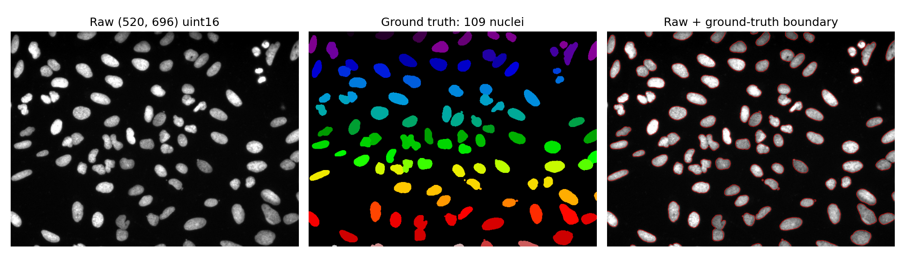
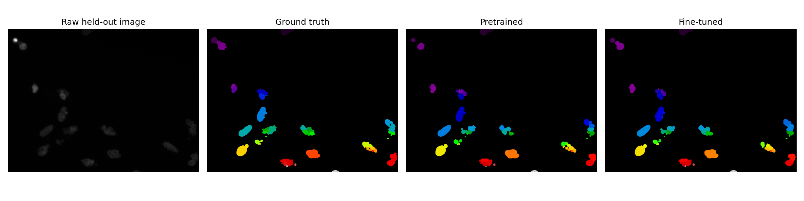
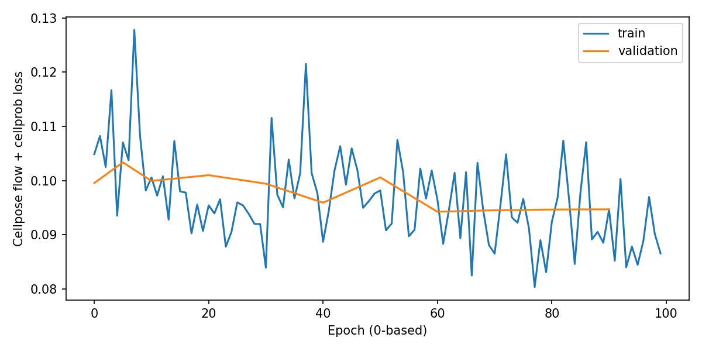
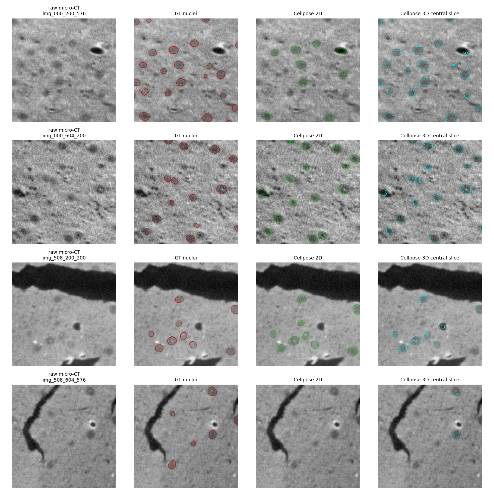

# Cellpose 최종 통합 보고서

기본 실험과 모든 후속 실험을 이 문서에 함께 수록했다. 다른 기본/후속 문서를 따로 읽을 필요 없이 아래 요약과 본문을 보면 된다.

## 1. 입력과 메모리 결론

이미지 → 핵/세포별 instance mask. cpsam_v2(약304.6M),영상개수와동시GPU타일개수를구분한다.

**목표는 메모리 할당80% 조건 확인**이다. 전체공유RAM121.688GiB의80%는약97.35GiB다. GPU-Util은별도연산활동지표이며이목표의성공판정에쓰지않는다.

|작업|관측메모리 peak GiB|공유RAM대비|해당 입력·배치·정밀도|80% 확인/제약|
|---|---|---|---|---|---|
|이미지 타일 추론|**43.397**|35.66%|실제520×696·1채널이미지32개→256×256타일384개동시처리. GPU입력384×1×256×256,BF16.|80% 미확인; 다음배치576은예상예약량guard로미실행|
|정답 마스크 기반 파인튜닝|**7.985**|6.56%|실제train16/val8/test16이미지. 학습GPU입력1×3×256×256(FP32),100epoch.|학습batch1 관측값; 학습batch확대 미실시|
|뇌 조직 3D 추가 추론|**1.491**|1.23%|NucMM-M micro-CT 192×192×192복셀4patch. tilebatch8·256타일,BF16,최종3D마스크후처리포함.|일반뇌MRI아님. AP50평균0.422; 기존타일network시간과범위다름|

메모리는PyTorch의경우CUDA allocated peak다. reserved는예약량으로별도다. **AlphaFold2는컴파일·warmup등을포함한JAX프로세스누적peak**이므로CUDA구간peak와같은정의로비교하지않는다. RSS와CUDA를더하지않는다. 표는시험한조건의관측값이며모델의절대최대나모든모델의80%달성을의미하지않는다.

## 2. 기본 정보·입력 검사·추론·학습·평가

## Cellpose-SAM: DGX Spark 실행 보고서

실행: `cellpose_20261027_193331_947064`. 상태: **complete**. 원본 측정: [summary.json](../results/cellpose_20261027_193331_947064/summary.json), 로그 (로컬 보관: `../results/cellpose_20261027_193331_947064/run.log`), [자원 시계열](../results/cellpose_20261027_193331_947064/resources.csv), [실제 forward 입력](../results/cellpose_20261027_193331_947064/forward_calls.json).

### 모델과 환경

Cellpose 4.2.1, 공식 기본 체크포인트 **cpsam_v2**, SAM ViT-L 기반 Cellpose-SAM이다. Cellpose3 cyto·CPDINO와 별개다. 전체 파라미터 304,628,930, requires_grad 304,592,064. 이론적 BF16 파라미터 저장량 0.567416 GiB.

체크포인트 revision: `7c61431b5fbb078f3296754bd15d9f51b320f837`; SHA-256: `0f1cc3f7ecdd8a037a57c6c48d9d8921391be4cbce3fa9f13c3e3a2e1253c667`. 공식 파일 메타데이터 `../models/repository_files.json`의 LFS oid와 대조해 일치했다. 데이터/모델 출처 목록은 `../data/sources.json`에 보존했다.

환경: {"python": "3.12.3 (main, Mar 23 2026, 19:04:32) [GCC 13.3.0]", "torch": "2.13.0a0+8145d630e8.nv26.06", "cuda": "13.3", "cellpose": "4.2.1", "gpu": "NVIDIA GB10", "platform": "Linux-7.0.0-1019-nvidia-aarch64-with-glibc2.39", "tf32": true}

8 CPU threads, seed42. 공식 trainer는 epoch별 NumPy seed를 epoch 번호로, 검증 때42로 설정한다. GPU 작업은 한 번에 하나씩 실행했다. PyTorch NGC 26.06 ARM64 전용 venv이며 기존 환경은 보존했다. BF16 추론, 공식 학습 API가 자동 변환하는 FP32 파인튜닝이다. TF32 허용은 Cellpose 공식 코드 기본값이다.

| 적재 상태 | CUDA allocated GiB | reserved GiB | RSS GiB | system available GiB |
| --- | --- | --- | --- | --- |
| 모델 적재 직후, 첫 입력 이전 | 0.568277 | 1.740 | 0.954 | 111.969 |

적재 시간 1.129초; 적재 중 allocator peak 1.718GiB. 이는 현재 적재량과 다르다. 첫 warmup 1.377초는 초기 kernel/Numba 준비와 후처리를 포함하며 정상 반복 성능 표에서 제외했다.

### 실제 데이터와 학습 입력

Broad BBBC039v1 공개 CC0 데이터: U2OS 세포의 Hoechst DNA 채널, 200장, uint16 흑백 TIFF 520×696. 공식 원본 이미지 분할 train100/validation50/test50에서 seed42로 16/8/16장을 선택했다. 원본 이미지 단계에서 분리한 뒤 학습 crop을 생성한다. 픽셀 크기(µm)는 확보한 메타데이터에서 확인되지 않아 N/A로 남긴다.

정답은 사람이 표시한 핵 instance PNG의 첫 채널을 공식 예제처럼 connected-component label로 변환했다. 0은 배경, 양의 정수는 개별 핵 ID이며 연속값 회귀 라벨이 아니다. 원본 영상·마스크 shape 일치, 유한값, 이미지 식별자 중복 및 split 분리를 확인했다. 전체200장에는 핵이 적은 영상도 있으나 선택한 학습16장은 모두 최소5개 기준을 충족한다.

| split | 선택 장수 | 첫 원본 ID | shape | dtype | 핵 수 | 픽셀 범위 |
| --- | --- | --- | --- | --- | --- | --- |
| training | 16 | IXMtest_B12_s9_w1ABE4C6B8-6110-4D7D-B782-94C43FDC2E1F | [520, 696] | uint16 | 109 | 119…3398 |
| validation | 8 | IXMtest_B12_s2_w19F7E0279-D087-4B5E-9899-61971C29CB78 | [520, 696] | uint16 | 120 | 125…3271 |
| test | 16 | IXMtest_A12_s7_w1EAEEA614-51ED-43B3-A4FF-088730911E4C | [520, 696] | uint16 | 69 | 112…3885 |

원본 2D grayscale은 실제 추론 forward에서 1채널로 유지된다(아래 실측 NCHW). 학습 API에서는 첫 채널 + 두 zero 채널로 변환된다. 1/99 percentile 정규화 후 float32 전처리, 추론 forward에서 BF16으로 변환한다. 학습은 영상과 flow label을 함께 random rotate/resize하여 실제 1×3×256×256 FP32 입력을 사용한다. 각 epoch마다 각 학습 이미지에서 crop을 하나 뽑는 정책이다.

실제 전체 선택 목록·파일 해시·마스크 경로: [input_audit.json](../data/input_audit.json). BBBC039는 DSB2018과 일부 겹치며 사전학습 Cellpose 데이터와의 중복 여부를 확정하지 못했다. 본 test는 이번 파인튜닝에서만 분리한 평가이며, 사전학습까지 완전히 독립적인 외부 성능이라고 주장하지 않는다.

### 입력 규모에 따른 GPU 사용률과 메모리

공식 eval 기본 타일 배치 상한8, tile256, overlap0.1, augment=False, diameter/rescale 없음, flow_threshold0.4, cellprob_threshold0, min_size15, max_size_fraction0.4, 동일 사전학습 체크포인트를 고정했다. 영상별로 순차 처리하며, 실제 batch는 타일 수에 따라8보다 작을 수 있다. 개수 비교는 같은 크기의 중첩1/4/16장, 크기 비교는 같은4장의 중심128/256/512 crop이며 native520×696 비교는 count4 행이다. crop은 확대보간하지 않은 부분 시야다.

| 조건 | 원본 H×W | 고유 장수 | 반복 | 초 | 장/초 | GPU 평균/최대 % | 시작 allocated GiB | peak GiB | 같은 run 증가 GiB | 실제 forward NCHW |
| --- | --- | --- | --- | --- | --- | --- | --- | --- | --- | --- |
| count_1 | [520, 696] | 1 | 23 | 15.296 | 1.504 | 91.3 / 95 | 0.600 | 1.491 | 0.892 | ['[4, 1, 256, 256]', '[8, 1, 256, 256]'] |
| count_4 | [520, 696] | 4 | 6 | 16.512 | 1.453 | 88.9 / 95 | 0.600 | 1.491 | 0.892 | ['[4, 1, 256, 256]', '[8, 1, 256, 256]'] |
| count_16 | [520, 696] | 16 | 2 | 22.150 | 1.445 | 89.6 / 95 | 0.600 | 1.491 | 0.892 | ['[4, 1, 256, 256]', '[8, 1, 256, 256]'] |
| crop_128 | [128, 128] | 4 | 55 | 15.266 | 14.411 | 78.3 / 86 | 0.600 | 0.705 | 0.106 | ['[1, 1, 256, 256]'] |
| crop_256 | [256, 256] | 4 | 17 | 15.284 | 4.449 | 89.5 / 95 | 0.600 | 1.046 | 0.446 | ['[4, 1, 256, 256]'] |
| crop_512 | [512, 512] | 4 | 8 | 16.350 | 1.957 | 79.8 / 95 | 0.600 | 1.491 | 0.892 | ['[1, 1, 256, 256]', '[8, 1, 256, 256]'] |

실제 타일 수는 이미지당128crop=1,256crop=4,512crop=9,520×696원본=12다. 입력 padding과 overlap 때문에256crop도4타일이 된다. 공식 소스의 padding 후 타일 정책을 그대로 사용했다.

각 조건 최소15초 동안 완전한 eval 반복을 실행했다. 고유 장수와 반복 처리량을 구분한다. 측정 시간은 메모리에 읽어둔 입력의 정규화·타일링·전송·모델 forward·flow dynamics·마스크 후처리를 포함하며 원본 디스크 읽기와 결과 파일 저장은 제외한다. forward 별도 시간은 CPU↔GPU 전송과 반환 변환을 포함한다. CUDA 경계는 synchronize했다. 반복 구간의 CUDA peak는 조건마다 reset하고 empty_cache 뒤의 실제 baseline을 함께 기록한다.

원본 디스크 읽기·개별 결과 파일 저장 시간은 별도 계측하지 않아 N/A다. warmup은 초기 준비 시간을 포함하며 독립적인 compile 시간은 분리되지 않았다. 학습 총시간에는 공식 checkpoint 저장이 포함되지만 저장만의 시간은 N/A다.

GPU-Util은 nvidia-smi의 장치 활동 시간 비율이며 최대 FLOPS나 메모리 사용률이 아니다. 0.5초 대기+조회 소요의 시계열에서 조회 전체가 조건 안에 들어간 표본만 집계했다. 장치 전체에는 디스플레이 영향이 포함될 수 있다. RSS/available은 sampled 값이며 정확한 순간 peak가 아니다. 별도 CSV에 reserved peak와 sampled RSS/available, forward 시간도 저장했다.

추론 최대 GPU-Util 95%; 80% 관측 여부: 관측됨. 추론 최대 allocated 1.491GiB는 전체 공유 RAM 121.688GiB의 1.23% 참고값이다. GPU 활동 시간 90%와 공유 RAM90% 사용은 다른 뜻이다. RSS와 CUDA 수치를 더하지 않는다. 이미지가 커져도 타일 입력은256×256으로 유지되며 타일 수·마지막 batch·후처리 비용이 변한다. 입력 개수 증가가 peak를 비례 증가시킨다고 해석할 수 없다.

### 정답 마스크 파인튜닝·검증·저장

공식 train_seg 경로, 전 학습 가능 구성의 AdamW(lr1e-5, weight_decay0.1), batch1, 100epochs, epoch당16장, rescale=False, scale_range0.5,256crop을 고정했다. 공식10epoch warmup과 마지막50epoch 감쇠를 사용했다. validation8장은 API의 test_data 인자에 넣었으며 최종 test16장은 학습에 넣지 않았다. 기본 min_train_masks5로 선택 학습 영상 모두 유지됐다.

완료 1600 optimizer steps, 총 672.75초(정답 flow 준비·검증·저장 포함). flow/정규화 준비 0.80초. 학습 진입 FP32 baseline 1.166GiB, fit peak 7.985GiB, 증가 6.819GiB. 전체 fit GPU 평균/최대 93.1/95%. 이 평균에는 flow 준비와 검증·저장도 포함한다.

실제 gradient를 관찰한 파라미터: {"parameters_with_gradient": 304394432, "names_without_gradient": ["encoder.patch_embed.proj.weight", "encoder.patch_embed.proj.bias"]}

일부 patch embedding은 공식 forward가 .data를 사용하므로 requires_grad=True여도 gradient가 없다. 실제 변경 예시(최대 절댓값): {"encoder.patch_embed.proj.weight": 0.0, "encoder.blocks.0.attn.qkv.weight": 0.001953125, "out.weight": 0.00390625}

저장 경로: `models/cellpose_20261027_193331_947064/models/cpsam_v2_bbbc039_finetuned`. 공식 trainer의 저장 가중치는 FP32이고 평가 시 BF16으로 복원한다. 별도 optimizer/RNG/epoch 상태도 저장했으나 중단 후 학습 재개는 검증하지 않았다.

| 동일 test16장 | 평균 AP@0.5 | AP@0.75 | AP@0.9 |
| --- | --- | --- | --- |
| 사전학습 | 0.9054 | 0.8545 | 0.5991 |
| 파인튜닝 | 0.9138 | 0.8515 | 0.5937 |

AP는 Cellpose instance matching의 TP/(TP+FP+FN)을 이미지별 계산한 평균으로 COCO mAP와 다르다. 작은 파인튜닝 subset과100epochs의 관찰 결과이며 향상을 보장하지 않는다. epoch 선택에 test 지표를 사용하지 않았다.

독립 새 프로세스 재로드 결과: {"checkpoint_sha256": "3acb3f69377a915bcd523e0eb5889b73674b8575a77d7c1e3c4a76c6ebfec360", "load_seconds": 1.168588638305664, "cellprob_max_abs_difference": 0.0, "flow_max_abs_difference": 0.0, "mask_exact_match": true, "independent_process": true, "shape": [520, 696], "passed": true}

### 재현과 한계

코드: `scripts/setup.py`, `prepare_inputs.py`, `benchmark.py`, `launch.py`, `reload.py`, `report.py`. 실행 명령과 로그는 각 run 폴더에 있다. 첫 실행의 결과 기록 함수 이름 충돌은 GPU 추론 이후 발생해 해당 실패 run을 보존하고 수정 후 새 run으로 재실행했다. 가중치 구간 다운로드 조립 크기 검증이 처음 실패해 기존 다운로드를 실제 종료하고 보존 prefix 길이에 맞춰 재조립했으며 최종 공식 SHA-256 일치로 검증했다.

데이터 선택·tile 정책을 고정한 단일 장비 단일 실행 관찰이다. GPU 연산 커널만의 순수 FLOPS, 다른 장비 대비 속도 향상, 광범위한 생물학적 일반화를 주장하지 않는다. 큰 이미지의 병목은 실제 타일 batch·메모리·시간을 바탕으로 해석하며, 확인하지 않은 원인은 추정으로 남긴다.

### 공식 출처

- [Cellpose 모델·tile 정책](https://cellpose.readthedocs.io/en/latest/models.html)
- [공식 학습 안내](https://cellpose.readthedocs.io/en/latest/train.html)
- [공식 소스](https://github.com/MouseLand/cellpose)
- [공식 체크포인트](https://huggingface.co/mouseland/cellpose-sam)
- [BBBC039 데이터 설명·분할](https://bbbc.broadinstitute.org/BBBC039)
- [공식 BBBC039 mask decoding 예](https://gist.github.com/jccaicedo/15e811722fca51e3ae90e8b43057f075)

## 3. 후속 실험 통합 — 배치 확대 및 자원 검증

## Cellpose-SAM 실제 이미지의 타일 배치별 추론 자원

실행 `tile_batch_20261028_134130_265230` · 상태 **complete** · 종료 사유 `predicted_reservation_exceeds_available_budget`

### 이미지 개수와 GPU 배치의 차이

원본BBBC039v1 이미지는200개, 각520×696·1채널·uint16이다. 각이미지를공식기본백분위정규화후float32 CPU배열로보관하고, padding·tile overlap0.1·256×256 고정타일·augment=False·resize없음을유지한다. 픽셀물리크기는확인되지않아입력검사에미확인으로표기했다. Cellpose-SAM cpsam_v2 BF16가중치이며기존체크포인트SHA256은원본summary에기록했다. Cellpose버전·Torch/CUDA·전체파라미터수·모델적재직후메모리는batch별summary에있다(기본모델304628930파라미터). BF16 가중치 이론용량은304628930×2bytes≈0.567GiB이며실측적재량과구분한다. 학습가능파라미터는이번추론에서0이다.

이미지당타일12개가생긴다. **batch8은원본이미지8개가아닌한번에타일최대8개**, 실제forward는8+4로분할된다. batch24는원본2이미지의24타일을동시에처리한다. 이미지내타일은서로겹치므로독립생물학적샘플24개라는뜻은아니다. 입력shape는실제 `[타일수,1,256,256]`,모델내부변환·중간표현메모리는별도다. 큰batch는실제여러이미지의타일을함께묶으며인공확대나같은타일복제는하지않는다. 최소2회·15초이상측정반복을하므로고유이미지수와총처리량을구분한다. 원본split메타데이터는유지하며자원pool에여러split을포함하지만학습이나조건별정확도선택은하지않았다.

### 측정 범위

공식 core.run_net의CPU타일링·padding·전송·networkforward·CPU반환·tileblending을포함한다. 입력정규화·모델로딩·warmup·mask dynamics·파일저장은제외한다. 따라서전체segmentation 처리시간이아닌타일네트워크추론구간이다. 기존작은배치전체mask추론과직접속도비교하지않는다. 모델·타일크기·dtype·전처리를고정하고각조건fresh container로allocator누적을분리했다. 각구간CUDA동기화,0.5초대기+조회시계열을사용한다. RSS와시스템가용량은sampled값이다.

|요청batch|실제최대타일batch|고유이미지|고유타일|반복|총처리타일|초|타일/초|모델적재GiB|allocated peak GiB|적재대비추가GiB|reserved peak GiB|공유RAM대비%|GPU평균/최대%|RSS sampled peak GiB|가용 sampled 최소GiB|
|---|---|---|---|---|---|---|---|---|---|---|---|---|---|---|
|8|8|1|12|24|288|15.542|18.531|0.568|1.491|0.923|1.783|1.226|91.069|95.0|1.781|110.113|
|12|12|1|12|23|276|15.117|18.258|0.568|1.938|1.369|2.354|1.592|93.714|95.0|1.648|109.92|
|24|24|2|24|12|288|15.393|18.709|0.568|3.276|2.707|4.104|2.692|94.321|95.0|1.787|108.071|
|48|48|4|48|6|288|16.113|17.874|0.568|5.949|5.381|7.549|4.889|87.733|95.0|1.84|104.572|
|96|96|8|96|3|288|16.575|17.376|0.568|11.299|10.731|14.486|9.285|85.29|96.0|1.911|97.392|
|192|192|16|192|2|384|20.291|18.924|0.568|21.998|21.43|28.361|18.078|88.0|96.0|2.102|82.89|
|384|384|32|384|2|768|41.396|18.552|0.568|43.397|42.828|56.113|35.662|89.84|96.0|2.661|54.578|

### 결과와 검증

시험한최대성공타일batch **384**. allocated80%도달: False,90%도달: False. 다음예상예약량과가용RAM16GiB·swap증가2GiB guard에의해확대를중단한다. 건너뛴batch는실제실패나모델절대한계가아니다.

출력flow/cellprob은전체이미지에재조립돼[N,520,696,3]이며각반복전체finite를확인했다. 첫이미지출력은저장후정확재로드를검증한다. batch8의전체공식model.eval과flow값일치를검증하고실제instance mask도저장했다. 다른batch의첫이미지flow차이·cosine은각summary에보존하며BF16의batch별수치차이를비트단위동일성으로표현하지않는다. 새학습·독립정확도평가를한실험은아니며기존학습/정답mask평가결과는기본보고서에있다.

GPU-Util은GPU활동시간비율,allocated/reserved는프로세스PyTorchallocator다. 분모121.688GiB는CPU/GPU공유RAM으로전용VRAM점유율과다르며RSS와CUDA를더하지않는다. 모델적재기준값과추가메모리는같은run에서구분했다. 정확한입력·출력·실제forwardshape·로딩/warmup시간·환경·메모리시계열·명령·로그·종료코드는원본결과폴더에저장했다.

원본 `results/tile_batch_20261028_134130_265230` · 실행코드 `scripts/batch_followup`

[공식 모델](https://cellpose.readthedocs.io/en/latest/models.html) · [공식 배치/타일 API](https://cellpose.readthedocs.io/en/latest/api.html) · [기본 Cellpose 결과](Cellpose.md)

## 4. 후속 실험 통합 — 뇌 조직 2D·3D 검증

## Cellpose-SAM 추가 검증: 생쥐 뇌 조직의 세포핵

상태 **complete** · 실행 `brain_nucmm_20261029_110603_965442`

### 어떤 뇌 이미지인가?

NucMM-M의생쥐시각피질 **마이크로CT** 공개train/val패치다. 일반적인임상뇌MRI/CT의뇌영역·종양분할과제와다르며,과제는뇌조직안의**개별세포핵instance분할**이다. 기존U2OS형광이미지와촬영방식·입력구조가다르다.

원본연구프로젝트·README_original.txt와실제HDF5를대조했다. 배포미러README.md에는EM/200³라는잘못된설명이있지만원본설명은micro-CT/192³이고실제8파일shape도192³로확인됐다. 미러HF리비전5c489be7532664b14d90f4c028c6b2f9b6fcd782와파일별URL/SHA256·두README를data/brain_nucmm/download_manifest.json에보존했다. 원본GoogleDrive와byte동일성은독립적으로검증하지않았으며실제다운로드출처는공개미러임을명시한다.

|원본분할|고유3D패치|패치당shape|원본dtype|정답|
|---|---|---|---|---|
|train|4|192×192×192|uint8|uint16,핵별instance ID|
|val|4|192×192×192|uint8|uint16,핵별instance ID|

전체8volume은1536개원본슬라이스에해당하지만5000개독립뇌영상이아니다. 2D평가는val각volume중앙1장씩총4장,3D평가는val4volume전체총768슬라이스를사용한다. 모든패치가같은parent뇌volume에서나왔으며독립donor/test는아니다. 실제물리voxel크기·해부학적축방향은확인되지않았다. 계산시배열축Z/Y/X,anisotropy1을가정하므로물리보정된정확도주장으로해석하지않는다.

### 모델·전처리·검증 정책

기존Cellpose4.2.1 cpsam_v2 체크포인트를그대로사용했다. 전체304628930파라미터,학습갱신0,BF16가중치·공식FP32흐름/CPU전처리·TF32=False·seed42. 같은run의모델적재직후allocated/reserved·RSS·MemAvailable과SHA256은summary에있다. 추가파인튜닝은수행하지않았다.

tile256×256·tilebatch8·overlap0.1·augment=False·resize/diameter변경없음·공식백분위정규화·flow_threshold0.4·cellprob_threshold0·min_size15·max_size_fraction0.4를고정했다. 원본핵은배경보다어두워**train4패치의정답영역/배경평균만으로invert=True를선택**했다. 검증정답으로조건을선택하지않았다. train분할은가중치학습에쓰지않고이정책확인·2Dwarmup에만사용했다.

2D는중앙단면별정규화와최종mask생성을포함하고,3D는공식do_3D=True 경로로직교방향network추론후3D흐름/마스크를생성했다. 3D의flow_threshold동작은공식경로를따르며2D와같은기능이라고가정하지않는다. 원본192×192평면은network입력에맞게padding되며256×256타일입력과구분한다. 실제forwardshape·타일처리수는forward_calls.json과각행에보존했다.

### 전체 segmentation 시간과 자원

시간은입력배열이CPU에준비된후정규화·타일링·전송·networkforward·재조립·**최종마스크후처리까지포함**한다. 다운로드/HDF5변환·모델로딩·입력검사·평가지표·파일저장은제외한다. 2D는train중앙단면warmup후15초이상반복했고,3D는volume당1회측정으로첫3D설정비용도포함한다. network·mask단계는CUDA동기화로따로계측했다. 기존후속타일forward시간과직접비교하지않는다.

|조건|고유입력|반복|전체초|network초|mask후처리초|allocated peak GiB|reserved peak GiB|GPU평균/최대%|RSS sampled peak GiB|가용 sampled 최소GiB|
|---|---|---|---|---|---|---|---|---|---|---|
|2d_central_validation_slices|4|59|15.1835|12.8156|1.9246|0.7054|0.7363|75.931|87.0|2.2465|111.5072|
|3d_img_000_200_576|1|1|28.7865|28.2204|0.2124|1.4914|1.7832|92.9245|96.0|2.5235|110.3805|
|3d_img_000_604_200|1|1|28.6605|28.1252|0.1728|1.4914|1.7852|90.7358|96.0|2.5215|110.363|
|3d_img_508_200_200|1|1|28.692|28.164|0.1704|1.4914|1.7832|89.1509|96.0|2.5214|110.3917|
|3d_img_508_604_576|1|1|28.7559|28.2129|0.1655|1.4914|1.7832|92.1698|96.0|2.5215|110.3909|

GPU-Util은커널활동시간비율이며메모리점유율이아니다. CUDAallocated/reserved는프로세스allocator,전체121.688GiB는CPU/GPU공유RAM이다. RSS와CUDA를더하지않는다. 시스템가용량·RSS는0.5초대기+조회간격의sampled값이다. 가용8GiB미만/swap+2GiBguard를사용한다.

### 정답 마스크 대비 평가

|조건/패치|GT핵수|예측핵수|AP50|AP75|AP90|
|---|---|---|---|---|---|
|2d/img_000_200_576|23|9|0.3333|0.1852|0.0|
|2d/img_000_604_200|14|15|0.6111|0.2609|0.0357|
|2d/img_508_200_200|11|9|0.8182|0.3333|0.1111|
|2d/img_508_604_576|6|0|0.0|0.0|0.0|
|3d/img_000_200_576|282|314|0.6329|0.0643|0.0|
|3d/img_000_604_200|192|176|0.5593|0.1185|0.0|
|3d/img_508_200_200|101|78|0.2878|0.0783|0.0|
|3d/img_508_604_576|88|51|0.2087|0.0451|0.0|

3D평가는3D instance IoU,2D평가는해당단면의instance IoU를사용한다. GT의비연속ID는object를합치지않고연속재번호화했으며원래ID매핑을저장했다. AP는TP/(TP+FP+FN)인Cellpose instance평가지표다. pLDDT같은신뢰도나영상단위분류정확도가아니다. 평가4volume/같은parent뇌·외부사전학습데이터중복불확실성때문에임상/전체뇌일반화성능을입증하지않는다. 부정확한예측은정확히보고하고이미지예시와함께확인한다.

### 실제 입력·정답·예측 예시

### 보관 파일

원본HDF5·다운로드SHA/리비전·입력검사·정규화선택근거는data/brain_nucmm. 결과run에는원본코드snapshot·명령·exit·로그·GPU/RAM CSV·stage/forward계측·2D/3D마스크·flow/cellprob·원본GT ID·평가JSON·예시PNG를보존한다. 저장마스크는재로드해정확히같음을확인했다. 새모델을학습하지않아새학습체크포인트나학습재개를검증했다는주장은하지않는다.

[NucMM 원본 연구/데이터 설명](https://connectomics-bazaar.github.io/proj/nucMM/index.html) · [실제 배포 미러](https://huggingface.co/datasets/MedOtter/NucMM-M) · [Cellpose 공식 API](https://cellpose.readthedocs.io/en/latest/api.html)

## 기록 해석

본문의과거완료표시는해당run의실행·저장상태이다. 사용자목표인80%메모리도달여부는이문서첫표를우선한다. 미도달/미확인을불가능으로해석하지않으며,학습미실시·데이터pool제한·예상예약guard·실패run을완료된성공조건과구분한다.
