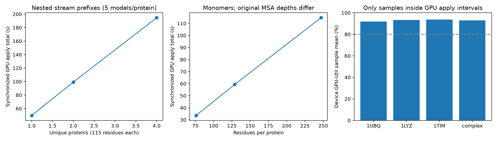

# AlphaFold2 — ColabFold 최종 통합 보고서

## 1. 모델과 실제 입력

단백질 서열과 MSA → 3D 원자좌표·신뢰도. 단량체 PTM과 Multimer를기본보고서에서구분한다.

실제파일·입력/정답예시·전처리와모델구조설명은이문서5절에전문을포함했다. 추론데이터와지도학습label을구분하며,세포/유전자·서열/토큰·이미지/타일의단위를섞지않는다.

## 2. 실행 조건과 측정 기준

표의실제batch·입력shape·정밀도·epoch/step를먼저확인한다. GPU-Util은연산활동시간비율이고,메모리목표80%는약97.35GiB allocated다. 모델별학습범위(전체/부분/head-only/처음부터학습/용량probe)를같은학습으로가정하지않는다. 같은run의시간·메모리를사용하고예측정확도가미평가이면그대로표시한다.

## 3. 조건별 추론·학습 결과 — 한 표

아래시간은각원본조건의실측값이다. 조건별포함/제외범위는4~5절과원본기록에서확인한다. 대부분PyTorch CUDAallocated peak이나AlphaFold2는컴파일/warmup포함JAX프로세스누적peak다. RSS와CUDA를독립메모리처럼더하지않는다.

|작업|실제 입력·고유 데이터 수|동시 GPU batch·모양|학습량/반복|측정시간|처리량/step 참고|최대 메모리 / 공유RAM대비|성능·80% 상태|
|---|---|---|---|---|---|---|---|
|실험적JAX vmap 추론|서로다른실제단백질1개,각115AA+기존MSA|batch1,model_1,FP32|3recycle/초기포함4pass;2회|22.85초|0.0875단백질/초|2.162 GiB / 1.78%|JAX프로세스누적peak(컴파일/warmup포함);PDB검증;80%미도달|
|실험적JAX vmap 추론|서로다른실제단백질2개,각115AA+기존MSA|batch2,model_1,FP32|3recycle/초기포함4pass;2회|44.39초|0.0901단백질/초|2.158 GiB / 1.77%|JAX프로세스누적peak(컴파일/warmup포함);PDB검증;80%미도달|
|실험적JAX vmap 추론|서로다른실제단백질4개,각115AA+기존MSA|batch4,model_1,FP32|3recycle/초기포함4pass;2회|90.66초|0.0882단백질/초|2.308 GiB / 1.90%|JAX프로세스누적peak(컴파일/warmup포함);PDB검증;80%미도달|
|학습|이번환경미실시|—|—|미실시|—|미측정|전체학습파이프라인실행완료로표현하지않음|

## 4. 결과 해석

같은실행경로에서batch를늘린행끼리메모리와처리량을비교한다. 전체고유데이터수와반복처리건수는다르다. 추론·학습·후처리의측정시간범위가다르면단순속도순위로해석하지않는다. 현재80%에도달한조건을이모델에서확인한것은아니며데이터pool한계·예상guard와실제실패를구분해본문에남겼다. 위주표에는동일조건의시간·메모리만연결했고미실시평가를성능성공으로표현하지않는다.

## 5. 실험 방법·입력 예시·기본/후속·평가·저장 상세


### AlphaFold2 — ColabFold를 통한 실행: DGX Spark 검증


작성 시각: 2026-10-27T18:23:34+09:00

#### 완료 범위와 주요 결과

기존 ColabFold 1.6.2 ARM64 이미지·가중치를 재사용해 단일체 7개 × 5개 모델 = 35개 구조와 복합체 1개 × Multimer v3 모델 5개 = 5개 구조를 실제 GB10에서 순차 예측했다. 모든 실행은 별도 호스트 run 폴더에 저장했으며 단일체와 복합체 GPU 작업을 겹치지 않았다. PDB·신뢰도 JSON·MSA·좌표의 유한값과 실제 서열을 검증했다. 구조 예측용 ColabFold 경로를 사용했으므로 공식 전체 AlphaFold2 데이터베이스 검색 파이프라인과 구분한다.

개수 비교는 동일 115 잔기 단백질 4개를 한 스트림으로 처리하고, 첫 1/2/4개 중첩 prefix를 집계했다. 조건별 독립 재실행이나 동일 입력 반복 측정이 아니다. 길이 비교는 76/129/247 잔기 실제 단백질을 사용한다. MSA는 각각 따로 준비하고 실제 깊이 차이를 공개한다. GPU 80%를 맞추기 위한 배치·정밀도 sweep은 하지 않았다.

#### 입력 전 모델 적재와 실행 메모리 비교

같은 이미지와 TF_FORCE_UNIFIED_MEMORY=1, XLA_PYTHON_CLIENT_MEM_FRACTION=4.0, preallocation=False 조건에서 모델만 로딩했다. 5개 weight set을 한꺼번에 보관하되 추론은 하나씩 한다. Loader 종료 시에는 초기 runner parameter 사본이 추가로 남을 수 있어, 첫 weight set을 선택하고 사용하지 않는 참조를 해제한 **입력 forward 직전 ready 상태**도 따로 측정했다. JAX bytes_in_use 기준이다.

| preset | loader 직후 allocated GiB | 첫 모델 선택 후 ready GiB | loading peak GiB | RSS 적재 후 GiB |
| --- | --- | --- | --- | --- |
| alphafold2_ptm | 2.178 | 1.817 | 2.186 | 3.556 |
| alphafold2_multimer_v3 | 2.178 | 1.801 | 2.218 | 3.379 |

| 실제 입력 | GPU 평균 / 최대 % | 모델 ready 기준 GiB | 실행 시작 후 누적 allocator peak GiB | 참고 차이 GiB |
| --- | --- | --- | --- | --- |
| 1UBQ (76 residues) | 91.85 / 94 | 1.817 | 2.166 | 0.349 |
| count1_A2RU14 (115 residues) | 92.88 / 95 | 1.817 | 2.273 | 0.456 |
| count2_A6NFY7 (115 residues) | 92.82 / 94 | 1.817 | 2.273 | 0.456 |
| count3_O14519 (115 residues) | 91.55 / 95 | 1.817 | 2.273 | 0.456 |
| count4_P01270 (115 residues) | 91.36 / 95 | 1.817 | 2.273 | 0.456 |
| 1LYZ (129 residues) | 93.33 / 95 | 1.817 | 2.307 | 0.490 |
| 1TIM (247 residues) | 93.67 / 95 | 1.817 | 2.706 | 0.889 |
| 3G5O_A_3G5O_B (180 residues) | 92.92 / 95 | 1.801 | 2.170 | 0.369 |

차이는 다른 run의 ready 상태를 기준으로 계산한 참고값이다. 실행 peak는 프로세스 시작 후 누적치이며 현재 query 자체의 activation peak만 뜻하지 않는다. 모델은 추론만 했으므로 자체 학습 데이터 예시가 없고, FASTA/MSA가 입력이며 정답 PDB는 평가용이다.

#### 환경과 실행 조건

| 항목 | 단일체 | 복합체 |
| --- | --- | --- |
| 이미지 | ghcr.io/sokrypton/colabfold:1.6.2-cuda13 | 동일 이미지 |
| digest | sha256:c9eab0253fe324b7ec2ec644607141539d7580a4e88d1d3788abba8c92d61ef1 | 동일 |
| GPU / 아키텍처 | NVIDIA GB10 / ARM64 | 동일 |
| Python / JAX / jaxlib | 3.12.12 / 0.10.2 / 0.10.2 | 동일 |
| NumPy / Haiku | 2.5.1 / 0.0.16 | 동일 |
| 모델 preset | alphafold2_ptm | alphafold2_multimer_v3 |
| 순차 weight set 수 | 5 (model_1~5) | 5 (model_1~5) |
| 실행 파라미터/tree (각 model) | 92,907,930 | 93,223,705 |
| 학습 가능 / 학습 수행 | 0 / 추론만 수행 | 0 / 추론만 수행 |
| recycle | 3 (최초 pass 포함 4회) | 20 (최초 pass 포함 21회) |
| 조기 중단 tolerance | 0.0 (비교를 위해 고정) | 0.0 (고정) |
| ensemble / seed | 1 / 42, seed 수 1 | 동일 |
| MSA 정책 | MMseqs2 UniRef + environmental | unpaired_paired, greedy |
| MSA 모델 capacity | 512 clustered + 5120 extra | 508 clustered + 2048 extra |
| 정밀도 | BF16 계산, FP32 weights, FP16 recycle buffers/출력 변환 | 동일 혼합 정밀도 정책 |
| template / dropout / relaxation | 모두 비활성화 | 모두 비활성화 |
| compile mode / Pallas | tuned / False | 동일 |
| 배치 | 단백질 1개씩, weight set 5개를 순차 실행 | 복합체 1개씩, weight set 5개를 순차 실행 |
| JAX preallocation | False | False |
| JAX backends | cuda,cpu: CPU feature 준비 + GPU forward | 동일 |

일반적인 ColabFold 기본 5개 모델·기본 BF16 경로를 사용했다. 단일체 recycle 3과 Multimer v3 recycle 20을 명시하고 tolerance를 0으로 고정했다. 모델별 기본 recycle이 다르므로 단일체와 복합체 시간을 같은 길이 효과로 직접 비교하지 않는다. BF16은 전체 배열이 BF16이라는 뜻이 아니다. GPU 메모리를 채우기 위한 정밀도 변경은 하지 않았다.

기존 모델·이미지·가중치·scGPT 컨테이너를 변경하지 않았다. Docker 그룹 등록은 사용자가 수행했고 현재 명령은 sg docker로 등록된 그룹을 적용했다. 가중치는 read-only `/cache`, 결과는 host bind `/work`에 저장했다. 예측 컨테이너는 network none이므로 MSA API 시간과 GPU 예측을 분리했다.

#### 입력·MSA·출처 확인

| 입력 | 원본/실제 residues | 원본 A3M 행 | 실제 feature residue 축 | MSA tensor shape | truncation |
| --- | --- | --- | --- | --- | --- |
| 1UBQ | 76 | 21577 | 86 | [4, 512, 86] | 없음 |
| count1_A2RU14 | 115 | 568 | 125 | [4, 512, 125] | 없음 |
| count2_A6NFY7 | 115 | 2382 | 125 | [4, 512, 125] | 없음 |
| count3_O14519 | 115 | 1295 | 125 | [4, 512, 125] | 없음 |
| count4_P01270 | 115 | 971 | 125 | [4, 512, 125] | 없음 |
| 1LYZ | 129 | 5508 | 139 | [4, 512, 139] | 없음 |
| 1TIM | 247 | 16469 | 247 | [4, 512, 247] | 없음 |
| 3G5O_A_3G5O_B | 180 | 21350 | 180 | [3072, 180] | 없음 |

개수용 UniProt 단백질은 ESM-2 단계에서 확보한 UniProtKB reviewed 2026_03 원본을 재사용했으며 서로 다른 고유 서열 4개를 검사했다. 모두 115 residues지만 MSA의 깊이·내용은 다르다. 길이용 FASTA와 실험 구조는 RCSB PDB 1UBQ/1LYZ/1TIM의 공개 데이터를 확보했다. 복합체는 ColabFold v1.6.2 공식 test-data/complex/input.csv의 3G5O A/B 예제(93+87 residues)이며, RCSB 전체 construct에 있는 tag 일부가 생략된 입력이다. 3G5O의 전체 biological assembly를 모두 예측한 것이 아니다.

A3M에서 소문자 insertion을 제외한 alignment column 수와 첫 query가 원본 입력과 일치하는지 확인했다. 표의 A3M 행은 검색 결과의 저장 행이고 feature 구성 과정의 중복 제거 후 깊이는 events.jsonl의 raw_feature_shapes에 따로 기록된다. 단일체 feature는 4개 recycle용 입력 축과 512 clustered/5120 extra capacity로 padding된다. 복합체는 원본 alignment와 모델 내부 sampled MSA capacity를 구분해야 한다. dummy template tensor가 존재해도 실제 template 정보는 사용하지 않는다. 실제 모델 입력의 shape·dtype는 events.jsonl에 보존했다.

#### 실제 입력·출력 예

```text
>1UBQ
MQIFVKTLTGKTITLEVEPSDTIENVKAKIQDKEGIPPDQQRLIFAGKQLEDGRTLSDYNIQKESTLHLVLRLRGG

ATOM      2  CA  MET A   1      -5.727 -12.086   3.102  1.00 95.56           C  
```

저장된 1UBQ 1위 구조: `/home/hyein/ai-benchmark/colabfold/results/af2_20261027_172813_247681/predictions/1UBQ_unrelaxed_rank_001_alphafold2_ptm_model_4_seed_042.pdb`. 점수 JSON의 pLDDT 첫 5개 값은 [95.56, 97.81, 98.56, 98.56, 98.5], pLDDT shape=[76], PAE shape=[76,76]이다. PDB의 B-factor 필드는 예측 pLDDT를 기록하며 실험 B-factor가 아니다.

#### 시간·자원 계측 방법

기존 RunModel의 JIT apply를 의미가 같은 lower(...).compile()과 compiled callable 호출로 나누어 컴파일 시간을 측정했다. 새로운 shape에서만 AOT 컴파일하며 같은 shape·dtype·PyTree 구조의 다음 호출에는 실행 파일을 재사용했다. 매 GPU apply 결과에 jax.block_until_ready를 적용했다. GPU apply는 forward 1회이며 recycle과 model 개수를 합쳐 집계한다. CPU feature 구성, pLDDT/pTM·JSON/PDB 후처리, MSA API, 컴파일과는 범위가 다르다. 최초 shape의 첫 apply는 cold kernel 실행이며 포함한 상태로 보고한다. 별도 인위적 warmup을 수행하지 않았고 단일 프로세스 측정이다.

0.5초 간격으로 nvidia-smi GPU-Util, 프로세스 RSS, 시스템 MemAvailable·swap을 수집했다. 평균·최대는 조회 시작과 종료가 모두 GPU apply 구간 안에 있는 표본만 집계한다. 장치 전체 GPU-Util에는 디스플레이·브라우저 부하가 포함될 수 있으며 FLOPS나 SM occupancy 비율이 아니다. 각 apply 경계의 짧은 표본은 제외돼 표본 수가 단순 시간/0.5와 다를 수 있다.

JAX memory_stats의 peak_bytes_in_use는 프로세스 시작 후 누적 최고치이며 query별로 초기화하지 않았다. per-query 표는 이를 명확히 구분한다. 실제 apply 반환 시점의 live allocation도 별도 JSON에 기록했다. Compile memory_analysis는 정적 buffer 분석으로 실제 allocator peak와 다르다. TF_FORCE_UNIFIED_MEMORY=1, XLA_PYTHON_CLIENT_MEM_FRACTION=4.0은 기존 ColabFold 코드가 적용하는 설정이며 bytes_limit가 물리 RAM의 4배로 표시돼도 이를 전용 VRAM 용량이나 점유율 분모로 사용하지 않았다. Spark의 공유 DRAM에서 RSS와 CUDA/JAX 수치를 더하지 않았다. nvidia-smi 장치 memory 사용량은 Not Supported이므로 N/A다.

#### 개수 증가: 동일 길이 115 residues, 스트림 누적 prefix

| 고유/처리 입력 | 구조 수 | GPU apply 수 | GPU 실행 합계 s | protein/s | GPU 평균/최대 % | 표본 수 |
| --- | --- | --- | --- | --- | --- | --- |
| 1 / 1 | 5 | 20 | 49.700 | 0.02012 | 92.88 / 95 | 95 |
| 2 / 2 | 10 | 40 | 99.317 | 0.02014 | 92.85 / 95 | 195 |
| 4 / 4 | 20 | 80 | 194.667 | 0.02055 | 92.16 / 95 | 383 |

| 입력 수 | query wall 합계 s | 컴파일 s (wall에 포함) | JAX 누적 peak GiB | RSS sampled peak GiB | MemAvailable 최소 GiB |
| --- | --- | --- | --- | --- | --- |
| 1 | 58.289 | 7.710 | 2.273 | 5.420 | 109.224 |
| 2 | 108.738 | 7.710 | 2.273 | 5.576 | 109.224 |
| 4 | 205.893 | 7.710 | 2.273 | 5.604 | 109.132 |

모든 prefix는 같은 125 padded residue 축과 같은 MSA capacity로 처리됐다. 첫 115-residue query가 새 shape 컴파일 비용을 부담하고 뒤 query는 재사용한다. 따라서 query wall 차이와 GPU apply 시간을 구분한다. 고유 입력 1/2/4는 한 번 실행한 스트림의 중첩 집계이므로 독립 반복 실행의 평균이나 신뢰구간을 의미하지 않는다. 개수 증가에 따라 순간 GPU 메모리와 사용률이 비례해서 증가한다고 해석하지 않는다.

#### 단일체 길이 비교와 복합체 개별 결과

| 입력 | 길이 | GPU apply s | 컴파일 s | query wall s | GPU 평균/최대 % | 표본 수 |
| --- | --- | --- | --- | --- | --- | --- |
| 1UBQ | 76 | 33.637 | 8.366 | 43.253 | 91.85 / 94 | 65 |
| 1LYZ | 129 | 59.395 | 9.292 | 69.709 | 93.33 / 95 | 120 |
| 1TIM | 247 | 114.715 | 11.483 | 127.518 | 93.67 / 95 | 226 |
| 3G5O_A_3G5O_B | 180 | 334.304 | 19.504 | 357.369 | 92.92 / 95 | 660 |

| 입력 | JAX 누적 peak GiB | apply 반환 live 최대 GiB | RSS sampled peak GiB | MemAvailable 최소 GiB | swap bytes |
| --- | --- | --- | --- | --- | --- |
| 1UBQ | 2.166 | 1.794 | 4.968 | 109.909 | 0 |
| 1LYZ | 2.307 | 1.804 | 5.884 | 108.882 | 0 |
| 1TIM | 2.706 | 1.837 | 6.862 | 107.214 | 0 |
| 3G5O_A_3G5O_B | 2.170 | 1.818 | 5.119 | 109.463 | 0 |

단일체 길이가 증가하면서 실행 시간이 증가했다. 서로 다른 단백질과 MSA 깊이를 사용했으므로 완전한 길이 단독 인과 실험은 아니다. MSA와 template·모델·정밀도 정책은 고정했으며 실제 padding과 MSA shape를 공개했다. 복합체는 다른 Multimer v3 체크포인트와 20 recycles를 사용하므로 180 길이를 단일체 길이 곡선에 섞지 않았다. 단일체·복합체 모두 지원되는 작은 입력에서 이미 GPU 평균 80%를 넘었고 더 큰 입력으로 사용률을 억지로 맞추지 않았다.


#### MSA·모델 로딩·컴파일·실행·저장 구분

| 실행 | MSA 준비 wall s | 모델 로딩 s | 컴파일 s | GPU apply s | pipeline wall s | 컨테이너 포함 wall s |
| --- | --- | --- | --- | --- | --- | --- |
| 단일체 7개 | 57.020 | 2.396 | 36.852 | 402.414 | 454.267 | 456.572 |
| 복합체 1개 | 20.187 | 3.789 | 19.504 | 334.304 | 362.510 | 364.547 |

MSA wall에는 컨테이너 시작·API 대기/다운로드·MSA 저장·일부 전처리/coverage 그림이 포함돼 순수 검색 서버 계산 시간이 아니다. GPU 예측에서는 저장된 A3M을 재사용했고 네트워크 접근은 차단했다. pipeline wall은 로딩·전처리·컴파일·GPU·후처리·모든 파일 저장을 포함한다. query wall은 predict_structure 단위로 그 앞의 raw MSA 파싱·일부 feature 생성과 global 모델 로딩을 제외한다. 파일 쓰기 이벤트는 PDB/JSON/A3M text write 시간의 하한이며 PNG·ranking rename·모든 serialization을 완전 분리한 저장 시간은 N/A다. Relaxation은 0회로 실행하지 않았다. 서로 다른 계측 범위를 직접 속도 개선으로 비교하지 않는다.

#### 구조 검증과 정확도 해석

| 1위 구조 | pLDDT 평균 | pTM | CA RMSD Å | CA-only lDDT | 정렬 CA 수 |
| --- | --- | --- | --- | --- | --- |
| 1UBQ | 95.96 | 0.840 | 0.801 | 0.982 | 76 |
| count1_A2RU14 | 86.08 | 0.520 | N/A | N/A | N/A |
| count2_A6NFY7 | 74.01 | 0.530 | N/A | N/A | N/A |
| count3_O14519 | 71.37 | 0.450 | N/A | N/A | N/A |
| count4_P01270 | 70.26 | 0.310 | N/A | N/A | N/A |
| 1LYZ | 98.20 | 0.910 | 0.546 | 0.949 | 129 |
| 1TIM | 96.49 | 0.940 | 1.044 | 0.885 | 247 |

| 복합체 1위 항목 | 결과 |
| --- | --- |
| pLDDT 평균 | 94.59 |
| pTM / ipTM | 0.890 / 0.880 |
| 사슬 A CA RMSD Å / aligned CA | 1.286 / 91 |
| 사슬 B CA RMSD Å / aligned CA | 1.460 / 81 |
| 전체 정렬 CA RMSD Å | 1.598 |
| 전체 정렬 CA-only lDDT | 0.969 |

모든 구조에서 CA 서열이 입력과 일치하고 좌표·pLDDT·PAE가 유한하며, pLDDT [L], PAE [L,L]을 검사했다. 정답 구조 대비 수치는 global sequence alignment로 대응 CA를 선정한 후 Kabsch RMSD와 CA-only lDDT(15Å 이내 쌍, 0.5/1/2/4Å 기준)를 계산했다. CA-only lDDT를 공식 all-atom lDDT나 자체 예측 pLDDT와 동일시하지 않는다. pLDDT/pTM/ipTM은 신뢰도이며 정답 구조 대비 정확도와 별개다.

3G5O reference는 PDB A/B 사슬이며 query에 생략된 tag와 실험 구조의 missing residue가 있어 alignment 범위를 명시했다. 전체 complex 정렬은 고정된 A/B 순서의 concatenated sequence 대응을 사용한 sanity check이며 DockQ나 CAPRI 평가를 수행하지 않았다. 이 단백질들은 오래된 공개 PDB 구조로 학습 데이터와의 독립성을 입증하지 못한다. 따라서 정상 작동 확인용 구조 일치 결과이며 신규 단백질 일반화 성능을 입증하는 독립 benchmark가 아니다.

원본 NPZ 파라미터 수: PTM model_1/2는 각각 93,237,338개, model_3/4/5는 각각 92,907,930개, Multimer v3는 각각 93,223,705개다. 실제 추론에 전달한 tree 수와 원본 전체를 구분한다. 표의 학습 가능 0은 이 실행에서 optimizer가 갱신한 대상이 없다는 뜻이며 모든 weight가 수학적으로 미분 불가능하다는 뜻이 아니다. MSA 서버의 정확한 데이터베이스 revision은 확인하지 못해 N/A로 남긴다.

#### 학습·저장·재현 상태

현재 ColabFold CLI와 호출한 RunModel 경로는 구조 추론용이다. optimizer·훈련 loop·지도학습 split을 구성하지 않았고 파인튜닝을 수행하지 않았다. is_training 인자가 존재하는 것만으로 이 실행에서 지원되는 완성형 학습 workflow가 있다고 표현하지 않는다. 새 학습 checkpoint·optimizer·재개 학습·학습 모델 재로드는 N/A다. 기존의 공식 가중치를 재사용했고 출력 PDB·JSON을 새 CPU 프로세스에서 다시 읽어 저장 결과를 검증했다.

최초 단일체 시도는 JAX_PLATFORMS=cuda만 지정해 CPU 전처리 backend가 비활성화돼 실패했다. ColabFold의 일반적인 "Not Enough GPU memory?" 로그와 달리 실제 예외는 "Unknown backend cpu"였고 OOM이 아니었다. 실패 run과 로그를 보존한 뒤 cuda,cpu로 수정해 새 run에서 성공했다. GPU 실행은 dev=cuda:0와 실제 JAX GPU apply로 확인했다.

#### 저장 경로와 실행 방법

| 항목 | 호스트 경로 |
| --- | --- |
| 단일체 run | /home/hyein/ai-benchmark/colabfold/results/af2_20261027_172813_247681 |
| 복합체 run | /home/hyein/ai-benchmark/colabfold/results/af2_multimer_20261027_181640_431467 |
| 단일체 MSA | /home/hyein/ai-benchmark/colabfold/results/msa_20261027_172359_775627 |
| 복합체 MSA | /home/hyein/ai-benchmark/colabfold/results/msa_complex_20261027_173649_931405 |
| 환경·원본 source | /home/hyein/ai-benchmark/colabfold/results/environment_verified |
| 입력·정답 PDB | /home/hyein/ai-benchmark/colabfold/data |
| 기존 가중치 | /home/hyein/ai-benchmark/colabfold/cache/colabfold/params |
| 계측 코드 | /home/hyein/ai-benchmark/colabfold/scripts/benchmark_af2.py |
| CPU 구조 검증 | /home/hyein/ai-benchmark/colabfold/scripts/validate_structures.py |
| 비교 CSV / metrics JSON | /home/hyein/ai-benchmark/colabfold/reports/comparison.csv / metrics.json |
| weight SHA-256 / NPZ 파라미터 | /home/hyein/ai-benchmark/colabfold/reports/weight_manifest.json |
| 보고서 | /home/hyein/ai-benchmark/colabfold/reports/AlphaFold2_ColabFold.md |

각 run에는 command.json, console.log, log.txt, events.jsonl, resources.csv, exit_code.json, summary.json, input_report.json, apply_calls.json, query_stats.json, predictions/와 structure_validation.json이 있다. 모든 컨테이너 출력은 호스트 bind mount 아래에 보존된다. run별 코드 snapshot도 보관했다. 10개 실제 사용 가중치 NPZ의 해시·dtype·원본 파라미터 수는 weight_manifest.json에 저장했다. 템플릿 비활성화 시 model3 구조를 공유하는 loaded tree는 원본 NPZ 전체와 파라미터 수가 다를 수 있다.

```bash
cd /home/hyein/ai-benchmark
# 기존 출력은 보존하고 새 run ID를 생성한다. GPU compute 작업이 있으면 launch를 중단한다.
python3 colabfold/scripts/launch.py
python3 colabfold/scripts/launch_multimer.py
```

#### 한계·다음 작업

메모리 압박·swap 급증·OOM은 관찰되지 않았다. GPU 사용률과 메모리 용량을 혼동하지 않았으며 순간 메모리 또는 물리 RAM을 80% 채우는 것을 목표로 하지 않았다. 단일 seed·단일 프로세스의 작은 입력 범위이며 confidence calibration, 대규모 생산 처리량, 여러 MSA seed, docking accuracy, relaxation과 학습 성능은 미검증이다. 다음 모델 순서는 scVI이고, 기존 scGPT 정규화 이력이 불명확한 입력을 raw count로 그대로 재사용하면 안 된다.

#### 공식 출처

- [ColabFold 저장소·사용법](https://github.com/sokrypton/ColabFold)
- [설치 버전의 모델 로딩·BF16 설정](https://github.com/sokrypton/ColabFold/blob/v1.6.2/colabfold/alphafold/models.py)
- [설치 버전의 batch CLI·MSA·padding](https://github.com/sokrypton/ColabFold/blob/v1.6.2/colabfold/batch.py)
- [공식 복합체 예제](https://github.com/sokrypton/ColabFold/blob/v1.6.2/test-data/complex/input.csv)
- [AlphaFold2 공식 저장소](https://github.com/google-deepmind/alphafold)
- [RCSB PDB 1UBQ](https://www.rcsb.org/structure/1UBQ)
- [RCSB PDB 1LYZ](https://www.rcsb.org/structure/1LYZ)
- [RCSB PDB 1TIM](https://www.rcsb.org/structure/1TIM)
- [RCSB PDB 3G5O](https://www.rcsb.org/structure/3G5O)
- [JAX AOT 컴파일](https://docs.jax.dev/en/latest/aot.html)
- [Spark 공유 메모리 계측 한계](https://docs.nvidia.com/dgx/dgx-spark/known-issues.html)

### 3. 후속 실험 통합 — 배치 확대 및 자원 검증

### AlphaFold2 — ColabFold JAX vmap 배치 후속 실험


상태 **complete** · vmap_fp32_20261028_190843_576148

공식CLI가제공하는배치기능이아닌**별도실험구현**이다. 기존ColabFold1.6.2/AlphaFold2 PTM model_1의가중치·forward를사용하고 JAX vmap으로서로독립인실제단백질query축을추가했다. 복합체사슬을batch로세거나다른GPU작업을동시에띄우지않았다. 이번비교는FP32활성값/가중치를고정했다. 앞선BF16벡터화는native대조CA RMSD1.075Å로사전0.5Å검증기준을넘어실패기록을보존했고,수치민감도를확인하기위해별도FP32조건을분리했다. 기본BF16성능수치와직접비교하지않는다. 모델수는고정1개,3recycle(초기pass포함4회),ensemble1,seed42/query,dropout비활성,template/relaxation없음이다. 기본보고서의5모델순차실행과다른조건으로구분한다.

기존실제단량체4개는각115잔기이며기존MSA를재사용한다. 원래MSA깊이·SHA256은input_audit.json,실제처리msa mask깊이와각feature shape은worker summary에있다. extra-MSA/cluster축은pool내최대shape로zero pad하고마스크도0으로유지했다. 잔기서열을복제하거나추가하지않았다. 큰모델에서vmap이동작하는지부터단일native predict와검증하는pilot이며길이900AA같은다른조건의결과로확대해해석하지않는다.

|batch/고유query|반복|초|query/초|GPU평균/최대%|프로세스누적JAX peak GiB|실행중sampled bytes-in-use peak GiB|컴파일초|
|---|---|---|---|---|---|---|---|
|1|2|22.8477|0.0875|93.3721|95.0|2.1616|0.8211|7.9508|
|2|2|44.3891|0.0901|93.6951|96.0|2.1575|1.3424|10.2016|
|4|2|90.6622|0.0882|94.4759|96.0|2.3083|2.3083|12.5127|

시간은동기화된4passforward·recycle의FP16반환·prev재입력을포함한다. MSA/featurecache구성·모델로딩·컴파일·warmup·PDB저장·native참조검증은별도시간이다. JAXpeak는프로세스생성후컴파일/warmup포함누적allocator값이며실행구간reset peak라고쓰지않는다. compiled.memory_analysis도별도기록한다. 실행중bytes_in_use/RSS/시스템가용량은0.5초대기+조회sampled값이다. CPU/GPU공유RAM에서RSS와JAX값을더하지않는다.

단일batch1과원래runner.predict의동일query/seed출력은CA정렬RMSD·pLDDT차이로비교했다. 다른batch도첫query를batch1과비교해벡터화의수치차이를보존했다. 모든좌표/pLDDTfinite·잔기수·PDB의CA수검증을수행했다. 신뢰도와정답구조정확도를혼동하지않으며새독립구조정확도평가는하지않았다. 실제4querypool끝에서종료하므로80/90%메모리최대가능성을검증한실험은아니다.

[공식 ColabFold](https://github.com/sokrypton/ColabFold) · [JAX vmap](https://docs.jax.dev/en/latest/_autosummary/jax.vmap.html) · [기본 결과](AlphaFold2_ColabFold.md)

원본실행: results/vmap_fp32_20261028_190843_576148; 명령·소스·가중치출처·inputcache·출력·자원시계열·exit·검증값을보존한다.

### 기록 해석

본문의과거완료표시는해당run의실행·저장상태이다. 사용자목표인80%메모리도달여부는이문서첫표를우선한다. 미도달/미확인을불가능으로해석하지않으며,학습미실시·데이터pool제한·예상예약guard·실패run을완료된성공조건과구분한다.


## 6. 실제 실행 코드·명령어 전문

<!-- EXECUTED_SCRIPTS_START -->

### 원문과 출처 검증

아래 코드 블록은 원본 내용을 생략하거나 재작성하지 않았다. 각 파일의 원래 경로·원문 SHA256·출처 상태를 함께 기록했다. `실행 run 저장 snapshot`을 우선하고, 현재 소스만 남은 경우에는 당시 파일과 같다고 단정하지 않는다. 동일 바이트 버전은 한 번만 수록하고 해당 경로들을 함께 표시한다.

GitHub에는 `.py`/`.sh`를 별도 파일로 두지 않는다. 코드 블록을 원래 경로에 저장하거나 [복원 안내](../../docs/RESTORE_FILES.md)의 코드로 로컬에서 복원한다. 라이브러리 전체 소스는 이 사용자 실행 스크립트와 구분하며 패키지 버전/출처를 따른다.

### 코드 목록

|원래 파일|원문 SHA256|출처 상태|
|---|---|---|
|`colabfold/scripts/batch_followup/capture.py`|`d9f662d352182b1ceaafeb7bc3aed41b58c83d54d0eb982b4a27d1a7e971c3ff`|현재 보관 소스; 실행 당시와의 바이트 동일성은 별도 근거가 없는 경우 미검증|
|`colabfold/results/vmap_batch_20261028_185758_495006/source_capture.py`|`d9f662d352182b1ceaafeb7bc3aed41b58c83d54d0eb982b4a27d1a7e971c3ff`|실행 run 저장 snapshot; 실패·재시도 버전도 경로 그대로 보존|
|`colabfold/scripts/batch_followup/worker.py`|`3d83bfc23d5a62f73522ebc6ddd26ad91c3f0a0a666f7a76b97eb4da74da008a`|현재 보관 소스; 실행 당시와의 바이트 동일성은 별도 근거가 없는 경우 미검증|
|`colabfold/results/vmap_fp32_20261028_190843_576148/source_worker.py`|`3d83bfc23d5a62f73522ebc6ddd26ad91c3f0a0a666f7a76b97eb4da74da008a`|실행 run 저장 snapshot; 실패·재시도 버전도 경로 그대로 보존|
|`colabfold/scripts/benchmark_af2.py`|`f11c9e66c3b8f3514780db7513ff135ca9f8f9fdc706dc0884f8b06b648cdee3`|현재 보관 소스; 실행 당시와의 바이트 동일성은 별도 근거가 없는 경우 미검증|
|`colabfold/results/af2_multimer_20261027_181640_431467/benchmark_af2.py`|`f11c9e66c3b8f3514780db7513ff135ca9f8f9fdc706dc0884f8b06b648cdee3`|실행 run 저장 snapshot; 실패·재시도 버전도 경로 그대로 보존|
|`colabfold/scripts/inspect_environment.py`|`2fcfbabaa25bad65104e67a2c41bebaaa1ba77dd4b4696ff956fe36acf894c3d`|현재 보관 소스; 실행 당시와의 바이트 동일성은 별도 근거가 없는 경우 미검증|
|`colabfold/scripts/launch.py`|`c5a623b4a8a1e0efcf840b18ac32c52d82447095e594d328fcd34c2227a05f53`|현재 보관 소스; 실행 당시와의 바이트 동일성은 별도 근거가 없는 경우 미검증|
|`colabfold/scripts/launch_multimer.py`|`ef4104935d86cc6e0f25ee6e08f4af0e1ce26f8494b77ef71650e950e8d6d73f`|현재 보관 소스; 실행 당시와의 바이트 동일성은 별도 근거가 없는 경우 미검증|
|`colabfold/scripts/measure_loading.py`|`39667da7763f11bbaacf0a1b1e1264bb28b641c51600b6ba4af63cf5355c1b50`|현재 보관 소스; 실행 당시와의 바이트 동일성은 별도 근거가 없는 경우 미검증|
|`colabfold/scripts/prepare_inputs.py`|`2a327312228528a70d4ba6e8003cee0096ce9059a1b0d67c510b05d7561b1e7f`|현재 보관 소스; 실행 당시와의 바이트 동일성은 별도 근거가 없는 경우 미검증|
|`colabfold/scripts/report_af2.py`|`34c4855a7ffc5dd9b66aa88a94f1f69230d9a5d5a05917028eb48d667d6e3cb3`|현재 보관 소스; 실행 당시와의 바이트 동일성은 별도 근거가 없는 경우 미검증|
|`colabfold/scripts/validate_structures.py`|`8137f03a6ec35c630f5843b9fb7c61dfe97715857676cc0b562b3b6a07a45500`|현재 보관 소스; 실행 당시와의 바이트 동일성은 별도 근거가 없는 경우 미검증|
|`colabfold/results/vmap_batch_20261028_185758_495006/source_worker.py`|`c999c2ae00fa1fb9f9c3bdedbbc575a47b5f34b7c541e91e293e1d70bc7d5c64`|실행 run 저장 snapshot; 실패·재시도 버전도 경로 그대로 보존|
|`colabfold/results/environment_verified/colabfold_models.py`|`bd637765535c7a199d76631874264e20e2d496e332251fb1d16e144542c03894`|실행 run 저장 snapshot; 실패·재시도 버전도 경로 그대로 보존|
|`colabfold/results/environment_verified/alphafold_model.py`|`61e0d1ebc73e644defb9f649cfbdedab21b839829b41cf9f8102d2f53f3092df`|실행 run 저장 snapshot; 실패·재시도 버전도 경로 그대로 보존|
|`colabfold/results/environment_verified/batch.py`|`1001e5685ce9b104cefbe0391cf803815d0788f90d47387883b6991338bebcd7`|실행 run 저장 snapshot; 실패·재시도 버전도 경로 그대로 보존|
|`colabfold/results/af2_20261027_172813_247681/benchmark_af2.py`|`626767be4e7429cd4bb57737e77bba58877133c44dcbe9760e8c8845ff0bf323`|실행 run 저장 snapshot; 실패·재시도 버전도 경로 그대로 보존|
|`colabfold/results/af2_20261027_172609_696571/benchmark_af2.py`|`a89e96d7103c3b3784dff3dfc1b012b42a25c73b6616771eaba2af510382aa04`|실행 run 저장 snapshot; 실패·재시도 버전도 경로 그대로 보존|
|`colabfold/results/vmap_batch_retry_20261028_190537_289704/source_worker.py`|`1a123408b7acb82b46c8643e3ab9070e5c539b3064ec06f6450eaa86919eae3d`|실행 run 저장 snapshot; 실패·재시도 버전도 경로 그대로 보존|
|`scripts/gpu_support.py`|`349a7dc8855cbf32ad999ac113f97c4cf496b0b0154dd7b8e54fe00af58632d2`|실행 계측 공통 helper 현재 보관본; 버전은 각 run 기록과 대조|

<details>
<summary>colabfold/scripts/batch_followup/capture.py — 원문 전문 (2,352 bytes)</summary>


<!-- RESTORE_FILE {"path": "colabfold/scripts/batch_followup/capture.py", "sha256": "d9f662d352182b1ceaafeb7bc3aed41b58c83d54d0eb982b4a27d1a7e971c3ff", "encoding": "utf-8", "added_final_newline": false} -->
```python
from pathlib import Path
import os,json,numpy as np,hashlib
from colabfold import batch
from colabfold.utils import setup_logging
from alphafold.model import model as afmodel
R=Path('/work');D=R/'results'/os.environ['RUN_ID'];MSA=R/'results'/(R/'results/MSA_LATEST').read_text().strip()/'msa';manifest=json.loads((R/'data/input_manifest.json').read_text());queries=[r for r in manifest['queries'] if r['length']==115];assert len(queries)==4;setup_logging(D/'feature_capture.log');current={};audit=[]
class Captured(Exception):pass
def capture(self,feat,*args,**kwargs):
 p=D/(current['id']+'_processed_features.npz');np.savez_compressed(p,**{k:np.asarray(v) for k,v in feat.items()});(D/'runner_config.json').write_text(json.dumps(self.config.to_dict(),indent=2));print('CAPTURED',current['id'],{k:list(v.shape) for k,v in feat.items() if k in ['aatype','msa_feat','extra_msa']},flush=True);raise Captured('intentional feature cache; GPU prediction deferred to controlled vmap worker')
afmodel.RunModel.predict=capture
for q in queries:
 current=q;text=(MSA/(q['id']+'.a3m')).read_text();depth=sum(bool(l.strip()) and not l.startswith(('>','#')) for l in text.splitlines());audit.append({'id':q['id'],'sequence':q['sequence'],'length':q['length'],'msa_depth_before_feature_sampling':depth,'msa_sha256':hashlib.sha256(text.encode()).hexdigest()})
 try:batch.run(queries=[(q['id'],q['sequence'],[text],None)],result_dir=D/('capture_'+q['id']),num_models=1,model_order=[1],is_complex=False,num_recycles=3,recycle_early_stop_tolerance=0.,num_ensemble=1,model_type='alphafold2_ptm',msa_mode='mmseqs2_uniref_env',use_templates=False,num_relax=0,data_dir=Path('/cache'),random_seed=42,num_seeds=1,use_bfloat16=True,use_pallas=False,compile_mode='tuned',max_seq=512,max_extra_seq=5120,recompile_padding=10)
 except Captured:pass
 assert (D/(q['id']+'_processed_features.npz')).exists(),q['id']
(D/'input_audit.json').write_text(json.dumps({'queries':audit,'unique_queries':len(audit),'features':'official ColabFold processed features captured before predict, JAX_PLATFORMS=cpu during capture','preset':'alphafold2_ptm model_1, actual runner shared model3 architecture without templates','num_recycles':3,'num_ensemble':1,'max_seq':512,'max_extra_seq':5120,'templates':False,'relaxation':False,'seed':42},indent=2));print('FEATURE_CAPTURE_COMPLETE',flush=True)
```
<!-- END_RESTORE_FILE -->

<!-- RESTORE_ALIAS {"path": "colabfold/results/vmap_batch_20261028_185758_495006/source_capture.py", "source": "colabfold/scripts/batch_followup/capture.py", "sha256": "d9f662d352182b1ceaafeb7bc3aed41b58c83d54d0eb982b4a27d1a7e971c3ff"} -->

</details>

<details>
<summary>colabfold/scripts/batch_followup/worker.py — 원문 전문 (8,561 bytes)</summary>


<!-- RESTORE_FILE {"path": "colabfold/scripts/batch_followup/worker.py", "sha256": "3d83bfc23d5a62f73522ebc6ddd26ad91c3f0a0a666f7a76b97eb4da74da008a", "encoding": "utf-8", "added_final_newline": false} -->
```python
from pathlib import Path
import os,time,json,threading,csv,subprocess,gc
import numpy as np,jax,jax.numpy as jnp
from colabfold.alphafold.models import load_models_and_params
from alphafold.common import protein
R=Path('/work');D=R/'results'/os.environ['RUN_ID'];B=int(os.environ['BATCH']);C=D/f'batch_{B}';C.mkdir();dev=jax.devices('gpu')[0];stop=threading.Event();rows=[];phase='loading';G=2**30
S={'status':'running','batch':B,'implementation':'experimental jax.vmap over unmodified ColabFold RunModel.apply; shared fixed model_1 weights, independent actual query features and RNG; not a native CLI batch option','conditions':[]}
def write():(C/'summary.json').write_text(json.dumps(S,indent=2,default=lambda x:x.item() if hasattr(x,'item') else str(x)))
def mem():
 info={k:int(v.split()[0])*1024 for k,v in (line.split(':',1) for line in Path('/proc/meminfo').read_text().splitlines())};rss=next(int(l.split()[1])*1024 for l in Path('/proc/self/status').read_text().splitlines() if l.startswith('VmRSS:'));return {'rss_gib':rss/G,'available_gib':info['MemAvailable']/G,'total_gib':info['MemTotal']/G,'swap_gib':(info['SwapTotal']-info['SwapFree'])/G}
def dmem():return {k:int(v) for k,v in (dev.memory_stats() or {}).items()}
swap0=mem()['swap_gib']
def monitor():
 with (C/'resources.csv').open('w',newline='') as f:
  w=csv.DictWriter(f,fieldnames=['query_start','query_end','phase','gpu_util','rss_gib','available_gib','swap_gib','jax_bytes_in_use']);w.writeheader()
  while not stop.is_set():
   t=time.time();ph=phase
   try:u=float(subprocess.check_output(['nvidia-smi','--query-gpu=utilization.gpu','--format=csv,noheader,nounits'],text=True,timeout=3).strip())
   except Exception:u=None
   m=mem();r={'query_start':t,'query_end':time.time(),'phase':ph,'gpu_util':u,'rss_gib':m['rss_gib'],'available_gib':m['available_gib'],'swap_gib':m['swap_gib'],'jax_bytes_in_use':dmem().get('bytes_in_use')};rows.append(r);w.writerow(r);f.flush()
   if m['available_gib']<16 or m['swap_gib']>swap0+2:(C/'memory_guard.json').write_text(json.dumps(r));os._exit(86)
   stop.wait(.5)
th=threading.Thread(target=monitor,daemon=True);th.start()
def aligned_rmsd(x,y):
 x=x-x.mean(0);y=y-y.mean(0);u,s,v=np.linalg.svd(x.T@y);q=np.eye(3);q[-1,-1]=np.linalg.det(u@v);return float(np.sqrt(np.mean(np.sum((x@(u@q@v)-y)**2,axis=1))))
try:
 audit=json.loads((D/'input_audit.json').read_text());queries=audit['queries'];allfeat=[dict(np.load(D/(q['id']+'_processed_features.npz'))) for q in queries];keys=set(allfeat[0]);assert all(set(f)==keys for f in allfeat);maxshape={k:tuple(max(f[k].shape[d] for f in allfeat) for d in range(allfeat[0][k].ndim)) for k in keys};features=[]
 for f in allfeat:
  features.append({k:np.pad(v,[(0,maxshape[k][d]-v.shape[d]) for d in range(v.ndim)],mode='constant') for k,v in f.items()})
 selected=features[:B];S['input']={'unique_queries':B,'query_ids':[q['id'] for q in queries[:B]],'actual_residues':[q['length'] for q in queries[:B]],'feature_shapes_per_query':{k:list(v.shape) for k,v in features[0].items()},'padding':'pool-wide max feature shapes; zero-padded extra-MSA/cluster entries masked by zero masks; no sequence duplication','actual_msa_valid_rows':[int((f['msa_mask'][0].sum(-1)>0).sum()) for f in selected]};t=time.time();loaded=load_models_and_params(num_models=1,use_templates=False,num_recycles=3,recycle_early_stop_tolerance=0.,num_ensemble=1,model_order=[1],model_type='alphafold2_ptm',data_dir=Path('/cache'),max_seq=512,max_extra_seq=5120,use_bfloat16=False,use_pallas=False,compile_mode='tuned');name,runner,params=loaded[0];runner.params=params;jax.block_until_ready(params);S['loading_seconds']=time.time()-t;S['parameters']=sum(int(x.size) for x in jax.tree_util.tree_leaves(params));S['weights_dtype']=sorted({str(x.dtype) for x in jax.tree_util.tree_leaves(params)});S['model_only_postload']={'jax':dmem(),'system':mem()};S['environment']={'jax':jax.__version__,'device':str(dev),'preallocate':os.environ.get('XLA_PYTHON_CLIENT_PREALLOCATE'),'compute':'FP32 activations/weights, explicit separate validation condition after BF16 vmap reference drift','recycles':3,'ensembles':1,'templates':False,'relaxation':False,'seed_per_query':42};write()
 full={k:jnp.asarray(np.stack([f[k] for f in selected])) for k in keys};L=int(selected[0]['aatype'].shape[1]);zero_prev={'prev_msa_first_row':jnp.zeros((B,L,256),jnp.float16),'prev_pair':jnp.zeros((B,L,L,128),jnp.float16),'prev_pos':jnp.zeros((B,L,37,3),jnp.float16)};rng=jnp.stack([jax.random.PRNGKey(42)]*B);first={k:v[:,0:1] for k,v in full.items()};first['prev']=zero_prev;vmapped=jax.jit(jax.vmap(runner.apply.__wrapped__,in_axes=(None,0,0)),compiler_options={'xla_gpu_override_gemm_autotuner':'block_m: 64 block_n: 64 block_k: 16 num_stages: 3 num_warps: 4 num_ctas: 1'});phase='compilation';t=time.time();compiled=vmapped.lower(params,rng,first).compile();S['compilation_seconds']=time.time()-t;S['compiled_memory_analysis']=str(compiled.memory_analysis());write()
 def predict():
  prev=zero_prev;key=jnp.stack([jax.random.PRNGKey(42)]*B)
  for recycle in range(4):
   pair=jax.vmap(jax.random.split)(key);key=pair[:,0];subkey=pair[:,1];subfeat={k:v[:,recycle:recycle+1] for k,v in full.items()};subfeat['prev']=prev;result=compiled(params,subkey,subfeat);jax.block_until_ready(result);result=jax.tree_util.tree_map(lambda x:np.asarray(x,np.float16),result);prev={k:jnp.asarray(v) for k,v in result.pop('prev').items()}
  return result
 phase='warmup';t=time.time();result=predict();S['warmup_seconds']=time.time()-t;phase='execution';t=time.time();repeats=0
 while repeats<2 or time.time()-t<15:result=predict();repeats+=1
 end=time.time();stats=dmem();observed=[r for r in rows if r['query_start']>=t and r['query_end']<=end];utils=[r['gpu_util'] for r in observed if r['gpu_util'] is not None];S['conditions']=[{'batch':B,'unique_queries':B,'repeats':repeats,'processed_queries':B*repeats,'seconds':end-t,'queries_per_second':B*repeats/(end-t),'gpu_util_avg':float(np.mean(utils)) if utils else None,'gpu_util_max':max(utils) if utils else None,'sample_count':len(utils),'jax_memory_stats':stats,'memory_definition':'peak_bytes_in_use is cumulative process allocator peak including compilation and warmup; execution bytes_in_use samples separate, no unsupported reset','execution_sampled_peak_bytes_in_use':max([r['jax_bytes_in_use'] for r in observed if r['jax_bytes_in_use'] is not None],default=None),'rss_sampled_peak_gib':max([r['rss_gib'] for r in observed],default=None),'available_sampled_min_gib':min([r['available_gib'] for r in observed],default=None)}];phase='validation';preds=[]
 for i,q in enumerate(queries[:B]):
  single=jax.tree_util.tree_map(lambda x:x[i],result);coords=single['structure_module']['final_atom_positions'];plddt=single['plddt'];assert coords.shape==(L,37,3) and np.isfinite(coords).all() and np.isfinite(plddt).all();np.savez(C/(q['id']+'_prediction.npz'),atom_positions=coords,plddt=plddt);prot=protein.from_prediction(features=selected[i],result=single,b_factors=np.repeat(plddt[:,None],37,axis=1));pdb=protein.to_pdb(prot);(C/(q['id']+'.pdb')).write_text(pdb);assert sum(l.startswith('ATOM') and l[12:16].strip()=='CA' for l in pdb.splitlines())==q['length'];preds.append({'id':q['id'],'residues':q['length'],'mean_plddt':float(plddt.mean()),'finite_and_pdb_valid':True})
 S['predictions']=preds;reference=D/'batch_1'/ (queries[0]['id']+'_prediction.npz')
 if B==1:
  phase='single_native_reference';t0=time.time();ref,recycles=runner.predict(selected[0],random_seed=42);S['native_reference_seconds_excluded']=time.time()-t0;refcoords=ref['structure_module']['final_atom_positions'];S['native_reference_comparison']={'ca_aligned_rmsd_angstrom':aligned_rmsd(np.asarray(refcoords[:,1],float),np.asarray(result['structure_module']['final_atom_positions'][0,:,1],float)),'plddt_max_abs':float(np.abs(ref['plddt']-result['plddt'][0]).max()),'native_recycles':int(recycles)};assert S['native_reference_comparison']['ca_aligned_rmsd_angstrom']<.5;np.savez(C/'native_single_reference.npz',atom_positions=refcoords,plddt=ref['plddt'])
 else:
  ref=np.load(reference);S['first_query_batch_comparison']={'ca_aligned_rmsd_angstrom':aligned_rmsd(np.asarray(ref['atom_positions'][:,1],float),np.asarray(result['structure_module']['final_atom_positions'][0,:,1],float)),'plddt_max_abs':float(np.abs(ref['plddt']-result['plddt'][0]).max())}
 S['status']='complete';write();print('AF2_VMAP_COMPLETE',B,flush=True)
except BaseException as e:S['status']='failed';S['error']=repr(e);write();raise
finally:stop.set();th.join(timeout=5)
```
<!-- END_RESTORE_FILE -->

<!-- RESTORE_ALIAS {"path": "colabfold/results/vmap_fp32_20261028_190843_576148/source_worker.py", "source": "colabfold/scripts/batch_followup/worker.py", "sha256": "3d83bfc23d5a62f73522ebc6ddd26ad91c3f0a0a666f7a76b97eb4da74da008a"} -->

</details>

<details>
<summary>colabfold/scripts/benchmark_af2.py — 원문 전문 (11,120 bytes)</summary>


<!-- RESTORE_FILE {"path": "colabfold/scripts/benchmark_af2.py", "sha256": "f11c9e66c3b8f3514780db7513ff135ca9f8f9fdc706dc0884f8b06b648cdee3", "encoding": "utf-8", "added_final_newline": false} -->
```python
"""Instrument existing ColabFold; serialize all GPU work; explicit AOT compile timing."""
import os,sys,pathlib,time,json,threading,subprocess,csv,traceback,inspect,functools,datetime,hashlib,shutil,resource
import numpy as np,jax
from colabfold import batch
from colabfold.alphafold import models
from alphafold.model import model as afmodel
from colabfold.input import get_queries
from colabfold.utils import setup_logging
COMPLEX=len(sys.argv)>3 and sys.argv[3]=='multimer'
MANIFEST='complex_manifest.json' if COMPLEX else 'input_manifest.json'
MODELTYPE='alphafold2_multimer_v3' if COMPLEX else 'alphafold2_ptm'
RECYCLES=20 if COMPLEX else 3
MAXSEQ=508 if COMPLEX else 512
MAXEXTRA=2048 if COMPLEX else 5120
R=pathlib.Path('/work');O=R/'results'/sys.argv[1];O.mkdir(exist_ok=True);MSA=R/'results'/sys.argv[2]/'msa';phase='setup';current='setup';stop=threading.Event();samples=[];predictions=[];calls=[];events=[];query_stats=[];allstart=time.perf_counter()
shutil.copy2(__file__,O/'benchmark_af2.py')
def write(n,x):(O/n).write_text(json.dumps(x,indent=2,allow_nan=False,default=lambda x:x.item() if hasattr(x,'item') else str(x)))
def event(kind,**kw):
 row=dict(time_unix=time.time(),kind=kind,query=current,phase=phase,**kw);events.append(row)
 with (O/'events.jsonl').open('a') as f:f.write(json.dumps(row,default=str)+'\n')
 print('BENCH',json.dumps(row,default=str),flush=True)
def memory():
 d={}
 for line in pathlib.Path('/proc/meminfo').read_text().splitlines():
  k,v=line.split(':');d[k]=int(v.strip().split()[0])*1024
 rss=next(int(l.split()[1])*1024 for l in pathlib.Path('/proc/self/status').read_text().splitlines() if l.startswith('VmRSS:'))
 return rss,d['MemAvailable'],d['SwapTotal']-d['SwapFree'],d['MemTotal']
initial_swap=memory()[2];dev=jax.devices('gpu')[0]
def dmem():
 try:return {k:int(v) for k,v in (dev.memory_stats() or {}).items()}
 except Exception:return {}
def monitor():
 with (O/'resources.csv').open('w') as f:
  fields=['query_start','query_end','query','phase','gpu_util_percent','rss_bytes','system_available_bytes','swap_used_bytes'];w=csv.DictWriter(f,fieldnames=fields);w.writeheader()
  while not stop.is_set():
   start=time.time();ph=phase;qid=current
   try:
    p=subprocess.run(['nvidia-smi','--query-gpu=utilization.gpu','--format=csv,noheader,nounits'],capture_output=True,text=True,timeout=3);v=float(p.stdout.strip()) if p.returncode==0 else None
   except Exception:v=None
   rss,available,swap,total=memory();row=dict(query_start=start,query_end=time.time(),query=qid,phase=ph,gpu_util_percent=v,rss_bytes=rss,system_available_bytes=available,swap_used_bytes=swap);samples.append(row);w.writerow(row);f.flush()
   if available<8*2**30 or swap>initial_swap+2*2**30:
    event('memory_pressure_stop',available_bytes=available,swap_bytes=swap);os._exit(70)
   stop.wait(max(0,.5-(time.time()-start)))
thread=threading.Thread(target=monitor,daemon=True);thread.start()
summary=dict(status='running',run=str(O),settings=dict(model_type=MODELTYPE,num_models=5,model_order=[1,2,3,4,5],num_recycles=RECYCLES,recycle_early_stop_tolerance=0.0,num_ensemble=1,num_seeds=1,random_seed=42,use_templates=False,num_relax=0,dropout=False,msa_mode='mmseqs2_uniref_env',max_seq=MAXSEQ,max_extra_seq=MAXEXTRA,use_bfloat16=True,use_pallas=False,compile_mode='tuned',recompile_padding=10,batch='one protein at a time, five weight sets sequentially',preallocation=False),predictions=predictions)
write('summary.json',summary)
class TimedJit:
 def __init__(self,fn):self.fn=fn;self.cache={}
 def __getattr__(self,key):return getattr(self.fn,key)
 def __call__(self,*args,**kw):
  global phase
  leaves,tree=jax.tree_util.tree_flatten((args,kw));signature=(str(tree),tuple((tuple(getattr(x,'shape',())),str(getattr(x,'dtype',type(x)))) for x in leaves));oldphase=phase
  if signature not in self.cache:
   phase='compilation';t=time.perf_counter();start=time.time();compiled=self.fn.lower(*args,**kw).compile();seconds=time.perf_counter()-t;self.cache[signature]=compiled
   try:analysis=str(compiled.memory_analysis())
   except Exception:analysis=None
   event('compilation',start_unix=start,end_unix=time.time(),seconds=seconds,memory_analysis=analysis,shape_variants=len(self.cache))
  phase='execution';start=time.time();t=time.perf_counter();out=self.cache[signature](*args,**kw);jax.block_until_ready(out);seconds=time.perf_counter()-t;end=time.time();row=dict(query=current,start_unix=start,end_unix=end,seconds=seconds,device_memory=dmem());calls.append(row);event('gpu_apply',**{k:v for k,v in row.items() if k!='query'});phase=oldphase;return out
original_init=afmodel.RunModel.__init__
def timed_init(self,*args,**kw):original_init(self,*args,**kw);self.apply=TimedJit(self.apply)
afmodel.RunModel.__init__=timed_init
origload=models.load_models_and_params
@functools.wraps(origload)
def load(*args,**kw):
 global phase
 old=phase;phase='model_loading';t=time.perf_counter();out=origload(*args,**kw);jax.block_until_ready([p for n,r,p in out]);seconds=time.perf_counter()-t;counts=[dict(model=n,parameters=sum(int(x.size) for x in jax.tree_util.tree_leaves(p)),parameter_dtypes=sorted({str(x.dtype) for x in jax.tree_util.tree_leaves(p)})) for n,r,p in out];event('model_loading',seconds=seconds,models=counts);summary['loaded_models']=counts;summary['model_loading_seconds']=seconds;phase=old;return out
models.load_models_and_params=load
# Time host preprocessing separately; never alter returned features.
def timed_function(obj,name,label):
 old=getattr(obj,name)
 @functools.wraps(old)
 def fn(*a,**kw):
  global phase,current
  if name=='generate_input_feature':
   bound=inspect.signature(old).bind_partial(*a,**kw);seqs=bound.arguments.get('query_seqs_unique',[]);seq=''.join(seqs) if isinstance(seqs,list) else str(seqs)
   current=next((q['id'] for q in json.loads((R/'data'/MANIFEST).read_text())['queries'] if q['sequence']==seq),current)
  ph=phase;phase=label;t=time.perf_counter();result=old(*a,**kw);event(label,function=name,seconds=time.perf_counter()-t);phase=ph;return result
 setattr(obj,name,fn)
for name in ['unserialize_msa','generate_input_feature']:timed_function(batch,name,'preprocessing')
timed_function(afmodel.RunModel,'process_features','preprocessing')
origpredict=afmodel.RunModel.predict
@functools.wraps(origpredict)
def predict(self,feat,*args,**kw):
 global phase
 phase='prediction';start=time.perf_counter();event('actual_model_input',shapes={k:dict(shape=list(v.shape),dtype=str(v.dtype)) for k,v in feat.items() if hasattr(v,'shape')},bfloat16=bool(self.config.model.global_config.bfloat16),training=False)
 result=origpredict(self,feat,*args,**kw);event('predict_total',seconds=time.perf_counter()-start,recycles=int(result[1]));phase='output';return result
afmodel.RunModel.predict=predict
origstructure=batch.predict_structure
@functools.wraps(origstructure)
def structure(*a,**kw):
 global current,phase
 bound=inspect.signature(origstructure).bind_partial(*a,**kw);current=str(bound.arguments['prefix']);phase='query';t=time.perf_counter();start=time.time();res=origstructure(*a,**kw);end=time.time();stat=dict(query=current,wall_seconds=time.perf_counter()-t,start_unix=start,end_unix=end);query_stats.append(stat);event('query_complete',**{k:v for k,v in stat.items() if k!='query'});write('query_stats.json',query_stats);phase='between_queries';return res
batch.predict_structure=structure
# Track explicit text output writes as a lower bound on serialization time.
origwrite=pathlib.Path.write_text
@functools.wraps(origwrite)
def timedwrite(self,*args,**kw):
 t=time.perf_counter();result=origwrite(self,*args,**kw)
 if str(self).startswith(str(O)) and self.suffix in ['.pdb','.json','.a3m'] and self.name not in ['summary.json','query_stats.json','input_report.json']:
  event('file_write',path=str(self),seconds=time.perf_counter()-t)
 return result
pathlib.Path.write_text=timedwrite

def callback(protein,lengths,result,features,tag):
 row=dict(query=current,tag=tag[0],lengths=list(map(int,lengths)),mean_plddt=float(np.mean(result['plddt'][:sum(lengths)])),ptm=float(result['ptm']) if 'ptm' in result else None,iptm=float(result['iptm']) if 'iptm' in result else None,plddt_shape=list(result['plddt'].shape),pae_shape=list(result['predicted_aligned_error'].shape) if 'predicted_aligned_error' in result else None,coordinates_shape=list(protein.atom_positions.shape),finite_coordinates=bool(np.isfinite(protein.atom_positions).all()),finite_plddt=bool(np.isfinite(result['plddt']).all()))
 assert row['finite_coordinates'] and row['finite_plddt'];predictions.append(row);event('validated_prediction',**{k:v for k,v in row.items() if k!='query'});write('predictions.json',predictions)
try:
 setup_logging(O/'log.txt');manifest=json.loads((R/'data'/MANIFEST).read_text());queries=[];report=[]
 for q in manifest['queries']:
  p=MSA/(q['id']+'.a3m');text=p.read_text();seqs=[]
  for line in text.splitlines():
   if line.startswith(('>','#')):continue
   if line.strip():seqs.append(''.join(c for c in line if not c.islower()))
  assert seqs and seqs[0]==q['sequence'];assert all(len(s)==q['length'] for s in seqs)
  report.append(dict(id=q['id'],residues=q['length'],msa_depth=len(seqs),msa_aligned_columns=len(seqs[0]),msa_characters=sorted(set(''.join(seqs))),msa_sha256=hashlib.sha256(p.read_bytes()).hexdigest(),msa_bytes=p.stat().st_size,token_dtype='int32 features',truncated=False,templates=False))
  queries.append((q['id'],q['chains'] if COMPLEX else q['sequence'],[text],None))
 write('input_report.json',report);event('input_verified',queries=report);event('initial_memory',rss_bytes=memory()[0],available_bytes=memory()[1],system_total_bytes=memory()[3],gpu=dmem())
 phase='pipeline';start=time.perf_counter()
 batch.run(queries=queries,result_dir=O/'predictions',num_models=5,is_complex=COMPLEX,num_recycles=RECYCLES,recycle_early_stop_tolerance=0.0,model_order=[1,2,3,4,5],num_ensemble=1,model_type=MODELTYPE,msa_mode='mmseqs2_uniref_env',use_templates=False,num_relax=0,keep_existing_results=False,data_dir=pathlib.Path('/cache'),random_seed=42,num_seeds=1,recompile_padding=10,prediction_callback=callback,feature_dict_callback=lambda feat:event('raw_feature_shapes',shapes={k:list(v.shape) for k,v in feat.items() if hasattr(v,'shape')}),use_bfloat16=True,use_pallas=False,compile_mode='tuned',max_seq=MAXSEQ,max_extra_seq=MAXEXTRA)
 summary['pipeline_wall_seconds']=time.perf_counter()-start;assert len(predictions)==5*len(queries),(len(predictions),len(queries));summary['status']='success';summary['gpu_apply_seconds']=sum(c['seconds'] for c in calls);summary['compilation_seconds']=sum(e['seconds'] for e in events if e['kind']=='compilation');summary['final_device_memory']=dmem();summary['wall_seconds']=time.perf_counter()-allstart;write('summary.json',summary);write('apply_calls.json',calls);event('success',summary_path=str(O/'summary.json'))
except Exception as e:
 summary['status']='failed';summary['error']=str(e);summary['traceback']=traceback.format_exc();write('summary.json',summary);event('failed',error=str(e));traceback.print_exc();raise
finally:stop.set();thread.join(timeout=5)
```
<!-- END_RESTORE_FILE -->

<!-- RESTORE_ALIAS {"path": "colabfold/results/af2_multimer_20261027_181640_431467/benchmark_af2.py", "source": "colabfold/scripts/benchmark_af2.py", "sha256": "f11c9e66c3b8f3514780db7513ff135ca9f8f9fdc706dc0884f8b06b648cdee3"} -->

</details>

<details>
<summary>colabfold/scripts/inspect_environment.py — 원문 전문 (971 bytes)</summary>


<!-- RESTORE_FILE {"path": "colabfold/scripts/inspect_environment.py", "sha256": "2fcfbabaa25bad65104e67a2c41bebaaa1ba77dd4b4696ff956fe36acf894c3d", "encoding": "utf-8", "added_final_newline": false} -->
```python
import sys,pathlib,json,inspect,importlib.metadata,os
import jax,numpy as np
from alphafold.model import model,config
from colabfold.alphafold import models
from colabfold import batch
r=pathlib.Path('/work');o=r/'results/environment_verified';o.mkdir(exist_ok=True)
info=dict(python=sys.version,versions={n:importlib.metadata.version(n) for n in ['colabfold','jax','jaxlib','dm-haiku','numpy']},devices=[str(d) for d in jax.devices()],environment={k:v for k,v in os.environ.items() if k.startswith(('XLA','JAX','TF_','CUDA'))},run_signature=str(inspect.signature(batch.run)),load_signature=str(inspect.signature(models.load_models_and_params)))
print(json.dumps(info,indent=2));(o/'environment.json').write_text(json.dumps(info,indent=2))
for obj,name in [(model,'alphafold_model.py'),(models,'colabfold_models.py'),(batch,'batch.py')]:
 (o/name).write_text(inspect.getsource(obj))
a=jax.numpy.ones((32,32));(a@a).block_until_ready();print('JAX GPU execution verified')
```
<!-- END_RESTORE_FILE -->


</details>

<details>
<summary>colabfold/scripts/launch.py — 원문 전문 (1,438 bytes)</summary>


<!-- RESTORE_FILE {"path": "colabfold/scripts/launch.py", "sha256": "c5a623b4a8a1e0efcf840b18ac32c52d82447095e594d328fcd34c2227a05f53", "encoding": "utf-8", "added_final_newline": false} -->
```python
import pathlib,subprocess,json,datetime,sys
r=pathlib.Path(__file__).resolve().parents[1];msa=(r/'results/MSA_LATEST').read_text().strip();meta=json.loads((r/'results'/msa/'exit_code.json').read_text());assert meta['exit_code']==0
q=subprocess.run(['nvidia-smi','--query-compute-apps=pid','--format=csv,noheader,nounits'],capture_output=True,text=True);assert q.returncode==0 and not q.stdout.strip(),'Another GPU compute job exists; do not launch'
name='af2_'+datetime.datetime.now().strftime('%Y%m%d_%H%M%S_%f');o=r/'results'/name;o.mkdir();(r/'results/AF2_LATEST').write_text(name+'\n');cmd=['sg','docker','-c','docker run --rm --name '+name+' --gpus all --network none --user 1000:1000 -e JAX_PLATFORMS=cuda,cpu -e XLA_PYTHON_CLIENT_PREALLOCATE=false -e MPLCONFIGDIR=/work/results/'+name+'/mplcache -v '+str(r)+':/work -v '+str(r/'cache/colabfold')+':/cache:ro ghcr.io/sokrypton/colabfold:1.6.2-cuda13 python -u /work/scripts/benchmark_af2.py '+name+' '+msa];(o/'command.json').write_text(json.dumps(cmd,indent=2));print('AF2_RUN',name,flush=True);start=datetime.datetime.now(datetime.timezone.utc).isoformat()
with (o/'console.log').open('w') as f:p=subprocess.run(cmd,stdout=f,stderr=subprocess.STDOUT)
(o/'exit_code.json').write_text(json.dumps(dict(exit_code=p.returncode,start_utc=start,end_utc=datetime.datetime.now(datetime.timezone.utc).isoformat()),indent=2));print('AF2_EXIT',p.returncode,flush=True);sys.exit(p.returncode)
```
<!-- END_RESTORE_FILE -->


</details>

<details>
<summary>colabfold/scripts/launch_multimer.py — 원문 전문 (1,590 bytes)</summary>


<!-- RESTORE_FILE {"path": "colabfold/scripts/launch_multimer.py", "sha256": "ef4104935d86cc6e0f25ee6e08f4af0e1ce26f8494b77ef71650e950e8d6d73f", "encoding": "utf-8", "added_final_newline": false} -->
```python
import pathlib,subprocess,json,datetime,sys
r=pathlib.Path(__file__).resolve().parents[1];mono=(r/'results/AF2_LATEST').read_text().strip();assert json.loads((r/'results'/mono/'exit_code.json').read_text())['exit_code']==0
q=subprocess.run(['nvidia-smi','--query-compute-apps=pid','--format=csv,noheader,nounits'],capture_output=True,text=True);assert q.returncode==0 and not q.stdout.strip(),'Another GPU compute job exists'
msa=(r/'results/MSA_COMPLEX_LATEST').read_text().strip();assert json.loads((r/'results'/msa/'exit_code.json').read_text())['exit_code']==0
name='af2_multimer_'+datetime.datetime.now().strftime('%Y%m%d_%H%M%S_%f');o=r/'results'/name;o.mkdir();(r/'results/MULTIMER_LATEST').write_text(name+'\n');cmd=['sg','docker','-c','docker run --rm --name '+name+' --gpus all --network none --user 1000:1000 -e JAX_PLATFORMS=cuda,cpu -e XLA_PYTHON_CLIENT_PREALLOCATE=false -e MPLCONFIGDIR=/work/results/'+name+'/mplcache -v '+str(r)+':/work -v '+str(r/'cache/colabfold')+':/cache:ro ghcr.io/sokrypton/colabfold:1.6.2-cuda13 python -u /work/scripts/benchmark_af2.py '+name+' '+msa+' multimer'];(o/'command.json').write_text(json.dumps(cmd,indent=2));print('MULTIMER_RUN',name,flush=True);start=datetime.datetime.now(datetime.timezone.utc).isoformat()
with (o/'console.log').open('w') as f:p=subprocess.run(cmd,stdout=f,stderr=subprocess.STDOUT)
(o/'exit_code.json').write_text(json.dumps(dict(exit_code=p.returncode,start_utc=start,end_utc=datetime.datetime.now(datetime.timezone.utc).isoformat()),indent=2));print('MULTIMER_EXIT',p.returncode,flush=True);sys.exit(p.returncode)
```
<!-- END_RESTORE_FILE -->


</details>

<details>
<summary>colabfold/scripts/measure_loading.py — 원문 전문 (2,257 bytes)</summary>


<!-- RESTORE_FILE {"path": "colabfold/scripts/measure_loading.py", "sha256": "39667da7763f11bbaacf0a1b1e1264bb28b641c51600b6ba4af63cf5355c1b50", "encoding": "utf-8", "added_final_newline": false} -->
```python
from pathlib import Path
import sys,time,datetime,json,gc
from colabfold import batch
import jax
from colabfold.alphafold.models import load_models_and_params
R=Path('/work');preset=sys.argv[1];O=R/'results'/('loading_'+preset+'_'+datetime.datetime.now().strftime('%Y%m%d_%H%M%S_%f'));O.mkdir();(R/'results'/('LOADING_'+preset+'_LATEST')).write_text(O.name+'\n');d=jax.devices('gpu')[0]
def rss():return next(int(x.split()[1])*1024 for x in Path('/proc/self/status').read_text().splitlines() if x.startswith('VmRSS:'))
before=rss();mbefore=d.memory_stats();t=time.perf_counter();out=load_models_and_params(num_models=5,use_templates=False,num_recycles=20 if 'multimer' in preset else 3,recycle_early_stop_tolerance=0.,num_ensemble=1,model_order=[1,2,3,4,5],model_type=preset,data_dir=Path('/cache'),max_seq=508 if 'multimer' in preset else 512,max_extra_seq=2048 if 'multimer' in preset else 5120,use_bfloat16=True,use_pallas=False,compile_mode='tuned');jax.block_until_ready([p for n,r,p in out]);stats=d.memory_stats();out[0][1].params=out[0][2];gc.collect();jax.block_until_ready(out[0][1].params);ready=d.memory_stats();row=dict(model_type=preset,weight_sets=5,parameters_per_model=[dict(name=n,parameters=sum(int(x.size) for x in jax.tree_util.tree_leaves(p))) for n,r,p in out],parameter_dtype='float32',compute_configuration='bfloat16',load_seconds=time.perf_counter()-t,device_memory_before=mbefore,device_memory_after=stats,after_load_allocated_gib=stats['bytes_in_use']/2**30,before_first_forward_ready_allocated_gib=ready['bytes_in_use']/2**30,device_memory_ready=ready,environment=dict(TF_FORCE_UNIFIED_MEMORY=__import__('os').environ.get('TF_FORCE_UNIFIED_MEMORY'),XLA_PYTHON_CLIENT_MEM_FRACTION=__import__('os').environ.get('XLA_PYTHON_CLIENT_MEM_FRACTION')),loading_peak_gib=stats['peak_bytes_in_use']/2**30,rss_before_load_gib=before/2**30,rss_after_load_gib=rss()/2**30,scope='Fresh process and same image; five official weight sets loaded, no input features, forward, compile or optimizer; loader snapshot may keep an extra initial runner parameter reference; ready snapshot selects model_1 as normal batch.run does, then releases unused references');(O/'loading.json').write_text(json.dumps(row,indent=2));print(json.dumps(row,indent=2))
```
<!-- END_RESTORE_FILE -->


</details>

<details>
<summary>colabfold/scripts/prepare_inputs.py — 원문 전문 (1,884 bytes)</summary>


<!-- RESTORE_FILE {"path": "colabfold/scripts/prepare_inputs.py", "sha256": "2a327312228528a70d4ba6e8003cee0096ce9059a1b0d67c510b05d7561b1e7f", "encoding": "utf-8", "added_final_newline": false} -->
```python
from pathlib import Path
import json,hashlib,ssl,urllib.request,datetime
R=Path('/home/hyein/ai-benchmark/colabfold');D=R/'data';ctx=ssl.create_default_context(cafile='/etc/ssl/certs/ca-certificates.crt');ss=[]
for line in (R.parent/'esm2/data/uniprot_reviewed.fasta').read_text().splitlines():
 if line.startswith('>'):ss.append([line[1:].split()[0],''])
 else:ss[-1][1]+=line
pool=[(i,s) for i,s in ss if len(s)==115];unique=[];seen=set()
for i,s in pool:
 if s not in seen:unique.append((i,s));seen.add(s)
assert len(unique)>=4
queries=[]
for n,(i,s) in enumerate(unique[:4],1):queries.append(dict(id='count'+str(n)+'_'+i.split('|')[1],sequence=s,length=len(s),kind='count',source='UniProtKB reviewed 2026_03; reused ESM-2 source snapshot',source_id=i))
for pdb in ['1UBQ','1LYZ','1TIM']:
 p=D/(pdb+'.fasta');seq=''.join(l.strip() for l in p.read_text().splitlines() if not l.startswith('>'));queries.append(dict(id=pdb,sequence=seq,length=len(seq),kind='length',source='https://www.rcsb.org/fasta/entry/'+pdb,reference_chain='A'))
 ref=D/(pdb+'.pdb')
 if not ref.exists():
  with urllib.request.urlopen('https://files.rcsb.org/download/'+pdb+'.pdb',context=ctx,timeout=90) as f:ref.write_bytes(f.read())
for q in queries:
 assert set(q['sequence'])<=set('ACDEFGHIKLMNPQRSTVWY') and q['length']>0
queries.sort(key=lambda q:(q['length'],q['id']))
(D/'queries.fasta').write_text(''.join('>'+q['id']+'\n'+q['sequence']+'\n' for q in queries));(D/'input_manifest.json').write_text(json.dumps(dict(created_utc=datetime.datetime.now(datetime.timezone.utc).isoformat(),unique_sequences=len(set(q['sequence'] for q in queries)),queries=queries,format='FASTA amino-acid sequences; PDB reference chain A; no labels for count proteins',missing_sequences=0,sequence_dtype='text',preprocessed=False,msa='not yet generated'),indent=2))
print([(q['id'],q['length']) for q in queries],flush=True)
```
<!-- END_RESTORE_FILE -->


</details>

<details>
<summary>colabfold/scripts/report_af2.py — 원문 전문 (24,538 bytes)</summary>


<!-- RESTORE_FILE {"path": "colabfold/scripts/report_af2.py", "sha256": "34c4855a7ffc5dd9b66aa88a94f1f69230d9a5d5a05917028eb48d667d6e3cb3", "encoding": "utf-8", "added_final_newline": false} -->
````python
"""CPU-only report of measured AlphaFold2/ColabFold runs."""
from pathlib import Path
import json,csv,statistics,datetime,hashlib,subprocess
import numpy as np
import matplotlib
matplotlib.use('Agg')
import matplotlib.pyplot as plt
R=Path('/work');HOST='/home/hyein/ai-benchmark/colabfold';REPORTS=R/'reports';REPORTS.mkdir(exist_ok=True)
def host(p):return str(p).replace('/work',HOST,1)
def read(p):return json.loads(p.read_text())
def fmt(x,n=3):return 'N/A' if x is None else f'{x:.{n}f}'
mono=R/'results'/(R/'results/AF2_LATEST').read_text().strip();multi=R/'results'/(R/'results/MULTIMER_LATEST').read_text().strip();runs=[mono,multi];summary=[read(o/'summary.json') for o in runs];assert all(s['status']=='success' for s in summary);assert all(read(o/'exit_code.json')['exit_code']==0 for o in runs);assert all(read(o/'structure_validation.json')['passed'] for o in runs)
allrows=[];aggregate=[]
for o in runs:
 events=[json.loads(l) for l in (o/'events.jsonl').read_text().splitlines()];samples=list(csv.DictReader((o/'resources.csv').open()));calls=read(o/'apply_calls.json');qstats=read(o/'query_stats.json');inputs=read(o/'input_report.json');validation=read(o/'structure_validation.json')['results'];stats={q['query']:q for q in qstats}
 for q in inputs:
  name=q['id'];cc=[c for c in calls if c['query']==name];ss=[s for s in samples if any(float(s['query_start'])>=c['start_unix'] and float(s['query_end'])<=c['end_unix'] for c in cc)];us=[float(s['gpu_util_percent']) for s in ss if s['gpu_util_percent']];actual=[e for e in events if e['kind']=='actual_model_input' and e['query']==name];first=actual[0]['shapes'];row=dict(run=o.name,query=name,unique_inputs=1,total_processed_proteins=1,predicted_models=5,gpu_apply_calls=len(cc),original_residues=q['residues'],actual_residues=q['residues'],padded_residue_axis=first['aatype']['shape'][-1],original_a3m_rows=q['msa_depth'],actual_feature_msa_shape=first.get('msa',first.get('msa_mask'))['shape'],extra_msa_shape=first.get('extra_msa',{}).get('shape'),truncated=False,compute_seconds=sum(c['seconds'] for c in cc),compilation_seconds=sum(e['seconds'] for e in events if e['kind']=='compilation' and e['query']==name),query_wall_seconds=stats[name]['wall_seconds'],protein_throughput_per_second=1/sum(c['seconds'] for c in cc),model_throughput_per_second=5/sum(c['seconds'] for c in cc),gpu_util_mean_percent=statistics.mean(us) if us else None,gpu_util_max_percent=max(us) if us else None,sample_count=len(ss),rss_sampled_peak_gib=max([int(s['rss_bytes']) for s in ss],default=0)/2**30,available_min_gib=min([int(s['system_available_bytes']) for s in ss],default=0)/2**30,swap_max_bytes=max([int(s['swap_used_bytes']) for s in ss],default=0),jax_allocator_peak_gib_since_process_start=max([c['device_memory'].get('peak_bytes_in_use',0) for c in cc],default=0)/2**30,jax_live_bytes_max_at_apply_return_gib=max([c['device_memory'].get('bytes_in_use',0) for c in cc],default=0)/2**30,query_start=stats[name]['start_unix'],query_end=stats[name]['end_unix'])
  aggregate.append(row)
 for v in validation:allrows.append(dict(run=o.name,**v))
 (o/'aggregated_metrics.json').write_text(json.dumps([r for r in aggregate if r['run']==o.name],indent=2))
weights=[]
for p in sorted(Path('/cache/params').glob('params_model_*')):
 if not (p.name.endswith('_ptm.npz') or p.name.endswith('_multimer_v3.npz')):continue
 h=hashlib.sha256()
 with p.open('rb') as f:
  for b in iter(lambda:f.read(8388608),b''):h.update(b)
 with np.load(p,allow_pickle=False) as d:count=sum(int(np.prod(d[k].shape)) for k in d.files);dtypes=sorted({str(d[k].dtype) for k in d.files})
 weights.append(dict(file=p.name,bytes=p.stat().st_size,parameters_in_npz=count,dtypes=dtypes,sha256=h.hexdigest()))
(REPORTS/'weight_manifest.json').write_text(json.dumps(weights,indent=2));(REPORTS/'metrics.json').write_text(json.dumps(aggregate,indent=2))
fields=[k for k in aggregate[0] if k not in ['actual_feature_msa_shape','extra_msa_shape']]
with (REPORTS/'comparison.csv').open('w') as f:
 w=csv.DictWriter(f,fieldnames=fields,extrasaction='ignore');w.writeheader();w.writerows(aggregate)
# Nested streaming prefixes: same 115-residue proteins, shape and fixed-capacity policy.
counts=[r for r in aggregate if r['query'].startswith('count')];counts.sort(key=lambda x:x['query']);prefix=[]
for n in [1,2,4]:
 rows=counts[:n];sec=sum(r['compute_seconds'] for r in rows);total_samples=sum(r['sample_count'] for r in rows);prefix.append(dict(unique_inputs=n,processed_inputs=n,predicted_models=5*n,gpu_forward_calls=20*n,compute_seconds=sec,query_wall_sum_seconds=sum(r['query_wall_seconds'] for r in rows),compile_seconds=sum(r['compilation_seconds'] for r in rows),proteins_per_second=n/sec,models_per_second=5*n/sec,gpu_util_mean_percent=sum(r['gpu_util_mean_percent']*r['sample_count'] for r in rows)/total_samples,gpu_util_max_percent=max(r['gpu_util_max_percent'] for r in rows),sample_count=total_samples,jax_peak_gib_cumulative=max(r['jax_allocator_peak_gib_since_process_start'] for r in rows),rss_sampled_peak_gib=max(r['rss_sampled_peak_gib'] for r in rows),available_min_gib=min(r['available_min_gib'] for r in rows)))
(REPORTS/'count_prefix_metrics.json').write_text(json.dumps(prefix,indent=2))
# Standalone scientific charts, with explicit timing scope and units.
lengths=[next(r for r in aggregate if r['query']==q) for q in ['1UBQ','1LYZ','1TIM']]
fig,ax=plt.subplots(1,3,figsize=(14,4));ax[0].plot([x['unique_inputs'] for x in prefix],[x['compute_seconds'] for x in prefix],'o-');ax[0].set(xlabel='Unique proteins (115 residues each)',ylabel='Synchronized GPU apply total (s)',title='Nested stream prefixes (5 models/protein)');ax[1].plot([x['original_residues'] for x in lengths],[x['compute_seconds'] for x in lengths],'o-');ax[1].set(xlabel='Residues per protein',ylabel='Synchronized GPU apply total (s)',title='Monomers; original MSA depths differ');ax[2].bar([x['query'] for x in lengths]+['complex'],[x['gpu_util_mean_percent'] for x in lengths]+[aggregate[-1]['gpu_util_mean_percent']]);ax[2].axhline(80,color='grey',linestyle='--');ax[2].set(ylabel='Device GPU-Util sample mean (%)',ylim=(0,100),title='Only samples inside GPU apply intervals');fig.tight_layout();fig.savefig(REPORTS/'performance.png',dpi=180);plt.close(fig)
out=[]
def add(s=''):out.append(s)
def table(h,rows):
 add('| '+' | '.join(h)+' |');add('| '+' | '.join(['---']*len(h))+' |')
 for row in rows:add('| '+' | '.join(map(str,row))+' |')
 add()
msanames=[(R/'results/MSA_LATEST').read_text().strip(),(R/'results/MSA_COMPLEX_LATEST').read_text().strip()];msameta=[read(R/'results'/n/'exit_code.json') for n in msanames]
add('# AlphaFold2 — ColabFold를 통한 실행: DGX Spark 검증');add();add('작성 시각: '+datetime.datetime.now(datetime.timezone(datetime.timedelta(hours=9))).isoformat(timespec='seconds'));add();add('## 완료 범위와 주요 결과');add();add('기존 ColabFold 1.6.2 ARM64 이미지·가중치를 재사용해 단일체 7개 × 5개 모델 = 35개 구조와 복합체 1개 × Multimer v3 모델 5개 = 5개 구조를 실제 GB10에서 순차 예측했다. 모든 실행은 별도 호스트 run 폴더에 저장했으며 단일체와 복합체 GPU 작업을 겹치지 않았다. PDB·신뢰도 JSON·MSA·좌표의 유한값과 실제 서열을 검증했다. 구조 예측용 ColabFold 경로를 사용했으므로 공식 전체 AlphaFold2 데이터베이스 검색 파이프라인과 구분한다.');add();add('개수 비교는 동일 115 잔기 단백질 4개를 한 스트림으로 처리하고, 첫 1/2/4개 중첩 prefix를 집계했다. 조건별 독립 재실행이나 동일 입력 반복 측정이 아니다. 길이 비교는 76/129/247 잔기 실제 단백질을 사용한다. MSA는 각각 따로 준비하고 실제 깊이 차이를 공개한다. GPU 80%를 맞추기 위한 배치·정밀도 sweep은 하지 않았다.');add()
add('## 환경과 실행 조건');add();table(['항목','단일체','복합체'],[['이미지','ghcr.io/sokrypton/colabfold:1.6.2-cuda13','동일 이미지'],['digest','sha256:c9eab0253fe324b7ec2ec644607141539d7580a4e88d1d3788abba8c92d61ef1','동일'],['GPU / 아키텍처','NVIDIA GB10 / ARM64','동일'],['Python / JAX / jaxlib','3.12.12 / 0.10.2 / 0.10.2','동일'],['NumPy / Haiku','2.5.1 / 0.0.16','동일'],['모델 preset','alphafold2_ptm','alphafold2_multimer_v3'],['순차 weight set 수','5 (model_1~5)','5 (model_1~5)'],['실행 파라미터/tree (각 model)',f"{summary[0]['loaded_models'][0]['parameters']:,}",f"{summary[1]['loaded_models'][0]['parameters']:,}"],['학습 가능 / 학습 수행','0 / 추론만 수행','0 / 추론만 수행'],['recycle','3 (최초 pass 포함 4회)','20 (최초 pass 포함 21회)'],['조기 중단 tolerance','0.0 (비교를 위해 고정)','0.0 (고정)'],['ensemble / seed','1 / 42, seed 수 1','동일'],['MSA 정책','MMseqs2 UniRef + environmental','unpaired_paired, greedy'],['MSA 모델 capacity','512 clustered + 5120 extra','508 clustered + 2048 extra'],['정밀도','BF16 계산, FP32 weights, FP16 recycle buffers/출력 변환','동일 혼합 정밀도 정책'],['template / dropout / relaxation','모두 비활성화','모두 비활성화'],['compile mode / Pallas','tuned / False','동일'],['배치','단백질 1개씩, weight set 5개를 순차 실행','복합체 1개씩, weight set 5개를 순차 실행'],['JAX preallocation','False','False'],['JAX backends','cuda,cpu: CPU feature 준비 + GPU forward','동일']]);add('일반적인 ColabFold 기본 5개 모델·기본 BF16 경로를 사용했다. 단일체 recycle 3과 Multimer v3 recycle 20을 명시하고 tolerance를 0으로 고정했다. 모델별 기본 recycle이 다르므로 단일체와 복합체 시간을 같은 길이 효과로 직접 비교하지 않는다. BF16은 전체 배열이 BF16이라는 뜻이 아니다. GPU 메모리를 채우기 위한 정밀도 변경은 하지 않았다.');add();add('기존 모델·이미지·가중치·scGPT 컨테이너를 변경하지 않았다. Docker 그룹 등록은 사용자가 수행했고 현재 명령은 sg docker로 등록된 그룹을 적용했다. 가중치는 read-only `/cache`, 결과는 host bind `/work`에 저장했다. 예측 컨테이너는 network none이므로 MSA API 시간과 GPU 예측을 분리했다.');add()
add('## 입력·MSA·출처 확인');add();table(['입력','원본/실제 residues','원본 A3M 행','실제 feature residue 축','MSA tensor shape','truncation'],[[r['query'],r['original_residues'],r['original_a3m_rows'],r['padded_residue_axis'],str(r['actual_feature_msa_shape']),'없음'] for r in aggregate]);add('개수용 UniProt 단백질은 ESM-2 단계에서 확보한 UniProtKB reviewed 2026_03 원본을 재사용했으며 서로 다른 고유 서열 4개를 검사했다. 모두 115 residues지만 MSA의 깊이·내용은 다르다. 길이용 FASTA와 실험 구조는 RCSB PDB 1UBQ/1LYZ/1TIM의 공개 데이터를 확보했다. 복합체는 ColabFold v1.6.2 공식 test-data/complex/input.csv의 3G5O A/B 예제(93+87 residues)이며, RCSB 전체 construct에 있는 tag 일부가 생략된 입력이다. 3G5O의 전체 biological assembly를 모두 예측한 것이 아니다.');add();add('A3M에서 소문자 insertion을 제외한 alignment column 수와 첫 query가 원본 입력과 일치하는지 확인했다. 표의 A3M 행은 검색 결과의 저장 행이고 feature 구성 과정의 중복 제거 후 깊이는 events.jsonl의 raw_feature_shapes에 따로 기록된다. 단일체 feature는 4개 recycle용 입력 축과 512 clustered/5120 extra capacity로 padding된다. 복합체는 원본 alignment와 모델 내부 sampled MSA capacity를 구분해야 한다. dummy template tensor가 존재해도 실제 template 정보는 사용하지 않는다. 실제 모델 입력의 shape·dtype는 events.jsonl에 보존했다.');add()
add('## 시간·자원 계측 방법');add();add('기존 RunModel의 JIT apply를 의미가 같은 lower(...).compile()과 compiled callable 호출로 나누어 컴파일 시간을 측정했다. 새로운 shape에서만 AOT 컴파일하며 같은 shape·dtype·PyTree 구조의 다음 호출에는 실행 파일을 재사용했다. 매 GPU apply 결과에 jax.block_until_ready를 적용했다. GPU apply는 forward 1회이며 recycle과 model 개수를 합쳐 집계한다. CPU feature 구성, pLDDT/pTM·JSON/PDB 후처리, MSA API, 컴파일과는 범위가 다르다. 최초 shape의 첫 apply는 cold kernel 실행이며 포함한 상태로 보고한다. 별도 인위적 warmup을 수행하지 않았고 단일 프로세스 측정이다.');add();add('0.5초 간격으로 nvidia-smi GPU-Util, 프로세스 RSS, 시스템 MemAvailable·swap을 수집했다. 평균·최대는 조회 시작과 종료가 모두 GPU apply 구간 안에 있는 표본만 집계한다. 장치 전체 GPU-Util에는 디스플레이·브라우저 부하가 포함될 수 있으며 FLOPS나 SM occupancy 비율이 아니다. 각 apply 경계의 짧은 표본은 제외돼 표본 수가 단순 시간/0.5와 다를 수 있다.');add();add('JAX memory_stats의 peak_bytes_in_use는 프로세스 시작 후 누적 최고치이며 query별로 초기화하지 않았다. per-query 표는 이를 명확히 구분한다. 실제 apply 반환 시점의 live allocation도 별도 JSON에 기록했다. Compile memory_analysis는 정적 buffer 분석으로 실제 allocator peak와 다르다. TF_FORCE_UNIFIED_MEMORY=1, XLA_PYTHON_CLIENT_MEM_FRACTION=4.0은 기존 ColabFold 코드가 적용하는 설정이며 bytes_limit가 물리 RAM의 4배로 표시돼도 이를 전용 VRAM 용량이나 점유율 분모로 사용하지 않았다. Spark의 공유 DRAM에서 RSS와 CUDA/JAX 수치를 더하지 않았다. nvidia-smi 장치 memory 사용량은 Not Supported이므로 N/A다.');add()
add('## 개수 증가: 동일 길이 115 residues, 스트림 누적 prefix');add();table(['고유/처리 입력','구조 수','GPU apply 수','GPU 실행 합계 s','protein/s','GPU 평균/최대 %','표본 수'],[[f"{x['unique_inputs']} / {x['processed_inputs']}",x['predicted_models'],x['gpu_forward_calls'],fmt(x['compute_seconds']),fmt(x['proteins_per_second'],5),f"{x['gpu_util_mean_percent']:.2f} / {x['gpu_util_max_percent']:.0f}",x['sample_count']] for x in prefix]);table(['입력 수','query wall 합계 s','컴파일 s (wall에 포함)','JAX 누적 peak GiB','RSS sampled peak GiB','MemAvailable 최소 GiB'],[[x['unique_inputs'],fmt(x['query_wall_sum_seconds']),fmt(x['compile_seconds']),fmt(x['jax_peak_gib_cumulative']),fmt(x['rss_sampled_peak_gib']),fmt(x['available_min_gib'])] for x in prefix]);add('모든 prefix는 같은 125 padded residue 축과 같은 MSA capacity로 처리됐다. 첫 115-residue query가 새 shape 컴파일 비용을 부담하고 뒤 query는 재사용한다. 따라서 query wall 차이와 GPU apply 시간을 구분한다. 고유 입력 1/2/4는 한 번 실행한 스트림의 중첩 집계이므로 독립 반복 실행의 평균이나 신뢰구간을 의미하지 않는다. 개수 증가에 따라 순간 GPU 메모리와 사용률이 비례해서 증가한다고 해석하지 않는다.');add()
add('## 단일체 길이 비교와 복합체 개별 결과');add();table(['입력','길이','GPU apply s','컴파일 s','query wall s','GPU 평균/최대 %','표본 수'],[[x['query'],x['original_residues'],fmt(x['compute_seconds']),fmt(x['compilation_seconds']),fmt(x['query_wall_seconds']),f"{x['gpu_util_mean_percent']:.2f} / {x['gpu_util_max_percent']:.0f}",x['sample_count']] for x in lengths+[aggregate[-1]]]);table(['입력','JAX 누적 peak GiB','apply 반환 live 최대 GiB','RSS sampled peak GiB','MemAvailable 최소 GiB','swap bytes'],[[x['query'],fmt(x['jax_allocator_peak_gib_since_process_start']),fmt(x['jax_live_bytes_max_at_apply_return_gib']),fmt(x['rss_sampled_peak_gib']),fmt(x['available_min_gib']),x['swap_max_bytes']] for x in lengths+[aggregate[-1]]]);add('단일체 길이가 증가하면서 실행 시간이 증가했다. 서로 다른 단백질과 MSA 깊이를 사용했으므로 완전한 길이 단독 인과 실험은 아니다. MSA와 template·모델·정밀도 정책은 고정했으며 실제 padding과 MSA shape를 공개했다. 복합체는 다른 Multimer v3 체크포인트와 20 recycles를 사용하므로 180 길이를 단일체 길이 곡선에 섞지 않았다. 단일체·복합체 모두 지원되는 작은 입력에서 이미 GPU 평균 80%를 넘었고 더 큰 입력으로 사용률을 억지로 맞추지 않았다.');add();add('');add()
add('## MSA·모델 로딩·컴파일·실행·저장 구분');add();table(['실행','MSA 준비 wall s','모델 로딩 s','컴파일 s','GPU apply s','pipeline wall s','컨테이너 포함 wall s'],[[label,fmt((datetime.datetime.fromisoformat(mm['end_utc'])-datetime.datetime.fromisoformat(mm['start_utc'])).total_seconds()),fmt(ss['model_loading_seconds']),fmt(ss['compilation_seconds']),fmt(ss['gpu_apply_seconds']),fmt(ss['pipeline_wall_seconds']),fmt((datetime.datetime.fromisoformat(read(o/'exit_code.json')['end_utc'])-datetime.datetime.fromisoformat(read(o/'exit_code.json')['start_utc'])).total_seconds())] for label,mm,ss,o in zip(['단일체 7개','복합체 1개'],msameta,summary,runs)]);add('MSA wall에는 컨테이너 시작·API 대기/다운로드·MSA 저장·일부 전처리/coverage 그림이 포함돼 순수 검색 서버 계산 시간이 아니다. GPU 예측에서는 저장된 A3M을 재사용했고 네트워크 접근은 차단했다. pipeline wall은 로딩·전처리·컴파일·GPU·후처리·모든 파일 저장을 포함한다. query wall은 predict_structure 단위로 그 앞의 raw MSA 파싱·일부 feature 생성과 global 모델 로딩을 제외한다. 파일 쓰기 이벤트는 PDB/JSON/A3M text write 시간의 하한이며 PNG·ranking rename·모든 serialization을 완전 분리한 저장 시간은 N/A다. Relaxation은 0회로 실행하지 않았다. 서로 다른 계측 범위를 직접 속도 개선으로 비교하지 않는다.');add()
add('## 구조 검증과 정확도 해석');add();table(['1위 구조','pLDDT 평균','pTM','CA RMSD Å','CA-only lDDT','정렬 CA 수'],[[x['query'],fmt(x['mean_plddt'],2),fmt(x['ptm']),fmt(x.get('ca_rmsd_angstrom')),fmt(x.get('ca_lddt')),x.get('aligned_ca','N/A')] for x in allrows if x['run']==mono.name and x['rank']==1]);complexbest=next(x for x in allrows if x['run']==multi.name and x['rank']==1);table(['복합체 1위 항목','결과'],[['pLDDT 평균',fmt(complexbest['mean_plddt'],2)],['pTM / ipTM',fmt(complexbest['ptm'])+' / '+fmt(complexbest['iptm'])],['사슬 A CA RMSD Å / aligned CA',fmt(complexbest['chain_A']['ca_rmsd_angstrom'])+' / '+str(complexbest['chain_A']['aligned_ca'])],['사슬 B CA RMSD Å / aligned CA',fmt(complexbest['chain_B']['ca_rmsd_angstrom'])+' / '+str(complexbest['chain_B']['aligned_ca'])],['전체 정렬 CA RMSD Å',fmt(complexbest['complex_alignment']['ca_rmsd_angstrom'])],['전체 정렬 CA-only lDDT',fmt(complexbest['complex_alignment']['ca_lddt'])]]);add('모든 구조에서 CA 서열이 입력과 일치하고 좌표·pLDDT·PAE가 유한하며, pLDDT [L], PAE [L,L]을 검사했다. 정답 구조 대비 수치는 global sequence alignment로 대응 CA를 선정한 후 Kabsch RMSD와 CA-only lDDT(15Å 이내 쌍, 0.5/1/2/4Å 기준)를 계산했다. CA-only lDDT를 공식 all-atom lDDT나 자체 예측 pLDDT와 동일시하지 않는다. pLDDT/pTM/ipTM은 신뢰도이며 정답 구조 대비 정확도와 별개다.');add();add('3G5O reference는 PDB A/B 사슬이며 query에 생략된 tag와 실험 구조의 missing residue가 있어 alignment 범위를 명시했다. 전체 complex 정렬은 고정된 A/B 순서의 concatenated sequence 대응을 사용한 sanity check이며 DockQ나 CAPRI 평가를 수행하지 않았다. 이 단백질들은 오래된 공개 PDB 구조로 학습 데이터와의 독립성을 입증하지 못한다. 따라서 정상 작동 확인용 구조 일치 결과이며 신규 단백질 일반화 성능을 입증하는 독립 benchmark가 아니다.');add()
add('## 학습·저장·재현 상태');add();add('현재 ColabFold CLI와 호출한 RunModel 경로는 구조 추론용이다. optimizer·훈련 loop·지도학습 split을 구성하지 않았고 파인튜닝을 수행하지 않았다. is_training 인자가 존재하는 것만으로 이 실행에서 지원되는 완성형 학습 workflow가 있다고 표현하지 않는다. 새 학습 checkpoint·optimizer·재개 학습·학습 모델 재로드는 N/A다. 기존의 공식 가중치를 재사용했고 출력 PDB·JSON을 새 CPU 프로세스에서 다시 읽어 저장 결과를 검증했다.');add();add('최초 단일체 시도는 JAX_PLATFORMS=cuda만 지정해 CPU 전처리 backend가 비활성화돼 실패했다. ColabFold의 일반적인 "Not Enough GPU memory?" 로그와 달리 실제 예외는 "Unknown backend cpu"였고 OOM이 아니었다. 실패 run과 로그를 보존한 뒤 cuda,cpu로 수정해 새 run에서 성공했다. GPU 실행은 dev=cuda:0와 실제 JAX GPU apply로 확인했다.');add()
add('## 저장 경로와 실행 방법');add();table(['항목','호스트 경로'],[['단일체 run',host(mono)],['복합체 run',host(multi)],['단일체 MSA',host(R/'results'/msanames[0])],['복합체 MSA',host(R/'results'/msanames[1])],['환경·원본 source',host(R/'results/environment_verified')],['입력·정답 PDB',host(R/'data')],['기존 가중치',HOST+'/cache/colabfold/params'],['계측 코드',HOST+'/scripts/benchmark_af2.py'],['CPU 구조 검증',HOST+'/scripts/validate_structures.py'],['비교 CSV / metrics JSON',HOST+'/reports/comparison.csv / metrics.json'],['weight SHA-256 / NPZ 파라미터',HOST+'/reports/weight_manifest.json'],['보고서',HOST+'/reports/AlphaFold2_ColabFold.md']]);add('각 run에는 command.json, console.log, log.txt, events.jsonl, resources.csv, exit_code.json, summary.json, input_report.json, apply_calls.json, query_stats.json, predictions/와 structure_validation.json이 있다. 모든 컨테이너 출력은 호스트 bind mount 아래에 보존된다. run별 코드 snapshot도 보관했다. 10개 실제 사용 가중치 NPZ의 해시·dtype·원본 파라미터 수는 weight_manifest.json에 저장했다. 템플릿 비활성화 시 model3 구조를 공유하는 loaded tree는 원본 NPZ 전체와 파라미터 수가 다를 수 있다.');add();add('```bash');add('cd /home/hyein/ai-benchmark');add('# 기존 출력은 보존하고 새 run ID를 생성한다. GPU compute 작업이 있으면 launch를 중단한다.');add('python3 colabfold/scripts/launch.py');add('python3 colabfold/scripts/launch_multimer.py');add('```');add()
add('## 한계·다음 작업');add();add('메모리 압박·swap 급증·OOM은 관찰되지 않았다. GPU 사용률과 메모리 용량을 혼동하지 않았으며 순간 메모리 또는 물리 RAM을 80% 채우는 것을 목표로 하지 않았다. 단일 seed·단일 프로세스의 작은 입력 범위이며 confidence calibration, 대규모 생산 처리량, 여러 MSA seed, docking accuracy, relaxation과 학습 성능은 미검증이다. 다음 모델 순서는 scVI이고, 기존 scGPT 정규화 이력이 불명확한 입력을 raw count로 그대로 재사용하면 안 된다.');add()
add('## 공식 출처');add();
for title,url in [('ColabFold 저장소·사용법','https://github.com/sokrypton/ColabFold'),('설치 버전의 모델 로딩·BF16 설정','https://github.com/sokrypton/ColabFold/blob/v1.6.2/colabfold/alphafold/models.py'),('설치 버전의 batch CLI·MSA·padding','https://github.com/sokrypton/ColabFold/blob/v1.6.2/colabfold/batch.py'),('공식 복합체 예제','https://github.com/sokrypton/ColabFold/blob/v1.6.2/test-data/complex/input.csv'),('AlphaFold2 공식 저장소','https://github.com/google-deepmind/alphafold'),('RCSB PDB 1UBQ','https://www.rcsb.org/structure/1UBQ'),('RCSB PDB 1LYZ','https://www.rcsb.org/structure/1LYZ'),('RCSB PDB 1TIM','https://www.rcsb.org/structure/1TIM'),('RCSB PDB 3G5O','https://www.rcsb.org/structure/3G5O'),('JAX AOT 컴파일','https://docs.jax.dev/en/latest/aot.html'),('Spark 공유 메모리 계측 한계','https://docs.nvidia.com/dgx/dgx-spark/known-issues.html')]:add('- ['+title+']('+url+')')
(REPORTS/'AlphaFold2_ColabFold.md').write_text('\n'.join(out)+'\n')
print('REPORT',host(REPORTS/'AlphaFold2_ColabFold.md'));print('Validated',len(allrows),'structures; plot/CSV/JSON saved')
````
<!-- END_RESTORE_FILE -->


</details>

<details>
<summary>colabfold/scripts/validate_structures.py — 원문 전문 (3,770 bytes)</summary>


<!-- RESTORE_FILE {"path": "colabfold/scripts/validate_structures.py", "sha256": "8137f03a6ec35c630f5843b9fb7c61dfe97715857676cc0b562b3b6a07a45500", "encoding": "utf-8", "added_final_newline": false} -->
```python
"""CPU-only validation of persisted predicted structures and experimental references."""
import pathlib,json,csv,hashlib,sys,numpy as np
from Bio.PDB import PDBParser
from Bio.SeqUtils import seq1
from Bio.Align import PairwiseAligner
R=pathlib.Path('/work');complex_mode=len(sys.argv)>1 and sys.argv[1]=='multimer';run=(R/'results'/('MULTIMER_LATEST' if complex_mode else 'AF2_LATEST')).read_text().strip();O=R/'results'/run;manifest=json.loads((R/'data'/('complex_manifest.json' if complex_mode else 'input_manifest.json')).read_text());qs={q['id']:q for q in manifest['queries']};parser=PDBParser(QUIET=True);results=[]
def ca_chain(path,chain='A'):
 structure=parser.get_structure('p',path)[0];c=structure[chain];res=[r for r in c if r.id[0]==' ' and 'CA' in r];return ''.join(seq1(r.resname) for r in res),np.array([r['CA'].coord for r in res],dtype=float)
def align_metrics(pseq,px,rseq,rx):
 aligner=PairwiseAligner();aligner.mode='global';aligner.match_score=2;aligner.mismatch_score=-1;aligner.open_gap_score=-5;aligner.extend_gap_score=-.5;a=aligner.align(pseq,rseq)[0];ip=[];ir=[]
 for (s,e),(rs,re) in zip(a.aligned[0],a.aligned[1]):ip.extend(range(s,e));ir.extend(range(rs,re))
 x=px[ip];y=rx[ir];xc=x-x.mean(0);yc=y-y.mean(0);u,_,vt=np.linalg.svd(xc.T@yc);rot=u@vt
 if np.linalg.det(rot)<0:u[:,-1]*=-1;rot=u@vt
 rmsd=float(np.sqrt(np.mean(np.sum((xc@rot-yc)**2,axis=1))));dp=np.linalg.norm(x[:,None]-x[None,:],axis=-1);dr=np.linalg.norm(y[:,None]-y[None,:],axis=-1);mask=(dr<15)&(dr>0);dist=np.abs(dp-dr);lddt=float(np.mean(sum((dist[mask]<t).astype(float) for t in [.5,1,2,4])/4)) if mask.any() else None
 return dict(aligned_ca=len(ip),predicted_ca=len(px),reference_ca=len(rx),sequence_identity=float(np.mean([pseq[i]==rseq[j] for i,j in zip(ip,ir)])),ca_rmsd_angstrom=rmsd,ca_lddt=lddt,definition='Global sequence alignment; optimal Kabsch CA RMSD and CA-only lDDT, reference distance cutoff 15A. Not official all-atom lDDT.')
for qid,q in qs.items():
 files=sorted((O/'predictions').glob(qid+'_unrelaxed_rank_*.pdb'));assert len(files)==5,(qid,len(files));scorefiles=sorted((O/'predictions').glob(qid+'_scores_rank_*.json'));assert len(scorefiles)==5
 for p in files:
  seq,xyz=ca_chain(p)
  if complex_mode:
   seqb,xyzb=ca_chain(p,'B');assert [seq,seqb]==q['chains'];seq+=seqb;xyz=np.concatenate([xyz,xyzb])
  assert seq==q['sequence'],(qid,len(seq),q['length']);assert np.isfinite(xyz).all();rank=p.name.split('_rank_')[1][:3];scorepath=next(s for s in scorefiles if '_rank_'+rank+'_' in s.name);score=json.loads(scorepath.read_text());pl=np.asarray(score['plddt']);assert len(pl)==q['length'] and np.isfinite(pl).all() and pl.min()>=0 and pl.max()<=100
  pae=np.asarray(score['pae']);assert pae.shape==(q['length'],q['length']) and np.isfinite(pae).all()
  row=dict(query=qid,rank=int(rank),pdb_path=str(p),scores_path=str(scorepath),residues=len(seq),mean_plddt=float(pl.mean()),ptm=float(score['ptm']),pdb_sha256=hashlib.sha256(p.read_bytes()).hexdigest(),finite=True)
  if qid in ['1UBQ','1LYZ','1TIM']:
   rs,rx=ca_chain(R/'data'/(qid+'.pdb'));row['reference']=str(R/'data'/(qid+'.pdb'));row.update(align_metrics(seq,xyz,rs,rx))
  if complex_mode:
   ra,xa=ca_chain(R/'data/3G5O.pdb','A');rb,xb=ca_chain(R/'data/3G5O.pdb','B');pa,pxa=ca_chain(p,'A');pb,pxb=ca_chain(p,'B');row['chain_A']=align_metrics(pa,pxa,ra,xa);row['chain_B']=align_metrics(pb,pxb,rb,xb);row['reference_chain_mapping']={'predicted A':'3G5O A','predicted B':'3G5O B'};row['complex_alignment']=align_metrics(seq,xyz,ra+rb,np.concatenate([xa,xb]));row['iptm']=float(score['iptm'])
  results.append(row)
(O/'structure_validation.json').write_text(json.dumps(dict(passed=True,files_validated=len(results),results=results),indent=2));print('VALIDATED PDB+scores:',len(results))
```
<!-- END_RESTORE_FILE -->


</details>

<details>
<summary>colabfold/results/vmap_batch_20261028_185758_495006/source_worker.py — 원문 전문 (8,356 bytes)</summary>


<!-- RESTORE_FILE {"path": "colabfold/results/vmap_batch_20261028_185758_495006/source_worker.py", "sha256": "c999c2ae00fa1fb9f9c3bdedbbc575a47b5f34b7c541e91e293e1d70bc7d5c64", "encoding": "utf-8", "added_final_newline": false} -->
```python
from pathlib import Path
import os,time,json,threading,csv,subprocess,gc
import numpy as np,jax,jax.numpy as jnp
from colabfold.alphafold.models import load_models_and_params
from alphafold.common import protein
R=Path('/work');D=R/'results'/os.environ['RUN_ID'];B=int(os.environ['BATCH']);C=D/f'batch_{B}';C.mkdir();dev=jax.devices('gpu')[0];stop=threading.Event();rows=[];phase='loading';G=2**30
S={'status':'running','batch':B,'implementation':'experimental jax.vmap over unmodified ColabFold RunModel.apply; shared fixed model_1 weights, independent actual query features and RNG; not a native CLI batch option','conditions':[]}
def write():(C/'summary.json').write_text(json.dumps(S,indent=2,default=lambda x:x.item() if hasattr(x,'item') else str(x)))
def mem():
 info={k:int(v.split()[0])*1024 for k,v in (line.split(':',1) for line in Path('/proc/meminfo').read_text().splitlines())};rss=next(int(l.split()[1])*1024 for l in Path('/proc/self/status').read_text().splitlines() if l.startswith('VmRSS:'));return {'rss_gib':rss/G,'available_gib':info['MemAvailable']/G,'total_gib':info['MemTotal']/G,'swap_gib':(info['SwapTotal']-info['SwapFree'])/G}
def dmem():return {k:int(v) for k,v in (dev.memory_stats() or {}).items()}
swap0=mem()['swap_gib']
def monitor():
 with (C/'resources.csv').open('w',newline='') as f:
  w=csv.DictWriter(f,fieldnames=['query_start','query_end','phase','gpu_util','rss_gib','available_gib','swap_gib','jax_bytes_in_use']);w.writeheader()
  while not stop.is_set():
   t=time.time();ph=phase
   try:u=float(subprocess.check_output(['nvidia-smi','--query-gpu=utilization.gpu','--format=csv,noheader,nounits'],text=True,timeout=3).strip())
   except Exception:u=None
   m=mem();r={'query_start':t,'query_end':time.time(),'phase':ph,'gpu_util':u,'rss_gib':m['rss_gib'],'available_gib':m['available_gib'],'swap_gib':m['swap_gib'],'jax_bytes_in_use':dmem().get('bytes_in_use')};rows.append(r);w.writerow(r);f.flush()
   if m['available_gib']<16 or m['swap_gib']>swap0+2:(C/'memory_guard.json').write_text(json.dumps(r));os._exit(86)
   stop.wait(.5)
th=threading.Thread(target=monitor,daemon=True);th.start()
def aligned_rmsd(x,y):
 x=x-x.mean(0);y=y-y.mean(0);u,s,v=np.linalg.svd(x.T@y);q=np.eye(3);q[-1,-1]=np.linalg.det(u@v);return float(np.sqrt(np.mean(np.sum((x@(u@q@v)-y)**2,axis=1))))
try:
 audit=json.loads((D/'input_audit.json').read_text());queries=audit['queries'];allfeat=[dict(np.load(D/(q['id']+'_processed_features.npz'))) for q in queries];keys=set(allfeat[0]);assert all(set(f)==keys for f in allfeat);maxshape={k:tuple(max(f[k].shape[d] for f in allfeat) for d in range(allfeat[0][k].ndim)) for k in keys};features=[]
 for f in allfeat:
  features.append({k:np.pad(v,[(0,maxshape[k][d]-v.shape[d]) for d in range(v.ndim)],mode='constant') for k,v in f.items()})
 selected=features[:B];S['input']={'unique_queries':B,'query_ids':[q['id'] for q in queries[:B]],'actual_residues':[q['length'] for q in queries[:B]],'feature_shapes_per_query':{k:list(v.shape) for k,v in features[0].items()},'padding':'pool-wide max feature shapes; zero-padded extra-MSA/cluster entries masked by zero masks; no sequence duplication','actual_msa_valid_rows':[int((f['msa_mask'][0].sum(-1)>0).sum()) for f in selected]};t=time.time();loaded=load_models_and_params(num_models=1,use_templates=False,num_recycles=3,recycle_early_stop_tolerance=0.,num_ensemble=1,model_order=[1],model_type='alphafold2_ptm',data_dir=Path('/cache'),max_seq=512,max_extra_seq=5120,use_bfloat16=True,use_pallas=False,compile_mode='tuned');name,runner,params=loaded[0];runner.params=params;jax.block_until_ready(params);S['loading_seconds']=time.time()-t;S['parameters']=sum(int(x.size) for x in jax.tree_util.tree_leaves(params));S['weights_dtype']=sorted({str(x.dtype) for x in jax.tree_util.tree_leaves(params)});S['model_only_postload']={'jax':dmem(),'system':mem()};S['environment']={'jax':jax.__version__,'device':str(dev),'preallocate':os.environ.get('XLA_PYTHON_CLIENT_PREALLOCATE'),'compute':'original BF16 config, FP32 weights','recycles':3,'ensembles':1,'templates':False,'relaxation':False,'seed_per_query':42};write()
 full={k:jnp.asarray(np.stack([f[k] for f in selected])) for k in keys};L=int(selected[0]['aatype'].shape[1]);zero_prev={'prev_msa_first_row':jnp.zeros((B,L,256),jnp.float16),'prev_pair':jnp.zeros((B,L,L,128),jnp.float16),'prev_pos':jnp.zeros((B,L,37,3),jnp.float16)};rng=jnp.stack([jax.random.PRNGKey(42)]*B);first={k:v[:,0:1] for k,v in full.items()};first['prev']=zero_prev;vmapped=jax.jit(jax.vmap(runner.apply,in_axes=(None,0,0)));phase='compilation';t=time.time();compiled=vmapped.lower(params,rng,first).compile();S['compilation_seconds']=time.time()-t;S['compiled_memory_analysis']=str(compiled.memory_analysis());write()
 def predict():
  prev=zero_prev;key=jnp.stack([jax.random.PRNGKey(42)]*B)
  for recycle in range(4):
   pair=jax.vmap(jax.random.split)(key);key=pair[:,0];subkey=pair[:,1];subfeat={k:v[:,recycle:recycle+1] for k,v in full.items()};subfeat['prev']=prev;result=compiled(params,subkey,subfeat);jax.block_until_ready(result);result=jax.tree_util.tree_map(lambda x:np.asarray(x,np.float16),result);prev={k:jnp.asarray(v) for k,v in result.pop('prev').items()}
  return result
 phase='warmup';t=time.time();result=predict();S['warmup_seconds']=time.time()-t;phase='execution';t=time.time();repeats=0
 while repeats<2 or time.time()-t<15:result=predict();repeats+=1
 end=time.time();stats=dmem();observed=[r for r in rows if r['query_start']>=t and r['query_end']<=end];utils=[r['gpu_util'] for r in observed if r['gpu_util'] is not None];S['conditions']=[{'batch':B,'unique_queries':B,'repeats':repeats,'processed_queries':B*repeats,'seconds':end-t,'queries_per_second':B*repeats/(end-t),'gpu_util_avg':float(np.mean(utils)) if utils else None,'gpu_util_max':max(utils) if utils else None,'sample_count':len(utils),'jax_memory_stats':stats,'memory_definition':'peak_bytes_in_use is cumulative process allocator peak including compilation and warmup; execution bytes_in_use samples separate, no unsupported reset','execution_sampled_peak_bytes_in_use':max([r['jax_bytes_in_use'] for r in observed if r['jax_bytes_in_use'] is not None],default=None),'rss_sampled_peak_gib':max([r['rss_gib'] for r in observed],default=None),'available_sampled_min_gib':min([r['available_gib'] for r in observed],default=None)}];phase='validation';preds=[]
 for i,q in enumerate(queries[:B]):
  single=jax.tree_util.tree_map(lambda x:x[i],result);coords=single['structure_module']['final_atom_positions'];plddt=single['plddt'];assert coords.shape==(L,37,3) and np.isfinite(coords).all() and np.isfinite(plddt).all();np.savez(C/(q['id']+'_prediction.npz'),atom_positions=coords,plddt=plddt);prot=protein.from_prediction(features=selected[i],result=single,b_factors=np.repeat(plddt[:,None],37,axis=1));pdb=protein.to_pdb(prot);(C/(q['id']+'.pdb')).write_text(pdb);assert sum(l.startswith('ATOM') and l[12:16].strip()=='CA' for l in pdb.splitlines())==q['length'];preds.append({'id':q['id'],'residues':q['length'],'mean_plddt':float(plddt.mean()),'finite_and_pdb_valid':True})
 S['predictions']=preds;reference=D/'batch_1'/ (queries[0]['id']+'_prediction.npz')
 if B==1:
  phase='single_native_reference';t0=time.time();ref,recycles=runner.predict(selected[0],random_seed=42);S['native_reference_seconds_excluded']=time.time()-t0;refcoords=ref['structure_module']['final_atom_positions'];S['native_reference_comparison']={'ca_aligned_rmsd_angstrom':aligned_rmsd(np.asarray(refcoords[:,1],float),np.asarray(result['structure_module']['final_atom_positions'][0,:,1],float)),'plddt_max_abs':float(np.abs(ref['plddt']-result['plddt'][0]).max()),'native_recycles':int(recycles)};assert S['native_reference_comparison']['ca_aligned_rmsd_angstrom']<.5;np.savez(C/'native_single_reference.npz',atom_positions=refcoords,plddt=ref['plddt'])
 else:
  ref=np.load(reference);S['first_query_batch_comparison']={'ca_aligned_rmsd_angstrom':aligned_rmsd(np.asarray(ref['atom_positions'][:,1],float),np.asarray(result['structure_module']['final_atom_positions'][0,:,1],float)),'plddt_max_abs':float(np.abs(ref['plddt']-result['plddt'][0]).max())}
 S['status']='complete';write();print('AF2_VMAP_COMPLETE',B,flush=True)
except BaseException as e:S['status']='failed';S['error']=repr(e);write();raise
finally:stop.set();th.join(timeout=5)
```
<!-- END_RESTORE_FILE -->


</details>

<details>
<summary>colabfold/results/environment_verified/colabfold_models.py — 원문 전문 (9,160 bytes)</summary>


<!-- RESTORE_FILE {"path": "colabfold/results/environment_verified/colabfold_models.py", "sha256": "bd637765535c7a199d76631874264e20e2d496e332251fb1d16e144542c03894", "encoding": "utf-8", "added_final_newline": false} -->
```python
from pathlib import Path
from functools import wraps, partialmethod
from typing import Tuple, List, Optional
import haiku
from alphafold.model import model, config, data
from alphafold.model.modules import AlphaFold
from alphafold.model.modules_multimer import AlphaFold as AlphaFoldMultimer

def _compile_jit_kwargs(compile_mode: str) -> dict:
    import jaxlib
    from packaging.version import Version
    # These params won across GB10/L40S/A100, however exact tile is not very important anyway
    if Version(jaxlib.__version__) < Version("0.10.1"):
        # jaxlib < 0.10 checks for split_k, now deprecated
        tuned = "block_m: 64 block_n: 64 block_k: 16 split_k: 1 num_stages: 3 num_warps: 4 num_ctas: 1"
    else:
        tuned = "block_m: 64 block_n: 64 block_k: 16 num_stages: 3 num_warps: 4 num_ctas: 1"
    copts = {
        "fast":  {"xla_gpu_enable_triton_gemm": False},
        "tuned": {"xla_gpu_override_gemm_autotuner": tuned},
        "full":  None,
    }.get(compile_mode)
    return {"compiler_options": copts} if copts else {}


def get_model_haiku_params(
    data_dir: str,
    model_type: str,
    model_number: str,
    use_fuse: bool = True,
    to_jnp: bool = True,
) -> haiku.Params:
    """Get the Haiku parameters from a model type and number."""
    import os
    import numpy as np
    from alphafold.model import utils
    import jax.numpy as jnp

    is_deepfold = False
    if model_type == "alphafold2_multimer_v1":
        file = f"params_model_{model_number}_multimer.npz"
    elif model_type == "alphafold2_multimer_v2":
        file = f"params_model_{model_number}_multimer_v2.npz"
    elif model_type == "alphafold2_multimer_v3":
        file = f"params_model_{model_number}_multimer_v3.npz"
    elif model_type == "alphafold2_ptm":
        file = f"params_model_{model_number}_ptm.npz"
    elif model_type == "alphafold2":
        file = f"params_model_{model_number}.npz"
    elif model_type == "deepfold_v1":
        file = f"deepfold_model_{model_number}.npz"
        is_deepfold = True
    else:
        raise ValueError(f"Unknown model_type {model_type}")

    path = os.path.join(data_dir, "params", file)
    params = np.load(path, allow_pickle=False)
    return utils.flat_params_to_haiku(params, fuse=use_fuse, to_jnp=to_jnp)


def model_to_config_name(model_type: str, model_number: str) -> str:
    if model_type == "alphafold2_multimer_v1":
        return f"model_{model_number}_multimer"
    elif model_type == "alphafold2_multimer_v2":
        return f"model_{model_number}_multimer_v2"
    elif model_type == "alphafold2_multimer_v3":
        return f"model_{model_number}_multimer_v3"
    elif model_type == "alphafold2_ptm":
        return f"model_{model_number}_ptm"
    elif model_type == "alphafold2":
        return f"model_{model_number}"
    elif model_type == "deepfold_v1":
        return f"model_{model_number}"
    else:
        raise ValueError(f"Unknown model_type {model_type}")


def load_models_and_params(
    num_models: int,
    use_templates: bool,
    num_recycles: Optional[int] = None,
    recycle_early_stop_tolerance: Optional[float] = None,
    num_ensemble: int = 1,
    model_order: Optional[List[int]] = None,
    model_type: str = "",
    data_dir: Path = Path("."),
    stop_at_score: float = 100,
    rank_by: str = "auto",
    max_seq: Optional[int] = None,
    max_extra_seq: Optional[int] = None,
    use_cluster_profile: bool = True,
    use_fuse: bool = True,
    use_bfloat16: bool = True,
    use_dropout: bool = False,
    save_all: bool = False,
    calc_extra_ptm: bool = False,
    use_probs_extra: bool = True,
    use_pallas: bool = False,
    compile_mode: str = "tuned"
) -> List[Tuple[str, model.RunModel, haiku.Params]]:
    """We use only two actual models and swap the parameters to avoid recompiling.

    Note that models 1 and 2 have a different number of parameters compared to models 3, 4 and 5,
    so we load model 1 and model 3.
    """

    # Use only two model and later swap params to avoid recompiling
    model_runner_and_params: [Tuple[str, model.RunModel, haiku.Params]] = []

    if model_order is None:
        model_order = [1, 2, 3, 4, 5]
    else:
        model_order.sort()

    model_build_order = [3, 4, 5, 1, 2]
    if "multimer" in model_type:
        models_need_compilation = [3]
    else:
        # only models 1,2 use templates
        models_need_compilation = [1, 3] if use_templates else [3]
    
    model_runner_and_params_build_order: [Tuple[str, model.RunModel, haiku.Params]] = []
    model_runner = None
    for model_number in model_build_order:
        if model_number in models_need_compilation:
            # get configurations
            config_name = model_to_config_name(model_type, model_number)
            model_config = config.model_config(config_name)
            model_config.model.stop_at_score = float(stop_at_score)
            model_config.model.rank_by = rank_by

            # set dropouts
            model_config.model.global_config.eval_dropout = use_dropout

            # set bfloat options
            model_config.model.global_config.bfloat16 = use_bfloat16

            # cuEquivariance fused kernels
            model_config.model.global_config.use_pallas = use_pallas

            # set fuse options
            model_config.model.embeddings_and_evoformer.evoformer.triangle_multiplication_incoming.fuse_projection_weights = use_fuse
            model_config.model.embeddings_and_evoformer.evoformer.triangle_multiplication_outgoing.fuse_projection_weights = use_fuse
            if "multimer" in config_name or model_number in [1,2]:
                model_config.model.embeddings_and_evoformer.template.template_pair_stack.triangle_multiplication_incoming.fuse_projection_weights = use_fuse
                model_config.model.embeddings_and_evoformer.template.template_pair_stack.triangle_multiplication_outgoing.fuse_projection_weights = use_fuse
                        
            # set number of sequences options
            if max_seq is not None:
                if "multimer" in config_name:
                    model_config.model.embeddings_and_evoformer.num_msa = max_seq
                else:
                    model_config.data.eval.max_msa_clusters = max_seq
            
            if max_extra_seq is not None:
                if "multimer" in config_name:
                    model_config.model.embeddings_and_evoformer.num_extra_msa = max_extra_seq
                else:
                    model_config.data.common.max_extra_msa = max_extra_seq

            # disable some outputs if not being saved
            if not save_all:
                if not calc_extra_ptm:
                    model_config.model.heads.distogram.weight = 0.0
                model_config.model.heads.masked_msa.weight = 0.0
                model_config.model.heads.experimentally_resolved.weight = 0.0

            # set number of recycles and ensembles            
            if "multimer" in config_name:
                if num_recycles is not None:
                    model_config.model.num_recycle = num_recycles
                model_config.model.embeddings_and_evoformer.use_cluster_profile = use_cluster_profile
                model_config.model.num_ensemble_eval = num_ensemble
            else:
                if num_recycles is not None:
                    model_config.data.common.num_recycle = num_recycles
                    model_config.model.num_recycle = num_recycles
                model_config.data.eval.num_ensemble = num_ensemble

            if recycle_early_stop_tolerance is not None:
                model_config.model.recycle_early_stop_tolerance = recycle_early_stop_tolerance
            
            # get model runner
            params = get_model_haiku_params(
                model_type=model_type,
                model_number=model_number,
                data_dir=str(data_dir),
                use_fuse=use_fuse
            )

            model_runner = model.RunModel(
                model_config,
                params,
                extended_ptm_config={'calc_extended_ptm': calc_extra_ptm,
                                     'use_probs_extended': use_probs_extra},
                jit_kwargs=_compile_jit_kwargs(compile_mode)
            )
        
        params = get_model_haiku_params(
            model_type=model_type,
            model_number=model_number,
            data_dir=str(data_dir),
            use_fuse=use_fuse,
        )
        # keep only parameters of compiled model
        params_subset = {}
        for k in model_runner.params.keys():
            params_subset[k] = params[k]

        model_name = f"model_{model_number}"
        model_runner_and_params_build_order.append(
            (model_name, model_runner, params_subset)
        )
    # reorder model
    for n, model_number in enumerate(model_order):
        if n == num_models:
            break
        model_name = f"model_{model_number}"
        for m in model_runner_and_params_build_order:
            if model_name == m[0]:
                model_runner_and_params.append(m)
                break
    return model_runner_and_params
```
<!-- END_RESTORE_FILE -->


</details>

<details>
<summary>colabfold/results/environment_verified/alphafold_model.py — 원문 전문 (7,437 bytes)</summary>


<!-- RESTORE_FILE {"path": "colabfold/results/environment_verified/alphafold_model.py", "sha256": "61e0d1ebc73e644defb9f649cfbdedab21b839829b41cf9f8102d2f53f3092df", "encoding": "utf-8", "added_final_newline": false} -->
```python
# Copyright 2021 DeepMind Technologies Limited
#
# Licensed under the Apache License, Version 2.0 (the "License");
# you may not use this file except in compliance with the License.
# You may obtain a copy of the License at
#
#      http://www.apache.org/licenses/LICENSE-2.0
#
# Unless required by applicable law or agreed to in writing, software
# distributed under the License is distributed on an "AS IS" BASIS,
# WITHOUT WARRANTIES OR CONDITIONS OF ANY KIND, either express or implied.
# See the License for the specific language governing permissions and
# limitations under the License.

"""Code for constructing the model."""
from typing import Any, Mapping, Optional, Union

from absl import logging
from alphafold.common import confidence
from alphafold.model import features
from alphafold.model import modules
from alphafold.model import modules_multimer
from alphafold.common import residue_constants
import haiku as hk
import jax
import jax.numpy as jnp
import ml_collections
import numpy as np
from alphafold.model.tf import np_backend as tf
import tree

class RunModel:
  """Container for JAX model."""

  def __init__(self,
               config: ml_collections.ConfigDict,
               params: Optional[Mapping[str, Mapping[str, np.ndarray]]] = None,
               is_training = False, extended_ptm_config=None, jit_kwargs=None):
    
    self.config = config
    self.params = params
    self.multimer_mode = config.model.global_config.multimer_mode
    self.config.model.calc_extended_ptm = extended_ptm_config['calc_extended_ptm'] if extended_ptm_config else False
    self.config.model.use_probs_extended = extended_ptm_config['use_probs_extended'] if extended_ptm_config else False

    if self.multimer_mode:
      def _forward_fn(batch):
        model = modules_multimer.AlphaFold(self.config.model)
        return model(batch, is_training=is_training)
    else:
      def _forward_fn(batch):
        if self.config.data.eval.num_ensemble == 1:
          model = modules.AlphaFold_noE(self.config.model)
          return model(batch, is_training=is_training)
        else:
          model = modules.AlphaFold(self.config.model)
          return model(
              batch,
              is_training=is_training,
              compute_loss=False,
              ensemble_representations=True)

    jit_kwargs = jit_kwargs or {}
    self.apply = jax.jit(hk.transform(_forward_fn).apply, **jit_kwargs)
    self.init = jax.jit(hk.transform(_forward_fn).init, **jit_kwargs)

  def init_params(self, feat: features.FeatureDict, random_seed: int = 0):
    """Initializes the model parameters.

    If none were provided when this class was instantiated then the parameters
    are randomly initialized.

    Args:
      feat: A dictionary of NumPy feature arrays as output by
        RunModel.process_features.
      random_seed: A random seed to use to initialize the parameters if none
        were set when this class was initialized.
    """
    if not self.params:
      # Init params randomly.
      rng = jax.random.PRNGKey(random_seed)
      self.params = hk.data_structures.to_mutable_dict(
          self.init(rng, feat))
      logging.warning('Initialized parameters randomly')

  def process_features(
      self,
      raw_features: Union[tf.train.Example, features.FeatureDict],
      random_seed: int) -> features.FeatureDict:
    """Processes features to prepare for feeding them into the model.

    Args:
      raw_features: The output of the data pipeline either as a dict of NumPy
        arrays or as a tf.train.Example.
      random_seed: The random seed to use when processing the features.

    Returns:
      A dict of NumPy feature arrays suitable for feeding into the model.
    """

    if self.multimer_mode:
      return raw_features

    # Single-chain mode.
    if isinstance(raw_features, dict):
      return features.np_example_to_features(
          np_example=raw_features,
          config=self.config,
          random_seed=random_seed)
    else:
      return features.tf_example_to_features(
          tf_example=raw_features,
          config=self.config,
          random_seed=random_seed)

  def eval_shape(self, feat: features.FeatureDict) -> jax.ShapeDtypeStruct:
    self.init_params(feat)
    logging.debug('Running eval_shape with shape(feat) = %s',
                 tree.map_structure(lambda x: x.shape, feat))
    shape = jax.eval_shape(self.apply, self.params, jax.random.PRNGKey(0), feat)
    logging.info('Output shape was %s', shape)
    return shape

  def predict(self,
              feat: features.FeatureDict,
              random_seed: int = 0,
              return_representations: bool = False,
              callback: Any = None) -> Mapping[str, Any]:
    """Makes a prediction by inferencing the model on the provided features.

    Args:
      feat: A dictionary of NumPy feature arrays as output by
        RunModel.process_features.
      random_seed: The random seed to use when running the model. In the
        multimer model this controls the MSA sampling.

    Returns:
      A dictionary of model outputs.
    """
    self.init_params(feat)
    logging.info('Running predict with shape(feat) = %s',
                 tree.map_structure(lambda x: x.shape, feat))
    
    # get shapes
    aatype = feat["aatype"]
    num_iters = self.config.model.num_recycle + 1
    if self.multimer_mode:
      L = aatype.shape[0]
    else:
      num_ensemble = self.config.data.eval.num_ensemble
      L = aatype.shape[1]
    
    # initialize
    zeros = lambda shape: np.zeros(shape, dtype=np.float16)
    prev = {'prev_msa_first_row': zeros([L,256]),
            'prev_pair':          zeros([L,L,128])}
    
    # initial guess
    if "all_atom_positions" in feat:
      logging.info("INFO: using provided all_atom_positions as initial guess")
      prev["prev_pos"] = feat["all_atom_positions"]
    else:
      prev["prev_pos"] = zeros([L,37,3])
    
    def run(key, feat, prev):
      def _jnp_to_np(x):
        for k, v in x.items():
          if isinstance(v, dict):
            x[k] = _jnp_to_np(v)
          else:
            x[k] = np.asarray(v,np.float16)
        return x
      result = _jnp_to_np(self.apply(self.params, key, {**feat, "prev":prev}))
      prev = result.pop("prev")
      return result, prev


    # initialize random key
    key = jax.random.PRNGKey(random_seed)
    
    # iterate through recycles
    for r in range(num_iters):      
        # grab subset of features
        if self.multimer_mode:
          sub_feat = feat
        else:
          s = r * num_ensemble
          e = (r+1) * num_ensemble
          sub_feat = jax.tree_util.tree_map(lambda x:x[s:e], feat)
            
        # run
        key, sub_key = jax.random.split(key)
        result, prev = run(sub_key, sub_feat, prev)
        
        if return_representations:

          result["representations"] = {"pair":   prev["prev_pair"],
                                       "single": prev["prev_msa_first_row"]}
                                       
        # callback
        if callback is not None: callback(result, r)

        # decide when to stop
        if result["ranking_confidence"] > self.config.model.stop_at_score:
          break
        if r > 0 and result["tol"] < self.config.model.recycle_early_stop_tolerance:
          break
    logging.info('Output shape was %s', tree.map_structure(lambda x: x.shape, result))
    return result, r
```
<!-- END_RESTORE_FILE -->


</details>

<details>
<summary>colabfold/results/environment_verified/batch.py — 원문 전문 (91,330 bytes)</summary>


<!-- RESTORE_FILE {"path": "colabfold/results/environment_verified/batch.py", "sha256": "1001e5685ce9b104cefbe0391cf803815d0788f90d47387883b6991338bebcd7", "encoding": "utf-8", "added_final_newline": false} -->
```python
from __future__ import annotations

import os
ENV = {"TF_FORCE_UNIFIED_MEMORY":"1", "XLA_PYTHON_CLIENT_MEM_FRACTION":"4.0"}
for k,v in ENV.items():
    if k not in os.environ: os.environ[k] = v

import warnings
from Bio import BiopythonDeprecationWarning # what can possibly go wrong...
warnings.simplefilter(action='ignore', category=BiopythonDeprecationWarning)

import json
hasOrjson = False
try:
    import orjson
    hasOrjson = True
except ImportError:
    pass
import logging
import math
import sys
import time
import zipfile
import shutil
import pickle
import gzip

from argparse import ArgumentParser, ArgumentDefaultsHelpFormatter
from pathlib import Path
from typing import Any, Callable, Dict, List, Optional, Tuple, Union, TYPE_CHECKING
from io import StringIO

import importlib_metadata
import numpy as np

try:
    import alphafold
except ModuleNotFoundError:
    raise RuntimeError(
        "\n\nalphafold is not installed. Please run `pip install colabfold[alphafold]`\n"
    )

from alphafold.common import protein, residue_constants

# delay imports of jax and numpy
# loading these for type checking only can take around 10 seconds just to show a CLI usage message
if TYPE_CHECKING:
    import haiku
    from alphafold.model import model
    from numpy import ndarray

from alphafold.common.protein import Protein
from alphafold.data import (
    feature_processing,
    msa_pairing,
    pipeline,
    pipeline_multimer,
    templates,
)
from alphafold.data.tools import hhsearch
from colabfold.citations import write_bibtex
from colabfold.download import default_data_dir, download_alphafold_params
from colabfold.utils import (
    ACCEPT_DEFAULT_TERMS,
    DEFAULT_API_SERVER,
    NO_GPU_FOUND,
    CIF_REVISION_DATE,
    get_commit,
    setup_logging,
    CFMMCIFIO,
    AF3Utils,
)
from colabfold.input import (
    pair_msa,
    msa_to_str,
    get_queries,
    safe_filename,
    modified_mapping,
    pdb_to_string,
)
from colabfold.relax import relax_me
from colabfold.alphafold import extra_ptm

from Bio.PDB import MMCIFParser, PDBParser, MMCIF2Dict
from Bio.PDB.PDBIO import Select

# logging settings
logger = logging.getLogger(__name__)

def _str2bool(v):
    """argparse type for an optional-value bool flag (--flag / --flag true/false)."""
    if isinstance(v, bool):
        return v
    s = str(v).lower()
    if s in ("1", "true", "yes", "on", "t"):
        return True
    if s in ("0", "false", "no", "off", "f"):
        return False
    from argparse import ArgumentTypeError
    raise ArgumentTypeError(f"expected true/false, got {v!r}")

from jax import local_devices

# from jax 0.4.6, jax._src.lib.xla_bridge moved to jax._src.xla_bridge
# suppress warnings: Unable to initialize backend 'rocm' or 'tpu'
logging.getLogger('jax._src.xla_bridge').addFilter(lambda _: False) # jax >=0.4.6
logging.getLogger('jax._src.lib.xla_bridge').addFilter(lambda _: False) # jax < 0.4.5

def mk_mock_template(
    query_sequence: Union[List[str], str], num_temp: int = 1
) -> Dict[str, Any]:
    ln = (
        len(query_sequence)
        if isinstance(query_sequence, str)
        else sum(len(s) for s in query_sequence)
    )
    output_templates_sequence = "A" * ln
    output_confidence_scores = np.full(ln, 1.0)

    templates_all_atom_positions = np.zeros(
        (ln, templates.residue_constants.atom_type_num, 3)
    )
    templates_all_atom_masks = np.zeros((ln, templates.residue_constants.atom_type_num))
    templates_aatype = templates.residue_constants.sequence_to_onehot(
        output_templates_sequence, templates.residue_constants.HHBLITS_AA_TO_ID
    )
    template_features = {
        "template_all_atom_positions": np.tile(
            templates_all_atom_positions[None], [num_temp, 1, 1, 1]
        ),
        "template_all_atom_masks": np.tile(
            templates_all_atom_masks[None], [num_temp, 1, 1]
        ),
        "template_sequence": [f"none".encode()] * num_temp,
        "template_aatype": np.tile(np.array(templates_aatype)[None], [num_temp, 1, 1]),
        "template_confidence_scores": np.tile(
            output_confidence_scores[None], [num_temp, 1]
        ),
        "template_domain_names": [f"none".encode()] * num_temp,
        "template_release_date": [f"none".encode()] * num_temp,
        "template_sum_probs": np.zeros([num_temp], dtype=np.float32),
    }
    return template_features

def mk_template(
    a3m_lines: str,
    template_path: str,
    query_sequence: str,
    max_template_date="2100-01-01",
    max_hits=20,
) -> Dict[str, Any]:
    template_featurizer = templates.HhsearchHitFeaturizer(
        mmcif_dir=template_path,
        max_template_date=max_template_date,
        max_hits=max_hits,
        kalign_binary_path="kalign",
        release_dates_path=None,
        obsolete_pdbs_path=None,
    )

    hhsearch_pdb70_runner = hhsearch.HHSearch(
        binary_path="hhsearch", databases=[f"{template_path}/pdb70"]
    )

    hhsearch_result = hhsearch_pdb70_runner.query(a3m_lines)
    hhsearch_hits = pipeline.parsers.parse_hhr(hhsearch_result)
    templates_result = template_featurizer.get_templates(
        query_sequence=query_sequence, hits=hhsearch_hits
    )
    return dict(templates_result.features)

def validate_and_fix_mmcif(cif_file: Path):
    """validate presence of _entity_poly_seq in cif file and add revision_date if missing"""
    # check that required poly_seq and revision_date fields are present
    cif_dict = MMCIF2Dict.MMCIF2Dict(cif_file)
    required = [
        "_chem_comp.id",
        "_chem_comp.type",
        "_struct_asym.id",
        "_struct_asym.entity_id",
        "_entity_poly_seq.mon_id",
    ]
    for r in required:
        if r not in cif_dict:
            raise ValueError(f"mmCIF file {cif_file} is missing required field {r}.")
    if "_pdbx_audit_revision_history.revision_date" not in cif_dict:
        logger.info(
            f"Adding missing field revision_date to {cif_file}. Backing up original file to {cif_file}.bak."
        )
        shutil.copy2(cif_file, str(cif_file) + ".bak")
        with open(cif_file, "a") as f:
            f.write(CIF_REVISION_DATE)

class ReplaceOrRemoveHetatmSelect(Select):
  def accept_residue(self, residue):
    hetfield, _, _ = residue.get_id()
    if hetfield != " ":
      if residue.resname in modified_mapping:
        # set unmodified resname
        residue.resname = modified_mapping[residue.resname]
        # clear hetatm flag
        residue._id = (" ", residue._id[1], " ")
        t = residue.full_id
        residue.full_id = (t[0], t[1], t[2], residue._id)
        return 1
      return 0
    else:
      return 1

def convert_pdb_to_mmcif(pdb_file: Path):
    """convert existing pdb files into mmcif with the required poly_seq and revision_date"""
    i = pdb_file.stem
    cif_file = pdb_file.parent.joinpath(f"{i}.cif")
    if cif_file.is_file():
        return
    parser = PDBParser(QUIET=True)
    structure = parser.get_structure(i, pdb_file)
    cif_io = CFMMCIFIO()
    cif_io.set_structure(structure)
    cif_io.save(str(cif_file), ReplaceOrRemoveHetatmSelect())

def mk_hhsearch_single_entry_db(cif_file: Path, dbdir_cache_path: str):
    dbdir = Path(dbdir_cache_path)
    dbdir.mkdir(parents=True, exist_ok=True)
    tmp_cif_path = str(dbdir_cache_path) + "/1dmy.cif"
    shutil.copy2(cif_file, tmp_cif_path)
    # clear internal AF2 cache of mmCIF files
    templates._read_file.cache_clear()
    cif_file = Path(tmp_cif_path)
    pdb70_db_files = dbdir.glob("pdb70*")
    for f in pdb70_db_files:
        os.remove(f)

    with open(dbdir.joinpath("pdb70_a3m.ffdata"), "w") as a3m, open(
        dbdir.joinpath("pdb70_cs219.ffindex"), "w"
    ) as cs219_index, open(
        dbdir.joinpath("pdb70_a3m.ffindex"), "w"
    ) as a3m_index, open(
        dbdir.joinpath("pdb70_cs219.ffdata"), "w"
    ) as cs219:
        n = 1000000
        index_offset = 0
        with open(cif_file) as f:
            cif_string = f.read()
        cif_fh = StringIO(cif_string)
        parser = MMCIFParser(QUIET=True)
        structure = parser.get_structure("none", cif_fh)
        models = list(structure.get_models())
        if len(models) != 1:
            logger.warning(f"WARNING: Found {len(models)} models in {cif_file}. The first model will be used as a template.", )
            # raise ValueError(
            #     f"Only single model PDBs are supported. Found {len(models)} models in {cif_file}."
            # )
        model = models[0]
        for chain in model:
            amino_acid_res = []
            for res in chain:
                if res.id[2] != " ":
                    logger.warning(f"WARNING: Found insertion code at chain {chain.id} and residue index {res.id[1]} of {cif_file}. "
                                    "This file cannot be used as a template.")
                    continue
                    # raise ValueError(
                    #     f"PDB {cif_file} contains an insertion code at chain {chain.id} and residue "
                    #     f"index {res.id[1]}. These are not supported."
                    # )
                amino_acid_res.append(
                    residue_constants.restype_3to1.get(res.resname, "X")
                )

            protein_str = "".join(amino_acid_res)
            a3m_str = f">{cif_file.stem}_{chain.id}\n{protein_str}\n\0"
            a3m_str_len = len(a3m_str)
            a3m_index.write(f"{n}\t{index_offset}\t{a3m_str_len}\n")
            cs219_index.write(f"{n}\t{index_offset}\t{len(protein_str)}\n")
            index_offset += a3m_str_len
            a3m.write(a3m_str)
            cs219.write("\n\0")
            n += 1

def mk_hhsearch_db(template_dir: str):
    template_path = Path(template_dir)

    cif_files = template_path.glob("*.cif")
    for cif_file in cif_files:
        validate_and_fix_mmcif(cif_file)

    pdb_files = template_path.glob("*.pdb")
    for pdb_file in pdb_files:
        convert_pdb_to_mmcif(pdb_file)

    pdb70_db_files = template_path.glob("pdb70*")
    for f in pdb70_db_files:
        os.remove(f)

    with open(template_path.joinpath("pdb70_a3m.ffdata"), "w") as a3m, open(
        template_path.joinpath("pdb70_cs219.ffindex"), "w"
    ) as cs219_index, open(
        template_path.joinpath("pdb70_a3m.ffindex"), "w"
    ) as a3m_index, open(
        template_path.joinpath("pdb70_cs219.ffdata"), "w"
    ) as cs219:
        n = 1000000
        index_offset = 0
        cif_files = template_path.glob("*.cif")
        for cif_file in cif_files:
            with open(cif_file) as f:
                cif_string = f.read()
            cif_fh = StringIO(cif_string)
            parser = MMCIFParser(QUIET=True)
            structure = parser.get_structure("none", cif_fh)
            models = list(structure.get_models())
            if len(models) != 1:
                logger.warning(f"WARNING: Found {len(models)} models in {cif_file}. The first model will be used as a template.", )
                # raise ValueError(
                #     f"Only single model PDBs are supported. Found {len(models)} models in {cif_file}."
                # )
            model = models[0]
            for chain in model:
                amino_acid_res = []
                for res in chain:
                    if res.id[2] != " ":
                        logger.warning(f"WARNING: Found insertion code at chain {chain.id} and residue index {res.id[1]} of {cif_file}. "
                                       "This file cannot be used as a template.")
                        continue
                        # raise ValueError(
                        #     f"PDB {cif_file} contains an insertion code at chain {chain.id} and residue "
                        #     f"index {res.id[1]}. These are not supported."
                        # )
                    amino_acid_res.append(
                        residue_constants.restype_3to1.get(res.resname, "X")
                    )

                protein_str = "".join(amino_acid_res)
                a3m_str = f">{cif_file.stem}_{chain.id}\n{protein_str}\n\0"
                a3m_str_len = len(a3m_str)
                a3m_index.write(f"{n}\t{index_offset}\t{a3m_str_len}\n")
                cs219_index.write(f"{n}\t{index_offset}\t{len(protein_str)}\n")
                index_offset += a3m_str_len
                a3m.write(a3m_str)
                cs219.write("\n\0")
                n += 1

def pad_input(
    input_features: model.features.FeatureDict,
    model_runner: model.RunModel,
    model_name: str,
    pad_len: int,
    use_templates: bool,
) -> model.features.FeatureDict:
    from colabfold.alphafold.msa import make_fixed_size

    model_config = model_runner.config
    eval_cfg = model_config.data.eval
    crop_feats = {k: [None] + v for k, v in dict(eval_cfg.feat).items()}

    max_msa_clusters = eval_cfg.max_msa_clusters
    max_extra_msa = model_config.data.common.max_extra_msa
    # templates models
    if (model_name == "model_1" or model_name == "model_2") and use_templates:
        pad_msa_clusters = max_msa_clusters - eval_cfg.max_templates
    else:
        pad_msa_clusters = max_msa_clusters

    max_msa_clusters = pad_msa_clusters

    # let's try pad (num_res + X)
    input_fix = make_fixed_size(
        input_features,
        crop_feats,
        msa_cluster_size=max_msa_clusters,  # true_msa (4, 512, 68)
        extra_msa_size=max_extra_msa,  # extra_msa (4, 5120, 68)
        num_res=pad_len,  # aatype (4, 68)
        num_templates=4,
    )  # template_mask (4, 4) second value
    return input_fix

class file_manager:
    def __init__(self, prefix: str, result_dir: Path):
        self.prefix = prefix
        self.result_dir = result_dir
        self.tag = None
        self.files = {}

    def get(self, x: str, ext:str) -> Path:
        if self.tag not in self.files:
            self.files[self.tag] = []
        file = self.result_dir.joinpath(f"{self.prefix}_{x}_{self.tag}.{ext}")
        self.files[self.tag].append([x,ext,file])
        return file

    def set_tag(self, tag):
        self.tag = tag

def predict_structure(
    prefix: str,
    result_dir: Path,
    feature_dict: Dict[str, Any],
    is_complex: bool,
    use_templates: bool,
    sequences_lengths: List[int],
    pad_len: int,
    model_type: str,
    model_runner_and_params: List[Tuple[str, model.RunModel, haiku.Params]],
    initial_guess: str = None,
    msa_pad_depth: int = 0,
    num_relax: int = 0,
    relax_max_iterations: int = 0,
    relax_tolerance: float = 2.39,
    relax_stiffness: float = 10.0,
    relax_max_outer_iterations: int = 3,
    rank_by: str = "auto",
    random_seed: int = 0,
    num_seeds: int = 1,
    stop_at_score: float = 100,
    prediction_callback: Callable[[Any, Any, Any, Any, Any], Any] = None,
    use_gpu_relax: bool = False,
    save_all: bool = False,
    save_single_representations: bool = False,
    save_pair_representations: bool = False,
    save_recycles: bool = False,
    calc_extra_ptm: bool = False,
    use_probs_extra: bool = True,
):
    """Predicts structure using AlphaFold for the given sequence."""
    mean_scores = []
    conf = []
    unrelaxed_pdb_lines = []
    prediction_times = []
    model_names = []
    files = file_manager(prefix, result_dir)
    seq_len = sum(sequences_lengths)

    # iterate through random seeds
    for seed_num, seed in enumerate(range(random_seed, random_seed+num_seeds)):

        # iterate through models
        for model_num, (model_name, model_runner, params) in enumerate(model_runner_and_params):

            # swap params to avoid recompiling
            model_runner.params = params

            #########################
            # process input features
            #########################
            if "multimer" in model_type:
                if model_num == 0 and seed_num == 0:
                    # TODO: add pad_input_mulitmer()
                    input_features = feature_dict
                    input_features["asym_id"] = input_features["asym_id"] - input_features["asym_id"][...,0]
                    # Pad MSA depth up to msa_pad_depth to share one compiled shape
                    # Padded rows are masked (msa_mask=0), so the prediction is unchanged
                    if msa_pad_depth > input_features["msa"].shape[0]:
                        input_features = pipeline_multimer.pad_msa(input_features, min_num_seq=msa_pad_depth)
            else:
                if model_num == 0:
                    input_features = model_runner.process_features(feature_dict, random_seed=seed)
                    r = input_features["aatype"].shape[0]
                    input_features["asym_id"] = np.tile(feature_dict["asym_id"],r).reshape(r,-1)
                    if seq_len < pad_len:
                        input_features = pad_input(input_features, model_runner,
                            model_name, pad_len, use_templates)
                        logger.info(f"Padding length to {pad_len}")


            tag = f"{model_type}_{model_name}_seed_{seed:03d}"
            model_names.append(tag)
            files.set_tag(tag)

            # initial guess
            if initial_guess:
                input_guess = Path(initial_guess)
                if input_guess.suffix == ".pdb":
                    pdb_string = pdb_to_string(initial_guess)
                    input_features["all_atom_positions"] = protein.from_pdb_string(pdb_string).atom_positions
                elif input_guess.suffix == ".cif":
                    input_features["all_atom_positions"] = protein.from_mmcif_string(input_guess.read_text()).atom_positions
                else:
                    raise ValueError(f"Unsupported initial guess file format: {initial_guess}")
                

            ########################
            # predict
            ########################
            start = time.time()

            # monitor intermediate results
            def callback(result, recycles):
                if recycles == 0: result.pop("tol",None)
                if not is_complex: result.pop("iptm",None)
                print_line = ""
                for x,y in [["mean_plddt","pLDDT"],["ptm","pTM"],["iptm","ipTM"],["tol","tol"]]:
                  if x in result:
                    print_line += f" {y}={result[x]:.3g}"
                logger.info(f"{tag} recycle={recycles}{print_line}")

                if save_recycles:
                    final_atom_mask = result["structure_module"]["final_atom_mask"]
                    b_factors = result["plddt"][:, None] * final_atom_mask
                    unrelaxed_protein = protein.from_prediction(
                        features=input_features,
                        result=result, b_factors=b_factors,
                        remove_leading_feature_dimension=("multimer" not in model_type))
                    files.get("unrelaxed",f"r{recycles}.pdb").write_text(protein.to_pdb(unrelaxed_protein))

                    if save_all:
                        with files.get("all",f"r{recycles}.pickle").open("wb") as handle:
                            pickle.dump(result, handle)
                    del unrelaxed_protein

            return_representations = save_all or save_single_representations or save_pair_representations

            # predict
            result, recycles = \
            model_runner.predict(input_features,
                random_seed=seed,
                return_representations=return_representations,
                callback=callback)

            if calc_extra_ptm and 'predicted_aligned_error' in result.keys():
                extra_ptm_output = extra_ptm.get_chain_and_interface_metrics(result, input_features['asym_id'],
                    use_probs_extra=use_probs_extra,
                    use_jnp=False)
                result.pop('pae_matrix_with_logits', None)
                result['actifptm'] = extra_ptm_output['actifptm']
            else:
                calc_extra_ptm = False
            prediction_times.append(time.time() - start)

            ########################
            # parse results
            ########################

            # summary metrics
            mean_scores.append(result["ranking_confidence"])
            if recycles == 0: result.pop("tol",None)
            if not is_complex: result.pop("iptm",None)
            print_line = ""
            conf.append({})
            for x,y in [["mean_plddt","pLDDT"],["ptm","pTM"],["iptm","ipTM"], ['actifptm', 'actifpTM']]:
              if x in result:
                print_line += f" {y}={result[x]:.3g}"
                conf[-1][x] = float(result[x])
            conf[-1]["print_line"] = print_line
            logger.info(f"{tag} took {prediction_times[-1]:.1f}s ({recycles} recycles)")

            # create protein object
            final_atom_mask = result["structure_module"]["final_atom_mask"]
            b_factors = result["plddt"][:, None] * final_atom_mask
            unrelaxed_protein = protein.from_prediction(
                features=input_features,
                result=result,
                b_factors=b_factors,
                remove_leading_feature_dimension=("multimer" not in model_type))

            # callback for visualization
            if prediction_callback is not None:
                prediction_callback(unrelaxed_protein, sequences_lengths,
                                    result, input_features, (tag, False))

            #########################
            # save results
            #########################

            # save pdb
            protein_lines = protein.to_pdb(unrelaxed_protein)
            files.get("unrelaxed","pdb").write_text(protein_lines)
            unrelaxed_pdb_lines.append(protein_lines)

            # save raw outputs
            if save_all:
                with files.get("all","pickle").open("wb") as handle:
                    pickle.dump(result, handle)
            if save_single_representations:
                np.save(files.get("single_repr","npy"),result["representations"]["single"])
            if save_pair_representations:
                np.save(files.get("pair_repr","npy"),result["representations"]["pair"])

            # write an easy-to-use format (pAE and pLDDT)
            plddt = result["plddt"][:seq_len]
            scores = {"plddt": np.around(plddt.astype(float), 2).tolist()}
            if "predicted_aligned_error" in result:
                pae = result["predicted_aligned_error"][:seq_len,:seq_len]
                scores.update({"max_pae": pae.max().astype(float).item(),
                                "pae": np.around(pae.astype(float), 2).tolist()})
                if calc_extra_ptm:
                    scores.update(extra_ptm_output)
                for k in ["ptm", "iptm"]:
                    if k in conf[-1]:
                        scores[k] = np.around(conf[-1][k], 2).item()
                del pae
            del plddt
            file = files.get("scores", "json")
            if hasOrjson:
                file.write_bytes(orjson.dumps(scores))
            else:
                file.write_text(json.dumps(scores))

            del result, unrelaxed_protein

            # early stop criteria fulfilled
            if mean_scores[-1] > stop_at_score: break

        # early stop criteria fulfilled
        if mean_scores[-1] > stop_at_score: break

        # cleanup
        if "multimer" not in model_type: del input_features
    if "multimer" in model_type: del input_features

    ###################################################
    # rerank models based on predicted confidence
    ###################################################

    rank, metric = [],[]
    result_files = []
    logger.info(f"reranking models by '{rank_by}' metric")
    model_rank = np.array(mean_scores).argsort()[::-1]
    for n, key in enumerate(model_rank):
        metric.append(conf[key])
        tag = model_names[key]
        files.set_tag(tag)
        # save relaxed pdb
        if n < num_relax:
            start = time.time()
            pdb_lines = relax_me(
                pdb_lines=unrelaxed_pdb_lines[key],
                max_iterations=relax_max_iterations,
                tolerance=relax_tolerance,
                stiffness=relax_stiffness,
                max_outer_iterations=relax_max_outer_iterations,
                use_gpu=use_gpu_relax)
            files.get("relaxed","pdb").write_text(pdb_lines)
            logger.info(f"Relaxation took {(time.time() - start):.1f}s")

        # rename files to include rank
        new_tag = f"rank_{(n+1):03d}_{tag}"
        rank.append(new_tag)
        logger.info(f"{new_tag}{metric[-1]['print_line']}")
        for x, ext, file in files.files[tag]:
            new_file = result_dir.joinpath(f"{prefix}_{x}_{new_tag}.{ext}")
            file.rename(new_file)
            result_files.append(new_file)

    return {"rank":rank,
            "metric":metric,
            "result_files":result_files}

def get_msa_and_templates(
    jobname: str,
    query_sequences: Union[str, List[str]],
    a3m_lines: Optional[List[str]],
    result_dir: Path,
    msa_mode: str,
    use_templates: bool,
    custom_template_path: str,
    pair_mode: str,
    pairing_strategy: str = "greedy",
    host_url: str = DEFAULT_API_SERVER,
    user_agent: str = "",
    max_template_date="2100-01-01",
    max_template_hits=20,
) -> Tuple[
    Optional[List[str]], Optional[List[str]], List[str], List[int], List[Dict[str, Any]]
]:
    from colabfold.colabfold import run_mmseqs2

    use_env = msa_mode == "mmseqs2_uniref_env" or msa_mode == "mmseqs2_uniref_env_envpair"
    use_envpair = msa_mode == "mmseqs2_uniref_env_envpair"
    if isinstance(query_sequences, str): query_sequences = [query_sequences]

    # remove duplicates before searching
    query_seqs_unique = []
    for x in query_sequences:
        if x not in query_seqs_unique:
            query_seqs_unique.append(x)

    # determine how many times is each sequence is used
    query_seqs_cardinality = [0] * len(query_seqs_unique)
    for seq in query_sequences:
        seq_idx = query_seqs_unique.index(seq)
        query_seqs_cardinality[seq_idx] += 1

    # get template features
    template_features = []
    if use_templates:
        # Skip template search when custom_template_path is provided
        if custom_template_path is not None:
            if msa_mode == "single_sequence":
                a3m_lines = []
                num = 101
                for i, seq in enumerate(query_seqs_unique):
                    a3m_lines.append(f">{num + i}\n{seq}")

            if a3m_lines is None:
                a3m_lines_mmseqs2 = run_mmseqs2(
                    query_seqs_unique,
                    str(result_dir.joinpath(jobname)),
                    use_env,
                    use_templates=False,
                    host_url=host_url,
                    user_agent=user_agent,
                )
            else:
                a3m_lines_mmseqs2 = a3m_lines
            template_paths = {}
            for index in range(0, len(query_seqs_unique)):
                template_paths[index] = custom_template_path
        else:
            a3m_lines_mmseqs2, template_paths = run_mmseqs2(
                query_seqs_unique,
                str(result_dir.joinpath(jobname)),
                use_env,
                use_templates=True,
                host_url=host_url,
                user_agent=user_agent,
            )
        if template_paths is None:
            logger.info("No template detected")
            for index in range(0, len(query_seqs_unique)):
                template_feature = mk_mock_template(query_seqs_unique[index])
                template_features.append(template_feature)
        else:
            for index in range(0, len(query_seqs_unique)):
                if template_paths[index] is not None:
                    template_feature = mk_template(
                        a3m_lines_mmseqs2[index],
                        template_paths[index],
                        query_seqs_unique[index],
                        max_template_date=max_template_date,
                        max_hits=max_template_hits,
                    )
                    if len(template_feature["template_domain_names"]) == 0:
                        template_feature = mk_mock_template(query_seqs_unique[index])
                        logger.info(f"Sequence {index} found no templates")
                    else:
                        logger.info(
                            f"Sequence {index} found templates: {template_feature['template_domain_names'].astype(str).tolist()}"
                        )
                else:
                    template_feature = mk_mock_template(query_seqs_unique[index])
                    logger.info(f"Sequence {index} found no templates")

                template_features.append(template_feature)
    else:
        for index in range(0, len(query_seqs_unique)):
            template_feature = mk_mock_template(query_seqs_unique[index])
            template_features.append(template_feature)

    if len(query_sequences) == 1:
        pair_mode = "none"

    if pair_mode == "none" or pair_mode == "unpaired" or pair_mode == "unpaired_paired":
        if msa_mode == "single_sequence":
            a3m_lines = []
            num = 101
            for i, seq in enumerate(query_seqs_unique):
                a3m_lines.append(f">{num + i}\n{seq}")
        else:
            # find normal a3ms
            a3m_lines = run_mmseqs2(
                query_seqs_unique,
                str(result_dir.joinpath(jobname)),
                use_env,
                use_pairing=False,
                host_url=host_url,
                user_agent=user_agent,
            )
    else:
        a3m_lines = None

    if msa_mode != "single_sequence" and (
        pair_mode == "paired" or pair_mode == "unpaired_paired"
    ):
        # find paired a3m if not a homooligomers
        if len(query_seqs_unique) > 1:
            paired_a3m_lines = run_mmseqs2(
                query_seqs_unique,
                str(result_dir.joinpath(jobname)),
                use_envpair,
                use_pairing=True,
                pairing_strategy=pairing_strategy,
                host_url=host_url,
                user_agent=user_agent,
            )
        else:
            # homooligomers
            num = 101
            paired_a3m_lines = []
            for i in range(0, query_seqs_cardinality[0]):
                paired_a3m_lines.append(f">{num+i}\n{query_seqs_unique[0]}\n")
    else:
        paired_a3m_lines = None

    return (
        a3m_lines,
        paired_a3m_lines,
        query_seqs_unique,
        query_seqs_cardinality,
        template_features,
    )

def build_monomer_feature(
    sequence: str, unpaired_msa: str, template_features: Dict[str, Any]
):
    msa = pipeline.parsers.parse_a3m(unpaired_msa)
    # gather features
    return {
        **pipeline.make_sequence_features(
            sequence=sequence, description="none", num_res=len(sequence)
        ),
        **pipeline.make_msa_features([msa]),
        **template_features,
    }

def build_multimer_feature(paired_msa: str) -> Dict[str, ndarray]:
    parsed_paired_msa = pipeline.parsers.parse_a3m(paired_msa)
    return {
        f"{k}_all_seq": v
        for k, v in pipeline.make_msa_features([parsed_paired_msa]).items()
    }

def process_multimer_features(
    features_for_chain: Dict[str, Dict[str, ndarray]],
    min_num_seq: int = 512,
) -> Dict[str, ndarray]:
    all_chain_features = {}
    for chain_id, chain_features in features_for_chain.items():
        all_chain_features[chain_id] = pipeline_multimer.convert_monomer_features(
            chain_features, chain_id
        )

    all_chain_features = pipeline_multimer.add_assembly_features(all_chain_features)
    # np_example = feature_processing.pair_and_merge(
    #    all_chain_features=all_chain_features, is_prokaryote=is_prokaryote)
    feature_processing.process_unmerged_features(all_chain_features)
    np_chains_list = list(all_chain_features.values())
    # noinspection PyProtectedMember
    pair_msa_sequences = not feature_processing._is_homomer_or_monomer(np_chains_list)
    chains = list(np_chains_list)
    chain_keys = chains[0].keys()
    updated_chains = []
    for chain_num, chain in enumerate(chains):
        new_chain = {k: v for k, v in chain.items() if "_all_seq" not in k}
        for feature_name in chain_keys:
            if feature_name.endswith("_all_seq"):
                feats_padded = msa_pairing.pad_features(
                    chain[feature_name], feature_name
                )
                new_chain[feature_name] = feats_padded
        new_chain["num_alignments_all_seq"] = np.asarray(
            len(np_chains_list[chain_num]["msa_all_seq"])
        )
        updated_chains.append(new_chain)
    np_chains_list = updated_chains
    np_chains_list = feature_processing.crop_chains(
        np_chains_list,
        msa_crop_size=feature_processing.MSA_CROP_SIZE,
        pair_msa_sequences=pair_msa_sequences,
        max_templates=feature_processing.MAX_TEMPLATES,
    )
    # merge_chain_features crashes if there are additional features only present in one chain
    # remove all features that are not present in all chains
    common_features = set([*np_chains_list[0]]).intersection(*np_chains_list)
    np_chains_list = [
        {key: value for (key, value) in chain.items() if key in common_features}
        for chain in np_chains_list
    ]
    np_example = feature_processing.msa_pairing.merge_chain_features(
        np_chains_list=np_chains_list,
        pair_msa_sequences=pair_msa_sequences,
        max_templates=feature_processing.MAX_TEMPLATES,
    )
    np_example = feature_processing.process_final(np_example)

    # Pad MSA to avoid zero-sized extra_msa.
    np_example = pipeline_multimer.pad_msa(np_example, min_num_seq=min_num_seq)
    return np_example

def generate_input_feature(
    query_seqs_unique: List[str],
    query_seqs_cardinality: List[int],
    unpaired_msa: List[str],
    paired_msa: List[str],
    template_features: List[Dict[str, Any]],
    is_complex: bool,
    model_type: str,
    max_seq: int,
) -> Tuple[Dict[str, Any], Dict[str, str]]:

    input_feature = {}
    domain_names = {}
    if is_complex and "multimer" not in model_type:

        full_sequence = ""
        Ls = []
        for sequence_index, sequence in enumerate(query_seqs_unique):
            for cardinality in range(0, query_seqs_cardinality[sequence_index]):
                full_sequence += sequence
                Ls.append(len(sequence))

        # bugfix
        a3m_lines = f">0\n{full_sequence}\n"
        a3m_lines += pair_msa(query_seqs_unique, query_seqs_cardinality, paired_msa, unpaired_msa)

        input_feature = build_monomer_feature(full_sequence, a3m_lines, mk_mock_template(full_sequence))
        input_feature["residue_index"] = np.concatenate([np.arange(L) for L in Ls])
        input_feature["asym_id"] = np.concatenate([np.full(L,n) for n,L in enumerate(Ls)])
        if any(
            [
                template != b"none"
                for i in template_features
                for template in i["template_domain_names"]
            ]
        ):
            logger.warning(
                f"{model_type} complex does not consider templates. Chose multimer model-type for template support."
            )

    else:
        features_for_chain = {}
        chain_cnt = 0
        # for each unique sequence
        for sequence_index, sequence in enumerate(query_seqs_unique):

            # get unpaired msa
            if unpaired_msa is None:
                input_msa = f">{101 + sequence_index}\n{sequence}"
            else:
                input_msa = unpaired_msa[sequence_index]

            feature_dict = build_monomer_feature(
                sequence, input_msa, template_features[sequence_index])

            if "multimer" in model_type:
                # get paired msa
                if paired_msa is None:
                    input_msa = f">{101 + sequence_index}\n{sequence}"
                else:
                    input_msa = paired_msa[sequence_index]
                feature_dict.update(build_multimer_feature(input_msa))

            # for each copy
            for cardinality in range(0, query_seqs_cardinality[sequence_index]):
                features_for_chain[protein.PDB_CHAIN_IDS[chain_cnt]] = feature_dict
                chain_cnt += 1

        if "multimer" in model_type:
            # combine features across all chains
            input_feature = process_multimer_features(features_for_chain, min_num_seq=max_seq + 4)
            domain_names = {
                chain: [
                    name.decode("UTF-8")
                    for name in feature["template_domain_names"]
                    if name != b"none"
                ]
                for (chain, feature) in features_for_chain.items()
            }
        else:
            input_feature = features_for_chain[protein.PDB_CHAIN_IDS[0]]
            input_feature["asym_id"] = np.zeros(input_feature["aatype"].shape[0],dtype=int)
            domain_names = {
                protein.PDB_CHAIN_IDS[0]: [
                    name.decode("UTF-8")
                    for name in input_feature["template_domain_names"]
                    if name != b"none"
                ]
            }
    return (input_feature, domain_names)

def normalize_a3m(lines: list[str]) -> list[str]:
    out = []
    i = 0

    # keep meta header
    if lines and lines[0].startswith("#"):
        out.append(lines[0].rstrip("\n"))
        i = 1

    header = None
    seq_chunks = []
    while i < len(lines):
        line = lines[i].strip()
        i += 1
        if not line:
            continue
        if line.startswith(">"):
            if header is not None:
                out.append(header)
                out.append("".join(seq_chunks))
            header = line
            seq_chunks = []
        else:
            # remove all whitespace inside sequence lines
            seq_chunks.append("".join(line.split()))
    if header is not None:
        out.append(header)
        out.append("".join(seq_chunks))

    return out

def unserialize_msa(
    a3m_lines: List[str], query_sequence: Union[List[str], str]
) -> Tuple[
    Optional[List[str]],
    Optional[List[str]],
    List[str],
    List[int],
    List[Dict[str, Any]],
]:
    a3m_lines = a3m_lines[0].replace("\x00", "").splitlines()
    a3m_lines = normalize_a3m(a3m_lines)
    if not a3m_lines[0].startswith("#") or len(a3m_lines[0][1:].split("\t")) != 2:
        assert isinstance(query_sequence, str)
        return (
            ["\n".join(a3m_lines)],
            None,
            [query_sequence],
            [1],
            [mk_mock_template(query_sequence)],
        )

    if len(a3m_lines) < 3:
        raise ValueError(f"Unknown file format a3m")
    tab_sep_entries = a3m_lines[0][1:].split("\t")
    query_seq_len = tab_sep_entries[0].split(",")
    query_seq_len = list(map(int, query_seq_len))
    query_seqs_cardinality = tab_sep_entries[1].split(",")
    query_seqs_cardinality = list(map(int, query_seqs_cardinality))
    num_chains = len(query_seq_len)
    is_homooligomer = (
        True if num_chains == 1 and query_seqs_cardinality[0] > 1 else False
    )
    is_single_protein = (
        True if num_chains == 1 and query_seqs_cardinality[0] == 1 else False
    )

    query_seqs_unique = []
    qcat = a3m_lines[2]
    prev = 0
    for qlen in query_seq_len:
        nxt = prev + max(int(qlen), 0)
        query_seqs_unique.append(qcat[prev:nxt])
        prev = nxt

    paired_chunks = [[] for _ in range(num_chains)]
    unpaired_chunks = [[] for _ in range(num_chains)]
    already_in = set()

    qlens_local = query_seq_len
    def _split_by_aln(s):
        segments = [""] * num_chains
        has_aa = [False] * num_chains
        seg_idx = 0
        aln_count = 0
        start = 0
        curr_has_aa = False

        dash = '-'
        A, Z = 'A', 'Z'
        a, z = 'a', 'z'
        n = len(s)
        i = 0
        while i < n and seg_idx < num_chains:
            c = s[i]
            # non-lowercase are aligned columns
            if not (a <= c <= z):
                if c != dash and (A <= c <= Z):
                    curr_has_aa = True
                aln_count += 1
                if aln_count == qlens_local[seg_idx]:
                    # close current segment
                    segments[seg_idx] = s[start:i+1]
                    has_aa[seg_idx] = curr_has_aa
                    seg_idx += 1
                    aln_count = 0
                    start = i + 1
                    curr_has_aa = False
            i += 1
        return segments, has_aa

    i = 1
    end = len(a3m_lines)
    while i + 1 < end:
        header = a3m_lines[i]
        seq = a3m_lines[i + 1]
        i += 2

        key = (header, seq)
        if key in already_in:
            continue
        already_in.add(key)

        segments, has_aa = _split_by_aln(seq)

        # Paired if multi-chain (not single protein), not homo-oligomer, >=2 segments have AA
        if (not is_single_protein) and (not is_homooligomer) and (sum(has_aa) > 1):
            header_no_gt = header.replace(">", "")
            header_fields = header_no_gt.split("\t")
            for j, seg in enumerate(segments):
                label = header_fields[j] if j < len(header_fields) else (header_fields[-1] if header_fields else "")
                pc = paired_chunks[j]
                pc.append(">")
                pc.append(label)
                pc.append("\n")
                pc.append(seg)
                pc.append("\n")
        else:
            for j, seg in enumerate(segments):
                if has_aa[j]:
                    uc = unpaired_chunks[j]
                    uc.append(header)
                    uc.append("\n")
                    uc.append(seg)
                    uc.append("\n")

    if is_homooligomer:
        num = 101
        count = max(query_seqs_cardinality[0], 0)
        q = query_seqs_unique[0] if query_seqs_unique else ""
        paired_msa = [f">{num + k}\n{q}\n" for k in range(count)]
    else:
        if is_single_protein:
            paired_msa = None
        else:
            paired_msa = ["".join(ch) for ch in paired_chunks]


    unpaired_msa = ["".join(ch) for ch in unpaired_chunks]
    template_features = [mk_mock_template(q) for q in query_seqs_unique]

    return (
        unpaired_msa,
        paired_msa,
        query_seqs_unique,
        query_seqs_cardinality,
        template_features,
    )

def put_mmciffiles_into_resultdir(
    pdb_hit_file: Path,
    local_pdb_path: Path,
    result_dir: Path,
    max_num_templates: int = 20,
):
    """Put mmcif files from local_pdb_path into result_dir and unzip them.
    max_num_templates is the maximum number of templates to use (default: 20).
    Args:
        pdb_hit_file (Path): Path to pdb_hit_file
        local_pdb_path (Path): Path to local_pdb_path
        result_dir (Path): Path to result_dir
        max_num_templates (int): Maximum number of templates to use
    """
    pdb_hit_file = Path(pdb_hit_file)
    local_pdb_path = Path(local_pdb_path)
    result_dir = Path(result_dir)
    result_dir.mkdir(parents=True, exist_ok=True)

    query_ids = []
    with open(pdb_hit_file, "r") as f:
        for line in f:
            query_id = line.split("\t")[0]
            query_ids.append(query_id)
            if query_ids.count(query_id) > max_num_templates:
                continue
            else:
                pdb_id = line.split("\t")[1][0:4]
                divided_pdb_id = pdb_id[1:3]
                gzipped_divided_mmcif_file = local_pdb_path / divided_pdb_id / (pdb_id + ".cif.gz")
                gzipped_mmcif_file = local_pdb_path / (pdb_id + ".cif.gz")
                unzipped_mmcif_file = local_pdb_path / (pdb_id + ".cif")
                result_file = result_dir / (pdb_id + ".cif")
                possible_files = [gzipped_divided_mmcif_file, gzipped_mmcif_file, unzipped_mmcif_file]
                for file in possible_files:
                    if file == gzipped_divided_mmcif_file or file == gzipped_mmcif_file:
                        if file.exists():
                            with gzip.open(file, "rb") as f_in:
                                with open(result_file, "wb") as f_out:
                                    shutil.copyfileobj(f_in, f_out)
                                    break
                    else:
                        # unzipped_mmcif_file
                        if file.exists():
                            shutil.copyfile(file, result_file)
                            break
                if not result_file.exists():
                    print(f"WARNING: {pdb_id} does not exist in {local_pdb_path}.")


def run(
    queries: List[Tuple[str, Union[str, List[str]], Optional[List[str]], Optional[List[Tuple[str, str,int]]]]],
    result_dir: Union[str, Path],
    num_models: int,
    is_complex: bool,
    num_recycles: Optional[int] = None,
    recycle_early_stop_tolerance: Optional[float] = None,
    model_order: List[int] = [1,2,3,4,5],
    initial_guess: str = None,
    num_ensemble: int = 1,
    model_type: str = "auto",
    msa_mode: str = "mmseqs2_uniref_env",
    use_templates: bool = False,
    custom_template_path: str = None,
    custom_template_cache_path: str = None,
    num_relax: int = 0,
    relax_max_iterations: int = 0,
    relax_tolerance: float = 2.39,
    relax_stiffness: float = 10.0,
    relax_max_outer_iterations: int = 3,
    keep_existing_results: bool = True,
    rank_by: str = "auto",
    pair_mode: str = "unpaired_paired",
    pairing_strategy: str = "greedy",
    data_dir: Union[str, Path] = default_data_dir,
    host_url: str = DEFAULT_API_SERVER,
    user_agent: str = "",
    random_seed: int = 0,
    num_seeds: int = 1,
    recompile_padding: Union[int, float] = 10,
    zip_results: bool = False,
    prediction_callback: Callable[[Any, Any, Any, Any, Any], Any] = None,
    save_single_representations: bool = False,
    save_pair_representations: bool = False,
    skip_output: List[str] = [],
    jobname_prefix: Optional[str] = None,
    save_all: bool = False,
    save_recycles: bool = False,
    use_dropout: bool = False,
    use_gpu_relax: bool = False,
    stop_at_score: float = 100,
    dpi: int = 200,
    max_seq: Optional[int] = None,
    max_extra_seq: Optional[int] = None,
    pdb_hit_file: Optional[Path] = None,
    local_pdb_path: Optional[Path] = None,
    use_cluster_profile: bool = True,
    feature_dict_callback: Callable[[Any], Any] = None,
    calc_extra_ptm: bool = False,
    use_probs_extra: bool = True,
    max_template_date: str = "2100-01-01",
    max_template_hits: int = 20,
    **kwargs
):
    # check what device is available
    try:
        # check if TPU is available
        from tpu_info import device
        if len(device.get_local_chips()) > 0:
            import jax.tools.colab_tpu
            jax.tools.colab_tpu.setup_tpu()
            logger.info('Running on TPU')
            use_gpu_relax = False
    except:
        if local_devices()[0].platform == 'cpu':
            logger.info("WARNING: no GPU detected, will be using CPU")
            use_gpu_relax = False
        else:
            logger.info('Running on GPU')

    from colabfold.alphafold.models import load_models_and_params

    data_dir = Path(data_dir)
    result_dir = Path(result_dir)
    result_dir.mkdir(exist_ok=True)
    model_type = set_model_type(is_complex, model_type)

    # backward-compatibility with old options
    old_names = {"MMseqs2 (UniRef+Environmental)":"mmseqs2_uniref_env",
                 "MMseqs2 (UniRef+Environmental+Env. Pairing)":"mmseqs2_uniref_env_envpair",
                 "MMseqs2 (UniRef only)":"mmseqs2_uniref",
                 "unpaired+paired":"unpaired_paired"}
    msa_mode   = old_names.get(msa_mode,msa_mode)
    pair_mode  = old_names.get(pair_mode,pair_mode)
    feature_dict_callback = kwargs.pop("input_features_callback", feature_dict_callback)
    use_dropout           = kwargs.pop("training", use_dropout)
    use_fuse              = kwargs.pop("use_fuse", True)
    use_bfloat16          = kwargs.pop("use_bfloat16", True)
    use_pallas            = kwargs.pop("use_pallas", False)
    compile_mode          = kwargs.pop("compile_mode", "tuned")
    if use_pallas and not use_bfloat16:
        raise ValueError("use_pallas requires bfloat16")
    max_msa               = kwargs.pop("max_msa",None)
    if max_msa is not None:
        max_seq, max_extra_seq = [int(x) for x in max_msa.split(":")]

    if kwargs.pop("use_amber", False) and num_relax == 0:
        num_relax = num_models * num_seeds

    if len(kwargs) > 0:
        print(f"WARNING: the following options are not being used: {kwargs}")

    # decide how to rank outputs
    if rank_by == "auto":
        rank_by = "multimer" if is_complex else "plddt"
    if "ptm" not in model_type and "multimer" not in model_type:
        rank_by = "plddt"

    # added for actifptm calculation
    if not is_complex and calc_extra_ptm:
        logger.info("Calculating extra pTM is not supported for single chain prediction, skipping it.")
        calc_extra_ptm = False

    # get max length
    max_len = 0
    max_num = 0
    for _, query_sequence, _, _ in queries:
        N = 1 if isinstance(query_sequence,str) else len(query_sequence)
        L = len("".join(query_sequence))
        if L > max_len: max_len = L
        if N > max_num: max_num = N

    # get max sequences
    # 512 5120 = alphafold_ptm (models 1,3,4)
    # 512 1024 = alphafold_ptm (models 2,5)
    # 508 2048 = alphafold-multimer_v3 (models 1,2,3)
    # 508 1152 = alphafold-multimer_v3 (models 4,5)
    # 252 1152 = alphafold-multimer_v[1,2]

    set_if = lambda x,y: y if x is None else x
    if model_type in ["alphafold2_multimer_v1","alphafold2_multimer_v2"]:
        (max_seq, max_extra_seq) = (set_if(max_seq,252), set_if(max_extra_seq,1152))
    elif model_type == "alphafold2_multimer_v3":
        (max_seq, max_extra_seq) = (set_if(max_seq,508), set_if(max_extra_seq,2048))
    else:
        (max_seq, max_extra_seq) = (set_if(max_seq,512), set_if(max_extra_seq,5120))

    if msa_mode == "single_sequence":
        num_seqs = 1
        if is_complex and "multimer" not in model_type: num_seqs += max_num
        if use_templates: num_seqs += 4
        max_seq = min(num_seqs, max_seq)
        max_extra_seq = max(min(num_seqs - max_seq, max_extra_seq), 1)

    # sort model order
    model_order.sort()

    # initial guess
    if initial_guess is not None:
        logger.info(f'Using initial guess: {initial_guess}')

    # Record the parameters of this run
    config = {
        "num_queries": len(queries),
        "use_templates": use_templates,
        "num_relax": num_relax,
        "relax_max_iterations": relax_max_iterations,
        "relax_tolerance": relax_tolerance,
        "relax_stiffness": relax_stiffness,
        "relax_max_outer_iterations": relax_max_outer_iterations,
        "msa_mode": msa_mode,
        "model_type": model_type,
        "num_models": num_models,
        "num_recycles": num_recycles,
        "recycle_early_stop_tolerance": recycle_early_stop_tolerance,
        "num_ensemble": num_ensemble,
        "model_order": model_order,
        "initial_guess": initial_guess,
        "keep_existing_results": keep_existing_results,
        "rank_by": rank_by,
        "max_seq": max_seq,
        "max_extra_seq": max_extra_seq,
        "pair_mode": pair_mode,
        "pairing_strategy": pairing_strategy,
        "host_url": host_url,
        "user_agent": user_agent,
        "stop_at_score": stop_at_score,
        "random_seed": random_seed,
        "num_seeds": num_seeds,
        "recompile_padding": recompile_padding,
        "commit": get_commit(),
        "use_dropout": use_dropout,
        "use_cluster_profile": use_cluster_profile,
        "use_fuse": use_fuse,
        "use_bfloat16": use_bfloat16,
        "use_pallas": use_pallas,
        "compile_mode": compile_mode,
        "version": importlib_metadata.version("colabfold"),
        "calc_extra_ptm": calc_extra_ptm,
        "use_probs_extra": use_probs_extra,
        "max_template_date": max_template_date,
        "max_template_hits": max_template_hits,
    }
    config_out_file = result_dir.joinpath("config.json")
    config_out_file.write_text(json.dumps(config, indent=4))
    use_env = "env" in msa_mode
    use_msa = "mmseqs2" in msa_mode
    use_amber = num_models > 0 and num_relax > 0

    bibtex_file = write_bibtex(
        model_type if num_models > 0 else "", use_msa, use_env, use_templates, use_amber, result_dir
    )

    if pdb_hit_file is not None:
        if local_pdb_path is None:
            raise ValueError("local_pdb_path is not specified.")
        else:
            custom_template_path = result_dir / "templates"
            put_mmciffiles_into_resultdir(pdb_hit_file, local_pdb_path, custom_template_path)


    if custom_template_path is not None:
        mk_hhsearch_db(custom_template_path)

    pad_len = 0
    msa_pad_depth = 0
    ranks, metrics = [],[]
    first_job = True
    job_number = 0
    for job_number, (raw_jobname, query_sequence, a3m_lines, custom_template_path_per_entry) in enumerate(queries):

        if use_templates and custom_template_path_per_entry is not None and isinstance(custom_template_path_per_entry, Path):
            mk_hhsearch_single_entry_db(custom_template_path_per_entry, custom_template_cache_path)
            custom_template_path = custom_template_cache_path

        if jobname_prefix is not None:
            # pad job number based on number of queries
            fill = len(str(len(queries)))
            jobname = safe_filename(jobname_prefix) + "_" + str(job_number).zfill(fill)
            job_number += 1
        else:
            jobname = safe_filename(raw_jobname)

        #######################################
        # check if job has already finished
        #######################################
        # In the colab version and with --zip we know we're done when a zip file has been written
        result_zip = result_dir.joinpath(jobname).with_suffix(".result.zip")
        if keep_existing_results and result_zip.is_file():
            logger.info(f"Skipping {jobname} (result.zip)")
            continue
        # In the local version we use a marker file
        is_done_marker = result_dir.joinpath(jobname + ".done.txt")
        if keep_existing_results and is_done_marker.is_file():
            logger.info(f"Skipping {jobname} (already done)")
            continue

        seq_len = len("".join(query_sequence))
        logger.info(f"Query {job_number + 1}/{len(queries)}: {jobname} (length {seq_len})")

        ###########################################
        # generate MSA (a3m_lines) and templates
        ###########################################
        try:
            pickled_msa_and_templates = result_dir.joinpath(f"{jobname}.pickle")
            if pickled_msa_and_templates.is_file():
                with open(pickled_msa_and_templates, 'rb') as f:
                    (unpaired_msa, paired_msa, query_seqs_unique, query_seqs_cardinality, template_features) = pickle.load(f)
                logger.info(f"Loaded {pickled_msa_and_templates}")

            else:
                if a3m_lines is None:
                    (unpaired_msa, paired_msa, query_seqs_unique, query_seqs_cardinality, template_features) \
                    = get_msa_and_templates(
                        jobname, query_sequence, a3m_lines, result_dir, msa_mode, use_templates,
                        custom_template_path, pair_mode, pairing_strategy, host_url, user_agent,
                        max_template_date=max_template_date, max_template_hits=max_template_hits,
                    )

                elif a3m_lines is not None:
                    if(isinstance(a3m_lines, Path)):
                        a3m_lines = [a3m_lines.read_text()]
                    (unpaired_msa, paired_msa, query_seqs_unique, query_seqs_cardinality, template_features) \
                    = unserialize_msa(a3m_lines, query_sequence)
                    if use_templates:
                        (_, _, _, _, template_features) \
                            = get_msa_and_templates(
                                jobname, query_seqs_unique, unpaired_msa, result_dir, 'single_sequence', use_templates,
                                custom_template_path, pair_mode, pairing_strategy, host_url, user_agent,
                                max_template_date=max_template_date, max_template_hits=max_template_hits,
                            )

                if num_models == 0:
                    with open(pickled_msa_and_templates, 'wb') as f:
                        pickle.dump((unpaired_msa, paired_msa, query_seqs_unique, query_seqs_cardinality, template_features), f)
                    logger.info(f"Saved {pickled_msa_and_templates}")

            # save a3m
            if not 'msa' in skip_output:
                msa = msa_to_str(unpaired_msa, paired_msa, query_seqs_unique, query_seqs_cardinality)
                result_dir.joinpath(f"{jobname}.a3m").write_text(msa)

        except Exception as e:
            logger.exception(f"Could not get MSA/templates for {jobname}: {e}")
            continue

        #######################
        # generate features
        #######################
        try:
            (feature_dict, domain_names) \
            = generate_input_feature(query_seqs_unique, query_seqs_cardinality, unpaired_msa, paired_msa,
                                     template_features, is_complex, model_type, max_seq=max_seq)

            # to allow display of MSA info during colab/chimera run (thanks tomgoddard)
            if feature_dict_callback is not None:
                feature_dict_callback(feature_dict)

        except Exception as e:
            logger.exception(f"Could not generate input features {jobname}: {e}")
            continue

        ###############
        # save plots not requiring prediction
        ###############

        result_files = []

        # make msa plot
        if not 'plots' in skip_output:
            from colabfold.plot import plot_msa_v2
            msa_plot = plot_msa_v2(feature_dict, dpi=dpi)
            coverage_png = result_dir.joinpath(f"{jobname}_coverage.png")
            msa_plot.savefig(str(coverage_png), bbox_inches='tight')
            msa_plot.close()
            result_files.append(coverage_png)

        if use_templates:
            templates_file = result_dir.joinpath(f"{jobname}_template_domain_names.json")
            templates_file.write_text(json.dumps(domain_names))
            result_files.append(templates_file)

        result_files.append(result_dir.joinpath(jobname + ".a3m"))
        result_files += [bibtex_file, config_out_file]

        ######################
        # predict structures
        ######################
        if num_models > 0:
            try:
                # get list of lengths
                query_sequence_len_array = sum([[len(x)] * y
                    for x,y in zip(query_seqs_unique, query_seqs_cardinality)],[])

                # decide how much to pad (to avoid recompiling)
                if seq_len > pad_len:
                    if isinstance(recompile_padding, float):
                        pad_len = math.ceil(seq_len * recompile_padding)
                    else:
                        pad_len = seq_len + recompile_padding
                    pad_len = min(pad_len, max_len)

                # prep model and params
                if first_job:
                    # if one job input adjust max settings
                    if len(queries) == 1 and msa_mode != "single_sequence":
                        # get number of sequences
                        if "msa_mask" in feature_dict:
                            num_seqs = int(sum(feature_dict["msa_mask"].max(-1) == 1))
                        else:
                            num_seqs = int(len(feature_dict["msa"]))

                        if use_templates: num_seqs += 4

                        # adjust max settings
                        max_seq = min(num_seqs, max_seq)
                        max_extra_seq = max(min(num_seqs - max_seq, max_extra_seq), 1)
                        logger.info(f"Setting max_seq={max_seq}, max_extra_seq={max_extra_seq}")

                    model_runner_and_params = load_models_and_params(
                        num_models=num_models,
                        use_templates=use_templates,
                        num_recycles=num_recycles,
                        num_ensemble=num_ensemble,
                        model_order=model_order,
                        model_type=model_type,
                        data_dir=data_dir,
                        stop_at_score=stop_at_score,
                        rank_by=rank_by,
                        use_dropout=use_dropout,
                        max_seq=max_seq,
                        max_extra_seq=max_extra_seq,
                        use_cluster_profile=use_cluster_profile,
                        recycle_early_stop_tolerance=recycle_early_stop_tolerance,
                        use_fuse=use_fuse,
                        use_bfloat16=use_bfloat16,
                        save_all=save_all,
                        calc_extra_ptm=calc_extra_ptm,
                        use_pallas=use_pallas,
                        compile_mode=compile_mode
                    )
                    first_job = False

                # Track the deepest multimer MSA seen so far
                if "multimer" in model_type and "msa" in feature_dict:
                    msa_pad_depth = max(msa_pad_depth, len(feature_dict["msa"]))

                results = predict_structure(
                    prefix=jobname,
                    result_dir=result_dir,
                    feature_dict=feature_dict,
                    msa_pad_depth=msa_pad_depth,
                    is_complex=is_complex,
                    use_templates=use_templates,
                    sequences_lengths=query_sequence_len_array,
                    pad_len=pad_len,
                    initial_guess=initial_guess,
                    model_type=model_type,
                    model_runner_and_params=model_runner_and_params,
                    num_relax=num_relax,
                    relax_max_iterations=relax_max_iterations,
                    relax_tolerance=relax_tolerance,
                    relax_stiffness=relax_stiffness,
                    relax_max_outer_iterations=relax_max_outer_iterations,
                    rank_by=rank_by,
                    stop_at_score=stop_at_score,
                    prediction_callback=prediction_callback,
                    use_gpu_relax=use_gpu_relax,
                    random_seed=random_seed,
                    num_seeds=num_seeds,
                    save_all=save_all,
                    save_single_representations=save_single_representations,
                    save_pair_representations=save_pair_representations,
                    save_recycles=save_recycles,
                    calc_extra_ptm=calc_extra_ptm,
                    use_probs_extra=use_probs_extra,
                )
                
                result_files += results["result_files"]
                ranks.append(results["rank"])
                metrics.append(results["metric"])

            except RuntimeError as e:
                # This normally happens on OOM. TODO: Filter for the specific OOM error message
                logger.error(f"Could not predict {jobname}. Not Enough GPU memory? {e}")
                continue

            ###############
            # save prediction plots
            ###############

            # load the scores
            if not 'pae_json' in skip_output:
                scores = []
                for r in results["rank"][:5]:
                    scores_file = result_dir.joinpath(f"{jobname}_scores_{r}.json")
                    with scores_file.open("r") as handle:
                        scores.append(json.load(handle))

                # write alphafold-db format (pAE)
                if "pae" in scores[0]:
                    af_pae_file = result_dir.joinpath(f"{jobname}_predicted_aligned_error_v1.json")
                    af_pae_file.write_text(json.dumps({
                        "predicted_aligned_error":scores[0]["pae"],
                        "max_predicted_aligned_error":scores[0]["max_pae"]}))
                    result_files.append(af_pae_file)

                    # make pAE plots
                    if not 'plots' in skip_output:
                        from colabfold.colabfold import plot_paes
                        paes_plot = plot_paes([np.asarray(x["pae"]) for x in scores],
                            Ls=query_sequence_len_array, dpi=dpi)
                        pae_png = result_dir.joinpath(f"{jobname}_pae.png")
                        paes_plot.savefig(str(pae_png), bbox_inches='tight')
                        paes_plot.close()
                        result_files.append(pae_png)

                    # make pairwise interface metric plots and chainwise ptm plot
                    if calc_extra_ptm:
                        ext_metric_png = result_dir.joinpath(f"{jobname}_ext_metrics.png")
                        extra_ptm.plot_chain_pairwise_analysis(scores, fig_path=ext_metric_png)

                # make pLDDT plot
                if not 'plots' in skip_output:
                    from colabfold.colabfold import plot_plddts
                    plddt_plot = plot_plddts([np.asarray(x["plddt"]) for x in scores],
                        Ls=query_sequence_len_array, dpi=dpi)
                    plddt_png = result_dir.joinpath(f"{jobname}_plddt.png")
                    plddt_plot.savefig(str(plddt_png), bbox_inches='tight')
                    plddt_plot.close()
                    result_files.append(plddt_png)

        if zip_results:
            with zipfile.ZipFile(result_zip, "w") as result_zip:
                for file in result_files:
                    result_zip.write(file, arcname=file.name)

            # Delete only after the zip was successful, and also not the bibtex and config because we need those again
            for file in result_files:
                if file != bibtex_file and file != config_out_file:
                    file.unlink()
        else:
            if num_models > 0:
                is_done_marker.touch()

    logger.info("Done")
    return {"rank":ranks,"metric":metrics}

def set_model_type(is_complex: bool, model_type: str) -> str:
    # backward-compatibility with old options
    old_names = {
        "AlphaFold2-multimer-v1":"alphafold2_multimer_v1",
        "AlphaFold2-multimer-v2":"alphafold2_multimer_v2",
        "AlphaFold2-multimer-v3":"alphafold2_multimer_v3",
        "AlphaFold2-ptm":        "alphafold2_ptm",
        "AlphaFold2":            "alphafold2",
        "DeepFold":              "deepfold_v1",
    }
    model_type = old_names.get(model_type, model_type)
    if model_type == "auto":
        if is_complex:
            model_type = "alphafold2_multimer_v3"
        else:
            model_type = "alphafold2_ptm"
    return model_type

def generate_af3_input(
    queries: List[Tuple[str, Union[str, List[str]], Optional[List[str]], Optional[List[Tuple[str, str, int]]]]],
    result_dir: Union[str, Path],
    msa_mode: str = "mmseqs2_uniref_env",
    pair_mode: str = "unpaired_paired",
    pairing_strategy: str = "greedy",
    use_templates: bool = False,
    custom_template_path: str = None,
    jobname_prefix: Optional[str] = None,
    host_url: str = DEFAULT_API_SERVER,
    user_agent: str = "",
    max_template_date: str = "2100-01-01",
    max_template_hits: int = 20,
    # is_complex: bool,
    # model_type: str = "auto",
):
    result_dir = Path(result_dir) 
    result_dir.mkdir(exist_ok=True)

    job_number = 0

    for job_number, (raw_jobname, query_sequences, a3m_lines, other_molecules) in enumerate(queries):
        if jobname_prefix is not None:
            # pad job number based on number of queries
            fill = len(str(len(queries)))
            jobname = safe_filename(jobname_prefix) + "_" + str(job_number).zfill(fill)
            # job_number += 1 # Why add?
        else:
            jobname = safe_filename(raw_jobname)

        ###########################################
        # generate MSA (a3m_lines) and templates
        ###########################################
        try:
            if a3m_lines is None:
                (unpaired_msa, paired_msa, query_seqs_unique, query_seqs_cardinality, template_features) \
                = get_msa_and_templates(
                    jobname, query_sequences, a3m_lines, result_dir, msa_mode, use_templates,
                    custom_template_path, pair_mode, pairing_strategy, host_url, user_agent,
                    max_template_date=max_template_date, max_template_hits=max_template_hits,
                )

            elif a3m_lines is not None:
                (unpaired_msa, paired_msa, query_seqs_unique, query_seqs_cardinality, template_features) \
                = unserialize_msa(a3m_lines, query_sequences)
                # if use_templates:
                #     (_, _, _, _, template_features) \
                #         = get_msa_and_templates(
                #               jobname, query_seqs_unique, unpaired_msa, result_dir, 'single_sequence', use_templates,
                #               custom_template_path, pair_mode, pairing_strategy, host_url, user_agent,
                #               max_template_date=max_template_date, max_template_hits=max_template_hits,
                #           )

            # save json
            af3 = AF3Utils(jobname, query_seqs_unique, query_seqs_cardinality, unpaired_msa, paired_msa, other_molecules)
            with open(result_dir.joinpath(f"{jobname}.json"), "w") as f:
                f.write(json.dumps(af3.content, indent = 4))
                
            # save a3m
            msa = msa_to_str(unpaired_msa, paired_msa, query_seqs_unique, query_seqs_cardinality)
            result_dir.joinpath(f"{jobname}.a3m").write_text(msa)

        except Exception as e:
            logger.exception(f"Failed to generate AF3 input json for {jobname}: Could not get MSA/templates. {e}")
            continue

def main():
    parser = ArgumentParser(formatter_class=ArgumentDefaultsHelpFormatter)
    parser.add_argument(
        "input",
        default="input",
        help="One of: 1) directory with FASTA/A3M files, 2) CSV/TSV file, 3) FASTA file or 4) A3M file.",
    )
    parser.add_argument("results", help="Results output directory.")

    msa_group = parser.add_argument_group("MSA arguments", "")
    msa_group.add_argument(
        "--msa-only",
        action="store_true",
        help="Query and store MSAs from the MSA server without structure prediction",
    )
    msa_group.add_argument(
        "--msa-mode",
        default="mmseqs2_uniref_env",
        choices=[
            "mmseqs2_uniref_env",
            "mmseqs2_uniref_env_envpair",
            "mmseqs2_uniref",
            "single_sequence",
        ],
        help="Databases to use to create the MSA: UniRef30+Environmental (default), UniRef30 only or None. "
        "Using an A3M file as input overwrites this option.",
    )
    msa_group.add_argument(
        "--pair-mode",
        help="Multimer MSA pairing mode for complex prediction: unpaired MSA only, paired MSA only, both (default).",
        type=str,
        default="unpaired_paired",
        choices=["unpaired", "paired", "unpaired_paired"],
    )
    msa_group.add_argument(
        "--pair-strategy",
        help="How sequences are paired during MSA pairing for complex prediction. "
        "complete: MSA sequences should only be paired if the same species exists in all MSAs. "
        "greedy: MSA sequences should only be paired if the same species exists in at least two MSAs. "
        "Typically, greedy produces better predictions as it results in more paired sequences. "
        "However, in some cases complete pairing might help, especially if MSAs are already large and can be well paired. ",
        type=str,
        default="greedy",
        choices=["complete", "greedy"],
    )
    msa_group.add_argument(
        "--templates",
        default=False,
        action="store_true",
        help="Query PDB templates from the MSA server. "
        'If this parameter is not set, "--custom-template-path" and "--pdb-hit-file" will not be used. '
        "Warning: This can result in the MSA server being queried with A3M input. "
    )
    msa_group.add_argument(
        "--custom-template-path",
        type=str,
        default=None,
        help="Directory with PDB files to provide as custom templates to the predictor. "
        "No templates will be queried from the MSA server. "
        "'--templates' argument is also required to enable this.",
    )
    msa_group.add_argument(
        "--custom-template-cache-path",
        type=str,
        default=None,
        help="Directory to generate temporary HHsearch databases for custom templates.",
    )
    msa_group.add_argument(
        "--max-template-date",
        type=str,
        default="2100-01-01",
        help="Maximum release date (YYYY-MM-DD) for templates to be considered."
    )
    msa_group.add_argument(
        "--max-template-hits",
        type=int,
        default=20,
        help="Maximum number of template hits to consider."
    )
    msa_group.add_argument(
        "--pdb-hit-file",
        default=None,
        help="Path to a BLAST-m8 formatted PDB hit file corresponding to the input A3M file (e.g. pdb70.m8). "
        "Typically, this parameter should be used for a MSA generated by 'colabfold_search'. "
        "'--templates' argument is also required to enable this.",
    )
    msa_group.add_argument(
        "--local-pdb-path",
        default=None,
        help="Directory of a local mirror of the PDB mmCIF database (e.g. /path/to/pdb/divided). "
        "If provided, PDB files from the directory are used for templates specified by '--pdb-hit-file'. ",
    )

    pred_group = parser.add_argument_group("Prediction arguments", "")
    pred_group.add_argument(
        "--num-recycle",
        help="Number of prediction recycles. "
        "Increasing recycles can improve the prediction quality but slows down the prediction.",
        type=int,
        default=None,
    )
    pred_group.add_argument(
        "--recycle-early-stop-tolerance",
        help="Specify convergence criteria. "
        "Run recycles until the distance between recycles is within the given tolerance value.",
        type=float,
        default=None,
    )
    pred_group.add_argument(
        "--num-ensemble",
        help="Number of ensembles. "
        "The trunk of the network is run multiple times with different random choices for the MSA cluster centers. "
        "This can result in a better prediction at the cost of longer runtime. ",
        type=int,
        default=1,
    )
    pred_group.add_argument(
        "--num-seeds",
        help="Number of seeds to try. Will iterate from range(random_seed, random_seed+num_seeds). "
        "This can result in a better/different prediction at the cost of longer runtime. ",
        type=int,
        default=1,
    )
    pred_group.add_argument(
        "--random-seed",
        help="Changing the seed for the random number generator can result in better/different structure predictions.",
        type=int,
        default=0,
    )
    pred_group.add_argument(
        "--num-models",
        help="Number of models to use for structure prediction. "
        "Reducing the number of models speeds up the prediction but results in lower quality.",
        type=int,
        default=5,
        choices=[1, 2, 3, 4, 5],
    )
    pred_group.add_argument(
        "--model-type",
        help="Predict structure/complex using the given model. "
        'Auto will pick "alphafold2_ptm" for structure predictions and "alphafold2_multimer_v3" for complexes. '
        "Older versions of the AF2 models are generally worse, however they can sometimes result in better predictions. "
        "If the model is not already downloaded, it will be automatically downloaded. ",
        type=str,
        default="auto",
        choices=[
            "auto",
            "alphafold2",
            "alphafold2_ptm",
            "alphafold2_multimer_v1",
            "alphafold2_multimer_v2",
            "alphafold2_multimer_v3",
            "deepfold_v1",
        ],
    )
    pred_group.add_argument("--model-order", default="1,2,3,4,5", type=str)
    pred_group.add_argument(
        "--initial-guess",
        nargs="?",
        const=True,
        help="Specify a starting model for the prediction. If the main input file is a PDB format, "
        "it will be used as the initial guess. Otherwise, you can provide an input file with this flag, "
        "which will override the main input."
    )
    pred_group.add_argument(
        "--use-dropout",
        default=False,
        action="store_true",
        help="Activate dropouts during inference to sample from uncertainty of the models. "
        "This can result in different predictions and can be (carefully!) used for conformations sampling.",
    )
    pred_group.add_argument(
        "--max-seq",
        help="Number of sequence clusters to use. "
        "This can result in different predictions and can be (carefully!) used for conformations sampling.",
        type=int,
        default=None,
    )
    pred_group.add_argument(
        "--max-extra-seq",
        help="Number of extra sequences to use. "
        "This can result in different predictions and can be (carefully!) used for conformations sampling.",
        type=int,
        default=None,
    )
    pred_group.add_argument(
        "--max-msa",
        help="Defines: `max-seq:max-extra-seq` number of sequences to use in one go. "
        '"--max-seq" and "--max-extra-seq" are ignored if this parameter is set.',
        type=str,
        default=None,
    )
    pred_group.add_argument(
        "--disable-cluster-profile",
        default=False,
        action="store_true",
        help="Experimental: For multimer models, disable cluster profiles.",
    )
    pred_group.add_argument(
        "--calc-extra-ptm",
        default=False,
        action="store_true",
        help="Experimental: calculate pairwise metrics (ipTM and actifpTM), and also chain-wise pTM",
    )
    pred_group.add_argument(
        "--no-use-probs-extra",
        default=False,
        action="store_true",
        help="Experimental: instead of contact probabilities form use binary contacts for extra metrics calculation",
    )
    pred_group.add_argument("--data", help="Path to AlphaFold2 weights directory.")

    relax_group = parser.add_argument_group("Relaxation arguments", "")
    relax_group.add_argument(
        "--amber",
        default=False,
        action="store_true",
        help="Enable OpenMM/Amber for structure relaxation. "
        "Can improve the quality of side-chains at a cost of longer runtime. "
    )
    relax_group.add_argument(
        "--num-relax",
        help="Specify how many of the top ranked structures to relax using OpenMM/Amber. "
        "Typically, relaxing the top-ranked prediction is enough and speeds up the runtime. ",
        type=int,
        default=0,
    )
    relax_group.add_argument(
        "--relax-max-iterations",
        type=int,
        default=2000,
        help="Maximum number of iterations for the relaxation process. "
        "AlphaFold2 sets this to unlimited (0), however, we found that this can lead to very long relaxation times for some inputs.",
    )
    relax_group.add_argument(
        "--relax-tolerance",
        type=float,
        default=2.39,
        help="Tolerance threshold for relaxation convergence.",
    )
    relax_group.add_argument(
        "--relax-stiffness",
        type=float,
        default=10.0,
        help="Stiffness parameter for relaxation.",
    )
    relax_group.add_argument(
        "--relax-max-outer-iterations",
        type=int,
        default=3,
        help="Maximum number of outer iterations for the relaxation process.",
    )
    relax_group.add_argument(
        "--use-gpu-relax",
        default=False,
        action="store_true",
        help="Run OpenMM/Amber on GPU instead of CPU. "
        "This can significantly speed up the relaxation runtime, however, might lead to compatibility issues with CUDA. "
        "Unsupported on AMD/ROCM and Apple Silicon.",
    )

    output_group = parser.add_argument_group("Output arguments", "")
    output_group.add_argument(
        "--rank",
        help='Choose metric to rank the "--num-models" predicted models.',
        type=str,
        default="auto",
        choices=["auto", "plddt", "ptm", "iptm", "multimer"],
    )
    output_group.add_argument(
        "--stop-at-score",
        help="Compute models until pLDDT (single chain) or pTM-score (multimer) > threshold is reached. "
        "This speeds up prediction by running less models for easier queries.",
        type=float,
        default=100,
    )
    output_group.add_argument(
        "--jobname-prefix",
        help="If set, the jobname will be prefixed with the given string and a running number, instead of the input headers/accession.",
        type=str,
        default=None,
    )
    output_group.add_argument(
        "--save-all",
        default=False,
        action="store_true",
        help="Save all raw outputs from model to a pickle file. "
        "Useful for downstream use in other models."
    )
    output_group.add_argument(
        "--save-recycles",
        default=False,
        action="store_true",
        help="Save all intermediate predictions at each recycle iteration.",
    )
    output_group.add_argument(
        "--save-single-representations",
        default=False,
        action="store_true",
        help="Save the single representation embeddings of all models.",
    )
    output_group.add_argument(
        "--save-pair-representations",
        default=False,
        action="store_true",
        help="Save the pair representation embeddings of all models.",
    )
    def comma_separated_list(arg_string):
        return [item.strip() for item in arg_string.split(',') if item.strip() in ['msa', 'plots', 'pae_json']]
    output_group.add_argument(
        "--skip-output",
        help="Comma-separated list of output types to skip: msa, plots, pae_json.",
        type=comma_separated_list,
        default="",
    )
    output_group.add_argument(
        "--overwrite-existing-results",
        default=False,
        action="store_true",
        help="Do not recompute results, if a query has already been predicted.",
    )
    output_group.add_argument(
        "--zip",
        default=False,
        action="store_true",
        help="Zip all results into one <jobname>.result.zip and delete the original files.",
    )
    output_group.add_argument(
        "--sort-queries-by",
        help="Sort input queries by: none, length, msa_depth, random. "
        "Sorting by length or depth speeds up monomer or multimer prediction as models are recompiled less often.",
        type=str,
        default="length",
        choices=["none", "length", "msa_depth", "random"],
    )

    adv_group = parser.add_argument_group(
        "Advanced arguments", ""
    )
    adv_group.add_argument(
        "--host-url",
        default=DEFAULT_API_SERVER,
        help="Which MSA server should be queried. By default, the free public MSA server hosted by the ColabFold team is queried. "
    )
    adv_group.add_argument(
        "--disable-unified-memory",
        default=False,
        action="store_true",
        help="If you are getting TensorFlow/Jax errors, it might help to disable this.",
    )
    adv_group.add_argument(
        "--recompile-padding",
        type=int,
        default=10,
        help="Whenever the input length changes, the model needs to be recompiled. "
        "We pad sequences by the specified length, so we can e.g., compute sequences from length 100 to 110 without recompiling. "
        "Individual predictions will become marginally slower due to longer input, "
        "but overall performance increases due to not recompiling. "
        "Set to 0 to disable.",
    )
    adv_group.add_argument(
        "--use-pallas",
        nargs="?",
        const=True,
        default=False,
        type=_str2bool,
        metavar="BOOL",
        help="Use Pallas/Triton kernels for faster prediction",
    )
    adv_group.add_argument(
        "--compile-mode",
        choices=["fast", "tuned", "full"],
        default="tuned",
        help="Kernel autotuning effort, trading compile time for inference speed: "
        "'fast': cuBLAS only, fastest compile, ~4%% slower inference, single/one-off predictions. "
        "'tuned': fixed, tuned kernel shape compiled with cuBLAS and Pallas, fast compile and ~1%% off optimal. "
        "'full': unbounded Kernel autotune, can take tens of minutes to compile for longsequences  but optimal inference, can be worth it for large batches."
    )
    adv_group.add_argument(
        "--debug-logging",
        default=False,
        action="store_true",
        help="Enable debug message logging.",
    )

    af3_group = parser.add_argument_group(
        "AlphaFold3 arguments", ""
    )
    af3_group.add_argument(
        "--af3-json",
        help="Generate input JSON for AlphaFold3 from the provided FASTA/A3M file.",
        action="store_true",
    )
    
    args = parser.parse_args()

    if (args.custom_template_path is not None) and (args.pdb_hit_file is not None):
        raise RuntimeError("Arguments --pdb-hit-file and --custom-template-path cannot be used simultaneously.")
    # disable unified memory
    if args.disable_unified_memory:
        for k in ENV.keys():
            if k in os.environ: del os.environ[k]

    setup_logging(Path(args.results).joinpath("log.txt"), verbose=args.debug_logging)

    version = importlib_metadata.version("colabfold")
    commit = get_commit()
    if commit:
        version += f" ({commit})"

    logger.info(f"Running colabfold {version}")

    data_dir = Path(args.data or default_data_dir)

    queries, is_complex = get_queries(args.input, args.sort_queries_by)

    has_per_entry_templates = any(isinstance(q[3], Path) for q in queries)
    if has_per_entry_templates and args.custom_template_cache_path is None:
        raise ValueError("--custom-template-cache-path must be set when using per-entry template paths in CSV input")
    if has_per_entry_templates and args.custom_template_path is not None:
        raise ValueError("--custom-template-path and per-entry template paths in CSV input cannot be used simultaneously")

    model_type = set_model_type(is_complex, args.model_type)

    # use pdb or cif input as initial guess
    if args.initial_guess is not None:
        if isinstance(args.initial_guess, str) and Path(args.initial_guess).suffix in (".pdb", ".cif"):
            initial_guess = args.initial_guess
        elif Path(args.input).suffix in (".pdb", ".cif"):
            initial_guess = args.input
        else:
            raise ValueError("Provide PDB or CIF file for initial guess.")
    else:
        initial_guess = None

    if args.msa_only:
        args.num_models = 0

    if args.num_models > 0:
        download_alphafold_params(model_type, data_dir)

    if args.msa_mode != "single_sequence" and not args.templates:
        uses_api = any((query[2] is None for query in queries))
        if uses_api and args.host_url == DEFAULT_API_SERVER:
            print(ACCEPT_DEFAULT_TERMS, file=sys.stderr)

    model_order = [int(i) for i in args.model_order.split(",")]

    assert args.recompile_padding >= 0, "Can't apply negative padding"

    # backward compatibility
    if args.amber and args.num_relax == 0:
        args.num_relax = args.num_models * args.num_seeds

    # added for actifptm calculation
    use_probs_extra = False if args.no_use_probs_extra else True

    user_agent = f"colabfold/{version}"

    if args.af3_json:
        generate_af3_input(
            queries=queries,
            result_dir=args.results,
            msa_mode=args.msa_mode,
            pair_mode=args.pair_mode,
            pairing_strategy=args.pair_strategy,
            use_templates=args.templates,
            custom_template_path=args.custom_template_path,
            jobname_prefix=args.jobname_prefix,
            host_url=args.host_url,
            user_agent=user_agent,
            max_template_date=args.max_template_date,
            max_template_hits=args.max_template_hits,
            # extra_molecules=extra_molecules,
        )
        return
    
    run(
        queries=queries,
        result_dir=args.results,
        use_templates=args.templates,
        custom_template_path=args.custom_template_path,
        custom_template_cache_path=args.custom_template_cache_path,
        num_relax=args.num_relax,
        relax_max_iterations=args.relax_max_iterations,
        relax_tolerance=args.relax_tolerance,
        relax_stiffness=args.relax_stiffness,
        relax_max_outer_iterations=args.relax_max_outer_iterations,
        msa_mode=args.msa_mode,
        model_type=model_type,
        num_models=args.num_models,
        num_recycles=args.num_recycle,
        recycle_early_stop_tolerance=args.recycle_early_stop_tolerance,
        num_ensemble=args.num_ensemble,
        model_order=model_order,
        initial_guess=initial_guess,
        is_complex=is_complex,
        keep_existing_results=not args.overwrite_existing_results,
        rank_by=args.rank,
        pair_mode=args.pair_mode,
        pairing_strategy=args.pair_strategy,
        data_dir=data_dir,
        host_url=args.host_url,
        user_agent=user_agent,
        random_seed=args.random_seed,
        num_seeds=args.num_seeds,
        stop_at_score=args.stop_at_score,
        recompile_padding=args.recompile_padding,
        zip_results=args.zip,
        save_single_representations=args.save_single_representations,
        save_pair_representations=args.save_pair_representations,
        skip_output=args.skip_output,
        use_dropout=args.use_dropout,
        max_seq=args.max_seq,
        max_extra_seq=args.max_extra_seq,
        max_msa=args.max_msa,
        pdb_hit_file=args.pdb_hit_file,
        local_pdb_path=args.local_pdb_path,
        use_cluster_profile=not args.disable_cluster_profile,
        use_gpu_relax = args.use_gpu_relax,
        jobname_prefix=args.jobname_prefix,
        save_all=args.save_all,
        save_recycles=args.save_recycles,
        calc_extra_ptm=args.calc_extra_ptm,
        use_probs_extra=use_probs_extra,
        max_template_date=args.max_template_date,
        max_template_hits=args.max_template_hits,
        use_pallas=args.use_pallas,
        compile_mode=args.compile_mode,
    )

if __name__ == "__main__":
    main()
```
<!-- END_RESTORE_FILE -->


</details>

<details>
<summary>colabfold/results/af2_20261027_172813_247681/benchmark_af2.py — 원문 전문 (10,754 bytes)</summary>


<!-- RESTORE_FILE {"path": "colabfold/results/af2_20261027_172813_247681/benchmark_af2.py", "sha256": "626767be4e7429cd4bb57737e77bba58877133c44dcbe9760e8c8845ff0bf323", "encoding": "utf-8", "added_final_newline": false} -->
```python
"""Instrument existing ColabFold; serialize all GPU work; explicit AOT compile timing."""
import os,sys,pathlib,time,json,threading,subprocess,csv,traceback,inspect,functools,datetime,hashlib,shutil,resource
import numpy as np,jax
from colabfold import batch
from colabfold.alphafold import models
from alphafold.model import model as afmodel
from colabfold.input import get_queries
from colabfold.utils import setup_logging
R=pathlib.Path('/work');O=R/'results'/sys.argv[1];O.mkdir(exist_ok=True);MSA=R/'results'/sys.argv[2]/'msa';phase='setup';current='setup';stop=threading.Event();samples=[];predictions=[];calls=[];events=[];query_stats=[];allstart=time.perf_counter()
shutil.copy2(__file__,O/'benchmark_af2.py')
def write(n,x):(O/n).write_text(json.dumps(x,indent=2,allow_nan=False,default=lambda x:x.item() if hasattr(x,'item') else str(x)))
def event(kind,**kw):
 row=dict(time_unix=time.time(),kind=kind,query=current,phase=phase,**kw);events.append(row)
 with (O/'events.jsonl').open('a') as f:f.write(json.dumps(row,default=str)+'\n')
 print('BENCH',json.dumps(row,default=str),flush=True)
def memory():
 d={}
 for line in pathlib.Path('/proc/meminfo').read_text().splitlines():
  k,v=line.split(':');d[k]=int(v.strip().split()[0])*1024
 rss=next(int(l.split()[1])*1024 for l in pathlib.Path('/proc/self/status').read_text().splitlines() if l.startswith('VmRSS:'))
 return rss,d['MemAvailable'],d['SwapTotal']-d['SwapFree'],d['MemTotal']
initial_swap=memory()[2];dev=jax.devices('gpu')[0]
def dmem():
 try:return {k:int(v) for k,v in (dev.memory_stats() or {}).items()}
 except Exception:return {}
def monitor():
 with (O/'resources.csv').open('w') as f:
  fields=['query_start','query_end','query','phase','gpu_util_percent','rss_bytes','system_available_bytes','swap_used_bytes'];w=csv.DictWriter(f,fieldnames=fields);w.writeheader()
  while not stop.is_set():
   start=time.time();ph=phase;qid=current
   try:
    p=subprocess.run(['nvidia-smi','--query-gpu=utilization.gpu','--format=csv,noheader,nounits'],capture_output=True,text=True,timeout=3);v=float(p.stdout.strip()) if p.returncode==0 else None
   except Exception:v=None
   rss,available,swap,total=memory();row=dict(query_start=start,query_end=time.time(),query=qid,phase=ph,gpu_util_percent=v,rss_bytes=rss,system_available_bytes=available,swap_used_bytes=swap);samples.append(row);w.writerow(row);f.flush()
   if available<8*2**30 or swap>initial_swap+2*2**30:
    event('memory_pressure_stop',available_bytes=available,swap_bytes=swap);os._exit(70)
   stop.wait(max(0,.5-(time.time()-start)))
thread=threading.Thread(target=monitor,daemon=True);thread.start()
summary=dict(status='running',run=str(O),settings=dict(model_type='alphafold2_ptm',num_models=5,model_order=[1,2,3,4,5],num_recycles=3,recycle_early_stop_tolerance=0.0,num_ensemble=1,num_seeds=1,random_seed=42,use_templates=False,num_relax=0,dropout=False,msa_mode='mmseqs2_uniref_env',max_seq=512,max_extra_seq=5120,use_bfloat16=True,use_pallas=False,compile_mode='tuned',recompile_padding=10,batch='one protein at a time, five weight sets sequentially',preallocation=False),predictions=predictions)
write('summary.json',summary)
class TimedJit:
 def __init__(self,fn):self.fn=fn;self.cache={}
 def __getattr__(self,key):return getattr(self.fn,key)
 def __call__(self,*args,**kw):
  global phase
  leaves,tree=jax.tree_util.tree_flatten((args,kw));signature=(str(tree),tuple((tuple(getattr(x,'shape',())),str(getattr(x,'dtype',type(x)))) for x in leaves));oldphase=phase
  if signature not in self.cache:
   phase='compilation';t=time.perf_counter();start=time.time();compiled=self.fn.lower(*args,**kw).compile();seconds=time.perf_counter()-t;self.cache[signature]=compiled
   try:analysis=str(compiled.memory_analysis())
   except Exception:analysis=None
   event('compilation',start_unix=start,end_unix=time.time(),seconds=seconds,memory_analysis=analysis,shape_variants=len(self.cache))
  phase='execution';start=time.time();t=time.perf_counter();out=self.cache[signature](*args,**kw);jax.block_until_ready(out);seconds=time.perf_counter()-t;end=time.time();row=dict(query=current,start_unix=start,end_unix=end,seconds=seconds,device_memory=dmem());calls.append(row);event('gpu_apply',**{k:v for k,v in row.items() if k!='query'});phase=oldphase;return out
original_init=afmodel.RunModel.__init__
def timed_init(self,*args,**kw):original_init(self,*args,**kw);self.apply=TimedJit(self.apply)
afmodel.RunModel.__init__=timed_init
origload=models.load_models_and_params
@functools.wraps(origload)
def load(*args,**kw):
 global phase
 old=phase;phase='model_loading';t=time.perf_counter();out=origload(*args,**kw);jax.block_until_ready([p for n,r,p in out]);seconds=time.perf_counter()-t;counts=[dict(model=n,parameters=sum(int(x.size) for x in jax.tree_util.tree_leaves(p)),parameter_dtypes=sorted({str(x.dtype) for x in jax.tree_util.tree_leaves(p)})) for n,r,p in out];event('model_loading',seconds=seconds,models=counts);summary['loaded_models']=counts;summary['model_loading_seconds']=seconds;phase=old;return out
models.load_models_and_params=load
# Time host preprocessing separately; never alter returned features.
def timed_function(obj,name,label):
 old=getattr(obj,name)
 @functools.wraps(old)
 def fn(*a,**kw):
  global phase,current
  if name=='generate_input_feature':
   bound=inspect.signature(old).bind_partial(*a,**kw);seqs=bound.arguments.get('query_seqs_unique',[]);seq=''.join(seqs) if isinstance(seqs,list) else str(seqs)
   current=next((q['id'] for q in json.loads((R/'data/input_manifest.json').read_text())['queries'] if q['sequence']==seq),current)
  ph=phase;phase=label;t=time.perf_counter();result=old(*a,**kw);event(label,function=name,seconds=time.perf_counter()-t);phase=ph;return result
 setattr(obj,name,fn)
for name in ['unserialize_msa','generate_input_feature']:timed_function(batch,name,'preprocessing')
timed_function(afmodel.RunModel,'process_features','preprocessing')
origpredict=afmodel.RunModel.predict
@functools.wraps(origpredict)
def predict(self,feat,*args,**kw):
 global phase
 phase='prediction';start=time.perf_counter();event('actual_model_input',shapes={k:dict(shape=list(v.shape),dtype=str(v.dtype)) for k,v in feat.items() if hasattr(v,'shape')},bfloat16=bool(self.config.model.global_config.bfloat16),training=False)
 result=origpredict(self,feat,*args,**kw);event('predict_total',seconds=time.perf_counter()-start,recycles=int(result[1]));phase='output';return result
afmodel.RunModel.predict=predict
origstructure=batch.predict_structure
@functools.wraps(origstructure)
def structure(*a,**kw):
 global current,phase
 bound=inspect.signature(origstructure).bind_partial(*a,**kw);current=str(bound.arguments['prefix']);phase='query';t=time.perf_counter();start=time.time();res=origstructure(*a,**kw);end=time.time();stat=dict(query=current,wall_seconds=time.perf_counter()-t,start_unix=start,end_unix=end);query_stats.append(stat);event('query_complete',**{k:v for k,v in stat.items() if k!='query'});write('query_stats.json',query_stats);phase='between_queries';return res
batch.predict_structure=structure
# Track explicit text output writes as a lower bound on serialization time.
origwrite=pathlib.Path.write_text
@functools.wraps(origwrite)
def timedwrite(self,*args,**kw):
 t=time.perf_counter();result=origwrite(self,*args,**kw)
 if str(self).startswith(str(O)) and self.suffix in ['.pdb','.json','.a3m'] and self.name not in ['summary.json','query_stats.json','input_report.json']:
  event('file_write',path=str(self),seconds=time.perf_counter()-t)
 return result
pathlib.Path.write_text=timedwrite

def callback(protein,lengths,result,features,tag):
 row=dict(query=current,tag=tag[0],lengths=list(map(int,lengths)),mean_plddt=float(np.mean(result['plddt'][:sum(lengths)])),ptm=float(result['ptm']) if 'ptm' in result else None,plddt_shape=list(result['plddt'].shape),pae_shape=list(result['predicted_aligned_error'].shape) if 'predicted_aligned_error' in result else None,coordinates_shape=list(protein.atom_positions.shape),finite_coordinates=bool(np.isfinite(protein.atom_positions).all()),finite_plddt=bool(np.isfinite(result['plddt']).all()))
 assert row['finite_coordinates'] and row['finite_plddt'];predictions.append(row);event('validated_prediction',**{k:v for k,v in row.items() if k!='query'});write('predictions.json',predictions)
try:
 setup_logging(O/'log.txt');manifest=json.loads((R/'data/input_manifest.json').read_text());queries=[];report=[]
 for q in manifest['queries']:
  p=MSA/(q['id']+'.a3m');text=p.read_text();seqs=[]
  for line in text.splitlines():
   if line.startswith(('>','#')):continue
   if line.strip():seqs.append(''.join(c for c in line if not c.islower()))
  assert seqs and seqs[0]==q['sequence'];assert all(len(s)==q['length'] for s in seqs)
  report.append(dict(id=q['id'],residues=q['length'],msa_depth=len(seqs),msa_aligned_columns=len(seqs[0]),msa_characters=sorted(set(''.join(seqs))),msa_sha256=hashlib.sha256(p.read_bytes()).hexdigest(),msa_bytes=p.stat().st_size,token_dtype='int32 features',truncated=False,templates=False))
  queries.append((q['id'],q['sequence'],[text],None))
 write('input_report.json',report);event('input_verified',queries=report);event('initial_memory',rss_bytes=memory()[0],available_bytes=memory()[1],system_total_bytes=memory()[3],gpu=dmem())
 phase='pipeline';start=time.perf_counter()
 batch.run(queries=queries,result_dir=O/'predictions',num_models=5,is_complex=False,num_recycles=3,recycle_early_stop_tolerance=0.0,model_order=[1,2,3,4,5],num_ensemble=1,model_type='alphafold2_ptm',msa_mode='mmseqs2_uniref_env',use_templates=False,num_relax=0,keep_existing_results=False,data_dir=pathlib.Path('/cache'),random_seed=42,num_seeds=1,recompile_padding=10,prediction_callback=callback,feature_dict_callback=lambda feat:event('raw_feature_shapes',shapes={k:list(v.shape) for k,v in feat.items() if hasattr(v,'shape')}),use_bfloat16=True,use_pallas=False,compile_mode='tuned',max_seq=512,max_extra_seq=5120)
 summary['pipeline_wall_seconds']=time.perf_counter()-start;assert len(predictions)==5*len(queries),(len(predictions),len(queries));summary['status']='success';summary['gpu_apply_seconds']=sum(c['seconds'] for c in calls);summary['compilation_seconds']=sum(e['seconds'] for e in events if e['kind']=='compilation');summary['final_device_memory']=dmem();summary['wall_seconds']=time.perf_counter()-allstart;write('summary.json',summary);write('apply_calls.json',calls);event('success',summary_path=str(O/'summary.json'))
except Exception as e:
 summary['status']='failed';summary['error']=str(e);summary['traceback']=traceback.format_exc();write('summary.json',summary);event('failed',error=str(e));traceback.print_exc();raise
finally:stop.set();thread.join(timeout=5)
```
<!-- END_RESTORE_FILE -->


</details>

<details>
<summary>colabfold/results/af2_20261027_172609_696571/benchmark_af2.py — 원문 전문 (10,416 bytes)</summary>


<!-- RESTORE_FILE {"path": "colabfold/results/af2_20261027_172609_696571/benchmark_af2.py", "sha256": "a89e96d7103c3b3784dff3dfc1b012b42a25c73b6616771eaba2af510382aa04", "encoding": "utf-8", "added_final_newline": false} -->
```python
"""Instrument existing ColabFold; serialize all GPU work; explicit AOT compile timing."""
import os,sys,pathlib,time,json,threading,subprocess,csv,traceback,inspect,functools,datetime,hashlib,shutil,resource
import numpy as np,jax
from colabfold import batch
from colabfold.alphafold import models
from alphafold.model import model as afmodel
from colabfold.input import get_queries
from colabfold.utils import setup_logging
R=pathlib.Path('/work');O=R/'results'/sys.argv[1];O.mkdir(exist_ok=True);MSA=R/'results'/sys.argv[2]/'msa';phase='setup';current='setup';stop=threading.Event();samples=[];predictions=[];calls=[];events=[];query_stats=[];allstart=time.perf_counter()
shutil.copy2(__file__,O/'benchmark_af2.py')
def write(n,x):(O/n).write_text(json.dumps(x,indent=2,allow_nan=False,default=lambda x:x.item() if hasattr(x,'item') else str(x)))
def event(kind,**kw):
 row=dict(time_unix=time.time(),kind=kind,query=current,phase=phase,**kw);events.append(row)
 with (O/'events.jsonl').open('a') as f:f.write(json.dumps(row,default=str)+'\n')
 print('BENCH',json.dumps(row,default=str),flush=True)
def memory():
 d={}
 for line in pathlib.Path('/proc/meminfo').read_text().splitlines():
  k,v=line.split(':');d[k]=int(v.strip().split()[0])*1024
 rss=next(int(l.split()[1])*1024 for l in pathlib.Path('/proc/self/status').read_text().splitlines() if l.startswith('VmRSS:'))
 return rss,d['MemAvailable'],d['SwapTotal']-d['SwapFree'],d['MemTotal']
initial_swap=memory()[2];dev=jax.devices('gpu')[0]
def dmem():
 try:return {k:int(v) for k,v in (dev.memory_stats() or {}).items()}
 except Exception:return {}
def monitor():
 with (O/'resources.csv').open('w') as f:
  fields=['query_start','query_end','query','phase','gpu_util_percent','rss_bytes','system_available_bytes','swap_used_bytes'];w=csv.DictWriter(f,fieldnames=fields);w.writeheader()
  while not stop.is_set():
   start=time.time();ph=phase;qid=current
   try:
    p=subprocess.run(['nvidia-smi','--query-gpu=utilization.gpu','--format=csv,noheader,nounits'],capture_output=True,text=True,timeout=3);v=float(p.stdout.strip()) if p.returncode==0 else None
   except Exception:v=None
   rss,available,swap,total=memory();row=dict(query_start=start,query_end=time.time(),query=qid,phase=ph,gpu_util_percent=v,rss_bytes=rss,system_available_bytes=available,swap_used_bytes=swap);samples.append(row);w.writerow(row);f.flush()
   if available<8*2**30 or swap>initial_swap+2*2**30:
    event('memory_pressure_stop',available_bytes=available,swap_bytes=swap);os._exit(70)
   stop.wait(max(0,.5-(time.time()-start)))
thread=threading.Thread(target=monitor,daemon=True);thread.start()
summary=dict(status='running',run=str(O),settings=dict(model_type='alphafold2_ptm',num_models=5,model_order=[1,2,3,4,5],num_recycles=3,recycle_early_stop_tolerance=0.0,num_ensemble=1,num_seeds=1,random_seed=42,use_templates=False,num_relax=0,dropout=False,msa_mode='mmseqs2_uniref_env',max_seq=512,max_extra_seq=5120,use_bfloat16=True,use_pallas=False,compile_mode='tuned',recompile_padding=10,batch='one protein at a time, five weight sets sequentially',preallocation=False),predictions=predictions)
write('summary.json',summary)
class TimedJit:
 def __init__(self,fn):self.fn=fn;self.cache={}
 def __getattr__(self,key):return getattr(self.fn,key)
 def __call__(self,*args,**kw):
  global phase
  leaves,tree=jax.tree_util.tree_flatten((args,kw));signature=(str(tree),tuple((tuple(getattr(x,'shape',())),str(getattr(x,'dtype',type(x)))) for x in leaves));oldphase=phase
  if signature not in self.cache:
   phase='compilation';t=time.perf_counter();start=time.time();compiled=self.fn.lower(*args,**kw).compile();seconds=time.perf_counter()-t;self.cache[signature]=compiled
   try:analysis=str(compiled.memory_analysis())
   except Exception:analysis=None
   event('compilation',start_unix=start,end_unix=time.time(),seconds=seconds,memory_analysis=analysis,shape_variants=len(self.cache))
  phase='execution';start=time.time();t=time.perf_counter();out=self.cache[signature](*args,**kw);jax.block_until_ready(out);seconds=time.perf_counter()-t;end=time.time();row=dict(query=current,start_unix=start,end_unix=end,seconds=seconds,device_memory=dmem());calls.append(row);event('gpu_apply',**{k:v for k,v in row.items() if k!='query'});phase=oldphase;return out
original_init=afmodel.RunModel.__init__
def timed_init(self,*args,**kw):original_init(self,*args,**kw);self.apply=TimedJit(self.apply)
afmodel.RunModel.__init__=timed_init
origload=models.load_models_and_params
@functools.wraps(origload)
def load(*args,**kw):
 global phase
 old=phase;phase='model_loading';t=time.perf_counter();out=origload(*args,**kw);jax.block_until_ready([p for n,r,p in out]);seconds=time.perf_counter()-t;counts=[dict(model=n,parameters=sum(int(x.size) for x in jax.tree_util.tree_leaves(p)),parameter_dtypes=sorted({str(x.dtype) for x in jax.tree_util.tree_leaves(p)})) for n,r,p in out];event('model_loading',seconds=seconds,models=counts);summary['loaded_models']=counts;summary['model_loading_seconds']=seconds;phase=old;return out
models.load_models_and_params=load
# Time host preprocessing separately; never alter returned features.
def timed_function(obj,name,label):
 old=getattr(obj,name)
 @functools.wraps(old)
 def fn(*a,**kw):
  global phase
  ph=phase;phase=label;t=time.perf_counter();result=old(*a,**kw);event(label,function=name,seconds=time.perf_counter()-t);phase=ph;return result
 setattr(obj,name,fn)
for name in ['unserialize_msa','generate_input_feature']:timed_function(batch,name,'preprocessing')
timed_function(afmodel.RunModel,'process_features','preprocessing')
origpredict=afmodel.RunModel.predict
@functools.wraps(origpredict)
def predict(self,feat,*args,**kw):
 global phase
 phase='prediction';start=time.perf_counter();event('actual_model_input',shapes={k:dict(shape=list(v.shape),dtype=str(v.dtype)) for k,v in feat.items() if hasattr(v,'shape')},bfloat16=bool(self.config.model.global_config.bfloat16),training=False)
 result=origpredict(self,feat,*args,**kw);event('predict_total',seconds=time.perf_counter()-start,recycles=int(result[1]));phase='output';return result
afmodel.RunModel.predict=predict
origstructure=batch.predict_structure
@functools.wraps(origstructure)
def structure(*a,**kw):
 global current,phase
 bound=inspect.signature(origstructure).bind_partial(*a,**kw);current=str(bound.arguments['prefix']);phase='query';t=time.perf_counter();start=time.time();res=origstructure(*a,**kw);end=time.time();stat=dict(query=current,wall_seconds=time.perf_counter()-t,start_unix=start,end_unix=end);query_stats.append(stat);event('query_complete',**{k:v for k,v in stat.items() if k!='query'});write('query_stats.json',query_stats);phase='between_queries';return res
batch.predict_structure=structure
# Track explicit text output writes as a lower bound on serialization time.
origwrite=pathlib.Path.write_text
@functools.wraps(origwrite)
def timedwrite(self,*args,**kw):
 t=time.perf_counter();result=origwrite(self,*args,**kw)
 if str(self).startswith(str(O)) and self.suffix in ['.pdb','.json','.a3m'] and self.name not in ['summary.json','query_stats.json','input_report.json']:
  event('file_write',path=str(self),seconds=time.perf_counter()-t)
 return result
pathlib.Path.write_text=timedwrite

def callback(protein,lengths,result,features,tag):
 row=dict(query=current,tag=tag[0],lengths=list(map(int,lengths)),mean_plddt=float(np.mean(result['plddt'][:sum(lengths)])),ptm=float(result['ptm']) if 'ptm' in result else None,plddt_shape=list(result['plddt'].shape),pae_shape=list(result['predicted_aligned_error'].shape) if 'predicted_aligned_error' in result else None,coordinates_shape=list(protein.atom_positions.shape),finite_coordinates=bool(np.isfinite(protein.atom_positions).all()),finite_plddt=bool(np.isfinite(result['plddt']).all()))
 assert row['finite_coordinates'] and row['finite_plddt'];predictions.append(row);event('validated_prediction',**{k:v for k,v in row.items() if k!='query'});write('predictions.json',predictions)
try:
 setup_logging(O/'log.txt');manifest=json.loads((R/'data/input_manifest.json').read_text());queries=[];report=[]
 for q in manifest['queries']:
  p=MSA/(q['id']+'.a3m');text=p.read_text();seqs=[]
  for line in text.splitlines():
   if line.startswith(('>','#')):continue
   if line.strip():seqs.append(''.join(c for c in line if not c.islower()))
  assert seqs and seqs[0]==q['sequence'];assert all(len(s)==q['length'] for s in seqs)
  report.append(dict(id=q['id'],residues=q['length'],msa_depth=len(seqs),msa_aligned_columns=len(seqs[0]),msa_characters=sorted(set(''.join(seqs))),msa_sha256=hashlib.sha256(p.read_bytes()).hexdigest(),msa_bytes=p.stat().st_size,token_dtype='int32 features',truncated=False,templates=False))
  queries.append((q['id'],q['sequence'],[text],None))
 write('input_report.json',report);event('input_verified',queries=report);event('initial_memory',rss_bytes=memory()[0],available_bytes=memory()[1],system_total_bytes=memory()[3],gpu=dmem())
 phase='pipeline';start=time.perf_counter()
 batch.run(queries=queries,result_dir=O/'predictions',num_models=5,is_complex=False,num_recycles=3,recycle_early_stop_tolerance=0.0,model_order=[1,2,3,4,5],num_ensemble=1,model_type='alphafold2_ptm',msa_mode='mmseqs2_uniref_env',use_templates=False,num_relax=0,keep_existing_results=False,data_dir=pathlib.Path('/cache'),random_seed=42,num_seeds=1,recompile_padding=10,prediction_callback=callback,feature_dict_callback=lambda feat:event('raw_feature_shapes',shapes={k:list(v.shape) for k,v in feat.items() if hasattr(v,'shape')}),use_bfloat16=True,use_pallas=False,compile_mode='tuned',max_seq=512,max_extra_seq=5120)
 summary['pipeline_wall_seconds']=time.perf_counter()-start;assert len(predictions)==5*len(queries),(len(predictions),len(queries));summary['status']='success';summary['gpu_apply_seconds']=sum(c['seconds'] for c in calls);summary['compilation_seconds']=sum(e['seconds'] for e in events if e['kind']=='compilation');summary['final_device_memory']=dmem();summary['wall_seconds']=time.perf_counter()-allstart;write('summary.json',summary);write('apply_calls.json',calls);event('success',summary_path=str(O/'summary.json'))
except Exception as e:
 summary['status']='failed';summary['error']=str(e);summary['traceback']=traceback.format_exc();write('summary.json',summary);event('failed',error=str(e));traceback.print_exc();raise
finally:stop.set();thread.join(timeout=5)
```
<!-- END_RESTORE_FILE -->


</details>

<details>
<summary>colabfold/results/vmap_batch_retry_20261028_190537_289704/source_worker.py — 원문 전문 (8,498 bytes)</summary>


<!-- RESTORE_FILE {"path": "colabfold/results/vmap_batch_retry_20261028_190537_289704/source_worker.py", "sha256": "1a123408b7acb82b46c8643e3ab9070e5c539b3064ec06f6450eaa86919eae3d", "encoding": "utf-8", "added_final_newline": false} -->
```python
from pathlib import Path
import os,time,json,threading,csv,subprocess,gc
import numpy as np,jax,jax.numpy as jnp
from colabfold.alphafold.models import load_models_and_params
from alphafold.common import protein
R=Path('/work');D=R/'results'/os.environ['RUN_ID'];B=int(os.environ['BATCH']);C=D/f'batch_{B}';C.mkdir();dev=jax.devices('gpu')[0];stop=threading.Event();rows=[];phase='loading';G=2**30
S={'status':'running','batch':B,'implementation':'experimental jax.vmap over unmodified ColabFold RunModel.apply; shared fixed model_1 weights, independent actual query features and RNG; not a native CLI batch option','conditions':[]}
def write():(C/'summary.json').write_text(json.dumps(S,indent=2,default=lambda x:x.item() if hasattr(x,'item') else str(x)))
def mem():
 info={k:int(v.split()[0])*1024 for k,v in (line.split(':',1) for line in Path('/proc/meminfo').read_text().splitlines())};rss=next(int(l.split()[1])*1024 for l in Path('/proc/self/status').read_text().splitlines() if l.startswith('VmRSS:'));return {'rss_gib':rss/G,'available_gib':info['MemAvailable']/G,'total_gib':info['MemTotal']/G,'swap_gib':(info['SwapTotal']-info['SwapFree'])/G}
def dmem():return {k:int(v) for k,v in (dev.memory_stats() or {}).items()}
swap0=mem()['swap_gib']
def monitor():
 with (C/'resources.csv').open('w',newline='') as f:
  w=csv.DictWriter(f,fieldnames=['query_start','query_end','phase','gpu_util','rss_gib','available_gib','swap_gib','jax_bytes_in_use']);w.writeheader()
  while not stop.is_set():
   t=time.time();ph=phase
   try:u=float(subprocess.check_output(['nvidia-smi','--query-gpu=utilization.gpu','--format=csv,noheader,nounits'],text=True,timeout=3).strip())
   except Exception:u=None
   m=mem();r={'query_start':t,'query_end':time.time(),'phase':ph,'gpu_util':u,'rss_gib':m['rss_gib'],'available_gib':m['available_gib'],'swap_gib':m['swap_gib'],'jax_bytes_in_use':dmem().get('bytes_in_use')};rows.append(r);w.writerow(r);f.flush()
   if m['available_gib']<16 or m['swap_gib']>swap0+2:(C/'memory_guard.json').write_text(json.dumps(r));os._exit(86)
   stop.wait(.5)
th=threading.Thread(target=monitor,daemon=True);th.start()
def aligned_rmsd(x,y):
 x=x-x.mean(0);y=y-y.mean(0);u,s,v=np.linalg.svd(x.T@y);q=np.eye(3);q[-1,-1]=np.linalg.det(u@v);return float(np.sqrt(np.mean(np.sum((x@(u@q@v)-y)**2,axis=1))))
try:
 audit=json.loads((D/'input_audit.json').read_text());queries=audit['queries'];allfeat=[dict(np.load(D/(q['id']+'_processed_features.npz'))) for q in queries];keys=set(allfeat[0]);assert all(set(f)==keys for f in allfeat);maxshape={k:tuple(max(f[k].shape[d] for f in allfeat) for d in range(allfeat[0][k].ndim)) for k in keys};features=[]
 for f in allfeat:
  features.append({k:np.pad(v,[(0,maxshape[k][d]-v.shape[d]) for d in range(v.ndim)],mode='constant') for k,v in f.items()})
 selected=features[:B];S['input']={'unique_queries':B,'query_ids':[q['id'] for q in queries[:B]],'actual_residues':[q['length'] for q in queries[:B]],'feature_shapes_per_query':{k:list(v.shape) for k,v in features[0].items()},'padding':'pool-wide max feature shapes; zero-padded extra-MSA/cluster entries masked by zero masks; no sequence duplication','actual_msa_valid_rows':[int((f['msa_mask'][0].sum(-1)>0).sum()) for f in selected]};t=time.time();loaded=load_models_and_params(num_models=1,use_templates=False,num_recycles=3,recycle_early_stop_tolerance=0.,num_ensemble=1,model_order=[1],model_type='alphafold2_ptm',data_dir=Path('/cache'),max_seq=512,max_extra_seq=5120,use_bfloat16=True,use_pallas=False,compile_mode='tuned');name,runner,params=loaded[0];runner.params=params;jax.block_until_ready(params);S['loading_seconds']=time.time()-t;S['parameters']=sum(int(x.size) for x in jax.tree_util.tree_leaves(params));S['weights_dtype']=sorted({str(x.dtype) for x in jax.tree_util.tree_leaves(params)});S['model_only_postload']={'jax':dmem(),'system':mem()};S['environment']={'jax':jax.__version__,'device':str(dev),'preallocate':os.environ.get('XLA_PYTHON_CLIENT_PREALLOCATE'),'compute':'original BF16 config, FP32 weights','recycles':3,'ensembles':1,'templates':False,'relaxation':False,'seed_per_query':42};write()
 full={k:jnp.asarray(np.stack([f[k] for f in selected])) for k in keys};L=int(selected[0]['aatype'].shape[1]);zero_prev={'prev_msa_first_row':jnp.zeros((B,L,256),jnp.float16),'prev_pair':jnp.zeros((B,L,L,128),jnp.float16),'prev_pos':jnp.zeros((B,L,37,3),jnp.float16)};rng=jnp.stack([jax.random.PRNGKey(42)]*B);first={k:v[:,0:1] for k,v in full.items()};first['prev']=zero_prev;vmapped=jax.jit(jax.vmap(runner.apply.__wrapped__,in_axes=(None,0,0)),compiler_options={'xla_gpu_override_gemm_autotuner':'block_m: 64 block_n: 64 block_k: 16 num_stages: 3 num_warps: 4 num_ctas: 1'});phase='compilation';t=time.time();compiled=vmapped.lower(params,rng,first).compile();S['compilation_seconds']=time.time()-t;S['compiled_memory_analysis']=str(compiled.memory_analysis());write()
 def predict():
  prev=zero_prev;key=jnp.stack([jax.random.PRNGKey(42)]*B)
  for recycle in range(4):
   pair=jax.vmap(jax.random.split)(key);key=pair[:,0];subkey=pair[:,1];subfeat={k:v[:,recycle:recycle+1] for k,v in full.items()};subfeat['prev']=prev;result=compiled(params,subkey,subfeat);jax.block_until_ready(result);result=jax.tree_util.tree_map(lambda x:np.asarray(x,np.float16),result);prev={k:jnp.asarray(v) for k,v in result.pop('prev').items()}
  return result
 phase='warmup';t=time.time();result=predict();S['warmup_seconds']=time.time()-t;phase='execution';t=time.time();repeats=0
 while repeats<2 or time.time()-t<15:result=predict();repeats+=1
 end=time.time();stats=dmem();observed=[r for r in rows if r['query_start']>=t and r['query_end']<=end];utils=[r['gpu_util'] for r in observed if r['gpu_util'] is not None];S['conditions']=[{'batch':B,'unique_queries':B,'repeats':repeats,'processed_queries':B*repeats,'seconds':end-t,'queries_per_second':B*repeats/(end-t),'gpu_util_avg':float(np.mean(utils)) if utils else None,'gpu_util_max':max(utils) if utils else None,'sample_count':len(utils),'jax_memory_stats':stats,'memory_definition':'peak_bytes_in_use is cumulative process allocator peak including compilation and warmup; execution bytes_in_use samples separate, no unsupported reset','execution_sampled_peak_bytes_in_use':max([r['jax_bytes_in_use'] for r in observed if r['jax_bytes_in_use'] is not None],default=None),'rss_sampled_peak_gib':max([r['rss_gib'] for r in observed],default=None),'available_sampled_min_gib':min([r['available_gib'] for r in observed],default=None)}];phase='validation';preds=[]
 for i,q in enumerate(queries[:B]):
  single=jax.tree_util.tree_map(lambda x:x[i],result);coords=single['structure_module']['final_atom_positions'];plddt=single['plddt'];assert coords.shape==(L,37,3) and np.isfinite(coords).all() and np.isfinite(plddt).all();np.savez(C/(q['id']+'_prediction.npz'),atom_positions=coords,plddt=plddt);prot=protein.from_prediction(features=selected[i],result=single,b_factors=np.repeat(plddt[:,None],37,axis=1));pdb=protein.to_pdb(prot);(C/(q['id']+'.pdb')).write_text(pdb);assert sum(l.startswith('ATOM') and l[12:16].strip()=='CA' for l in pdb.splitlines())==q['length'];preds.append({'id':q['id'],'residues':q['length'],'mean_plddt':float(plddt.mean()),'finite_and_pdb_valid':True})
 S['predictions']=preds;reference=D/'batch_1'/ (queries[0]['id']+'_prediction.npz')
 if B==1:
  phase='single_native_reference';t0=time.time();ref,recycles=runner.predict(selected[0],random_seed=42);S['native_reference_seconds_excluded']=time.time()-t0;refcoords=ref['structure_module']['final_atom_positions'];S['native_reference_comparison']={'ca_aligned_rmsd_angstrom':aligned_rmsd(np.asarray(refcoords[:,1],float),np.asarray(result['structure_module']['final_atom_positions'][0,:,1],float)),'plddt_max_abs':float(np.abs(ref['plddt']-result['plddt'][0]).max()),'native_recycles':int(recycles)};assert S['native_reference_comparison']['ca_aligned_rmsd_angstrom']<.5;np.savez(C/'native_single_reference.npz',atom_positions=refcoords,plddt=ref['plddt'])
 else:
  ref=np.load(reference);S['first_query_batch_comparison']={'ca_aligned_rmsd_angstrom':aligned_rmsd(np.asarray(ref['atom_positions'][:,1],float),np.asarray(result['structure_module']['final_atom_positions'][0,:,1],float)),'plddt_max_abs':float(np.abs(ref['plddt']-result['plddt'][0]).max())}
 S['status']='complete';write();print('AF2_VMAP_COMPLETE',B,flush=True)
except BaseException as e:S['status']='failed';S['error']=repr(e);write();raise
finally:stop.set();th.join(timeout=5)
```
<!-- END_RESTORE_FILE -->


</details>

<details>
<summary>scripts/gpu_support.py — 원문 전문 (2,858 bytes)</summary>


<!-- RESTORE_FILE {"path": "scripts/gpu_support.py", "sha256": "349a7dc8855cbf32ad999ac113f97c4cf496b0b0154dd7b8e54fe00af58632d2", "encoding": "utf-8", "added_final_newline": false} -->
```python
import time,json,csv,threading,subprocess,os
from pathlib import Path
import numpy as np,psutil,torch
G=2**30
class Meter:
 def __init__(self,root):
  self.root=Path(root);self.root.mkdir(parents=True,exist_ok=True);self.csv_path=self.root/'resources.csv';
  if self.csv_path.exists():self.csv_path=self.root/('resources_'+str(time.time_ns())+'.csv')
  self.phase='initial';self.rows=[];self.stop=threading.Event();self.swap0=psutil.swap_memory().used;self.th=threading.Thread(target=self.monitor,daemon=True);self.th.start()
 def memory(self):
  v=psutil.virtual_memory();return dict(allocated_gib=torch.cuda.memory_allocated()/G,reserved_gib=torch.cuda.memory_reserved()/G,peak_allocated_gib=torch.cuda.max_memory_allocated()/G,peak_reserved_gib=torch.cuda.max_memory_reserved()/G,rss_gib=psutil.Process().memory_info().rss/G,system_available_gib=v.available/G,system_total_gib=v.total/G)
 def monitor(self):
  with self.csv_path.open('w',newline='') as f:
   keys=['query_start','query_end','phase','gpu_util','allocated_gib','reserved_gib','rss_gib','available_gib','swap_gib'];w=csv.DictWriter(f,fieldnames=keys);w.writeheader()
   while not self.stop.is_set():
    t=time.time();phase=self.phase
    try:u=float(subprocess.check_output(['nvidia-smi','--query-gpu=utilization.gpu','--format=csv,noheader,nounits'],text=True,timeout=4).strip().splitlines()[0])
    except Exception:u=None
    v=psutil.virtual_memory();r=dict(query_start=t,query_end=time.time(),phase=phase,gpu_util=u,allocated_gib=torch.cuda.memory_allocated()/G,reserved_gib=torch.cuda.memory_reserved()/G,rss_gib=psutil.Process().memory_info().rss/G,available_gib=v.available/G,swap_gib=psutil.swap_memory().used/G);self.rows.append(r);w.writerow(r);f.flush()
    if v.available<8*G or psutil.swap_memory().used>self.swap0+2*G:(self.root/'memory_guard.json').write_text(json.dumps(r));os._exit(86)
    self.stop.wait(.5)
 def stats(self,t,end):
  rows=[r for r in self.rows if r['query_start']>=t and r['query_end']<=end];u=[r['gpu_util'] for r in rows if r['gpu_util'] is not None];return dict(samples=len(u),gpu_util_avg=float(np.mean(u)) if u else None,gpu_util_max=max(u) if u else None,rss_sampled_peak_gib=max((r['rss_gib'] for r in rows),default=None),available_sampled_min_gib=min((r['available_gib'] for r in rows),default=None))
 def begin(self,name):
  self.phase=name;torch.cuda.synchronize();torch.cuda.empty_cache();torch.cuda.reset_peak_memory_stats();return time.time(),self.memory()
 def end(self,t,base,**kw):
  torch.cuda.synchronize();end=time.time();m=self.memory();return dict(**kw,seconds=end-t,baseline=base,memory=m,peak_delta_gib=m['peak_allocated_gib']-base['allocated_gib'],**self.stats(t,end))
 def close(self):self.stop.set();self.th.join(timeout=5)
def write_json(path,obj):Path(path).write_text(json.dumps(obj,indent=2,ensure_ascii=False,default=str))
```
<!-- END_RESTORE_FILE -->


</details>
