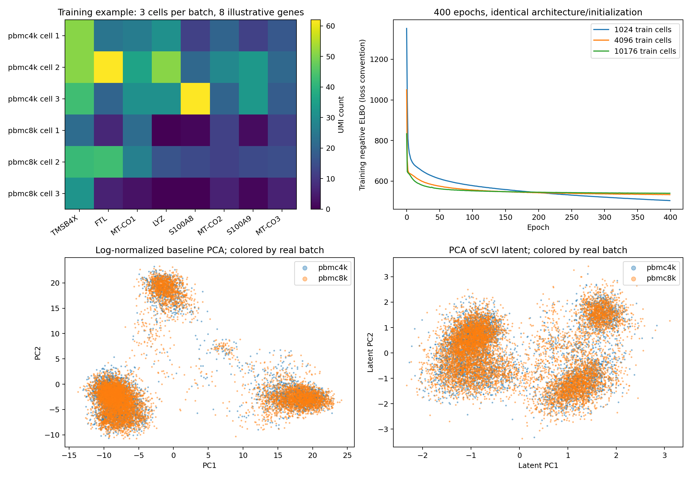

# scVI 최종 통합 보고서

## 1. 모델과 실제 입력

|항목|이번 실험에서 사용한 모델|
|---|---|
|체크포인트·버전|SCVI,seed42무작위초기화;사전학습미사용 checkpoint|
|구조|ZINB count 생성 VAE,hidden128,1층,latent10|
|전체·구성별 파라미터 수|1,293,526개(약129.4만 개)(1.294M);latent z_encoder258,964개(약25.9만 개);첫backward gradient778,884개(약77.9만 개)|
|정밀도|FP32|
|모델 입력 → 출력|raw-count 세포×유전자+sample_id →10차원 latent /count 분포|
|가중치와 실행 메모리의 차이|파라미터 수×dtype bytes는 이론 가중치 용량이다. 실행 peak에는 입력·중간 활성값이 더해지고,파인튜닝에는 gradient/optimizer 상태도 추가된다.|
|메모리% 정의|CUDA allocated peak / CPU·GPU 공유 RAM121.6875GiB ×100; GPU-Util과 별개. AlphaFold2는 JAX 계측을 별도로 표시|

### 실제 데이터와 학습 방식 구분

|구분|데이터·실제 처리 내용|
|---|---|
|추론 데이터|PBMC4k+8k raw count에 저장 모델을 적용해 latent 추출. 세포유형 분류 과제 아님|
|학습·검증·test 데이터|실제10x PBMC4k+8k12721세포×2000HVG. train10176/validation1272/test1273;작은 중첩 train부분집합도 별도 비교|
|학습 입력 X / 정답 y|X:counts[B,2000];재구성 목표는 같은 raw count. sample_id는 실제 생물학적batch 공변량. cell-type 정답 없음|
|가중치 갱신 방식|사전학습 가중치 없이 무작위 초기화에서 처음부터 학습,400epoch. 파인튜닝 아님|
|원본·변환 입력 저장 위치|`data/processed_counts.h5ad;results/<input_run>/splits.json`|
|해석 범위|재구성 기반 비지도 학습이며 생물학적batch와 GPU batch는 다르다. 통합 진단을 세포유형 정확도로 부르지 않음|

**용어:** 처음부터 학습=무작위 초기화에서 시작; 전체/일부 층 파인튜닝=공개 가중치에서 해당 부분 갱신; 분류기만 학습=본체를 동결하고 head만 갱신. **용량probe는 학습 방식이 아니라 짧은 자원 측정 목적**이며,실제로 수행한 가중치 갱신 방식과 함께 표기한다. 원본 전체 데이터 수와 해당 run에서 실제 사용한 부분집합 수를 구분한다.

### 실제 파일 → 전처리 → 모델 표현 → 최종 출력: 단계별 실제 예시

**scVI는처음부터학습한count 생성VAE이며,세포유형분류head를붙이지않았다.** 저장모델의 실제세포 `pbmc4k_AAACCTGAGAAGGCCT-1`를사용한다.

#### 0–1. 원본 파일과 행렬의 한 행

`data/processed_counts.h5ad`와저장모델의`adata.h5ad`에raw-count가보관된다. 원본처리행렬은세포12,721×유전자2,000이다. 행1개=세포1개,열1개=유전자1개다.

```json
{
  "cell_id": "pbmc4k_AAACCTGAGAAGGCCT-1",
  "nonzero_gene_names_first8": [
    "ENSG00000019582",
    "ENSG00000204287",
    "ENSG00000231389",
    "ENSG00000143546",
    "ENSG00000163220",
    "ENSG00000101439",
    "ENSG00000196126",
    "ENSG00000090382"
  ],
  "raw_counts_same_genes": [
    7.0,
    8.0,
    1.0,
    12.0,
    12.0,
    2.0,
    4.0,
    31.0
  ],
  "biological_batch_sample_id": "pbmc4k"
}
```
생물학적sample_id는GPU batch크기가아니다. 세포유형라벨을정답으로학습한모델도아니다.

#### 2. 모델 입력

counts는 `[1, 2000] float32`이며batch공변량을함께사용한다. Raw count를입력하고같은count의생성분포를학습한다.

#### 3. Encoder 특징

실제encoder hidden출력은 `[1, 128] float32`이다.

#### 4. 세포별 latent

`give_mean=True`로사후분포평균을반환했다. 실측 [1, 10] float32의전체10개값은:

```text
[0.389546, -1.092863, 0.414837, 0.043145, -1.896468, 1.140428, 0.549180, -0.241054, -0.926902, -0.477329]
```

#### 5–6. 출력과 학습목표

이번latent추론의최종출력은세포당10차원벡터다. 별도분류기확률/세포유형이아니다. **훈련시에는**decoder의count분포와raw count를이용한재구성항및KL항으로VAE를학습한다. 따라서정답구조는원래count이고외부cell-type정답을만들지않았다. 이예제CPU추적은latent경로만확인했으며decoder중간값을저장했다고주장하지않는다.

#### 7. 저장 파일

|단계별 저장 배열|실제 shape·dtype|의미|
|---|---|---|
|raw_counts|[1, 2000] float32|원래count행|
|encoder_hidden|[1, 128] float32|인코더중간표현|
|latent|[1, 10] float32|10차원최종latent|

로컬 전체 배열: `results/real_input_capacity_20261102_173213_274001/stage_trace_cpu/arrays.npz`. `arrays.npz::key`는 같은NPZ 파일 안의 배열이름이다. 아래 재현코드로 저장모델과 입력에서 다시 확인할 수 있다.

전체입력의GPU추론배열은각batch의 `outputs.npy`;이예제는그첫행과대조했다.

**값의 출처:** 저장된 모델을 CPU에서 새로 재확인한 중간값이다. 원GPU 자원계측 중에 캡처했던 것처럼 해석하지 않는다. 같은 저장GPU 출력과 최대 절대차이는 **3.576e-07**이다. 이 CPU 확인시간은 기존 GPU 벤치마크 시간에 포함하지 않는다.

### 모델 적재 직후 — 첫 입력 forward 이전

|적재 조건|allocated GiB(JAX는별도표기)|reserved GiB|프로세스 RSS GiB|원본 근거|
|---|---|---|---|---|
|추론/기본 모델 적재 기준|0.004826|0.005859375|1.1188545227050781|scvi/results/real_input_capacity_20261102_173213_274001/batch_10176/summary.json|

위 값은 **가중치를 GPU에 적재하고 첫 입력을 계산하기 전의 프레임워크 할당량**이다. CUDA/JAX context·driver·시스템 전체 GPU사용량과 같지 않으며 CPU입력 준비 포함 여부는 해당 실행 코드를 따른다. **실행 peak와 모델 적재 기준값의 차이는 같은 run에서만 계산**한다. 파인튜닝 중 추가량에는 입력뿐 아니라 중간값·gradient·optimizer 상태가 포함된다. 서로 다른 조건/정밀도의 기준값을 하나의 모델 고유 메모리로 단정하지 않는다.

## 2. 모델 입력

<!-- ENV_MEASUREMENT_OVERVIEW_START -->
### 실행 환경·자원 측정 방법 요약

|항목|이번 보고서의 측정 기준|
|---|---|
|장비·공유메모리|DGX Spark,NVIDIA GB10,ARM64;시스템공유RAM121.6875GiB. CPU/GPU RAM을별도로더하지않음|
|환경기록출처|scvi/results/real_input_capacity_20261102_173213_274001/batch_10176/summary.json|
|Python·프레임워크|{'torch': '2.13.0a0+8145d630e8.nv26.06', 'cuda': '13.3', 'precision': 'FP32'}|
|실험병렬정책|GPU벤치마크한번에1개. 이단계별CPU검증은별도작업이며GPU측정시간과합치지않음|
|GPU-Util|nvidia-smi utilization.gpu(%);관측기간중커널활동시간비율. 최대FLOPS/메모리비율아님|
|GPU메모리|PyTorch allocated/reserved및peak;JAX는bytes_in_use/peak_bytes_in_use별도. 모델적재직후·실행구간을분리|
|프로세스·시스템메모리|psutil RSS,MemAvailable,swap;시계열의sampled peak/최소값이며정확한연속최고치아님|
|표본간격|기본0.5초대기+GPU조회시간;측정구간의평균·최대·표본수저장. 짧은실행은동일조건반복하고고유입력과반복처리량구분|
|시간동기화|PyTorch구간앞뒤CUDA synchronize;JAX block_until_ready. 비동기호출반환시간만측정하지않음|
|시간포함범위|조건별로입력준비/전송/forward/backward/optimizer/validation/save포함여부를기록. 서로다른범위의시간을직접배수비교하지않음|
|loading·compile·warmup|구간을분리한다. JAX누적allocator peak가compile/warmup을포함하는경우본문에명시하고CUDA구간peak와직접동일시하지않음|
|메모리기준값과증가량|첫forward전모델적재기준값과같은run의실행peak를비교. 증가량에는학습gradient/optimizer/중간활성값이포함|
|누락·관측한계|미지원/미관측값은N/A. 장치전체GPU-Util에는다른프로세스·디스플레이활동이섞일수있음. 단일실행은통계적반복검증으로쓰지않음|

<!-- ENV_MEASUREMENT_OVERVIEW_END -->

counts는 `[1, 2000] float32`이며batch공변량을함께사용한다. Raw count를입력하고같은count의생성분포를학습한다.

#### 3. Encoder 특징

실제encoder hidden출력은 `[1, 128] float32`이다.

#### 4. 세포별 latent

`give_mean=True`로사후분포평균을반환했다. 실측 [1, 10] float32의전체10개값은:

```text
[0.389546, -1.092863, 0.414837, 0.043145, -1.896468, 1.140428, 0.549180, -0.241054, -0.926902, -0.477329]
```

#### 5–6. 출력과 학습목표

이번latent추론의최종출력은세포당10차원벡터다. 별도분류기확률/세포유형이아니다. **훈련시에는**decoder의count분포와raw count를이용한재구성항및KL항으로VAE를학습한다. 따라서정답구조는원래count이고외부cell-type정답을만들지않았다. 이예제CPU추적은latent경로만확인했으며decoder중간값을저장했다고주장하지않는다.

#### 7. 저장 파일

|단계별 저장 배열|실제 shape·dtype|의미|
|---|---|---|
|raw_counts|[1, 2000] float32|원래count행|
|encoder_hidden|[1, 128] float32|인코더중간표현|
|latent|[1, 10] float32|10차원최종latent|

로컬 전체 배열: `results/real_input_capacity_20261102_173213_274001/stage_trace_cpu/arrays.npz`. `arrays.npz::key`는 같은NPZ 파일 안의 배열이름이다. 아래 재현코드로 저장모델과 입력에서 다시 확인할 수 있다.

전체입력의GPU추론배열은각batch의 `outputs.npy`;이예제는그첫행과대조했다.

**값의 출처:** 저장된 모델을 CPU에서 새로 재확인한 중간값이다. 원GPU 자원계측 중에 캡처했던 것처럼 해석하지 않는다. 같은 저장GPU 출력과 최대 절대차이는 **3.576e-07**이다. 이 CPU 확인시간은 기존 GPU 벤치마크 시간에 포함하지 않는다.

### 모델 적재 직후 — 첫 입력 forward 이전

|적재 조건|allocated GiB(JAX는별도표기)|reserved GiB|프로세스 RSS GiB|원본 근거|
|---|---|---|---|---|
|추론/기본 모델 적재 기준|0.004826|0.005859375|1.1188545227050781|scvi/results/real_input_capacity_20261102_173213_274001/batch_10176/summary.json|

위 값은 **가중치를 GPU에 적재하고 첫 입력을 계산하기 전의 프레임워크 할당량**이다. CUDA/JAX context·driver·시스템 전체 GPU사용량과 같지 않으며 CPU입력 준비 포함 여부는 해당 실행 코드를 따른다. **실행 peak와 모델 적재 기준값의 차이는 같은 run에서만 계산**한다. 파인튜닝 중 추가량에는 입력뿐 아니라 중간값·gradient·optimizer 상태가 포함된다. 서로 다른 조건/정밀도의 기준값을 하나의 모델 고유 메모리로 단정하지 않는다.

## 2. 실행 조건과 측정 기준

표의실제batch·입력shape·정밀도·epoch/step를먼저확인한다. GPU-Util은연산활동시간비율이고,메모리목표80%는약97.35GiB allocated다. 모델별학습범위(전체/부분/head-only/처음부터학습/용량probe)를같은학습으로가정하지않는다. 같은run의시간·메모리를사용하고예측정확도가미평가이면그대로표시한다.

<!-- FACTOR_EFFECTS_START -->
### 시간·메모리에 영향을 주는 요인 — 통제 비교 상태

아래 원리는 모든 모델에서 정량 검증을 마쳤다는 뜻이 아니다. **실측 비교와 미실험을 구분**한다. 배치 sweep 중 정밀도·입력길이·체크포인트를 고정하며,다른 과제/다른head 결과를 같은 조건으로 섞지 않는다.

|요인|총시간·처리량 해석|최대 allocated 해석|이 모델의 실험 근거/상태|
|---|---|---|---|
|배치|한step은 길어질 수 있고step수는 줄어든다. 처리량 상승/포화는 실측으로 판단|같은입력길이·정밀도에서 동시중간값 증가가 주된영향|latent 추론batch확대 비교;기본훈련batch128|
|샘플당 실제입력 크기|GPU에들어간실제token/타일 크기가 커졌을때 계산량 변화 비교|토큰길이·패치/타일크기·attention구조에 따라 증가;원본크기와 다를수있음|실제raw count1024/4096/10176훈련세포 비교,2000HVG 고정|
|고유 데이터수|같은batch·epoch에서 총처리step가늘어 총시간이늘어나는지 비교|고정batch의동시입력이같으면 데이터총수만으로peak가크게늘지않을수있음|입력개수비교는본문참조;새지도학습데이터수비교는아래결과가생긴조건만완료|
|epoch|같은train입력을 반복하므로 누적시간 증가;검증성능개선은 보장안됨|동일batch·입력에서epoch자체가peak를선형증가시키는요인은아님|기본400epoch 고정;epoch별 독립조건 비교 미실험|
|학습방식·갱신범위|추론/본체동결head학습/부분·전체미세조정/처음부터학습은 계산범위가다름|gradient·optimizer·역전파용중간값의유무가다름|1절의가중치갱신방식과X/y를참조;다른데이터·목적의시간을단순배수비교하지않음|
|모델·정밀도·전처리|구조·dtype·토큰화·타일화·컴파일·후처리도영향|모델적재기준값과실행중추가량을분리|원인후보/고정조건으로기록;모델크기나dtype의단독영향sweep은미실험|

추가 통제 비교에서는 **batch8·FP32·공개초기weight·seed42·optimizer·원래전체pool의padding폭·검증/test를고정**하고,(1)같은train의epoch1/2/4,(2)epoch2의중첩train1/4·1/2·전체를각각실행한다. 전체데이터를바꾸면서epoch도함께바꾼행끼리는단독효과로해석하지않는다. 단일실행이며데이터부분집합의label분포변화는정확도해석의제약이다. 이비교는해당지도학습지원모델에만적용한다.


추가epoch/데이터수통제비교 수치: **아직미실험/대기**. 기존측정을추정해서채우지않는다.

<!-- FACTOR_EFFECTS_END -->

## 3. 조건별 추론·학습 결과 — 한 표

아래시간은각원본조건의실측값이다. 조건별포함/제외범위는4~5절과원본기록에서확인한다. 대부분PyTorch CUDAallocated peak이나AlphaFold2는컴파일/warmup포함JAX프로세스누적peak다. RSS와CUDA를독립메모리처럼더하지않는다.

|작업|실제 입력·고유 데이터 수|동시 GPU batch·모양|학습량/반복|측정시간|처리량/step 참고|최대 메모리 / 공유RAM대비|성능·80% 상태|
|---|---|---|---|---|---|---|---|
|배치 추론|고유128개; 실제10x PBMC,2000유전자|batch128, {'unique_cells': 128, 'genes': 2000, 'raw_counts_source': 'saved adata.h5ad layers counts, actual 10x PBMC4k+8k', 'original_pool_cells': 12721, 'batch_covariate': 'sample_id, biological batch distinct from GPU batch'},FP32|13607회/총1741696건|15.00초|116105.69입력/초|0.039 GiB / 0.03%|출력finite·저장재로드·첫입력일치검증;80%미도달|
|배치 추론|고유10176개; 실제10x PBMC,2000유전자|batch10176, {'unique_cells': 10176, 'genes': 2000, 'raw_counts_source': 'saved adata.h5ad layers counts, actual 10x PBMC4k+8k', 'original_pool_cells': 12721, 'batch_covariate': 'sample_id, biological batch distinct from GPU batch'},FP32|122회/총1241472건|15.08초|82317.50입력/초|0.270 GiB / 0.22%|출력finite·저장재로드·첫입력일치검증;80%미도달|
|처음부터SCVI 학습|train10176/val1272/test1273세포|128세포×2000유전자,FP32|400epoch/32000step|159.07초(학습loop)|25589.51세포/초|0.097 GiB / 0.08%|latent 재로드검증·통합진단본문;80%미도달|

<!-- REAL_TRAINING_V3_START -->
### 실제 데이터 추가 실험 — real_input_capacity_20261102_173213_274001

진행 중인 실행의 완료 조건만 아래에 갱신한다. probe는 짧은 용량 측정이며 전체 학습이나 평가 완료가 아니다. 메모리%는 CUDA allocated peak / 시스템 공유 RAM ×100이며 GPU-Util과 다르다. 독립 실행 1회 기준.

|조건|가중치 갱신 방식·실험 목적|상태|고유 입력|배치|epoch|optimizer steps|실측 시간(s)|입력/s|allocated peak GiB|reserved peak GiB|공유 RAM 대비 allocated %|GPU-Util 평균%|최대%|독립 test 지표|저장 모델 재로드|
|---|---|---|---|---|---|---|---|---|---|---|---|---|---|---|---|
|batch_10176|추론(가중치 갱신 없음)|complete|10176|10176|N/A|N/A|15.1094|84859.4564|0.2696|0.2871|0.2215|3.4138|4.0000|N/A|N/A|
|batch_128|추론(가중치 갱신 없음)|complete|128|128|N/A|N/A|15.0009|119425.3903|0.0390|0.0410|0.0320|7.4483|8.0000|N/A|N/A|
|batch_4096|추론(가중치 갱신 없음)|complete|4096|4096|N/A|N/A|15.0007|582698.1578|0.1318|0.1504|0.1083|21.9310|25.0000|N/A|N/A|
|batch_8192|추론(가중치 갱신 없음)|complete|8192|8192|N/A|N/A|15.0348|84999.6667|0.2232|0.2461|0.1834|3.2069|6.0000|N/A|N/A|

이 run의 추론 capacity 실험과 지도학습 실험은 입력 과제·길이·학습 헤드가 다를 수 있어 각각 비교한다. 3step probe는 전체 학습이 아니다. full_training은 동일한 공개 초기 backbone와 seed42,FP32,AdamW(lr1e-5,weight_decay0.01),고정 전체 split pool padding으로2epoch 수행한다. 각 학습 조건의 원본 summary에 split ID,실제 길이·padding 모양,사용 헤드·학습 범위,라벨,gradient가 관측된 파라미터 수,검증/test지표,저장 모델 재로드 차이를 기록한다. scVI는 아래 설명이 적용되지 않는 별도 처음부터 학습 모델이며 AF2·Clair3에는 이 공통 학습 절차를 적용하지 않는다.

입력 및 메모리 기준값(같은 실행에서 측정):

|조건|실제 모델 입력 모양/정책|모델 적재 직후 allocated GiB|실행 시작 allocated GiB|peak 추가 allocated GiB|프로세스 RSS sampled peak GiB|시스템 가용 RAM sampled 최소 GiB|
|---|---|---|---|---|---|---|
|batch_10176|상세 전처리 정책 참조|0.0048|0.0361|0.2335|1.6446|112.8841|
|batch_128|상세 전처리 정책 참조|0.0048|0.0361|0.0029|1.5583|112.9791|
|batch_4096|상세 전처리 정책 참조|0.0048|0.0361|0.0957|1.5755|113.1444|
|batch_8192|상세 전처리 정책 참조|0.0048|0.0361|0.1871|1.6201|113.0019|

실행 상태: `measured`; 측정범위·제약: `tested_real_input_pool_or_planned_range_limit`.

실행 코드 블록의 파일은 원문SHA256으로 검증하며, 명령JSON에 기록된 실행 경로로 해당 snapshot을 복사하면 복원할 수 있다. 대용량 원본 데이터·가중치는 아래 전처리/다운로드 코드와 출처를 사용하고 로컬 원본도 보존한다.

로컬 원시 결과: `/home/hyein/ai-benchmark/scvi/results/real_input_capacity_20261102_173213_274001`. 메모리 부족/guard 실패는 성공 조건으로 기재하지 않는다.
<!-- REAL_TRAINING_V3_END -->

## 4. 결과 해석

<!-- MODEL_SUMMARY_START -->
### 요약 결론

- **학습 방식:** 사전학습 가중치 없이 무작위 초기화에서 처음부터 학습,400epoch. 파인튜닝 아님.
- **입력 구분:** 재구성 기반 비지도 학습이며 생물학적batch와 GPU batch는 다르다. 통합 진단을 세포유형 정확도로 부르지 않음.
- **최신 추가 run 최대 성공 메모리:** `batch_10176` **0.270GiB /0.22%**. 이 값은 해당 최신run의 성공 조건에서의 최대이며,다른 run의 최대와 구분한다. probe이면 전체 epoch·독립test 평가 완료를 뜻하지 않는다.
- **시간·정확도 해석:** 결과는 같은 행의 입력·배치·학습범위에만 연결한다. 메모리 상승 자체가 처리량·정확도 상승을 보장하지 않는다.
<!-- MODEL_SUMMARY_END -->

같은실행경로에서batch를늘린행끼리메모리와처리량을비교한다. 전체고유데이터수와반복처리건수는다르다. 추론·학습·후처리의측정시간범위가다르면단순속도순위로해석하지않는다. 현재80%에도달한조건을이모델에서확인한것은아니며데이터pool한계·예상guard와실제실패를구분해본문에남겼다. 위주표에는동일조건의시간·메모리만연결했고미실시평가를성능성공으로표현하지않는다.

## 5. 실험 방법·입력 예시·기본/후속·평가·저장 상세


### scVI: 모델 크기·실제 학습 입력·GPU 사용률·메모리 검증


작성: 2026-10-27T19:13:56+09:00

#### 결과 요약

10x PBMC의 원시 UMI count로 scVI를 데이터별로 처음부터 학습했다. 1024/4096/10176개 훈련세포를 같은 2000개 유전자·batch 128·FP32·400 epochs로 비교하고, 마지막 저장 모델 한 개로 1024/4096/12721세포의 latent 추론을 측정했다. GPU 사용률과 GPU 메모리를 같은 표에 제시한다. 모든 GPU 작업은 순차 실행했다.

세포 수를 늘리면 전체 처리 시간은 늘었지만 한 배치의 크기는 같으므로 peak 메모리는 거의 같았다. 이 조건에서는 80% GPU-Util에 도달하지 않았으며 배치·정밀도·모델을 사용률 목표에 맞춰 바꾸지 않았다. batch 통합 관련 지표는 원래 baseline에서도 두 batch가 잘 섞여 있어 뚜렷한 개선을 입증하지 못했다.

#### 1. 어떤 공개 모델이며 얼마나 큰가

| 항목 | 확인값 |
| --- | --- |
| 공개 구현 | scvi-tools 1.5.1, scvi.model.SCVI |
| 공개 사전학습 체크포인트 | 사용하지 않음. SCVI 기본 구조를 seed42로 초기화해 데이터별 학습 |
| 전체 파라미터 | 1,293,526 |
| configured requires_grad 파라미터 | 1,293,526 |
| 실제 첫 backward에서 gradient가 있던 파라미터 | 778,884 |
| latent 추론 z_encoder 파라미터 | 258,964 |
| 구조 | 2000 genes → hidden128, 1 layer → Normal latent10; decoder는 batch-conditioned ZINB |
| dropout / dispersion | 0.1 / gene |
| 가중치·계산 정밀도 | FP32, TF32 disabled, Lightning 32-true |
| 이론 FP32 가중치 용량 | 0.004819 GiB (parameter count × 4 bytes; 실행 메모리 아님) |
| 모델 초기화 동일성 | 세 학습 조건 모두 SHA-256 a1a88a8f3b1b835b70a4716a83fe2013d646d8c0ef2bfff34afc5165b4bf4926 |
| 환경 | DGX Spark GB10 ARM64; NVIDIA PyTorch 26.06 이미지 내 별도 venv |
| PyTorch / CUDA | 2.13.0a0+8145d630e8.nv26.06 / CUDA13.3 forward compatibility |
| 기존 환경 보존 | scGPT 컨테이너·이미지·기존 host PyTorch 수정 없음 |

requires_grad 개수와 실제 사용되는 branch의 gradient 개수는 다르다. observed library size를 사용하는 기본 경로에서 쓰이지 않는 branch도 module의 전체 파라미터에 포함된다. 학습 후 17개 parameter tensor의 갱신을 확인했다. scVI를 사전학습 모델 파인튜닝이나 scANVI 세포 유형 분류로 표현하지 않는다.

#### 2. 모델만 로드하면 얼마를 할당하는가

| 저장 모델 | 로드 전 allocated GiB | 로드 직후 allocated GiB | 모델 로드 증가 GiB | 로드 peak GiB | CPU RSS 직후 GiB |
| --- | --- | --- | --- | --- | --- |
| train_1024 | 0.000000 | 0.004826 | 0.004826 | 0.009651 | 1.054 |
| train_4096 | 0.031250 | 0.036076 | 0.004826 | 0.040901 | 1.557 |
| train_10176 | 0.031250 | 0.036076 | 0.004826 | 0.040901 | 1.604 |

첫 모델의 깨끗한 CUDA allocator 기준으로 **모델 적재 직후 0.004826 GiB (약 4.94 MiB)**였다. CUDA 초기화와 saved AnnData의 CPU 읽기는 기준 시점 전에 끝냈고, GPU forward와 optimizer 로드는 하지 않았다. 따라서 GPU에는 모델만 올라간 상태지만 CPU RSS에는 미리 읽은 데이터·라이브러리·registry가 포함된다.

두 번째·세 번째 모델은 같은 독립 검증 프로세스에서 앞선 inference 뒤의 0.03125 GiB 상주 할당이 남아 있어 absolute post-load가 더 크다. 이 32 MiB의 원인은 본 실험에서 세분화하지 않았다. 각 모델 적재의 전후 차이는 같았다. 물리 메모리 사용량과 PyTorch allocator 수치를 동일시하지 않는다.

#### 3. 학습 데이터는 어떻게 생겼는가

10x Genomics Cell Ranger 2.1.0의 pbmc4k·pbmc8k **filtered cell barcode의 raw UMI count**를 사용했다. filtered는 세포 선택을 뜻하며 log-normalization이 적용됐다는 뜻이 아니다. count 값은 정수값을 가진 float32 CSR sparse이고 비음수·유한값·고유 cell ID를 검사했다. 원본 12721세포 × 33694유전자에서 훈련세포만으로 batch-aware Seurat v3 HVG 2000개를 선택했다. count layer에는 normalize/log1p를 적용하지 않았다.

| 자료 | 원본 shape | 실제 batch | donor | 출처 |
| --- | --- | --- | --- | --- |
| PBMC4k | 4340 × 33694 | pbmc4k | 동일 healthy donor | 10x Cell Ranger2.1.0 |
| PBMC8k | 8381 × 33694 | pbmc8k | 동일 healthy donor | 10x Cell Ranger2.1.0 |
| 학습 입력 | 12721 × 2000 | 2개 실제 실험 batch | 1명 | HVG는 training cells에서만 선택 |

세포 유형 정답 라벨은 없다. 학습의 복원 대상은 입력 raw count 자체이며 sample_id는 batch covariate다. 이를 정답 cell-type 라벨로 쓰지 않았다. 다음은 각 batch의 앞 3개 훈련세포와, 이 6개 세포에서 count 합이 큰 8개 유전자를 고른 실제 행렬 예시다. 독자가 비영 count를 확인하기 위한 전시용 선택이며 실제 학습에는 선정된 2000개 유전자를 전부 사용했다.

| cell | TMSB4X | FTL | MT-CO1 | LYZ | S100A8 | MT-CO2 | S100A9 | MT-CO3 |
| --- | --- | --- | --- | --- | --- | --- | --- | --- |
| pbmc4k_AAACCTGAGAAGGCCT-1 | 51 | 24 | 26 | 31 | 12 | 20 | 12 | 17 |
| pbmc4k_AAACCTGAGACAGACC-1 | 51 | 62 | 36 | 51 | 21 | 29 | 33 | 21 |
| pbmc4k_AAACCTGAGATAGTCA-1 | 43 | 20 | 31 | 31 | 62 | 20 | 33 | 18 |
| pbmc8k_AAACCTGAGCATCATC-1 | 22 | 7 | 22 | 0 | 1 | 12 | 2 | 12 |
| pbmc8k_AAACCTGAGCTAACTC-1 | 42 | 43 | 27 | 16 | 14 | 12 | 14 | 15 |
| pbmc8k_AAACCTGCACATTAGC-1 | 32 | 6 | 3 | 0 | 0 | 6 | 1 | 6 |

같은 행에는 sample_id, original_barcode, total_umi, detected_genes, split 메타데이터가 연결된다. 전체 셀·유전자 목록은 input run의 cells.csv/genes.csv, 실제 행렬 예시는 reports/training_input_example.csv에 보관했다. latent 출력은 각 세포당 float32 숫자 10개이며 latent_example.csv에 실제 값을 저장했다.

```text
원본 [12721 cells, 33694 genes] raw UMI
 → training-only HVG 선택 [12721, 2000]
 → GPU minibatch [최대 128, 2000] float32
 → latent posterior mean [최대 128, 10]
 → batch-conditioned ZINB decoder / count reconstruction
```

##### 분리와 규모 비교

| 집합 | 세포 수 | pbmc4k / pbmc8k |
| --- | --- | --- |
| train_1024 | 1024 | 350 / 674 |
| train_4096 | 4096 | 1398 / 2698 |
| train | 10176 | 3472 / 6704 |
| validation | 1272 | 434 / 838 |
| test | 1273 | 434 / 839 |

training 부분집합은 중첩 구조이고 batch·UMI 깊이 구간 분포를 층화했다. 깊이 구간은 전체 자료 QC 정보를 사용하므로 완전히 blind한 표본 선정은 아니다. Validation 1272개와 test 1273개는 세 모델에서 동일하며 parameter update에 사용하지 않았다. optimizer와 epoch 수·중단 정책을 고정했고 test로 조건을 선택하지 않았다. 같은 donor 안에서의 random split이며 donor-independent 일반화 검증은 아니다.

#### 4. 입력 조건에 따른 GPU 사용률과 메모리

기본 batch 128, FP32를 고정했다. 아래 모델 로드 기준과 실행 peak는 서로 다른 run에서 얻었으므로 증가량은 **참고 차이**다. 정확히 같은 run의 baseline 전후 차이라고 쓰지 않는다. 학습 추가량에는 gradient·optimizer·중간값·작업 buffer가 포함된다.

| 학습 고유세포 / genes | 실제 GPU 입력 | GPU 평균 / 최대 % | 모델 로드 기준 GiB | fit allocated peak GiB | 기준 대비 참고 증가 GiB |
| --- | --- | --- | --- | --- | --- |
| 1024 / 2000 | [≤128, 2000] | 21.80 / 30 | 0.004826 | 0.097363 | 0.092537 |
| 4096 / 2000 | [≤128, 2000] | 26.55 / 32 | 0.004826 | 0.097439 | 0.092614 |
| 10176 / 2000 | [≤128, 2000] | 25.76 / 33 | 0.004826 | 0.097439 | 0.092614 |

| 추론 고유세포 / genes | 실제 GPU 입력 | GPU 평균 / 최대 % | 모델 로드 기준 GiB | allocated peak GiB | 기준 대비 참고 증가 GiB |
| --- | --- | --- | --- | --- | --- |
| 1024 / 2000 | [≤128, 2000] | 24.07 / 29 | 0.004826 | 0.039019 | 0.034193 |
| 4096 / 2000 | [≤128, 2000] | 27.73 / 31 | 0.004826 | 0.039019 | 0.034193 |
| 12721 / 2000 | [≤128, 2000] | 29.10 / 33 | 0.004826 | 0.039019 | 0.034193 |

세포당 2000개 입력 유전자와 hidden/latent 구조가 같아 모델 크기는 동일하다. 세포 수는 전체 처리 건수를 늘릴 뿐 GPU에 한번에 올라가는 크기를 바꾸지 않으므로 peak가 거의 일정했다. 유전자 수를 바꾸면 encoder/decoder parameter 수와 복원 과제가 함께 바뀌므로 같은 모델의 단순 길이 비교로 취급하지 않았다.

#### 5. 학습·추론 시간과 처리량

| 학습 세포 | epochs / optimizer steps | 총 학습 처리 건수 | train loop s | validation loop s | fit wall s | cell/s |
| --- | --- | --- | --- | --- | --- | --- |
| 1024 | 400 / 3200 | 409600 | 19.424 | 0.420 | 20.263 | 21087.3 |
| 4096 | 400 / 12800 | 1638400 | 60.201 | 0.424 | 61.060 | 27215.3 |
| 10176 | 400 / 32000 | 4070400 | 159.065 | 0.415 | 159.903 | 25589.5 |

| 추론 고유세포 | 반복 / 총 처리 | 실행 s | 저장 s | cell/s | RSS sampled peak GiB | MemAvailable 최소 GiB |
| --- | --- | --- | --- | --- | --- | --- |
| 1024 | 3546 / 3631104 | 15.002 | 0.003 | 242037.7 | 1.616 | 113.014 |
| 4096 | 1020 / 4177920 | 15.010 | 0.006 | 278335.3 | 1.613 | 112.974 |
| 12721 | 352 / 4477792 | 15.013 | 0.016 | 298263.8 | 1.615 | 113.044 |

추론은 동일한 10176세포 학습 모델 하나를 사용했고 posterior mean을 얻었다. 0.5초 GPU 표본을 충분히 확보하려고 조건마다 최소 15초·최소 3회 반복했다. 많은 총 처리 건수는 동일 데이터의 반복이며 고유 데이터가 그만큼 많다는 뜻이 아니다. 매 반복 출력이 첫 출력과 일치하는지도 검사했다.

| 학습 세포 | 입력 준비 s | 초기화 s | 평가 s | 모델/AnnData 저장 s | RSS peak GiB | MemAvailable 최소 GiB |
| --- | --- | --- | --- | --- | --- | --- |
| 1024 | 0.016 | 0.214 | 0.042 | 0.095 | 1.955 | 112.789 |
| 4096 | 0.017 | 0.168 | 0.039 | 0.065 | 1.989 | 112.478 |
| 10176 | 0.017 | 0.010 | 0.032 | 0.061 | 2.060 | 112.388 |

초기 count 입력 준비는 3.832초였다. training은 400 epochs, Adam lr=1e-3, weight_decay=1e-6, eps=0.01, KL warmup400 epochs, validation 주기20, early stopping False다. 각 조건은 단일 seed·단일 학습 실행이다. 큰 training set은 고유세포뿐 아니라 optimizer step 수도 많아 정확도 차이를 단순한 입력 개수 효과로 분리할 수 없다.

#### 6. 평가·batch integration·재로드

| 학습 고유세포 | validation ELBO | 독립 test ELBO | 독립 재로드 test cells | 재로드 최대 절대 차이 |
| --- | --- | --- | --- | --- |
| 1024 | -620.406 | -597.572 | 1273 | 0.0 |
| 4096 | -567.465 | -548.418 | 1273 | 0.0 |
| 10176 | -554.151 | -536.274 | 1273 | 0.0 |

scvi-tools 1.5.1의 get_elbo는 ELBO를 반환해 높을수록 좋다. 학습 history/그래프의 elbo_train은 loss 관례의 양수 negative ELBO라 부호를 구분해야 한다. ELBO는 cell-type accuracy가 아니다.

| held-out test1273 지표 | log-normalized PCA | SCVI latent |
| --- | --- | --- |
| batch_silhouette | 0.000836 | 0.001080 |
| mean_normalized_batch_knn_entropy | 0.908868 | 0.909826 |
| batch_prediction_balanced_accuracy | 0.508183 | 0.500000 |

batch silhouette는 0에 가깝고 30-neighbor batch entropy는 두 방법 모두 높다. 실제 batch를 예측하는 진단 분류기의 balanced accuracy도 둘 다 chance 수준이다. baseline부터 잘 섞여 있던 같은 donor 자료이므로 큰 batch correction 개선을 주장할 수 없다. cell-type 라벨 없이 과도한 biological mixing 여부를 검증하지 못한다. scVI 조건부 생성 기능으로 두 batch를 평균한 normalized expression 예시 [128,2000]도 저장했지만 이 값은 raw 학습 입력이 아니다.



저장 모델 3개를 새 OS 프로세스에서 다시 불러와 각 1273개 test의 10차원 latent가 원본과 정확히 일치함을 확인했다. 공식 model.pt·registry·init 설정·var 순서·AnnData를 보관했고 별도로 trainer.ckpt(optimizer/epoch), RNG도 저장했다. 상태 저장은 했지만 학습 재개 자체를 검증하지 않아 재개 성공으로 쓰지 않는다.

#### 계측 범위·제약

시간 구간 경계에서 torch.cuda.synchronize()를 호출했다. train loop는 데이터 로딩·전송·forward·backward·optimizer·일부 프레임워크 overhead를 포함하며 validation loop와 구분한다. fit wall은 Trainer 전체다. inference 시간은 표준 scVI 데이터 로더·전송·encoder·CPU latent 반환·유한값/반복 일치 검사까지 포함하고 파일 저장은 제외한다. 별도 JIT/torch.compile은 사용하지 않았다. 작은 GPU smoke [32,2000]→[32,10] CUDA float32를 확인했고 추론 첫128셀 warmup 0.004초는 본 측정에서 제외했다.

GPU-Util·RSS·MemAvailable·swap은 0.5초 간격 sampled 값이다. GPU 평균은 해당 phase에 시작하고 동기화 측정 구간 안에서 끝난 query 표본을 사용한다. NVML 내부 집계 window는 phase 경계를 걸칠 수 있다. validation은 합계 약0.4초처럼 짧아 단독 GPU 평균을 신뢰할 수 없어 주 비교표에서 사용하지 않았다. RSS sampled peak는 정확한 최고치가 아니다. GPU-Util은 장치 전체 커널 활동 시간 비율이며 FLOPS/SM occupancy/메모리 비율이 아니다. 디스플레이·브라우저 부하도 포함될 수 있다.

메모리 비교는 PyTorch allocator allocated/reserved, 프로세스 RSS, 시스템 MemAvailable을 구분한다. 공유 DRAM121.688GiB에서 이를 합산하지 않았고 GPU dedicated VRAM 비율로 표현하지 않았다. 시스템 swap 증가는 없고 가용 RAM은 충분했다. 낮은 GPU 사용률의 특정 원인을 CPU profiler로 확정하지 않았다. 작은 encoder/MLP·기본 batch·일반 데이터 로딩 경로가 가능한 설명이지만 병목 분해는 미수행이다.


#### 저장 경로·실행

| 항목 | 호스트 경로 |
| --- | --- |
| 입력 확인 | /home/hyein/ai-benchmark/scvi/results/inputs_20261027_093652_887319 |
| 최종 run | /home/hyein/ai-benchmark/scvi/results/scvi_20261027_185901_460537 |
| raw source·processed_counts.h5ad | /home/hyein/ai-benchmark/scvi/data |
| 세 학습 모델 | /home/hyein/ai-benchmark/scvi/models/scvi_20261027_184921_028161/train_1024, /home/hyein/ai-benchmark/scvi/models/scvi_20261027_185327_767988/train_4096, /home/hyein/ai-benchmark/scvi/models/scvi_20261027_185327_767988/train_10176 |
| 독립 재로드·모델 로딩 기준값 | /home/hyein/ai-benchmark/scvi/results/scvi_20261027_185901_460537/independent_reload.json / /home/hyein/ai-benchmark/scvi/results/scvi_20261027_185901_460537/loading_baselines_annotated.json |
| 입력 예시 | /home/hyein/ai-benchmark/scvi/reports/training_input_example.csv |
| 비교 CSV | /home/hyein/ai-benchmark/scvi/reports/comparison.csv |
| 보고서 | /home/hyein/ai-benchmark/scvi/reports/scVI.md |

각 학습 source_run의 resources.csv와 epoch_timings, 학습곡선, test latent, 명령·환경·패키지 버전·입력split·초기화 해시를 보관했다. 최신 run에서 재사용한 학습 숫자의 원본 시계열은 source_run으로 연결된다. 모든 컨테이너 결과는 host bind /work 경로에 저장된다.

```bash
cd /home/hyein/ai-benchmark
# 동일한 준비 입력으로 새로운 run을 만들며 기존 결과를 보존한다.
python3 scvi/scripts/launch.py
# 재로드 검증은 기존 GPU 작업이 끝난 후 하나씩 실행한다.
```

#### 공식 출처

- [scVI API·기본 구조](https://docs.scvi-tools.org/en/stable/api/reference/scvi.model.SCVI.html)
- [공식 count 입력·학습 예제](https://docs.scvi-tools.org/en/stable/tutorials/notebooks/quick_start/api_overview.html)
- [scvi-tools1.5.1 source](https://github.com/scverse/scvi-tools/tree/1.5.1)
- [10x PBMC4k (CC BY4.0)](https://www.10xgenomics.com/datasets/4-k-pbm-cs-from-a-healthy-donor-2-standard-2-1-0)
- [10x PBMC8k (CC BY4.0)](https://www.10xgenomics.com/datasets/8-k-pbm-cs-from-a-healthy-donor-2-standard-2-1-0)
- [Spark 공유 메모리](https://docs.nvidia.com/dgx/dgx-spark/known-issues.html)

### 3. 후속 실험 통합 — 배치 확대 및 자원 검증

### scvi 실제 입력의 배치별 추론 자원


상태 **complete** · run `batch_followup_20261028_142752_517769` · 측정범위·제약 `available_unique_input_limit`

#### 입력과 고정 조건

{
  "source": "saved full10176cell SCVI model and its raw-count AnnData, fixed2000genes; latent posterior mean",
  "unique_available_inputs": 10176,
  "selection": "nested original order, exact sequence deduplication, no synthetic copies; inference only, original split metadata retained",
  "token_policy": "fixed CPU pool-wide padding width across batch conditions, no tokenizer truncation; actual shapes in workers"
}

배치는한번에GPU에서계산하는독립입력개수다. scVI는세포수,서열모델은서열수이며원본전체데이터개수와다르다. 실제기존공개데이터의중첩고유부분집합을사용한다. 반복처리는관측시간확보용이며고유데이터를늘렸다는뜻이아니다. 길이crop·tokenization·dtype·체크포인트를고정하고batch만확대한다. 실제input_shapes와ID는각batch/summary에있고원본입력선택은inputs.json또는저장scVIadata에있다.

FP32/TF32=False/seed42,각조건fresh container. 기존정상환경·모델·데이터를보존하고로컬가중치만재사용한다. 전체/실제사용backbone 파라미터수·모델출처·기본학습/정확도평가는기본모델보고서를참조한다. 각새run의전체파라미터수·적재기준값·모델로딩/warmup시간·Torch/CUDA·저장출력은batch별summary에있다. 이번실험은추론만수행하므로학습파라미터0이다.

#### 배치별 측정

측정은cache 이후배치구성/전송·forward·pooling/latent계산·CPU반환을포함한다. 다운로드·입력선택/crop·tokenization·모델로딩·warmup·파일저장은제외한다. scVI공식latent API는내부데이터로더구성을포함한다. OpenSpliceAI는동일5개모델ensemble을순차평가한다. 최솟값2회·15초이상반복이며실제횟수를기록한다.

|batch/고유입력|반복|총처리|초|입력/초|모델적재GiB|allocated peak GiB|적재대비추가GiB|reserved peak GiB|공유RAM대비%|GPU평균/최대%|RSS sampled peak GiB|가용 sampled 최소GiB|
|---|---|---|---|---|---|---|---|---|---|---|---|---|
|128|13607|1741696|15.001|116105.6941|0.0048|0.039|0.0342|0.041|0.032|15.6897|19.0|1.5399|112.4895|
|256|11926|3053056|15.0007|203528.1284|0.0048|0.0419|0.0371|0.0566|0.0345|17.4138|20.0|1.5383|112.371|
|512|10058|5149696|15.0006|343299.507|0.0048|0.0478|0.0429|0.0566|0.0393|20.1724|24.0|1.5434|112.4101|
|1024|7756|7942144|15.0008|529446.5185|0.0048|0.0595|0.0546|0.0762|0.0489|26.1724|29.0|1.5465|112.4435|
|2048|4718|9662464|15.0018|644088.376|0.0048|0.084|0.0791|0.0859|0.069|24.2414|26.0|1.534|112.3655|
|4096|2211|9056256|15.0009|603715.4809|0.0048|0.1318|0.127|0.1504|0.1083|24.8621|28.0|1.5626|112.3741|
|8192|154|1261568|15.0271|83952.6489|0.0048|0.2232|0.2184|0.2461|0.1834|5.7931|7.0|1.6075|112.1286|
|10176|122|1241472|15.0815|82317.5007|0.0048|0.2696|0.2647|0.2871|0.2215|4.7241|8.0|1.6315|112.0164|

#### 결과 해석과 검증

최대시험성공batch 10176. allocated80%도달 False,90%도달 False. 실제고유입력pool한계/안전guard로중단할수있으며모델절대한계를뜻하지않는다. 다음예약량예측은보수적안전추정이며실측실패와구분한다.

출력shape·전체finite·저장후정확재로드·동일첫입력의배치별예측일치검사를수행한다. 결과가안맞거나실패하면성공행에넣지않고batch로그/exit/summary에보관한다. 독립생물학적정확도평가/학습을추가수행한결과가아니다. 원래모델의기본학습/재로드/test결과를재사용한다.

GPU-Util은계산활동시간비율이며메모리비율이아니다. CUDA allocated/reserved는프로세스allocator이고공유RAM약121.688GiB대비비율은전용VRAM점유율이아니다. RSS와CUDA를더하지않는다. 모델적재와추가메모리는같은worker에서측정했다. RSS/MemAvailable은0.5초대기+조회간격sampled값이다. 가용16GiB·swap증가2GiB guard와다음batch예약예측으로확대를중단한다.

원본설정·코드·환경·input IDs·cache·출력·GPU시계열·명령·종료코드는실행폴더와scripts/remaining_followups에보관한다. 새학습은수행하지않아분류라벨을자원실험의정답으로사용하지않는다.

[공식 출처](https://docs.scvi-tools.org/en/stable/tutorials/notebooks/quick_start/api_overview.html) · [기존 모델 보고서 디렉터리](scVI.md)

### 기록 해석

본문의과거완료표시는해당run의실행·저장상태이다. 사용자목표인80%메모리도달여부는이문서첫표를우선한다. 미도달/미확인을불가능으로해석하지않으며,학습미실시·데이터pool제한·예상예약guard·실패run을완료된성공조건과구분한다.


## 6. 실제 실행 코드·명령어 전문

<!-- EXECUTED_SCRIPTS_START -->

### 원문과 출처 검증

아래 코드 블록은 원본 내용을 생략하거나 재작성하지 않았다. 각 파일의 원래 경로·원문 SHA256·출처 상태를 함께 기록했다. `실행 run 저장 snapshot`을 우선하고, 현재 소스만 남은 경우에는 당시 파일과 같다고 단정하지 않는다. 동일 바이트 버전은 한 번만 수록하고 해당 경로들을 함께 표시한다.

GitHub에는 `.py`/`.sh`를 별도 파일로 두지 않는다. 코드 블록을 원래 경로에 저장하거나 [복원 안내](scVI.md)의 코드로 로컬에서 복원한다. 라이브러리 전체 소스는 이 사용자 실행 스크립트와 구분하며 패키지 버전/출처를 따른다.

### 코드 목록

|원래 파일|원문 SHA256|출처 상태|
|---|---|---|
|`scvi/scripts/benchmark.py`|`a3ca63437414a72298ab23f77f7fe17e30b98a57bbe3138398dcb9a08b62a3fc`|현재 보관 소스; 실행 당시와의 바이트 동일성은 별도 근거가 없는 경우 미검증|
|`scvi/results/scvi_20261027_185901_460537/benchmark.py`|`a3ca63437414a72298ab23f77f7fe17e30b98a57bbe3138398dcb9a08b62a3fc`|실행 run 저장 snapshot; 실패·재시도 버전도 경로 그대로 보존|
|`scvi/scripts/download_data.py`|`c9180afb6d36ddb7be409efb35c6a1356f60cb2bd73c931f80352204b14d9b8f`|현재 보관 소스; 실행 당시와의 바이트 동일성은 별도 근거가 없는 경우 미검증|
|`scvi/scripts/launch.py`|`55e8b33b69a2a08ed83d2d236d1aae2b5df23dbc6296cd55328ec6b68393462e`|현재 보관 소스; 실행 당시와의 바이트 동일성은 별도 근거가 없는 경우 미검증|
|`scvi/scripts/predict.py`|`77bc0219030fc8fbd543deebcf2a91b503cd461b8465336c0f786516feaec832`|현재 보관 소스; 실행 당시와의 바이트 동일성은 별도 근거가 없는 경우 미검증|
|`scvi/scripts/prepare_inputs.py`|`285efb06f82f3f740e5f78a42714849b3dbe91612e3262c4d6a1743cc10f4c51`|현재 보관 소스; 실행 당시와의 바이트 동일성은 별도 근거가 없는 경우 미검증|
|`scvi/scripts/report.py`|`f04419f65c34b21978e746673be92a3c41c8f61aaaacdd5e3f6ca09aa975f687`|현재 보관 소스; 실행 당시와의 바이트 동일성은 별도 근거가 없는 경우 미검증|
|`scvi/scripts/setup_env.py`|`61feab41808751423b12941a6b0ac7b20705ac6a08208a347e73580f13068414`|현재 보관 소스; 실행 당시와의 바이트 동일성은 별도 근거가 없는 경우 미검증|
|`scvi/scripts/verify_reload.py`|`77b5a2a1b19102254f898dc7630109ecbcf6d7bcd1dab50f8568b5202ff46d72`|현재 보관 소스; 실행 당시와의 바이트 동일성은 별도 근거가 없는 경우 미검증|
|`scvi/results/scvi_20261027_185327_767988/benchmark.py`|`b106d7b8a3a11165ebbe38d4ed0b6cf3141b8b5ca58fe49eb0ab255a3b234aaf`|실행 run 저장 snapshot; 실패·재시도 버전도 경로 그대로 보존|
|`scvi/results/scvi_20261027_184921_028161/benchmark.py`|`2a54d90a269cf167ee6dc6057ddd4e16659d8befbf7fb047cc23f272b15d6db5`|실행 run 저장 snapshot; 실패·재시도 버전도 경로 그대로 보존|
|`scripts/gpu_support.py`|`349a7dc8855cbf32ad999ac113f97c4cf496b0b0154dd7b8e54fe00af58632d2`|실행 계측 공통 helper 현재 보관본; 버전은 각 run 기록과 대조|
|`scripts/remaining_followups/launch.py`|`84ea6bdb09c57582e25bfc2adf9da1ba72bcc66836af78386532e5869488af63`|현재 보관 소스; 실행 당시와의 바이트 동일성은 별도 근거가 없는 경우 미검증|
|`scripts/remaining_followups/report.py`|`8b67b28dbc254521328fff13f7ad3b5abcef84f687eff838616e741ab957d700`|현재 보관 소스; 실행 당시와의 바이트 동일성은 별도 근거가 없는 경우 미검증|
|`scripts/remaining_followups/worker.py`|`e47c0fd347e235ec6529c9052da478986e5515c1d9b72dad653c2ac421ddff74`|현재 보관 소스; 실행 당시와의 바이트 동일성은 별도 근거가 없는 경우 미검증|

<details>
<summary>scvi/scripts/benchmark.py — 원문 전문 (18,015 bytes)</summary>


<!-- RESTORE_FILE {"path": "scvi/scripts/benchmark.py", "sha256": "a3ca63437414a72298ab23f77f7fe17e30b98a57bbe3138398dcb9a08b62a3fc", "encoding": "utf-8", "added_final_newline": false} -->
```python
"""scVI raw-count training and input-size GPU profiling, one GPU job at a time."""
import pathlib,sys,os,time,json,csv,datetime,threading,subprocess,random,hashlib,copy,traceback,gc,shutil,platform
import numpy as np,pandas as pd,torch,scanpy as sc,scvi,psutil
from lightning.pytorch.callbacks import Callback
from sklearn.model_selection import train_test_split
from sklearn.decomposition import PCA
from sklearn.metrics import silhouette_score,balanced_accuracy_score
from sklearn.neighbors import NearestNeighbors
from sklearn.linear_model import LogisticRegression
R=pathlib.Path('/work');O=R/'results'/sys.argv[1];O.mkdir(exist_ok=True);I=R/'results'/(R/'results/INPUT_LATEST').read_text().strip();shutil.copy2(__file__,O/'benchmark.py');shutil.copy2(I/'input_report.json',O/'input_report.json');shutil.copy2(I/'splits.json',O/'splits.json');shutil.copy2(I/'pip_freeze.txt',O/'pip_freeze.txt');shutil.copy2(R/'data/sources.json',O/'sources.json')
phase='setup';condition='setup';stop=threading.Event();samples=[];proc=psutil.Process();initialswap=psutil.swap_memory().used;allstart=time.perf_counter()
def write(name,obj):(O/name).write_text(json.dumps(obj,ensure_ascii=False,indent=2,allow_nan=False,default=lambda x:x.item() if hasattr(x,'item') else str(x)))
def event(kind,**kw):
 row={'time_unix':time.time(),'kind':kind,'condition':condition,'phase':phase,**kw}
 with (O/'events.jsonl').open('a') as f:f.write(json.dumps(row,ensure_ascii=False,default=str)+'\n')
 print(json.dumps(row,ensure_ascii=False,default=str),flush=True)
def monitor():
 with (O/'resources.csv').open('w') as f:
  w=csv.DictWriter(f,fieldnames=['query_start','query_end','condition','phase','gpu_util_percent','rss_bytes','available_bytes','swap_bytes']);w.writeheader()
  while not stop.is_set():
   start=time.time();ph=phase;c=condition
   try:
    p=subprocess.run(['nvidia-smi','--query-gpu=utilization.gpu','--format=csv,noheader,nounits'],capture_output=True,text=True,timeout=3);util=float(p.stdout.strip()) if p.returncode==0 else None
   except Exception:util=None
   row=dict(query_start=start,query_end=time.time(),condition=c,phase=ph,gpu_util_percent=util,rss_bytes=proc.memory_info().rss,available_bytes=psutil.virtual_memory().available,swap_bytes=psutil.swap_memory().used);samples.append(row);w.writerow(row);f.flush()
   if row['available_bytes']<8*2**30 or row['swap_bytes']>initialswap+2*2**30:event('memory_pressure_stop');os._exit(70)
   stop.wait(max(0,.5-(time.time()-start)))
def profile(c,start,end,ph=None):
 rows=[s for s in samples if s['condition']==c and start<=s['query_start'] and s['query_end']<=end and (ph is None or s['phase']==ph)];v=[s['gpu_util_percent'] for s in rows if s['gpu_util_percent'] is not None]
 return dict(gpu_util_mean_percent=float(np.mean(v)) if v else None,gpu_util_max_percent=max(v) if v else None,sample_count=len(rows),rss_sampled_peak_gib=max([s['rss_bytes'] for s in rows],default=0)/2**30,available_min_gib=min([s['available_bytes'] for s in rows],default=0)/2**30,swap_max_bytes=max([s['swap_bytes'] for s in rows],default=0))
def digest(state):
 h=hashlib.sha256()
 for k,v in sorted(state.items()):h.update(k.encode());h.update(v.detach().cpu().contiguous().numpy().tobytes())
 return h.hexdigest()
def finitefloat(x):return float(x.detach().cpu()) if torch.is_tensor(x) else float(x)
thread=threading.Thread(target=monitor,daemon=True);thread.start();summary=dict(status='running',settings=dict(scvi_version=scvi.__version__,training='from scratch, not pretrained fine-tuning',batch_size=128,precision='32-true FP32; TF32 disabled',seed=42,epochs=400,validation_every_n_epochs=20,early_stopping=False,n_genes=2000,n_hidden=128,n_latent=10,n_layers=1,gene_likelihood='zinb',dispersion='gene',dropout_rate=.1,optimizer='Adam',lr=.001,weight_decay=1e-6,eps=.01,kl_warmup_epochs=400,num_workers=0,sampling_seconds=.5),training=[],inference=[]);write('summary.json',summary)
class Timing(Callback):
 def __init__(self,model):self.model=model;self.t0=None;self.train_seconds=0;self.val_seconds=0;self.epochs=[];self.gradient_names=[]
 def on_train_epoch_start(self,tr,pl):
  global phase
  torch.cuda.synchronize();phase='training';self.t0=time.perf_counter();self.begin=time.time()
 def close_train(self,tr):
  if self.t0 is not None:
   torch.cuda.synchronize();sec=time.perf_counter()-self.t0;self.train_seconds+=sec;self.epochs.append(dict(epoch=tr.current_epoch,start_unix=self.begin,end_unix=time.time(),seconds=sec));self.t0=None
 def on_validation_start(self,tr,pl):
  global phase
  self.close_train(tr);phase='validation';torch.cuda.synchronize();self.v0=time.perf_counter()
 def on_validation_end(self,tr,pl):
  global phase
  torch.cuda.synchronize();self.val_seconds+=time.perf_counter()-self.v0;phase='epoch_boundary'
 def on_train_epoch_end(self,tr,pl):
  global phase
  self.close_train(tr);phase='epoch_boundary'
  if tr.current_epoch in [0,19,99,199,299,399]:event('epoch',epoch=tr.current_epoch+1,global_step=tr.global_step,metrics={k:finitefloat(v) for k,v in tr.callback_metrics.items() if torch.is_tensor(v) and v.numel()==1 and torch.isfinite(v)})
 def on_after_backward(self,tr,pl):
  if not self.gradient_names:self.gradient_names=[n for n,p in self.model.module.named_parameters() if p.grad is not None]
try:
 torch.set_num_threads(8);torch.backends.cuda.matmul.allow_tf32=False;torch.backends.cudnn.allow_tf32=False;scvi.settings.seed=42;scvi.settings.batch_size=128;scvi.settings.dl_num_workers=0
 phase='data_loading';t=time.perf_counter();full=sc.read_h5ad(R/'data/processed_counts.h5ad');assert np.isfinite(full.layers['counts'].data).all() and np.all(np.asarray(full.layers['counts'].sum(1)).ravel()>0);splits=json.loads((I/'splits.json').read_text());summary['data_load_seconds']=time.perf_counter()-t
 write('environment.json',dict(python=sys.version,scvi=scvi.__version__,torch=torch.__version__,cuda=torch.version.cuda,gpu=torch.cuda.get_device_name(0),host=platform.node(),memory_bytes=psutil.virtual_memory().total,initial_available_bytes=psutil.virtual_memory().available,initial_swap_bytes=initialswap,nvidia_smi=subprocess.run(['nvidia-smi'],capture_output=True,text=True).stdout))
 canonical=None;canonical_hash=None;paths=[]
 if len(sys.argv)>2:
  previous=R/'results'/sys.argv[2];oldsummary=json.loads((previous/'summary.json').read_text());canonical=torch.load(previous/'shared_initialization.pt',map_location='cpu',weights_only=True);canonical_hash=digest(canonical)
  for reused in oldsummary['training']:
   assert reused['training_success'] and reused['model_saved'] and pathlib.Path(reused['model_path'],'model.pt').exists() and reused['initialization_sha256']==canonical_hash
   reused.setdefault('source_run',sys.argv[2]);reused['reuse_reason']='Completed training and save reused; retry only remaining loading/inference stages';summary['training'].append(reused);paths.append(reused['model_path'])
  for p in previous.glob('train_*'):
   if p.is_file():shutil.copy2(p,O/p.name)
  torch.save(canonical,O/'shared_initialization.pt');write('recovery.json',dict(parent_run=sys.argv[2],reused_conditions=[r['condition'] for r in summary['training']]));event('reused_completed_training',source_run=sys.argv[2],models=paths)
 for key in ['train_1024','train_4096','train']:
  if any(r['condition']=='train_'+str(len(splits[key])) for r in summary['training']):continue
  train=np.array(splits[key],dtype=int);val=np.array(splits['validation'],dtype=int);test=np.array(splits['test'],dtype=int);N=len(train);condition='train_'+str(N);phase='preprocessing';twall=time.perf_counter();t=time.perf_counter();idx=np.concatenate([train,val,test]);a=full[idx].copy();scvi.model.SCVI.setup_anndata(a,layer='counts',batch_key='sample_id');preprocess=time.perf_counter()-t
  localtrain=np.arange(N);localval=np.arange(N,N+len(val));localtest=np.arange(N+len(val),len(idx));phase='initialization';scvi.settings.seed=42;t=time.perf_counter();model=scvi.model.SCVI(a,n_hidden=128,n_latent=10,n_layers=1,dropout_rate=.1,gene_likelihood='zinb',dispersion='gene')
  if canonical is None:canonical={k:v.detach().cpu().clone() for k,v in model.module.state_dict().items()};canonical_hash=digest(canonical);torch.save(canonical,O/'shared_initialization.pt')
  else:model.module.load_state_dict(canonical)
  assert digest(model.module.state_dict())==canonical_hash;model.to_device('cuda:0');torch.cuda.synchronize();initsec=time.perf_counter()-t;total=sum(p.numel() for p in model.module.parameters());trainable=sum(p.numel() for p in model.module.parameters() if p.requires_grad);encoder=sum(p.numel() for p in model.module.z_encoder.parameters())
  if key=='train_1024':
   phase='smoke';model.module.eval();bt=next(iter(model._make_data_loader(adata=a,indices=np.arange(32),batch_size=128)));bt={k:v.cuda() if torch.is_tensor(v) else v for k,v in bt.items()}
   with torch.no_grad():io,go,loss=model.module(bt);torch.cuda.synchronize();assert io['z'].shape==(32,10) and torch.isfinite(io['z']).all();write('smoke.json',dict(passed=True,input_shape=list(bt['X'].shape),latent_shape=list(io['z'].shape),device=str(io['z'].device),dtype=str(bt['X'].dtype)))
   del bt,io,go,loss
  scvi.settings.seed=42;cb=Timing(model);torch.cuda.empty_cache();torch.cuda.reset_peak_memory_stats();phase='fit';start=time.time();t=time.perf_counter()
  model.train(max_epochs=400,accelerator='gpu',devices=1,batch_size=128,early_stopping=False,datasplitter_kwargs={'external_indexing':[localtrain,localval,localtest],'num_workers':0},check_val_every_n_epoch=20,num_sanity_val_steps=0,precision='32-true',callbacks=[cb],enable_progress_bar=False,enable_model_summary=False,enable_checkpointing=False,log_every_n_steps=10,default_root_dir=str(O/condition))
  torch.cuda.synchronize();fitsec=time.perf_counter()-t;end=time.time();peakalloc=torch.cuda.max_memory_allocated()/2**30;peakreserved=torch.cuda.max_memory_reserved()/2**30;phase='evaluation';model.module.eval();assert set(model.train_indices)==set(localtrain) and set(model.validation_indices)==set(localval) and set(model.test_indices)==set(localtest)
  updated=[n for n,p in model.module.named_parameters() if not torch.equal(p.detach().cpu(),canonical[n])];assert updated;scvi.settings.seed=42;torch.cuda.synchronize();t=time.perf_counter();test_elbo=finitefloat(model.get_elbo(adata=a,indices=localtest,batch_size=128));val_elbo=finitefloat(model.get_elbo(adata=a,indices=localval,batch_size=128));testz=model.get_latent_representation(adata=a,indices=localtest,batch_size=128,give_mean=True);torch.cuda.synchronize();evaltime=time.perf_counter()-t;assert np.isfinite(testz).all() and testz.shape==(len(test),10)
  np.save(O/(condition+'_test_latent.npy'),testz);pd.DataFrame(testz,index=a.obs_names[localtest]).to_csv(O/(condition+'_test_latent.csv'));M=R/'models'/sys.argv[1]/condition;phase='saving';t=time.perf_counter();model.save(M,overwrite=False,save_anndata=True);model.trainer.save_checkpoint(M/'trainer.ckpt');torch.save(dict(torch=torch.get_rng_state(),cuda=torch.cuda.get_rng_state_all(),numpy=np.random.get_state(),python=random.getstate()),M/'rng.pt');save=time.perf_counter()-t
  for h,v in model.history.items():v.to_csv(O/(condition+'_'+h+'.csv'))
  write(condition+'_epoch_timings.json',cb.epochs);(M/'genes.csv').write_text('\n'.join(a.var_names)+'\n');a.obs.to_csv(M/'cell_metadata.csv')
  result=dict(condition=condition,unique_training_cells=N,processed_training_cells=N*400,validation_cells=len(val),test_cells=len(test),epochs=400,optimizer_steps=int(model.trainer.global_step),genes=2000,latent_dim=10,total_parameters=total,configured_trainable_parameters=trainable,encoder_parameters=encoder,observed_gradient_parameters=sum(p.numel() for n,p in model.module.named_parameters() if n in cb.gradient_names),updated_parameter_tensors=len(updated),initialization_sha256=canonical_hash,preprocess_seconds=preprocess,initialization_seconds=initsec,training_loop_seconds=cb.train_seconds,validation_loop_seconds=cb.val_seconds,fit_wall_seconds=fitsec,evaluation_seconds=evaltime,save_seconds=save,condition_wall_seconds=time.perf_counter()-twall,training_cells_per_second=N*400/cb.train_seconds,test_elbo=test_elbo,validation_elbo=val_elbo,elbo_definition='scVI 1.5.1 get_elbo returns ELBO; higher is better',cuda_peak_allocated_gib=peakalloc,cuda_peak_reserved_gib=peakreserved,fit_profile=profile(condition,start,end),training_phase_profile=profile(condition,start,end,'training'),validation_phase_profile=profile(condition,start,end,'validation'),model_path=str(M),training_success=True,model_saved=True,reload_verified=False,training_resume_verified=False)
  write(condition+'_metrics.json',result);(M/'benchmark_metadata.json').write_text(json.dumps(result,indent=2));summary['training'].append(result);paths.append(str(M));write('summary.json',summary);event('training_complete',**result);del model,a,testz,cb;gc.collect();torch.cuda.empty_cache()
 # All count inference conditions use one fixed saved model, never retrain between them.
 condition='primary_reload';phase='loading';t=time.perf_counter();primary=scvi.model.SCVI.load(paths[-1],accelerator='gpu',device=1);torch.cuda.synchronize();summary['primary_reload_seconds']=time.perf_counter()-t;check=primary.get_latent_representation(indices=np.flatnonzero(primary.adata.obs['split'].to_numpy()=='test'),batch_size=128,give_mean=True)
 # Reloaded local test order is train+validation+test. Stored trainer indices may not persist.
 expected=np.load(O/'train_10176_test_latent.npy');assert check.shape==expected.shape;delta=float(np.max(np.abs(check-expected)));assert delta<=1e-5;summary['primary_reload_max_abs_difference']=delta
 pool=np.arange(full.n_obs);strata=full.obs['sample_id'].astype(str)+'_q'+pd.qcut(full.obs['total_umi'].rank(method='first'),4,labels=False).astype(str);med,_=train_test_split(pool,train_size=4096,random_state=42,stratify=strata);small,_=train_test_split(med,train_size=1024,random_state=42,stratify=strata.iloc[med]);inference_indices=[np.sort(small),np.sort(med),pool]
 phase='warmup';t=time.perf_counter();warm=primary.get_latent_representation(adata=full,indices=small[:128],batch_size=128,give_mean=True);torch.cuda.synchronize();summary['inference_warmup_seconds']=time.perf_counter()-t
 for ix in inference_indices:
  N=len(ix);condition='inference_'+str(N);phase='inference';torch.cuda.empty_cache();torch.cuda.reset_peak_memory_stats();torch.cuda.synchronize();start=time.time();t=time.perf_counter();dur=[];repeats=0;first=None
  while time.perf_counter()-t<15 or repeats<3:
   rt=time.perf_counter();z=primary.get_latent_representation(adata=full,indices=ix,batch_size=128,give_mean=True);torch.cuda.synchronize();dur.append(time.perf_counter()-rt);assert z.shape==(N,10) and np.isfinite(z).all()
   if first is None:first=z.copy()
   else:assert np.allclose(z,first,atol=1e-6,rtol=1e-5)
   repeats+=1
  sec=time.perf_counter()-t;end=time.time();alloc=torch.cuda.max_memory_allocated()/2**30;reserved=torch.cuda.max_memory_reserved()/2**30;phase='saving';st=time.perf_counter();np.save(O/(condition+'_latent.npy'),first);full.obs.iloc[ix].to_csv(O/(condition+'_cells.csv'));sav=time.perf_counter()-st
  row=dict(condition=condition,unique_inputs=N,processed_inputs=N*repeats,repeats=repeats,genes=2000,batch_size=128,input_tensor_shape='[<=128,2000] float32',latent_shape=list(z.shape),execution_seconds=sec,repeat_seconds=dur,save_seconds=sav,cells_per_second=N*repeats/sec,cuda_peak_allocated_gib=alloc,cuda_peak_reserved_gib=reserved,**profile(condition,start,end));write(condition+'_metrics.json',row);summary['inference'].append(row);write('summary.json',summary);event('inference_complete',**{k:v for k,v in row.items() if k!='repeat_seconds'})
 # Batch integration diagnostics on held-out cells; no cell-type labels are fabricated.
 condition='integration';phase='integration_evaluation';latent=primary.get_latent_representation(adata=full,batch_size=128,give_mean=True);np.save(O/'all_cells_latent.npy',latent);baseline=full.copy();sc.pp.normalize_total(baseline,target_sum=1e4);sc.pp.log1p(baseline);train=np.array(splits['train']);test=np.array(splits['test']);pca=PCA(n_components=10,random_state=42);pca.fit(baseline.X[train].toarray());pc=pca.transform(baseline.X.toarray());labels=full.obs['sample_id'].cat.codes.to_numpy();integration={}
 for name,x in [('log_normalized_PCA',pc),('SCVI_latent',latent)]:
  tdata=x[test];nn=NearestNeighbors(n_neighbors=31).fit(tdata);neighbors=nn.kneighbors(tdata,return_distance=False)[:,1:];p=labels[test][neighbors].mean(1);entropy=-(p*np.log(np.maximum(p,1e-12))+(1-p)*np.log(np.maximum(1-p,1e-12)))/np.log(2);clf=LogisticRegression(max_iter=1000,random_state=42).fit(x[train],labels[train]);integration[name]=dict(test_cells=len(test),batch_silhouette=float(silhouette_score(tdata,labels[test])),mean_normalized_batch_knn_entropy=float(entropy.mean()),batch_prediction_balanced_accuracy=float(balanced_accuracy_score(labels[test],clf.predict(tdata))),knn=30)
 normalized=primary.get_normalized_expression(adata=full,indices=test[:128],transform_batch=['pbmc4k','pbmc8k'],n_samples=1,library_size=1e4,return_numpy=True);assert normalized.shape==(128,2000) and np.isfinite(normalized).all();np.save(O/'batch_averaged_normalized_expression_example.npy',normalized);write('integration_metrics.json',dict(metrics=integration,cell_type_labels=None,limitations='Same donor technical batches; mixing alone cannot establish biological conservation; not scANVI cell classification',normalized_expression_example_shape=list(normalized.shape)));np.save(O/'baseline_pca.npy',pc)
 summary['integration']=integration;summary['status']='success';summary['model_paths']=paths;summary['wall_seconds']=time.perf_counter()-allstart;write('summary.json',summary);event('success',run=str(O))
except Exception as e:
 summary['status']='failed';summary['error']=str(e);summary['traceback']=traceback.format_exc();write('summary.json',summary);event('failed',error=str(e));traceback.print_exc();raise
finally:stop.set();thread.join(timeout=5)
```
<!-- END_RESTORE_FILE -->

<!-- RESTORE_ALIAS {"path": "scvi/results/scvi_20261027_185901_460537/benchmark.py", "source": "scvi/scripts/benchmark.py", "sha256": "a3ca63437414a72298ab23f77f7fe17e30b98a57bbe3138398dcb9a08b62a3fc"} -->

</details>

<details>
<summary>scvi/scripts/download_data.py — 원문 전문 (1,381 bytes)</summary>


<!-- RESTORE_FILE {"path": "scvi/scripts/download_data.py", "sha256": "c9180afb6d36ddb7be409efb35c6a1356f60cb2bd73c931f80352204b14d9b8f", "encoding": "utf-8", "added_final_newline": false} -->
```python
from pathlib import Path
import urllib.request,ssl,hashlib,json,tarfile,shutil,datetime
R=Path('/home/hyein/ai-benchmark/scvi');D=R/'data';ctx=ssl.create_default_context(cafile='/etc/ssl/certs/ca-certificates.crt');sources=[]
for name in ['pbmc4k','pbmc8k']:
 url='https://cf.10xgenomics.com/samples/cell-exp/2.1.0/'+name+'/'+name+'_filtered_gene_bc_matrices.tar.gz';p=D/(name+'.tar.gz');print('DOWNLOAD',url,flush=True)
 if not p.exists():
  with urllib.request.urlopen(urllib.request.Request(url,headers={"User-Agent":"Mozilla/5.0"}),context=ctx,timeout=180) as f,p.with_suffix('.part').open('wb') as out:headers=dict(f.headers);shutil.copyfileobj(f,out)
  p.with_suffix('.part').rename(p)
 else:headers={}
 h=hashlib.sha256(p.read_bytes()).hexdigest();sources.append(dict(batch=name,url=url,file=str(p),bytes=p.stat().st_size,sha256=h,headers=headers,checked_utc=datetime.datetime.now(datetime.timezone.utc).isoformat(),description='Cell Ranger 2.1.0 filtered UMI count matrix; real sample/run batch, same healthy donor for 4k and 8k',license='CC BY 4.0'))
 dest=D/name;dest.mkdir(exist_ok=True)
 with tarfile.open(p) as tf:
  for m in tf.getmembers():
   assert (dest/m.name).resolve().is_relative_to(dest.resolve()) and not m.issym() and not m.islnk()
  tf.extractall(dest)
 print(name,p.stat().st_size,flush=True)
 (D/'sources.json').write_text(json.dumps(sources,indent=2))
```
<!-- END_RESTORE_FILE -->


</details>

<details>
<summary>scvi/scripts/launch.py — 원문 전문 (1,280 bytes)</summary>


<!-- RESTORE_FILE {"path": "scvi/scripts/launch.py", "sha256": "55e8b33b69a2a08ed83d2d236d1aae2b5df23dbc6296cd55328ec6b68393462e", "encoding": "utf-8", "added_final_newline": false} -->
```python
import pathlib,subprocess,json,datetime,sys
r=pathlib.Path(__file__).resolve().parents[1];p=subprocess.run(['nvidia-smi','--query-compute-apps=pid','--format=csv,noheader,nounits'],capture_output=True,text=True);assert p.returncode==0 and not p.stdout.strip(),'Another GPU compute job exists'
name='scvi_'+datetime.datetime.now().strftime('%Y%m%d_%H%M%S_%f');o=r/'results'/name;o.mkdir();(r/'results/LATEST').write_text(name+'\n');cmd=['sg','docker','-c','docker run --rm --name '+name+' --gpus all --network none --shm-size=1g --user 1000:1000 -e MPLCONFIGDIR=/work/.cache/matplotlib -e NUMBA_CACHE_DIR=/work/.cache/numba -e OMP_NUM_THREADS=8 -v '+str(r)+':/work nvcr.io/nvidia/pytorch:26.06-py3 /work/.venv/bin/python -u /work/scripts/benchmark.py '+name+(' '+sys.argv[1] if len(sys.argv)>1 else '')];(o/'command.json').write_text(json.dumps(cmd,indent=2));print('SCVI_RUN',name,flush=True);start=datetime.datetime.now(datetime.timezone.utc).isoformat()
with (o/'console.log').open('w') as f:p=subprocess.run(cmd,stdout=f,stderr=subprocess.STDOUT)
(o/'exit_code.json').write_text(json.dumps(dict(exit_code=p.returncode,start_utc=start,end_utc=datetime.datetime.now(datetime.timezone.utc).isoformat()),indent=2));print('SCVI_EXIT',p.returncode,flush=True);sys.exit(p.returncode)
```
<!-- END_RESTORE_FILE -->


</details>

<details>
<summary>scvi/scripts/predict.py — 원문 전문 (1,069 bytes)</summary>


<!-- RESTORE_FILE {"path": "scvi/scripts/predict.py", "sha256": "77bc0219030fc8fbd543deebcf2a91b503cd461b8465336c0f786516feaec832", "encoding": "utf-8", "added_final_newline": false} -->
```python
"""Export latent posterior means from a saved SCVI model (known batches and gene set)."""
import argparse,pathlib,numpy as np,scanpy as sc,scvi,torch
p=argparse.ArgumentParser();p.add_argument('--model',required=True);p.add_argument('--counts');p.add_argument('--output',required=True,type=pathlib.Path);a=p.parse_args();assert not a.output.exists(),'Output already exists';torch.set_num_threads(8);torch.backends.cuda.matmul.allow_tf32=False;torch.backends.cudnn.allow_tf32=False;scvi.settings.seed=42
data=sc.read_h5ad(a.counts) if a.counts else None
if data is not None:
 assert 'counts' in data.layers and 'sample_id' in data.obs
 values=data.layers['counts'].data;assert np.isfinite(values).all() and (values>=0).all() and (values==np.floor(values)).all()
m=scvi.model.SCVI.load(a.model,adata=data,accelerator='gpu',device=1);z=m.get_latent_representation(batch_size=128,give_mean=True);assert np.isfinite(z).all();a.output.parent.mkdir(parents=True,exist_ok=True);np.save(a.output,z);m.adata.obs.to_csv(a.output.with_suffix('.cells.csv'));print(a.output,z.shape)
```
<!-- END_RESTORE_FILE -->


</details>

<details>
<summary>scvi/scripts/prepare_inputs.py — 원문 전문 (5,191 bytes)</summary>


<!-- RESTORE_FILE {"path": "scvi/scripts/prepare_inputs.py", "sha256": "285efb06f82f3f740e5f78a42714849b3dbe91612e3262c4d6a1743cc10f4c51", "encoding": "utf-8", "added_final_newline": false} -->
```python
import pathlib,json,time,hashlib,datetime,inspect,subprocess,sys
import numpy as np,pandas as pd,scanpy as sc,anndata as ad,scvi,scipy.sparse as sp,torch
from sklearn.model_selection import train_test_split
R=pathlib.Path('/work');O=R/'results'/('inputs_'+datetime.datetime.now().strftime('%Y%m%d_%H%M%S_%f'));O.mkdir();(R/'results/INPUT_LATEST').write_text(O.name+'\n');start=time.perf_counter();reports=[];items=[]
for name in ['pbmc4k','pbmc8k']:
 path=next((R/'data'/name).rglob('matrix.mtx')).parent;a=sc.read_10x_mtx(path,var_names='gene_ids',make_unique=False,cache=False);a.X=sp.csr_matrix(a.X,dtype=np.float32);assert a.var_names.is_unique and a.obs_names.is_unique and np.isfinite(a.X.data).all() and (a.X.data>=0).all() and (a.X.data==np.floor(a.X.data)).all();assert np.all(np.asarray(a.X.sum(1)).ravel()>0)
 a.obs['sample_id']=pd.Categorical([name]*a.n_obs);a.obs['original_barcode']=a.obs_names;a.obs_names=[name+'_'+str(x) for x in a.obs_names];a.obs['total_umi']=np.asarray(a.X.sum(1)).ravel();a.obs['detected_genes']=np.diff(a.X.indptr)
 reports.append(dict(batch=name,shape=list(a.shape),storage='CSR sparse',dtype=str(a.X.dtype),nnz=int(a.X.nnz),min_nonzero=float(a.X.data.min()),max_count=float(a.X.data.max()),all_finite=True,integer_valued=True,missing_barcodes=0,unique_cells=a.obs_names.is_unique,counts_quantiles=np.quantile(a.obs['total_umi'],[0,.25,.5,.75,1]).tolist(),raw_layers=list(a.layers.keys()),raw_present=a.raw is not None,normalized=False,provenance='10x filtered cell barcodes and raw integer UMI counts, Cell Ranger 2.1.0'))
 items.append(a)
a=ad.concat(items,join='inner',merge='same');assert a.obs_names.is_unique;a.obs['sample_id']=a.obs['sample_id'].astype('category');n=a.n_obs;ix=np.arange(n);n_test=int(np.ceil(n*.1));n_val=int(np.floor(n*.1));pool,test=train_test_split(ix,test_size=n_test,random_state=42,stratify=a.obs['sample_id']);train,val=train_test_split(pool,test_size=n_val,random_state=42,stratify=a.obs['sample_id'].iloc[pool]);assert not (set(train)&set(val) or set(train)&set(test) or set(test)&set(val))
a.obs['split']='train';a.obs.iloc[val,a.obs.columns.get_loc('split')]='validation';a.obs.iloc[test,a.obs.columns.get_loc('split')]='test'
# All feature selection is fitted on training cells; never normalize the count layer.
gene_mask=np.asarray((a.X[train]>0).sum(0)).ravel()>=3;selected=a[train,gene_mask].copy();sc.pp.highly_variable_genes(selected,n_top_genes=2000,flavor='seurat_v3',batch_key='sample_id',subset=False);v=selected.var.loc[selected.var['highly_variable']].copy();assert len(v)==2000;v['gene_id']=v.index;v=v.sort_values(['highly_variable_rank','gene_id']);genes=v.index.tolist();processed=a[:,genes].copy();processed.layers['counts']=processed.X.copy();processed.var['hvg_rank']=np.arange(2000);processed.uns['raw_count_provenance']='10x Cell Ranger 2.1.0 filtered count matrices, no normalization or log1p';processed.uns['feature_selection']='Seurat v3 HVG on training cells only, sample_id batch-aware, seed42';processed.uns['donor_note']='pbmc4k and pbmc8k have the same healthy donor; sample_id represents technical experiment batch'
strata=processed.obs['sample_id'].astype(str)+'_q'+pd.qcut(processed.obs['total_umi'].rank(method='first'),4,labels=False).astype(str)
medium,_=train_test_split(train,train_size=4096,random_state=42,stratify=strata.iloc[train]);small,_=train_test_split(medium,train_size=1024,random_state=42,stratify=strata.iloc[medium]);assert set(small)<=set(medium)<=set(train)
splits={'train':sorted(map(int,train)),'validation':sorted(map(int,val)),'test':sorted(map(int,test)),'train_1024':sorted(map(int,small)),'train_4096':sorted(map(int,medium))}
(O/'splits.json').write_text(json.dumps(splits,indent=2));processed.obs.to_csv(O/'cells.csv');processed.var.to_csv(O/'genes.csv');processed.write_h5ad(R/'data/processed_counts.h5ad',compression='gzip')
report=dict(source_batches=reports,joined_shape=list(a.shape),selected_shape=list(processed.shape),gene_ids='Ensembl GRCh38 IDs; original gene symbols stored in var when available',actual_batches=processed.obs['sample_id'].value_counts().to_dict(),donor_count=1,split_counts=processed.obs['split'].value_counts().to_dict(),cell_type_labels=None,raw_count_layer='counts',preprocessing_seconds=time.perf_counter()-start,genes_selected_on='training cells only',gene_filter='expressed in >=3 training cells',hvg_method='seurat_v3 batch-aware, 2000 genes',split_seed=42,conditions={k:dict(cells=len(v),batches=processed.obs.iloc[v]['sample_id'].value_counts().to_dict(),mean_total_umi=float(processed.obs.iloc[v]['total_umi'].mean())) for k,v in splits.items()})
(O/'input_report.json').write_text(json.dumps(report,indent=2));(O/'environment.json').write_text(json.dumps(dict(python=sys.version,torch=torch.__version__,scvi=scvi.__version__,cuda=torch.version.cuda,scanpy=sc.__version__,anndata=ad.__version__,numpy=np.__version__,model_signature=str(inspect.signature(scvi.model.SCVI)),train_signature=str(inspect.signature(scvi.model.SCVI.train))),indent=2));(O/'pip_freeze.txt').write_text(subprocess.run([sys.executable,'-m','pip','freeze'],capture_output=True,text=True).stdout);print(json.dumps(report,indent=2),flush=True)
```
<!-- END_RESTORE_FILE -->


</details>

<details>
<summary>scvi/scripts/report.py — 원문 전문 (21,865 bytes)</summary>


<!-- RESTORE_FILE {"path": "scvi/scripts/report.py", "sha256": "f04419f65c34b21978e746673be92a3c41c8f61aaaacdd5e3f6ca09aa975f687", "encoding": "utf-8", "added_final_newline": false} -->
````python
"""Build a Korean report with input examples, loading baselines and joint GPU/memory tables."""
from pathlib import Path
import json,csv,datetime,hashlib,shutil
import numpy as np,pandas as pd,scanpy as sc
import matplotlib
matplotlib.use('Agg')
import matplotlib.pyplot as plt
R=Path('/work');O=R/'results'/(R/'results/LATEST').read_text().strip();I=R/'results'/(R/'results/INPUT_LATEST').read_text().strip();S=json.loads((O/'summary.json').read_text());V=json.loads((O/'independent_reload.json').read_text());B=json.loads((O/'loading_baselines.json').read_text());A=json.loads((I/'input_report.json').read_text());assert S['status']=='success' and V['passed'];HOST='/home/hyein/ai-benchmark/scvi';D=R/'reports';D.mkdir(exist_ok=True)
def host(p):return str(p).replace('/work',HOST,1)
def f(x,n=3):return 'N/A' if x is None else f'{x:.{n}f}'
def gpu(p):return f(p['gpu_util_mean_percent'],2)+' / '+f(p['gpu_util_max_percent'],0)
base=B[0]['cuda_after_load_allocated_gib']-B[0]['cuda_before_load_gib'];theory=S['training'][0]['total_parameters']*4/2**30
for b in B:b['cuda_model_increment_gib']=b['cuda_after_load_allocated_gib']-b['cuda_before_load_gib']
(O/'loading_baselines_annotated.json').write_text(json.dumps(B,indent=2))
a=sc.read_h5ad(R/'data/processed_counts.h5ad');train=np.array(json.loads((I/'splits.json').read_text())['train']);test=np.array(json.loads((I/'splits.json').read_text())['test']);example_rows=np.concatenate([train[a.obs.iloc[train]['sample_id'].astype(str).to_numpy()==batch][:3] for batch in ['pbmc4k','pbmc8k']]);example_cols=np.argsort(-np.asarray(a.X[example_rows].sum(0)).ravel(),kind='stable')[:8];preview=a.X[example_rows][:,example_cols].toarray().astype(int);names=[str(a.var.iloc[i].get('gene_symbols',a.var_names[i])) for i in example_cols];pframe=pd.DataFrame(preview,index=a.obs_names[example_rows],columns=names);a.obs.iloc[example_rows].to_csv(D/'training_input_example_metadata.csv');pframe.to_csv(D/'training_input_example.csv');latent=np.load(O/'all_cells_latent.npy');np.save(D/'latent_example.npy',latent[example_rows]);pd.DataFrame(latent[example_rows],index=a.obs_names[example_rows]).to_csv(D/'latent_example.csv')
fig,ax=plt.subplots(2,2,figsize=(13,9));h=ax[0,0].imshow(preview,aspect='auto');ax[0,0].set_xticks(range(8),names,rotation=35,ha='right');ax[0,0].set_yticks(range(6),['pbmc4k cell '+str(i+1) for i in range(3)]+['pbmc8k cell '+str(i+1) for i in range(3)]);ax[0,0].set_title('Training example: 3 cells per batch, 8 illustrative genes');fig.colorbar(h,ax=ax[0,0],label='UMI count')
for r in S['training']:
 p=O/(r['condition']+'_elbo_train.csv')
 if p.exists():
  d=pd.read_csv(p,index_col=0);ax[0,1].plot(d.index,d.iloc[:,0],label=str(r['unique_training_cells'])+' train cells')
ax[0,1].set(xlabel='Epoch',ylabel='Training negative ELBO (loss convention)',title='400 epochs, identical architecture/initialization');ax[0,1].legend();colors=a.obs['sample_id'].cat.codes.to_numpy();pc=np.load(O/'baseline_pca.npy');from sklearn.decomposition import PCA
zz=PCA(n_components=2,random_state=42).fit_transform(latent)
for k,label in enumerate(a.obs['sample_id'].cat.categories):
 mask=colors==k;ax[1,0].scatter(pc[mask,0],pc[mask,1],s=2,alpha=.4,label=label);ax[1,1].scatter(zz[mask,0],zz[mask,1],s=2,alpha=.4,label=label)
ax[1,0].set(title='Log-normalized baseline PCA; colored by real batch',xlabel='PC1',ylabel='PC2');ax[1,1].set(title='PCA of scVI latent; colored by real batch',xlabel='Latent PC1',ylabel='Latent PC2');ax[1,0].legend(markerscale=4);ax[1,1].legend(markerscale=4);fig.tight_layout();fig.savefig(D/'scvi_data_and_training.png',dpi=180);plt.close(fig)
rows=[]
for r in S['training']:
 p=r['training_phase_profile'];rows.append(dict(mode='training',cells=r['unique_training_cells'],genes=2000,batch=128,epochs=400,gpu_util_mean_percent=p['gpu_util_mean_percent'],gpu_util_max_percent=p['gpu_util_max_percent'],model_loading_reference_gib=base,runtime_peak_allocated_gib=r['cuda_peak_allocated_gib'],reference_additional_gib=r['cuda_peak_allocated_gib']-base,execution_seconds=r['training_loop_seconds'],throughput=r['training_cells_per_second'],memory_comparison='different-run loading reference; training includes gradients/optimizer/workspace'))
for r in S['inference']:rows.append(dict(mode='latent_inference',cells=r['unique_inputs'],genes=2000,batch=128,epochs=None,gpu_util_mean_percent=r['gpu_util_mean_percent'],gpu_util_max_percent=r['gpu_util_max_percent'],model_loading_reference_gib=base,runtime_peak_allocated_gib=r['cuda_peak_allocated_gib'],reference_additional_gib=r['cuda_peak_allocated_gib']-base,execution_seconds=r['execution_seconds'],throughput=r['cells_per_second'],memory_comparison='different-run loading reference; includes input/intermediate/workspace'))
with (D/'comparison.csv').open('w') as out:
 w=csv.DictWriter(out,fieldnames=list(rows[0]));w.writeheader();w.writerows(rows)
(D/'metrics.json').write_text(json.dumps(rows,indent=2));out=[]
def add(t=''):out.append(t)
def table(headers,rows):
 add('| '+' | '.join(headers)+' |');add('| '+' | '.join(['---']*len(headers))+' |')
 for row in rows:add('| '+' | '.join(map(str,row))+' |')
 add()
add('# scVI: 모델 크기·실제 학습 입력·GPU 사용률·메모리 검증');add();add('작성: '+datetime.datetime.now(datetime.timezone(datetime.timedelta(hours=9))).isoformat(timespec='seconds'));add();add('## 결과 요약');add();add('10x PBMC의 원시 UMI count로 scVI를 데이터별로 처음부터 학습했다. 1024/4096/10176개 훈련세포를 같은 2000개 유전자·batch 128·FP32·400 epochs로 비교하고, 마지막 저장 모델 한 개로 1024/4096/12721세포의 latent 추론을 측정했다. GPU 사용률과 GPU 메모리를 같은 표에 제시한다. 모든 GPU 작업은 순차 실행했다.');add();add('세포 수를 늘리면 전체 처리 시간은 늘었지만 한 배치의 크기는 같으므로 peak 메모리는 거의 같았다. 이 조건에서는 80% GPU-Util에 도달하지 않았으며 배치·정밀도·모델을 사용률 목표에 맞춰 바꾸지 않았다. batch 통합 관련 지표는 원래 baseline에서도 두 batch가 잘 섞여 있어 뚜렷한 개선을 입증하지 못했다.');add()
add('## 1. 어떤 공개 모델이며 얼마나 큰가');add();r=S['training'][0];table(['항목','확인값'],[['공개 구현','scvi-tools 1.5.1, scvi.model.SCVI'],['공개 사전학습 체크포인트','사용하지 않음. SCVI 기본 구조를 seed42로 초기화해 데이터별 학습'],['전체 파라미터',f"{r['total_parameters']:,}"],['configured requires_grad 파라미터',f"{r['configured_trainable_parameters']:,}"],['실제 첫 backward에서 gradient가 있던 파라미터',f"{r['observed_gradient_parameters']:,}"],['latent 추론 z_encoder 파라미터',f"{r['encoder_parameters']:,}"],['구조','2000 genes → hidden128, 1 layer → Normal latent10; decoder는 batch-conditioned ZINB'],['dropout / dispersion','0.1 / gene'],['가중치·계산 정밀도','FP32, TF32 disabled, Lightning 32-true'],['이론 FP32 가중치 용량',f(theory,6)+' GiB (parameter count × 4 bytes; 실행 메모리 아님)'],['모델 초기화 동일성','세 학습 조건 모두 SHA-256 '+r['initialization_sha256']],['환경','DGX Spark GB10 ARM64; NVIDIA PyTorch 26.06 이미지 내 별도 venv'],['PyTorch / CUDA','2.13.0a0+8145d630e8.nv26.06 / CUDA13.3 forward compatibility'],['기존 환경 보존','scGPT 컨테이너·이미지·기존 host PyTorch 수정 없음']]);add('requires_grad 개수와 실제 사용되는 branch의 gradient 개수는 다르다. observed library size를 사용하는 기본 경로에서 쓰이지 않는 branch도 module의 전체 파라미터에 포함된다. 학습 후 17개 parameter tensor의 갱신을 확인했다. scVI를 사전학습 모델 파인튜닝이나 scANVI 세포 유형 분류로 표현하지 않는다.');add()
add('## 2. 모델만 로드하면 얼마를 할당하는가');add();table(['저장 모델','로드 전 allocated GiB','로드 직후 allocated GiB','모델 로드 증가 GiB','로드 peak GiB','CPU RSS 직후 GiB'],[[b['condition'],f(b['cuda_before_load_gib'],6),f(b['cuda_after_load_allocated_gib'],6),f(b['cuda_model_increment_gib'],6),f(b['cuda_load_peak_allocated_gib'],6),f(b['rss_after_model_load_gib'])] for b in B]);add(f'첫 모델의 깨끗한 CUDA allocator 기준으로 **모델 적재 직후 {base:.6f} GiB (약 {base*1024:.2f} MiB)**였다. CUDA 초기화와 saved AnnData의 CPU 읽기는 기준 시점 전에 끝냈고, GPU forward와 optimizer 로드는 하지 않았다. 따라서 GPU에는 모델만 올라간 상태지만 CPU RSS에는 미리 읽은 데이터·라이브러리·registry가 포함된다.');add();add('두 번째·세 번째 모델은 같은 독립 검증 프로세스에서 앞선 inference 뒤의 0.03125 GiB 상주 할당이 남아 있어 absolute post-load가 더 크다. 이 32 MiB의 원인은 본 실험에서 세분화하지 않았다. 각 모델 적재의 전후 차이는 같았다. 물리 메모리 사용량과 PyTorch allocator 수치를 동일시하지 않는다.');add()
add('## 3. 학습 데이터는 어떻게 생겼는가');add();add('10x Genomics Cell Ranger 2.1.0의 pbmc4k·pbmc8k **filtered cell barcode의 raw UMI count**를 사용했다. filtered는 세포 선택을 뜻하며 log-normalization이 적용됐다는 뜻이 아니다. count 값은 정수값을 가진 float32 CSR sparse이고 비음수·유한값·고유 cell ID를 검사했다. 원본 12721세포 × 33694유전자에서 훈련세포만으로 batch-aware Seurat v3 HVG 2000개를 선택했다. count layer에는 normalize/log1p를 적용하지 않았다.');add();table(['자료','원본 shape','실제 batch','donor','출처'],[['PBMC4k','4340 × 33694','pbmc4k','동일 healthy donor','10x Cell Ranger2.1.0'],['PBMC8k','8381 × 33694','pbmc8k','동일 healthy donor','10x Cell Ranger2.1.0'],['학습 입력','12721 × 2000','2개 실제 실험 batch','1명','HVG는 training cells에서만 선택']]);add('세포 유형 정답 라벨은 없다. 학습의 복원 대상은 입력 raw count 자체이며 sample_id는 batch covariate다. 이를 정답 cell-type 라벨로 쓰지 않았다. 다음은 각 batch의 앞 3개 훈련세포와, 이 6개 세포에서 count 합이 큰 8개 유전자를 고른 실제 행렬 예시다. 독자가 비영 count를 확인하기 위한 전시용 선택이며 실제 학습에는 선정된 2000개 유전자를 전부 사용했다.');add();table(['cell']+names,[[str(i)]+list(map(int,row)) for i,row in pframe.iterrows()]);add('같은 행에는 sample_id, original_barcode, total_umi, detected_genes, split 메타데이터가 연결된다. 전체 셀·유전자 목록은 input run의 cells.csv/genes.csv, 실제 행렬 예시는 reports/training_input_example.csv에 보관했다. latent 출력은 각 세포당 float32 숫자 10개이며 latent_example.csv에 실제 값을 저장했다.');add();add('```text\n원본 [12721 cells, 33694 genes] raw UMI\n → training-only HVG 선택 [12721, 2000]\n → GPU minibatch [최대 128, 2000] float32\n → latent posterior mean [최대 128, 10]\n → batch-conditioned ZINB decoder / count reconstruction\n```');add();add('### 분리와 규모 비교');add();table(['집합','세포 수','pbmc4k / pbmc8k'],[[k,A['conditions'][k]['cells'],str(A['conditions'][k]['batches'].get('pbmc4k',0))+' / '+str(A['conditions'][k]['batches'].get('pbmc8k',0))] for k in ['train_1024','train_4096','train','validation','test']]);add('training 부분집합은 중첩 구조이고 batch·UMI 깊이 구간 분포를 층화했다. 깊이 구간은 전체 자료 QC 정보를 사용하므로 완전히 blind한 표본 선정은 아니다. Validation 1272개와 test 1273개는 세 모델에서 동일하며 parameter update에 사용하지 않았다. optimizer와 epoch 수·중단 정책을 고정했고 test로 조건을 선택하지 않았다. 같은 donor 안에서의 random split이며 donor-independent 일반화 검증은 아니다.');add()
add('## 4. 입력 조건에 따른 GPU 사용률과 메모리');add();add('기본 batch 128, FP32를 고정했다. 아래 모델 로드 기준과 실행 peak는 서로 다른 run에서 얻었으므로 증가량은 **참고 차이**다. 정확히 같은 run의 baseline 전후 차이라고 쓰지 않는다. 학습 추가량에는 gradient·optimizer·중간값·작업 buffer가 포함된다.');add();table(['학습 고유세포 / genes','실제 GPU 입력','GPU 평균 / 최대 %','모델 로드 기준 GiB','fit allocated peak GiB','기준 대비 참고 증가 GiB'],[[str(x['cells'])+' / 2000','[≤128, 2000]',f(x['gpu_util_mean_percent'],2)+' / '+f(x['gpu_util_max_percent'],0),f(base,6),f(x['runtime_peak_allocated_gib'],6),f(x['reference_additional_gib'],6)] for x in rows if x['mode']=='training']);table(['추론 고유세포 / genes','실제 GPU 입력','GPU 평균 / 최대 %','모델 로드 기준 GiB','allocated peak GiB','기준 대비 참고 증가 GiB'],[[str(x['cells'])+' / 2000','[≤128, 2000]',f(x['gpu_util_mean_percent'],2)+' / '+f(x['gpu_util_max_percent'],0),f(base,6),f(x['runtime_peak_allocated_gib'],6),f(x['reference_additional_gib'],6)] for x in rows if x['mode']=='latent_inference']);add('세포당 2000개 입력 유전자와 hidden/latent 구조가 같아 모델 크기는 동일하다. 세포 수는 전체 처리 건수를 늘릴 뿐 GPU에 한번에 올라가는 크기를 바꾸지 않으므로 peak가 거의 일정했다. 유전자 수를 바꾸면 encoder/decoder parameter 수와 복원 과제가 함께 바뀌므로 같은 모델의 단순 길이 비교로 취급하지 않았다.');add()
add('## 5. 학습·추론 시간과 처리량');add();table(['학습 세포','epochs / optimizer steps','총 학습 처리 건수','train loop s','validation loop s','fit wall s','cell/s'],[[r['unique_training_cells'],str(r['epochs'])+' / '+str(r['optimizer_steps']),r['processed_training_cells'],f(r['training_loop_seconds']),f(r['validation_loop_seconds']),f(r['fit_wall_seconds']),f(r['training_cells_per_second'],1)] for r in S['training']]);table(['추론 고유세포','반복 / 총 처리','실행 s','저장 s','cell/s','RSS sampled peak GiB','MemAvailable 최소 GiB'],[[r['unique_inputs'],str(r['repeats'])+' / '+str(r['processed_inputs']),f(r['execution_seconds']),f(r['save_seconds']),f(r['cells_per_second'],1),f(r['rss_sampled_peak_gib']),f(r['available_min_gib'])] for r in S['inference']]);add('추론은 동일한 10176세포 학습 모델 하나를 사용했고 posterior mean을 얻었다. 0.5초 GPU 표본을 충분히 확보하려고 조건마다 최소 15초·최소 3회 반복했다. 많은 총 처리 건수는 동일 데이터의 반복이며 고유 데이터가 그만큼 많다는 뜻이 아니다. 매 반복 출력이 첫 출력과 일치하는지도 검사했다.');add();table(['학습 세포','입력 준비 s','초기화 s','평가 s','모델/AnnData 저장 s','RSS peak GiB','MemAvailable 최소 GiB'],[[r['unique_training_cells'],f(r['preprocess_seconds']),f(r['initialization_seconds']),f(r['evaluation_seconds']),f(r['save_seconds']),f(r['fit_profile']['rss_sampled_peak_gib']),f(r['fit_profile']['available_min_gib'])] for r in S['training']]);add('초기 count 입력 준비는 '+f(A['preprocessing_seconds'])+'초였다. training은 400 epochs, Adam lr=1e-3, weight_decay=1e-6, eps=0.01, KL warmup400 epochs, validation 주기20, early stopping False다. 각 조건은 단일 seed·단일 학습 실행이다. 큰 training set은 고유세포뿐 아니라 optimizer step 수도 많아 정확도 차이를 단순한 입력 개수 효과로 분리할 수 없다.');add()
add('## 6. 평가·batch integration·재로드');add();table(['학습 고유세포','validation ELBO','독립 test ELBO','독립 재로드 test cells','재로드 최대 절대 차이'],[[r['unique_training_cells'],f(r['validation_elbo']),f(r['test_elbo']),1273,r['independent_reload_max_abs_difference']] for r in S['training']]);add('scvi-tools 1.5.1의 get_elbo는 ELBO를 반환해 높을수록 좋다. 학습 history/그래프의 elbo_train은 loss 관례의 양수 negative ELBO라 부호를 구분해야 한다. ELBO는 cell-type accuracy가 아니다.');add();integ=S['integration'];table(['held-out test1273 지표','log-normalized PCA','SCVI latent'],[[k,f(integ['log_normalized_PCA'][k],6),f(integ['SCVI_latent'][k],6)] for k in ['batch_silhouette','mean_normalized_batch_knn_entropy','batch_prediction_balanced_accuracy']]);add('batch silhouette는 0에 가깝고 30-neighbor batch entropy는 두 방법 모두 높다. 실제 batch를 예측하는 진단 분류기의 balanced accuracy도 둘 다 chance 수준이다. baseline부터 잘 섞여 있던 같은 donor 자료이므로 큰 batch correction 개선을 주장할 수 없다. cell-type 라벨 없이 과도한 biological mixing 여부를 검증하지 못한다. scVI 조건부 생성 기능으로 두 batch를 평균한 normalized expression 예시 [128,2000]도 저장했지만 이 값은 raw 학습 입력이 아니다.');add();add('');add();add('저장 모델 3개를 새 OS 프로세스에서 다시 불러와 각 1273개 test의 10차원 latent가 원본과 정확히 일치함을 확인했다. 공식 model.pt·registry·init 설정·var 순서·AnnData를 보관했고 별도로 trainer.ckpt(optimizer/epoch), RNG도 저장했다. 상태 저장은 했지만 학습 재개 자체를 검증하지 않아 재개 성공으로 쓰지 않는다.');add()
add('## 계측 범위·제약');add();add('시간 구간 경계에서 torch.cuda.synchronize()를 호출했다. train loop는 데이터 로딩·전송·forward·backward·optimizer·일부 프레임워크 overhead를 포함하며 validation loop와 구분한다. fit wall은 Trainer 전체다. inference 시간은 표준 scVI 데이터 로더·전송·encoder·CPU latent 반환·유한값/반복 일치 검사까지 포함하고 파일 저장은 제외한다. 별도 JIT/torch.compile은 사용하지 않았다. 작은 GPU smoke [32,2000]→[32,10] CUDA float32를 확인했고 추론 첫128셀 warmup '+f(S['inference_warmup_seconds'])+'초는 본 측정에서 제외했다.');add();add('GPU-Util·RSS·MemAvailable·swap은 0.5초 간격 sampled 값이다. GPU 평균은 해당 phase에 시작하고 동기화 측정 구간 안에서 끝난 query 표본을 사용한다. NVML 내부 집계 window는 phase 경계를 걸칠 수 있다. validation은 합계 약0.4초처럼 짧아 단독 GPU 평균을 신뢰할 수 없어 주 비교표에서 사용하지 않았다. RSS sampled peak는 정확한 최고치가 아니다. GPU-Util은 장치 전체 커널 활동 시간 비율이며 FLOPS/SM occupancy/메모리 비율이 아니다. 디스플레이·브라우저 부하도 포함될 수 있다.');add();add('메모리 비교는 PyTorch allocator allocated/reserved, 프로세스 RSS, 시스템 MemAvailable을 구분한다. 공유 DRAM121.688GiB에서 이를 합산하지 않았고 GPU dedicated VRAM 비율로 표현하지 않았다. 시스템 swap 증가는 없고 가용 RAM은 충분했다. 낮은 GPU 사용률의 특정 원인을 CPU profiler로 확정하지 않았다. 작은 encoder/MLP·기본 batch·일반 데이터 로딩 경로가 가능한 설명이지만 병목 분해는 미수행이다.');add();add('복구 과정: 첫1024세포 학습과 저장 후 로그 event에 condition 키가 중복돼 Python 오류가 났고, 다음 실행에서 중복 학습 없이 저장 결과를 재사용했다. 4096/10176 학습 완료 후에는 load API에 device=0을 장치 개수로 전달해 오류가 나서 device=1로 수정했다. 세 학습을 모두 재사용하고 로딩·추론 단계만 새 run에서 이어갔다. 실패 run의 종료 코드1과 로그를 보존했으며 최신 완료 run은 종료 코드0이다.');add()
add('## 저장 경로·실행');add();table(['항목','호스트 경로'],[['입력 확인',host(I)],['최종 run',host(O)],['raw source·processed_counts.h5ad',HOST+'/data'],['세 학습 모델',', '.join(host(r['model_path']) for r in S['training'])],['독립 재로드·모델 로딩 기준값',host(O/'independent_reload.json')+' / '+host(O/'loading_baselines_annotated.json')],['입력 예시',HOST+'/reports/training_input_example.csv'],['비교 CSV',HOST+'/reports/comparison.csv'],['보고서',HOST+'/reports/scVI.md']]);add('각 학습 source_run의 resources.csv와 epoch_timings, 학습곡선, test latent, 명령·환경·패키지 버전·입력split·초기화 해시를 보관했다. 최신 run에서 재사용한 학습 숫자의 원본 시계열은 source_run으로 연결된다. 모든 컨테이너 결과는 host bind /work 경로에 저장된다.');add();add('```bash\ncd /home/hyein/ai-benchmark\n# 동일한 준비 입력으로 새로운 run을 만들며 기존 결과를 보존한다.\npython3 scvi/scripts/launch.py\n# 재로드 검증은 기존 GPU 작업이 끝난 후 하나씩 실행한다.\n```');add()
add('## 공식 출처');add();
for name,url in [('scVI API·기본 구조','https://docs.scvi-tools.org/en/stable/api/reference/scvi.model.SCVI.html'),('공식 count 입력·학습 예제','https://docs.scvi-tools.org/en/stable/tutorials/notebooks/quick_start/api_overview.html'),('scvi-tools1.5.1 source','https://github.com/scverse/scvi-tools/tree/1.5.1'),('10x PBMC4k (CC BY4.0)','https://www.10xgenomics.com/datasets/4-k-pbm-cs-from-a-healthy-donor-2-standard-2-1-0'),('10x PBMC8k (CC BY4.0)','https://www.10xgenomics.com/datasets/8-k-pbm-cs-from-a-healthy-donor-2-standard-2-1-0'),('Spark 공유 메모리','https://docs.nvidia.com/dgx/dgx-spark/known-issues.html')]:add('- ['+name+']('+url+')')
(D/'scVI.md').write_text('\n'.join(out)+'\n');shutil.copy2(D/'scVI.md',D/('scVI_'+O.name+'.md'));print('REPORT',host(D/'scVI.md'))
````
<!-- END_RESTORE_FILE -->


</details>

<details>
<summary>scvi/scripts/setup_env.py — 원문 전문 (1,202 bytes)</summary>


<!-- RESTORE_FILE {"path": "scvi/scripts/setup_env.py", "sha256": "61feab41808751423b12941a6b0ac7b20705ac6a08208a347e73580f13068414", "encoding": "utf-8", "added_final_newline": false} -->
```python
import pathlib,subprocess,sys,json,importlib.metadata,datetime
R=pathlib.Path('/work');O=R/'results'/('setup_'+datetime.datetime.now().strftime('%Y%m%d_%H%M%S'));O.mkdir();(R/'results/SETUP_LATEST').write_text(O.name+'\n')
versions={}
for n in ['torch','torchvision','torchaudio','numpy','scipy','pandas']:
 try:versions[n]=importlib.metadata.version(n)
 except importlib.metadata.PackageNotFoundError:pass
(O/'base_versions.json').write_text(json.dumps(versions,indent=2));constraint=R/'constraints.txt';constraint.write_text('\n'.join(n+'=='+v for n,v in versions.items() if n in ['torch','torchvision','torchaudio'])+'\n');print(versions,flush=True)
subprocess.run([sys.executable,'-m','venv','--system-site-packages',str(R/'.venv')],check=True)
cmd=[str(R/'.venv/bin/python'),'-m','pip','install','--cache-dir',str(R/'.cache/pip'),'-c',str(constraint),'scvi-tools==1.5.1','psutil'];(O/'install_command.json').write_text(json.dumps(cmd,indent=2))
with (O/'install.log').open('w') as f:p=subprocess.run(cmd,stdout=f,stderr=subprocess.STDOUT)
(O/'exit_code.json').write_text(json.dumps(dict(exit_code=p.returncode),indent=2));print('SETUP_EXIT',p.returncode,flush=True);raise SystemExit(p.returncode)
```
<!-- END_RESTORE_FILE -->


</details>

<details>
<summary>scvi/scripts/verify_reload.py — 원문 전문 (2,854 bytes)</summary>


<!-- RESTORE_FILE {"path": "scvi/scripts/verify_reload.py", "sha256": "77b5a2a1b19102254f898dc7630109ecbcf6d7bcd1dab50f8568b5202ff46d72", "encoding": "utf-8", "added_final_newline": false} -->
```python
"""Independent-process GPU reload and model-only GPU allocation baselines."""
from pathlib import Path
import sys,json,time,numpy as np,torch,scvi,scanpy as sc,psutil,gc,datetime
R=Path('/work');O=R/'results'/(R/'results/LATEST').read_text().strip();s=json.loads((O/'summary.json').read_text());assert s['status']=='success';torch.set_num_threads(8);torch.backends.cuda.matmul.allow_tf32=False;torch.backends.cudnn.allow_tf32=False;torch.cuda.init();checks=[];baselines=[];proc=psutil.Process()
for row in s['training']:
 scvi.settings.seed=42;t=time.perf_counter();adata=sc.read_h5ad(Path(row['model_path'])/'adata.h5ad');data_seconds=time.perf_counter()-t;torch.cuda.empty_cache();torch.cuda.reset_peak_memory_stats();before_alloc=torch.cuda.memory_allocated();before_rss=proc.memory_info().rss;t=time.perf_counter();m=scvi.model.SCVI.load(row['model_path'],adata=adata,accelerator='gpu',device=1);torch.cuda.synchronize();load_seconds=time.perf_counter()-t
 baseline=dict(condition=row['condition'],model_path=row['model_path'],total_parameters=sum(p.numel() for p in m.module.parameters()),weight_dtype=str(next(m.module.parameters()).dtype),cuda_before_load_gib=before_alloc/2**30,cuda_after_load_allocated_gib=torch.cuda.memory_allocated()/2**30,cuda_after_load_reserved_gib=torch.cuda.memory_reserved()/2**30,cuda_load_peak_allocated_gib=torch.cuda.max_memory_allocated()/2**30,rss_before_model_load_gib=before_rss/2**30,rss_after_model_load_gib=proc.memory_info().rss/2**30,available_after_load_gib=psutil.virtual_memory().available/2**30,input_data_cpu_load_seconds=data_seconds,model_load_seconds=load_seconds,scope='CUDA initialized first; saved AnnData read on CPU before model loading; no forward before this snapshot; optimizer not loaded')
 baselines.append(baseline);n=row['unique_training_cells'];indices=np.arange(n+row['validation_cells'],m.adata.n_obs);z=m.get_latent_representation(indices=indices,batch_size=128,give_mean=True);expected=np.load(O/(row['condition']+'_test_latent.npy'));assert z.shape==expected.shape==(1273,10);delta=float(np.max(np.abs(z-expected)));assert delta<=1e-5;check=dict(condition=row['condition'],independent_process=True,reload_verified=True,test_cells=1273,max_abs_difference=delta,tolerance=1e-5,training_resume_verified=False);checks.append(check);print(check,baseline,flush=True);del m,adata,z,expected;gc.collect();torch.cuda.empty_cache()
(O/'independent_reload.json').write_text(json.dumps(dict(passed=True,checked_utc=datetime.datetime.now(datetime.timezone.utc).isoformat(),models=checks),indent=2));(O/'loading_baselines.json').write_text(json.dumps(baselines,indent=2))
for r,c in zip(s['training'],checks):r['reload_verified']=True;r['independent_reload_max_abs_difference']=c['max_abs_difference']
s['independent_reload_verified']=True;(O/'summary.json').write_text(json.dumps(s,indent=2))
```
<!-- END_RESTORE_FILE -->


</details>

<details>
<summary>scvi/results/scvi_20261027_185327_767988/benchmark.py — 원문 전문 (18,032 bytes)</summary>


<!-- RESTORE_FILE {"path": "scvi/results/scvi_20261027_185327_767988/benchmark.py", "sha256": "b106d7b8a3a11165ebbe38d4ed0b6cf3141b8b5ca58fe49eb0ab255a3b234aaf", "encoding": "utf-8", "added_final_newline": false} -->
```python
"""scVI raw-count training and input-size GPU profiling, one GPU job at a time."""
import pathlib,sys,os,time,json,csv,datetime,threading,subprocess,random,hashlib,copy,traceback,gc,shutil,platform
import numpy as np,pandas as pd,torch,scanpy as sc,scvi,psutil
from lightning.pytorch.callbacks import Callback
from sklearn.model_selection import train_test_split
from sklearn.decomposition import PCA
from sklearn.metrics import silhouette_score,balanced_accuracy_score
from sklearn.neighbors import NearestNeighbors
from sklearn.linear_model import LogisticRegression
R=pathlib.Path('/work');O=R/'results'/sys.argv[1];O.mkdir(exist_ok=True);I=R/'results'/(R/'results/INPUT_LATEST').read_text().strip();shutil.copy2(__file__,O/'benchmark.py');shutil.copy2(I/'input_report.json',O/'input_report.json');shutil.copy2(I/'splits.json',O/'splits.json');shutil.copy2(I/'pip_freeze.txt',O/'pip_freeze.txt');shutil.copy2(R/'data/sources.json',O/'sources.json')
phase='setup';condition='setup';stop=threading.Event();samples=[];proc=psutil.Process();initialswap=psutil.swap_memory().used;allstart=time.perf_counter()
def write(name,obj):(O/name).write_text(json.dumps(obj,ensure_ascii=False,indent=2,allow_nan=False,default=lambda x:x.item() if hasattr(x,'item') else str(x)))
def event(kind,**kw):
 row={'time_unix':time.time(),'kind':kind,'condition':condition,'phase':phase,**kw}
 with (O/'events.jsonl').open('a') as f:f.write(json.dumps(row,ensure_ascii=False,default=str)+'\n')
 print(json.dumps(row,ensure_ascii=False,default=str),flush=True)
def monitor():
 with (O/'resources.csv').open('w') as f:
  w=csv.DictWriter(f,fieldnames=['query_start','query_end','condition','phase','gpu_util_percent','rss_bytes','available_bytes','swap_bytes']);w.writeheader()
  while not stop.is_set():
   start=time.time();ph=phase;c=condition
   try:
    p=subprocess.run(['nvidia-smi','--query-gpu=utilization.gpu','--format=csv,noheader,nounits'],capture_output=True,text=True,timeout=3);util=float(p.stdout.strip()) if p.returncode==0 else None
   except Exception:util=None
   row=dict(query_start=start,query_end=time.time(),condition=c,phase=ph,gpu_util_percent=util,rss_bytes=proc.memory_info().rss,available_bytes=psutil.virtual_memory().available,swap_bytes=psutil.swap_memory().used);samples.append(row);w.writerow(row);f.flush()
   if row['available_bytes']<8*2**30 or row['swap_bytes']>initialswap+2*2**30:event('memory_pressure_stop');os._exit(70)
   stop.wait(max(0,.5-(time.time()-start)))
def profile(c,start,end,ph=None):
 rows=[s for s in samples if s['condition']==c and start<=s['query_start'] and s['query_end']<=end and (ph is None or s['phase']==ph)];v=[s['gpu_util_percent'] for s in rows if s['gpu_util_percent'] is not None]
 return dict(gpu_util_mean_percent=float(np.mean(v)) if v else None,gpu_util_max_percent=max(v) if v else None,sample_count=len(rows),rss_sampled_peak_gib=max([s['rss_bytes'] for s in rows],default=0)/2**30,available_min_gib=min([s['available_bytes'] for s in rows],default=0)/2**30,swap_max_bytes=max([s['swap_bytes'] for s in rows],default=0))
def digest(state):
 h=hashlib.sha256()
 for k,v in sorted(state.items()):h.update(k.encode());h.update(v.detach().cpu().contiguous().numpy().tobytes())
 return h.hexdigest()
def finitefloat(x):return float(x.detach().cpu()) if torch.is_tensor(x) else float(x)
thread=threading.Thread(target=monitor,daemon=True);thread.start();summary=dict(status='running',settings=dict(scvi_version=scvi.__version__,training='from scratch, not pretrained fine-tuning',batch_size=128,precision='32-true FP32; TF32 disabled',seed=42,epochs=400,validation_every_n_epochs=20,early_stopping=False,n_genes=2000,n_hidden=128,n_latent=10,n_layers=1,gene_likelihood='zinb',dispersion='gene',dropout_rate=.1,optimizer='Adam',lr=.001,weight_decay=1e-6,eps=.01,kl_warmup_epochs=400,num_workers=0,sampling_seconds=.5),training=[],inference=[]);write('summary.json',summary)
class Timing(Callback):
 def __init__(self,model):self.model=model;self.t0=None;self.train_seconds=0;self.val_seconds=0;self.epochs=[];self.gradient_names=[]
 def on_train_epoch_start(self,tr,pl):
  global phase
  torch.cuda.synchronize();phase='training';self.t0=time.perf_counter();self.begin=time.time()
 def close_train(self,tr):
  if self.t0 is not None:
   torch.cuda.synchronize();sec=time.perf_counter()-self.t0;self.train_seconds+=sec;self.epochs.append(dict(epoch=tr.current_epoch,start_unix=self.begin,end_unix=time.time(),seconds=sec));self.t0=None
 def on_validation_start(self,tr,pl):
  global phase
  self.close_train(tr);phase='validation';torch.cuda.synchronize();self.v0=time.perf_counter()
 def on_validation_end(self,tr,pl):
  global phase
  torch.cuda.synchronize();self.val_seconds+=time.perf_counter()-self.v0;phase='epoch_boundary'
 def on_train_epoch_end(self,tr,pl):
  global phase
  self.close_train(tr);phase='epoch_boundary'
  if tr.current_epoch in [0,19,99,199,299,399]:event('epoch',epoch=tr.current_epoch+1,global_step=tr.global_step,metrics={k:finitefloat(v) for k,v in tr.callback_metrics.items() if torch.is_tensor(v) and v.numel()==1 and torch.isfinite(v)})
 def on_after_backward(self,tr,pl):
  if not self.gradient_names:self.gradient_names=[n for n,p in self.model.module.named_parameters() if p.grad is not None]
try:
 torch.set_num_threads(8);torch.backends.cuda.matmul.allow_tf32=False;torch.backends.cudnn.allow_tf32=False;scvi.settings.seed=42;scvi.settings.batch_size=128;scvi.settings.dl_num_workers=0
 phase='data_loading';t=time.perf_counter();full=sc.read_h5ad(R/'data/processed_counts.h5ad');assert np.isfinite(full.layers['counts'].data).all() and np.all(np.asarray(full.layers['counts'].sum(1)).ravel()>0);splits=json.loads((I/'splits.json').read_text());summary['data_load_seconds']=time.perf_counter()-t
 write('environment.json',dict(python=sys.version,scvi=scvi.__version__,torch=torch.__version__,cuda=torch.version.cuda,gpu=torch.cuda.get_device_name(0),host=platform.node(),memory_bytes=psutil.virtual_memory().total,initial_available_bytes=psutil.virtual_memory().available,initial_swap_bytes=initialswap,nvidia_smi=subprocess.run(['nvidia-smi'],capture_output=True,text=True).stdout))
 canonical=None;canonical_hash=None;paths=[]
 if len(sys.argv)>2:
  previous=R/'results'/sys.argv[2];reused=json.loads((previous/'train_1024_metrics.json').read_text());assert reused['training_success'] and reused['model_saved'] and pathlib.Path(reused['model_path'],'model.pt').exists();canonical=torch.load(previous/'shared_initialization.pt',map_location='cpu',weights_only=True);canonical_hash=digest(canonical);assert canonical_hash==reused['initialization_sha256'];reused['source_run']=sys.argv[2];reused['reuse_reason']='Training and model save completed before a logging-only exception; no duplicate training';summary['training'].append(reused);paths.append(reused['model_path'])
  for p in previous.glob('train_1024*'):
   if p.is_file():shutil.copy2(p,O/p.name)
  torch.save(canonical,O/'shared_initialization.pt');write('recovery.json',reused);event('reused_completed_training',source_run=sys.argv[2],model_path=reused['model_path'])
 for key in ['train_1024','train_4096','train']:
  if key=='train_1024' and paths:continue
  train=np.array(splits[key],dtype=int);val=np.array(splits['validation'],dtype=int);test=np.array(splits['test'],dtype=int);N=len(train);condition='train_'+str(N);phase='preprocessing';twall=time.perf_counter();t=time.perf_counter();idx=np.concatenate([train,val,test]);a=full[idx].copy();scvi.model.SCVI.setup_anndata(a,layer='counts',batch_key='sample_id');preprocess=time.perf_counter()-t
  localtrain=np.arange(N);localval=np.arange(N,N+len(val));localtest=np.arange(N+len(val),len(idx));phase='initialization';scvi.settings.seed=42;t=time.perf_counter();model=scvi.model.SCVI(a,n_hidden=128,n_latent=10,n_layers=1,dropout_rate=.1,gene_likelihood='zinb',dispersion='gene')
  if canonical is None:canonical={k:v.detach().cpu().clone() for k,v in model.module.state_dict().items()};canonical_hash=digest(canonical);torch.save(canonical,O/'shared_initialization.pt')
  else:model.module.load_state_dict(canonical)
  assert digest(model.module.state_dict())==canonical_hash;model.to_device('cuda:0');torch.cuda.synchronize();initsec=time.perf_counter()-t;total=sum(p.numel() for p in model.module.parameters());trainable=sum(p.numel() for p in model.module.parameters() if p.requires_grad);encoder=sum(p.numel() for p in model.module.z_encoder.parameters())
  if key=='train_1024':
   phase='smoke';model.module.eval();bt=next(iter(model._make_data_loader(adata=a,indices=np.arange(32),batch_size=128)));bt={k:v.cuda() if torch.is_tensor(v) else v for k,v in bt.items()}
   with torch.no_grad():io,go,loss=model.module(bt);torch.cuda.synchronize();assert io['z'].shape==(32,10) and torch.isfinite(io['z']).all();write('smoke.json',dict(passed=True,input_shape=list(bt['X'].shape),latent_shape=list(io['z'].shape),device=str(io['z'].device),dtype=str(bt['X'].dtype)))
   del bt,io,go,loss
  scvi.settings.seed=42;cb=Timing(model);torch.cuda.empty_cache();torch.cuda.reset_peak_memory_stats();phase='fit';start=time.time();t=time.perf_counter()
  model.train(max_epochs=400,accelerator='gpu',devices=1,batch_size=128,early_stopping=False,datasplitter_kwargs={'external_indexing':[localtrain,localval,localtest],'num_workers':0},check_val_every_n_epoch=20,num_sanity_val_steps=0,precision='32-true',callbacks=[cb],enable_progress_bar=False,enable_model_summary=False,enable_checkpointing=False,log_every_n_steps=10,default_root_dir=str(O/condition))
  torch.cuda.synchronize();fitsec=time.perf_counter()-t;end=time.time();peakalloc=torch.cuda.max_memory_allocated()/2**30;peakreserved=torch.cuda.max_memory_reserved()/2**30;phase='evaluation';model.module.eval();assert set(model.train_indices)==set(localtrain) and set(model.validation_indices)==set(localval) and set(model.test_indices)==set(localtest)
  updated=[n for n,p in model.module.named_parameters() if not torch.equal(p.detach().cpu(),canonical[n])];assert updated;scvi.settings.seed=42;torch.cuda.synchronize();t=time.perf_counter();test_elbo=finitefloat(model.get_elbo(adata=a,indices=localtest,batch_size=128));val_elbo=finitefloat(model.get_elbo(adata=a,indices=localval,batch_size=128));testz=model.get_latent_representation(adata=a,indices=localtest,batch_size=128,give_mean=True);torch.cuda.synchronize();evaltime=time.perf_counter()-t;assert np.isfinite(testz).all() and testz.shape==(len(test),10)
  np.save(O/(condition+'_test_latent.npy'),testz);pd.DataFrame(testz,index=a.obs_names[localtest]).to_csv(O/(condition+'_test_latent.csv'));M=R/'models'/sys.argv[1]/condition;phase='saving';t=time.perf_counter();model.save(M,overwrite=False,save_anndata=True);model.trainer.save_checkpoint(M/'trainer.ckpt');torch.save(dict(torch=torch.get_rng_state(),cuda=torch.cuda.get_rng_state_all(),numpy=np.random.get_state(),python=random.getstate()),M/'rng.pt');save=time.perf_counter()-t
  for h,v in model.history.items():v.to_csv(O/(condition+'_'+h+'.csv'))
  write(condition+'_epoch_timings.json',cb.epochs);(M/'genes.csv').write_text('\n'.join(a.var_names)+'\n');a.obs.to_csv(M/'cell_metadata.csv')
  result=dict(condition=condition,unique_training_cells=N,processed_training_cells=N*400,validation_cells=len(val),test_cells=len(test),epochs=400,optimizer_steps=int(model.trainer.global_step),genes=2000,latent_dim=10,total_parameters=total,configured_trainable_parameters=trainable,encoder_parameters=encoder,observed_gradient_parameters=sum(p.numel() for n,p in model.module.named_parameters() if n in cb.gradient_names),updated_parameter_tensors=len(updated),initialization_sha256=canonical_hash,preprocess_seconds=preprocess,initialization_seconds=initsec,training_loop_seconds=cb.train_seconds,validation_loop_seconds=cb.val_seconds,fit_wall_seconds=fitsec,evaluation_seconds=evaltime,save_seconds=save,condition_wall_seconds=time.perf_counter()-twall,training_cells_per_second=N*400/cb.train_seconds,test_elbo=test_elbo,validation_elbo=val_elbo,elbo_definition='scVI 1.5.1 get_elbo returns ELBO; higher is better',cuda_peak_allocated_gib=peakalloc,cuda_peak_reserved_gib=peakreserved,fit_profile=profile(condition,start,end),training_phase_profile=profile(condition,start,end,'training'),validation_phase_profile=profile(condition,start,end,'validation'),model_path=str(M),training_success=True,model_saved=True,reload_verified=False,training_resume_verified=False)
  write(condition+'_metrics.json',result);(M/'benchmark_metadata.json').write_text(json.dumps(result,indent=2));summary['training'].append(result);paths.append(str(M));write('summary.json',summary);event('training_complete',**result);del model,a,testz,cb;gc.collect();torch.cuda.empty_cache()
 # All count inference conditions use one fixed saved model, never retrain between them.
 condition='primary_reload';phase='loading';t=time.perf_counter();primary=scvi.model.SCVI.load(paths[-1],accelerator='gpu',device=0);torch.cuda.synchronize();summary['primary_reload_seconds']=time.perf_counter()-t;check=primary.get_latent_representation(indices=primary.test_indices,batch_size=128,give_mean=True) if primary.test_indices is not None and len(primary.test_indices)>0 else primary.get_latent_representation(indices=np.arange(len(splits['train'])+len(splits['validation']),len(full)),batch_size=128,give_mean=True)
 # Reloaded local test order is train+validation+test. Stored trainer indices may not persist.
 expected=np.load(O/'train_10176_test_latent.npy');assert check.shape==expected.shape;delta=float(np.max(np.abs(check-expected)));assert delta<=1e-5;summary['primary_reload_max_abs_difference']=delta
 pool=np.arange(full.n_obs);strata=full.obs['sample_id'].astype(str)+'_q'+pd.qcut(full.obs['total_umi'].rank(method='first'),4,labels=False).astype(str);med,_=train_test_split(pool,train_size=4096,random_state=42,stratify=strata);small,_=train_test_split(med,train_size=1024,random_state=42,stratify=strata.iloc[med]);inference_indices=[np.sort(small),np.sort(med),pool]
 phase='warmup';t=time.perf_counter();warm=primary.get_latent_representation(adata=full,indices=small[:128],batch_size=128,give_mean=True);torch.cuda.synchronize();summary['inference_warmup_seconds']=time.perf_counter()-t
 for ix in inference_indices:
  N=len(ix);condition='inference_'+str(N);phase='inference';torch.cuda.empty_cache();torch.cuda.reset_peak_memory_stats();torch.cuda.synchronize();start=time.time();t=time.perf_counter();dur=[];repeats=0;first=None
  while time.perf_counter()-t<15 or repeats<3:
   rt=time.perf_counter();z=primary.get_latent_representation(adata=full,indices=ix,batch_size=128,give_mean=True);torch.cuda.synchronize();dur.append(time.perf_counter()-rt);assert z.shape==(N,10) and np.isfinite(z).all()
   if first is None:first=z.copy()
   else:assert np.allclose(z,first,atol=1e-6,rtol=1e-5)
   repeats+=1
  sec=time.perf_counter()-t;end=time.time();alloc=torch.cuda.max_memory_allocated()/2**30;reserved=torch.cuda.max_memory_reserved()/2**30;phase='saving';st=time.perf_counter();np.save(O/(condition+'_latent.npy'),first);full.obs.iloc[ix].to_csv(O/(condition+'_cells.csv'));sav=time.perf_counter()-st
  row=dict(condition=condition,unique_inputs=N,processed_inputs=N*repeats,repeats=repeats,genes=2000,batch_size=128,input_tensor_shape='[<=128,2000] float32',latent_shape=list(z.shape),execution_seconds=sec,repeat_seconds=dur,save_seconds=sav,cells_per_second=N*repeats/sec,cuda_peak_allocated_gib=alloc,cuda_peak_reserved_gib=reserved,**profile(condition,start,end));write(condition+'_metrics.json',row);summary['inference'].append(row);write('summary.json',summary);event('inference_complete',**{k:v for k,v in row.items() if k!='repeat_seconds'})
 # Batch integration diagnostics on held-out cells; no cell-type labels are fabricated.
 condition='integration';phase='integration_evaluation';latent=primary.get_latent_representation(adata=full,batch_size=128,give_mean=True);np.save(O/'all_cells_latent.npy',latent);baseline=full.copy();sc.pp.normalize_total(baseline,target_sum=1e4);sc.pp.log1p(baseline);train=np.array(splits['train']);test=np.array(splits['test']);pca=PCA(n_components=10,random_state=42);pca.fit(baseline.X[train].toarray());pc=pca.transform(baseline.X.toarray());labels=full.obs['sample_id'].cat.codes.to_numpy();integration={}
 for name,x in [('log_normalized_PCA',pc),('SCVI_latent',latent)]:
  tdata=x[test];nn=NearestNeighbors(n_neighbors=31).fit(tdata);neighbors=nn.kneighbors(tdata,return_distance=False)[:,1:];p=labels[test][neighbors].mean(1);entropy=-(p*np.log(np.maximum(p,1e-12))+(1-p)*np.log(np.maximum(1-p,1e-12)))/np.log(2);clf=LogisticRegression(max_iter=1000,random_state=42).fit(x[train],labels[train]);integration[name]=dict(test_cells=len(test),batch_silhouette=float(silhouette_score(tdata,labels[test])),mean_normalized_batch_knn_entropy=float(entropy.mean()),batch_prediction_balanced_accuracy=float(balanced_accuracy_score(labels[test],clf.predict(tdata))),knn=30)
 normalized=primary.get_normalized_expression(adata=full,indices=test[:128],transform_batch=['pbmc4k','pbmc8k'],n_samples=1,library_size=1e4,return_numpy=True);assert normalized.shape==(128,2000) and np.isfinite(normalized).all();np.save(O/'batch_averaged_normalized_expression_example.npy',normalized);write('integration_metrics.json',dict(metrics=integration,cell_type_labels=None,limitations='Same donor technical batches; mixing alone cannot establish biological conservation; not scANVI cell classification',normalized_expression_example_shape=list(normalized.shape)));np.save(O/'baseline_pca.npy',pc)
 summary['integration']=integration;summary['status']='success';summary['model_paths']=paths;summary['wall_seconds']=time.perf_counter()-allstart;write('summary.json',summary);event('success',run=str(O))
except Exception as e:
 summary['status']='failed';summary['error']=str(e);summary['traceback']=traceback.format_exc();write('summary.json',summary);event('failed',error=str(e));traceback.print_exc();raise
finally:stop.set();thread.join(timeout=5)
```
<!-- END_RESTORE_FILE -->


</details>

<details>
<summary>scvi/results/scvi_20261027_184921_028161/benchmark.py — 원문 전문 (17,086 bytes)</summary>


<!-- RESTORE_FILE {"path": "scvi/results/scvi_20261027_184921_028161/benchmark.py", "sha256": "2a54d90a269cf167ee6dc6057ddd4e16659d8befbf7fb047cc23f272b15d6db5", "encoding": "utf-8", "added_final_newline": false} -->
```python
"""scVI raw-count training and input-size GPU profiling, one GPU job at a time."""
import pathlib,sys,os,time,json,csv,datetime,threading,subprocess,random,hashlib,copy,traceback,gc,shutil,platform
import numpy as np,pandas as pd,torch,scanpy as sc,scvi,psutil
from lightning.pytorch.callbacks import Callback
from sklearn.model_selection import train_test_split
from sklearn.decomposition import PCA
from sklearn.metrics import silhouette_score,balanced_accuracy_score
from sklearn.neighbors import NearestNeighbors
from sklearn.linear_model import LogisticRegression
R=pathlib.Path('/work');O=R/'results'/sys.argv[1];O.mkdir(exist_ok=True);I=R/'results'/(R/'results/INPUT_LATEST').read_text().strip();shutil.copy2(__file__,O/'benchmark.py');shutil.copy2(I/'input_report.json',O/'input_report.json');shutil.copy2(I/'splits.json',O/'splits.json');shutil.copy2(I/'pip_freeze.txt',O/'pip_freeze.txt');shutil.copy2(R/'data/sources.json',O/'sources.json')
phase='setup';condition='setup';stop=threading.Event();samples=[];proc=psutil.Process();initialswap=psutil.swap_memory().used;allstart=time.perf_counter()
def write(name,obj):(O/name).write_text(json.dumps(obj,ensure_ascii=False,indent=2,allow_nan=False,default=lambda x:x.item() if hasattr(x,'item') else str(x)))
def event(kind,**kw):
 row=dict(time_unix=time.time(),kind=kind,condition=condition,phase=phase,**kw)
 with (O/'events.jsonl').open('a') as f:f.write(json.dumps(row,ensure_ascii=False,default=str)+'\n')
 print(json.dumps(row,ensure_ascii=False,default=str),flush=True)
def monitor():
 with (O/'resources.csv').open('w') as f:
  w=csv.DictWriter(f,fieldnames=['query_start','query_end','condition','phase','gpu_util_percent','rss_bytes','available_bytes','swap_bytes']);w.writeheader()
  while not stop.is_set():
   start=time.time();ph=phase;c=condition
   try:
    p=subprocess.run(['nvidia-smi','--query-gpu=utilization.gpu','--format=csv,noheader,nounits'],capture_output=True,text=True,timeout=3);util=float(p.stdout.strip()) if p.returncode==0 else None
   except Exception:util=None
   row=dict(query_start=start,query_end=time.time(),condition=c,phase=ph,gpu_util_percent=util,rss_bytes=proc.memory_info().rss,available_bytes=psutil.virtual_memory().available,swap_bytes=psutil.swap_memory().used);samples.append(row);w.writerow(row);f.flush()
   if row['available_bytes']<8*2**30 or row['swap_bytes']>initialswap+2*2**30:event('memory_pressure_stop');os._exit(70)
   stop.wait(max(0,.5-(time.time()-start)))
def profile(c,start,end,ph=None):
 rows=[s for s in samples if s['condition']==c and start<=s['query_start'] and s['query_end']<=end and (ph is None or s['phase']==ph)];v=[s['gpu_util_percent'] for s in rows if s['gpu_util_percent'] is not None]
 return dict(gpu_util_mean_percent=float(np.mean(v)) if v else None,gpu_util_max_percent=max(v) if v else None,sample_count=len(rows),rss_sampled_peak_gib=max([s['rss_bytes'] for s in rows],default=0)/2**30,available_min_gib=min([s['available_bytes'] for s in rows],default=0)/2**30,swap_max_bytes=max([s['swap_bytes'] for s in rows],default=0))
def digest(state):
 h=hashlib.sha256()
 for k,v in sorted(state.items()):h.update(k.encode());h.update(v.detach().cpu().contiguous().numpy().tobytes())
 return h.hexdigest()
def finitefloat(x):return float(x.detach().cpu()) if torch.is_tensor(x) else float(x)
thread=threading.Thread(target=monitor,daemon=True);thread.start();summary=dict(status='running',settings=dict(scvi_version=scvi.__version__,training='from scratch, not pretrained fine-tuning',batch_size=128,precision='32-true FP32; TF32 disabled',seed=42,epochs=400,validation_every_n_epochs=20,early_stopping=False,n_genes=2000,n_hidden=128,n_latent=10,n_layers=1,gene_likelihood='zinb',dispersion='gene',dropout_rate=.1,optimizer='Adam',lr=.001,weight_decay=1e-6,eps=.01,kl_warmup_epochs=400,num_workers=0,sampling_seconds=.5),training=[],inference=[]);write('summary.json',summary)
class Timing(Callback):
 def __init__(self,model):self.model=model;self.t0=None;self.train_seconds=0;self.val_seconds=0;self.epochs=[];self.gradient_names=[]
 def on_train_epoch_start(self,tr,pl):
  global phase
  torch.cuda.synchronize();phase='training';self.t0=time.perf_counter();self.begin=time.time()
 def close_train(self,tr):
  if self.t0 is not None:
   torch.cuda.synchronize();sec=time.perf_counter()-self.t0;self.train_seconds+=sec;self.epochs.append(dict(epoch=tr.current_epoch,start_unix=self.begin,end_unix=time.time(),seconds=sec));self.t0=None
 def on_validation_start(self,tr,pl):
  global phase
  self.close_train(tr);phase='validation';torch.cuda.synchronize();self.v0=time.perf_counter()
 def on_validation_end(self,tr,pl):
  global phase
  torch.cuda.synchronize();self.val_seconds+=time.perf_counter()-self.v0;phase='epoch_boundary'
 def on_train_epoch_end(self,tr,pl):
  global phase
  self.close_train(tr);phase='epoch_boundary'
  if tr.current_epoch in [0,19,99,199,299,399]:event('epoch',epoch=tr.current_epoch+1,global_step=tr.global_step,metrics={k:finitefloat(v) for k,v in tr.callback_metrics.items() if torch.is_tensor(v) and v.numel()==1 and torch.isfinite(v)})
 def on_after_backward(self,tr,pl):
  if not self.gradient_names:self.gradient_names=[n for n,p in self.model.module.named_parameters() if p.grad is not None]
try:
 torch.set_num_threads(8);torch.backends.cuda.matmul.allow_tf32=False;torch.backends.cudnn.allow_tf32=False;scvi.settings.seed=42;scvi.settings.batch_size=128;scvi.settings.dl_num_workers=0
 phase='data_loading';t=time.perf_counter();full=sc.read_h5ad(R/'data/processed_counts.h5ad');assert np.isfinite(full.layers['counts'].data).all() and np.all(np.asarray(full.layers['counts'].sum(1)).ravel()>0);splits=json.loads((I/'splits.json').read_text());summary['data_load_seconds']=time.perf_counter()-t
 write('environment.json',dict(python=sys.version,scvi=scvi.__version__,torch=torch.__version__,cuda=torch.version.cuda,gpu=torch.cuda.get_device_name(0),host=platform.node(),memory_bytes=psutil.virtual_memory().total,initial_available_bytes=psutil.virtual_memory().available,initial_swap_bytes=initialswap,nvidia_smi=subprocess.run(['nvidia-smi'],capture_output=True,text=True).stdout))
 canonical=None;canonical_hash=None;paths=[]
 for key in ['train_1024','train_4096','train']:
  train=np.array(splits[key],dtype=int);val=np.array(splits['validation'],dtype=int);test=np.array(splits['test'],dtype=int);N=len(train);condition='train_'+str(N);phase='preprocessing';twall=time.perf_counter();t=time.perf_counter();idx=np.concatenate([train,val,test]);a=full[idx].copy();scvi.model.SCVI.setup_anndata(a,layer='counts',batch_key='sample_id');preprocess=time.perf_counter()-t
  localtrain=np.arange(N);localval=np.arange(N,N+len(val));localtest=np.arange(N+len(val),len(idx));phase='initialization';scvi.settings.seed=42;t=time.perf_counter();model=scvi.model.SCVI(a,n_hidden=128,n_latent=10,n_layers=1,dropout_rate=.1,gene_likelihood='zinb',dispersion='gene')
  if canonical is None:canonical={k:v.detach().cpu().clone() for k,v in model.module.state_dict().items()};canonical_hash=digest(canonical);torch.save(canonical,O/'shared_initialization.pt')
  else:model.module.load_state_dict(canonical)
  assert digest(model.module.state_dict())==canonical_hash;model.to_device('cuda:0');torch.cuda.synchronize();initsec=time.perf_counter()-t;total=sum(p.numel() for p in model.module.parameters());trainable=sum(p.numel() for p in model.module.parameters() if p.requires_grad);encoder=sum(p.numel() for p in model.module.z_encoder.parameters())
  if key=='train_1024':
   phase='smoke';model.module.eval();bt=next(iter(model._make_data_loader(adata=a,indices=np.arange(32),batch_size=128)));bt={k:v.cuda() if torch.is_tensor(v) else v for k,v in bt.items()}
   with torch.no_grad():io,go,loss=model.module(bt);torch.cuda.synchronize();assert io['z'].shape==(32,10) and torch.isfinite(io['z']).all();write('smoke.json',dict(passed=True,input_shape=list(bt['X'].shape),latent_shape=list(io['z'].shape),device=str(io['z'].device),dtype=str(bt['X'].dtype)))
   del bt,io,go,loss
  scvi.settings.seed=42;cb=Timing(model);torch.cuda.empty_cache();torch.cuda.reset_peak_memory_stats();phase='fit';start=time.time();t=time.perf_counter()
  model.train(max_epochs=400,accelerator='gpu',devices=1,batch_size=128,early_stopping=False,datasplitter_kwargs={'external_indexing':[localtrain,localval,localtest],'num_workers':0},check_val_every_n_epoch=20,num_sanity_val_steps=0,precision='32-true',callbacks=[cb],enable_progress_bar=False,enable_model_summary=False,enable_checkpointing=False,log_every_n_steps=10,default_root_dir=str(O/condition))
  torch.cuda.synchronize();fitsec=time.perf_counter()-t;end=time.time();peakalloc=torch.cuda.max_memory_allocated()/2**30;peakreserved=torch.cuda.max_memory_reserved()/2**30;phase='evaluation';model.module.eval();assert set(model.train_indices)==set(localtrain) and set(model.validation_indices)==set(localval) and set(model.test_indices)==set(localtest)
  updated=[n for n,p in model.module.named_parameters() if not torch.equal(p.detach().cpu(),canonical[n])];assert updated;scvi.settings.seed=42;torch.cuda.synchronize();t=time.perf_counter();test_elbo=finitefloat(model.get_elbo(adata=a,indices=localtest,batch_size=128));val_elbo=finitefloat(model.get_elbo(adata=a,indices=localval,batch_size=128));testz=model.get_latent_representation(adata=a,indices=localtest,batch_size=128,give_mean=True);torch.cuda.synchronize();evaltime=time.perf_counter()-t;assert np.isfinite(testz).all() and testz.shape==(len(test),10)
  np.save(O/(condition+'_test_latent.npy'),testz);pd.DataFrame(testz,index=a.obs_names[localtest]).to_csv(O/(condition+'_test_latent.csv'));M=R/'models'/sys.argv[1]/condition;phase='saving';t=time.perf_counter();model.save(M,overwrite=False,save_anndata=True);model.trainer.save_checkpoint(M/'trainer.ckpt');torch.save(dict(torch=torch.get_rng_state(),cuda=torch.cuda.get_rng_state_all(),numpy=np.random.get_state(),python=random.getstate()),M/'rng.pt');save=time.perf_counter()-t
  for h,v in model.history.items():v.to_csv(O/(condition+'_'+h+'.csv'))
  write(condition+'_epoch_timings.json',cb.epochs);(M/'genes.csv').write_text('\n'.join(a.var_names)+'\n');a.obs.to_csv(M/'cell_metadata.csv')
  result=dict(condition=condition,unique_training_cells=N,processed_training_cells=N*400,validation_cells=len(val),test_cells=len(test),epochs=400,optimizer_steps=int(model.trainer.global_step),genes=2000,latent_dim=10,total_parameters=total,configured_trainable_parameters=trainable,encoder_parameters=encoder,observed_gradient_parameters=sum(p.numel() for n,p in model.module.named_parameters() if n in cb.gradient_names),updated_parameter_tensors=len(updated),initialization_sha256=canonical_hash,preprocess_seconds=preprocess,initialization_seconds=initsec,training_loop_seconds=cb.train_seconds,validation_loop_seconds=cb.val_seconds,fit_wall_seconds=fitsec,evaluation_seconds=evaltime,save_seconds=save,condition_wall_seconds=time.perf_counter()-twall,training_cells_per_second=N*400/cb.train_seconds,test_elbo=test_elbo,validation_elbo=val_elbo,elbo_definition='scVI 1.5.1 get_elbo returns ELBO; higher is better',cuda_peak_allocated_gib=peakalloc,cuda_peak_reserved_gib=peakreserved,fit_profile=profile(condition,start,end),training_phase_profile=profile(condition,start,end,'training'),validation_phase_profile=profile(condition,start,end,'validation'),model_path=str(M),training_success=True,model_saved=True,reload_verified=False,training_resume_verified=False)
  write(condition+'_metrics.json',result);(M/'benchmark_metadata.json').write_text(json.dumps(result,indent=2));summary['training'].append(result);paths.append(str(M));write('summary.json',summary);event('training_complete',**result);del model,a,testz,cb;gc.collect();torch.cuda.empty_cache()
 # All count inference conditions use one fixed saved model, never retrain between them.
 condition='primary_reload';phase='loading';t=time.perf_counter();primary=scvi.model.SCVI.load(paths[-1],accelerator='gpu',device=0);torch.cuda.synchronize();summary['primary_reload_seconds']=time.perf_counter()-t;check=primary.get_latent_representation(indices=primary.test_indices,batch_size=128,give_mean=True) if primary.test_indices is not None and len(primary.test_indices)>0 else primary.get_latent_representation(indices=np.arange(len(splits['train'])+len(splits['validation']),len(full)),batch_size=128,give_mean=True)
 # Reloaded local test order is train+validation+test. Stored trainer indices may not persist.
 expected=np.load(O/'train_10176_test_latent.npy');assert check.shape==expected.shape;delta=float(np.max(np.abs(check-expected)));assert delta<=1e-5;summary['primary_reload_max_abs_difference']=delta
 pool=np.arange(full.n_obs);strata=full.obs['sample_id'].astype(str)+'_q'+pd.qcut(full.obs['total_umi'].rank(method='first'),4,labels=False).astype(str);med,_=train_test_split(pool,train_size=4096,random_state=42,stratify=strata);small,_=train_test_split(med,train_size=1024,random_state=42,stratify=strata.iloc[med]);inference_indices=[np.sort(small),np.sort(med),pool]
 phase='warmup';t=time.perf_counter();warm=primary.get_latent_representation(adata=full,indices=small[:128],batch_size=128,give_mean=True);torch.cuda.synchronize();summary['inference_warmup_seconds']=time.perf_counter()-t
 for ix in inference_indices:
  N=len(ix);condition='inference_'+str(N);phase='inference';torch.cuda.empty_cache();torch.cuda.reset_peak_memory_stats();torch.cuda.synchronize();start=time.time();t=time.perf_counter();dur=[];repeats=0;first=None
  while time.perf_counter()-t<15 or repeats<3:
   rt=time.perf_counter();z=primary.get_latent_representation(adata=full,indices=ix,batch_size=128,give_mean=True);torch.cuda.synchronize();dur.append(time.perf_counter()-rt);assert z.shape==(N,10) and np.isfinite(z).all()
   if first is None:first=z.copy()
   else:assert np.allclose(z,first,atol=1e-6,rtol=1e-5)
   repeats+=1
  sec=time.perf_counter()-t;end=time.time();alloc=torch.cuda.max_memory_allocated()/2**30;reserved=torch.cuda.max_memory_reserved()/2**30;phase='saving';st=time.perf_counter();np.save(O/(condition+'_latent.npy'),first);full.obs.iloc[ix].to_csv(O/(condition+'_cells.csv'));sav=time.perf_counter()-st
  row=dict(condition=condition,unique_inputs=N,processed_inputs=N*repeats,repeats=repeats,genes=2000,batch_size=128,input_tensor_shape='[<=128,2000] float32',latent_shape=list(z.shape),execution_seconds=sec,repeat_seconds=dur,save_seconds=sav,cells_per_second=N*repeats/sec,cuda_peak_allocated_gib=alloc,cuda_peak_reserved_gib=reserved,**profile(condition,start,end));write(condition+'_metrics.json',row);summary['inference'].append(row);write('summary.json',summary);event('inference_complete',**{k:v for k,v in row.items() if k!='repeat_seconds'})
 # Batch integration diagnostics on held-out cells; no cell-type labels are fabricated.
 condition='integration';phase='integration_evaluation';latent=primary.get_latent_representation(adata=full,batch_size=128,give_mean=True);np.save(O/'all_cells_latent.npy',latent);baseline=full.copy();sc.pp.normalize_total(baseline,target_sum=1e4);sc.pp.log1p(baseline);train=np.array(splits['train']);test=np.array(splits['test']);pca=PCA(n_components=10,random_state=42);pca.fit(baseline.X[train].toarray());pc=pca.transform(baseline.X.toarray());labels=full.obs['sample_id'].cat.codes.to_numpy();integration={}
 for name,x in [('log_normalized_PCA',pc),('SCVI_latent',latent)]:
  tdata=x[test];nn=NearestNeighbors(n_neighbors=31).fit(tdata);neighbors=nn.kneighbors(tdata,return_distance=False)[:,1:];p=labels[test][neighbors].mean(1);entropy=-(p*np.log(np.maximum(p,1e-12))+(1-p)*np.log(np.maximum(1-p,1e-12)))/np.log(2);clf=LogisticRegression(max_iter=1000,random_state=42).fit(x[train],labels[train]);integration[name]=dict(test_cells=len(test),batch_silhouette=float(silhouette_score(tdata,labels[test])),mean_normalized_batch_knn_entropy=float(entropy.mean()),batch_prediction_balanced_accuracy=float(balanced_accuracy_score(labels[test],clf.predict(tdata))),knn=30)
 normalized=primary.get_normalized_expression(adata=full,indices=test[:128],transform_batch=['pbmc4k','pbmc8k'],n_samples=1,library_size=1e4,return_numpy=True);assert normalized.shape==(128,2000) and np.isfinite(normalized).all();np.save(O/'batch_averaged_normalized_expression_example.npy',normalized);write('integration_metrics.json',dict(metrics=integration,cell_type_labels=None,limitations='Same donor technical batches; mixing alone cannot establish biological conservation; not scANVI cell classification',normalized_expression_example_shape=list(normalized.shape)));np.save(O/'baseline_pca.npy',pc)
 summary['integration']=integration;summary['status']='success';summary['model_paths']=paths;summary['wall_seconds']=time.perf_counter()-allstart;write('summary.json',summary);event('success',run=str(O))
except Exception as e:
 summary['status']='failed';summary['error']=str(e);summary['traceback']=traceback.format_exc();write('summary.json',summary);event('failed',error=str(e));traceback.print_exc();raise
finally:stop.set();thread.join(timeout=5)
```
<!-- END_RESTORE_FILE -->


</details>

<details>
<summary>scripts/gpu_support.py — 원문 전문 (2,858 bytes)</summary>


<!-- RESTORE_FILE {"path": "scripts/gpu_support.py", "sha256": "349a7dc8855cbf32ad999ac113f97c4cf496b0b0154dd7b8e54fe00af58632d2", "encoding": "utf-8", "added_final_newline": false} -->
```python
import time,json,csv,threading,subprocess,os
from pathlib import Path
import numpy as np,psutil,torch
G=2**30
class Meter:
 def __init__(self,root):
  self.root=Path(root);self.root.mkdir(parents=True,exist_ok=True);self.csv_path=self.root/'resources.csv';
  if self.csv_path.exists():self.csv_path=self.root/('resources_'+str(time.time_ns())+'.csv')
  self.phase='initial';self.rows=[];self.stop=threading.Event();self.swap0=psutil.swap_memory().used;self.th=threading.Thread(target=self.monitor,daemon=True);self.th.start()
 def memory(self):
  v=psutil.virtual_memory();return dict(allocated_gib=torch.cuda.memory_allocated()/G,reserved_gib=torch.cuda.memory_reserved()/G,peak_allocated_gib=torch.cuda.max_memory_allocated()/G,peak_reserved_gib=torch.cuda.max_memory_reserved()/G,rss_gib=psutil.Process().memory_info().rss/G,system_available_gib=v.available/G,system_total_gib=v.total/G)
 def monitor(self):
  with self.csv_path.open('w',newline='') as f:
   keys=['query_start','query_end','phase','gpu_util','allocated_gib','reserved_gib','rss_gib','available_gib','swap_gib'];w=csv.DictWriter(f,fieldnames=keys);w.writeheader()
   while not self.stop.is_set():
    t=time.time();phase=self.phase
    try:u=float(subprocess.check_output(['nvidia-smi','--query-gpu=utilization.gpu','--format=csv,noheader,nounits'],text=True,timeout=4).strip().splitlines()[0])
    except Exception:u=None
    v=psutil.virtual_memory();r=dict(query_start=t,query_end=time.time(),phase=phase,gpu_util=u,allocated_gib=torch.cuda.memory_allocated()/G,reserved_gib=torch.cuda.memory_reserved()/G,rss_gib=psutil.Process().memory_info().rss/G,available_gib=v.available/G,swap_gib=psutil.swap_memory().used/G);self.rows.append(r);w.writerow(r);f.flush()
    if v.available<8*G or psutil.swap_memory().used>self.swap0+2*G:(self.root/'memory_guard.json').write_text(json.dumps(r));os._exit(86)
    self.stop.wait(.5)
 def stats(self,t,end):
  rows=[r for r in self.rows if r['query_start']>=t and r['query_end']<=end];u=[r['gpu_util'] for r in rows if r['gpu_util'] is not None];return dict(samples=len(u),gpu_util_avg=float(np.mean(u)) if u else None,gpu_util_max=max(u) if u else None,rss_sampled_peak_gib=max((r['rss_gib'] for r in rows),default=None),available_sampled_min_gib=min((r['available_gib'] for r in rows),default=None))
 def begin(self,name):
  self.phase=name;torch.cuda.synchronize();torch.cuda.empty_cache();torch.cuda.reset_peak_memory_stats();return time.time(),self.memory()
 def end(self,t,base,**kw):
  torch.cuda.synchronize();end=time.time();m=self.memory();return dict(**kw,seconds=end-t,baseline=base,memory=m,peak_delta_gib=m['peak_allocated_gib']-base['allocated_gib'],**self.stats(t,end))
 def close(self):self.stop.set();self.th.join(timeout=5)
def write_json(path,obj):Path(path).write_text(json.dumps(obj,indent=2,ensure_ascii=False,default=str))
```
<!-- END_RESTORE_FILE -->


</details>

<details>
<summary>scripts/remaining_followups/launch.py — 원문 전문 (7,883 bytes)</summary>


<!-- RESTORE_FILE {"path": "scripts/remaining_followups/launch.py", "sha256": "84ea6bdb09c57582e25bfc2adf9da1ba72bcc66836af78386532e5869488af63", "encoding": "utf-8", "added_final_newline": false} -->
```python
from pathlib import Path
import json,subprocess,time,datetime,sys,os,shlex,csv,hashlib
import psutil
ROOT=Path('/home/hyein/ai-benchmark');plan=['scvi','dnabert2','ntv2','rnafm','openspliceai'];stamp=datetime.datetime.now().strftime('%Y%m%d_%H%M%S_%f');Q={'status':'running','queue_id':stamp,'order':plan,'models':{},'scope':'inference batch expansion, same existing weights; sequential GPU only','applicability_notes':{'AlphaFold2':'ColabFold query list is processed sequentially; no independent-query GPU batch axis exposed in existing official path. Complex chain count changes biological input, not batch. No artificial concurrent GPU jobs or replacement model. Existing baseline retained; dedicated batch sweep not performed.','Clair3':'Existing official calling pipeline controls batch internally (predictBatchSize and GPU multiplier), no explicit CLI minibatch argument in installed path. Do not confuse candidate count, threads/workers and batch. Dedicated source-level candidate-cache batch sweep not performed; existing measured GPU batch1000 and coverage/region results retained.'}}
qp=ROOT/'FOLLOWUP_QUEUE.json'
def queue_save():
 qp.write_text(json.dumps(Q,indent=2));lines=['# 후속 배치 실험 진행','',Q['scope'],'','|모델|상태|최대 성공batch|보고서|','|---|---|---|---|']
 for model in plan:
  s=Q['models'].get(model,{});lines.append('|'+model+'|'+s.get('status','queued')+'|'+str(s.get('largest_successful_batch',''))+'|['+model+']('+model+'/reports/Batch_memory_followup.md)|')
 lines+=['','## 배치 확대 적용 범위','']+[k+': '+v for k,v in Q['applicability_notes'].items()];(ROOT/'FOLLOWUP_RESULTS.md').write_text('\n'.join(lines)+'\n')
queue_save()
for model in plan:
 R=ROOT/model;run='batch_followup_'+datetime.datetime.now().strftime('%Y%m%d_%H%M%S_%f');D=R/'results'/run;D.mkdir();(R/'results/BATCH_LATEST').write_text(run+'\n');records=[]
 if model=='dnabert2':records=list(csv.DictReader(Path('/home/hyein/dnabert2-benchmark/dnabert2_eval/external_data/BEND/prepared/20261012_001503_n1000_seed42/train_n1000_bp4000.csv').open()));source='existing BEND prepared n1000, fixed4000bp, actual native tokenizer length verified worker'
 elif model=='ntv2':
  original=json.loads((R/'data/inputs.json').read_text())['long_inference'];records=[{**r,'sequence':r['sequence'][(len(r['sequence'])-6000)//2:(len(r['sequence'])-6000)//2+6000]} for r in original];source='existing real GRCh38 regions, central6000nt crops -> native ~1001tokens'
 elif model=='rnafm':
  original=json.loads((R/'data/inputs.json').read_text());records=[{**r,'sequence':r['sequence'][:512]} for split in ['train','validation','test'] for r in original[split] if len(r['sequence'])>=512];source='official tutorial RNAcentral actual unique sequences >=512nt, first512nt explicit crop; pool limit retained'
 elif model=='openspliceai':
  original=json.loads((R/'data/inputs.json').read_text());records=[{**r,'sequence':r['sequence'][2500:17500]} for split in ['train','validation','test'] for r in original[split]];source='actual GRCh38 curated regions; input15000nt -> output5000nt; original five-model MANE10000 ensemble'
 else:source='saved full10176cell SCVI model and its raw-count AnnData, fixed2000genes; latent posterior mean'
 if records:
  seen=set();unique=[]
  for r in records:
   assert r['sequence'] and set(r['sequence'])<=set('ACGTUNRYKMSWBDHVX')
   if r['sequence'] not in seen:unique.append(r);seen.add(r['sequence'])
  records=unique;assert len({r['id'] for r in records})==len(records);(D/'inputs.json').write_text(json.dumps(records,indent=2));pool=len(records)
 else:pool=10176
 S={'status':'running','model':model,'run_id':run,'conditions':[],'failed':[],'input_audit':{'source':source,'unique_available_inputs':pool,'selection':'nested original order, exact sequence deduplication, no synthetic copies; inference only, original split metadata retained','token_policy':'fixed CPU pool-wide padding width across batch conditions, no tokenizer truncation; actual shapes in workers'},'largest_successful_batch':None};swap0=psutil.swap_memory().used
 def save():(D/'summary.json').write_text(json.dumps(S,indent=2));Q['models'][model]={'status':S['status'],'run_id':run,'largest_successful_batch':S.get('largest_successful_batch')};queue_save()
 save();print('MODEL_START',model,run,pool,flush=True)
 sizes=[1,2,4,8,16,32,64,96,128,192,256,384,512,768,1024,2048,4096,8192] if model!='scvi' else [128,256,512,1024,2048,4096,8192]
 sizes=sorted(set([b for b in sizes if b<=pool]+[pool]))
 for batch in sizes:
  active=subprocess.check_output(['nvidia-smi','--query-compute-apps=pid','--format=csv,noheader,nounits'],text=True).strip()
  if active:S['stop_reason']='other_GPU_job_present';S['status']='waiting_external_gpu';save();raise RuntimeError('Do not overlap existing GPU job '+active)
  available=psutil.virtual_memory().available/2**30
  if available<16 or psutil.swap_memory().used>swap0+2*2**30:S['stop_reason']='system_memory_guard';break
  if S['conditions']:
   last=S['conditions'][-1];base=last['model_only_allocated_gib'];estimate=base+(last['memory']['peak_reserved_gib']-base)*batch/last['batch_size']*1.25+3
   if estimate>available-16:S['stop_reason']='predicted_reservation_exceeds_available_budget';S['skipped_next_batch']={'batch':batch,'estimated_reserved_gib':estimate,'available_gib':available};break
  name='followup-'+model+'-'+run.lower()+'-'+str(batch);cmd=['docker','run','--rm','--name',name,'--gpus','all','--network','none','--ipc=host','--user','1000:1000','-v',str(R)+':/work','-v',str(ROOT/'scripts')+':/support:ro','-e','RUN_ID='+run,'-e','MODEL_KIND='+model,'-e','BATCH='+str(batch),'-e','MPLCONFIGDIR=/work/.cache/matplotlib','-e','NUMBA_CACHE_DIR=/work/.cache/numba','-e','HF_HOME=/work/.cache/huggingface','-e','HF_MODULES_CACHE=/work/.cache/modules','-e','HF_HUB_OFFLINE=1','-e','TRANSFORMERS_OFFLINE=1']
  python='/work/.venv/bin/python'
  if model=='dnabert2':cmd+=['-v','/home/hyein/dnabert2-benchmark:/workspace:ro'];python='/workspace/miniforge/envs/dnabert2/bin/python'
  cmd+=['nvcr.io/nvidia/pytorch:26.06-py3',python,'-u','/support/remaining_followups/worker.py'];(D/f'batch{batch}_command.json').write_text(json.dumps(cmd,indent=2));start=time.time();reason=None
  with (D/f'batch{batch}.log').open('w') as f:
   p=subprocess.Popen(['sg','docker','-c',shlex.join(cmd)],stdout=f,stderr=subprocess.STDOUT)
   while p.poll() is None:
    if psutil.virtual_memory().available<16*2**30 or psutil.swap_memory().used>swap0+2*2**30:reason='parent_memory_guard';subprocess.run(['sg','docker','-c',shlex.join(['docker','stop','-t','2',name])],stdout=f,stderr=subprocess.STDOUT);break
    time.sleep(.5)
   code=p.wait()
  (D/f'batch{batch}_exit.json').write_text(json.dumps({'exit_code':code,'wall_seconds':time.time()-start,'reason':reason}));print('BATCH_EXIT',model,batch,code,flush=True)
  if code:S['failed'].append({'batch':batch,'exit_code':code,'reason':reason or 'worker_error_see_log'});S['stop_reason']='worker_stopped_see_log';break
  worker=json.loads((D/f'batch_{batch}/summary.json').read_text());assert worker['status']=='complete';S['conditions'].append(worker['conditions'][0]);S['largest_successful_batch']=batch;save()
 else:S['stop_reason']='available_unique_input_limit'
 S['status']='complete' if not S['failed'] else 'stopped';S['reached80']=any(c['allocated_fraction_shared_ram']>=.8 for c in S['conditions']);S['reached90']=any(c['allocated_fraction_shared_ram']>=.9 for c in S['conditions']);save();subprocess.run([sys.executable,str(ROOT/'scripts/remaining_followups/report.py'),model,str(D)],check=True);print('MODEL_FINISH',model,S['status'],S.get('stop_reason'),flush=True)
Q['status']='finished_with_unresolved_items' if any(s['status']!='complete' for s in Q['models'].values()) else 'complete_for_supported_sweeps';queue_save();print('QUEUE_FINISHED',Q['status'],flush=True)
```
<!-- END_RESTORE_FILE -->


</details>

<details>
<summary>scripts/remaining_followups/report.py — 원문 전문 (5,292 bytes)</summary>


<!-- RESTORE_FILE {"path": "scripts/remaining_followups/report.py", "sha256": "8b67b28dbc254521328fff13f7ad3b5abcef84f687eff838616e741ab957d700", "encoding": "utf-8", "added_final_newline": false} -->
```python
from pathlib import Path
import json,sys,csv
ROOT=Path('/home/hyein/ai-benchmark');model=sys.argv[1];D=Path(sys.argv[2]);S=json.loads((D/'summary.json').read_text());R=ROOT/model;lines=[f'# {model} 실제 입력의 배치별 추론 자원','',f"상태 **{S['status']}** · run `{D.name}` · 종료사유 `{S.get('stop_reason','running')}`",'','## 입력과 고정 조건','',json.dumps(S['input_audit'],ensure_ascii=False,indent=2),'','배치는한번에GPU에서계산하는독립입력개수다. scVI는세포수,서열모델은서열수이며원본전체데이터개수와다르다. 실제기존공개데이터의중첩고유부분집합을사용한다. 반복처리는관측시간확보용이며고유데이터를늘렸다는뜻이아니다. 길이crop·tokenization·dtype·체크포인트를고정하고batch만확대한다. 실제input_shapes와ID는각batch/summary에있고원본입력선택은inputs.json또는저장scVIadata에있다.','','FP32/TF32=False/seed42,각조건fresh container. 기존정상환경·모델·데이터를보존하고로컬가중치만재사용한다. 전체/실제사용backbone 파라미터수·모델출처·기본학습/정확도평가는기본모델보고서를참조한다. 각새run의전체파라미터수·적재기준값·모델로딩/warmup시간·Torch/CUDA·저장출력은batch별summary에있다. 이번실험은추론만수행하므로학습파라미터0이다.','','## 배치별 측정','','측정은cache 이후배치구성/전송·forward·pooling/latent계산·CPU반환을포함한다. 다운로드·입력선택/crop·tokenization·모델로딩·warmup·파일저장은제외한다. scVI공식latent API는내부데이터로더구성을포함한다. OpenSpliceAI는동일5개모델ensemble을순차평가한다. 최솟값2회·15초이상반복이며실제횟수를기록한다.','', '|batch/고유입력|반복|총처리|초|입력/초|모델적재GiB|allocated peak GiB|적재대비추가GiB|reserved peak GiB|공유RAM대비%|GPU평균/최대%|RSS sampled peak GiB|가용 sampled 최소GiB|','|---|---|---|---|---|---|---|---|---|---|---|---|---|'];flat=[]
for c in S['conditions']:
 m=c['memory'];b=c['model_only_allocated_gib'];r={'batch':c['batch_size'],'repeats':c['repeats'],'processed_inputs':c['processed_inputs'],'seconds':c['seconds'],'inputs_per_second':c['inputs_per_second'],'loaded_allocated_gib':b,'allocated_peak_gib':m['peak_allocated_gib'],'additional_from_same_run_load_gib':m['peak_allocated_gib']-b,'reserved_peak_gib':m['peak_reserved_gib'],'percent_shared_ram':100*c['allocated_fraction_shared_ram'],'gpu_mean':c['gpu_util_avg'],'gpu_max':c['gpu_util_max'],'rss_sampled_peak_gib':c['rss_sampled_peak_gib'],'available_sampled_min_gib':c['available_sampled_min_gib']};flat.append(r);lines.append('|'+ '|'.join(str(round(v,4)) if isinstance(v,float) else str(v) for v in r.values())+'|')
lines+=['','## 결과 해석과 검증','',f"최대시험성공batch {S.get('largest_successful_batch')}. allocated80%도달 {S.get('reached80')},90%도달 {S.get('reached90')}. 실제고유입력pool한계/안전guard로중단할수있으며모델절대한계를뜻하지않는다. 다음예약량예측은보수적안전추정이며실측실패와구분한다.",'','출력shape·전체finite·저장후정확재로드·동일첫입력의배치별예측일치검사를수행한다. 결과가안맞거나실패하면성공행에넣지않고batch로그/exit/summary에보관한다. 독립생물학적정확도평가/학습을추가수행한결과가아니다. 원래모델의기본학습/재로드/test결과를재사용한다.','','GPU-Util은계산활동시간비율이며메모리비율이아니다. CUDA allocated/reserved는프로세스allocator이고공유RAM약121.688GiB대비비율은전용VRAM점유율이아니다. RSS와CUDA를더하지않는다. 모델적재와추가메모리는같은worker에서측정했다. RSS/MemAvailable은0.5초대기+조회간격sampled값이다. 가용16GiB·swap증가2GiB guard와다음batch예약예측으로확대를중단한다.','','원본설정·코드·환경·input IDs·cache·출력·GPU시계열·명령·종료코드는실행폴더와scripts/remaining_followups에보관한다. 새학습은수행하지않아분류라벨을자원실험의정답으로사용하지않는다.']
sources={'scvi':'https://docs.scvi-tools.org/en/stable/tutorials/notebooks/quick_start/api_overview.html','dnabert2':'https://github.com/MAGICS-LAB/DNABERT_2','ntv2':'https://huggingface.co/InstaDeepAI/nucleotide-transformer-v2-500m-multi-species','rnafm':'https://github.com/ml4bio/RNA-FM','openspliceai':'https://github.com/Kuanhao-Chao/OpenSpliceAI'}
lines+=['','[공식 출처]('+sources[model]+') · [기존 모델 보고서 디렉터리](.)']
(R/'reports/Batch_memory_followup.md').write_text('\n'.join(lines)+'\n')
if flat:
 with (R/'reports/batch_memory_followup.csv').open('w',newline='') as f:w=csv.DictWriter(f,fieldnames=list(flat[0]));w.writeheader();w.writerows(flat)
for name in ['STATUS.md','RESULTS.md','MEMORY_RESULTS.md']:
 with (ROOT/name).open('a') as f:f.write('\n'+model+' 배치후속 '+S['status']+', 최대성공batch '+str(S.get('largest_successful_batch'))+'. [보고서]('+model+'/reports/Batch_memory_followup.md). 종료사유 '+S.get('stop_reason','running')+'.\n')
```
<!-- END_RESTORE_FILE -->


</details>

<details>
<summary>scripts/remaining_followups/worker.py — 원문 전문 (6,920 bytes)</summary>


<!-- RESTORE_FILE {"path": "scripts/remaining_followups/worker.py", "sha256": "e47c0fd347e235ec6529c9052da478986e5515c1d9b72dad653c2ac421ddff74", "encoding": "utf-8", "added_final_newline": false} -->
```python
from pathlib import Path
import os,sys,time,json,gc,argparse
import numpy as np,torch
sys.path.insert(0,'/support');from gpu_support import Meter,write_json
R=Path('/work');D=R/'results'/os.environ['RUN_ID'];kind=os.environ['MODEL_KIND'];B=int(os.environ['BATCH']);C=D/f'batch_{B}';C.mkdir();meter=Meter(C);S={'status':'running','model':kind,'batch':B,'task':'inference resource batch sweep only, no training','conditions':[]}
def save():write_json(C/'summary.json',S)
try:
 torch.set_num_threads(8);torch.manual_seed(42);torch.backends.cuda.matmul.allow_tf32=False;torch.backends.cudnn.allow_tf32=False;torch.cuda.init();meter.phase='load';t=time.time();tokenizer=None
 if kind=='scvi':
  import scvi
  P=R/'models/scvi_20261027_185327_767988/train_10176';m=scvi.model.SCVI.load(str(P),accelerator='cpu');m.to_device('cuda:0');m.module.eval();nets=[m.module];ad=m.adata;assert ad.n_vars==2000 and ad.n_obs>=B;S['checkpoint']=str(P);S['input']={'unique_cells':B,'genes':ad.n_vars,'raw_counts_source':'saved adata.h5ad layers counts, actual 10x PBMC4k+8k','original_pool_cells':ad.n_obs,'batch_covariate':'sample_id, biological batch distinct from GPU batch'}
  x=ad[:B].copy()
  def forward():return m.get_latent_representation(adata=x,batch_size=B,give_mean=True)
 else:
  records=json.loads((D/'inputs.json').read_text());assert len(records)>=B
  if kind=='dnabert2':
   from transformers import AutoModel,AutoTokenizer,BertConfig
   P=Path('/workspace/dnabert2_eval/model');tokenizer=AutoTokenizer.from_pretrained(P,trust_remote_code=True,local_files_only=True);m=AutoModel.from_pretrained(P,config=BertConfig.from_pretrained(P),trust_remote_code=True,local_files_only=True).float().cuda().eval();nets=[m]
  elif kind=='ntv2':
   from transformers import AutoModelForMaskedLM,AutoTokenizer
   P=R/'models/checkpoint';tokenizer=AutoTokenizer.from_pretrained(P,trust_remote_code=True,local_files_only=True);m=AutoModelForMaskedLM.from_pretrained(P,trust_remote_code=True,local_files_only=True).float().cuda().eval();nets=[m]
  elif kind=='rnafm':
   import fm
   torch.serialization.add_safe_globals([argparse.Namespace]);m,alphabet=fm.pretrained.rna_fm_t12(R/'models/RNA-FM_pretrained.pth');m=m.float().cuda().eval();nets=[m];converter=alphabet.get_batch_converter()
  elif kind=='openspliceai':
   from openspliceai.train_base.openspliceai import SpliceAI
   W=np.array([11]*8+[21]*4+[41]*4);AR=np.array([1]*4+[4]*4+[10]*4+[25]*4);nets=[]
   for seed in range(10,15):
    net=SpliceAI(32,W,AR).float().cuda();net.load_state_dict(torch.load(R/f'source/models/openspliceai-mane/10000nt/model_10000nt_rs{seed}.pt',map_location='cpu',weights_only=True));net.eval();nets.append(net)
  else:raise ValueError(kind)
 torch.cuda.synchronize();S['load_seconds']=time.time()-t;S['model_only_postload']=meter.memory();S['parameters_total']=sum(p.numel() for net in nets for p in net.parameters());S['parameters_trained_in_this_run']=0;S['theoretical_weight_storage_gib']=sum(p.numel()*p.element_size() for net in nets for p in net.parameters())/2**30;S['parameters_used_backbone']=sum(p.numel() for p in m.esm.parameters()) if kind=='ntv2' else S['parameters_total'];S['checkpoint_reference']={'scvi':'models/scvi_20261027_185327_767988/train_10176','dnabert2':'/workspace/dnabert2_eval/model + model_revision.txt','ntv2':'models/checkpoint; existing setup/download provenance','rnafm':'models/RNA-FM_pretrained.pth; existing data/sources.json','openspliceai':'source/models/openspliceai-mane/10000nt seeds10..14'}[kind];S['environment']={'torch':torch.__version__,'cuda':torch.version.cuda,'gpu':torch.cuda.get_device_name(0),'precision':'FP32','tf32':False};save()
 if kind!='scvi':
  cache=D/'token_cache.pt'
  if not cache.exists():
   if tokenizer is not None:
    encoded=tokenizer([r['sequence'] for r in records],padding=True,truncation=False,return_tensors='pt');encoded={k:encoded[k] for k in ['input_ids','attention_mask']}
   elif kind=='rnafm':
    _,_,tok=converter([(r['id'],r['sequence']) for r in records]);encoded={'input_ids':tok}
   else:
    tab=np.zeros((256,4),np.uint8)
    for j,c in enumerate('ACGT'):tab[ord(c),j]=1
    encoded={'onehot':torch.from_numpy(np.stack([tab[np.frombuffer(r['sequence'].encode(),np.uint8)].T for r in records]))}
   torch.save(encoded,cache)
  encoded=torch.load(cache,map_location='cpu',weights_only=True);cpu={k:v[:B] for k,v in encoded.items()};S['input']={'unique_sequences':B,'pool_sequences':len(records),'raw_length_min':min(len(r['sequence']) for r in records[:B]),'raw_length_max':max(len(r['sequence']) for r in records[:B]),'input_shapes':{k:list(v.shape) for k,v in cpu.items()},'tokenizer_truncation':False,'padding':'same pool-wide longest token width fixed across batches; explicit crop lengths in inputs provenance','ids':[r['id'] for r in records[:B]]}
  if kind=='ntv2':assert cpu['input_ids'].shape[1]<=2048
  if kind=='rnafm':assert cpu['input_ids'].shape[1]<=1024
  def forward():
   x={k:(v.cuda().float() if k=='onehot' else v.cuda()) for k,v in cpu.items()}
   if kind in ['dnabert2','ntv2']:
    h=m(**x)[0] if kind=='dnabert2' else m.esm(**x,return_dict=True).last_hidden_state;mask=x['attention_mask'].unsqueeze(-1).to(h.dtype);out=(h*mask).sum(1)/mask.sum(1)
   elif kind=='rnafm':
    h=m(x['input_ids'],repr_layers=[12],return_contacts=False)['representations'][12];out=torch.stack([h[i,1:len(r['sequence'])+1].mean(0) for i,r in enumerate(records[:B])])
   else:
    out=None
    for net in nets:
     z=net(x['onehot']);out=z if out is None else out+z
    out=out/len(nets)
   return out.cpu().numpy()
 meter.phase='warmup';t=time.time()
 with torch.no_grad():out=forward()
 torch.cuda.synchronize();S['warmup_seconds']=time.time()-t;assert out.shape[0]==B and np.isfinite(out).all();del out;gc.collect();t,base=meter.begin('inference');steps=0
 with torch.no_grad():
  while steps<2 or time.time()-t<15:out=forward();assert np.isfinite(out).all();torch.cuda.synchronize();steps+=1
 r=meter.end(t,base,batch_size=B,unique_inputs=B,processed_inputs=B*steps,repeats=steps);r['inputs_per_second']=B*steps/r['seconds'];r['allocated_fraction_shared_ram']=r['memory']['peak_allocated_gib']/r['memory']['system_total_gib'];r['model_only_allocated_gib']=S['model_only_postload']['allocated_gib'];S['conditions']=[r];np.save(C/'outputs.npy',out);assert np.array_equal(np.load(C/'outputs.npy'),out);S['output_shape']=list(out.shape);S['finite_and_exact_save_reload']=True
 first=D/'reference_first.npy'
 if not first.exists():np.save(first,out[0]);S['reference_first_created']=True
 else:
  ref=np.load(first);diff=float(np.abs(ref-out[0]).max());S['batch_invariance_max_abs']=diff;assert np.allclose(ref,out[0],atol=1e-4,rtol=1e-4),(kind,diff)
 S['status']='complete';save();print('BATCH_COMPLETE',kind,B,r['memory']['peak_allocated_gib'],flush=True)
except BaseException as e:S['status']='failed';S['error']=repr(e);save();raise
finally:meter.close()
```
<!-- END_RESTORE_FILE -->


</details>

### record-97988b4b2f6e

원래 파일: `scvi/data/sources.json` · 원문 SHA256: `41f27de5778ecdabf1be3e1c81d4d21c5c8f8d1250ba9c7b8d35e989fadf5555`

<details>
<summary>scvi/data/sources.json — 명령/설정/환경 원문</summary>


<!-- RESTORE_FILE {"path": "scvi/data/sources.json", "sha256": "41f27de5778ecdabf1be3e1c81d4d21c5c8f8d1250ba9c7b8d35e989fadf5555", "encoding": "utf-8", "added_final_newline": true} -->
```json
[
  {
    "batch": "pbmc4k",
    "url": "https://cf.10xgenomics.com/samples/cell-exp/2.1.0/pbmc4k/pbmc4k_filtered_gene_bc_matrices.tar.gz",
    "file": "/home/hyein/ai-benchmark/scvi/data/pbmc4k.tar.gz",
    "bytes": 18423814,
    "sha256": "097ff873bae645bec5586898ac002ccebbce952d52ac19ea0a35c27c4820df26",
    "headers": {
      "Date": "Tue, 27 Oct 2026 09:35:17 GMT",
      "Content-Type": "application/x-tar",
      "Content-Length": "18423814",
      "Connection": "close",
      "last-modified": "Wed, 08 Nov 2017 19:04:51 GMT",
      "etag": "\"993a2872a9bf5292ca288fca271c8018-3\"",
      "x-amz-storage-class": "INTELLIGENT_TIERING",
      "x-amz-version-id": "z.y73.QFJ7yOStr79rDWmiIZwiIgk25J",
      "Accept-Ranges": "bytes",
      "Server": "cloudflare",
      "x-cache": "Miss from cloudfront",
      "via": "1.1 398e2e4101ed255d172b5d628fa36f5c.cloudfront.net (CloudFront)",
      "x-amz-cf-pop": "ICN57-P2",
      "x-amz-cf-id": "uBy14ylIdZBi_jcIMlcjgbhMt7AjLNvgXrQS5hrwQhB__VbB3Lv6JQ==",
      "Server-Timing": "cfCacheStatus;desc=\"HIT\"",
      "Age": "114",
      "expires": "Tue, 27 Oct 2026 13:35:17 GMT",
      "Cache-Control": "public, max-age=14400",
      "cf-cache-status": "HIT",
      "CF-RAY": "a510b5b84e99329c-ICN"
    },
    "checked_utc": "2026-10-27T09:35:18.026239+00:00",
    "description": "Cell Ranger 2.1.0 filtered UMI count matrix; real sample/run batch, same healthy donor for 4k and 8k",
    "license": "CC BY 4.0"
  },
  {
    "batch": "pbmc8k",
    "url": "https://cf.10xgenomics.com/samples/cell-exp/2.1.0/pbmc8k/pbmc8k_filtered_gene_bc_matrices.tar.gz",
    "file": "/home/hyein/ai-benchmark/scvi/data/pbmc8k.tar.gz",
    "bytes": 37558165,
    "sha256": "8351eff1f33de79befb16e669d969f22198638f544a12b0e8c56c6bc931c5afe",
    "headers": {
      "Date": "Tue, 27 Oct 2026 09:35:18 GMT",
      "Content-Type": "application/x-tar",
      "Content-Length": "37558165",
      "Connection": "close",
      "Accept-Ranges": "bytes",
      "Server": "cloudflare",
      "last-modified": "Wed, 08 Nov 2017 19:36:21 GMT",
      "x-amz-version-id": "JvP_HJ7FmO.l51IRLZAhF3HnIYAJTHv7",
      "x-amz-storage-class": "INTELLIGENT_TIERING",
      "etag": "\"671527e042a8582cb7ecb799317c4e5d-5\"",
      "x-cache": "RefreshHit from cloudfront",
      "via": "1.1 15ec6bb909b49c02bb9f951e35c2a8e8.cloudfront.net (CloudFront)",
      "x-amz-cf-pop": "NRT20-P5",
      "x-amz-cf-id": "7TR7K4kxpWIxUeDdAbCebqSvEHhxdGy7hIPlNjUPTvdW29Q6EjOEbw==",
      "Server-Timing": "cfCacheStatus;desc=\"REVALIDATED\"",
      "expires": "Tue, 27 Oct 2026 13:35:18 GMT",
      "Cache-Control": "public, max-age=14400",
      "cf-cache-status": "REVALIDATED",
      "CF-RAY": "a510b5bbb816ea11-ICN"
    },
    "checked_utc": "2026-10-27T09:35:18.877919+00:00",
    "description": "Cell Ranger 2.1.0 filtered UMI count matrix; real sample/run batch, same healthy donor for 4k and 8k",
    "license": "CC BY 4.0"
  }
]
```
<!-- END_RESTORE_FILE -->


</details>

### record-1c87cb4eba51

원래 파일: `scvi/results/batch_followup_20261028_142752_517769/batch10176_command.json` · 원문 SHA256: `ec3117e67d4d4a41d8863cf05dba48b211b95ef586183dfd697a8fad32578459`

<details>
<summary>scvi/results/batch_followup_20261028_142752_517769/batch10176_command.json — 명령/설정/환경 원문</summary>


<!-- RESTORE_FILE {"path": "scvi/results/batch_followup_20261028_142752_517769/batch10176_command.json", "sha256": "ec3117e67d4d4a41d8863cf05dba48b211b95ef586183dfd697a8fad32578459", "encoding": "utf-8", "added_final_newline": true} -->
```json
[
  "docker",
  "run",
  "--rm",
  "--name",
  "followup-scvi-batch_followup_20261028_142752_517769-10176",
  "--gpus",
  "all",
  "--network",
  "none",
  "--ipc=host",
  "--user",
  "1000:1000",
  "-v",
  "/home/hyein/ai-benchmark/scvi:/work",
  "-v",
  "/home/hyein/ai-benchmark/scripts:/support:ro",
  "-e",
  "RUN_ID=batch_followup_20261028_142752_517769",
  "-e",
  "MODEL_KIND=scvi",
  "-e",
  "BATCH=10176",
  "-e",
  "MPLCONFIGDIR=/work/.cache/matplotlib",
  "-e",
  "NUMBA_CACHE_DIR=/work/.cache/numba",
  "-e",
  "HF_HOME=/work/.cache/huggingface",
  "-e",
  "HF_MODULES_CACHE=/work/.cache/modules",
  "-e",
  "HF_HUB_OFFLINE=1",
  "-e",
  "TRANSFORMERS_OFFLINE=1",
  "nvcr.io/nvidia/pytorch:26.06-py3",
  "/work/.venv/bin/python",
  "-u",
  "/support/remaining_followups/worker.py"
]
```
<!-- END_RESTORE_FILE -->


</details>

### record-f5d1a7b52e2b

원래 파일: `scvi/results/batch_followup_20261028_142752_517769/batch1024_command.json` · 원문 SHA256: `ecdc5e2e73958ad025de782d07682d3ec2ee234b2c2d859296ee14218f6da874`

<details>
<summary>scvi/results/batch_followup_20261028_142752_517769/batch1024_command.json — 명령/설정/환경 원문</summary>


<!-- RESTORE_FILE {"path": "scvi/results/batch_followup_20261028_142752_517769/batch1024_command.json", "sha256": "ecdc5e2e73958ad025de782d07682d3ec2ee234b2c2d859296ee14218f6da874", "encoding": "utf-8", "added_final_newline": true} -->
```json
[
  "docker",
  "run",
  "--rm",
  "--name",
  "followup-scvi-batch_followup_20261028_142752_517769-1024",
  "--gpus",
  "all",
  "--network",
  "none",
  "--ipc=host",
  "--user",
  "1000:1000",
  "-v",
  "/home/hyein/ai-benchmark/scvi:/work",
  "-v",
  "/home/hyein/ai-benchmark/scripts:/support:ro",
  "-e",
  "RUN_ID=batch_followup_20261028_142752_517769",
  "-e",
  "MODEL_KIND=scvi",
  "-e",
  "BATCH=1024",
  "-e",
  "MPLCONFIGDIR=/work/.cache/matplotlib",
  "-e",
  "NUMBA_CACHE_DIR=/work/.cache/numba",
  "-e",
  "HF_HOME=/work/.cache/huggingface",
  "-e",
  "HF_MODULES_CACHE=/work/.cache/modules",
  "-e",
  "HF_HUB_OFFLINE=1",
  "-e",
  "TRANSFORMERS_OFFLINE=1",
  "nvcr.io/nvidia/pytorch:26.06-py3",
  "/work/.venv/bin/python",
  "-u",
  "/support/remaining_followups/worker.py"
]
```
<!-- END_RESTORE_FILE -->


</details>

### record-298caf261fbf

원래 파일: `scvi/results/batch_followup_20261028_142752_517769/batch128_command.json` · 원문 SHA256: `3cef9c3c169f9156652de75d14a1bab1bd0b9c53c197362ede74eea5ce392ca7`

<details>
<summary>scvi/results/batch_followup_20261028_142752_517769/batch128_command.json — 명령/설정/환경 원문</summary>


<!-- RESTORE_FILE {"path": "scvi/results/batch_followup_20261028_142752_517769/batch128_command.json", "sha256": "3cef9c3c169f9156652de75d14a1bab1bd0b9c53c197362ede74eea5ce392ca7", "encoding": "utf-8", "added_final_newline": true} -->
```json
[
  "docker",
  "run",
  "--rm",
  "--name",
  "followup-scvi-batch_followup_20261028_142752_517769-128",
  "--gpus",
  "all",
  "--network",
  "none",
  "--ipc=host",
  "--user",
  "1000:1000",
  "-v",
  "/home/hyein/ai-benchmark/scvi:/work",
  "-v",
  "/home/hyein/ai-benchmark/scripts:/support:ro",
  "-e",
  "RUN_ID=batch_followup_20261028_142752_517769",
  "-e",
  "MODEL_KIND=scvi",
  "-e",
  "BATCH=128",
  "-e",
  "MPLCONFIGDIR=/work/.cache/matplotlib",
  "-e",
  "NUMBA_CACHE_DIR=/work/.cache/numba",
  "-e",
  "HF_HOME=/work/.cache/huggingface",
  "-e",
  "HF_MODULES_CACHE=/work/.cache/modules",
  "-e",
  "HF_HUB_OFFLINE=1",
  "-e",
  "TRANSFORMERS_OFFLINE=1",
  "nvcr.io/nvidia/pytorch:26.06-py3",
  "/work/.venv/bin/python",
  "-u",
  "/support/remaining_followups/worker.py"
]
```
<!-- END_RESTORE_FILE -->


</details>

### record-a4a5c6a11254

원래 파일: `scvi/results/batch_followup_20261028_142752_517769/batch2048_command.json` · 원문 SHA256: `13280797ceb97f40e710634174ba93b29308adf98d33bb8e15837ef992228a80`

<details>
<summary>scvi/results/batch_followup_20261028_142752_517769/batch2048_command.json — 명령/설정/환경 원문</summary>


<!-- RESTORE_FILE {"path": "scvi/results/batch_followup_20261028_142752_517769/batch2048_command.json", "sha256": "13280797ceb97f40e710634174ba93b29308adf98d33bb8e15837ef992228a80", "encoding": "utf-8", "added_final_newline": true} -->
```json
[
  "docker",
  "run",
  "--rm",
  "--name",
  "followup-scvi-batch_followup_20261028_142752_517769-2048",
  "--gpus",
  "all",
  "--network",
  "none",
  "--ipc=host",
  "--user",
  "1000:1000",
  "-v",
  "/home/hyein/ai-benchmark/scvi:/work",
  "-v",
  "/home/hyein/ai-benchmark/scripts:/support:ro",
  "-e",
  "RUN_ID=batch_followup_20261028_142752_517769",
  "-e",
  "MODEL_KIND=scvi",
  "-e",
  "BATCH=2048",
  "-e",
  "MPLCONFIGDIR=/work/.cache/matplotlib",
  "-e",
  "NUMBA_CACHE_DIR=/work/.cache/numba",
  "-e",
  "HF_HOME=/work/.cache/huggingface",
  "-e",
  "HF_MODULES_CACHE=/work/.cache/modules",
  "-e",
  "HF_HUB_OFFLINE=1",
  "-e",
  "TRANSFORMERS_OFFLINE=1",
  "nvcr.io/nvidia/pytorch:26.06-py3",
  "/work/.venv/bin/python",
  "-u",
  "/support/remaining_followups/worker.py"
]
```
<!-- END_RESTORE_FILE -->


</details>

### record-6d3b1f439b27

원래 파일: `scvi/results/batch_followup_20261028_142752_517769/batch256_command.json` · 원문 SHA256: `bfe33b67fc4837ebc62e34360c25da85ac96c730d94fd0f787b7b2489a580490`

<details>
<summary>scvi/results/batch_followup_20261028_142752_517769/batch256_command.json — 명령/설정/환경 원문</summary>


<!-- RESTORE_FILE {"path": "scvi/results/batch_followup_20261028_142752_517769/batch256_command.json", "sha256": "bfe33b67fc4837ebc62e34360c25da85ac96c730d94fd0f787b7b2489a580490", "encoding": "utf-8", "added_final_newline": true} -->
```json
[
  "docker",
  "run",
  "--rm",
  "--name",
  "followup-scvi-batch_followup_20261028_142752_517769-256",
  "--gpus",
  "all",
  "--network",
  "none",
  "--ipc=host",
  "--user",
  "1000:1000",
  "-v",
  "/home/hyein/ai-benchmark/scvi:/work",
  "-v",
  "/home/hyein/ai-benchmark/scripts:/support:ro",
  "-e",
  "RUN_ID=batch_followup_20261028_142752_517769",
  "-e",
  "MODEL_KIND=scvi",
  "-e",
  "BATCH=256",
  "-e",
  "MPLCONFIGDIR=/work/.cache/matplotlib",
  "-e",
  "NUMBA_CACHE_DIR=/work/.cache/numba",
  "-e",
  "HF_HOME=/work/.cache/huggingface",
  "-e",
  "HF_MODULES_CACHE=/work/.cache/modules",
  "-e",
  "HF_HUB_OFFLINE=1",
  "-e",
  "TRANSFORMERS_OFFLINE=1",
  "nvcr.io/nvidia/pytorch:26.06-py3",
  "/work/.venv/bin/python",
  "-u",
  "/support/remaining_followups/worker.py"
]
```
<!-- END_RESTORE_FILE -->


</details>

### record-bf95a00d530b

원래 파일: `scvi/results/batch_followup_20261028_142752_517769/batch4096_command.json` · 원문 SHA256: `93a2745e486ced3cefb0b83e3b2c2fb1d56a9b1586f3ba710d3be1fb5fba0e10`

<details>
<summary>scvi/results/batch_followup_20261028_142752_517769/batch4096_command.json — 명령/설정/환경 원문</summary>


<!-- RESTORE_FILE {"path": "scvi/results/batch_followup_20261028_142752_517769/batch4096_command.json", "sha256": "93a2745e486ced3cefb0b83e3b2c2fb1d56a9b1586f3ba710d3be1fb5fba0e10", "encoding": "utf-8", "added_final_newline": true} -->
```json
[
  "docker",
  "run",
  "--rm",
  "--name",
  "followup-scvi-batch_followup_20261028_142752_517769-4096",
  "--gpus",
  "all",
  "--network",
  "none",
  "--ipc=host",
  "--user",
  "1000:1000",
  "-v",
  "/home/hyein/ai-benchmark/scvi:/work",
  "-v",
  "/home/hyein/ai-benchmark/scripts:/support:ro",
  "-e",
  "RUN_ID=batch_followup_20261028_142752_517769",
  "-e",
  "MODEL_KIND=scvi",
  "-e",
  "BATCH=4096",
  "-e",
  "MPLCONFIGDIR=/work/.cache/matplotlib",
  "-e",
  "NUMBA_CACHE_DIR=/work/.cache/numba",
  "-e",
  "HF_HOME=/work/.cache/huggingface",
  "-e",
  "HF_MODULES_CACHE=/work/.cache/modules",
  "-e",
  "HF_HUB_OFFLINE=1",
  "-e",
  "TRANSFORMERS_OFFLINE=1",
  "nvcr.io/nvidia/pytorch:26.06-py3",
  "/work/.venv/bin/python",
  "-u",
  "/support/remaining_followups/worker.py"
]
```
<!-- END_RESTORE_FILE -->


</details>

### record-c5cb7f050105

원래 파일: `scvi/results/batch_followup_20261028_142752_517769/batch512_command.json` · 원문 SHA256: `5009f68f2ec4bb9e7a4b54ae21c53c791590d7cf7f5459a265e4600435f17949`

<details>
<summary>scvi/results/batch_followup_20261028_142752_517769/batch512_command.json — 명령/설정/환경 원문</summary>


<!-- RESTORE_FILE {"path": "scvi/results/batch_followup_20261028_142752_517769/batch512_command.json", "sha256": "5009f68f2ec4bb9e7a4b54ae21c53c791590d7cf7f5459a265e4600435f17949", "encoding": "utf-8", "added_final_newline": true} -->
```json
[
  "docker",
  "run",
  "--rm",
  "--name",
  "followup-scvi-batch_followup_20261028_142752_517769-512",
  "--gpus",
  "all",
  "--network",
  "none",
  "--ipc=host",
  "--user",
  "1000:1000",
  "-v",
  "/home/hyein/ai-benchmark/scvi:/work",
  "-v",
  "/home/hyein/ai-benchmark/scripts:/support:ro",
  "-e",
  "RUN_ID=batch_followup_20261028_142752_517769",
  "-e",
  "MODEL_KIND=scvi",
  "-e",
  "BATCH=512",
  "-e",
  "MPLCONFIGDIR=/work/.cache/matplotlib",
  "-e",
  "NUMBA_CACHE_DIR=/work/.cache/numba",
  "-e",
  "HF_HOME=/work/.cache/huggingface",
  "-e",
  "HF_MODULES_CACHE=/work/.cache/modules",
  "-e",
  "HF_HUB_OFFLINE=1",
  "-e",
  "TRANSFORMERS_OFFLINE=1",
  "nvcr.io/nvidia/pytorch:26.06-py3",
  "/work/.venv/bin/python",
  "-u",
  "/support/remaining_followups/worker.py"
]
```
<!-- END_RESTORE_FILE -->


</details>

### record-b2306e38e45e

원래 파일: `scvi/results/batch_followup_20261028_142752_517769/batch8192_command.json` · 원문 SHA256: `a40b1709553e325ab113512e1524bc70069aefb5db7a41f0c561e4cab6e88e64`

<details>
<summary>scvi/results/batch_followup_20261028_142752_517769/batch8192_command.json — 명령/설정/환경 원문</summary>


<!-- RESTORE_FILE {"path": "scvi/results/batch_followup_20261028_142752_517769/batch8192_command.json", "sha256": "a40b1709553e325ab113512e1524bc70069aefb5db7a41f0c561e4cab6e88e64", "encoding": "utf-8", "added_final_newline": true} -->
```json
[
  "docker",
  "run",
  "--rm",
  "--name",
  "followup-scvi-batch_followup_20261028_142752_517769-8192",
  "--gpus",
  "all",
  "--network",
  "none",
  "--ipc=host",
  "--user",
  "1000:1000",
  "-v",
  "/home/hyein/ai-benchmark/scvi:/work",
  "-v",
  "/home/hyein/ai-benchmark/scripts:/support:ro",
  "-e",
  "RUN_ID=batch_followup_20261028_142752_517769",
  "-e",
  "MODEL_KIND=scvi",
  "-e",
  "BATCH=8192",
  "-e",
  "MPLCONFIGDIR=/work/.cache/matplotlib",
  "-e",
  "NUMBA_CACHE_DIR=/work/.cache/numba",
  "-e",
  "HF_HOME=/work/.cache/huggingface",
  "-e",
  "HF_MODULES_CACHE=/work/.cache/modules",
  "-e",
  "HF_HUB_OFFLINE=1",
  "-e",
  "TRANSFORMERS_OFFLINE=1",
  "nvcr.io/nvidia/pytorch:26.06-py3",
  "/work/.venv/bin/python",
  "-u",
  "/support/remaining_followups/worker.py"
]
```
<!-- END_RESTORE_FILE -->


</details>

### record-fc791d7dbda2

원래 파일: `scvi/results/inputs_20261027_093652_887319/environment.json` · 원문 SHA256: `d0a10c4a73473d6b3f5bf1ea4842d2b4fba6572b4e80f91b9007ebfea7de45e1`

<details>
<summary>scvi/results/inputs_20261027_093652_887319/environment.json — 명령/설정/환경 원문</summary>


<!-- RESTORE_FILE {"path": "scvi/results/inputs_20261027_093652_887319/environment.json", "sha256": "d0a10c4a73473d6b3f5bf1ea4842d2b4fba6572b4e80f91b9007ebfea7de45e1", "encoding": "utf-8", "added_final_newline": true} -->
```json
{
  "python": "3.12.3 (main, Mar 23 2026, 19:04:32) [GCC 13.3.0]",
  "torch": "2.13.0a0+8145d630e8.nv26.06",
  "scvi": "1.5.1",
  "cuda": "13.3",
  "scanpy": "1.12.4",
  "anndata": "0.13.4",
  "numpy": "2.1.0",
  "model_signature": "(adata: 'AnnData | None' = None, registry: 'dict | None' = None, n_hidden: 'int' = 128, n_latent: 'int' = 10, n_layers: 'int' = 1, dropout_rate: 'float' = 0.1, dispersion: \"Literal['gene', 'gene-batch', 'gene-label', 'gene-cell']\" = 'gene', gene_likelihood: \"Literal['zinb', 'nb', 'poisson', 'normal']\" = 'zinb', use_observed_lib_size: 'bool' = True, latent_distribution: \"Literal['normal', 'ln']\" = 'normal', **kwargs)",
  "train_signature": "(self, max_epochs: 'int | None' = None, accelerator: 'str' = 'auto', devices: 'int | list[int] | str' = 'auto', train_size: 'float | None' = None, validation_size: 'float | None' = None, shuffle_set_split: 'bool' = True, load_sparse_tensor: 'bool' = False, batch_size: 'int' = 128, early_stopping: 'bool' = False, datasplitter_kwargs: 'dict | None' = None, plan_config: 'KwargsLike | None' = None, plan_kwargs: 'KwargsLike | None' = None, datamodule: 'LightningDataModule | None' = None, trainer_config: 'KwargsLike | None' = None, **trainer_kwargs)"
}
```
<!-- END_RESTORE_FILE -->


</details>

### record-0d9e780dcc15

원래 파일: `scvi/results/scvi_20261027_184921_028161/command.json` · 원문 SHA256: `261aa52bed0679e89a25047e5521169ca40b97da6ab63224b6ed3668e8bd2ce4`

<details>
<summary>scvi/results/scvi_20261027_184921_028161/command.json — 명령/설정/환경 원문</summary>


<!-- RESTORE_FILE {"path": "scvi/results/scvi_20261027_184921_028161/command.json", "sha256": "261aa52bed0679e89a25047e5521169ca40b97da6ab63224b6ed3668e8bd2ce4", "encoding": "utf-8", "added_final_newline": true} -->
```json
[
  "sg",
  "docker",
  "-c",
  "docker run --rm --name scvi_20261027_184921_028161 --gpus all --network none --shm-size=1g --user 1000:1000 -e MPLCONFIGDIR=/work/.cache/matplotlib -e NUMBA_CACHE_DIR=/work/.cache/numba -e OMP_NUM_THREADS=8 -v /home/hyein/ai-benchmark/scvi:/work nvcr.io/nvidia/pytorch:26.06-py3 /work/.venv/bin/python -u /work/scripts/benchmark.py scvi_20261027_184921_028161"
]
```
<!-- END_RESTORE_FILE -->


</details>

### record-3a7b7f1610f1

원래 파일: `scvi/results/scvi_20261027_184921_028161/environment.json` · 원문 SHA256: `bf837d930aec612aa6d17db74b2a7d4cbb28f27f33d096cced75bedf39baad94`

<details>
<summary>scvi/results/scvi_20261027_184921_028161/environment.json — 명령/설정/환경 원문</summary>


<!-- RESTORE_FILE {"path": "scvi/results/scvi_20261027_184921_028161/environment.json", "sha256": "bf837d930aec612aa6d17db74b2a7d4cbb28f27f33d096cced75bedf39baad94", "encoding": "utf-8", "added_final_newline": true} -->
```json
{
  "python": "3.12.3 (main, Mar 23 2026, 19:04:32) [GCC 13.3.0]",
  "scvi": "1.5.1",
  "torch": "2.13.0a0+8145d630e8.nv26.06",
  "cuda": "13.3",
  "gpu": "NVIDIA GB10",
  "host": "fb1e1263f444",
  "memory_bytes": 130660974592,
  "initial_available_bytes": 122555195392,
  "initial_swap_bytes": 0,
  "nvidia_smi": "Tue Oct 27 09:49:25 2026       \n+-----------------------------------------------------------------------------------------+\n| NVIDIA-SMI 580.178.04             Driver Version: 580.178.04     CUDA Version: 13.3     |\n+-----------------------------------------+------------------------+----------------------+\n| GPU  Name                 Persistence-M | Bus-Id          Disp.A | Volatile Uncorr. ECC |\n| Fan  Temp   Perf          Pwr:Usage/Cap |           Memory-Usage | GPU-Util  Compute M. |\n|                                         |                        |               MIG M. |\n|=========================================+========================+======================|\n|   0  NVIDIA GB10                    On  |   0000000F:01:00.0  On |                  N/A |\n| N/A   40C    P0              8W /  N/A  | Not Supported          |      7%      Default |\n|                                         |                        |                  N/A |\n+-----------------------------------------+------------------------+----------------------+\n\n+-----------------------------------------------------------------------------------------+\n| Processes:                                                                              |\n|  GPU   GI   CI              PID   Type   Process name                        GPU Memory |\n|        ID   ID                                                               Usage      |\n|=========================================================================================|\n|  No running processes found                                                             |\n+-----------------------------------------------------------------------------------------+\n"
}
```
<!-- END_RESTORE_FILE -->


</details>

### record-91a92ffeed9c

원래 파일: `scvi/results/scvi_20261027_184921_028161/sources.json` · 원문 SHA256: `41f27de5778ecdabf1be3e1c81d4d21c5c8f8d1250ba9c7b8d35e989fadf5555`

<details>
<summary>scvi/results/scvi_20261027_184921_028161/sources.json — 명령/설정/환경 원문</summary>


동일 원문은 `scvi/data/sources.json` 블록에 전문 수록했다. 아래 별칭은 동일한 바이트를 원래 경로로 복원한다.
<!-- RESTORE_ALIAS {"path": "scvi/results/scvi_20261027_184921_028161/sources.json", "source": "scvi/data/sources.json", "sha256": "41f27de5778ecdabf1be3e1c81d4d21c5c8f8d1250ba9c7b8d35e989fadf5555"} -->


</details>

### record-2329c3d4b3ad

원래 파일: `scvi/results/scvi_20261027_185327_767988/command.json` · 원문 SHA256: `6b6118d327a7aa9e1b0635246dd0ea02247eae2d4095e04a0d15d2c04fc4d538`

<details>
<summary>scvi/results/scvi_20261027_185327_767988/command.json — 명령/설정/환경 원문</summary>


<!-- RESTORE_FILE {"path": "scvi/results/scvi_20261027_185327_767988/command.json", "sha256": "6b6118d327a7aa9e1b0635246dd0ea02247eae2d4095e04a0d15d2c04fc4d538", "encoding": "utf-8", "added_final_newline": true} -->
```json
[
  "sg",
  "docker",
  "-c",
  "docker run --rm --name scvi_20261027_185327_767988 --gpus all --network none --shm-size=1g --user 1000:1000 -e MPLCONFIGDIR=/work/.cache/matplotlib -e NUMBA_CACHE_DIR=/work/.cache/numba -e OMP_NUM_THREADS=8 -v /home/hyein/ai-benchmark/scvi:/work nvcr.io/nvidia/pytorch:26.06-py3 /work/.venv/bin/python -u /work/scripts/benchmark.py scvi_20261027_185327_767988 scvi_20261027_184921_028161"
]
```
<!-- END_RESTORE_FILE -->


</details>

### record-e2de0b98caf1

원래 파일: `scvi/results/scvi_20261027_185327_767988/environment.json` · 원문 SHA256: `2ee81805d92336023249407207fc6bfb066255412a4e98125f95995bea0bf086`

<details>
<summary>scvi/results/scvi_20261027_185327_767988/environment.json — 명령/설정/환경 원문</summary>


<!-- RESTORE_FILE {"path": "scvi/results/scvi_20261027_185327_767988/environment.json", "sha256": "2ee81805d92336023249407207fc6bfb066255412a4e98125f95995bea0bf086", "encoding": "utf-8", "added_final_newline": true} -->
```json
{
  "python": "3.12.3 (main, Mar 23 2026, 19:04:32) [GCC 13.3.0]",
  "scvi": "1.5.1",
  "torch": "2.13.0a0+8145d630e8.nv26.06",
  "cuda": "13.3",
  "gpu": "NVIDIA GB10",
  "host": "3c62897a734a",
  "memory_bytes": 130660974592,
  "initial_available_bytes": 122560225280,
  "initial_swap_bytes": 0,
  "nvidia_smi": "Tue Oct 27 09:53:31 2026       \n+-----------------------------------------------------------------------------------------+\n| NVIDIA-SMI 580.178.04             Driver Version: 580.178.04     CUDA Version: 13.3     |\n+-----------------------------------------+------------------------+----------------------+\n| GPU  Name                 Persistence-M | Bus-Id          Disp.A | Volatile Uncorr. ECC |\n| Fan  Temp   Perf          Pwr:Usage/Cap |           Memory-Usage | GPU-Util  Compute M. |\n|                                         |                        |               MIG M. |\n|=========================================+========================+======================|\n|   0  NVIDIA GB10                    On  |   0000000F:01:00.0  On |                  N/A |\n| N/A   40C    P0              8W /  N/A  | Not Supported          |      8%      Default |\n|                                         |                        |                  N/A |\n+-----------------------------------------+------------------------+----------------------+\n\n+-----------------------------------------------------------------------------------------+\n| Processes:                                                                              |\n|  GPU   GI   CI              PID   Type   Process name                        GPU Memory |\n|        ID   ID                                                               Usage      |\n|=========================================================================================|\n|  No running processes found                                                             |\n+-----------------------------------------------------------------------------------------+\n"
}
```
<!-- END_RESTORE_FILE -->


</details>

### record-f576c4fe5f5e

원래 파일: `scvi/results/scvi_20261027_185327_767988/sources.json` · 원문 SHA256: `41f27de5778ecdabf1be3e1c81d4d21c5c8f8d1250ba9c7b8d35e989fadf5555`

<details>
<summary>scvi/results/scvi_20261027_185327_767988/sources.json — 명령/설정/환경 원문</summary>


동일 원문은 `scvi/data/sources.json` 블록에 전문 수록했다. 아래 별칭은 동일한 바이트를 원래 경로로 복원한다.
<!-- RESTORE_ALIAS {"path": "scvi/results/scvi_20261027_185327_767988/sources.json", "source": "scvi/data/sources.json", "sha256": "41f27de5778ecdabf1be3e1c81d4d21c5c8f8d1250ba9c7b8d35e989fadf5555"} -->


</details>

### record-68bf4cdfc155

원래 파일: `scvi/results/scvi_20261027_185901_460537/command.json` · 원문 SHA256: `816c995f9f111b8e249819531dfb04a95357df47e321d4549f4a66b428a1e904`

<details>
<summary>scvi/results/scvi_20261027_185901_460537/command.json — 명령/설정/환경 원문</summary>


<!-- RESTORE_FILE {"path": "scvi/results/scvi_20261027_185901_460537/command.json", "sha256": "816c995f9f111b8e249819531dfb04a95357df47e321d4549f4a66b428a1e904", "encoding": "utf-8", "added_final_newline": true} -->
```json
[
  "sg",
  "docker",
  "-c",
  "docker run --rm --name scvi_20261027_185901_460537 --gpus all --network none --shm-size=1g --user 1000:1000 -e MPLCONFIGDIR=/work/.cache/matplotlib -e NUMBA_CACHE_DIR=/work/.cache/numba -e OMP_NUM_THREADS=8 -v /home/hyein/ai-benchmark/scvi:/work nvcr.io/nvidia/pytorch:26.06-py3 /work/.venv/bin/python -u /work/scripts/benchmark.py scvi_20261027_185901_460537 scvi_20261027_185327_767988"
]
```
<!-- END_RESTORE_FILE -->


</details>

### record-88451bcb3be0

원래 파일: `scvi/results/scvi_20261027_185901_460537/environment.json` · 원문 SHA256: `f0a0882b4b1a0adfaa51db97ef36905578c48d067a35a97f64f2a5a9ed7a13b1`

<details>
<summary>scvi/results/scvi_20261027_185901_460537/environment.json — 명령/설정/환경 원문</summary>


<!-- RESTORE_FILE {"path": "scvi/results/scvi_20261027_185901_460537/environment.json", "sha256": "f0a0882b4b1a0adfaa51db97ef36905578c48d067a35a97f64f2a5a9ed7a13b1", "encoding": "utf-8", "added_final_newline": true} -->
```json
{
  "python": "3.12.3 (main, Mar 23 2026, 19:04:32) [GCC 13.3.0]",
  "scvi": "1.5.1",
  "torch": "2.13.0a0+8145d630e8.nv26.06",
  "cuda": "13.3",
  "gpu": "NVIDIA GB10",
  "host": "9a6fa1f91990",
  "memory_bytes": 130660974592,
  "initial_available_bytes": 122343882752,
  "initial_swap_bytes": 0,
  "nvidia_smi": "Tue Oct 27 09:59:05 2026       \n+-----------------------------------------------------------------------------------------+\n| NVIDIA-SMI 580.178.04             Driver Version: 580.178.04     CUDA Version: 13.3     |\n+-----------------------------------------+------------------------+----------------------+\n| GPU  Name                 Persistence-M | Bus-Id          Disp.A | Volatile Uncorr. ECC |\n| Fan  Temp   Perf          Pwr:Usage/Cap |           Memory-Usage | GPU-Util  Compute M. |\n|                                         |                        |               MIG M. |\n|=========================================+========================+======================|\n|   0  NVIDIA GB10                    On  |   0000000F:01:00.0  On |                  N/A |\n| N/A   42C    P0              8W /  N/A  | Not Supported          |      7%      Default |\n|                                         |                        |                  N/A |\n+-----------------------------------------+------------------------+----------------------+\n\n+-----------------------------------------------------------------------------------------+\n| Processes:                                                                              |\n|  GPU   GI   CI              PID   Type   Process name                        GPU Memory |\n|        ID   ID                                                               Usage      |\n|=========================================================================================|\n|  No running processes found                                                             |\n+-----------------------------------------------------------------------------------------+\n"
}
```
<!-- END_RESTORE_FILE -->


</details>

### record-5277887d24d3

원래 파일: `scvi/results/scvi_20261027_185901_460537/sources.json` · 원문 SHA256: `41f27de5778ecdabf1be3e1c81d4d21c5c8f8d1250ba9c7b8d35e989fadf5555`

<details>
<summary>scvi/results/scvi_20261027_185901_460537/sources.json — 명령/설정/환경 원문</summary>


동일 원문은 `scvi/data/sources.json` 블록에 전문 수록했다. 아래 별칭은 동일한 바이트를 원래 경로로 복원한다.
<!-- RESTORE_ALIAS {"path": "scvi/results/scvi_20261027_185901_460537/sources.json", "source": "scvi/data/sources.json", "sha256": "41f27de5778ecdabf1be3e1c81d4d21c5c8f8d1250ba9c7b8d35e989fadf5555"} -->


</details>

### record-e1efe8ac1f9a

원래 파일: `scvi/results/setup_20261027_093024/base_versions.json` · 원문 SHA256: `688cb2909954a54aa124eb71f6fd106a9bfec6022f30f2c735237bf74b4e3227`

<details>
<summary>scvi/results/setup_20261027_093024/base_versions.json — 명령/설정/환경 원문</summary>


<!-- RESTORE_FILE {"path": "scvi/results/setup_20261027_093024/base_versions.json", "sha256": "688cb2909954a54aa124eb71f6fd106a9bfec6022f30f2c735237bf74b4e3227", "encoding": "utf-8", "added_final_newline": true} -->
```json
{
  "torch": "2.13.0a0+8145d630e8.nv26.6.54250401",
  "torchvision": "0.27.0a0+499ca510.nv26.6.54250401",
  "numpy": "2.1.0",
  "scipy": "1.17.1",
  "pandas": "3.0.3"
}
```
<!-- END_RESTORE_FILE -->


</details>

### record-f1ce3387f730

원래 파일: `scvi/results/setup_20261027_093024/install_command.json` · 원문 SHA256: `02a89568a00cc9c2dfe1e4ea1e7ddfbb7ae40dbd35dbd1e4d5153c9d3be2d05b`

<details>
<summary>scvi/results/setup_20261027_093024/install_command.json — 명령/설정/환경 원문</summary>


<!-- RESTORE_FILE {"path": "scvi/results/setup_20261027_093024/install_command.json", "sha256": "02a89568a00cc9c2dfe1e4ea1e7ddfbb7ae40dbd35dbd1e4d5153c9d3be2d05b", "encoding": "utf-8", "added_final_newline": true} -->
```json
[
  "/work/.venv/bin/python",
  "-m",
  "pip",
  "install",
  "--cache-dir",
  "/work/.cache/pip",
  "-c",
  "/work/constraints.txt",
  "scvi-tools==1.5.1",
  "psutil"
]
```
<!-- END_RESTORE_FILE -->


</details>

### 원문 확인·로컬 복원

아래 코드는실제로해시검증·독립임시폴더복원검증에사용한도구전문이다. 필요할때로컬의restore.py에저장하여저장소루트에서`python3 restore.py`(검증),`python3 restore.py --write`(복원)로사용한다. 실제모델실험은자동실행하지않는다. 코드/설정/명령은본문코드블록에수록했고원본데이터·모델가중치·원시자원시계열/대형예측은장비로컬에보존했다. 원본로그를모두보고서본문으로옮긴것은아니다.

```python
from pathlib import Path
import argparse,base64,hashlib,json,re,sys
p=argparse.ArgumentParser(description='Verify or restore original files embedded in Markdown. No benchmark is executed.');p.add_argument('--write',action='store_true',help='restore verified original files under repository root');args=p.parse_args();root=Path.cwd().resolve();files={};aliases=[];blocks=0
for md in root.rglob('*.md'):
 if '.git' in md.parts:continue
 lines=md.read_text(encoding='utf-8').splitlines(keepends=True);i=0
 while i<len(lines):
  line=lines[i].strip()
  if line.startswith('<!-- RESTORE_ALIAS ') and line.endswith(' -->'):aliases.append(json.loads(line[len('<!-- RESTORE_ALIAS '):-len(' -->')]))
  if not line.startswith('<!-- RESTORE_FILE ') or not line.endswith(' -->'):i+=1;continue
  meta=json.loads(line[len('<!-- RESTORE_FILE '):-len(' -->')]);i+=1;opening=re.match(r'^(`{3,})[^\n]*\n?$',lines[i]);assert opening,(md,i);fence=opening.group(1);i+=1;content=[]
  while i<len(lines) and lines[i].strip()!=fence:content.append(lines[i]);i+=1
  assert i<len(lines),(md,'missing closing fence');payload=''.join(content)
  if meta['encoding']=='base64':data=base64.b64decode(payload.strip(),validate=True)
  else:
   if meta.get('added_final_newline'):assert payload.endswith('\n');payload=payload[:-1]
   data=payload.encode('utf-8')
  actual=hashlib.sha256(data).hexdigest();assert actual==meta['sha256'],(md,meta['path'],'SHA256 mismatch');path=(root/meta['path']).resolve();assert root in path.parents,(meta['path'],'path outside repository');previous=files.get(meta['path']);assert previous is None or previous['data']==data,(meta['path'],'conflicting code versions');files[meta['path']]={'data':data,'sha256':actual};blocks+=1;i+=1
pending=aliases[:]
while pending:
 progress=False
 for meta in pending[:]:
  if meta['source'] not in files:continue
  src=files[meta['source']];assert src['sha256']==meta['sha256'];previous=files.get(meta['path']);assert previous is None or previous['data']==src['data'];files[meta['path']]=src;pending.remove(meta);progress=True
 assert progress,('unresolved aliases',pending)
if args.write:
 for name,item in files.items():
  dest=(root/name).resolve();assert root in dest.parents;dest.parent.mkdir(parents=True,exist_ok=True)
  if dest.exists() and dest.read_bytes()!=item['data']:raise RuntimeError('Refusing to overwrite different existing file: '+name)
  dest.write_bytes(item['data'])
print(json.dumps({'verified_embedded_blocks':blocks,'restorable_original_paths':len(files),'restored':args.write},ensure_ascii=False))

```

<details><summary>추가 실험 실행 원문: inference_b10176_executed_source.py</summary>

<!-- RESTORE_FILE {"path": "scvi/results/real_input_capacity_20261102_173213_274001/inference_b10176_executed_source.py", "sha256": "11095b56bf1768b5e12be9814eb1ec572938ec22412ab702bc3ee3c7e8babce6", "encoding": "utf-8", "added_final_newline": false} -->
```python
from pathlib import Path
import os,sys,time,json,gc,argparse
import numpy as np,torch
sys.path.insert(0,'/support');from gpu_support import Meter,write_json
R=Path('/work');D=R/'results'/os.environ['RUN_ID'];kind=os.environ['MODEL_KIND'];B=int(os.environ['BATCH']);C=D/f'batch_{B}';C.mkdir();meter=Meter(C);S={'status':'running','model':kind,'batch':B,'task':'inference resource batch sweep only, no training','conditions':[]}
def save():write_json(C/'summary.json',S)
try:
 torch.set_num_threads(8);torch.manual_seed(42);torch.backends.cuda.matmul.allow_tf32=False;torch.backends.cudnn.allow_tf32=False;torch.cuda.init();torch.cuda.set_per_process_memory_fraction(min(.9,100*2**30/torch.cuda.get_device_properties(0).total_memory));S['allocator_budget_gib']=100;meter.phase='load';t=time.time();tokenizer=None
 if kind=='scvi':
  import scvi
  P=R/'models/scvi_20261027_185327_767988/train_10176';m=scvi.model.SCVI.load(str(P),accelerator='cpu');m.to_device('cuda:0');m.module.eval();nets=[m.module];ad=m.adata;assert ad.n_vars==2000 and ad.n_obs>=B;S['checkpoint']=str(P);S['input']={'unique_cells':B,'genes':ad.n_vars,'raw_counts_source':'saved adata.h5ad layers counts, actual 10x PBMC4k+8k','original_pool_cells':ad.n_obs,'batch_covariate':'sample_id, biological batch distinct from GPU batch'}
  x=ad[:B].copy()
  def forward():return m.get_latent_representation(adata=x,batch_size=B,give_mean=True)
 else:
  records=json.loads((D/'inputs.json').read_text());assert len(records)>=B
  if kind=='dnabert2':
   from transformers import AutoModel,AutoTokenizer,BertConfig
   P=Path('/workspace/dnabert2_eval/model');tokenizer=AutoTokenizer.from_pretrained(P,trust_remote_code=True,local_files_only=True);m=AutoModel.from_pretrained(P,config=BertConfig.from_pretrained(P),trust_remote_code=True,local_files_only=True).float().cuda().eval();nets=[m]
  elif kind=='ntv2':
   from transformers import AutoModelForMaskedLM,AutoTokenizer
   P=R/'models/checkpoint';tokenizer=AutoTokenizer.from_pretrained(P,trust_remote_code=True,local_files_only=True);m=AutoModelForMaskedLM.from_pretrained(P,trust_remote_code=True,local_files_only=True).float().cuda().eval();nets=[m]
  elif kind=='rnafm':
   import fm
   torch.serialization.add_safe_globals([argparse.Namespace]);m,alphabet=fm.pretrained.rna_fm_t12(R/'models/RNA-FM_pretrained.pth');m=m.float().cuda().eval();nets=[m];converter=alphabet.get_batch_converter()
  elif kind=='openspliceai':
   from openspliceai.train_base.openspliceai import SpliceAI
   W=np.array([11]*8+[21]*4+[41]*4);AR=np.array([1]*4+[4]*4+[10]*4+[25]*4);nets=[]
   for seed in range(10,15):
    net=SpliceAI(32,W,AR).float().cuda();net.load_state_dict(torch.load(R/f'source/models/openspliceai-mane/10000nt/model_10000nt_rs{seed}.pt',map_location='cpu',weights_only=True));net.eval();nets.append(net)
  else:raise ValueError(kind)
 torch.cuda.synchronize();S['load_seconds']=time.time()-t;S['model_only_postload']=meter.memory();S['parameters_total']=sum(p.numel() for net in nets for p in net.parameters());S['parameters_trained_in_this_run']=0;S['theoretical_weight_storage_gib']=sum(p.numel()*p.element_size() for net in nets for p in net.parameters())/2**30;S['parameters_used_backbone']=sum(p.numel() for p in m.esm.parameters()) if kind=='ntv2' else S['parameters_total'];S['checkpoint_reference']={'scvi':'models/scvi_20261027_185327_767988/train_10176','dnabert2':'/workspace/dnabert2_eval/model + model_revision.txt','ntv2':'models/checkpoint; existing setup/download provenance','rnafm':'models/RNA-FM_pretrained.pth; existing data/sources.json','openspliceai':'source/models/openspliceai-mane/10000nt seeds10..14'}[kind];S['environment']={'torch':torch.__version__,'cuda':torch.version.cuda,'gpu':torch.cuda.get_device_name(0),'precision':'FP32','tf32':False};save()
 if kind!='scvi':
  cache=D/'token_cache.pt'
  if not cache.exists():
   if tokenizer is not None:
    encoded=tokenizer([r['sequence'] for r in records],padding=True,truncation=False,return_tensors='pt');encoded={k:encoded[k] for k in ['input_ids','attention_mask']}
   elif kind=='rnafm':
    _,_,tok=converter([(r['id'],r['sequence']) for r in records]);encoded={'input_ids':tok}
   else:
    tab=np.zeros((256,4),np.uint8)
    for j,c in enumerate('ACGT'):tab[ord(c),j]=1
    encoded={'onehot':torch.from_numpy(np.stack([tab[np.frombuffer(r['sequence'].encode(),np.uint8)].T for r in records]))}
   torch.save(encoded,cache)
  encoded=torch.load(cache,map_location='cpu',weights_only=True);cpu={k:v[:B] for k,v in encoded.items()};S['input']={'unique_sequences':B,'pool_sequences':len(records),'raw_length_min':min(len(r['sequence']) for r in records[:B]),'raw_length_max':max(len(r['sequence']) for r in records[:B]),'input_shapes':{k:list(v.shape) for k,v in cpu.items()},'tokenizer_truncation':False,'padding':'same pool-wide longest token width fixed across batches; explicit crop lengths in inputs provenance','ids':[r['id'] for r in records[:B]]}
  if kind=='ntv2':assert cpu['input_ids'].shape[1]<=2048
  if kind=='rnafm':assert cpu['input_ids'].shape[1]<=1024
  def forward():
   x={k:(v.cuda().float() if k=='onehot' else v.cuda()) for k,v in cpu.items()}
   if kind in ['dnabert2','ntv2']:
    h=m(**x)[0] if kind=='dnabert2' else m.esm(**x,return_dict=True).last_hidden_state;mask=x['attention_mask'].unsqueeze(-1).to(h.dtype);out=(h*mask).sum(1)/mask.sum(1)
   elif kind=='rnafm':
    h=m(x['input_ids'],repr_layers=[12],return_contacts=False)['representations'][12];out=torch.stack([h[i,1:len(r['sequence'])+1].mean(0) for i,r in enumerate(records[:B])])
   else:
    out=None
    for net in nets:
     z=net(x['onehot']);out=z if out is None else out+z
    out=out/len(nets)
   return out.cpu().numpy()
 meter.phase='warmup';t=time.time()
 with torch.no_grad():out=forward()
 torch.cuda.synchronize();S['warmup_seconds']=time.time()-t;assert out.shape[0]==B and np.isfinite(out).all();del out;gc.collect();t,base=meter.begin('inference');steps=0
 with torch.no_grad():
  while steps<2 or time.time()-t<15:out=forward();assert np.isfinite(out).all();torch.cuda.synchronize();steps+=1
 r=meter.end(t,base,batch_size=B,unique_inputs=B,processed_inputs=B*steps,repeats=steps);r['inputs_per_second']=B*steps/r['seconds'];r['allocated_fraction_shared_ram']=r['memory']['peak_allocated_gib']/r['memory']['system_total_gib'];r['model_only_allocated_gib']=S['model_only_postload']['allocated_gib'];S['conditions']=[r];np.save(C/'outputs.npy',out);assert np.array_equal(np.load(C/'outputs.npy'),out);S['output_shape']=list(out.shape);S['finite_and_exact_save_reload']=True
 first=D/'reference_first.npy'
 if not first.exists():np.save(first,out[0]);S['reference_first_created']=True
 else:
  ref=np.load(first);diff=float(np.abs(ref-out[0]).max());S['batch_invariance_max_abs']=diff;assert np.allclose(ref,out[0],atol=1e-4,rtol=1e-4),(kind,diff)
 S['status']='complete';save();print('BATCH_COMPLETE',kind,B,r['memory']['peak_allocated_gib'],flush=True)
except BaseException as e:S['status']='failed';S['error']=repr(e);save();raise
finally:meter.close()
```
<!-- END_RESTORE_FILE -->

</details>

<details><summary>추가 실험 실행 원문: inference_b10176_command.json</summary>

<!-- RESTORE_FILE {"path": "scvi/results/real_input_capacity_20261102_173213_274001/inference_b10176_command.json", "sha256": "18386de057cebe6fd0fb2cd82aee2a01b539107b3ad8a282c8751f92606f35c7", "encoding": "utf-8", "added_final_newline": true} -->
```json
[
  "docker",
  "run",
  "--rm",
  "--gpus",
  "all",
  "--ipc=host",
  "--network",
  "none",
  "--user",
  "1000:1000",
  "-v",
  "/home/hyein/ai-benchmark/scvi:/work",
  "-v",
  "/home/hyein/ai-benchmark/scripts:/support:ro",
  "-e",
  "RUN_ID=real_input_capacity_20261102_173213_274001",
  "-e",
  "MODEL_KIND=scvi",
  "-e",
  "BATCH=10176",
  "-e",
  "MPLCONFIGDIR=/work/.cache/matplotlib",
  "-e",
  "NUMBA_CACHE_DIR=/work/.cache/numba",
  "-e",
  "HF_HOME=/work/.cache/huggingface",
  "-e",
  "HF_MODULES_CACHE=/work/.cache/modules",
  "-e",
  "HF_HUB_OFFLINE=1",
  "-e",
  "TRANSFORMERS_OFFLINE=1",
  "nvcr.io/nvidia/pytorch:26.06-py3",
  "/work/.venv/bin/python",
  "-u",
  "/support/real_training_v3/inference_worker.py"
]
```
<!-- END_RESTORE_FILE -->

</details>

<details><summary>추가 실험 실행 원문: inference_b128_command.json</summary>

<!-- RESTORE_FILE {"path": "scvi/results/real_input_capacity_20261102_173213_274001/inference_b128_command.json", "sha256": "d45032daae927ccc1f2cd912918e53f967315c3fe7146c6fe34c97114e5b2e67", "encoding": "utf-8", "added_final_newline": true} -->
```json
[
  "docker",
  "run",
  "--rm",
  "--gpus",
  "all",
  "--ipc=host",
  "--network",
  "none",
  "--user",
  "1000:1000",
  "-v",
  "/home/hyein/ai-benchmark/scvi:/work",
  "-v",
  "/home/hyein/ai-benchmark/scripts:/support:ro",
  "-e",
  "RUN_ID=real_input_capacity_20261102_173213_274001",
  "-e",
  "MODEL_KIND=scvi",
  "-e",
  "BATCH=128",
  "-e",
  "MPLCONFIGDIR=/work/.cache/matplotlib",
  "-e",
  "NUMBA_CACHE_DIR=/work/.cache/numba",
  "-e",
  "HF_HOME=/work/.cache/huggingface",
  "-e",
  "HF_MODULES_CACHE=/work/.cache/modules",
  "-e",
  "HF_HUB_OFFLINE=1",
  "-e",
  "TRANSFORMERS_OFFLINE=1",
  "nvcr.io/nvidia/pytorch:26.06-py3",
  "/work/.venv/bin/python",
  "-u",
  "/support/real_training_v3/inference_worker.py"
]
```
<!-- END_RESTORE_FILE -->

</details>

<details><summary>추가 실험 실행 원문: inference_b4096_command.json</summary>

<!-- RESTORE_FILE {"path": "scvi/results/real_input_capacity_20261102_173213_274001/inference_b4096_command.json", "sha256": "f360945b08f716f9c4a3ef398927c3acc4d56d57d6be369ebfd65a3a09565f43", "encoding": "utf-8", "added_final_newline": true} -->
```json
[
  "docker",
  "run",
  "--rm",
  "--gpus",
  "all",
  "--ipc=host",
  "--network",
  "none",
  "--user",
  "1000:1000",
  "-v",
  "/home/hyein/ai-benchmark/scvi:/work",
  "-v",
  "/home/hyein/ai-benchmark/scripts:/support:ro",
  "-e",
  "RUN_ID=real_input_capacity_20261102_173213_274001",
  "-e",
  "MODEL_KIND=scvi",
  "-e",
  "BATCH=4096",
  "-e",
  "MPLCONFIGDIR=/work/.cache/matplotlib",
  "-e",
  "NUMBA_CACHE_DIR=/work/.cache/numba",
  "-e",
  "HF_HOME=/work/.cache/huggingface",
  "-e",
  "HF_MODULES_CACHE=/work/.cache/modules",
  "-e",
  "HF_HUB_OFFLINE=1",
  "-e",
  "TRANSFORMERS_OFFLINE=1",
  "nvcr.io/nvidia/pytorch:26.06-py3",
  "/work/.venv/bin/python",
  "-u",
  "/support/real_training_v3/inference_worker.py"
]
```
<!-- END_RESTORE_FILE -->

</details>

<details><summary>추가 실험 실행 원문: inference_b8192_command.json</summary>

<!-- RESTORE_FILE {"path": "scvi/results/real_input_capacity_20261102_173213_274001/inference_b8192_command.json", "sha256": "76b532883e031788c8d4d0215438589d4171263e319b9ff046c6f0c3b1d1a053", "encoding": "utf-8", "added_final_newline": true} -->
```json
[
  "docker",
  "run",
  "--rm",
  "--gpus",
  "all",
  "--ipc=host",
  "--network",
  "none",
  "--user",
  "1000:1000",
  "-v",
  "/home/hyein/ai-benchmark/scvi:/work",
  "-v",
  "/home/hyein/ai-benchmark/scripts:/support:ro",
  "-e",
  "RUN_ID=real_input_capacity_20261102_173213_274001",
  "-e",
  "MODEL_KIND=scvi",
  "-e",
  "BATCH=8192",
  "-e",
  "MPLCONFIGDIR=/work/.cache/matplotlib",
  "-e",
  "NUMBA_CACHE_DIR=/work/.cache/numba",
  "-e",
  "HF_HOME=/work/.cache/huggingface",
  "-e",
  "HF_MODULES_CACHE=/work/.cache/modules",
  "-e",
  "HF_HUB_OFFLINE=1",
  "-e",
  "TRANSFORMERS_OFFLINE=1",
  "nvcr.io/nvidia/pytorch:26.06-py3",
  "/work/.venv/bin/python",
  "-u",
  "/support/real_training_v3/inference_worker.py"
]
```
<!-- END_RESTORE_FILE -->

</details>

<details><summary>추가 실험 실행 원문: remaining_queue_152f0b87bce32235.py</summary>

<!-- RESTORE_FILE {"path": "scvi/results/real_input_capacity_20261102_173213_274001/reproduction_sources/remaining_queue_152f0b87bce32235.py", "sha256": "152f0b87bce32235a41f8616d74f03deabd611eef85dde6419bd68da175973a6", "encoding": "utf-8", "added_final_newline": false} -->
```python
from pathlib import Path
import os,sys,json,datetime,subprocess,shlex,time,shutil,csv
ROOT=Path('/home/hyein/ai-benchmark');P=ROOT/'SUPPLEMENT_EXPERIMENT_STATUS.json';FETCH=ROOT/'scripts/real_training_v3/fetched_inputs'
def update(**kw):
 state=json.loads(P.read_text());state.update(**kw);P.write_text(json.dumps(state,indent=2,ensure_ascii=False))
def idle():assert not subprocess.check_output(['nvidia-smi','--query-compute-apps=pid','--format=csv,noheader,nounits'],text=True).strip(),'another compute job exists'
def launch(D,label,cmd,source):
 idle();shutil.copy2(source,D/(label+'_executed_source.py'));(D/(label+'_command.json')).write_text(json.dumps(cmd,indent=2));update(active_stage=label);print('START',label,flush=True);t=time.time()
 with (D/(label+'.log')).open('w') as f:code=subprocess.call(cmd if cmd[0]!='docker' else ['sg','docker','-c',shlex.join(cmd)],stdout=f,stderr=subprocess.STDOUT)
 (D/(label+'_exit.json')).write_text(json.dumps({'exit_code':code,'wall_seconds':time.time()-t}));print('EXIT',label,code,flush=True);return code
if (ROOT/'STOP_AFTER_CELLPOSE').exists():
 update(status='stopped_after_cellpose_by_user',active_model=None,active_stage=None)
 print('STOP_AFTER_CELLPOSE: user requested stop; no remaining model launched',flush=True)
 sys.exit(0)
for model in ['esm2','dnabert2','ntv2','rnafm','openspliceai','scvi','clair3','colabfold']:
 if os.environ.get('RESUME_REMAINING')=='1' and model in [v['model'] for v in json.loads(P.read_text()).get('additional_models_measured',[])]:continue
 run='real_input_capacity_'+datetime.datetime.now().strftime('%Y%m%d_%H%M%S_%f');R=ROOT/model;D=R/'results'/run;D.mkdir();(R/'results/REAL_TRAINING_LATEST').write_text(run+'\n');update(active_model=model,active_run=run,status='running');S={'status':'running','run_id':run,'model':model,'scope':'actual unique inputs, inference capacity extension; existing verified training results retained separately','conditions':[],'failed':[],'allocator_policy':'PyTorch process memory cap100GiB, guard available8GiB/swap+2GiB; JAX no preallocation'}
 if model in ['esm2','rnafm']:
  src=FETCH/(model+'.json')
  if not src.exists():S.update(status='blocked',reason='real_input_download_failed');(D/'summary.json').write_text(json.dumps(S));continue
  records=json.loads(src.read_text());sizes=([1,384,448,512,544,560,576,584,592,600] if model=='esm2' else [1,128,256,512,768,1024,1280,1536,1792,2048,2304,2400])
 elif model=='dnabert2':records=list(csv.DictReader(Path('/home/hyein/dnabert2-benchmark/dnabert2_eval/external_data/BEND/prepared/20261012_001503_n1000_seed42/train_n1000_bp4000.csv').open()));sizes=[8,512,640,768,800,816,832,848,864,880,896,912,928,944,960,976,992,1000]
 elif model in ['ntv2','openspliceai']:
  records=json.loads((R/'data/real_training_v3/inference_inputs.json').read_text());sizes=([8,128,256,384,448,512,544,560,576,592,608,624,640] if model=='ntv2' else [8,512,1024,2048,4096,6144,8192,9216,10240,11264,12288,13312,14336,15360,16000])
 elif model=='scvi':records=[];sizes=[128,4096,8192,10176]
 else:records=[];sizes=[]
 if records:
  assert len({r['sequence'] for r in records})==len(records);(D/'inputs.json').write_text(json.dumps(records));S['unique_available_sequences']=len(records)
 if model in ['esm2','dnabert2','ntv2','rnafm','openspliceai','scvi']:
  for b in sizes:
   if records and b>len(records):break
   if model=='esm2':source=R/'scripts/real_training_v3/inference_worker.py';cmd=[str(R/'.venv/bin/python'),'-u',str(source),str(D),str(b)]
   else:
    source=ROOT/'scripts/real_training_v3/inference_worker.py';cmd=['docker','run','--rm','--gpus','all','--ipc=host','--network','none','--user','1000:1000','-v',str(R)+':/work','-v',str(ROOT/'scripts')+':/support:ro','-e','RUN_ID='+run,'-e','MODEL_KIND='+model,'-e','BATCH='+str(b),'-e','MPLCONFIGDIR=/work/.cache/matplotlib','-e','NUMBA_CACHE_DIR=/work/.cache/numba','-e','HF_HOME=/work/.cache/huggingface','-e','HF_MODULES_CACHE=/work/.cache/modules','-e','HF_HUB_OFFLINE=1','-e','TRANSFORMERS_OFFLINE=1'];python='/work/.venv/bin/python'
    if model=='dnabert2':cmd+=['-v','/home/hyein/dnabert2-benchmark:/workspace:ro'];python='/workspace/miniforge/envs/dnabert2/bin/python'
    cmd+=['nvcr.io/nvidia/pytorch:26.06-py3',python,'-u','/support/real_training_v3/inference_worker.py']
   code=launch(D,'inference_b'+str(b),cmd,source)
   if code:S['failed'].append({'batch':b,'exit_code':code});S['stop_reason']='actual_worker_error_or_guard';break
   s=json.loads((D/f'batch_{b}/summary.json').read_text());r=s['conditions'][0];S['conditions'].append(r);S['largest_successful_batch']=b;(D/'summary.json').write_text(json.dumps(S,indent=2))
   if r['allocated_fraction_shared_ram']>=.8:S['stop_reason']='allocated80pct_shared_ram_reached';break
  else:S['stop_reason']='tested_real_input_pool_or_planned_range_limit'
 elif model=='clair3':
  old=R/'results/candidate_batch_20261028_185641_089149'
  for kind in ['Clair3_P','Clair3_F']:
   for suffix in ['_inputs.npy','_reference_first.npy']:
    os.symlink(old/(kind+suffix),D/(kind+suffix))
   pool=json.loads((old/'input_audit.json').read_text())[kind]['unique_feature_rows'];b=pool;source=R/'scripts/batch_followup/worker.py';cmd=['docker','run','--rm','--gpus','all','--ipc=host','--network','none','--user','1000:1000','-v',str(R)+':/work','-v',str(ROOT/'scripts')+':/support:ro','-e','RUN_ID='+run,'-e','CANDIDATE_MODEL='+kind,'-e','BATCH='+str(b),'local/clair3-spark:9d1dd3f','/work/.venv/bin/python','-u','/work/scripts/batch_followup/worker.py'];code=launch(D,kind+'_full_real_pool',cmd,source)
   if code:S['failed'].append({'kind':kind,'exit_code':code});continue
   s=json.loads((D/f'{kind}_batch_{b}/summary.json').read_text());S['conditions'].append(s['condition'])
  S['stop_reason']='actual_unique_BAM_candidate_cache_limit; no synthetic candidates or pseudo truth labels'
 elif model=='colabfold':
  old=R/'results/vmap_fp32_20261028_190843_576148'
  for p in old.glob('*_processed_features.npz'):os.symlink(p,D/p.name)
  os.symlink(old/'input_audit.json',D/'input_audit.json');os.symlink(old/'batch_1',D/'batch_1');source=R/'scripts/batch_followup/worker.py';cmd=['docker','run','--rm','--gpus','all','--network','none','--ipc=host','--user','1000:1000','-v',str(R)+':/work','-v',str(R/'cache/colabfold')+':/cache:ro','-e','RUN_ID='+run,'-e','BATCH=4','-e','JAX_PLATFORMS=cuda,cpu','-e','XLA_PYTHON_CLIENT_PREALLOCATE=false','ghcr.io/sokrypton/colabfold:1.6.2-cuda13','python','-u','/work/scripts/batch_followup/worker.py'];code=launch(D,'four_real_queries',cmd,source)
  if code:S['failed'].append({'batch':4,'exit_code':code})
  else:S['conditions']=json.loads((D/'batch_4/summary.json').read_text())['conditions']
  S['stop_reason']='four_actual_cached_MSA_query_pool_limit; no native training in installed ColabFold execution path'
 if model in ['esm2','dnabert2','ntv2','rnafm','openspliceai']:
  source=ROOT/'scripts/real_training_v3/sequence_training_worker.py';sizes={'esm2':[8,32,64,96,128,160,192,224,256,288,320,384,448,512,768,1024],'dnabert2':[8,32,48,64,72,80,88,96,104,112,120,128],'ntv2':[8,64,128,256,384,448,512],'rnafm':[8,32,64,96,128,160,192,224,256,288,320,384,448,512,640,768,896],'openspliceai':[8,32,64,96]}[model];safe=[];target=None;S['training_probes']=[]
  def traincommand(b,mode):
   env={'RUN_ID':run,'MODEL_KIND':model,'BATCH':str(b),'TRAIN_MODE':mode,'MPLCONFIGDIR':'/work/.cache/matplotlib','NUMBA_CACHE_DIR':'/work/.cache/numba','HF_HOME':'/work/.cache/huggingface','HF_MODULES_CACHE':'/work/.cache/modules','HF_HUB_OFFLINE':'1','TRANSFORMERS_OFFLINE':'1'}
   if model=='esm2':
    env.update(MODEL_ROOT=str(R),SUPPORT_PATH=str(ROOT/'scripts'));return ['env']+[k+'='+v for k,v in env.items()]+[str(R/'.venv/bin/python'),'-u',str(source)]
   cmd=['docker','run','--rm','--gpus','all','--ipc=host','--network','none','--user','1000:1000','-v',str(R)+':/work','-v',str(ROOT/'scripts')+':/support:ro'];python='/work/.venv/bin/python'
   if model=='dnabert2':cmd+=['-v','/home/hyein/dnabert2-benchmark:/workspace:ro'];python='/workspace/miniforge/envs/dnabert2/bin/python'
   for k,v in env.items():cmd+=['-e',k+'='+v]
   return cmd+['nvcr.io/nvidia/pytorch:26.06-py3',python,'-u','/support/real_training_v3/sequence_training_worker.py']
  for b in sizes:
   code=launch(D,'training_probe_b'+str(b),traincommand(b,'probe'),source)
   if code:S['training_probe_stop']={'batch':b,'exit_code':code};break
   w=json.loads((D/f'probe_training_b{b}/summary.json').read_text());r=w['training'];S['training_probes'].append(r);safe.append(b)
   if r['allocated_fraction_shared_ram']>=.8:target=b;break
  S['training80_batch']=target;S['full_training_cases']=[]
  for b in sorted(set(([8] if safe else [])+([target] if target else ([max(safe)] if safe and max(safe)>8 else [])))):
   code=launch(D,'full_training_b'+str(b),traincommand(b,'full'),source)
   S['full_training_cases'].append({'batch':b,'exit_code':code})
   if not code:
    w=json.loads((D/f'full_training_b{b}/summary.json').read_text());S['full_training_cases'][-1]['summary_path']=str(D/f'full_training_b{b}/summary.json')
  (D/'summary.json').write_text(json.dumps(S,indent=2))
 S['reached80']=any(r.get('allocated_fraction_shared_ram',0)>=.8 for r in S['conditions']);S['status']='stopped' if S['failed'] else 'measured';(D/'summary.json').write_text(json.dumps(S,indent=2));subprocess.run([sys.executable,str(ROOT/'scripts/real_training_v3/update_reports.py')]);state=json.loads(P.read_text());done=state.get('additional_models_measured',[]);done.append({'model':model,'run':run,'status':S['status'],'reached80':S['reached80']});update(additional_models_measured=done);print('MODEL_DONE',model,S['status'],flush=True)
update(status='all_ten_additional_runs_finished_review_required',active_model=None,active_stage=None)
```
<!-- END_RESTORE_FILE -->

</details>

<details><summary>추가 실험 실행 원문: update_reports_305433d7fed68d6f.py</summary>

<!-- RESTORE_FILE {"path": "scvi/results/real_input_capacity_20261102_173213_274001/reproduction_sources/update_reports_305433d7fed68d6f.py", "sha256": "305433d7fed68d6ff20850b0d00d18708a0de3d92b36924d41dbbfe168034b8e", "encoding": "utf-8", "added_final_newline": false} -->
```python
from pathlib import Path
import json,re,hashlib,shutil
ROOT=Path('/home/hyein/ai-benchmark');PUB=Path('/home/hyein/ai-benchmark-publication');mapping={'scgpt':'scGPT.md','cellpose':'Cellpose.md','esm2':'ESM-2.md','colabfold':'AlphaFold2.md','scvi':'scVI.md','dnabert2':'DNABERT-2.md','ntv2':'Nucleotide_Transformer_V2.md','clair3':'Clair3.md','rnafm':'RNA-FM.md','openspliceai':'OpenSpliceAI.md'}
def f(v):return 'N/A' if v is None else f'{v:.4f}' if isinstance(v,float) else str(v)
def block(path):
 b=path.read_bytes();s=b.decode();meta={'path':str(path.relative_to(ROOT)),'sha256':hashlib.sha256(b).hexdigest(),'encoding':'utf-8','added_final_newline':not s.endswith('\n')};n=max([3]+[len(m.group())+1 for m in re.finditer(r'`{3,}',s)]);fence='`'*n
 return '\n<!-- RESTORE_FILE '+json.dumps(meta)+' -->\n'+fence+('python' if path.suffix=='.py' else 'json')+'\n'+s+('' if s.endswith('\n') else '\n')+fence+'\n<!-- END_RESTORE_FILE -->\n'
for model,filename in mapping.items():
 pointer=ROOT/model/'results/REAL_TRAINING_LATEST'
 if not pointer.exists():continue
 D=pointer.parent/pointer.read_text().strip();rows=[]
 for p in sorted(D.glob('*/summary.json')):
  s=json.loads(p.read_text());r=s.get('training') or s.get('condition') or next(iter(s.get('conditions',[])),None)
  if not r:continue
  mem=r.get('memory',{})
  def pick(d,*keys):return next((d[k] for k in keys if d.get(k) is not None),None)
  score={k:v for k,v in s.get('test',{}).items() if k in ['accuracy','micro_f1','macro_f1','macro_f1_present_known_classes','mse','spearman','acceptor_donor_AUPRC','AP50_AP75_AP90']}
  method='추론(가중치 갱신 없음)'
  if s.get('training'):
   method='처음부터 학습' if model=='scvi' else '본체·분류기 파인튜닝' if model=='scgpt' else '본체·분할출력층 파인튜닝' if model=='cellpose' else '전체backbone·과제head 파인튜닝'
   if 'probe' in p.parent.name:method+=' /용량측정'
  values=[p.parent.name,method,s.get('status'),pick(r,'unique_training_cells','unique_train_images','unique_inputs','unique_candidates','unique_queries'),pick(r,'batch_size','batch') or s.get('batch'),r.get('epochs',s.get('epochs')),pick(r,'optimizer_steps','steps'),r.get('seconds'),pick(r,'cells_per_second','crops_per_second_trainer_scope','inputs_per_second','sequences_per_second','candidates_per_second','queries_per_second'),mem.get('peak_allocated_gib'),mem.get('peak_reserved_gib'),r['allocated_fraction_shared_ram']*100 if 'allocated_fraction_shared_ram' in r else None,r.get('gpu_util_avg'),r.get('gpu_util_max'),score or None,s.get('saved_model_reload_verified',s.get('reload_mask_equal'))]
  rows.append('|'+ '|'.join(map(f,values))+'|')
 text='<!-- REAL_TRAINING_V3_START -->\n### 실제 데이터 추가 실험 — '+D.name+'\n\n진행 중인 실행의 완료 조건만 아래에 갱신한다. probe는 짧은 용량 측정이며 전체 학습이나 평가 완료가 아니다. 메모리%는 CUDA allocated peak / 시스템 공유 RAM ×100이며 GPU-Util과 다르다. 독립 실행 1회 기준.\n\n|조건|가중치 갱신 방식·실험 목적|상태|고유 입력|배치|epoch|optimizer steps|실측 시간(s)|입력/s|allocated peak GiB|reserved peak GiB|공유 RAM 대비 allocated %|GPU-Util 평균%|최대%|독립 test 지표|저장 모델 재로드|\n|---|---|---|---|---|---|---|---|---|---|---|---|---|---|---|---|\n'+'\n'.join(rows)+'\n\n'
 if model=='scgpt':text+='입력은 Tabula Sapiens 실제 고유 30만 세포에서 donor 단위로 분리한 학습238,868 / 검증35,738 / test25,394세포이다. 학습 donor의 실제 cell_type161종을 정답으로 사용한다. 새 분류 헤드161개는 기존 pancreas13클래스 실험과 별도 조건이다. 이 실행의 전체 학습 비교는 동일한 고유1만 세포,1epoch,FP32,최대1200토큰(CLS 포함),실제 배치 최장 길이 padding,동일 초기 backbone/seed42/AdamW에서 배치만 바꾼다. 검증2,000 / test5,000세포 고정 부분집합을 평가하며 미등장 라벨은 제외 수를 별도 저장한다. 같은 epoch에서도 배치별 optimizer step수가 달라 정확도 차이를 순수 배치 성능으로 단정하지 않는다. 학습 시간은 주기적 체크포인트 저장 포함이며 순수 step 시간은 원본 summary에 따로 기록한다.\n\n'
 if model not in ['scgpt','cellpose']:text+='이 run의 추론 capacity 실험과 지도학습 실험은 입력 과제·길이·학습 헤드가 다를 수 있어 각각 비교한다. 3step probe는 전체 학습이 아니다. full_training은 동일한 공개 초기 backbone와 seed42,FP32,AdamW(lr1e-5,weight_decay0.01),고정 전체 split pool padding으로2epoch 수행한다. 각 학습 조건의 원본 summary에 split ID,실제 길이·padding 모양,사용 헤드·학습 범위,라벨,gradient가 관측된 파라미터 수,검증/test지표,저장 모델 재로드 차이를 기록한다. scVI는 아래 설명이 적용되지 않는 별도 처음부터 학습 모델이며 AF2·Clair3에는 이 공통 학습 절차를 적용하지 않는다.\n\n'
 if model=='dnabert2':text+='새 보완 학습은 기존 BEND train1000 안에서 seed42로800/100/100을 분리한다. 이는 기존 독립 test 평가를 대체하지 않으며 염색체 독립 평가가 아니다. 18개 다중 라벨,masked-mean+linear head,전체 backbone 학습이다.\n\n'
 if model=='esm2':text+='새 학습은 TAPE fluorescence의 실제 GFP train1024/valid128/test512를 고유 부분집합으로 사용한다. masked-mean+linear regression,학습 라벨 평균/표준편차로 정규화,전체 backbone 학습으로 이전 일부 계층 학습과 구분한다. 새 추론은 별도 UniProt reviewed900–950AA 실제 서열을 사용한다.\n\n'
 if model=='rnafm':text+='새 지도학습은 기존 RNAcentral 타입 라벨 train896/validation224/test280을 유지하고 전체 backbone+선형 분류기를 갱신한다. 기존 frozen backbone+head-only와 구분한다. 새 추론은 GENCODEv47 실제 lncRNA transcript 첫1000nt(T→U)2400개를 사용하며 타입 라벨 학습 데이터와 다르다.\n\n'
 if model=='ntv2':text+='새 학습은 기존 enhancer train512/validation128/test400,199–200nt 정답을 사용한다. 새 masked-mean+linear head는 이전 native CLS MLP head와 다른 별도 조건이며 이번 배치 비교 내에서는 고정한다. 추론은 실제 GRCh38 비중첩6000nt window1024개를 별도로 사용한다.\n\n'
 if model=='openspliceai':text+='추론은 GRCh38 실제 비중첩15000nt window16000개,기존5개 모델 앙상블이다. 학습은 기존 라벨이 검증된96/24/36개15000nt 입력→5000nt 정답,seed10단일 모델만 갱신한다. 비지도 reference window에 임의 정답을 만들지 않는다.\n\n'
 if model=='cellpose':text+='BBBC039 원본 이미지 단위 공식 분리100train/50validation/50test를 확인했다. 학습100장 중 정답 객체가 없는2장은 공식 min_train_masks5 정책으로 제외하여 실제 학습98장이다. 검증50장에는 빈 마스크1장이 있으며 test는50장이다. 원본520×696 uint16 grayscale와 정답 instance mask를 공식256×256 무작위 crop/회전/크기 증강으로 학습한다. FP32,AdamW,lr1e-5,weight_decay0.1,seed42 고정. 네트워크 입력은[B,3,256,256]이며 grayscale 외 두 채널은0이다. 공식 warmup의 epoch0 학습률0이므로 probe도2epoch 실행하고 실제 가중치 변화를 확인한다. 전체 학습 비교는10epoch이고 독립 test50장의 AP50/AP75/AP90이다. CUDA allocator budget100GiB로 캐시 예약이 공유 RAM을 잠식하는 것을 제한한 별도 정책이며 모든 배치에서 동일하다. 학습 시간에는 전처리/검증/체크포인트 저장이 포함된다. flow 준비는 별도 실행으로 재사용한다.\n\n'
 text+='입력 및 메모리 기준값(같은 실행에서 측정):\n\n|조건|실제 모델 입력 모양/정책|모델 적재 직후 allocated GiB|실행 시작 allocated GiB|peak 추가 allocated GiB|프로세스 RSS sampled peak GiB|시스템 가용 RAM sampled 최소 GiB|\n|---|---|---|---|---|---|---|\n'
 for p in sorted(D.glob('*/summary.json')):
  v=json.loads(p.read_text());q=v.get('training') or v.get('condition') or next(iter(v.get('conditions',[])),None)
  if not q:continue
  inp=v.get('input',{});shape=inp.get('actual_token_shape',inp.get('input_shapes',v.get('input_shape',v.get('training_input',v.get('fixed_pool_padded_shapes','상세 전처리 정책 참조')))))
  text+='|'+'|'.join(map(f,[p.parent.name,shape,v.get('model_only_postload',v.get('model_postload',{})).get('allocated_gib'),q.get('baseline',{}).get('allocated_gib'),q.get('peak_delta_gib'),q.get('rss_sampled_peak_gib'),q.get('available_sampled_min_gib')]))+'|\n'
 text+='\n'
 run_summary=D/'summary.json'
 if run_summary.exists():
  v=json.loads(run_summary.read_text());text+='실행 상태: `'+str(v.get('status','기록 확인'))+'`; 중단/관측 범위: `'+str(v.get('stop_reason','해당 조건별 상태 참조'))+'`.\n\n'
 if model=='colabfold':
  for pp in sorted(D.glob('batch_*/summary.json')):
   v=json.loads(pp.read_text());qq=next(iter(v.get('conditions',[])),{});jm=qq.get('jax_memory_stats',{});text+='JAX 계측 '+pp.parent.name+': 누적 process peak_bytes_in_use='+str(jm.get('peak_bytes_in_use'))+'bytes,실제 실행 구간 sampled peak_bytes_in_use='+str(qq.get('execution_sampled_peak_bytes_in_use'))+'bytes. 누적 peak에는 compile/warmup이 포함되며 CUDA allocated/reserved와 직접 동일시하지 않는다.\n\n'
 if model=='cellpose':text+='이 Cellpose run은 학습·test 평가·저장 모델 재로드가 완료됐다. 용량probe는 배치26까지90.5200GiB(공유 RAM74.39%) 성공,배치28은100GiB allocator budget에서OOM이 발생해 종료했다. 전체10epoch 학습은 배치1만 수행했으며 80% 학습 조건은 확인되지 않았다.\n\n'
 text+='실행 코드 블록의 파일은 원문SHA256으로 검증하며, 명령JSON에 기록된 실행 경로로 해당 snapshot을 복사하면 복원할 수 있다. 대용량 원본 데이터·가중치는 아래 전처리/다운로드 코드와 출처를 사용하고 로컬 원본도 보존한다.\n\n'
 text+='로컬 원시 결과: `'+str(D)+'`. 메모리 부족/guard 실패는 성공 조건으로 기재하지 않는다.\n<!-- REAL_TRAINING_V3_END -->\n'
 path=PUB/filename;old=path.read_text()
 if '<!-- REAL_TRAINING_V3_START -->' in old:old=re.sub(r'<!-- REAL_TRAINING_V3_START -->[\s\S]*?<!-- REAL_TRAINING_V3_END -->\n',lambda _:text,old)
 else:
  m=re.search(r'^## 4[.\s]',old,re.M);pos=m.start() if m else old.index('## 4');old=old[:pos]+text+'\n'+old[pos:]
 extra_sources=[ROOT/'scripts/gpu_support.py',ROOT/'scripts/real_training_v3/remaining_queue.py',ROOT/'scripts/real_training_v3/update_reports.py'] if model not in ['scgpt','cellpose'] else []
 if model in ['esm2','rnafm']:extra_sources += [ROOT/'scripts/real_training_v3/fetch_real_sequences.py',ROOT/'scripts/real_training_v3/fetched_inputs'/('uniprot_source.json' if model=='esm2' else 'gencode_source.json')]
 if model in ['ntv2','openspliceai']:extra_sources += [ROOT/'scripts/real_training_v3/prepare_genome_pools.py',ROOT/model/'data/real_training_v3/inference_audit.json']
 for source in sorted(D.glob('*_executed_source.py'))+sorted(D.glob('*_controller_source.py'))+sorted(D.glob('*_command.json'))+extra_sources:
  sha=hashlib.sha256(source.read_bytes()).hexdigest()
  if source in extra_sources:
   snapdir=D/'reproduction_sources';snapdir.mkdir(exist_ok=True);snapshot=snapdir/(source.stem+'_'+sha[:16]+source.suffix)
   if not snapshot.exists():shutil.copy2(source,snapshot)
   source=snapshot
  if ('"sha256": "'+sha+'"') not in old:old+='\n<details><summary>추가 실험 실행 원문: '+source.name+'</summary>\n'+block(source)+'\n</details>\n'
 path.write_text(old);shutil.copy2(path,ROOT/filename);print(model,'report updated',len(rows),'rows')

# Keep the model/input/learning-scope overview consistent as every new run finishes.
import subprocess,sys
subprocess.run([sys.executable,str(ROOT/'scripts/real_training_v3/standardize_overview.py')],check=True)
```
<!-- END_RESTORE_FILE -->

</details>

<details><summary>단계별 입력·출력 확인/보고 원문: trace_special_cpu.py</summary>

<!-- RESTORE_FILE {"path": "scripts/report_stages/source_snapshots/trace_special_cpu_04aa435d868170c0.py", "sha256": "04aa435d868170c035402ba565423c90588e061e0e45f8d170b8f1bf510b1b49", "encoding": "utf-8", "added_final_newline": false} -->
```python
from pathlib import Path
import os,json,gc,csv
os.environ['CUDA_VISIBLE_DEVICES']=''
import torch,numpy as np
kind=os.environ['MODEL_KIND'];R=Path('/work');torch.set_num_threads(8);S={'model':kind,'provenance':'New CPU-only saved-model replay; no new GPU benchmark or parameter update'};arrays={}
if kind=='scvi':
 import scvi
 P=R/'models/scvi_20261027_185327_767988/train_10176';m=scvi.model.SCVI.load(str(P),accelerator='cpu');m.module.eval();ad=m.adata;O=R/'results'/(R/'results/REAL_TRAINING_LATEST').read_text().strip()/'stage_trace_cpu';O.mkdir(exist_ok=True);x=ad.layers['counts'][:1];x=x.toarray() if hasattr(x,'toarray') else np.asarray(x);capture={}
 def hook(mod,args,out):capture['encoder_hidden']=out.detach().cpu().numpy()
 h=m.module.z_encoder.encoder.register_forward_hook(hook);z=m.get_latent_representation(adata=ad[:1].copy(),batch_size=1,give_mean=True);h.remove();ref=np.load(O.parent/'batch_128/outputs.npy')[0];arrays.update(raw_counts=x,encoder_hidden=capture['encoder_hidden'],latent=z);ix=np.flatnonzero(x[0]);S.update(sample_id=str(ad.obs_names[0]),raw_matrix_shape=list(ad.shape),gene_names_first_nonzero=ad.var_names[ix[:8]].tolist(),counts_first_nonzero=x[0,ix[:8]].tolist(),batch_covariate=str(ad.obs['sample_id'].iloc[0]),latent=z[0].tolist(),reference_max_abs=float(np.max(np.abs(z[0]-ref))),saved_model=str(P.relative_to(R)),target='count reconstruction; no external cell-type label')
elif kind=='cellpose':
 import tifffile
 from skimage.io import imread
 from skimage.measure import label
 from cellpose import models
 D=R/'results'/(R/'results/REAL_TRAINING_LATEST').read_text().strip();C=D/'train_b1_e10';old=json.loads((C/'summary.json').read_text());rows=json.loads((R/'data/input_audit.json').read_text())['all'];row=next(r for r in rows if r['id']==old['split_ids']['test'][0]);raw=tifffile.imread(R/row['image']);gt=label(imread(R/row['source_mask'])[:,:,0],background=0).astype('int32');O=C/'stage_trace_cpu';O.mkdir(exist_ok=True);m=models.CellposeModel(gpu=False,device=torch.device('cpu'),pretrained_model=old['checkpoint'],use_bfloat16=False);capture={}
 def pre(mod,args):
  if 'first_model_input' not in capture:capture['first_model_input']=args[0].detach().cpu().numpy()
 def patch(mod,args,out):
  if 'first_patch_features' not in capture:capture['first_patch_features']=out.detach().cpu().numpy()
 a=m.net.register_forward_pre_hook(pre);b=m.net.encoder.patch_embed.proj.register_forward_hook(patch);mask,flow,style=m.eval(raw,batch_size=1,bsize=256,tile_overlap=.1,augment=False,normalize=True,flow_threshold=.4,cellprob_threshold=0.,min_size=15,max_size_fraction=.4);a.remove();b.remove();gpu=np.load(C/'test_masks.npz')['0'];arrays.update(raw_image=raw,ground_truth_mask=gt,**capture,flows=flow[1],cell_probability=flow[2],predicted_mask=mask,saved_gpu_mask=gpu);S.update(sample_id=row['id'],raw_image_file=row['image'],raw_mask_file=row['source_mask'],first_feature_values=capture['first_patch_features'].ravel()[:8].tolist(),truth_instances=int(gt.max()),predicted_instances=int(mask.max()),first16_mask_ids=mask.ravel()[:16].tolist(),cpu_gpu_mask_equal=bool(np.array_equal(mask,gpu)),cpu_gpu_foreground_difference_pixels=int(np.count_nonzero((mask>0)!=(gpu>0))),saved_model=old['checkpoint'],note='CPU tile batch1 for this replay; original evaluated GPU tilebatch8. Not a new timing/accuracy sweep.')
elif kind=='scgpt':
 from scgpt.model import TransformerModel
 D=R/'results'/(R/'results/REAL_TRAINING_LATEST').read_text().strip();C=D/'train_b284_n10000';O=C/'stage_trace_cpu';O.mkdir(exist_ok=True);ck=torch.load(C/'final_model.pt',map_location='cpu',weights_only=True);model=TransformerModel(**ck['config'],vocab=ck['vocab']);model.load_state_dict(ck['model'],strict=True);model.float().eval();vocab=ck['vocab'];names={v:k for k,v in ck['labels'].items()};del ck;gc.collect();row=int(np.load(C/'test_rows.npy')[0]);P=R/'data_external/tabula_sapiens/prepared_300k_seed42';g=np.load(P/'gene_ids.npy',mmap_mode='r');values=np.load(P/'expression_bins.npy',mmap_mode='r');length=np.load(P/'lengths.npy',mmap_mode='r');width=int(length[row]);gg=torch.from_numpy(np.array(g[row:row+1,:width],np.int64));vv=torch.from_numpy(np.array(values[row:row+1,:width],np.float32));target=int(np.load(D/'labels.npy')[row]);pad=vocab['<pad>']
 with torch.no_grad():h=model._encode(gg,vv,src_key_padding_mask=gg.eq(pad));embed=h[:,0,:];logits=model.cls_decoder(embed);prob=logits.softmax(-1)
 ref=np.load(C/'test_logits.npy')[0];arrays.update(gene_ids=gg.numpy(),expression_bins=vv.numpy(),token_representations=h.numpy(),cls_embedding=embed.numpy(),logits=logits.numpy(),probabilities=prob.numpy(),target=np.asarray([target],np.int64));cell={}
 with (P/'cells.tsv').open() as f:
  for i,item in enumerate(csv.DictReader(f,delimiter='\t')):
   if i==row:cell=item;break
 inv={v:k for k,v in vocab.items()};S.update(sample_id=cell.get('cell_id',str(row)),cell_metadata=cell,prepared_row=row,raw_matrix_note='sourcecells x58482genes;preparedcache300000x1200;tokenization includes CLS/nonzero-gene selection/binning',first16_gene_ids=gg[0,:16].tolist(),first16_gene_names=[inv.get(int(i),'?') for i in gg[0,:16]],first16_expression_bins=vv[0,:16].tolist(),embedding_first8=embed[0,:8].tolist(),predicted_id=int(prob.argmax(1)),predicted_label=names.get(int(prob.argmax(1))),true_id=target,true_label=names.get(target),top_probability=float(prob.max()),reference_max_abs=float(np.max(np.abs(logits.numpy()[0]-ref))),saved_model=str((C/'final_model.pt').relative_to(R)))
elif kind=='clair3':
 import sys
 sys.path.insert(0,str(R/'source'));from clair3.model import Clair3_P,Clair3_F
 D=R/'results'/(R/'results/REAL_TRAINING_LATEST').read_text().strip();O=D/'stage_trace_cpu';O.mkdir(exist_ok=True);results={}
 for name,ctor,file in [('Clair3_P',Clair3_P,'pileup.pt'),('Clair3_F',Clair3_F,'full_alignment.pt')]:
  net=ctor(predict=True,add_indel_length=name=='Clair3_F').float().eval();ck=torch.load(R/'models/ont'/file,map_location='cpu',weights_only=False);net.load_state_dict(ck.get('state_dict',ck));x=np.array(np.load(D/(name+'_inputs.npy'),mmap_mode='r')[:1]);
  with torch.no_grad():pred=net(torch.from_numpy(x)).numpy()
  arrays[name+'_input']=x;arrays[name+'_probabilities']=pred;sub=next(D.glob(name+'_batch_*/predictions.npy'));ref=np.load(sub,mmap_mode='r')[0];results[name]={'shape':list(x.shape),'dtype':str(x.dtype),'input_first16':x.ravel()[:16].tolist(),'output_shape':list(pred.shape),'probability_first24':pred[0,:24].tolist(),'head21_argmax':int(pred[0,:21].argmax()),'genotype3_argmax':int(pred[0,21:24].argmax()),'reference_max_abs':float(np.max(np.abs(pred[0]-ref)))}
 S.update(branches=results,sample_id='actual cached candidate row0 in each branch; no proven cross-branch position mapping',note='Candidate cache did not retain genomicposition IDs; do not claim these two rows or a shown VCF record represent the same genomic locus.',raw_input_files=['data/HG003_chr20_demo.bam','data/GRCh38_no_alt_chr20.fa'])
S['arrays']={k:{'shape':list(v.shape),'dtype':str(v.dtype)} for k,v in arrays.items()};np.savez_compressed(O/'arrays.npz',**arrays);S['saved_arrays']=str((O/'arrays.npz').relative_to(R));(O/'trace.json').write_text(json.dumps(S,ensure_ascii=False,indent=2,default=lambda x:x.item() if hasattr(x,'item') else str(x)));print(kind,'trace_saved',str(O),flush=True)
```
<!-- END_RESTORE_FILE -->

</details>

<details><summary>단계별 입력·출력 확인/보고 원문: build_reports.py</summary>

<!-- RESTORE_FILE {"path": "scripts/report_stages/source_snapshots/build_reports_35f8ba6f14095856.py", "sha256": "35f8ba6f140958564b6f078d83efd13d998a0c6855ffdcaebb07c3c824f48501", "encoding": "utf-8", "added_final_newline": false} -->
````python
from pathlib import Path
import json,re,hashlib,shutil,platform
ROOT=Path('/home/hyein/ai-benchmark');PUB=Path('/home/hyein/ai-benchmark-publication');MAP={'dnabert2':'DNABERT-2.md','ntv2':'Nucleotide_Transformer_V2.md','rnafm':'RNA-FM.md','openspliceai':'OpenSpliceAI.md','scvi':'scVI.md','cellpose':'Cellpose.md','scgpt':'scGPT.md','clair3':'Clair3.md','colabfold':'AlphaFold2.md','esm2':'ESM-2.md'}
def j(x):return '```json\n'+json.dumps(x,ensure_ascii=False,indent=2)+'\n```\n'
def vector(x):return '['+', '.join(f'{v:.6f}' if isinstance(v,float) else str(v) for v in x)+']'
def shape(s,k):
 x=s['arrays'][k];return str(x['shape'])+' '+x['dtype']
def table(headers,rows):return '|'+ '|'.join(headers)+'|\n|'+'|'.join('---' for _ in headers)+'|\n'+''.join('|'+ '|'.join(str(v).replace('|','／') for v in row)+'|\n' for row in rows)+'\n'
def artifact(s,items):return table(['단계별 저장 배열','실제 shape·dtype','의미'],[(k,shape(s,k),desc) for k,desc in items])+'로컬 전체 배열: `'+s['saved_arrays']+'`. `arrays.npz::key`는 같은NPZ 파일 안의 배열이름이다. 아래 재현코드로 저장모델과 입력에서 다시 확인할 수 있다.\n\n'
def cpu_note(s):
 d=s.get('saved_gpu_output_max_abs_difference',s.get('reference_max_abs'))
 return '**값의 출처:** 저장된 모델을 CPU에서 새로 재확인한 중간값이다. 원GPU 자원계측 중에 캡처했던 것처럼 해석하지 않는다. '+(f'같은 저장GPU 출력과 최대 절대차이는 **{d:.3e}**이다. ' if d is not None else '')+'이 CPU 확인시간은 기존 GPU 벤치마크 시간에 포함하지 않는다.\n\n'
TRACES={}
for model,filename in MAP.items():
 if model=='esm2':continue
 r=ROOT/model;allp=list((r/'results').glob('**/stage_trace_cpu/trace.json'))+list((r/'results').glob('**/stage_trace_saved/trace.json'));assert allp,model;p=max(allp,key=lambda p:p.stat().st_mtime);s=json.loads(p.read_text());TRACES[model]=(p,s)
 t='### 실제 파일 → 전처리 → 모델 표현 → 최종 출력: 단계별 실제 예시\n\n'
 if model in ['dnabert2','ntv2','rnafm']:
  raw=s['raw_record'];classes={'dnabert2':18,'ntv2':2,'rnafm':28}[model];hidden={'dnabert2':768,'ntv2':1024,'rnafm':640}[model];task={'dnabert2':'18개 histone 표지 다중라벨 분류','ntv2':'enhancer 이진분류','rnafm':'RNA유형28종 분류'}[model]
  t+=f"이 예시는 **{task}**, 저장된 추가 전체backbone 파인튜닝 모델의 **test `{s['sample_id']}`**다. 아래 모든값은 같은 레코드에서 이어진다.\n\n"
  source={'dnabert2':'BEND CSV의 id,sequence,labels(원train1000 내부800/100/100분할)','ntv2':'data/inputs.json의 test: id,sequence,label','rnafm':'data/inputs.json의 test: id,sequence,type,label'}[model]
  t+='#### 0–1. 파일 레코드 — X와 정답 y\n\n'+source+'. 아래는 실제 레코드에서 앞80염기만 발췌한 표시이며, 모델에는 전체서열을 넣었다.\n\n'
  example={'id':s['sample_id'],'sequence_length':len(raw['sequence']),'sequence_first80':raw['sequence'][:80]}
  if model=='dnabert2':example['positive_label_indices']=json.loads(raw['labels']);example['target_18_multihot']=s['target']
  else:example['label']=raw['label'];example.update({'type':raw['type']} if 'type' in raw else {})
  t+=j(example)+'**X는 염기서열, y는 위 label**이다. 임베딩을 정답으로 쓰는 것이 아니다.\n\n'
  t+='#### 2. 토큰화 — 실제 모델 입력\n\n'+table(['항목','실제값'],[['tokens',shape(s,'input_ids')],['attention_mask',shape(s,'attention_mask')],['원서열 길이',str(s['raw_nt'])+'nt'],['유효token 수',s['valid_token_count']],['token ID 앞16개',vector(s['token_ids_first16'])]])
  t+=('DNA BPE는 몇nt가 몇token으로 바뀌는지 서열마다 달라진다.' if model=='dnabert2' else '6-mer 중심 토큰화로 염기수와token수가 다르다.' if model=='ntv2' else '염기당token+BOS/EOS이며, 원래전체pool의최대폭1022로padding해batch비교조건을고정했다.')+' 숫자ID는vocabulary index이고, 정답라벨번호와 다른 배열이다.\n\n'
  t+='#### 3. 본체 출력 — 위치별 표현\n\n`'+shape(s,'token_representations')+'`이며 각token에'+str(hidden)+'개 특징값이 생긴다. 첫위치의 앞8개 실제값: `'+vector(s['feature_first8'])+'`. 이 단계는 최종 class확률이 아니다.\n\n'
  t+='#### 4. Pooling — 서열당 벡터1개\n\n방식: **'+s['pooling']+'**. 출력 `'+shape(s,'embedding')+'`. 임베딩 앞8개 실제값: `'+vector(s['embedding_first8'])+'`.\n\n'
  t+='#### 5. 과제 head — 최종 예측으로 변환\n\n'+f'추가 파인튜닝의 linear head는 `{hidden}→{classes}`다. 기본보고서의 다른head/학습범위 조건과 구분한다.\n\n'
  t+=table(['단계','shape','의미'],[['head logits',shape(s,'logits'),'확률변환 전 실수'],['확률',shape(s,'probabilities'),'sigmoid:18개 독립확률' if model=='dnabert2' else f'softmax:{classes}개중한class의확률'],['판정',s['prediction'],'각확률>0.5를양성판정' if model=='dnabert2' else '최대확률class의ID']])
  t+='logits 앞8개: `'+vector(s['logits'][:8])+'`; 확률 앞8개: `'+vector(s['probabilities'][:8])+'`.\n\n'
  t+='#### 6. 정답과 비교\n\n'+table(['항목','실제값'],[['정답',s['target']],['예측',s['prediction']]])
  if model=='dnabert2':t+='정답은18개중복수양성인multi-hot이고, 예측도18개를독립판정한다. 이번추가통제실험의test micro-F1=0이며, 실행·재현검증을유효한분류성능달성으로해석하면안된다. 원래독립test와이번train내부분할test도구분한다.\n\n'
  t+='#### 7. 저장 파일\n\n'+artifact(s,[('input_ids','입력token'),('attention_mask','유효위치'),('token_representations','token별표현'),('embedding','서열당임베딩'),('logits','head출력'),('probabilities','class확률'),('target','정답')])+f"원GPU run의 `test_outputs.npy`는 **logits**이며 확률파일이 아니다. 값의 순서는 저장된 split_ids['test']와 일치한다.\n\n"+cpu_note(s)
 elif model=='openspliceai':
  raw=s['raw_record'];t+='**이 모델은 서열당임베딩벡터를분류하는방식이아니라 각염기위치의splice확률을출력한다.** 같은test구간 `'+s['sample_id']+'`를끝까지따라간다.\n\n'
  t+='#### 0–1. 실제 레코드와 정답\n\n`data/inputs.json`의 test 레코드다.\n\n'+j({k:raw[k] for k in ['id','chromosome','strand','genomic_input_start','genomic_input_end']})+'원레코드 X는20,000nt, 정답은가운데10,000위치의0/1/2주석이다. X를 `[2500:17500]`의15,000nt로, y를 `[2500:7500]`의5,000위치로대응되게선택했다. 0=nonsplice,1=acceptor,2=donor,-1=충돌주석무시다.\n\n'
  t+='#### 2. One-hot 입력\n\n'+shape(s,'onehot')+';채널순서는A/C/G/T, 앞12염기는 `'+s['input_first12_bases']+'`. 한위치가A이면 `[1,0,0,0]`이고 token ID로변환하는모델이아니다.\n\n'
  t+='#### 3–4. 합성곱 특징과 문맥 처리\n\n첫합성곱의실측특징은 `'+shape(s,'initial_conv_features')+'`;첫채널앞8개는 `'+vector(s['feature_first8'])+'`. 이후dilated residual CNN이넓은문맥을처리하며,단백질언어모델처럼전체서열을평균임베딩하진않는다.\n\n'
  t+='#### 5. 최종 위치별 출력\n\n출력은 **'+shape(s,'output_probabilities')+'**이다. 위치5,000개각각에3종확률이있다. 앞5위치실제확률(행=위치,열=nonsplice/acceptor/donor):\n\n'+j(s['first5_position_probabilities'])
  t+='#### 6. 같은 위치의 정답과 비교\n\n정답5,000개중라벨별개수: `'+str(s['target_counts'])+'`. 주석상splice위치의첫index들(출력window내0-based): `'+str(s['positive_target_positions_first8'])+'`. 전체구간한개에라벨하나를붙인과제가아니다. 평가는위치별acceptor/donor AUPRC등이며,seed10단일모델미세조정과5모델ensemble추론은별도조건이다.\n\n'
  t+='#### 7. 저장 파일\n\n'+artifact(s,[('onehot','DNA입력'),('initial_conv_features','첫CNN특징'),('output_probabilities','위치별3확률'),('target','각출력위치정답')])+'원GPU `test_outputs.npy`는 `[36,3,5000]`의확률이다.\n\n'+cpu_note(s)
 elif model=='scvi':
  t+='**scVI는처음부터학습한count 생성VAE이며,세포유형분류head를붙이지않았다.** 저장모델의 실제세포 `'+s['sample_id']+'`를사용한다.\n\n'
  t+='#### 0–1. 원본 파일과 행렬의 한 행\n\n`data/processed_counts.h5ad`와저장모델의`adata.h5ad`에raw-count가보관된다. 원본처리행렬은세포12,721×유전자2,000이다. 행1개=세포1개,열1개=유전자1개다.\n\n'+j({'cell_id':s['sample_id'],'nonzero_gene_names_first8':s['gene_names_first_nonzero'],'raw_counts_same_genes':s['counts_first_nonzero'],'biological_batch_sample_id':s['batch_covariate']})+'생물학적sample_id는GPU batch크기가아니다. 세포유형라벨을정답으로학습한모델도아니다.\n\n'
  t+='#### 2. 모델 입력\n\ncounts는 `'+shape(s,'raw_counts')+'`이며batch공변량을함께사용한다. Raw count를입력하고같은count의생성분포를학습한다.\n\n'
  t+='#### 3. Encoder 특징\n\n실제encoder hidden출력은 `'+shape(s,'encoder_hidden')+'`이다.\n\n'
  t+='#### 4. 세포별 latent\n\n`give_mean=True`로사후분포평균을반환했다. 실측 '+shape(s,'latent')+'의전체10개값은:\n\n```text\n'+vector(s['latent'])+'\n```\n\n'
  t+='#### 5–6. 출력과 학습목표\n\n이번latent추론의최종출력은세포당10차원벡터다. 별도분류기확률/세포유형이아니다. **훈련시에는**decoder의count분포와raw count를이용한재구성항및KL항으로VAE를학습한다. 따라서정답구조는원래count이고외부cell-type정답을만들지않았다. 이예제CPU추적은latent경로만확인했으며decoder중간값을저장했다고주장하지않는다.\n\n'
  t+='#### 7. 저장 파일\n\n'+artifact(s,[('raw_counts','원래count행'),('encoder_hidden','인코더중간표현'),('latent','10차원최종latent')])+'전체입력의GPU추론배열은각batch의 `outputs.npy`;이예제는그첫행과대조했다.\n\n'+cpu_note(s)
 elif model=='cellpose':
  t+='**Cellpose는이미지를평균임베딩하나로줄여분류하는모델이아니라 픽셀별flow·cell probability를만들어instance mask로변환한다.** 실제test이미지 `'+s['sample_id']+'`를사용한다.\n\n'
  t+='#### 0–1. 원본 이미지와 정답 mask\n\n'+table(['역할','실제파일','shape·dtype'],[['입력X',s['raw_image_file'],shape(s,'raw_image')],['정답y',s['raw_mask_file'],shape(s,'ground_truth_mask')]])+f"원본은520×696 흑백uint16 TIFF,정답PNG를공식방법으로연결성분instance-ID로변환하면핵 **{s['truth_instances']}개**다. mask값0은배경,양의정수각각은서로다른객체다.\n\n"
  t+='#### 2. 정규화·타일화 → 네트워크 입력\n\n공식백분위정규화와256×256타일화를적용한다. 이번CPU확인의첫실제입력은 **'+shape(s,'first_model_input')+'**. 추론경로의흑백1채널입력이고,파인튜닝의3채널crop(흑백+0채널2개)과구분한다. 원본520×696전체가한번에같은모양으로GPU에올라가는것은아니다.\n\n'
  t+='#### 3–4. SAM encoder의 공간 특징\n\n첫encoder block의실제출력은 **'+shape(s,'first_encoder_block_features')+'**. 공간격자에채널별특징이있고, `[1,1280]`같은이미지전체임베딩이최종결과인모델이아니다. 펼친첫8값: `'+vector(s['first_feature_values'])+'`.\n\n'
  t+='#### 5. 타일 합치기 → flow·cell probability\n\n'+table(['출력','shape·dtype','의미'],[['flow',shape(s,'flows'),'각픽셀의Y/X방향흐름'],['cell probability',shape(s,'cell_probability'),'cellprob_threshold를적용할네트워크점수;0~1로보정된확률로단정하지않음']])+ '타일결과를원래이미지크기에맞춰합친다. 이후flow dynamics·threshold·크기필터를거쳐픽셀을서로다른객체로묶는다.\n\n'
  t+='#### 6. 최종 instance mask와 정답 비교\n\n최종예측은 **'+shape(s,'predicted_mask')+'**,예측객체'+str(s['predicted_instances'])+'개다. 원래같은크기의정답mask와객체를매칭해AP50/AP75/AP90을계산한다. mask ID는객체식별번호이지세포유형라벨이아니다. 이예제CPU/GPU mask일치: **'+str(s['cpu_gpu_mask_equal'])+'**. 이번CPU타일batch는1이고원GPU평가는8이므로새속도비교로쓰지않는다.\n\n'
  t+='#### 7. 저장 파일\n\n'+artifact(s,[('raw_image','입력이미지'),('ground_truth_mask','정답객체mask'),('first_model_input','첫네트워크타일'),('first_encoder_block_features','encoder공간특징'),('flows','전체이미지flow'),('cell_probability','전체이미지점수'),('predicted_mask','최종객체IDmask'),('saved_gpu_mask','원GPU결과대조')])+cpu_note(s)
 elif model=='scgpt':
  t+='같은실제test세포 `'+str(s['sample_id'])+'`를사용한다. **세포1개=행렬1행이며,그행의유전자별발현값을token으로바꾼다.** 이번예제는Tabula Sapiens161클래스파인튜닝모델이고pancreas13클래스와별도다.\n\n'
  t+='#### 0–1. 원본 h5ad의 count 행\n\n원본Tabula Sapiens는483,152세포×58,482유전자이고원본`raw/X`에서실제선택세포한행을확인했다. 아래원본유전자index와count는같은순서다.\n\n'+j(s.get('raw_count_row',{'note':'원본count의새확인값없음'}))+'정답은세포metadata의cell_type이며,유전자ID나발현량이아니다.\n\n'
  t+='#### 2. 유전자 선택·발현 binning → 두 입력 배열\n\n공개vocabulary와매칭한유전자에서세포별nonzero gene을선택하고발현을bin으로변환한다. 최대1200자리에는CLS가포함된다. 이번세포의입력앞16개는:\n\n'+j({'gene_ids':s['first16_gene_ids'],'gene_names_same_order':s['first16_gene_names'],'expression_bins_same_order':s['first16_expression_bins']})+table(['배열','실측shape·dtype'],[['gene_ids',shape(s,'gene_ids')],['expression_bins',shape(s,'expression_bins')]])+'처음의CLS와특수발현값은일반유전자의raw count가아니다. bin값도원래UMI count와다른전처리결과다. 원본58482열전체를그대로1200열로복사한것이아니다.\n\n'
  t+='#### 3. token별 Transformer 표현\n\n실제출력: **'+shape(s,'token_representations')+'**. 각CLS/유전자token마다512개특징값이생긴다.\n\n'
  t+='#### 4. 세포 임베딩\n\nCLS위치의벡터를선택해 **'+shape(s,'cls_embedding')+'**로만든다. 앞8개실제값:`'+vector(s['embedding_first8'])+'`. 이분류경로는raw CLS를사용하며,별도임베딩추론의L2정규화와구분한다.\n\n'
  t+='#### 5. 분류 head\n\nhead logits는 **'+shape(s,'logits')+'**,softmax확률도 `[1,161]`이다. 세포당161개유형중최대확률유형을선택한다.\n\n'
  t+='#### 6. 실제 cell_type 정답과 비교\n\n'+table(['항목','실제값'],[['예측class',str(s['predicted_id'])+' /'+str(s['predicted_label'])],['예측최대확률',f"{s['top_probability']:.6f}"],['정답class',str(s['true_id'])+' /'+str(s['true_label'])]])+'전체test성능은별도5000세포지표이며,한세포예측결과가전체정확도를뜻하지않는다.\n\n'
  t+='#### 7. 저장 파일\n\n'+artifact(s,[('gene_ids','유전자ID입력'),('expression_bins','발현bin입력'),('token_representations','위치별특징'),('cls_embedding','세포임베딩'),('logits','class점수'),('probabilities','class확률'),('target','실제유형ID')])+'원GPU배열은 `test_logits.npy` `[5000,161]`와 `test_rows.npy`;같은행을재확인했다.\n\n'+cpu_note(s)
 elif model=='clair3':
  t+='**Clair3는단백질임베딩모델이아니라 정렬된read에서후보변이특징을만들어변이확률을계산한다.** 이예제는실제cache의첫후보이며,캐시에genomicposition ID가저장되지않았으므로BAM의특정read·표시된VCF행과동일좌표라고연결하지않는다.\n\n'
  t+='#### 0–1. 원본 입력과 평가 정답\n\n입력은 `'+ '`, `'.join(s['raw_input_files'])+'`및BAM index다. BAM의정렬read·염기품질·mapping정보와참조유전체에서후보특징을계산한다. GIAB truthVCF와평가구간은정확도평가용이며이번에학습한라벨tensor가아니다.\n\n'
  t+='#### 2. 후보 특징 tensor\n\n'+table(['모델분기','입력shape','dtype'],[(k,v['shape'],v['dtype']) for k,v in s['branches'].items()])+'pileup의33위치×18특징과full-alignment의89read행×33위치×8채널이다. batch는DNA문자수나원본read총수가아니라동시에처리하는후보tensor수다.\n\n'
  t+='#### 3–4. 분기별 특징 계산\n\npileup은양방향LSTM,full-alignment는CNN경로로후보의표현을계산한다. **이CPU확인에서는그내부hidden tensor를캡처하지않았으므로실제중간embedding값은N/A**다. 존재하지않는평균임베딩단계를추가하지않는다.\n\n'
  t+='#### 5. 최종 후보별 확률\n\n'
  for k,v in s['branches'].items():t+='- **'+k+'**:출력'+str(v['output_shape'])+',앞24개실제값 `'+vector(v['probability_first24'])+'`. 원GPU같은행과최대차이 '+f"{v['reference_max_abs']:.3e}"+'.\n'
  t+='\nP의24출력은GT21+genotype3, F의90출력은GT21+genotype3+indel길이33+33개head를연결한것이다. 전체90개를단일softmax90클래스로해석하지않는다.\n\n'
  t+='#### 6. 후보확률 → 실제 VCF·평가\n\n공식pipeline은후보별확률과위치·ref/alt정보를조합해VCF의CHROM/POS/REF/ALT/QUAL/GT등을작성한다. cache예제의좌표mapping이없어이확률과특정VCF행의직접대조는미검증이다. 원래BAM→VCF실행·truth평가결과는아래상세에보존했다. 훈련·파인튜닝은수행하지않았다.\n\n'
  t+='#### 7. 저장 파일\n\n'+artifact(s,[('Clair3_P_input','pileup후보입력'),('Clair3_P_probabilities','pileuphead확률'),('Clair3_F_input','full-alignment후보입력'),('Clair3_F_probabilities','full-alignmenthead확률')])+cpu_note(s)
 elif model=='colabfold':
  raw=s['raw_record'];t+='**AlphaFold2는단백질서열과MSA를받아구조를만든다. 평균임베딩뒤에회귀head를붙인ESM-2 과제와다르다.** 실제독립query `'+s['sample_id']+'`의저장된입력·출력을확인했다.\n\n'
  t+='#### 0–1. 원본 서열·MSA\n\n```fasta\n>'+s['sample_id']+'\n'+raw['sequence']+'\n```\n\n서열115AA,feature sampling전원MSA깊이'+str(raw['msa_depth_before_feature_sampling'])+'이다. 이query에는정답구조를학습시킨것이아니며,이번작업은추론이다.\n\n'
  t+='#### 2. 모델 입력 features\n\n'+table(['실제NPZ key','실측shape·dtype'],[(k,str(v['shape'])+' '+v['dtype']) for k,v in s['feature_shapes'].items() if k in ['aatype','target_feat','msa_feat','msa_mask','extra_msa','extra_msa_mask','residue_index']])+'recycle/ensemble feature축,MSA행,잔기축을원본서열개수나독립query batch와혼동하지않는다. zero-padding된MSA행은mask로제외한다.\n\n'
  t+='#### 3–4. Evoformer 표현·구조 모듈\n\nEvoformer가MSA와잔기쌍표현을처리하고structure module이원자좌표를계산한다. **원GPU실행은내부Evoformer embedding을저장하지않았으므로중간숫자는N/A**다. 이번확인은저장된features와최종예측배열을읽은것이며새JAX/GPU추론을실행한것이아니다.\n\n'
  t+='#### 5. 최종 구조·신뢰도 출력\n\n'+table(['출력','shape·dtype','실제예시'],[['atom_positions',str(s['output_shapes']['atom_positions']['shape'])+' '+s['output_shapes']['atom_positions']['dtype'],'첫잔기CA좌표 '+vector(s['first_residue_CA_xyz'])],['plddt',str(s['output_shapes']['plddt']['shape'])+' '+s['output_shapes']['plddt']['dtype'],'앞8값 '+vector(s['plddt_first8'])]])+'좌표의마지막3개값은X/Y/Z좌표이며,37원자slot중유효원자는residue별mask를따른다.\n\n'
  t+='#### 6. 정답·점수 해석\n\n평균pLDDT는 '+f"{s['mean_plddt']:.3f}"+'이며 **모델의신뢰도**다. 이query의정답실험구조가없어이를구조정확도로쓰지않는다. PDB1UBQ등정답구조대조는별도입력조건이다.\n\n'
  t+='#### 7. 저장 파일\n\n`'+s['pdb_file']+'`의실제처음5개ATOM레코드:\n\n```text\n'+'\n'.join(s['first5_PDB_ATOM_lines'])+'\n```\n\n저장최종NPZ는atom_positions/plddt이며준비features와함께 `'+s['saved_arrays']+'`에사본을보관했다. 별도3D좌표/PDB출력이지class라벨이아니다.\n\n'
 templates=ROOT/'scripts/report_stages/templates';templates.mkdir(exist_ok=True)
 (templates/(model+'.txt')).write_text(t)
# Record actual replay source snapshots and insert environment/measurement overview into all ten existing reports.
for model,filename in MAP.items():
 p=PUB/filename;s=p.read_text();rr=ROOT/model/'results';env={};source_path='상세원본환경기록 참조'
 candidates=[]
 for pointer in ['REAL_TRAINING_LATEST','LATEST']:
  pp=rr/pointer
  if pp.exists():
   dd=rr/pp.read_text().strip();candidates+=sorted(dd.glob('*/summary.json'))+[dd/'summary.json']
 candidates+=list(rr.glob('*/summary.json'))
 for q in candidates:
  if q.exists():
   v=json.loads(q.read_text())
   if isinstance(v.get('environment'),dict) and v['environment']:env=v['environment'];source_path=str(q.relative_to(ROOT));break
 envrows=[('장비·공유메모리','DGX Spark,NVIDIA GB10,ARM64;시스템공유RAM121.6875GiB. CPU/GPU RAM을별도로더하지않음'),('환경기록출처',source_path),('Python·프레임워크',str({k:v for k,v in env.items() if k in ['python','torch','jax','transformers','cuda','scgpt','cellpose','platform','precision']}) or 'N/A;5절의환경및실행코드참조'),('실험병렬정책','GPU벤치마크한번에1개. 이단계별CPU검증은별도작업이며GPU측정시간과합치지않음'),('GPU-Util','nvidia-smi utilization.gpu(%);관측기간중커널활동시간비율. 최대FLOPS/메모리비율아님'),('GPU메모리','PyTorch allocated/reserved및peak;JAX는bytes_in_use/peak_bytes_in_use별도. 모델적재직후·실행구간을분리'),('프로세스·시스템메모리','psutil RSS,MemAvailable,swap;시계열의sampled peak/최소값이며정확한연속최고치아님'),('표본간격','기본0.5초대기+GPU조회시간;측정구간의평균·최대·표본수저장. 짧은실행은동일조건반복하고고유입력과반복처리량구분'),('시간동기화','PyTorch구간앞뒤CUDA synchronize;JAX block_until_ready. 비동기호출반환시간만측정하지않음'),('시간포함범위','조건별로입력준비/전송/forward/backward/optimizer/validation/save포함여부를기록. 서로다른범위의시간을직접배수비교하지않음'),('loading·compile·warmup','구간을분리한다. JAX누적allocator peak가compile/warmup을포함하는경우본문에명시하고CUDA구간peak와직접동일시하지않음'),('메모리기준값과증가량','첫forward전모델적재기준값과같은run의실행peak를비교. 증가량에는학습gradient/optimizer/중간활성값이포함'),('누락·관측한계','미지원/미관측값은N/A. 장치전체GPU-Util에는다른프로세스·디스플레이활동이섞일수있음. 단일실행은통계적반복검증으로쓰지않음')]
 if model=='colabfold':envrows.append(('JAX메모리해석','XLA사전할당비활성. bytes_in_use와누적peak를분리하며미지원CUDA allocated/reserved는N/A'))
 content='<!-- ENV_MEASUREMENT_OVERVIEW_START -->\n### 실행 환경·자원 측정 방법 요약\n\n'+table(['항목','이번 보고서의 측정 기준'],envrows)+'<!-- ENV_MEASUREMENT_OVERVIEW_END -->\n\n'
 if '<!-- ENV_MEASUREMENT_OVERVIEW_START -->' in s:s=re.sub(r'<!-- ENV_MEASUREMENT_OVERVIEW_START -->[\s\S]*?<!-- ENV_MEASUREMENT_OVERVIEW_END -->\n*',lambda _:content,s)
 else:
  a=s.index('## 2.');i=s.index('\n',a)+1;s=s[:i]+'\n'+content+s[i:]
 p.write_text(s);shutil.copy2(p,ROOT/filename)
print('Generated nine model-specific stage sections and environment/measurement tables for all ten')
````
<!-- END_RESTORE_FILE -->

</details>

<details><summary>단계별 입력·출력 확인/보고 원문: standardize_overview.py</summary>

<!-- RESTORE_FILE {"path": "scripts/report_stages/source_snapshots/standardize_overview_766e505c1dc769df.py", "sha256": "766e505c1dc769df028985eb29add8c42d3e1a70c2e6ade11d912ddc2cec09ab", "encoding": "utf-8", "added_final_newline": false} -->
```python
from pathlib import Path
import json,re,shutil
ROOT=Path('/home/hyein/ai-benchmark');PUB=Path('/home/hyein/ai-benchmark-publication')
META={'esm2': ('ESM-2.md', 'esm2_t33_650M_UR50D', 'Transformer encoder,33층,1280차원', '651,043,254개(651.04M);encoder649,400,320개', 'FP32', '단백질 서열 →1280차원 임베딩 / GFP 형광값 예측', '추론:UniProt reviewed 단백질. 추가 run은900–950AA이며 GFP 학습 서열과 별개', 'TAPE fluorescence의 실제 GFP 변이체 약237AA. 기본 train128/val64/test128;추가 비교1024/128/512', 'X:아미노산→int64 tokens[B,L+2];y:GFP log_fluorescence[B]. 라벨 표준화에는 train 평균·표준편차만 사용', '기본:일부 backbone 층+회귀head 파인튜닝;추가:전체 backbone+linear 회귀head 파인튜닝', 'data/fluorescence/fluorescence_{train,valid,test}.lmdb', '긴 UniProt 추론 서열에는 본 실험의 GFP 정답이 없다. 부분 미세조정과 전체 미세조정 수치를 섞지 않는다'), 'colabfold': ('AlphaFold2.md', 'ColabFold1.6.2,alphafold2_ptm/alphafold2_multimer_v3', 'Evoformer+Structure Module', '실제PTM tree92,907,930개(92.91M)/Multimer93,223,705개(93.22M);원본NPZ 구성은 상세표 참조', '기본 BF16;별도 실험vmap FP32', '단백질 서열+MSA →3D좌표,pLDDT/PAE', '서로 다른 UniProt115AA 단백질4개,PDB1UBQ/1LYZ/1TIM;복합체3G5O A/B 예제', '훈련·파인튜닝 미실시. 이번 작업에 사용한 학습 데이터셋 없음', '추론 X:서열·MSA features. 참고 PDB는 평가용 정답 구조이며 학습에 사용하지 않음', '추론만 수행. 설치된 ColabFold 실행 경로에서 훈련하지 않음', 'data/queries.fasta;각run processed_features.npz/MSA', 'pLDDT는 신뢰도이며 실제 정답 구조 대비 정확도와 다르다. vmap은 별도 실험적 추론 경로'), 'scvi': ('scVI.md', 'SCVI,seed42무작위초기화;사전학습미사용 checkpoint', 'ZINB count 생성 VAE,hidden128,1층,latent10', '1,293,526개(1.294M);latent z_encoder258,964개;첫backward gradient778,884개', 'FP32', 'raw-count 세포×유전자+sample_id →10차원 latent /count 분포', 'PBMC4k+8k raw count에 저장 모델을 적용해 latent 추출. 세포유형 분류 과제 아님', '실제10x PBMC4k+8k12721세포×2000HVG. train10176/validation1272/test1273;작은 중첩 train부분집합도 별도 비교', 'X:counts[B,2000];재구성 목표는 같은 raw count. sample_id는 실제 생물학적batch 공변량. cell-type 정답 없음', '사전학습 가중치 없이 무작위 초기화에서 처음부터 학습,400epoch. 파인튜닝 아님', 'data/processed_counts.h5ad;results/<input_run>/splits.json', '재구성 기반 비지도 학습이며 생물학적batch와 GPU batch는 다르다. 통합 진단을 세포유형 정확도로 부르지 않음'), 'cellpose': ('Cellpose.md', 'Cellpose4.2.1,cpsam_v2（Cellpose-SAM）', 'SAM ViT-L 기반 이미지 분할', '304,628,930개(304.63M)', '추론BF16;파인튜닝FP32', '흑백 이미지 →핵/세포별 서로 다른ID의 instance mask', 'BBBC039200장520×696 uint16 핵 형광 이미지. 뇌 추가 입력은 NucMM-M192³ micro-CT patch4개', 'BBBC039 공식100/50/50;기본부분집합16/8/16. 추가 학습은 빈mask2장 제외 후 train98/validation50/test50', 'X:원본520×696에서 공식 무작위crop[B,3,256,256](흑백+0채널2개). y:같은 crop에 맞춰 변환한 instance mask·cell probability·flow. 세포유형 정답 아님', 'cpsam_v2 사전학습 가중치에서 backbone·분할출력층 파인튜닝. 실제 일부 파라미터는 gradient가 관측되지 않아 수를 별도 기록', 'data/input_audit.json;data/images/images/*.tif;data/masks/masks/*.png;추가run/prepared/*_mask.npy', 'batch26은2epoch 파인튜닝 용량 측정;전체10epoch 독립test·재로드 완료는batch1. 뇌patch는zero-shot 추론만 수행'), 'dnabert2': ('DNABERT-2.md', 'DNABERT-2-117M,revision7bce263b15377fc15361f52cfab88f8b586abda0', 'DNA BPE tokenizer+Transformer encoder,hidden768', 'encoder117,068,544개(117.07M);18출력linear head13,842개 추가', 'FP32', 'DNA →BPE tokens →임베딩 /18종histone 다중라벨', '실제BEND GRCh38구간.512/1000/2000/4000bp 비교;bp수와token수는 별개', 'BEND histone_modification 실제구간 및18개표지. 기본train1000. 추가비교는 원train1000 안에서 seed42로800/100/100 분리', 'X:input_ids/attention_mask[B,Ltokens]. y:[B,18] float32 multi-hot이며18중 하나를 고르는 과제 아님. 신규추론4000bp pool padding851tokens', '공개encoder+linear 다중라벨head 전체 파인튜닝. 사용하지 않는pooler 등 분기와 실제gradient 수는 별도 기록', '/home/hyein/dnabert2-benchmark/dnabert2_eval/external_data/BEND/prepared/20261012_001503_n1000_seed42/train_n1000_bp4000.csv', '추가800/100/100은 기존train 내부 분할이며 원래 독립test 결과를 대체하지 않음. 염색체독립 검증 아님'), 'ntv2': ('Nucleotide_Transformer_V2.md', 'InstaDeepAI/nucleotide-transformer-v2-500m-multi-species', 'DNA6-mer 중심 tokenizer+ESM 구현 Transformer', 'MLM498,345,436개(498.35M);embedding backbone493,084,113개;기본CLS분류구성494,135,763개', 'FP32', 'DNA →token 임베딩 /enhancer 이진분류', 'GRCh38 실제긴구간. 추가추론:서로 겹치지 않는6000nt window1024개,약1001tokens', '실제enhancer 라벨 서열199–200nt. train512/validation128/test400', 'X:token_ids/attention_mask[B,실제token길이]. y:[B]정수0/1. 긴6000nt 추론 window에는 이 enhancer 정답이 없음', '기본:전체backbone+원생CLS MLP 파인튜닝. 추가:전체backbone+masked-mean linear head 파인튜닝,별도 조건', 'data/inputs.json의 train/validation/test;data/real_training_v3/inference_inputs.json추론전용', '긴 유전체 추론window와 짧은enhancer 학습 서열을 구분. 정확도는 해당 라벨·split에서만 평가'), 'clair3': ('Clair3.md', 'Clair3 v2.0.4,ONT pileup.pt/full_alignment.pt', 'pileup 양방향LSTM 및 full-alignment CNN 후보분류 네트워크', 'Clair3_P2,074,520개(2.075M);Clair3_F2,986,522개(2.987M);단계별 실행', 'FP32', 'long-read BAM+참조유전체 →후보특징 →SNV/Indel VCF', 'HG003 ONT 실제BAM+GRCh38 chr20소구간. cache 고유feature P5708/F894', '이번 작업에서 학습·파인튜닝 미실시. 본 실험용 훈련 정답tensor 없음', '추론 X:P[B,33,18],F[B,89,33,8]. GIAB truthVCF/평가구간은 변이검출 정확도 평가용이며 학습에 사용하지 않음', '공식학습기능 존재와 별개로 이번에는 사전학습ONT 가중치의 추론만 수행', 'data/HG003_chr20_demo.bam;data/GRCh38_no_alt_chr20.fa;candidate run/*_inputs.npy', '후보batch는read개수가 아님. 작은구간 후보pool을 전부 사용한 결과는 전장유전체 최대메모리 한계가 아님'), 'rnafm': ('RNA-FM.md', 'RNA-FM ncRNA,RNA-FM_pretrained.pth（fm0.2.2）', 'RNA Transformer12층,hidden640', 'backbone99,521,546개(99.52M);28종linear head17,948개', 'FP32', 'RNA →640차원임베딩 /RNA유형 분류', '기본:RNAcentral 실제RNA. 추가추론:GENCODEv47 lncRNA transcript 첫1000nt,T→U,고유2400개', 'RNAcentral1400서열/28종류. train896/validation224/test280. 실제길이가 다양하며 최대1020nt', '기본head-only X:동결RNA-FM에서 추출한embedding[B,640]. y:[B]28종 유형ID. 추가backbone파인튜닝 X:RNA tokens[B,L+2]와 같은유형정답', '기본:본체동결·분류기만학습. 추가전체backbone+linear 분류기 파인튜닝은 해당run의 실제 완료상태를 확인', 'data/inputs.json의 train/validation/test;data/input_audit.json의 label매핑;GENCODE추론전용', '기본head-only 메모리를 전체RNA-FM 미세조정 메모리로 쓰지 않음. 신규lncRNA 추론2400개는28종 지도학습셋과 별개'), 'openspliceai': ('OpenSpliceAI.md', 'MANE10000nt,seed10–145개모델;파인튜닝은seed10', '팽창합성곱 residual CNN,10000nt 문맥', '단일696,739개(0.697M);5모델합계3,483,695개(3.484M)', 'FP32', 'DNA4채널one-hot →위치별nonsplice/acceptor/donor 확률', '기본:GRCh38실제156구간. 추가추론:고유비중첩15000nt window16000개,5모델ensemble', 'exon주석을확인한 GRCh38영역 train96/validation24/test36,염색체별분리. 원레코드20000nt/정답10000nt→실사용15000nt/정답5000nt', 'X:[B,4,15000] A/C/G/T one-hot. y:[B,5000]정수0/1/2;충돌위치-1무시. 구간전체에 정답1개가 아니라 위치별정답', 'seed10 단일모델 전체파인튜닝. seed10–14의5모델ensemble은 추론용이며5개동시학습 아님', 'data/inputs.json의 sequence및labels_10000;source/openspliceai/variant/annotations/grch38.txt', '추가무라벨reference window를 임의정답으로 학습시키지 않음. 지도학습정답은exon주석에서 변환'), 'scgpt': ('scGPT.md', 'scGPT whole-human,best_model.pt', 'Transformer12층,hidden512;geneID+expression bin embedding', 'encoder50,278,400개(50.28M);기본추론구성51,856,898개;13클래스구성51,338,254개;161클래스구성은run참조', 'FP32', '세포×유전자발현 →유전자token/bin →512차원임베딩 /세포유형분류', 'pancreas테스트세포;Tabula Sapiens 실제고유30만세포embedding 추론. 전부미세조정한 것은 아님', 'pancreas기본 train1000/val2120/test4218;전체8480/2120/4218. Tabula donor분리238868/35738/25394 중 실제train10000/val2000/test5000 사용', 'X:gene_ids[B,L]int64와expression_bins[B,L]float32,L≤1200(CLS포함). y:[B]Celltype/cell_type유형ID. 유전자가 분류정답인 것은 아님', '공개encoder/value encoder/Transformer+분류기 파인튜닝. pancreas13종과Tabula161종은 별도분류설정. 미사용분기와실제trainable/gradient수를 구분', 'data/pancreas_demo/*.h5ad;data_external/tabula_sapiens/prepared_300k_seed42/{gene_ids,expression_bins}.npy;추가run/labels.npy및*_rows.npy', 'batch는동시에처리하는세포수,각세포는표현행렬1행.1200은CLS+유전자token자리이며 세포수가아님')}
def ko(s):return s
for model,meta in META.items():
 filename,checkpoint,arch,params,precision,io,infer,training,xy,method,paths,limit=meta
 def human_count(match):
  n=int(match.group(1).replace(',',''));human=f'약{n/100000000:.2f}억 개' if n>=100000000 else f'약{n/10000:,.1f}만 개';return match.group(0)+'('+human+')'
 params=re.sub(r'(\d{1,3}(?:,\d{3})+)개',human_count,params)
 path=PUB/filename;s=path.read_text();table='|항목|이번 실험에서 사용한 모델|\n|---|---|\n'
 for key,value in [('체크포인트·버전',checkpoint),('구조',arch),('전체·구성별 파라미터 수',params),('정밀도',precision),('모델 입력 → 출력',io),('가중치와 실행 메모리의 차이','파라미터 수×dtype bytes는 이론 가중치 용량이다. 실행 peak에는 입력·중간 활성값이 더해지고,파인튜닝에는 gradient/optimizer 상태도 추가된다.'),('메모리% 정의','CUDA allocated peak / CPU·GPU 공유 RAM121.6875GiB ×100; GPU-Util과 별개. AlphaFold2는 JAX 계측을 별도로 표시')]:table+='|'+key+'|'+ko(value)+'|\n'
 table+='\n### 실제 데이터와 학습 방식 구분\n\n|구분|데이터·실제 처리 내용|\n|---|---|\n'
 for key,value in [('추론 데이터',infer),('학습·검증·test 데이터',training),('학습 입력 X / 정답 y',xy),('가중치 갱신 방식',method),('원본·변환 입력 저장 위치','`'+paths+'`'),('해석 범위',limit)]:table+='|'+key+'|'+ko(value)+'|\n'
 table+='\n**용어:** 처음부터 학습=무작위 초기화에서 시작; 전체/일부 층 파인튜닝=공개 가중치에서 해당 부분 갱신; 분류기만 학습=본체를 동결하고 head만 갱신. **용량probe는 학습 방식이 아니라 짧은 자원 측정 목적**이며,실제로 수행한 가중치 갱신 방식과 함께 표기한다. 원본 전체 데이터 수와 해당 run에서 실제 사용한 부분집합 수를 구분한다.\n\n'
 template=ROOT/'scripts/report_stages/templates'/(model+'.txt')
 if template.exists():table+=template.read_text()
 elif (ROOT/model/'data/report_input_section.txt').exists():table+=(ROOT/model/'data/report_input_section.txt').read_text()
 # Bring measured post-load baselines forward; do not infer them from parameter counts.
 candidates=[];rr=ROOT/model/'results'
 for pointer_name in ['REAL_TRAINING_LATEST','BATCH_LATEST','LATEST']:
  pp=rr/pointer_name
  if pp.exists():
   dd=rr/pp.read_text().strip();candidates+=sorted(dd.glob('*/summary.json'))+[dd/'summary.json']
 found={}
 for qp in candidates:
  if not qp.exists():continue
  vv=json.loads(qp.read_text());base=vv.get('model_only_postload',vv.get('model_postload'))
  if not isinstance(base,dict):continue
  training_case=any(x in qp.parent.name for x in ['training_b','train_b','probe_b'])
  role='파인튜닝 적재 기준' if training_case else '추론/기본 모델 적재 기준'
  if model=='clair3':role+=' ('+str(vv.get('model','분기 미기록'))+')'
  if 'allocated_gib' in base:
   if role in found:continue
   found[role]=(f"{base['allocated_gib']:.6f}",str(base.get('reserved_gib','N/A')),str(base.get('rss_gib','N/A')),str(qp.relative_to(ROOT)))
  elif 'jax' in base and role not in found:
   value=base['jax'].get('bytes_in_use');found[role]=('JAX '+(f'{value/2**30:.6f}' if value is not None else 'N/A'),'N/A',str(base.get('system',{}).get('rss_gib','N/A')),str(qp.relative_to(ROOT)))
 table+='### 모델 적재 직후 — 첫 입력 forward 이전\n\n|적재 조건|allocated GiB(JAX는별도표기)|reserved GiB|프로세스 RSS GiB|원본 근거|\n|---|---|---|---|---|\n'
 for role,values in found.items():table+='|'+role+'|'+'|'.join(values)+'|\n'
 if not found:table+='|기준값 원본을 추가 확인 중|N/A|N/A|N/A|기존 상세 기록 참조;추정값으로 채우지 않음|\n'
 table+='\n위 값은 **가중치를 GPU에 적재하고 첫 입력을 계산하기 전의 프레임워크 할당량**이다. CUDA/JAX context·driver·시스템 전체 GPU사용량과 같지 않으며 CPU입력 준비 포함 여부는 해당 실행 코드를 따른다. **실행 peak와 모델 적재 기준값의 차이는 같은 run에서만 계산**한다. 파인튜닝 중 추가량에는 입력뿐 아니라 중간값·gradient·optimizer 상태가 포함된다. 서로 다른 조건/정밀도의 기준값을 하나의 모델 고유 메모리로 단정하지 않는다.\n\n'
 a=s.index('## 1. 모델과 실제 입력')+len('## 1. 모델과 실제 입력');b=s.index('## 2.',a);s=s[:a]+'\n\n'+table+s[b:]
 # Keep historical detailed results/code intact; add an up-to-date conclusion at section4.
 marker='<!-- MODEL_SUMMARY_START -->';end='<!-- MODEL_SUMMARY_END -->';summary='### 요약 결론\n\n- **학습 방식:** '+ko(method)+'.\n- **입력 구분:** '+ko(limit)+'.\n'
 pointer=ROOT/model/'results/REAL_TRAINING_LATEST'
 if pointer.exists():
  d=pointer.parent/pointer.read_text().strip();records=[]
  for p in d.glob('*/summary.json'):
   v=json.loads(p.read_text());q=v.get('training') or v.get('condition') or next(iter(v.get('conditions',[])),None)
   if v.get('status')=='complete' and q and 'peak_allocated_gib' in q.get('memory',{}):records.append((q['memory']['peak_allocated_gib'],p.parent.name,q))
  if records:
   peak,case,q=max(records,key=lambda x:x[0]);ratio=peak/q['memory']['system_total_gib']*100;summary+=f'- **최신 추가 run 최대 성공 메모리:** `{case}` **{peak:.3f}GiB /{ratio:.2f}%**. 이 값은 해당 최신run의 성공 조건에서의 최대이며,다른 run의 최대와 구분한다. probe이면 전체 epoch·독립test 평가 완료를 뜻하지 않는다.\n'
 if model=='cellpose':summary+='- **전체 실험 구분:** 추론 타일batch384는43.397GiB/35.66%;FP32 파인튜닝 용량probe batch26은90.520GiB/74.39%. 전체10epoch·test평가·재로드는batch1에서 완료(AP50=0.9278). batch28은100GiB allocator 예산에서OOM;80% 성공은 미확인.\n'
 if model=='scgpt':summary+='- **실제1만세포 파인튜닝 완료:** batch284는98.003GiB/80.54%,1epoch442.37초,test5000세포Accuracy0.4674,재로드검증 완료. 이전고정padding batch292의82.79%는 별도 짧은probe이며 실제1만세포 조건과 다르다.\n'
 if model in ['colabfold','clair3']:summary+='- **학습 상태:** 이번 실행에서 훈련·미세조정은 수행하지 않았다. 참고 구조/진실변이는 평가 자료이며 학습 정답으로 사용한 것이 아니다.\n'
 summary+='- **시간·정확도 해석:** 결과는 같은 행의 입력·배치·학습범위에만 연결한다. 메모리 상승 자체가 처리량·정확도 상승을 보장하지 않는다.\n'
 content=marker+'\n'+summary+end+'\n\n'
 if marker in s:s=re.sub(re.escape(marker)+r'[\s\S]*?'+re.escape(end)+r'\n*',lambda _:content,s)
 else:
  m=re.search(r'^## 4\.[^\n]*\n',s,re.M);s=s[:m.end()]+'\n'+content+s[m.end():]
 path.write_text(s);shutil.copy2(path,ROOT/filename)
print('Updated model/input tables and conclusions in all10Markdown reports')

# Refresh control-factor evidence in the same ten reports.
import subprocess,sys
subprocess.run([sys.executable,str(ROOT/'scripts/real_training_v3/factor_reports.py')],check=True)
```
<!-- END_RESTORE_FILE -->

</details>

<details><summary>단계별 입력·출력 확인/보고 원문: build_reports.py</summary>

<!-- RESTORE_FILE {"path": "scripts/report_stages/source_snapshots/build_reports_28387c329c36e548.py", "sha256": "28387c329c36e5489ac208e5fffa3e1a78259f0ee92733f27179217f613cd675", "encoding": "utf-8", "added_final_newline": false} -->
````python
from pathlib import Path
import json,re,hashlib,shutil,platform
ROOT=Path('/home/hyein/ai-benchmark');PUB=Path('/home/hyein/ai-benchmark-publication');MAP={'dnabert2':'DNABERT-2.md','ntv2':'Nucleotide_Transformer_V2.md','rnafm':'RNA-FM.md','openspliceai':'OpenSpliceAI.md','scvi':'scVI.md','cellpose':'Cellpose.md','scgpt':'scGPT.md','clair3':'Clair3.md','colabfold':'AlphaFold2.md','esm2':'ESM-2.md'}
def j(x):return '```json\n'+json.dumps(x,ensure_ascii=False,indent=2)+'\n```\n'
def vector(x):return '['+', '.join(f'{v:.6f}' if isinstance(v,float) else str(v) for v in x)+']'
def shape(s,k):
 x=s['arrays'][k];return str(x['shape'])+' '+x['dtype']
def table(headers,rows):return '|'+ '|'.join(headers)+'|\n|'+'|'.join('---' for _ in headers)+'|\n'+''.join('|'+ '|'.join(str(v).replace('|','／') for v in row)+'|\n' for row in rows)+'\n'
def artifact(s,items):return table(['단계별 저장 배열','실제 shape·dtype','의미'],[(k,shape(s,k),desc) for k,desc in items])+'로컬 전체 배열: `'+s['saved_arrays']+'`. `arrays.npz::key`는 같은NPZ 파일 안의 배열이름이다. 아래 재현코드로 저장모델과 입력에서 다시 확인할 수 있다.\n\n'
def cpu_note(s):
 d=s.get('saved_gpu_output_max_abs_difference',s.get('reference_max_abs'))
 return '**값의 출처:** 저장된 모델을 CPU에서 새로 재확인한 중간값이다. 원GPU 자원계측 중에 캡처했던 것처럼 해석하지 않는다. '+(f'같은 저장GPU 출력과 최대 절대차이는 **{d:.3e}**이다. ' if d is not None else '')+'이 CPU 확인시간은 기존 GPU 벤치마크 시간에 포함하지 않는다.\n\n'
TRACES={}
for model,filename in MAP.items():
 if model=='esm2':continue
 r=ROOT/model;allp=list((r/'results').glob('**/stage_trace_cpu/trace.json'))+list((r/'results').glob('**/stage_trace_saved/trace.json'));assert allp,model;p=max(allp,key=lambda p:p.stat().st_mtime);s=json.loads(p.read_text());TRACES[model]=(p,s)
 t='### 실제 파일 → 전처리 → 모델 표현 → 최종 출력: 단계별 실제 예시\n\n'
 if model in ['dnabert2','ntv2','rnafm']:
  raw=s['raw_record'];classes={'dnabert2':18,'ntv2':2,'rnafm':28}[model];hidden={'dnabert2':768,'ntv2':1024,'rnafm':640}[model];task={'dnabert2':'18개 histone 표지 다중라벨 분류','ntv2':'enhancer 이진분류','rnafm':'RNA유형28종 분류'}[model]
  t+=f"이 예시는 **{task}**, 저장된 추가 전체backbone 파인튜닝 모델의 **test `{s['sample_id']}`**다. 아래 모든값은 같은 레코드에서 이어진다.\n\n"
  source={'dnabert2':'BEND CSV의 id,sequence,labels(원train1000 내부800/100/100분할)','ntv2':'data/inputs.json의 test: id,sequence,label','rnafm':'data/inputs.json의 test: id,sequence,type,label'}[model]
  t+='#### 0–1. 파일 레코드 — X와 정답 y\n\n'+source+'. 아래는 실제 레코드에서 앞80염기만 발췌한 표시이며, 모델에는 전체서열을 넣었다.\n\n'
  example={'id':s['sample_id'],'sequence_length':len(raw['sequence']),'sequence_first80':raw['sequence'][:80]}
  if model=='dnabert2':example['positive_label_indices']=json.loads(raw['labels']);example['target_18_multihot']=s['target']
  else:example['label']=raw['label'];example.update({'type':raw['type']} if 'type' in raw else {})
  t+=j(example)+'**X는 염기서열, y는 위 label**이다. 임베딩을 정답으로 쓰는 것이 아니다.\n\n'
  t+='#### 2. 토큰화 — 실제 모델 입력\n\n'+table(['항목','실제값'],[['tokens',shape(s,'input_ids')],['attention_mask',shape(s,'attention_mask')],['원서열 길이',str(s['raw_nt'])+'nt'],['유효token 수',s['valid_token_count']],['token ID 앞16개',vector(s['token_ids_first16'])]])
  t+=('DNA BPE는 몇nt가 몇token으로 바뀌는지 서열마다 달라진다.' if model=='dnabert2' else '6-mer 중심 토큰화로 염기수와token수가 다르다.' if model=='ntv2' else '염기당token+BOS/EOS이며, 원래전체pool의최대폭1022로padding해batch비교조건을고정했다.')+' 숫자ID는vocabulary index이고, 정답라벨번호와 다른 배열이다.\n\n'
  t+='#### 3. 본체 출력 — 위치별 표현\n\n`'+shape(s,'token_representations')+'`이며 각token에'+str(hidden)+'개 특징값이 생긴다. 첫위치의 앞8개 실제값: `'+vector(s['feature_first8'])+'`. 이 단계는 최종 class확률이 아니다.\n\n'
  t+='#### 4. Pooling — 서열당 벡터1개\n\n방식: **'+s['pooling']+'**. 출력 `'+shape(s,'embedding')+'`. 임베딩 앞8개 실제값: `'+vector(s['embedding_first8'])+'`.\n\n'
  t+='#### 5. 과제 head — 최종 예측으로 변환\n\n'+f'추가 파인튜닝의 linear head는 `{hidden}→{classes}`다. 기본보고서의 다른head/학습범위 조건과 구분한다.\n\n'
  t+=table(['단계','shape','의미'],[['head logits',shape(s,'logits'),'확률변환 전 실수'],['확률',shape(s,'probabilities'),'sigmoid:18개 독립확률' if model=='dnabert2' else f'softmax:{classes}개중한class의확률'],['판정',s['prediction'],'각확률>0.5를양성판정' if model=='dnabert2' else '최대확률class의ID']])
  t+='logits 앞8개: `'+vector(s['logits'][:8])+'`; 확률 앞8개: `'+vector(s['probabilities'][:8])+'`.\n\n'
  t+='#### 6. 정답과 비교\n\n'+table(['항목','실제값'],[['정답',s['target']],['예측',s['prediction']]])
  if model=='dnabert2':t+='정답은18개중복수양성인multi-hot이고, 예측도18개를독립판정한다. 이번추가통제실험의test micro-F1=0이며, 실행·재현검증을유효한분류성능달성으로해석하면안된다. 원래독립test와이번train내부분할test도구분한다.\n\n'
  t+='#### 7. 저장 파일\n\n'+artifact(s,[('input_ids','입력token'),('attention_mask','유효위치'),('token_representations','token별표현'),('embedding','서열당임베딩'),('logits','head출력'),('probabilities','class확률'),('target','정답')])+f"원GPU run의 `test_outputs.npy`는 **logits**이며 확률파일이 아니다. 값의 순서는 저장된 split_ids['test']와 일치한다.\n\n"+cpu_note(s)
 elif model=='openspliceai':
  raw=s['raw_record'];t+='**이 모델은 서열당임베딩벡터를분류하는방식이아니라 각염기위치의splice확률을출력한다.** 같은test구간 `'+s['sample_id']+'`를끝까지따라간다.\n\n'
  t+='#### 0–1. 실제 레코드와 정답\n\n`data/inputs.json`의 test 레코드다.\n\n'+j({k:raw[k] for k in ['id','chromosome','strand','genomic_input_start','genomic_input_end']})+'원레코드 X는20,000nt, 정답은가운데10,000위치의0/1/2주석이다. X를 `[2500:17500]`의15,000nt로, y를 `[2500:7500]`의5,000위치로대응되게선택했다. 0=nonsplice,1=acceptor,2=donor,-1=충돌주석무시다.\n\n'
  t+='#### 2. One-hot 입력\n\n'+shape(s,'onehot')+';채널순서는A/C/G/T, 앞12염기는 `'+s['input_first12_bases']+'`. 한위치가A이면 `[1,0,0,0]`이고 token ID로변환하는모델이아니다.\n\n'
  t+='#### 3–4. 합성곱 특징과 문맥 처리\n\n첫합성곱의실측특징은 `'+shape(s,'initial_conv_features')+'`;첫채널앞8개는 `'+vector(s['feature_first8'])+'`. 이후dilated residual CNN이넓은문맥을처리하며,단백질언어모델처럼전체서열을평균임베딩하진않는다.\n\n'
  t+='#### 5. 최종 위치별 출력\n\n출력은 **'+shape(s,'output_probabilities')+'**이다. 위치5,000개각각에3종확률이있다. 앞5위치실제확률(행=위치,열=nonsplice/acceptor/donor):\n\n'+j(s['first5_position_probabilities'])
  t+='#### 6. 같은 위치의 정답과 비교\n\n정답5,000개중라벨별개수: `'+str(s['target_counts'])+'`. 주석상splice위치의첫index들(출력window내0-based): `'+str(s['positive_target_positions_first8'])+'`. 전체구간한개에라벨하나를붙인과제가아니다. 평가는위치별acceptor/donor AUPRC등이며,seed10단일모델미세조정과5모델ensemble추론은별도조건이다.\n\n'
  t+='#### 7. 저장 파일\n\n'+artifact(s,[('onehot','DNA입력'),('initial_conv_features','첫CNN특징'),('output_probabilities','위치별3확률'),('target','각출력위치정답')])+'원GPU `test_outputs.npy`는 `[36,3,5000]`의확률이다.\n\n'+cpu_note(s)
 elif model=='scvi':
  t+='**scVI는처음부터학습한count 생성VAE이며,세포유형분류head를붙이지않았다.** 저장모델의 실제세포 `'+s['sample_id']+'`를사용한다.\n\n'
  t+='#### 0–1. 원본 파일과 행렬의 한 행\n\n`data/processed_counts.h5ad`와저장모델의`adata.h5ad`에raw-count가보관된다. 원본처리행렬은세포12,721×유전자2,000이다. 행1개=세포1개,열1개=유전자1개다.\n\n'+j({'cell_id':s['sample_id'],'nonzero_gene_names_first8':s['gene_names_first_nonzero'],'raw_counts_same_genes':s['counts_first_nonzero'],'biological_batch_sample_id':s['batch_covariate']})+'생물학적sample_id는GPU batch크기가아니다. 세포유형라벨을정답으로학습한모델도아니다.\n\n'
  t+='#### 2. 모델 입력\n\ncounts는 `'+shape(s,'raw_counts')+'`이며batch공변량을함께사용한다. Raw count를입력하고같은count의생성분포를학습한다.\n\n'
  t+='#### 3. Encoder 특징\n\n실제encoder hidden출력은 `'+shape(s,'encoder_hidden')+'`이다.\n\n'
  t+='#### 4. 세포별 latent\n\n`give_mean=True`로사후분포평균을반환했다. 실측 '+shape(s,'latent')+'의전체10개값은:\n\n```text\n'+vector(s['latent'])+'\n```\n\n'
  t+='#### 5–6. 출력과 학습목표\n\n이번latent추론의최종출력은세포당10차원벡터다. 별도분류기확률/세포유형이아니다. **훈련시에는**decoder의count분포와raw count를이용한재구성항및KL항으로VAE를학습한다. 따라서정답구조는원래count이고외부cell-type정답을만들지않았다. 이예제CPU추적은latent경로만확인했으며decoder중간값을저장했다고주장하지않는다.\n\n'
  t+='#### 7. 저장 파일\n\n'+artifact(s,[('raw_counts','원래count행'),('encoder_hidden','인코더중간표현'),('latent','10차원최종latent')])+'전체입력의GPU추론배열은각batch의 `outputs.npy`;이예제는그첫행과대조했다.\n\n'+cpu_note(s)
 elif model=='cellpose':
  t+='**Cellpose는이미지를평균임베딩하나로줄여분류하는모델이아니라 픽셀별flow·cell probability를만들어instance mask로변환한다.** 실제test이미지 `'+s['sample_id']+'`를사용한다.\n\n'
  t+='#### 0–1. 원본 이미지와 정답 mask\n\n'+table(['역할','실제파일','shape·dtype'],[['입력X',s['raw_image_file'],shape(s,'raw_image')],['정답y',s['raw_mask_file'],shape(s,'ground_truth_mask')]])+f"원본은520×696 흑백uint16 TIFF,정답PNG를공식방법으로연결성분instance-ID로변환하면핵 **{s['truth_instances']}개**다. mask값0은배경,양의정수각각은서로다른객체다.\n\n"
  t+='#### 2. 정규화·타일화 → 네트워크 입력\n\n공식백분위정규화와256×256타일화를적용한다. 이번CPU확인의첫실제입력은 **'+shape(s,'first_model_input')+'**. 추론경로의흑백1채널입력이고,파인튜닝의3채널crop(흑백+0채널2개)과구분한다. 원본520×696전체가한번에같은모양으로GPU에올라가는것은아니다.\n\n'
  t+='#### 3–4. SAM encoder의 공간 특징\n\n첫encoder block의실제출력은 **'+shape(s,'first_encoder_block_features')+'**. 공간격자에채널별특징이있고, `[1,1280]`같은이미지전체임베딩이최종결과인모델이아니다. 펼친첫8값: `'+vector(s['first_feature_values'])+'`.\n\n'
  t+='#### 5. 타일 합치기 → flow·cell probability\n\n'+table(['출력','shape·dtype','의미'],[['flow',shape(s,'flows'),'각픽셀의Y/X방향흐름'],['cell probability',shape(s,'cell_probability'),'cellprob_threshold를적용할네트워크점수;0~1로보정된확률로단정하지않음']])+ '타일결과를원래이미지크기에맞춰합친다. 이후flow dynamics·threshold·크기필터를거쳐픽셀을서로다른객체로묶는다.\n\n'
  t+='#### 6. 최종 instance mask와 정답 비교\n\n최종예측은 **'+shape(s,'predicted_mask')+'**,예측객체'+str(s['predicted_instances'])+'개다. 원래같은크기의정답mask와객체를매칭해AP50/AP75/AP90을계산한다. mask ID는객체식별번호이지세포유형라벨이아니다. 이예제CPU/GPU mask일치: **'+str(s['cpu_gpu_mask_equal'])+'**. 이번CPU타일batch는1이고원GPU평가는8이므로새속도비교로쓰지않는다.\n\n'
  t+='#### 7. 저장 파일\n\n'+artifact(s,[('raw_image','입력이미지'),('ground_truth_mask','정답객체mask'),('first_model_input','첫네트워크타일'),('first_encoder_block_features','encoder공간특징'),('flows','전체이미지flow'),('cell_probability','전체이미지점수'),('predicted_mask','최종객체IDmask'),('saved_gpu_mask','원GPU결과대조')])+cpu_note(s)
 elif model=='scgpt':
  t+='같은실제test세포 `'+str(s['sample_id'])+'`를사용한다. **세포1개=행렬1행이며,그행의유전자별발현값을token으로바꾼다.** 이번예제는Tabula Sapiens161클래스파인튜닝모델이고pancreas13클래스와별도다.\n\n'
  t+='#### 0–1. 원본 h5ad의 count 행\n\n원본Tabula Sapiens는483,152세포×58,482유전자이고원본`raw/X`에서실제선택세포한행을확인했다. 아래원본유전자index와count는같은순서다.\n\n'+j(s.get('raw_count_row',{'note':'원본count의새확인값없음'}))+'정답은세포metadata의cell_type이며,유전자ID나발현량이아니다.\n\n'
  t+='#### 2. 유전자 선택·발현 binning → 두 입력 배열\n\n공개vocabulary와매칭한유전자에서세포별nonzero gene을선택하고발현을bin으로변환한다. 최대1200자리에는CLS가포함된다. 이번세포의입력앞16개는:\n\n'+j({'gene_ids':s['first16_gene_ids'],'gene_names_same_order':s['first16_gene_names'],'expression_bins_same_order':s['first16_expression_bins']})+table(['배열','실측shape·dtype'],[['gene_ids',shape(s,'gene_ids')],['expression_bins',shape(s,'expression_bins')]])+'처음의CLS와특수발현값은일반유전자의raw count가아니다. bin값도원래UMI count와다른전처리결과다. 원본58482열전체를그대로1200열로복사한것이아니다.\n\n'
  t+='#### 3. token별 Transformer 표현\n\n실제출력: **'+shape(s,'token_representations')+'**. 각CLS/유전자token마다512개특징값이생긴다.\n\n'
  t+='#### 4. 세포 임베딩\n\nCLS위치의벡터를선택해 **'+shape(s,'cls_embedding')+'**로만든다. 앞8개실제값:`'+vector(s['embedding_first8'])+'`. 이분류경로는raw CLS를사용하며,별도임베딩추론의L2정규화와구분한다.\n\n'
  t+='#### 5. 분류 head\n\nhead logits는 **'+shape(s,'logits')+'**,softmax확률도 `[1,161]`이다. 세포당161개유형중최대확률유형을선택한다.\n\n'
  t+='#### 6. 실제 cell_type 정답과 비교\n\n'+table(['항목','실제값'],[['예측class',str(s['predicted_id'])+' /'+str(s['predicted_label'])],['예측최대확률',f"{s['top_probability']:.6f}"],['정답class',str(s['true_id'])+' /'+str(s['true_label'])]])+'전체test성능은별도5000세포지표이며,한세포예측결과가전체정확도를뜻하지않는다.\n\n'
  t+='#### 7. 저장 파일\n\n'+artifact(s,[('gene_ids','유전자ID입력'),('expression_bins','발현bin입력'),('token_representations','위치별특징'),('cls_embedding','세포임베딩'),('logits','class점수'),('probabilities','class확률'),('target','실제유형ID')])+'원GPU배열은 `test_logits.npy` `[5000,161]`와 `test_rows.npy`;같은행을재확인했다.\n\n'+cpu_note(s)
 elif model=='clair3':
  t+='**Clair3는단백질임베딩모델이아니라 정렬된read에서후보변이특징을만들어변이확률을계산한다.** 이예제는실제cache의첫후보이며,캐시에genomicposition ID가저장되지않았으므로BAM의특정read·표시된VCF행과동일좌표라고연결하지않는다.\n\n'
  t+='#### 0–1. 원본 입력과 평가 정답\n\n입력은 `'+ '`, `'.join(s['raw_input_files'])+'`및BAM index다. BAM의정렬read·염기품질·mapping정보와참조유전체에서후보특징을계산한다. GIAB truthVCF와평가구간은정확도평가용이며이번에학습한라벨tensor가아니다.\n\n'
  t+='#### 2. 후보 특징 tensor\n\n'+table(['모델분기','입력shape','dtype'],[(k,v['shape'],v['dtype']) for k,v in s['branches'].items()])+'pileup의33위치×18특징과full-alignment의89read행×33위치×8채널이다. batch는DNA문자수나원본read총수가아니라동시에처리하는후보tensor수다.\n\n'
  t+='#### 3–4. 분기별 특징 계산\n\npileup은양방향LSTM,full-alignment는CNN경로로후보의표현을계산한다. **이CPU확인에서는그내부hidden tensor를캡처하지않았으므로실제중간embedding값은N/A**다. 존재하지않는평균임베딩단계를추가하지않는다.\n\n'
  t+='#### 5. 최종 후보별 확률\n\n'
  for k,v in s['branches'].items():t+='- **'+k+'**:출력'+str(v['output_shape'])+',앞24개실제값 `'+vector(v['probability_first24'])+'`. 원GPU같은행과최대차이 '+f"{v['reference_max_abs']:.3e}"+'.\n'
  t+='\nP의24출력은GT21+genotype3, F의90출력은GT21+genotype3+indel길이33+33개head를연결한것이다. 전체90개를단일softmax90클래스로해석하지않는다.\n\n'
  t+='#### 6. 후보확률 → 실제 VCF·평가\n\n공식pipeline은후보별확률과위치·ref/alt정보를조합해VCF의CHROM/POS/REF/ALT/QUAL/GT등을작성한다. cache예제의좌표mapping이없어이확률과특정VCF행의직접대조는미검증이다. 원래BAM→VCF실행·truth평가결과는아래상세에보존했다. 훈련·파인튜닝은수행하지않았다.\n\n'
  t+='#### 7. 저장 파일\n\n'+artifact(s,[('Clair3_P_input','pileup후보입력'),('Clair3_P_probabilities','pileuphead확률'),('Clair3_F_input','full-alignment후보입력'),('Clair3_F_probabilities','full-alignmenthead확률')])+cpu_note(s)
 elif model=='colabfold':
  raw=s['raw_record'];t+='**AlphaFold2는단백질서열과MSA를받아구조를만든다. 평균임베딩뒤에회귀head를붙인ESM-2 과제와다르다.** 실제독립query `'+s['sample_id']+'`의저장된입력·출력을확인했다.\n\n'
  t+='#### 0–1. 원본 서열·MSA\n\n```fasta\n>'+s['sample_id']+'\n'+raw['sequence']+'\n```\n\n서열115AA,feature sampling전원MSA깊이'+str(raw['msa_depth_before_feature_sampling'])+'이다. 이query에는정답구조를학습시킨것이아니며,이번작업은추론이다.\n\n'
  t+='#### 2. 모델 입력 features\n\n'+table(['실제NPZ key','실측shape·dtype'],[(k,str(v['shape'])+' '+v['dtype']) for k,v in s['feature_shapes'].items() if k in ['aatype','target_feat','msa_feat','msa_mask','extra_msa','extra_msa_mask','residue_index']])+'recycle/ensemble feature축,MSA행,잔기축을원본서열개수나독립query batch와혼동하지않는다. zero-padding된MSA행은mask로제외한다.\n\n'
  t+='#### 3–4. Evoformer 표현·구조 모듈\n\nEvoformer가MSA와잔기쌍표현을처리하고structure module이원자좌표를계산한다. **원GPU실행은내부Evoformer embedding을저장하지않았으므로중간숫자는N/A**다. 이번확인은저장된features와최종예측배열을읽은것이며새JAX/GPU추론을실행한것이아니다.\n\n'
  t+='#### 5. 최종 구조·신뢰도 출력\n\n'+table(['출력','shape·dtype','실제예시'],[['atom_positions',str(s['output_shapes']['atom_positions']['shape'])+' '+s['output_shapes']['atom_positions']['dtype'],'첫잔기CA좌표 '+vector(s['first_residue_CA_xyz'])],['plddt',str(s['output_shapes']['plddt']['shape'])+' '+s['output_shapes']['plddt']['dtype'],'앞8값 '+vector(s['plddt_first8'])]])+'좌표의마지막3개값은X/Y/Z좌표이며,37원자slot중유효원자는residue별mask를따른다.\n\n'
  t+='#### 6. 정답·점수 해석\n\n평균pLDDT는 '+f"{s['mean_plddt']:.3f}"+'이며 **모델의신뢰도**다. 이query의정답실험구조가없어이를구조정확도로쓰지않는다. PDB1UBQ등정답구조대조는별도입력조건이다.\n\n'
  t+='#### 7. 저장 파일\n\n`'+s['pdb_file']+'`의실제처음5개ATOM레코드:\n\n```text\n'+'\n'.join(s['first5_PDB_ATOM_lines'])+'\n```\n\n저장최종NPZ는atom_positions/plddt이며준비features와함께 `'+s['saved_arrays']+'`에사본을보관했다. 별도3D좌표/PDB출력이지class라벨이아니다.\n\n'
 templates=ROOT/'scripts/report_stages/templates';templates.mkdir(exist_ok=True)
 (templates/(model+'.txt')).write_text(t)
# Record actual replay source snapshots and insert environment/measurement overview into all ten existing reports.
for model,filename in MAP.items():
 p=PUB/filename;s=p.read_text();rr=ROOT/model/'results';env={};source_path='상세원본환경기록 참조'
 candidates=[]
 for pointer in ['REAL_TRAINING_LATEST','LATEST']:
  pp=rr/pointer
  if pp.exists():
   dd=rr/pp.read_text().strip();candidates+=sorted(dd.glob('*/summary.json'))+[dd/'summary.json']
 candidates+=list(rr.glob('*/summary.json'))
 for q in candidates:
  if q.exists():
   v=json.loads(q.read_text())
   if isinstance(v.get('environment'),dict) and v['environment']:env=v['environment'];source_path=str(q.relative_to(ROOT));break
 envrows=[('장비·공유메모리','DGX Spark,NVIDIA GB10,ARM64;시스템공유RAM121.6875GiB. CPU/GPU RAM을별도로더하지않음'),('환경기록출처',source_path),('Python·프레임워크',str({k:v for k,v in env.items() if k in ['python','torch','jax','transformers','cuda','scgpt','cellpose','platform','precision']}) or 'N/A;5절의환경및실행코드참조'),('실험병렬정책','GPU벤치마크한번에1개. 이단계별CPU검증은별도작업이며GPU측정시간과합치지않음'),('GPU-Util','nvidia-smi utilization.gpu(%);관측기간중커널활동시간비율. 최대FLOPS/메모리비율아님'),('GPU메모리','PyTorch allocated/reserved및peak;JAX는bytes_in_use/peak_bytes_in_use별도. 모델적재직후·실행구간을분리'),('프로세스·시스템메모리','psutil RSS,MemAvailable,swap;시계열의sampled peak/최소값이며정확한연속최고치아님'),('표본간격','기본0.5초대기+GPU조회시간;측정구간의평균·최대·표본수저장. 짧은실행은동일조건반복하고고유입력과반복처리량구분'),('시간동기화','PyTorch구간앞뒤CUDA synchronize;JAX block_until_ready. 비동기호출반환시간만측정하지않음'),('시간포함범위','조건별로입력준비/전송/forward/backward/optimizer/validation/save포함여부를기록. 서로다른범위의시간을직접배수비교하지않음'),('loading·compile·warmup','구간을분리한다. JAX누적allocator peak가compile/warmup을포함하는경우본문에명시하고CUDA구간peak와직접동일시하지않음'),('메모리기준값과증가량','첫forward전모델적재기준값과같은run의실행peak를비교. 증가량에는학습gradient/optimizer/중간활성값이포함'),('누락·관측한계','미지원/미관측값은N/A. 장치전체GPU-Util에는다른프로세스·디스플레이활동이섞일수있음. 단일실행은통계적반복검증으로쓰지않음')]
 if model=='colabfold':envrows.append(('JAX메모리해석','XLA사전할당비활성. bytes_in_use와누적peak를분리하며미지원CUDA allocated/reserved는N/A'))
 content='<!-- ENV_MEASUREMENT_OVERVIEW_START -->\n### 실행 환경·자원 측정 방법 요약\n\n'+table(['항목','이번 보고서의 측정 기준'],envrows)+'<!-- ENV_MEASUREMENT_OVERVIEW_END -->\n\n'
 if '<!-- ENV_MEASUREMENT_OVERVIEW_START -->' in s:s=re.sub(r'<!-- ENV_MEASUREMENT_OVERVIEW_START -->[\s\S]*?<!-- ENV_MEASUREMENT_OVERVIEW_END -->\n*',lambda _:content,s)
 else:
  a=re.search(r'^## 2\.',s,re.M).start();i=s.index('\n',a)+1;s=s[:i]+'\n'+content+s[i:]
 p.write_text(s);shutil.copy2(p,ROOT/filename)
print('Generated nine model-specific stage sections and environment/measurement tables for all ten')
````
<!-- END_RESTORE_FILE -->

</details>

<details><summary>단계별 입력·출력 확인/보고 원문: standardize_overview.py</summary>

<!-- RESTORE_FILE {"path": "scripts/report_stages/source_snapshots/standardize_overview_d4186f52199664e9.py", "sha256": "d4186f52199664e9a2e6b440321cd3fcb0c4fe01e44287fa72285514a07b4606", "encoding": "utf-8", "added_final_newline": false} -->
```python
from pathlib import Path
import json,re,shutil
ROOT=Path('/home/hyein/ai-benchmark');PUB=Path('/home/hyein/ai-benchmark-publication')
META={'esm2': ('ESM-2.md', 'esm2_t33_650M_UR50D', 'Transformer encoder,33층,1280차원', '651,043,254개(651.04M);encoder649,400,320개', 'FP32', '단백질 서열 →1280차원 임베딩 / GFP 형광값 예측', '추론:UniProt reviewed 단백질. 추가 run은900–950AA이며 GFP 학습 서열과 별개', 'TAPE fluorescence의 실제 GFP 변이체 약237AA. 기본 train128/val64/test128;추가 비교1024/128/512', 'X:아미노산→int64 tokens[B,L+2];y:GFP log_fluorescence[B]. 라벨 표준화에는 train 평균·표준편차만 사용', '기본:일부 backbone 층+회귀head 파인튜닝;추가:전체 backbone+linear 회귀head 파인튜닝', 'data/fluorescence/fluorescence_{train,valid,test}.lmdb', '긴 UniProt 추론 서열에는 본 실험의 GFP 정답이 없다. 부분 미세조정과 전체 미세조정 수치를 섞지 않는다'), 'colabfold': ('AlphaFold2.md', 'ColabFold1.6.2,alphafold2_ptm/alphafold2_multimer_v3', 'Evoformer+Structure Module', '실제PTM tree92,907,930개(92.91M)/Multimer93,223,705개(93.22M);원본NPZ 구성은 상세표 참조', '기본 BF16;별도 실험vmap FP32', '단백질 서열+MSA →3D좌표,pLDDT/PAE', '서로 다른 UniProt115AA 단백질4개,PDB1UBQ/1LYZ/1TIM;복합체3G5O A/B 예제', '훈련·파인튜닝 미실시. 이번 작업에 사용한 학습 데이터셋 없음', '추론 X:서열·MSA features. 참고 PDB는 평가용 정답 구조이며 학습에 사용하지 않음', '추론만 수행. 설치된 ColabFold 실행 경로에서 훈련하지 않음', 'data/queries.fasta;각run processed_features.npz/MSA', 'pLDDT는 신뢰도이며 실제 정답 구조 대비 정확도와 다르다. vmap은 별도 실험적 추론 경로'), 'scvi': ('scVI.md', 'SCVI,seed42무작위초기화;사전학습미사용 checkpoint', 'ZINB count 생성 VAE,hidden128,1층,latent10', '1,293,526개(1.294M);latent z_encoder258,964개;첫backward gradient778,884개', 'FP32', 'raw-count 세포×유전자+sample_id →10차원 latent /count 분포', 'PBMC4k+8k raw count에 저장 모델을 적용해 latent 추출. 세포유형 분류 과제 아님', '실제10x PBMC4k+8k12721세포×2000HVG. train10176/validation1272/test1273;작은 중첩 train부분집합도 별도 비교', 'X:counts[B,2000];재구성 목표는 같은 raw count. sample_id는 실제 생물학적batch 공변량. cell-type 정답 없음', '사전학습 가중치 없이 무작위 초기화에서 처음부터 학습,400epoch. 파인튜닝 아님', 'data/processed_counts.h5ad;results/<input_run>/splits.json', '재구성 기반 비지도 학습이며 생물학적batch와 GPU batch는 다르다. 통합 진단을 세포유형 정확도로 부르지 않음'), 'cellpose': ('Cellpose.md', 'Cellpose4.2.1,cpsam_v2（Cellpose-SAM）', 'SAM ViT-L 기반 이미지 분할', '304,628,930개(304.63M)', '추론BF16;파인튜닝FP32', '흑백 이미지 →핵/세포별 서로 다른ID의 instance mask', 'BBBC039200장520×696 uint16 핵 형광 이미지. 뇌 추가 입력은 NucMM-M192³ micro-CT patch4개', 'BBBC039 공식100/50/50;기본부분집합16/8/16. 추가 학습은 빈mask2장 제외 후 train98/validation50/test50', 'X:원본520×696에서 공식 무작위crop[B,3,256,256](흑백+0채널2개). y:같은 crop에 맞춰 변환한 instance mask·cell probability·flow. 세포유형 정답 아님', 'cpsam_v2 사전학습 가중치에서 backbone·분할출력층 파인튜닝. 실제 일부 파라미터는 gradient가 관측되지 않아 수를 별도 기록', 'data/input_audit.json;data/images/images/*.tif;data/masks/masks/*.png;추가run/prepared/*_mask.npy', 'batch26은2epoch 파인튜닝 용량 측정;전체10epoch 독립test·재로드 완료는batch1. 뇌patch는zero-shot 추론만 수행'), 'dnabert2': ('DNABERT-2.md', 'DNABERT-2-117M,revision7bce263b15377fc15361f52cfab88f8b586abda0', 'DNA BPE tokenizer+Transformer encoder,hidden768', 'encoder117,068,544개(117.07M);18출력linear head13,842개 추가', 'FP32', 'DNA →BPE tokens →임베딩 /18종histone 다중라벨', '실제BEND GRCh38구간.512/1000/2000/4000bp 비교;bp수와token수는 별개', 'BEND histone_modification 실제구간 및18개표지. 기본train1000. 추가비교는 원train1000 안에서 seed42로800/100/100 분리', 'X:input_ids/attention_mask[B,Ltokens]. y:[B,18] float32 multi-hot이며18중 하나를 고르는 과제 아님. 신규추론4000bp pool padding851tokens', '공개encoder+linear 다중라벨head 전체 파인튜닝. 사용하지 않는pooler 등 분기와 실제gradient 수는 별도 기록', '/home/hyein/dnabert2-benchmark/dnabert2_eval/external_data/BEND/prepared/20261012_001503_n1000_seed42/train_n1000_bp4000.csv', '추가800/100/100은 기존train 내부 분할이며 원래 독립test 결과를 대체하지 않음. 염색체독립 검증 아님'), 'ntv2': ('Nucleotide_Transformer_V2.md', 'InstaDeepAI/nucleotide-transformer-v2-500m-multi-species', 'DNA6-mer 중심 tokenizer+ESM 구현 Transformer', 'MLM498,345,436개(498.35M);embedding backbone493,084,113개;기본CLS분류구성494,135,763개', 'FP32', 'DNA →token 임베딩 /enhancer 이진분류', 'GRCh38 실제긴구간. 추가추론:서로 겹치지 않는6000nt window1024개,약1001tokens', '실제enhancer 라벨 서열199–200nt. train512/validation128/test400', 'X:token_ids/attention_mask[B,실제token길이]. y:[B]정수0/1. 긴6000nt 추론 window에는 이 enhancer 정답이 없음', '기본:전체backbone+원생CLS MLP 파인튜닝. 추가:전체backbone+masked-mean linear head 파인튜닝,별도 조건', 'data/inputs.json의 train/validation/test;data/real_training_v3/inference_inputs.json추론전용', '긴 유전체 추론window와 짧은enhancer 학습 서열을 구분. 정확도는 해당 라벨·split에서만 평가'), 'clair3': ('Clair3.md', 'Clair3 v2.0.4,ONT pileup.pt/full_alignment.pt', 'pileup 양방향LSTM 및 full-alignment CNN 후보분류 네트워크', 'Clair3_P2,074,520개(2.075M);Clair3_F2,986,522개(2.987M);단계별 실행', 'FP32', 'long-read BAM+참조유전체 →후보특징 →SNV/Indel VCF', 'HG003 ONT 실제BAM+GRCh38 chr20소구간. cache 고유feature P5708/F894', '이번 작업에서 학습·파인튜닝 미실시. 본 실험용 훈련 정답tensor 없음', '추론 X:P[B,33,18],F[B,89,33,8]. GIAB truthVCF/평가구간은 변이검출 정확도 평가용이며 학습에 사용하지 않음', '공식학습기능 존재와 별개로 이번에는 사전학습ONT 가중치의 추론만 수행', 'data/HG003_chr20_demo.bam;data/GRCh38_no_alt_chr20.fa;candidate run/*_inputs.npy', '후보batch는read개수가 아님. 작은구간 후보pool을 전부 사용한 결과는 전장유전체 최대메모리 한계가 아님'), 'rnafm': ('RNA-FM.md', 'RNA-FM ncRNA,RNA-FM_pretrained.pth（fm0.2.2）', 'RNA Transformer12층,hidden640', 'backbone99,521,546개(99.52M);28종linear head17,948개', 'FP32', 'RNA →640차원임베딩 /RNA유형 분류', '기본:RNAcentral 실제RNA. 추가추론:GENCODEv47 lncRNA transcript 첫1000nt,T→U,고유2400개', 'RNAcentral1400서열/28종류. train896/validation224/test280. 실제길이가 다양하며 최대1020nt', '기본head-only X:동결RNA-FM에서 추출한embedding[B,640]. y:[B]28종 유형ID. 추가backbone파인튜닝 X:RNA tokens[B,L+2]와 같은유형정답', '기본:본체동결·분류기만학습. 추가전체backbone+linear 분류기 파인튜닝은 해당run의 실제 완료상태를 확인', 'data/inputs.json의 train/validation/test;data/input_audit.json의 label매핑;GENCODE추론전용', '기본head-only 메모리를 전체RNA-FM 미세조정 메모리로 쓰지 않음. 신규lncRNA 추론2400개는28종 지도학습셋과 별개'), 'openspliceai': ('OpenSpliceAI.md', 'MANE10000nt,seed10–145개모델;파인튜닝은seed10', '팽창합성곱 residual CNN,10000nt 문맥', '단일696,739개(0.697M);5모델합계3,483,695개(3.484M)', 'FP32', 'DNA4채널one-hot →위치별nonsplice/acceptor/donor 확률', '기본:GRCh38실제156구간. 추가추론:고유비중첩15000nt window16000개,5모델ensemble', 'exon주석을확인한 GRCh38영역 train96/validation24/test36,염색체별분리. 원레코드20000nt/정답10000nt→실사용15000nt/정답5000nt', 'X:[B,4,15000] A/C/G/T one-hot. y:[B,5000]정수0/1/2;충돌위치-1무시. 구간전체에 정답1개가 아니라 위치별정답', 'seed10 단일모델 전체파인튜닝. seed10–14의5모델ensemble은 추론용이며5개동시학습 아님', 'data/inputs.json의 sequence및labels_10000;source/openspliceai/variant/annotations/grch38.txt', '추가무라벨reference window를 임의정답으로 학습시키지 않음. 지도학습정답은exon주석에서 변환'), 'scgpt': ('scGPT.md', 'scGPT whole-human,best_model.pt', 'Transformer12층,hidden512;geneID+expression bin embedding', 'encoder50,278,400개(50.28M);기본추론구성51,856,898개;13클래스구성51,338,254개;161클래스구성은run참조', 'FP32', '세포×유전자발현 →유전자token/bin →512차원임베딩 /세포유형분류', 'pancreas테스트세포;Tabula Sapiens 실제고유30만세포embedding 추론. 전부미세조정한 것은 아님', 'pancreas기본 train1000/val2120/test4218;전체8480/2120/4218. Tabula donor분리238868/35738/25394 중 실제train10000/val2000/test5000 사용', 'X:gene_ids[B,L]int64와expression_bins[B,L]float32,L≤1200(CLS포함). y:[B]Celltype/cell_type유형ID. 유전자가 분류정답인 것은 아님', '공개encoder/value encoder/Transformer+분류기 파인튜닝. pancreas13종과Tabula161종은 별도분류설정. 미사용분기와실제trainable/gradient수를 구분', 'data/pancreas_demo/*.h5ad;data_external/tabula_sapiens/prepared_300k_seed42/{gene_ids,expression_bins}.npy;추가run/labels.npy및*_rows.npy', 'batch는동시에처리하는세포수,각세포는표현행렬1행.1200은CLS+유전자token자리이며 세포수가아님')}
def ko(s):return s
for model,meta in META.items():
 filename,checkpoint,arch,params,precision,io,infer,training,xy,method,paths,limit=meta
 def human_count(match):
  n=int(match.group(1).replace(',',''));human=f'약{n/100000000:.2f}억 개' if n>=100000000 else f'약{n/10000:,.1f}만 개';return match.group(0)+'('+human+')'
 params=re.sub(r'(\d{1,3}(?:,\d{3})+)개',human_count,params)
 path=PUB/filename;s=path.read_text();table='|항목|이번 실험에서 사용한 모델|\n|---|---|\n'
 for key,value in [('체크포인트·버전',checkpoint),('구조',arch),('전체·구성별 파라미터 수',params),('정밀도',precision),('모델 입력 → 출력',io),('가중치와 실행 메모리의 차이','파라미터 수×dtype bytes는 이론 가중치 용량이다. 실행 peak에는 입력·중간 활성값이 더해지고,파인튜닝에는 gradient/optimizer 상태도 추가된다.'),('메모리% 정의','CUDA allocated peak / CPU·GPU 공유 RAM121.6875GiB ×100; GPU-Util과 별개. AlphaFold2는 JAX 계측을 별도로 표시')]:table+='|'+key+'|'+ko(value)+'|\n'
 table+='\n### 실제 데이터와 학습 방식 구분\n\n|구분|데이터·실제 처리 내용|\n|---|---|\n'
 for key,value in [('추론 데이터',infer),('학습·검증·test 데이터',training),('학습 입력 X / 정답 y',xy),('가중치 갱신 방식',method),('원본·변환 입력 저장 위치','`'+paths+'`'),('해석 범위',limit)]:table+='|'+key+'|'+ko(value)+'|\n'
 table+='\n**용어:** 처음부터 학습=무작위 초기화에서 시작; 전체/일부 층 파인튜닝=공개 가중치에서 해당 부분 갱신; 분류기만 학습=본체를 동결하고 head만 갱신. **용량probe는 학습 방식이 아니라 짧은 자원 측정 목적**이며,실제로 수행한 가중치 갱신 방식과 함께 표기한다. 원본 전체 데이터 수와 해당 run에서 실제 사용한 부분집합 수를 구분한다.\n\n'
 template=ROOT/'scripts/report_stages/templates'/(model+'.txt')
 if template.exists():table+=template.read_text()
 elif (ROOT/model/'data/report_input_section.txt').exists():table+=(ROOT/model/'data/report_input_section.txt').read_text()
 # Bring measured post-load baselines forward; do not infer them from parameter counts.
 candidates=[];rr=ROOT/model/'results'
 for pointer_name in ['REAL_TRAINING_LATEST','BATCH_LATEST','LATEST']:
  pp=rr/pointer_name
  if pp.exists():
   dd=rr/pp.read_text().strip();candidates+=sorted(dd.glob('*/summary.json'))+[dd/'summary.json']
 found={}
 for qp in candidates:
  if not qp.exists():continue
  vv=json.loads(qp.read_text());base=vv.get('model_only_postload',vv.get('model_postload'))
  if not isinstance(base,dict):continue
  training_case=any(x in qp.parent.name for x in ['training_b','train_b','probe_b'])
  role='파인튜닝 적재 기준' if training_case else '추론/기본 모델 적재 기준'
  if model=='clair3':role+=' ('+str(vv.get('model','분기 미기록'))+')'
  if 'allocated_gib' in base:
   if role in found:continue
   found[role]=(f"{base['allocated_gib']:.6f}",str(base.get('reserved_gib','N/A')),str(base.get('rss_gib','N/A')),str(qp.relative_to(ROOT)))
  elif 'jax' in base and role not in found:
   value=base['jax'].get('bytes_in_use');found[role]=('JAX '+(f'{value/2**30:.6f}' if value is not None else 'N/A'),'N/A',str(base.get('system',{}).get('rss_gib','N/A')),str(qp.relative_to(ROOT)))
 table+='### 모델 적재 직후 — 첫 입력 forward 이전\n\n|적재 조건|allocated GiB(JAX는별도표기)|reserved GiB|프로세스 RSS GiB|원본 근거|\n|---|---|---|---|---|\n'
 for role,values in found.items():table+='|'+role+'|'+'|'.join(values)+'|\n'
 if not found:table+='|기준값 원본을 추가 확인 중|N/A|N/A|N/A|기존 상세 기록 참조;추정값으로 채우지 않음|\n'
 table+='\n위 값은 **가중치를 GPU에 적재하고 첫 입력을 계산하기 전의 프레임워크 할당량**이다. CUDA/JAX context·driver·시스템 전체 GPU사용량과 같지 않으며 CPU입력 준비 포함 여부는 해당 실행 코드를 따른다. **실행 peak와 모델 적재 기준값의 차이는 같은 run에서만 계산**한다. 파인튜닝 중 추가량에는 입력뿐 아니라 중간값·gradient·optimizer 상태가 포함된다. 서로 다른 조건/정밀도의 기준값을 하나의 모델 고유 메모리로 단정하지 않는다.\n\n'
 a=s.index('## 1. 모델과 실제 입력')+len('## 1. 모델과 실제 입력');b=a+re.search(r'^## 2\.',s[a:],re.M).start();s=s[:a]+'\n\n'+table+s[b:]
 # Keep historical detailed results/code intact; add an up-to-date conclusion at section4.
 marker='<!-- MODEL_SUMMARY_START -->';end='<!-- MODEL_SUMMARY_END -->';summary='### 요약 결론\n\n- **학습 방식:** '+ko(method)+'.\n- **입력 구분:** '+ko(limit)+'.\n'
 pointer=ROOT/model/'results/REAL_TRAINING_LATEST'
 if pointer.exists():
  d=pointer.parent/pointer.read_text().strip();records=[]
  for p in d.glob('*/summary.json'):
   v=json.loads(p.read_text());q=v.get('training') or v.get('condition') or next(iter(v.get('conditions',[])),None)
   if v.get('status')=='complete' and q and 'peak_allocated_gib' in q.get('memory',{}):records.append((q['memory']['peak_allocated_gib'],p.parent.name,q))
  if records:
   peak,case,q=max(records,key=lambda x:x[0]);ratio=peak/q['memory']['system_total_gib']*100;summary+=f'- **최신 추가 run 최대 성공 메모리:** `{case}` **{peak:.3f}GiB /{ratio:.2f}%**. 이 값은 해당 최신run의 성공 조건에서의 최대이며,다른 run의 최대와 구분한다. probe이면 전체 epoch·독립test 평가 완료를 뜻하지 않는다.\n'
 if model=='cellpose':summary+='- **전체 실험 구분:** 추론 타일batch384는43.397GiB/35.66%;FP32 파인튜닝 용량probe batch26은90.520GiB/74.39%. 전체10epoch·test평가·재로드는batch1에서 완료(AP50=0.9278). batch28은100GiB allocator 예산에서OOM;80% 성공은 미확인.\n'
 if model=='scgpt':summary+='- **실제1만세포 파인튜닝 완료:** batch284는98.003GiB/80.54%,1epoch442.37초,test5000세포Accuracy0.4674,재로드검증 완료. 이전고정padding batch292의82.79%는 별도 짧은probe이며 실제1만세포 조건과 다르다.\n'
 if model in ['colabfold','clair3']:summary+='- **학습 상태:** 이번 실행에서 훈련·미세조정은 수행하지 않았다. 참고 구조/진실변이는 평가 자료이며 학습 정답으로 사용한 것이 아니다.\n'
 summary+='- **시간·정확도 해석:** 결과는 같은 행의 입력·배치·학습범위에만 연결한다. 메모리 상승 자체가 처리량·정확도 상승을 보장하지 않는다.\n'
 content=marker+'\n'+summary+end+'\n\n'
 if marker in s:s=re.sub(re.escape(marker)+r'[\s\S]*?'+re.escape(end)+r'\n*',lambda _:content,s)
 else:
  m=re.search(r'^## 4\.[^\n]*\n',s,re.M);s=s[:m.end()]+'\n'+content+s[m.end():]
 path.write_text(s);shutil.copy2(path,ROOT/filename)
print('Updated model/input tables and conclusions in all10Markdown reports')

# Refresh control-factor evidence in the same ten reports.
import subprocess,sys
subprocess.run([sys.executable,str(ROOT/'scripts/real_training_v3/factor_reports.py')],check=True)
```
<!-- END_RESTORE_FILE -->

</details>

<details><summary>단계별 입력·출력 확인/보고 원문: build_reports.py</summary>

<!-- RESTORE_FILE {"path": "scripts/report_stages/source_snapshots/build_reports_9e7b25407dfd214d.py", "sha256": "9e7b25407dfd214d86df35adcb20fdda2f9eb7ae6d9d88eabb21e9fe46c4d65c", "encoding": "utf-8", "added_final_newline": false} -->
````python
from pathlib import Path
import json,re,hashlib,shutil,platform
ROOT=Path('/home/hyein/ai-benchmark');PUB=Path('/home/hyein/ai-benchmark-publication');MAP={'dnabert2':'DNABERT-2.md','ntv2':'Nucleotide_Transformer_V2.md','rnafm':'RNA-FM.md','openspliceai':'OpenSpliceAI.md','scvi':'scVI.md','cellpose':'Cellpose.md','scgpt':'scGPT.md','clair3':'Clair3.md','colabfold':'AlphaFold2.md','esm2':'ESM-2.md'}
def j(x):return '```json\n'+json.dumps(x,ensure_ascii=False,indent=2)+'\n```\n'
def vector(x):return '['+', '.join(f'{v:.6f}' if isinstance(v,float) else str(v) for v in x)+']'
def shape(s,k):
 x=s['arrays'][k];return str(x['shape'])+' '+x['dtype']
def table(headers,rows):return '|'+ '|'.join(headers)+'|\n|'+'|'.join('---' for _ in headers)+'|\n'+''.join('|'+ '|'.join(str(v).replace('|','／') for v in row)+'|\n' for row in rows)+'\n'
def artifact(s,items):return table(['단계별 저장 배열','실제 shape·dtype','의미'],[(k,shape(s,k),desc) for k,desc in items])+'로컬 전체 배열: `'+s['saved_arrays']+'`. `arrays.npz::key`는 같은NPZ 파일 안의 배열이름이다. 아래 재현코드로 저장모델과 입력에서 다시 확인할 수 있다.\n\n'
def cpu_note(s):
 d=s.get('saved_gpu_output_max_abs_difference',s.get('reference_max_abs'))
 return '**값의 출처:** 저장된 모델을 CPU에서 새로 재확인한 중간값이다. 원GPU 자원계측 중에 캡처했던 것처럼 해석하지 않는다. '+(f'같은 저장GPU 출력과 최대 절대차이는 **{d:.3e}**이다. ' if d is not None else '')+'이 CPU 확인시간은 기존 GPU 벤치마크 시간에 포함하지 않는다.\n\n'
TRACES={}
for model,filename in MAP.items():
 if model=='esm2':continue
 r=ROOT/model;allp=list((r/'results').glob('**/stage_trace_cpu/trace.json'))+list((r/'results').glob('**/stage_trace_saved/trace.json'));assert allp,model;p=max(allp,key=lambda p:p.stat().st_mtime);s=json.loads(p.read_text());TRACES[model]=(p,s)
 t='### 실제 파일 → 전처리 → 모델 표현 → 최종 출력: 단계별 실제 예시\n\n'
 if model in ['dnabert2','ntv2','rnafm']:
  raw=s['raw_record'];classes={'dnabert2':18,'ntv2':2,'rnafm':28}[model];hidden={'dnabert2':768,'ntv2':1024,'rnafm':640}[model];task={'dnabert2':'18개 histone 표지 다중라벨 분류','ntv2':'enhancer 이진분류','rnafm':'RNA유형28종 분류'}[model]
  t+=f"이 예시는 **{task}**, 저장된 추가 전체backbone 파인튜닝 모델의 **test `{s['sample_id']}`**다. 아래 모든값은 같은 레코드에서 이어진다.\n\n"
  source={'dnabert2':'BEND CSV의 id,sequence,labels(원train1000 내부800/100/100분할)','ntv2':'data/inputs.json의 test: id,sequence,label','rnafm':'data/inputs.json의 test: id,sequence,type,label'}[model]
  t+='#### 0–1. 파일 레코드 — X와 정답 y\n\n'+source+'. 아래는 실제 레코드에서 앞80염기만 발췌한 표시이며, 모델에는 전체서열을 넣었다.\n\n'
  example={'id':s['sample_id'],'sequence_length':len(raw['sequence']),'sequence_first80':raw['sequence'][:80]}
  if model=='dnabert2':example['positive_label_indices']=json.loads(raw['labels']);example['target_18_multihot']=s['target']
  else:example['label']=raw['label'];example.update({'type':raw['type']} if 'type' in raw else {})
  t+=j(example)+'**X는 염기서열, y는 위 label**이다. 임베딩을 정답으로 쓰는 것이 아니다.\n\n'
  t+='#### 2. 토큰화 — 실제 모델 입력\n\n'+table(['항목','실제값'],[['tokens',shape(s,'input_ids')],['attention_mask',shape(s,'attention_mask')],['원서열 길이',str(s['raw_nt'])+'nt'],['유효token 수',s['valid_token_count']],['token ID 앞16개',vector(s['token_ids_first16'])]])
  t+=('DNA BPE는 몇nt가 몇token으로 바뀌는지 서열마다 달라진다.' if model=='dnabert2' else '6-mer 중심 토큰화로 염기수와token수가 다르다.' if model=='ntv2' else '염기당token+BOS/EOS이며, 원래전체pool의최대폭1022로padding해batch비교조건을고정했다.')+' 숫자ID는vocabulary index이고, 정답라벨번호와 다른 배열이다.\n\n'
  t+='#### 3. 본체 출력 — 위치별 표현\n\n`'+shape(s,'token_representations')+'`이며 각token에'+str(hidden)+'개 특징값이 생긴다. 첫위치의 앞8개 실제값: `'+vector(s['feature_first8'])+'`. 이 단계는 최종 class확률이 아니다.\n\n'
  t+='#### 4. Pooling — 서열당 벡터1개\n\n방식: **'+s['pooling']+'**. 출력 `'+shape(s,'embedding')+'`. 임베딩 앞8개 실제값: `'+vector(s['embedding_first8'])+'`.\n\n'
  t+='#### 5. 과제 head — 최종 예측으로 변환\n\n'+f'추가 파인튜닝의 linear head는 `{hidden}→{classes}`다. 기본보고서의 다른head/학습범위 조건과 구분한다.\n\n'
  t+=table(['단계','shape','의미'],[['head logits',shape(s,'logits'),'확률변환 전 실수'],['확률',shape(s,'probabilities'),'sigmoid:18개 독립확률' if model=='dnabert2' else f'softmax:{classes}개중한class의확률'],['판정',s['prediction'],'각확률>0.5를양성판정' if model=='dnabert2' else '최대확률class의ID']])
  t+='logits 앞8개: `'+vector(s['logits'][:8])+'`; 확률 앞8개: `'+vector(s['probabilities'][:8])+'`.\n\n'
  t+='#### 6. 정답과 비교\n\n'+table(['항목','실제값'],[['정답',s['target']],['예측',s['prediction']]])
  if model=='dnabert2':t+='정답은18개중복수양성인multi-hot이고, 예측도18개를독립판정한다. 이번추가통제실험의test micro-F1=0이며, 실행·재현검증을유효한분류성능달성으로해석하면안된다. 원래독립test와이번train내부분할test도구분한다.\n\n'
  t+='#### 7. 저장 파일\n\n'+artifact(s,[('input_ids','입력token'),('attention_mask','유효위치'),('token_representations','token별표현'),('embedding','서열당임베딩'),('logits','head출력'),('probabilities','class확률'),('target','정답')])+f"원GPU run의 `test_outputs.npy`는 **logits**이며 확률파일이 아니다. 값의 순서는 저장된 split_ids['test']와 일치한다.\n\n"+cpu_note(s)
 elif model=='openspliceai':
  raw=s['raw_record'];t+='**이 모델은 서열당임베딩벡터를분류하는방식이아니라 각염기위치의splice확률을출력한다.** 같은test구간 `'+s['sample_id']+'`를끝까지따라간다.\n\n'
  t+='#### 0–1. 실제 레코드와 정답\n\n`data/inputs.json`의 test 레코드다.\n\n'+j({k:raw[k] for k in ['id','chromosome','strand','genomic_input_start','genomic_input_end']})+'원레코드 X는20,000nt, 정답은가운데10,000위치의0/1/2주석이다. X를 `[2500:17500]`의15,000nt로, y를 `[2500:7500]`의5,000위치로대응되게선택했다. 0=nonsplice,1=acceptor,2=donor,-1=충돌주석무시다.\n\n'
  t+='#### 2. One-hot 입력\n\n'+shape(s,'onehot')+';채널순서는A/C/G/T, 앞12염기는 `'+s['input_first12_bases']+'`. 한위치가A이면 `[1,0,0,0]`이고 token ID로변환하는모델이아니다.\n\n'
  t+='#### 3–4. 합성곱 특징과 문맥 처리\n\n첫합성곱의실측특징은 `'+shape(s,'initial_conv_features')+'`;첫채널앞8개는 `'+vector(s['feature_first8'])+'`. 이후dilated residual CNN이넓은문맥을처리하며,단백질언어모델처럼전체서열을평균임베딩하진않는다.\n\n'
  t+='#### 5. 최종 위치별 출력\n\n출력은 **'+shape(s,'output_probabilities')+'**이다. 위치5,000개각각에3종확률이있다. 앞5위치실제확률(행=위치,열=nonsplice/acceptor/donor):\n\n'+j(s['first5_position_probabilities'])
  t+='#### 6. 같은 위치의 정답과 비교\n\n정답5,000개중라벨별개수: `'+str(s['target_counts'])+'`. 주석상splice위치의첫index들(출력window내0-based): `'+str(s['positive_target_positions_first8'])+'`. 전체구간한개에라벨하나를붙인과제가아니다. 평가는위치별acceptor/donor AUPRC등이며,seed10단일모델미세조정과5모델ensemble추론은별도조건이다.\n\n'
  t+='#### 7. 저장 파일\n\n'+artifact(s,[('onehot','DNA입력'),('initial_conv_features','첫CNN특징'),('output_probabilities','위치별3확률'),('target','각출력위치정답')])+'원GPU `test_outputs.npy`는 `[36,3,5000]`의확률이다.\n\n'+cpu_note(s)
 elif model=='scvi':
  t+='**scVI는처음부터학습한count 생성VAE이며,세포유형분류head를붙이지않았다.** 저장모델의 실제세포 `'+s['sample_id']+'`를사용한다.\n\n'
  t+='#### 0–1. 원본 파일과 행렬의 한 행\n\n`data/processed_counts.h5ad`와저장모델의`adata.h5ad`에raw-count가보관된다. 원본처리행렬은세포12,721×유전자2,000이다. 행1개=세포1개,열1개=유전자1개다.\n\n'+j({'cell_id':s['sample_id'],'nonzero_gene_names_first8':s['gene_names_first_nonzero'],'raw_counts_same_genes':s['counts_first_nonzero'],'biological_batch_sample_id':s['batch_covariate']})+'생물학적sample_id는GPU batch크기가아니다. 세포유형라벨을정답으로학습한모델도아니다.\n\n'
  t+='#### 2. 모델 입력\n\ncounts는 `'+shape(s,'raw_counts')+'`이며batch공변량을함께사용한다. Raw count를입력하고같은count의생성분포를학습한다.\n\n'
  t+='#### 3. Encoder 특징\n\n실제encoder hidden출력은 `'+shape(s,'encoder_hidden')+'`이다.\n\n'
  t+='#### 4. 세포별 latent\n\n`give_mean=True`로사후분포평균을반환했다. 실측 '+shape(s,'latent')+'의전체10개값은:\n\n```text\n'+vector(s['latent'])+'\n```\n\n'
  t+='#### 5–6. 출력과 학습목표\n\n이번latent추론의최종출력은세포당10차원벡터다. 별도분류기확률/세포유형이아니다. **훈련시에는**decoder의count분포와raw count를이용한재구성항및KL항으로VAE를학습한다. 따라서정답구조는원래count이고외부cell-type정답을만들지않았다. 이예제CPU추적은latent경로만확인했으며decoder중간값을저장했다고주장하지않는다.\n\n'
  t+='#### 7. 저장 파일\n\n'+artifact(s,[('raw_counts','원래count행'),('encoder_hidden','인코더중간표현'),('latent','10차원최종latent')])+'전체입력의GPU추론배열은각batch의 `outputs.npy`;이예제는그첫행과대조했다.\n\n'+cpu_note(s)
 elif model=='cellpose':
  t+='**Cellpose는이미지를평균임베딩하나로줄여분류하는모델이아니라 픽셀별flow·cell probability를만들어instance mask로변환한다.** 실제test이미지 `'+s['sample_id']+'`를사용한다.\n\n'
  t+='#### 0–1. 원본 이미지와 정답 mask\n\n'+table(['역할','실제파일','shape·dtype'],[['입력X',s['raw_image_file'],shape(s,'raw_image')],['정답y',s['raw_mask_file'],shape(s,'ground_truth_mask')]])+f"원본은520×696 흑백uint16 TIFF,정답PNG를공식방법으로연결성분instance-ID로변환하면핵 **{s['truth_instances']}개**다. mask값0은배경,양의정수각각은서로다른객체다.\n\n"
  t+='#### 2. 정규화·타일화 → 네트워크 입력\n\n공식백분위정규화와256×256타일화를적용한다. 이번CPU확인의첫실제입력은 **'+shape(s,'first_model_input')+'**. 추론경로의흑백1채널입력이고,파인튜닝의3채널crop(흑백+0채널2개)과구분한다. 원본520×696전체가한번에같은모양으로GPU에올라가는것은아니다.\n\n'
  t+='#### 3–4. SAM encoder의 공간 특징\n\n첫encoder block의실제출력은 **'+shape(s,'first_encoder_block_features')+'**. 공간격자에채널별특징이있고, `[1,1280]`같은이미지전체임베딩이최종결과인모델이아니다. 펼친첫8값: `'+vector(s['first_feature_values'])+'`.\n\n'
  t+='#### 5. 타일 합치기 → flow·cell probability\n\n'+table(['출력','shape·dtype','의미'],[['flow',shape(s,'flows'),'각픽셀의Y/X방향흐름'],['cell probability',shape(s,'cell_probability'),'cellprob_threshold를적용할네트워크점수;0~1로보정된확률로단정하지않음']])+ '타일결과를원래이미지크기에맞춰합친다. 이후flow dynamics·threshold·크기필터를거쳐픽셀을서로다른객체로묶는다.\n\n'
  t+='#### 6. 최종 instance mask와 정답 비교\n\n최종예측은 **'+shape(s,'predicted_mask')+'**,예측객체'+str(s['predicted_instances'])+'개다. 원래같은크기의정답mask와객체를매칭해AP50/AP75/AP90을계산한다. mask ID는객체식별번호이지세포유형라벨이아니다. 이예제CPU/GPU mask일치: **'+str(s['cpu_gpu_mask_equal'])+'**. 이번CPU타일batch는1이고원GPU평가는8이므로새속도비교로쓰지않는다.\n\n'
  t+='#### 7. 저장 파일\n\n'+artifact(s,[('raw_image','입력이미지'),('ground_truth_mask','정답객체mask'),('first_model_input','첫네트워크타일'),('first_encoder_block_features','encoder공간특징'),('flows','전체이미지flow'),('cell_probability','전체이미지점수'),('predicted_mask','최종객체IDmask'),('saved_gpu_mask','원GPU결과대조')])+cpu_note(s)
 elif model=='scgpt':
  t+='같은실제test세포 `'+str(s['sample_id'])+'`를사용한다. **세포1개=행렬1행이며,그행의유전자별발현값을token으로바꾼다.** 이번예제는Tabula Sapiens161클래스파인튜닝모델이고pancreas13클래스와별도다.\n\n'
  t+='#### 0–1. 원본 h5ad의 count 행\n\n원본Tabula Sapiens는483,152세포×58,482유전자이고원본`raw/X`에서실제선택세포한행을확인했다. 아래원본유전자index와count는같은순서다.\n\n'+j(s.get('raw_count_row',{'note':'원본count의새확인값없음'}))+'정답은세포metadata의cell_type이며,유전자ID나발현량이아니다.\n\n'
  t+='#### 2. 유전자 선택·발현 binning → 두 입력 배열\n\n공개vocabulary와매칭한유전자에서세포별nonzero gene을선택하고발현을bin으로변환한다. 최대1200자리에는CLS가포함된다. 이번세포의입력앞16개는:\n\n'+j({'gene_ids':s['first16_gene_ids'],'gene_names_same_order':s['first16_gene_names'],'expression_bins_same_order':s['first16_expression_bins']})+table(['배열','실측shape·dtype'],[['gene_ids',shape(s,'gene_ids')],['expression_bins',shape(s,'expression_bins')]])+'처음의CLS와특수발현값은일반유전자의raw count가아니다. bin값도원래UMI count와다른전처리결과다. 원본58482열전체를그대로1200열로복사한것이아니다.\n\n'
  t+='#### 3. token별 Transformer 표현\n\n실제출력: **'+shape(s,'token_representations')+'**. 각CLS/유전자token마다512개특징값이생긴다.\n\n'
  t+='#### 4. 세포 임베딩\n\nCLS위치의벡터를선택해 **'+shape(s,'cls_embedding')+'**로만든다. 앞8개실제값:`'+vector(s['embedding_first8'])+'`. 이분류경로는raw CLS를사용하며,별도임베딩추론의L2정규화와구분한다.\n\n'
  t+='#### 5. 분류 head\n\nhead logits는 **'+shape(s,'logits')+'**,softmax확률도 `[1,161]`이다. 세포당161개유형중최대확률유형을선택한다.\n\n'
  t+='#### 6. 실제 cell_type 정답과 비교\n\n'+table(['항목','실제값'],[['예측class',str(s['predicted_id'])+' /'+str(s['predicted_label'])],['예측최대확률',f"{s['top_probability']:.6f}"],['정답class',str(s['true_id'])+' /'+str(s['true_label'])]])+'전체test성능은별도5000세포지표이며,한세포예측결과가전체정확도를뜻하지않는다.\n\n'
  t+='#### 7. 저장 파일\n\n'+artifact(s,[('gene_ids','유전자ID입력'),('expression_bins','발현bin입력'),('token_representations','위치별특징'),('cls_embedding','세포임베딩'),('logits','class점수'),('probabilities','class확률'),('target','실제유형ID')])+'원GPU배열은 `test_logits.npy` `[5000,161]`와 `test_rows.npy`;같은행을재확인했다.\n\n'+cpu_note(s)
 elif model=='clair3':
  t+='**Clair3는단백질임베딩모델이아니라 정렬된read에서후보변이특징을만들어변이확률을계산한다.** 이예제는실제cache의첫후보이며,캐시에genomicposition ID가저장되지않았으므로BAM의특정read·표시된VCF행과동일좌표라고연결하지않는다.\n\n'
  t+='#### 0–1. 원본 입력과 평가 정답\n\n입력은 `'+ '`, `'.join(s['raw_input_files'])+'`및BAM index다. BAM의정렬read·염기품질·mapping정보와참조유전체에서후보특징을계산한다. GIAB truthVCF와평가구간은정확도평가용이며이번에학습한라벨tensor가아니다.\n\n'
  t+='#### 2. 후보 특징 tensor\n\n'+table(['모델분기','입력shape','dtype'],[(k,v['shape'],v['dtype']) for k,v in s['branches'].items()])+'pileup의33위치×18특징과full-alignment의89read행×33위치×8채널이다. batch는DNA문자수나원본read총수가아니라동시에처리하는후보tensor수다.\n\n'
  t+='#### 3–4. 분기별 특징 계산\n\npileup은양방향LSTM,full-alignment는CNN경로로후보의표현을계산한다. **이CPU확인에서는그내부hidden tensor를캡처하지않았으므로실제중간embedding값은N/A**다. 존재하지않는평균임베딩단계를추가하지않는다.\n\n'
  t+='#### 5. 최종 후보별 확률\n\n'
  for k,v in s['branches'].items():t+='- **'+k+'**:출력'+str(v['output_shape'])+',앞24개실제값 `'+vector(v['probability_first24'])+'`. 원GPU같은행과최대차이 '+f"{v['reference_max_abs']:.3e}"+'.\n'
  t+='\nP의24출력은GT21+genotype3, F의90출력은GT21+genotype3+indel길이33+33개head를연결한것이다. 전체90개를단일softmax90클래스로해석하지않는다.\n\n'
  t+='#### 6. 후보확률 → 실제 VCF·평가\n\n공식pipeline은후보별확률과위치·ref/alt정보를조합해VCF의CHROM/POS/REF/ALT/QUAL/GT등을작성한다. cache예제의좌표mapping이없어이확률과특정VCF행의직접대조는미검증이다. 원래BAM→VCF실행·truth평가결과는아래상세에보존했다. 훈련·파인튜닝은수행하지않았다.\n\n'
  t+='#### 7. 저장 파일\n\n'+artifact(s,[('Clair3_P_input','pileup후보입력'),('Clair3_P_probabilities','pileuphead확률'),('Clair3_F_input','full-alignment후보입력'),('Clair3_F_probabilities','full-alignmenthead확률')])+cpu_note(s)
 elif model=='colabfold':
  raw=s['raw_record'];t+='**AlphaFold2는단백질서열과MSA를받아구조를만든다. 평균임베딩뒤에회귀head를붙인ESM-2 과제와다르다.** 실제독립query `'+s['sample_id']+'`의저장된입력·출력을확인했다.\n\n'
  t+='#### 0–1. 원본 서열·MSA\n\n```fasta\n>'+s['sample_id']+'\n'+raw['sequence']+'\n```\n\n서열115AA,feature sampling전원MSA깊이'+str(raw['msa_depth_before_feature_sampling'])+'이다. 이query에는정답구조를학습시킨것이아니며,이번작업은추론이다.\n\n'
  t+='#### 2. 모델 입력 features\n\n'+table(['실제NPZ key','실측shape·dtype'],[(k,str(v['shape'])+' '+v['dtype']) for k,v in s['feature_shapes'].items() if k in ['aatype','target_feat','msa_feat','msa_mask','extra_msa','extra_msa_mask','residue_index']])+'recycle/ensemble feature축,MSA행,잔기축을원본서열개수나독립query batch와혼동하지않는다. zero-padding된MSA행은mask로제외한다.\n\n'
  t+='#### 3–4. Evoformer 표현·구조 모듈\n\nEvoformer가MSA와잔기쌍표현을처리하고structure module이원자좌표를계산한다. **원GPU실행은내부Evoformer embedding을저장하지않았으므로중간숫자는N/A**다. 이번확인은저장된features와최종예측배열을읽은것이며새JAX/GPU추론을실행한것이아니다.\n\n'
  t+='#### 5. 최종 구조·신뢰도 출력\n\n'+table(['출력','shape·dtype','실제예시'],[['atom_positions',str(s['output_shapes']['atom_positions']['shape'])+' '+s['output_shapes']['atom_positions']['dtype'],'첫잔기CA좌표 '+vector(s['first_residue_CA_xyz'])],['plddt',str(s['output_shapes']['plddt']['shape'])+' '+s['output_shapes']['plddt']['dtype'],'앞8값 '+vector(s['plddt_first8'])]])+'좌표의마지막3개값은X/Y/Z좌표이며,37원자slot중유효원자는residue별mask를따른다.\n\n'
  t+='#### 6. 정답·점수 해석\n\n평균pLDDT는 '+f"{s['mean_plddt']:.3f}"+'이며 **모델의신뢰도**다. 이query의정답실험구조가없어이를구조정확도로쓰지않는다. PDB1UBQ등정답구조대조는별도입력조건이다.\n\n'
  t+='#### 7. 저장 파일\n\n`'+s['pdb_file']+'`의실제처음5개ATOM레코드:\n\n```text\n'+'\n'.join(s['first5_PDB_ATOM_lines'])+'\n```\n\n저장최종NPZ는atom_positions/plddt이며준비features와함께 `'+s['saved_arrays']+'`에사본을보관했다. 별도3D좌표/PDB출력이지class라벨이아니다.\n\n'
 templates=ROOT/'scripts/report_stages/templates';templates.mkdir(exist_ok=True)
 (templates/(model+'.txt')).write_text(t)
# Record actual replay source snapshots and insert environment/measurement overview into all ten existing reports.
for model,filename in MAP.items():
 p=PUB/filename;s=p.read_text();rr=ROOT/model/'results';env={};source_path='상세원본환경기록 참조'
 candidates=[]
 for pointer in ['REAL_TRAINING_LATEST','LATEST']:
  pp=rr/pointer
  if pp.exists():
   dd=rr/pp.read_text().strip();candidates+=sorted(dd.glob('*/summary.json'))+[dd/'summary.json']
 candidates+=list(rr.glob('*/summary.json'))
 for q in candidates:
  if q.exists():
   v=json.loads(q.read_text())
   if isinstance(v.get('environment'),dict) and v['environment']:env=v['environment'];source_path=str(q.relative_to(ROOT));break
 envrows=[('장비·공유메모리','DGX Spark,NVIDIA GB10,ARM64;시스템공유RAM121.6875GiB. CPU/GPU RAM을별도로더하지않음'),('환경기록출처',source_path),('Python·프레임워크',str({k:v for k,v in env.items() if k in ['python','torch','jax','transformers','cuda','scgpt','cellpose','platform','precision']}) or 'N/A;5절의환경및실행코드참조'),('실험병렬정책','GPU벤치마크한번에1개. 이단계별CPU검증은별도작업이며GPU측정시간과합치지않음'),('GPU-Util','nvidia-smi utilization.gpu(%);관측기간중커널활동시간비율. 최대FLOPS/메모리비율아님'),('GPU메모리','PyTorch allocated/reserved및peak;JAX는bytes_in_use/peak_bytes_in_use별도. 모델적재직후·실행구간을분리'),('프로세스·시스템메모리','psutil RSS,MemAvailable,swap;시계열의sampled peak/최소값이며정확한연속최고치아님'),('표본간격','기본0.5초대기+GPU조회시간;측정구간의평균·최대·표본수저장. 짧은실행은동일조건반복하고고유입력과반복처리량구분'),('시간동기화','PyTorch구간앞뒤CUDA synchronize;JAX block_until_ready. 비동기호출반환시간만측정하지않음'),('시간포함범위','조건별로입력준비/전송/forward/backward/optimizer/validation/save포함여부를기록. 서로다른범위의시간을직접배수비교하지않음'),('loading·compile·warmup','구간을분리한다. JAX누적allocator peak가compile/warmup을포함하는경우본문에명시하고CUDA구간peak와직접동일시하지않음'),('메모리기준값과증가량','첫forward전모델적재기준값과같은run의실행peak를비교. 증가량에는학습gradient/optimizer/중간활성값이포함'),('누락·관측한계','미지원/미관측값은N/A. 장치전체GPU-Util에는다른프로세스·디스플레이활동이섞일수있음. 단일실행은통계적반복검증으로쓰지않음')]
 if model=='colabfold':envrows.append(('JAX메모리해석','XLA사전할당비활성. bytes_in_use와누적peak를분리하며미지원CUDA allocated/reserved는N/A'))
 content='<!-- ENV_MEASUREMENT_OVERVIEW_START -->\n### 실행 환경·자원 측정 방법 요약\n\n'+table(['항목','이번 보고서의 측정 기준'],envrows)+'<!-- ENV_MEASUREMENT_OVERVIEW_END -->\n\n'
 if '<!-- ENV_MEASUREMENT_OVERVIEW_START -->' in s:s=re.sub(r'^<!-- ENV_MEASUREMENT_OVERVIEW_START -->\n[\s\S]*?^<!-- ENV_MEASUREMENT_OVERVIEW_END -->\n*',lambda _:content,s,flags=re.M)
 else:
  a=re.search(r'^## 2\.',s,re.M).start();i=s.index('\n',a)+1;s=s[:i]+'\n'+content+s[i:]
 p.write_text(s);shutil.copy2(p,ROOT/filename)
print('Generated nine model-specific stage sections and environment/measurement tables for all ten')
````
<!-- END_RESTORE_FILE -->

</details>

<details><summary>단계별 입력·출력 확인/보고 원문: standardize_overview.py</summary>

<!-- RESTORE_FILE {"path": "scripts/report_stages/source_snapshots/standardize_overview_da8843e93a5751fd.py", "sha256": "da8843e93a5751fd2140d5b1ad070fb01819e3afe0138761bc162e9aa0b35f85", "encoding": "utf-8", "added_final_newline": false} -->
```python
from pathlib import Path
import json,re,shutil
ROOT=Path('/home/hyein/ai-benchmark');PUB=Path('/home/hyein/ai-benchmark-publication')
META={'esm2': ('ESM-2.md', 'esm2_t33_650M_UR50D', 'Transformer encoder,33층,1280차원', '651,043,254개(651.04M);encoder649,400,320개', 'FP32', '단백질 서열 →1280차원 임베딩 / GFP 형광값 예측', '추론:UniProt reviewed 단백질. 추가 run은900–950AA이며 GFP 학습 서열과 별개', 'TAPE fluorescence의 실제 GFP 변이체 약237AA. 기본 train128/val64/test128;추가 비교1024/128/512', 'X:아미노산→int64 tokens[B,L+2];y:GFP log_fluorescence[B]. 라벨 표준화에는 train 평균·표준편차만 사용', '기본:일부 backbone 층+회귀head 파인튜닝;추가:전체 backbone+linear 회귀head 파인튜닝', 'data/fluorescence/fluorescence_{train,valid,test}.lmdb', '긴 UniProt 추론 서열에는 본 실험의 GFP 정답이 없다. 부분 미세조정과 전체 미세조정 수치를 섞지 않는다'), 'colabfold': ('AlphaFold2.md', 'ColabFold1.6.2,alphafold2_ptm/alphafold2_multimer_v3', 'Evoformer+Structure Module', '실제PTM tree92,907,930개(92.91M)/Multimer93,223,705개(93.22M);원본NPZ 구성은 상세표 참조', '기본 BF16;별도 실험vmap FP32', '단백질 서열+MSA →3D좌표,pLDDT/PAE', '서로 다른 UniProt115AA 단백질4개,PDB1UBQ/1LYZ/1TIM;복합체3G5O A/B 예제', '훈련·파인튜닝 미실시. 이번 작업에 사용한 학습 데이터셋 없음', '추론 X:서열·MSA features. 참고 PDB는 평가용 정답 구조이며 학습에 사용하지 않음', '추론만 수행. 설치된 ColabFold 실행 경로에서 훈련하지 않음', 'data/queries.fasta;각run processed_features.npz/MSA', 'pLDDT는 신뢰도이며 실제 정답 구조 대비 정확도와 다르다. vmap은 별도 실험적 추론 경로'), 'scvi': ('scVI.md', 'SCVI,seed42무작위초기화;사전학습미사용 checkpoint', 'ZINB count 생성 VAE,hidden128,1층,latent10', '1,293,526개(1.294M);latent z_encoder258,964개;첫backward gradient778,884개', 'FP32', 'raw-count 세포×유전자+sample_id →10차원 latent /count 분포', 'PBMC4k+8k raw count에 저장 모델을 적용해 latent 추출. 세포유형 분류 과제 아님', '실제10x PBMC4k+8k12721세포×2000HVG. train10176/validation1272/test1273;작은 중첩 train부분집합도 별도 비교', 'X:counts[B,2000];재구성 목표는 같은 raw count. sample_id는 실제 생물학적batch 공변량. cell-type 정답 없음', '사전학습 가중치 없이 무작위 초기화에서 처음부터 학습,400epoch. 파인튜닝 아님', 'data/processed_counts.h5ad;results/<input_run>/splits.json', '재구성 기반 비지도 학습이며 생물학적batch와 GPU batch는 다르다. 통합 진단을 세포유형 정확도로 부르지 않음'), 'cellpose': ('Cellpose.md', 'Cellpose4.2.1,cpsam_v2（Cellpose-SAM）', 'SAM ViT-L 기반 이미지 분할', '304,628,930개(304.63M)', '추론BF16;파인튜닝FP32', '흑백 이미지 →핵/세포별 서로 다른ID의 instance mask', 'BBBC039200장520×696 uint16 핵 형광 이미지. 뇌 추가 입력은 NucMM-M192³ micro-CT patch4개', 'BBBC039 공식100/50/50;기본부분집합16/8/16. 추가 학습은 빈mask2장 제외 후 train98/validation50/test50', 'X:원본520×696에서 공식 무작위crop[B,3,256,256](흑백+0채널2개). y:같은 crop에 맞춰 변환한 instance mask·cell probability·flow. 세포유형 정답 아님', 'cpsam_v2 사전학습 가중치에서 backbone·분할출력층 파인튜닝. 실제 일부 파라미터는 gradient가 관측되지 않아 수를 별도 기록', 'data/input_audit.json;data/images/images/*.tif;data/masks/masks/*.png;추가run/prepared/*_mask.npy', 'batch26은2epoch 파인튜닝 용량 측정;전체10epoch 독립test·재로드 완료는batch1. 뇌patch는zero-shot 추론만 수행'), 'dnabert2': ('DNABERT-2.md', 'DNABERT-2-117M,revision7bce263b15377fc15361f52cfab88f8b586abda0', 'DNA BPE tokenizer+Transformer encoder,hidden768', 'encoder117,068,544개(117.07M);18출력linear head13,842개 추가', 'FP32', 'DNA →BPE tokens →임베딩 /18종histone 다중라벨', '실제BEND GRCh38구간.512/1000/2000/4000bp 비교;bp수와token수는 별개', 'BEND histone_modification 실제구간 및18개표지. 기본train1000. 추가비교는 원train1000 안에서 seed42로800/100/100 분리', 'X:input_ids/attention_mask[B,Ltokens]. y:[B,18] float32 multi-hot이며18중 하나를 고르는 과제 아님. 신규추론4000bp pool padding851tokens', '공개encoder+linear 다중라벨head 전체 파인튜닝. 사용하지 않는pooler 등 분기와 실제gradient 수는 별도 기록', '/home/hyein/dnabert2-benchmark/dnabert2_eval/external_data/BEND/prepared/20261012_001503_n1000_seed42/train_n1000_bp4000.csv', '추가800/100/100은 기존train 내부 분할이며 원래 독립test 결과를 대체하지 않음. 염색체독립 검증 아님'), 'ntv2': ('Nucleotide_Transformer_V2.md', 'InstaDeepAI/nucleotide-transformer-v2-500m-multi-species', 'DNA6-mer 중심 tokenizer+ESM 구현 Transformer', 'MLM498,345,436개(498.35M);embedding backbone493,084,113개;기본CLS분류구성494,135,763개', 'FP32', 'DNA →token 임베딩 /enhancer 이진분류', 'GRCh38 실제긴구간. 추가추론:서로 겹치지 않는6000nt window1024개,약1001tokens', '실제enhancer 라벨 서열199–200nt. train512/validation128/test400', 'X:token_ids/attention_mask[B,실제token길이]. y:[B]정수0/1. 긴6000nt 추론 window에는 이 enhancer 정답이 없음', '기본:전체backbone+원생CLS MLP 파인튜닝. 추가:전체backbone+masked-mean linear head 파인튜닝,별도 조건', 'data/inputs.json의 train/validation/test;data/real_training_v3/inference_inputs.json추론전용', '긴 유전체 추론window와 짧은enhancer 학습 서열을 구분. 정확도는 해당 라벨·split에서만 평가'), 'clair3': ('Clair3.md', 'Clair3 v2.0.4,ONT pileup.pt/full_alignment.pt', 'pileup 양방향LSTM 및 full-alignment CNN 후보분류 네트워크', 'Clair3_P2,074,520개(2.075M);Clair3_F2,986,522개(2.987M);단계별 실행', 'FP32', 'long-read BAM+참조유전체 →후보특징 →SNV/Indel VCF', 'HG003 ONT 실제BAM+GRCh38 chr20소구간. cache 고유feature P5708/F894', '이번 작업에서 학습·파인튜닝 미실시. 본 실험용 훈련 정답tensor 없음', '추론 X:P[B,33,18],F[B,89,33,8]. GIAB truthVCF/평가구간은 변이검출 정확도 평가용이며 학습에 사용하지 않음', '공식학습기능 존재와 별개로 이번에는 사전학습ONT 가중치의 추론만 수행', 'data/HG003_chr20_demo.bam;data/GRCh38_no_alt_chr20.fa;candidate run/*_inputs.npy', '후보batch는read개수가 아님. 작은구간 후보pool을 전부 사용한 결과는 전장유전체 최대메모리 한계가 아님'), 'rnafm': ('RNA-FM.md', 'RNA-FM ncRNA,RNA-FM_pretrained.pth（fm0.2.2）', 'RNA Transformer12층,hidden640', 'backbone99,521,546개(99.52M);28종linear head17,948개', 'FP32', 'RNA →640차원임베딩 /RNA유형 분류', '기본:RNAcentral 실제RNA. 추가추론:GENCODEv47 lncRNA transcript 첫1000nt,T→U,고유2400개', 'RNAcentral1400서열/28종류. train896/validation224/test280. 실제길이가 다양하며 최대1020nt', '기본head-only X:동결RNA-FM에서 추출한embedding[B,640]. y:[B]28종 유형ID. 추가backbone파인튜닝 X:RNA tokens[B,L+2]와 같은유형정답', '기본:본체동결·분류기만학습. 추가전체backbone+linear 분류기 파인튜닝은 해당run의 실제 완료상태를 확인', 'data/inputs.json의 train/validation/test;data/input_audit.json의 label매핑;GENCODE추론전용', '기본head-only 메모리를 전체RNA-FM 미세조정 메모리로 쓰지 않음. 신규lncRNA 추론2400개는28종 지도학습셋과 별개'), 'openspliceai': ('OpenSpliceAI.md', 'MANE10000nt,seed10–145개모델;파인튜닝은seed10', '팽창합성곱 residual CNN,10000nt 문맥', '단일696,739개(0.697M);5모델합계3,483,695개(3.484M)', 'FP32', 'DNA4채널one-hot →위치별nonsplice/acceptor/donor 확률', '기본:GRCh38실제156구간. 추가추론:고유비중첩15000nt window16000개,5모델ensemble', 'exon주석을확인한 GRCh38영역 train96/validation24/test36,염색체별분리. 원레코드20000nt/정답10000nt→실사용15000nt/정답5000nt', 'X:[B,4,15000] A/C/G/T one-hot. y:[B,5000]정수0/1/2;충돌위치-1무시. 구간전체에 정답1개가 아니라 위치별정답', 'seed10 단일모델 전체파인튜닝. seed10–14의5모델ensemble은 추론용이며5개동시학습 아님', 'data/inputs.json의 sequence및labels_10000;source/openspliceai/variant/annotations/grch38.txt', '추가무라벨reference window를 임의정답으로 학습시키지 않음. 지도학습정답은exon주석에서 변환'), 'scgpt': ('scGPT.md', 'scGPT whole-human,best_model.pt', 'Transformer12층,hidden512;geneID+expression bin embedding', 'encoder50,278,400개(50.28M);기본추론구성51,856,898개;13클래스구성51,338,254개;161클래스구성은run참조', 'FP32', '세포×유전자발현 →유전자token/bin →512차원임베딩 /세포유형분류', 'pancreas테스트세포;Tabula Sapiens 실제고유30만세포embedding 추론. 전부미세조정한 것은 아님', 'pancreas기본 train1000/val2120/test4218;전체8480/2120/4218. Tabula donor분리238868/35738/25394 중 실제train10000/val2000/test5000 사용', 'X:gene_ids[B,L]int64와expression_bins[B,L]float32,L≤1200(CLS포함). y:[B]Celltype/cell_type유형ID. 유전자가 분류정답인 것은 아님', '공개encoder/value encoder/Transformer+분류기 파인튜닝. pancreas13종과Tabula161종은 별도분류설정. 미사용분기와실제trainable/gradient수를 구분', 'data/pancreas_demo/*.h5ad;data_external/tabula_sapiens/prepared_300k_seed42/{gene_ids,expression_bins}.npy;추가run/labels.npy및*_rows.npy', 'batch는동시에처리하는세포수,각세포는표현행렬1행.1200은CLS+유전자token자리이며 세포수가아님')}
def ko(s):return s
for model,meta in META.items():
 filename,checkpoint,arch,params,precision,io,infer,training,xy,method,paths,limit=meta
 def human_count(match):
  n=int(match.group(1).replace(',',''));human=f'약{n/100000000:.2f}억 개' if n>=100000000 else f'약{n/10000:,.1f}만 개';return match.group(0)+'('+human+')'
 params=re.sub(r'(\d{1,3}(?:,\d{3})+)개',human_count,params)
 path=PUB/filename;s=path.read_text();table='|항목|이번 실험에서 사용한 모델|\n|---|---|\n'
 for key,value in [('체크포인트·버전',checkpoint),('구조',arch),('전체·구성별 파라미터 수',params),('정밀도',precision),('모델 입력 → 출력',io),('가중치와 실행 메모리의 차이','파라미터 수×dtype bytes는 이론 가중치 용량이다. 실행 peak에는 입력·중간 활성값이 더해지고,파인튜닝에는 gradient/optimizer 상태도 추가된다.'),('메모리% 정의','CUDA allocated peak / CPU·GPU 공유 RAM121.6875GiB ×100; GPU-Util과 별개. AlphaFold2는 JAX 계측을 별도로 표시')]:table+='|'+key+'|'+ko(value)+'|\n'
 table+='\n### 실제 데이터와 학습 방식 구분\n\n|구분|데이터·실제 처리 내용|\n|---|---|\n'
 for key,value in [('추론 데이터',infer),('학습·검증·test 데이터',training),('학습 입력 X / 정답 y',xy),('가중치 갱신 방식',method),('원본·변환 입력 저장 위치','`'+paths+'`'),('해석 범위',limit)]:table+='|'+key+'|'+ko(value)+'|\n'
 table+='\n**용어:** 처음부터 학습=무작위 초기화에서 시작; 전체/일부 층 파인튜닝=공개 가중치에서 해당 부분 갱신; 분류기만 학습=본체를 동결하고 head만 갱신. **용량probe는 학습 방식이 아니라 짧은 자원 측정 목적**이며,실제로 수행한 가중치 갱신 방식과 함께 표기한다. 원본 전체 데이터 수와 해당 run에서 실제 사용한 부분집합 수를 구분한다.\n\n'
 template=ROOT/'scripts/report_stages/templates'/(model+'.txt')
 if template.exists():table+=template.read_text()
 elif (ROOT/model/'data/report_input_section.txt').exists():table+=(ROOT/model/'data/report_input_section.txt').read_text()
 # Bring measured post-load baselines forward; do not infer them from parameter counts.
 candidates=[];rr=ROOT/model/'results'
 for pointer_name in ['REAL_TRAINING_LATEST','BATCH_LATEST','LATEST']:
  pp=rr/pointer_name
  if pp.exists():
   dd=rr/pp.read_text().strip();candidates+=sorted(dd.glob('*/summary.json'))+[dd/'summary.json']
 found={}
 for qp in candidates:
  if not qp.exists():continue
  vv=json.loads(qp.read_text());base=vv.get('model_only_postload',vv.get('model_postload'))
  if not isinstance(base,dict):continue
  training_case=any(x in qp.parent.name for x in ['training_b','train_b','probe_b'])
  role='파인튜닝 적재 기준' if training_case else '추론/기본 모델 적재 기준'
  if model=='clair3':role+=' ('+str(vv.get('model','분기 미기록'))+')'
  if 'allocated_gib' in base:
   if role in found:continue
   found[role]=(f"{base['allocated_gib']:.6f}",str(base.get('reserved_gib','N/A')),str(base.get('rss_gib','N/A')),str(qp.relative_to(ROOT)))
  elif 'jax' in base and role not in found:
   value=base['jax'].get('bytes_in_use');found[role]=('JAX '+(f'{value/2**30:.6f}' if value is not None else 'N/A'),'N/A',str(base.get('system',{}).get('rss_gib','N/A')),str(qp.relative_to(ROOT)))
 table+='### 모델 적재 직후 — 첫 입력 forward 이전\n\n|적재 조건|allocated GiB(JAX는별도표기)|reserved GiB|프로세스 RSS GiB|원본 근거|\n|---|---|---|---|---|\n'
 for role,values in found.items():table+='|'+role+'|'+'|'.join(values)+'|\n'
 if not found:table+='|기준값 원본을 추가 확인 중|N/A|N/A|N/A|기존 상세 기록 참조;추정값으로 채우지 않음|\n'
 table+='\n위 값은 **가중치를 GPU에 적재하고 첫 입력을 계산하기 전의 프레임워크 할당량**이다. CUDA/JAX context·driver·시스템 전체 GPU사용량과 같지 않으며 CPU입력 준비 포함 여부는 해당 실행 코드를 따른다. **실행 peak와 모델 적재 기준값의 차이는 같은 run에서만 계산**한다. 파인튜닝 중 추가량에는 입력뿐 아니라 중간값·gradient·optimizer 상태가 포함된다. 서로 다른 조건/정밀도의 기준값을 하나의 모델 고유 메모리로 단정하지 않는다.\n\n'
 a=s.index('## 1. 모델과 실제 입력')+len('## 1. 모델과 실제 입력');b=a+re.search(r'^## 2\.',s[a:],re.M).start();s=s[:a]+'\n\n'+table+s[b:]
 # Keep historical detailed results/code intact; add an up-to-date conclusion at section4.
 marker='<!-- MODEL_SUMMARY_START -->';end='<!-- MODEL_SUMMARY_END -->';summary='### 요약 결론\n\n- **학습 방식:** '+ko(method)+'.\n- **입력 구분:** '+ko(limit)+'.\n'
 pointer=ROOT/model/'results/REAL_TRAINING_LATEST'
 if pointer.exists():
  d=pointer.parent/pointer.read_text().strip();records=[]
  for p in d.glob('*/summary.json'):
   v=json.loads(p.read_text());q=v.get('training') or v.get('condition') or next(iter(v.get('conditions',[])),None)
   if v.get('status')=='complete' and q and 'peak_allocated_gib' in q.get('memory',{}):records.append((q['memory']['peak_allocated_gib'],p.parent.name,q))
  if records:
   peak,case,q=max(records,key=lambda x:x[0]);ratio=peak/q['memory']['system_total_gib']*100;summary+=f'- **최신 추가 run 최대 성공 메모리:** `{case}` **{peak:.3f}GiB /{ratio:.2f}%**. 이 값은 해당 최신run의 성공 조건에서의 최대이며,다른 run의 최대와 구분한다. probe이면 전체 epoch·독립test 평가 완료를 뜻하지 않는다.\n'
 if model=='cellpose':summary+='- **전체 실험 구분:** 추론 타일batch384는43.397GiB/35.66%;FP32 파인튜닝 용량probe batch26은90.520GiB/74.39%. 전체10epoch·test평가·재로드는batch1에서 완료(AP50=0.9278). batch28은100GiB allocator 예산에서OOM;80% 성공은 미확인.\n'
 if model=='scgpt':summary+='- **실제1만세포 파인튜닝 완료:** batch284는98.003GiB/80.54%,1epoch442.37초,test5000세포Accuracy0.4674,재로드검증 완료. 이전고정padding batch292의82.79%는 별도 짧은probe이며 실제1만세포 조건과 다르다.\n'
 if model in ['colabfold','clair3']:summary+='- **학습 상태:** 이번 실행에서 훈련·미세조정은 수행하지 않았다. 참고 구조/진실변이는 평가 자료이며 학습 정답으로 사용한 것이 아니다.\n'
 summary+='- **시간·정확도 해석:** 결과는 같은 행의 입력·배치·학습범위에만 연결한다. 메모리 상승 자체가 처리량·정확도 상승을 보장하지 않는다.\n'
 content=marker+'\n'+summary+end+'\n\n'
 if marker in s:s=re.sub('^'+re.escape(marker)+r'\n[\s\S]*?^'+re.escape(end)+r'\n*',lambda _:content,s,flags=re.M)
 else:
  m=re.search(r'^## 4\.[^\n]*\n',s,re.M);s=s[:m.end()]+'\n'+content+s[m.end():]
 path.write_text(s);shutil.copy2(path,ROOT/filename)
print('Updated model/input tables and conclusions in all10Markdown reports')

# Refresh control-factor evidence in the same ten reports.
import subprocess,sys
subprocess.run([sys.executable,str(ROOT/'scripts/real_training_v3/factor_reports.py')],check=True)
```
<!-- END_RESTORE_FILE -->

</details>
