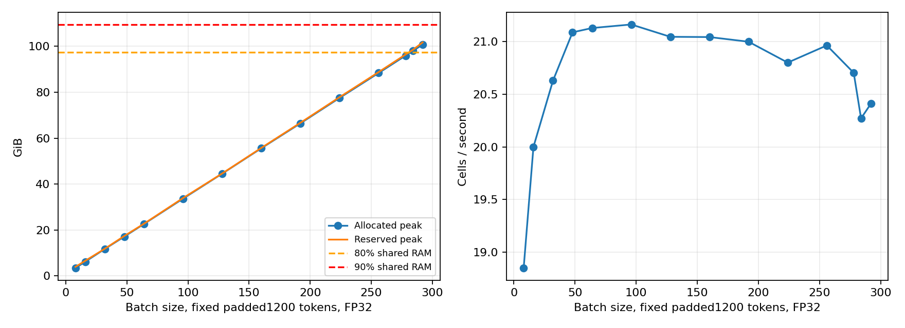

# scGPT 후속: batch 확대와 실제 메모리 용량

> 최신 통합판: [기본·모든 후속 실험을 합친 최종 보고서](FINAL.md). 입력·추론·학습별 메모리와 80% 목표 상태는 최종 보고서 첫 표를 확인한다.

## 입력을 읽는 법: 세포 행렬, 배치, 유전자 토큰

원본 발현 행렬의 구조는 **세포 × 유전자**다. 행 하나가 세포 하나, 열 하나가 유전자 하나이며, 교차하는 값이 그 세포에서 해당 유전자의 발현값이다. 따라서 **batch292는 세포292행을 한 번에 처리한다는 뜻**이다. 유전자292열을 선택한다는 뜻이 아니다.

다음은 설명용 예시이며 실제 측정 데이터의 값은 아니다.

| 세포(행) | 유전자 A(열) | 유전자 B(열) | 유전자 C(열) |
|---|---|---|---|
| 세포1 | 0 | 5 | 12 |
| 세포2 | 7 | 0 | 3 |

scGPT 전처리는 세포별 발현이 있는 유전자를 선택하고, 각 유전자의 ID에 변환한 발현값을 짝지어 입력한다. 이번 실험은 공식51-bin 전처리를 사용했다. **일반적인 유전자 토큰 하나는 유전자 하나를 나타내며, 발현값은 같은 위치에 대응하는 별도 값**이다. ID와 발현값을 각각 두 토큰으로 세지 않는다.

설명용 세포1의 입력은 `[CLS] [유전자 B + 변환한 발현값] [유전자 C + 변환한 발현값] …`처럼 생각하면 된다. CLS는 세포 전체의 표현을 모으는 특별 토큰이고, padding은 빈자리를 채우는 토큰이다. CLS 자체에 붙는 입력 값은 실제 유전자 발현값이 아니다.

**최대1200토큰 = CLS 1자리 + 유전자 최대1199자리**다. 실제 유전자가 적으면 남은 자리를 padding으로 채우고, 많으면 설정된 sampling 정책에 따라 일부 유전자를 선택한다. 따라서 모든 세포에 실제 유전자1200개를 넣었다는 뜻이 아니다. 토큰 위치는 원본 행렬의 고정된 유전자 열 번호와 다르며 세포별 유전자 ID로 구분한다.

GPU에는 유전자 ID 배열과 대응 발현값 배열이 들어간다. batch292의 고정 길이 학습 용량 실험에서는 두 배열의 입력 shape가 각각 **292세포 × 1200토큰 자리**였다. 그 뒤 모델 내부에서 위치별 벡터, attention 중간값 등이 생성되며 학습에서는 gradient와 optimizer 상태도 메모리를 사용한다. 입력 배열292×1200의 크기만으로 전체 메모리를 계산할 수 없다.

### 왜 전체 세포 수보다 배치가 순간 메모리에 영향을 주는가?

전체30만세포를 한꺼번에 GPU에 올리지 않고, `세포8개 전송 → 계산 → 결과를 CPU/파일에 저장 → 다음8개`처럼 나눠 처리한다. 배치와 실제 토큰 길이 등 조건이 같으면 전체 세포 수 증가는 주로 처리 횟수·총시간·출력 파일 크기를 늘린다. 순간 GPU 메모리가 세포 수에 비례해 증가하지는 않는다. 세포별 길이 분포가 달라지면 dynamic padding을 통해 메모리가 달라질 수 있다.

### 추론 결과와 학습 용량 결과를 구분하기

| 실험 | 배치(세포 수) | 입력 길이 정책 | CUDA allocated peak | 전체 공유RAM121.688GiB 대비 |
|---|---|---|---|---|
| 실제30만 고유세포 임베딩 추론 | 8 | 최대1200, 배치 내 실제 최대길이로 padding | 0.389GiB | 약0.32% |
| 같은 실제30만 고유세포 임베딩 추론 | 256 | 위와 동일한 cache·길이 정책 | 5.477GiB | 약4.50% |
| 별도 학습 용량 probe | 292 | 모든 입력을1200자리로 고정 padding | 100.750GiB | 약82.79% |

**82.79%는 batch292의 고정 padding 학습 용량 실험에서 관측한 값**이다. batch256 실제데이터 추론에서80%를 사용한 것이 아니다. 서로 다른 학습 상태·padding 정책·데이터 조건이므로 위 행 사이의 차이를 배치만의 효과로 해석하지 않는다. 학습 용량 probe는 실제1000학습세포 cache의 부분집합을 측정 step 동안 반복한 실험이며30만세포 학습 실험이 아니다.

GPU 연산 사용률(예:95%)은 GPU 커널이 활동한 시간 비율이다. 메모리 비율은 여기서 CUDA allocated peak를 CPU/GPU 공유RAM121.688GiB로 나눈 참고값이다. 둘은 다른 지표이며 별도 전용VRAM 점유율로 해석하지 않는다. reserved는 allocator가 확보한 예약 공간으로 allocated와 구분한다.

기본10종 완료 이후 별도 승인으로 실행한 **학습 자원용량 실험**이다. FP32·최대1200token·동일모델·전처리·optimizer를 고정하고 batch를 확대했다. 모델정확도 개선 실험이 아니다.

관측 최대 **batch292: CUDA allocated peak 100.750GiB / 공유RAM 121.688GiB = 82.79%**. 80% 초과: True; 90% 도달: False.

80% 기준 97.350GiB,90% 기준 109.519GiB다. 공유메모리에서이비율은전용VRAM점유율이나시스템전체사용률과같지않다. 최대성공batch는시험범위중최대이며이론적한계가아니다.

| batch | 고유세포 | 실제입력shape | step/반복 | 초 | 세포/초 | allocatedpeakGiB | reservedpeakGiB | 할당/공유RAM% | GPU평균/최대% | 가용RAM sampled최소GiB |
| --- | --- | --- | --- | --- | --- | --- | --- | --- | --- | --- |
| 8 | 8 | [8, 1200] | 36 | 15.28 | 18.85 | 3.390 | 3.922 | 2.79 | 89.5/95 | 108.295 |
| 16 | 16 | [16, 1200] | 19 | 15.20 | 20.00 | 6.153 | 6.562 | 5.06 | 89.1/95 | 105.676 |
| 32 | 32 | [32, 1200] | 10 | 15.51 | 20.63 | 11.704 | 11.812 | 9.62 | 92.1/95 | 100.381 |
| 48 | 48 | [48, 1200] | 7 | 15.93 | 21.09 | 17.097 | 17.379 | 14.05 | 91.7/95 | 94.677 |
| 64 | 64 | [64, 1200] | 5 | 15.15 | 21.13 | 22.574 | 22.695 | 18.55 | 90.8/95 | 89.274 |
| 96 | 96 | [96, 1200] | 4 | 18.15 | 21.16 | 33.629 | 33.889 | 27.64 | 93.7/95 | 77.938 |
| 128 | 128 | [128, 1200] | 3 | 18.25 | 21.05 | 44.513 | 44.598 | 36.58 | 93.7/95 | 66.771 |
| 160 | 160 | [160, 1200] | 3 | 22.81 | 21.04 | 55.566 | 55.736 | 45.66 | 91.9/95 | 55.690 |
| 192 | 192 | [192, 1200] | 3 | 27.43 | 21.00 | 66.436 | 66.689 | 54.60 | 94.2/96 | 44.629 |
| 224 | 224 | [224, 1200] | 3 | 32.31 | 20.80 | 77.510 | 77.828 | 63.70 | 93.6/96 | 32.619 |
| 256 | 256 | [256, 1200] | 3 | 36.64 | 20.96 | 88.375 | 88.783 | 72.62 | 93.3/96 | 21.983 |
| 278 | 278 | [278, 1200] | 3 | 40.28 | 20.70 | 95.947 | 96.430 | 78.85 | 93.7/96 | 14.050 |
| 284 | 284 | [284, 1200] | 3 | 42.03 | 20.27 | 98.002 | 98.465 | 80.54 | 92.3/95 | 11.926 |
| 292 | 292 | [292, 1200] | 3 | 42.92 | 20.41 | 100.750 | 101.738 | 82.79 | 94.3/96 | 8.863 |

batch8 대비 최대메모리 조건의처리량은약1.08배다. 메모리는 3.39→100.75GiB로늘었다. 중간batch에서이미처리량이비슷하면더큰batch의추가메모리효용은작다.

## 정확한 입력·학습·시간 범위

기존실제train1000세포의학습token화cache(gene IDs,expression bins,13개세포유형정답)를사용했다. 한batch내중복세포는없으며firstB중첩부분집합을같은조건에서여러step반복한다. 각condition은최소3step/15초이고실제step수를표에썼다. 작은batch는더많은측정step을반복하므로다른학습량의정확도비교로쓰지않는다.

각batch는동일pretrainedencoder·seed42새classifier·새AdamW에서시작한다. FP32/TF32=False,AdamWlr1e-4/wd.01/betas.9,.999/eps1e-8/gradientclip1.0을고정했다. 원본51bin·CLS전처리이며가중치이론량·실측적재량과실행중activation/gradient/optimizer증가를구분한다. 각run summary의parameters와model_only_postload에있다.

**이용량실험은모든batch를1200열까지padding한cache를그대로사용한다.** 원본일반학습은batch내최대실제길이에맞춘dynamicpadding을사용하므로평균시간을원본실험과직접비교하지않는다. 실제nonpad token평균은약300대이며,나머지padding도dense학습의메모리/계산비용을발생시킨다. 따라서90%에가까운할당이모두유효한유전자계산량이라는뜻은아니다. 일관된1200길이조건의capacity상한조사다.

시간에는cached batch구성·CPU→GPU·forward/classifier/loss·backward·gradientclip·optimizer와step경계CUDA동기화를포함한다. imports·모델적재·H5읽기·token화·probe가중치저장은제외했다. 각조건allocatorpeak는reset하고현재baseline도별도로기록했다. GPU-Util은활동시간비율로FLOPS/메모리%가아니다.

원본기본결과는보존했다. capacity probe후가중치는각run/probe_models/batch_B.pt에별도저장했으며모델초기화는initial_state.pt,구조는model_config.json이다. 이probe가중치를검증된생물학적최종모델로채택하지않았고,학습재개/정확도평가를주장하지않는다.

## 중단·측정 한계

시스템MemAvailable8GiB미만또는swap+2GiB에서자체프로세스를중단한다. 다음batch예상reserved가현재예약량+가용량−8GiB예산을넘으면확대전에중단하거나예상안전batch로축소한다. 첫coarse sweep은8%예측여유,80%경계refine은이전실측에대해2%여유를적용했다. 중단은90%불가능증명이나모델절대최대가아니다.

- `memory_batch_20261027_213310_982032`: complete / tested_predicted_safe_cap
- `memory_batch_refine_20261027_214026_294469`: complete / available_unique_input_limit

reserved는cache/단편화포함이며실제살아있는tensor할당과다르다. nvidia-smi는SparkVRAM용량을제공하지않으므로PyTorchcounter와전체공유RAM·시스템가용량을구분했다. RSS와CUDA는더하지않는다. RSS/가용량은0.5초대기+조회시계열sampled값이며순간최저를보장하지않는다.

## 원본 경로

- [run memory_batch_20261027_213310_982032](../results/memory_batch_20261027_213310_982032/summary.json) · 로그 (로컬 보관: `../results/memory_batch_20261027_213310_982032/run.log`) · [시계열](../results/memory_batch_20261027_213310_982032/resources.csv)
- [run memory_batch_refine_20261027_214026_294469](../results/memory_batch_refine_20261027_214026_294469/summary.json) · 로그 (로컬 보관: `../results/memory_batch_refine_20261027_214026_294469/run.log`) · [시계열](../results/memory_batch_refine_20261027_214026_294469/resources.csv)

[기본 scGPT 보고서](scGPT.md) · [기존모델·공식소스](https://github.com/bowang-lab/scGPT)
