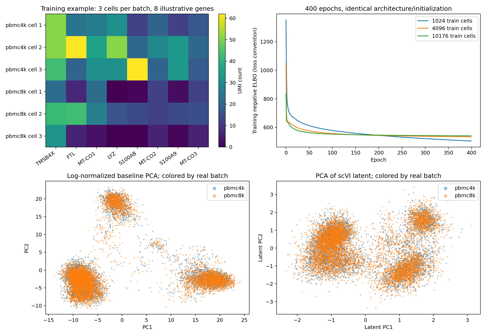

# scVI 최종 통합 보고서

## 1. 모델과 실제 입력

raw count의 세포×유전자 행렬과 실제생물학적batch → 세포당10차원 latent. 처음부터학습한SCVI 모델.

실제파일·입력/정답예시·전처리와모델구조설명은이문서5절에전문을포함했다. 추론데이터와지도학습label을구분하며,세포/유전자·서열/토큰·이미지/타일의단위를섞지않는다.

## 2. 실행 조건과 측정 기준

표의실제batch·입력shape·정밀도·epoch/step를먼저확인한다. GPU-Util은연산활동시간비율이고,메모리목표80%는약97.35GiB allocated다. 모델별학습범위(전체/부분/head-only/처음부터학습/용량probe)를같은학습으로가정하지않는다. 같은run의시간·메모리를사용하고예측정확도가미평가이면그대로표시한다.

## 3. 조건별 추론·학습 결과 — 한 표

아래시간은각원본조건의실측값이다. 조건별포함/제외범위는4~5절과원본기록에서확인한다. 대부분PyTorch CUDAallocated peak이나AlphaFold2는컴파일/warmup포함JAX프로세스누적peak다. RSS와CUDA를독립메모리처럼더하지않는다.

|작업|실제 입력·고유 데이터 수|동시 GPU batch·모양|학습량/반복|측정시간|처리량/step 참고|최대 메모리 / 공유RAM대비|성능·80% 상태|
|---|---|---|---|---|---|---|---|
|배치 추론|고유128개; 실제10x PBMC,2000유전자|batch128, {'unique_cells': 128, 'genes': 2000, 'raw_counts_source': 'saved adata.h5ad layers counts, actual 10x PBMC4k+8k', 'original_pool_cells': 12721, 'batch_covariate': 'sample_id, biological batch distinct from GPU batch'},FP32|13607회/총1741696건|15.00초|116105.69입력/초|0.039 GiB / 0.03%|출력finite·저장재로드·첫입력일치검증;80%미도달|
|배치 추론|고유10176개; 실제10x PBMC,2000유전자|batch10176, {'unique_cells': 10176, 'genes': 2000, 'raw_counts_source': 'saved adata.h5ad layers counts, actual 10x PBMC4k+8k', 'original_pool_cells': 12721, 'batch_covariate': 'sample_id, biological batch distinct from GPU batch'},FP32|122회/총1241472건|15.08초|82317.50입력/초|0.270 GiB / 0.22%|출력finite·저장재로드·첫입력일치검증;80%미도달|
|처음부터SCVI 학습|train10176/val1272/test1273세포|128세포×2000유전자,FP32|400epoch/32000step|159.07초(학습loop)|25589.51세포/초|0.097 GiB / 0.08%|latent 재로드검증·통합진단본문;80%미도달|

## 4. 결과 해석

같은실행경로에서batch를늘린행끼리메모리와처리량을비교한다. 전체고유데이터수와반복처리건수는다르다. 추론·학습·후처리의측정시간범위가다르면단순속도순위로해석하지않는다. 현재80%에도달한조건을이모델에서확인한것은아니며데이터pool한계·예상guard와실제실패를구분해본문에남겼다. 위주표에는동일조건의시간·메모리만연결했고미실시평가를성능성공으로표현하지않는다.

## 5. 실험 방법·입력 예시·기본/후속·평가·저장 상세


### scVI: 모델 크기·실제 학습 입력·GPU 사용률·메모리 검증


작성: 2026-10-27T19:13:56+09:00

#### 결과 요약

10x PBMC의 원시 UMI count로 scVI를 데이터별로 처음부터 학습했다. 1024/4096/10176개 훈련세포를 같은 2000개 유전자·batch 128·FP32·400 epochs로 비교하고, 마지막 저장 모델 한 개로 1024/4096/12721세포의 latent 추론을 측정했다. GPU 사용률과 GPU 메모리를 같은 표에 제시한다. 모든 GPU 작업은 순차 실행했다.

세포 수를 늘리면 전체 처리 시간은 늘었지만 한 배치의 크기는 같으므로 peak 메모리는 거의 같았다. 이 조건에서는 80% GPU-Util에 도달하지 않았으며 배치·정밀도·모델을 사용률 목표에 맞춰 바꾸지 않았다. batch 통합 관련 지표는 원래 baseline에서도 두 batch가 잘 섞여 있어 뚜렷한 개선을 입증하지 못했다.

#### 1. 어떤 공개 모델이며 얼마나 큰가

| 항목 | 확인값 |
| --- | --- |
| 공개 구현 | scvi-tools 1.5.1, scvi.model.SCVI |
| 공개 사전학습 체크포인트 | 사용하지 않음. SCVI 기본 구조를 seed42로 초기화해 데이터별 학습 |
| 전체 파라미터 | 1,293,526 |
| configured requires_grad 파라미터 | 1,293,526 |
| 실제 첫 backward에서 gradient가 있던 파라미터 | 778,884 |
| latent 추론 z_encoder 파라미터 | 258,964 |
| 구조 | 2000 genes → hidden128, 1 layer → Normal latent10; decoder는 batch-conditioned ZINB |
| dropout / dispersion | 0.1 / gene |
| 가중치·계산 정밀도 | FP32, TF32 disabled, Lightning 32-true |
| 이론 FP32 가중치 용량 | 0.004819 GiB (parameter count × 4 bytes; 실행 메모리 아님) |
| 모델 초기화 동일성 | 세 학습 조건 모두 SHA-256 a1a88a8f3b1b835b70a4716a83fe2013d646d8c0ef2bfff34afc5165b4bf4926 |
| 환경 | DGX Spark GB10 ARM64; NVIDIA PyTorch 26.06 이미지 내 별도 venv |
| PyTorch / CUDA | 2.13.0a0+8145d630e8.nv26.06 / CUDA13.3 forward compatibility |
| 기존 환경 보존 | scGPT 컨테이너·이미지·기존 host PyTorch 수정 없음 |

requires_grad 개수와 실제 사용되는 branch의 gradient 개수는 다르다. observed library size를 사용하는 기본 경로에서 쓰이지 않는 branch도 module의 전체 파라미터에 포함된다. 학습 후 17개 parameter tensor의 갱신을 확인했다. scVI를 사전학습 모델 파인튜닝이나 scANVI 세포 유형 분류로 표현하지 않는다.

#### 2. 모델만 로드하면 얼마를 할당하는가

| 저장 모델 | 로드 전 allocated GiB | 로드 직후 allocated GiB | 모델 로드 증가 GiB | 로드 peak GiB | CPU RSS 직후 GiB |
| --- | --- | --- | --- | --- | --- |
| train_1024 | 0.000000 | 0.004826 | 0.004826 | 0.009651 | 1.054 |
| train_4096 | 0.031250 | 0.036076 | 0.004826 | 0.040901 | 1.557 |
| train_10176 | 0.031250 | 0.036076 | 0.004826 | 0.040901 | 1.604 |

첫 모델의 깨끗한 CUDA allocator 기준으로 **모델 적재 직후 0.004826 GiB (약 4.94 MiB)**였다. CUDA 초기화와 saved AnnData의 CPU 읽기는 기준 시점 전에 끝냈고, GPU forward와 optimizer 로드는 하지 않았다. 따라서 GPU에는 모델만 올라간 상태지만 CPU RSS에는 미리 읽은 데이터·라이브러리·registry가 포함된다.

두 번째·세 번째 모델은 같은 독립 검증 프로세스에서 앞선 inference 뒤의 0.03125 GiB 상주 할당이 남아 있어 absolute post-load가 더 크다. 이 32 MiB의 원인은 본 실험에서 세분화하지 않았다. 각 모델 적재의 전후 차이는 같았다. 물리 메모리 사용량과 PyTorch allocator 수치를 동일시하지 않는다.

#### 3. 학습 데이터는 어떻게 생겼는가

10x Genomics Cell Ranger 2.1.0의 pbmc4k·pbmc8k **filtered cell barcode의 raw UMI count**를 사용했다. filtered는 세포 선택을 뜻하며 log-normalization이 적용됐다는 뜻이 아니다. count 값은 정수값을 가진 float32 CSR sparse이고 비음수·유한값·고유 cell ID를 검사했다. 원본 12721세포 × 33694유전자에서 훈련세포만으로 batch-aware Seurat v3 HVG 2000개를 선택했다. count layer에는 normalize/log1p를 적용하지 않았다.

| 자료 | 원본 shape | 실제 batch | donor | 출처 |
| --- | --- | --- | --- | --- |
| PBMC4k | 4340 × 33694 | pbmc4k | 동일 healthy donor | 10x Cell Ranger2.1.0 |
| PBMC8k | 8381 × 33694 | pbmc8k | 동일 healthy donor | 10x Cell Ranger2.1.0 |
| 학습 입력 | 12721 × 2000 | 2개 실제 실험 batch | 1명 | HVG는 training cells에서만 선택 |

세포 유형 정답 라벨은 없다. 학습의 복원 대상은 입력 raw count 자체이며 sample_id는 batch covariate다. 이를 정답 cell-type 라벨로 쓰지 않았다. 다음은 각 batch의 앞 3개 훈련세포와, 이 6개 세포에서 count 합이 큰 8개 유전자를 고른 실제 행렬 예시다. 독자가 비영 count를 확인하기 위한 전시용 선택이며 실제 학습에는 선정된 2000개 유전자를 전부 사용했다.

| cell | TMSB4X | FTL | MT-CO1 | LYZ | S100A8 | MT-CO2 | S100A9 | MT-CO3 |
| --- | --- | --- | --- | --- | --- | --- | --- | --- |
| pbmc4k_AAACCTGAGAAGGCCT-1 | 51 | 24 | 26 | 31 | 12 | 20 | 12 | 17 |
| pbmc4k_AAACCTGAGACAGACC-1 | 51 | 62 | 36 | 51 | 21 | 29 | 33 | 21 |
| pbmc4k_AAACCTGAGATAGTCA-1 | 43 | 20 | 31 | 31 | 62 | 20 | 33 | 18 |
| pbmc8k_AAACCTGAGCATCATC-1 | 22 | 7 | 22 | 0 | 1 | 12 | 2 | 12 |
| pbmc8k_AAACCTGAGCTAACTC-1 | 42 | 43 | 27 | 16 | 14 | 12 | 14 | 15 |
| pbmc8k_AAACCTGCACATTAGC-1 | 32 | 6 | 3 | 0 | 0 | 6 | 1 | 6 |

같은 행에는 sample_id, original_barcode, total_umi, detected_genes, split 메타데이터가 연결된다. 전체 셀·유전자 목록은 input run의 cells.csv/genes.csv, 실제 행렬 예시는 reports/training_input_example.csv에 보관했다. latent 출력은 각 세포당 float32 숫자 10개이며 latent_example.csv에 실제 값을 저장했다.

```text
원본 [12721 cells, 33694 genes] raw UMI
 → training-only HVG 선택 [12721, 2000]
 → GPU minibatch [최대 128, 2000] float32
 → latent posterior mean [최대 128, 10]
 → batch-conditioned ZINB decoder / count reconstruction
```

##### 분리와 규모 비교

| 집합 | 세포 수 | pbmc4k / pbmc8k |
| --- | --- | --- |
| train_1024 | 1024 | 350 / 674 |
| train_4096 | 4096 | 1398 / 2698 |
| train | 10176 | 3472 / 6704 |
| validation | 1272 | 434 / 838 |
| test | 1273 | 434 / 839 |

training 부분집합은 중첩 구조이고 batch·UMI 깊이 구간 분포를 층화했다. 깊이 구간은 전체 자료 QC 정보를 사용하므로 완전히 blind한 표본 선정은 아니다. Validation 1272개와 test 1273개는 세 모델에서 동일하며 parameter update에 사용하지 않았다. optimizer와 epoch 수·중단 정책을 고정했고 test로 조건을 선택하지 않았다. 같은 donor 안에서의 random split이며 donor-independent 일반화 검증은 아니다.

#### 4. 입력 조건에 따른 GPU 사용률과 메모리

기본 batch 128, FP32를 고정했다. 아래 모델 로드 기준과 실행 peak는 서로 다른 run에서 얻었으므로 증가량은 **참고 차이**다. 정확히 같은 run의 baseline 전후 차이라고 쓰지 않는다. 학습 추가량에는 gradient·optimizer·중간값·작업 buffer가 포함된다.

| 학습 고유세포 / genes | 실제 GPU 입력 | GPU 평균 / 최대 % | 모델 로드 기준 GiB | fit allocated peak GiB | 기준 대비 참고 증가 GiB |
| --- | --- | --- | --- | --- | --- |
| 1024 / 2000 | [≤128, 2000] | 21.80 / 30 | 0.004826 | 0.097363 | 0.092537 |
| 4096 / 2000 | [≤128, 2000] | 26.55 / 32 | 0.004826 | 0.097439 | 0.092614 |
| 10176 / 2000 | [≤128, 2000] | 25.76 / 33 | 0.004826 | 0.097439 | 0.092614 |

| 추론 고유세포 / genes | 실제 GPU 입력 | GPU 평균 / 최대 % | 모델 로드 기준 GiB | allocated peak GiB | 기준 대비 참고 증가 GiB |
| --- | --- | --- | --- | --- | --- |
| 1024 / 2000 | [≤128, 2000] | 24.07 / 29 | 0.004826 | 0.039019 | 0.034193 |
| 4096 / 2000 | [≤128, 2000] | 27.73 / 31 | 0.004826 | 0.039019 | 0.034193 |
| 12721 / 2000 | [≤128, 2000] | 29.10 / 33 | 0.004826 | 0.039019 | 0.034193 |

세포당 2000개 입력 유전자와 hidden/latent 구조가 같아 모델 크기는 동일하다. 세포 수는 전체 처리 건수를 늘릴 뿐 GPU에 한번에 올라가는 크기를 바꾸지 않으므로 peak가 거의 일정했다. 유전자 수를 바꾸면 encoder/decoder parameter 수와 복원 과제가 함께 바뀌므로 같은 모델의 단순 길이 비교로 취급하지 않았다.

#### 5. 학습·추론 시간과 처리량

| 학습 세포 | epochs / optimizer steps | 총 학습 처리 건수 | train loop s | validation loop s | fit wall s | cell/s |
| --- | --- | --- | --- | --- | --- | --- |
| 1024 | 400 / 3200 | 409600 | 19.424 | 0.420 | 20.263 | 21087.3 |
| 4096 | 400 / 12800 | 1638400 | 60.201 | 0.424 | 61.060 | 27215.3 |
| 10176 | 400 / 32000 | 4070400 | 159.065 | 0.415 | 159.903 | 25589.5 |

| 추론 고유세포 | 반복 / 총 처리 | 실행 s | 저장 s | cell/s | RSS sampled peak GiB | MemAvailable 최소 GiB |
| --- | --- | --- | --- | --- | --- | --- |
| 1024 | 3546 / 3631104 | 15.002 | 0.003 | 242037.7 | 1.616 | 113.014 |
| 4096 | 1020 / 4177920 | 15.010 | 0.006 | 278335.3 | 1.613 | 112.974 |
| 12721 | 352 / 4477792 | 15.013 | 0.016 | 298263.8 | 1.615 | 113.044 |

추론은 동일한 10176세포 학습 모델 하나를 사용했고 posterior mean을 얻었다. 0.5초 GPU 표본을 충분히 확보하려고 조건마다 최소 15초·최소 3회 반복했다. 많은 총 처리 건수는 동일 데이터의 반복이며 고유 데이터가 그만큼 많다는 뜻이 아니다. 매 반복 출력이 첫 출력과 일치하는지도 검사했다.

| 학습 세포 | 입력 준비 s | 초기화 s | 평가 s | 모델/AnnData 저장 s | RSS peak GiB | MemAvailable 최소 GiB |
| --- | --- | --- | --- | --- | --- | --- |
| 1024 | 0.016 | 0.214 | 0.042 | 0.095 | 1.955 | 112.789 |
| 4096 | 0.017 | 0.168 | 0.039 | 0.065 | 1.989 | 112.478 |
| 10176 | 0.017 | 0.010 | 0.032 | 0.061 | 2.060 | 112.388 |

초기 count 입력 준비는 3.832초였다. training은 400 epochs, Adam lr=1e-3, weight_decay=1e-6, eps=0.01, KL warmup400 epochs, validation 주기20, early stopping False다. 각 조건은 단일 seed·단일 학습 실행이다. 큰 training set은 고유세포뿐 아니라 optimizer step 수도 많아 정확도 차이를 단순한 입력 개수 효과로 분리할 수 없다.

#### 6. 평가·batch integration·재로드

| 학습 고유세포 | validation ELBO | 독립 test ELBO | 독립 재로드 test cells | 재로드 최대 절대 차이 |
| --- | --- | --- | --- | --- |
| 1024 | -620.406 | -597.572 | 1273 | 0.0 |
| 4096 | -567.465 | -548.418 | 1273 | 0.0 |
| 10176 | -554.151 | -536.274 | 1273 | 0.0 |

scvi-tools 1.5.1의 get_elbo는 ELBO를 반환해 높을수록 좋다. 학습 history/그래프의 elbo_train은 loss 관례의 양수 negative ELBO라 부호를 구분해야 한다. ELBO는 cell-type accuracy가 아니다.

| held-out test1273 지표 | log-normalized PCA | SCVI latent |
| --- | --- | --- |
| batch_silhouette | 0.000836 | 0.001080 |
| mean_normalized_batch_knn_entropy | 0.908868 | 0.909826 |
| batch_prediction_balanced_accuracy | 0.508183 | 0.500000 |

batch silhouette는 0에 가깝고 30-neighbor batch entropy는 두 방법 모두 높다. 실제 batch를 예측하는 진단 분류기의 balanced accuracy도 둘 다 chance 수준이다. baseline부터 잘 섞여 있던 같은 donor 자료이므로 큰 batch correction 개선을 주장할 수 없다. cell-type 라벨 없이 과도한 biological mixing 여부를 검증하지 못한다. scVI 조건부 생성 기능으로 두 batch를 평균한 normalized expression 예시 [128,2000]도 저장했지만 이 값은 raw 학습 입력이 아니다.


저장 모델 3개를 새 OS 프로세스에서 다시 불러와 각 1273개 test의 10차원 latent가 원본과 정확히 일치함을 확인했다. 공식 model.pt·registry·init 설정·var 순서·AnnData를 보관했고 별도로 trainer.ckpt(optimizer/epoch), RNG도 저장했다. 상태 저장은 했지만 학습 재개 자체를 검증하지 않아 재개 성공으로 쓰지 않는다.

#### 계측 범위·제약

시간 구간 경계에서 torch.cuda.synchronize()를 호출했다. train loop는 데이터 로딩·전송·forward·backward·optimizer·일부 프레임워크 overhead를 포함하며 validation loop와 구분한다. fit wall은 Trainer 전체다. inference 시간은 표준 scVI 데이터 로더·전송·encoder·CPU latent 반환·유한값/반복 일치 검사까지 포함하고 파일 저장은 제외한다. 별도 JIT/torch.compile은 사용하지 않았다. 작은 GPU smoke [32,2000]→[32,10] CUDA float32를 확인했고 추론 첫128셀 warmup 0.004초는 본 측정에서 제외했다.

GPU-Util·RSS·MemAvailable·swap은 0.5초 간격 sampled 값이다. GPU 평균은 해당 phase에 시작하고 동기화 측정 구간 안에서 끝난 query 표본을 사용한다. NVML 내부 집계 window는 phase 경계를 걸칠 수 있다. validation은 합계 약0.4초처럼 짧아 단독 GPU 평균을 신뢰할 수 없어 주 비교표에서 사용하지 않았다. RSS sampled peak는 정확한 최고치가 아니다. GPU-Util은 장치 전체 커널 활동 시간 비율이며 FLOPS/SM occupancy/메모리 비율이 아니다. 디스플레이·브라우저 부하도 포함될 수 있다.

메모리 비교는 PyTorch allocator allocated/reserved, 프로세스 RSS, 시스템 MemAvailable을 구분한다. 공유 DRAM121.688GiB에서 이를 합산하지 않았고 GPU dedicated VRAM 비율로 표현하지 않았다. 시스템 swap 증가는 없고 가용 RAM은 충분했다. 낮은 GPU 사용률의 특정 원인을 CPU profiler로 확정하지 않았다. 작은 encoder/MLP·기본 batch·일반 데이터 로딩 경로가 가능한 설명이지만 병목 분해는 미수행이다.

복구 과정: 첫1024세포 학습과 저장 후 로그 event에 condition 키가 중복돼 Python 오류가 났고, 다음 실행에서 중복 학습 없이 저장 결과를 재사용했다. 4096/10176 학습 완료 후에는 load API에 device=0을 장치 개수로 전달해 오류가 나서 device=1로 수정했다. 세 학습을 모두 재사용하고 로딩·추론 단계만 새 run에서 이어갔다. 실패 run의 종료 코드1과 로그를 보존했으며 최신 완료 run은 종료 코드0이다.

#### 저장 경로·실행

| 항목 | 호스트 경로 |
| --- | --- |
| 입력 확인 | /home/hyein/ai-benchmark/scvi/results/inputs_20261027_093652_887319 |
| 최종 run | /home/hyein/ai-benchmark/scvi/results/scvi_20261027_185901_460537 |
| raw source·processed_counts.h5ad | /home/hyein/ai-benchmark/scvi/data |
| 세 학습 모델 | /home/hyein/ai-benchmark/scvi/models/scvi_20261027_184921_028161/train_1024, /home/hyein/ai-benchmark/scvi/models/scvi_20261027_185327_767988/train_4096, /home/hyein/ai-benchmark/scvi/models/scvi_20261027_185327_767988/train_10176 |
| 독립 재로드·모델 로딩 기준값 | /home/hyein/ai-benchmark/scvi/results/scvi_20261027_185901_460537/independent_reload.json / /home/hyein/ai-benchmark/scvi/results/scvi_20261027_185901_460537/loading_baselines_annotated.json |
| 입력 예시 | /home/hyein/ai-benchmark/scvi/reports/training_input_example.csv |
| 비교 CSV | /home/hyein/ai-benchmark/scvi/reports/comparison.csv |
| 보고서 | /home/hyein/ai-benchmark/scvi/reports/scVI.md |

각 학습 source_run의 resources.csv와 epoch_timings, 학습곡선, test latent, 명령·환경·패키지 버전·입력split·초기화 해시를 보관했다. 최신 run에서 재사용한 학습 숫자의 원본 시계열은 source_run으로 연결된다. 모든 컨테이너 결과는 host bind /work 경로에 저장된다.

```bash
cd /home/hyein/ai-benchmark
# 동일한 준비 입력으로 새로운 run을 만들며 기존 결과를 보존한다.
python3 scvi/scripts/launch.py
# 재로드 검증은 기존 GPU 작업이 끝난 후 하나씩 실행한다.
```

#### 공식 출처

- [scVI API·기본 구조](https://docs.scvi-tools.org/en/stable/api/reference/scvi.model.SCVI.html)
- [공식 count 입력·학습 예제](https://docs.scvi-tools.org/en/stable/tutorials/notebooks/quick_start/api_overview.html)
- [scvi-tools1.5.1 source](https://github.com/scverse/scvi-tools/tree/1.5.1)
- [10x PBMC4k (CC BY4.0)](https://www.10xgenomics.com/datasets/4-k-pbm-cs-from-a-healthy-donor-2-standard-2-1-0)
- [10x PBMC8k (CC BY4.0)](https://www.10xgenomics.com/datasets/8-k-pbm-cs-from-a-healthy-donor-2-standard-2-1-0)
- [Spark 공유 메모리](https://docs.nvidia.com/dgx/dgx-spark/known-issues.html)

### 3. 후속 실험 통합 — 배치 확대 및 자원 검증

### scvi 실제 입력의 배치별 추론 자원


상태 **complete** · run `batch_followup_20261028_142752_517769` · 종료사유 `available_unique_input_limit`

#### 입력과 고정 조건

{
  "source": "saved full10176cell SCVI model and its raw-count AnnData, fixed2000genes; latent posterior mean",
  "unique_available_inputs": 10176,
  "selection": "nested original order, exact sequence deduplication, no synthetic copies; inference only, original split metadata retained",
  "token_policy": "fixed CPU pool-wide padding width across batch conditions, no tokenizer truncation; actual shapes in workers"
}

배치는한번에GPU에서계산하는독립입력개수다. scVI는세포수,서열모델은서열수이며원본전체데이터개수와다르다. 실제기존공개데이터의중첩고유부분집합을사용한다. 반복처리는관측시간확보용이며고유데이터를늘렸다는뜻이아니다. 길이crop·tokenization·dtype·체크포인트를고정하고batch만확대한다. 실제input_shapes와ID는각batch/summary에있고원본입력선택은inputs.json또는저장scVIadata에있다.

FP32/TF32=False/seed42,각조건fresh container. 기존정상환경·모델·데이터를보존하고로컬가중치만재사용한다. 전체/실제사용backbone 파라미터수·모델출처·기본학습/정확도평가는기본모델보고서를참조한다. 각새run의전체파라미터수·적재기준값·모델로딩/warmup시간·Torch/CUDA·저장출력은batch별summary에있다. 이번실험은추론만수행하므로학습파라미터0이다.

#### 배치별 측정

측정은cache 이후배치구성/전송·forward·pooling/latent계산·CPU반환을포함한다. 다운로드·입력선택/crop·tokenization·모델로딩·warmup·파일저장은제외한다. scVI공식latent API는내부데이터로더구성을포함한다. OpenSpliceAI는동일5개모델ensemble을순차평가한다. 최솟값2회·15초이상반복이며실제횟수를기록한다.

|batch/고유입력|반복|총처리|초|입력/초|모델적재GiB|allocated peak GiB|적재대비추가GiB|reserved peak GiB|공유RAM대비%|GPU평균/최대%|RSS sampled peak GiB|가용 sampled 최소GiB|
|---|---|---|---|---|---|---|---|---|---|---|---|---|
|128|13607|1741696|15.001|116105.6941|0.0048|0.039|0.0342|0.041|0.032|15.6897|19.0|1.5399|112.4895|
|256|11926|3053056|15.0007|203528.1284|0.0048|0.0419|0.0371|0.0566|0.0345|17.4138|20.0|1.5383|112.371|
|512|10058|5149696|15.0006|343299.507|0.0048|0.0478|0.0429|0.0566|0.0393|20.1724|24.0|1.5434|112.4101|
|1024|7756|7942144|15.0008|529446.5185|0.0048|0.0595|0.0546|0.0762|0.0489|26.1724|29.0|1.5465|112.4435|
|2048|4718|9662464|15.0018|644088.376|0.0048|0.084|0.0791|0.0859|0.069|24.2414|26.0|1.534|112.3655|
|4096|2211|9056256|15.0009|603715.4809|0.0048|0.1318|0.127|0.1504|0.1083|24.8621|28.0|1.5626|112.3741|
|8192|154|1261568|15.0271|83952.6489|0.0048|0.2232|0.2184|0.2461|0.1834|5.7931|7.0|1.6075|112.1286|
|10176|122|1241472|15.0815|82317.5007|0.0048|0.2696|0.2647|0.2871|0.2215|4.7241|8.0|1.6315|112.0164|

#### 결과 해석과 검증

최대시험성공batch 10176. allocated80%도달 False,90%도달 False. 실제고유입력pool한계/안전guard로중단할수있으며모델절대한계를뜻하지않는다. 다음예약량예측은보수적안전추정이며실측실패와구분한다.

출력shape·전체finite·저장후정확재로드·동일첫입력의배치별예측일치검사를수행한다. 결과가안맞거나실패하면성공행에넣지않고batch로그/exit/summary에보관한다. 독립생물학적정확도평가/학습을추가수행한결과가아니다. 원래모델의기본학습/재로드/test결과를재사용한다.

GPU-Util은계산활동시간비율이며메모리비율이아니다. CUDA allocated/reserved는프로세스allocator이고공유RAM약121.688GiB대비비율은전용VRAM점유율이아니다. RSS와CUDA를더하지않는다. 모델적재와추가메모리는같은worker에서측정했다. RSS/MemAvailable은0.5초대기+조회간격sampled값이다. 가용16GiB·swap증가2GiB guard와다음batch예약예측으로확대를중단한다.

원본설정·코드·환경·input IDs·cache·출력·GPU시계열·명령·종료코드는실행폴더와scripts/remaining_followups에보관한다. 새학습은수행하지않아분류라벨을자원실험의정답으로사용하지않는다.

[공식 출처](https://docs.scvi-tools.org/en/stable/tutorials/notebooks/quick_start/api_overview.html) · [기존 모델 보고서 디렉터리](.)

### 기록 해석

본문의과거완료표시는해당run의실행·저장상태이다. 사용자목표인80%메모리도달여부는이문서첫표를우선한다. 미도달/미확인을불가능으로해석하지않으며,학습미실시·데이터pool제한·예상예약guard·실패run을완료된성공조건과구분한다.


## 6. 실제 실행 코드·명령어 전문

<!-- EXECUTED_SCRIPTS_START -->

### 원문과 출처 검증

아래 코드 블록은 원본 내용을 생략하거나 재작성하지 않았다. 각 파일의 원래 경로·원문 SHA256·출처 상태를 함께 기록했다. `실행 run 저장 snapshot`을 우선하고, 현재 소스만 남은 경우에는 당시 파일과 같다고 단정하지 않는다. 동일 바이트 버전은 한 번만 수록하고 해당 경로들을 함께 표시한다.

GitHub에는 `.py`/`.sh`를 별도 파일로 두지 않는다. 코드 블록을 원래 경로에 저장하거나 [복원 안내](../../docs/RESTORE_FILES.md)의 코드로 로컬에서 복원한다. 라이브러리 전체 소스는 이 사용자 실행 스크립트와 구분하며 패키지 버전/출처를 따른다.

### 코드 목록

|원래 파일|원문 SHA256|출처 상태|
|---|---|---|
|`scvi/scripts/benchmark.py`|`a3ca63437414a72298ab23f77f7fe17e30b98a57bbe3138398dcb9a08b62a3fc`|현재 보관 소스; 실행 당시와의 바이트 동일성은 별도 근거가 없는 경우 미검증|
|`scvi/results/scvi_20261027_185901_460537/benchmark.py`|`a3ca63437414a72298ab23f77f7fe17e30b98a57bbe3138398dcb9a08b62a3fc`|실행 run 저장 snapshot; 실패·재시도 버전도 경로 그대로 보존|
|`scvi/scripts/download_data.py`|`c9180afb6d36ddb7be409efb35c6a1356f60cb2bd73c931f80352204b14d9b8f`|현재 보관 소스; 실행 당시와의 바이트 동일성은 별도 근거가 없는 경우 미검증|
|`scvi/scripts/launch.py`|`55e8b33b69a2a08ed83d2d236d1aae2b5df23dbc6296cd55328ec6b68393462e`|현재 보관 소스; 실행 당시와의 바이트 동일성은 별도 근거가 없는 경우 미검증|
|`scvi/scripts/predict.py`|`77bc0219030fc8fbd543deebcf2a91b503cd461b8465336c0f786516feaec832`|현재 보관 소스; 실행 당시와의 바이트 동일성은 별도 근거가 없는 경우 미검증|
|`scvi/scripts/prepare_inputs.py`|`285efb06f82f3f740e5f78a42714849b3dbe91612e3262c4d6a1743cc10f4c51`|현재 보관 소스; 실행 당시와의 바이트 동일성은 별도 근거가 없는 경우 미검증|
|`scvi/scripts/report.py`|`f04419f65c34b21978e746673be92a3c41c8f61aaaacdd5e3f6ca09aa975f687`|현재 보관 소스; 실행 당시와의 바이트 동일성은 별도 근거가 없는 경우 미검증|
|`scvi/scripts/setup_env.py`|`61feab41808751423b12941a6b0ac7b20705ac6a08208a347e73580f13068414`|현재 보관 소스; 실행 당시와의 바이트 동일성은 별도 근거가 없는 경우 미검증|
|`scvi/scripts/verify_reload.py`|`77b5a2a1b19102254f898dc7630109ecbcf6d7bcd1dab50f8568b5202ff46d72`|현재 보관 소스; 실행 당시와의 바이트 동일성은 별도 근거가 없는 경우 미검증|
|`scvi/results/scvi_20261027_185327_767988/benchmark.py`|`b106d7b8a3a11165ebbe38d4ed0b6cf3141b8b5ca58fe49eb0ab255a3b234aaf`|실행 run 저장 snapshot; 실패·재시도 버전도 경로 그대로 보존|
|`scvi/results/scvi_20261027_184921_028161/benchmark.py`|`2a54d90a269cf167ee6dc6057ddd4e16659d8befbf7fb047cc23f272b15d6db5`|실행 run 저장 snapshot; 실패·재시도 버전도 경로 그대로 보존|
|`scripts/gpu_support.py`|`349a7dc8855cbf32ad999ac113f97c4cf496b0b0154dd7b8e54fe00af58632d2`|실행 계측 공통 helper 현재 보관본; 버전은 각 run 기록과 대조|
|`scripts/remaining_followups/launch.py`|`84ea6bdb09c57582e25bfc2adf9da1ba72bcc66836af78386532e5869488af63`|현재 보관 소스; 실행 당시와의 바이트 동일성은 별도 근거가 없는 경우 미검증|
|`scripts/remaining_followups/report.py`|`8b67b28dbc254521328fff13f7ad3b5abcef84f687eff838616e741ab957d700`|현재 보관 소스; 실행 당시와의 바이트 동일성은 별도 근거가 없는 경우 미검증|
|`scripts/remaining_followups/worker.py`|`e47c0fd347e235ec6529c9052da478986e5515c1d9b72dad653c2ac421ddff74`|현재 보관 소스; 실행 당시와의 바이트 동일성은 별도 근거가 없는 경우 미검증|

<details>
<summary>scvi/scripts/benchmark.py — 원문 전문 (18,015 bytes)</summary>


<!-- RESTORE_FILE {"path": "scvi/scripts/benchmark.py", "sha256": "a3ca63437414a72298ab23f77f7fe17e30b98a57bbe3138398dcb9a08b62a3fc", "encoding": "utf-8", "added_final_newline": false} -->
```python
"""scVI raw-count training and input-size GPU profiling, one GPU job at a time."""
import pathlib,sys,os,time,json,csv,datetime,threading,subprocess,random,hashlib,copy,traceback,gc,shutil,platform
import numpy as np,pandas as pd,torch,scanpy as sc,scvi,psutil
from lightning.pytorch.callbacks import Callback
from sklearn.model_selection import train_test_split
from sklearn.decomposition import PCA
from sklearn.metrics import silhouette_score,balanced_accuracy_score
from sklearn.neighbors import NearestNeighbors
from sklearn.linear_model import LogisticRegression
R=pathlib.Path('/work');O=R/'results'/sys.argv[1];O.mkdir(exist_ok=True);I=R/'results'/(R/'results/INPUT_LATEST').read_text().strip();shutil.copy2(__file__,O/'benchmark.py');shutil.copy2(I/'input_report.json',O/'input_report.json');shutil.copy2(I/'splits.json',O/'splits.json');shutil.copy2(I/'pip_freeze.txt',O/'pip_freeze.txt');shutil.copy2(R/'data/sources.json',O/'sources.json')
phase='setup';condition='setup';stop=threading.Event();samples=[];proc=psutil.Process();initialswap=psutil.swap_memory().used;allstart=time.perf_counter()
def write(name,obj):(O/name).write_text(json.dumps(obj,ensure_ascii=False,indent=2,allow_nan=False,default=lambda x:x.item() if hasattr(x,'item') else str(x)))
def event(kind,**kw):
 row={'time_unix':time.time(),'kind':kind,'condition':condition,'phase':phase,**kw}
 with (O/'events.jsonl').open('a') as f:f.write(json.dumps(row,ensure_ascii=False,default=str)+'\n')
 print(json.dumps(row,ensure_ascii=False,default=str),flush=True)
def monitor():
 with (O/'resources.csv').open('w') as f:
  w=csv.DictWriter(f,fieldnames=['query_start','query_end','condition','phase','gpu_util_percent','rss_bytes','available_bytes','swap_bytes']);w.writeheader()
  while not stop.is_set():
   start=time.time();ph=phase;c=condition
   try:
    p=subprocess.run(['nvidia-smi','--query-gpu=utilization.gpu','--format=csv,noheader,nounits'],capture_output=True,text=True,timeout=3);util=float(p.stdout.strip()) if p.returncode==0 else None
   except Exception:util=None
   row=dict(query_start=start,query_end=time.time(),condition=c,phase=ph,gpu_util_percent=util,rss_bytes=proc.memory_info().rss,available_bytes=psutil.virtual_memory().available,swap_bytes=psutil.swap_memory().used);samples.append(row);w.writerow(row);f.flush()
   if row['available_bytes']<8*2**30 or row['swap_bytes']>initialswap+2*2**30:event('memory_pressure_stop');os._exit(70)
   stop.wait(max(0,.5-(time.time()-start)))
def profile(c,start,end,ph=None):
 rows=[s for s in samples if s['condition']==c and start<=s['query_start'] and s['query_end']<=end and (ph is None or s['phase']==ph)];v=[s['gpu_util_percent'] for s in rows if s['gpu_util_percent'] is not None]
 return dict(gpu_util_mean_percent=float(np.mean(v)) if v else None,gpu_util_max_percent=max(v) if v else None,sample_count=len(rows),rss_sampled_peak_gib=max([s['rss_bytes'] for s in rows],default=0)/2**30,available_min_gib=min([s['available_bytes'] for s in rows],default=0)/2**30,swap_max_bytes=max([s['swap_bytes'] for s in rows],default=0))
def digest(state):
 h=hashlib.sha256()
 for k,v in sorted(state.items()):h.update(k.encode());h.update(v.detach().cpu().contiguous().numpy().tobytes())
 return h.hexdigest()
def finitefloat(x):return float(x.detach().cpu()) if torch.is_tensor(x) else float(x)
thread=threading.Thread(target=monitor,daemon=True);thread.start();summary=dict(status='running',settings=dict(scvi_version=scvi.__version__,training='from scratch, not pretrained fine-tuning',batch_size=128,precision='32-true FP32; TF32 disabled',seed=42,epochs=400,validation_every_n_epochs=20,early_stopping=False,n_genes=2000,n_hidden=128,n_latent=10,n_layers=1,gene_likelihood='zinb',dispersion='gene',dropout_rate=.1,optimizer='Adam',lr=.001,weight_decay=1e-6,eps=.01,kl_warmup_epochs=400,num_workers=0,sampling_seconds=.5),training=[],inference=[]);write('summary.json',summary)
class Timing(Callback):
 def __init__(self,model):self.model=model;self.t0=None;self.train_seconds=0;self.val_seconds=0;self.epochs=[];self.gradient_names=[]
 def on_train_epoch_start(self,tr,pl):
  global phase
  torch.cuda.synchronize();phase='training';self.t0=time.perf_counter();self.begin=time.time()
 def close_train(self,tr):
  if self.t0 is not None:
   torch.cuda.synchronize();sec=time.perf_counter()-self.t0;self.train_seconds+=sec;self.epochs.append(dict(epoch=tr.current_epoch,start_unix=self.begin,end_unix=time.time(),seconds=sec));self.t0=None
 def on_validation_start(self,tr,pl):
  global phase
  self.close_train(tr);phase='validation';torch.cuda.synchronize();self.v0=time.perf_counter()
 def on_validation_end(self,tr,pl):
  global phase
  torch.cuda.synchronize();self.val_seconds+=time.perf_counter()-self.v0;phase='epoch_boundary'
 def on_train_epoch_end(self,tr,pl):
  global phase
  self.close_train(tr);phase='epoch_boundary'
  if tr.current_epoch in [0,19,99,199,299,399]:event('epoch',epoch=tr.current_epoch+1,global_step=tr.global_step,metrics={k:finitefloat(v) for k,v in tr.callback_metrics.items() if torch.is_tensor(v) and v.numel()==1 and torch.isfinite(v)})
 def on_after_backward(self,tr,pl):
  if not self.gradient_names:self.gradient_names=[n for n,p in self.model.module.named_parameters() if p.grad is not None]
try:
 torch.set_num_threads(8);torch.backends.cuda.matmul.allow_tf32=False;torch.backends.cudnn.allow_tf32=False;scvi.settings.seed=42;scvi.settings.batch_size=128;scvi.settings.dl_num_workers=0
 phase='data_loading';t=time.perf_counter();full=sc.read_h5ad(R/'data/processed_counts.h5ad');assert np.isfinite(full.layers['counts'].data).all() and np.all(np.asarray(full.layers['counts'].sum(1)).ravel()>0);splits=json.loads((I/'splits.json').read_text());summary['data_load_seconds']=time.perf_counter()-t
 write('environment.json',dict(python=sys.version,scvi=scvi.__version__,torch=torch.__version__,cuda=torch.version.cuda,gpu=torch.cuda.get_device_name(0),host=platform.node(),memory_bytes=psutil.virtual_memory().total,initial_available_bytes=psutil.virtual_memory().available,initial_swap_bytes=initialswap,nvidia_smi=subprocess.run(['nvidia-smi'],capture_output=True,text=True).stdout))
 canonical=None;canonical_hash=None;paths=[]
 if len(sys.argv)>2:
  previous=R/'results'/sys.argv[2];oldsummary=json.loads((previous/'summary.json').read_text());canonical=torch.load(previous/'shared_initialization.pt',map_location='cpu',weights_only=True);canonical_hash=digest(canonical)
  for reused in oldsummary['training']:
   assert reused['training_success'] and reused['model_saved'] and pathlib.Path(reused['model_path'],'model.pt').exists() and reused['initialization_sha256']==canonical_hash
   reused.setdefault('source_run',sys.argv[2]);reused['reuse_reason']='Completed training and save reused; retry only remaining loading/inference stages';summary['training'].append(reused);paths.append(reused['model_path'])
  for p in previous.glob('train_*'):
   if p.is_file():shutil.copy2(p,O/p.name)
  torch.save(canonical,O/'shared_initialization.pt');write('recovery.json',dict(parent_run=sys.argv[2],reused_conditions=[r['condition'] for r in summary['training']]));event('reused_completed_training',source_run=sys.argv[2],models=paths)
 for key in ['train_1024','train_4096','train']:
  if any(r['condition']=='train_'+str(len(splits[key])) for r in summary['training']):continue
  train=np.array(splits[key],dtype=int);val=np.array(splits['validation'],dtype=int);test=np.array(splits['test'],dtype=int);N=len(train);condition='train_'+str(N);phase='preprocessing';twall=time.perf_counter();t=time.perf_counter();idx=np.concatenate([train,val,test]);a=full[idx].copy();scvi.model.SCVI.setup_anndata(a,layer='counts',batch_key='sample_id');preprocess=time.perf_counter()-t
  localtrain=np.arange(N);localval=np.arange(N,N+len(val));localtest=np.arange(N+len(val),len(idx));phase='initialization';scvi.settings.seed=42;t=time.perf_counter();model=scvi.model.SCVI(a,n_hidden=128,n_latent=10,n_layers=1,dropout_rate=.1,gene_likelihood='zinb',dispersion='gene')
  if canonical is None:canonical={k:v.detach().cpu().clone() for k,v in model.module.state_dict().items()};canonical_hash=digest(canonical);torch.save(canonical,O/'shared_initialization.pt')
  else:model.module.load_state_dict(canonical)
  assert digest(model.module.state_dict())==canonical_hash;model.to_device('cuda:0');torch.cuda.synchronize();initsec=time.perf_counter()-t;total=sum(p.numel() for p in model.module.parameters());trainable=sum(p.numel() for p in model.module.parameters() if p.requires_grad);encoder=sum(p.numel() for p in model.module.z_encoder.parameters())
  if key=='train_1024':
   phase='smoke';model.module.eval();bt=next(iter(model._make_data_loader(adata=a,indices=np.arange(32),batch_size=128)));bt={k:v.cuda() if torch.is_tensor(v) else v for k,v in bt.items()}
   with torch.no_grad():io,go,loss=model.module(bt);torch.cuda.synchronize();assert io['z'].shape==(32,10) and torch.isfinite(io['z']).all();write('smoke.json',dict(passed=True,input_shape=list(bt['X'].shape),latent_shape=list(io['z'].shape),device=str(io['z'].device),dtype=str(bt['X'].dtype)))
   del bt,io,go,loss
  scvi.settings.seed=42;cb=Timing(model);torch.cuda.empty_cache();torch.cuda.reset_peak_memory_stats();phase='fit';start=time.time();t=time.perf_counter()
  model.train(max_epochs=400,accelerator='gpu',devices=1,batch_size=128,early_stopping=False,datasplitter_kwargs={'external_indexing':[localtrain,localval,localtest],'num_workers':0},check_val_every_n_epoch=20,num_sanity_val_steps=0,precision='32-true',callbacks=[cb],enable_progress_bar=False,enable_model_summary=False,enable_checkpointing=False,log_every_n_steps=10,default_root_dir=str(O/condition))
  torch.cuda.synchronize();fitsec=time.perf_counter()-t;end=time.time();peakalloc=torch.cuda.max_memory_allocated()/2**30;peakreserved=torch.cuda.max_memory_reserved()/2**30;phase='evaluation';model.module.eval();assert set(model.train_indices)==set(localtrain) and set(model.validation_indices)==set(localval) and set(model.test_indices)==set(localtest)
  updated=[n for n,p in model.module.named_parameters() if not torch.equal(p.detach().cpu(),canonical[n])];assert updated;scvi.settings.seed=42;torch.cuda.synchronize();t=time.perf_counter();test_elbo=finitefloat(model.get_elbo(adata=a,indices=localtest,batch_size=128));val_elbo=finitefloat(model.get_elbo(adata=a,indices=localval,batch_size=128));testz=model.get_latent_representation(adata=a,indices=localtest,batch_size=128,give_mean=True);torch.cuda.synchronize();evaltime=time.perf_counter()-t;assert np.isfinite(testz).all() and testz.shape==(len(test),10)
  np.save(O/(condition+'_test_latent.npy'),testz);pd.DataFrame(testz,index=a.obs_names[localtest]).to_csv(O/(condition+'_test_latent.csv'));M=R/'models'/sys.argv[1]/condition;phase='saving';t=time.perf_counter();model.save(M,overwrite=False,save_anndata=True);model.trainer.save_checkpoint(M/'trainer.ckpt');torch.save(dict(torch=torch.get_rng_state(),cuda=torch.cuda.get_rng_state_all(),numpy=np.random.get_state(),python=random.getstate()),M/'rng.pt');save=time.perf_counter()-t
  for h,v in model.history.items():v.to_csv(O/(condition+'_'+h+'.csv'))
  write(condition+'_epoch_timings.json',cb.epochs);(M/'genes.csv').write_text('\n'.join(a.var_names)+'\n');a.obs.to_csv(M/'cell_metadata.csv')
  result=dict(condition=condition,unique_training_cells=N,processed_training_cells=N*400,validation_cells=len(val),test_cells=len(test),epochs=400,optimizer_steps=int(model.trainer.global_step),genes=2000,latent_dim=10,total_parameters=total,configured_trainable_parameters=trainable,encoder_parameters=encoder,observed_gradient_parameters=sum(p.numel() for n,p in model.module.named_parameters() if n in cb.gradient_names),updated_parameter_tensors=len(updated),initialization_sha256=canonical_hash,preprocess_seconds=preprocess,initialization_seconds=initsec,training_loop_seconds=cb.train_seconds,validation_loop_seconds=cb.val_seconds,fit_wall_seconds=fitsec,evaluation_seconds=evaltime,save_seconds=save,condition_wall_seconds=time.perf_counter()-twall,training_cells_per_second=N*400/cb.train_seconds,test_elbo=test_elbo,validation_elbo=val_elbo,elbo_definition='scVI 1.5.1 get_elbo returns ELBO; higher is better',cuda_peak_allocated_gib=peakalloc,cuda_peak_reserved_gib=peakreserved,fit_profile=profile(condition,start,end),training_phase_profile=profile(condition,start,end,'training'),validation_phase_profile=profile(condition,start,end,'validation'),model_path=str(M),training_success=True,model_saved=True,reload_verified=False,training_resume_verified=False)
  write(condition+'_metrics.json',result);(M/'benchmark_metadata.json').write_text(json.dumps(result,indent=2));summary['training'].append(result);paths.append(str(M));write('summary.json',summary);event('training_complete',**result);del model,a,testz,cb;gc.collect();torch.cuda.empty_cache()
 # All count inference conditions use one fixed saved model, never retrain between them.
 condition='primary_reload';phase='loading';t=time.perf_counter();primary=scvi.model.SCVI.load(paths[-1],accelerator='gpu',device=1);torch.cuda.synchronize();summary['primary_reload_seconds']=time.perf_counter()-t;check=primary.get_latent_representation(indices=np.flatnonzero(primary.adata.obs['split'].to_numpy()=='test'),batch_size=128,give_mean=True)
 # Reloaded local test order is train+validation+test. Stored trainer indices may not persist.
 expected=np.load(O/'train_10176_test_latent.npy');assert check.shape==expected.shape;delta=float(np.max(np.abs(check-expected)));assert delta<=1e-5;summary['primary_reload_max_abs_difference']=delta
 pool=np.arange(full.n_obs);strata=full.obs['sample_id'].astype(str)+'_q'+pd.qcut(full.obs['total_umi'].rank(method='first'),4,labels=False).astype(str);med,_=train_test_split(pool,train_size=4096,random_state=42,stratify=strata);small,_=train_test_split(med,train_size=1024,random_state=42,stratify=strata.iloc[med]);inference_indices=[np.sort(small),np.sort(med),pool]
 phase='warmup';t=time.perf_counter();warm=primary.get_latent_representation(adata=full,indices=small[:128],batch_size=128,give_mean=True);torch.cuda.synchronize();summary['inference_warmup_seconds']=time.perf_counter()-t
 for ix in inference_indices:
  N=len(ix);condition='inference_'+str(N);phase='inference';torch.cuda.empty_cache();torch.cuda.reset_peak_memory_stats();torch.cuda.synchronize();start=time.time();t=time.perf_counter();dur=[];repeats=0;first=None
  while time.perf_counter()-t<15 or repeats<3:
   rt=time.perf_counter();z=primary.get_latent_representation(adata=full,indices=ix,batch_size=128,give_mean=True);torch.cuda.synchronize();dur.append(time.perf_counter()-rt);assert z.shape==(N,10) and np.isfinite(z).all()
   if first is None:first=z.copy()
   else:assert np.allclose(z,first,atol=1e-6,rtol=1e-5)
   repeats+=1
  sec=time.perf_counter()-t;end=time.time();alloc=torch.cuda.max_memory_allocated()/2**30;reserved=torch.cuda.max_memory_reserved()/2**30;phase='saving';st=time.perf_counter();np.save(O/(condition+'_latent.npy'),first);full.obs.iloc[ix].to_csv(O/(condition+'_cells.csv'));sav=time.perf_counter()-st
  row=dict(condition=condition,unique_inputs=N,processed_inputs=N*repeats,repeats=repeats,genes=2000,batch_size=128,input_tensor_shape='[<=128,2000] float32',latent_shape=list(z.shape),execution_seconds=sec,repeat_seconds=dur,save_seconds=sav,cells_per_second=N*repeats/sec,cuda_peak_allocated_gib=alloc,cuda_peak_reserved_gib=reserved,**profile(condition,start,end));write(condition+'_metrics.json',row);summary['inference'].append(row);write('summary.json',summary);event('inference_complete',**{k:v for k,v in row.items() if k!='repeat_seconds'})
 # Batch integration diagnostics on held-out cells; no cell-type labels are fabricated.
 condition='integration';phase='integration_evaluation';latent=primary.get_latent_representation(adata=full,batch_size=128,give_mean=True);np.save(O/'all_cells_latent.npy',latent);baseline=full.copy();sc.pp.normalize_total(baseline,target_sum=1e4);sc.pp.log1p(baseline);train=np.array(splits['train']);test=np.array(splits['test']);pca=PCA(n_components=10,random_state=42);pca.fit(baseline.X[train].toarray());pc=pca.transform(baseline.X.toarray());labels=full.obs['sample_id'].cat.codes.to_numpy();integration={}
 for name,x in [('log_normalized_PCA',pc),('SCVI_latent',latent)]:
  tdata=x[test];nn=NearestNeighbors(n_neighbors=31).fit(tdata);neighbors=nn.kneighbors(tdata,return_distance=False)[:,1:];p=labels[test][neighbors].mean(1);entropy=-(p*np.log(np.maximum(p,1e-12))+(1-p)*np.log(np.maximum(1-p,1e-12)))/np.log(2);clf=LogisticRegression(max_iter=1000,random_state=42).fit(x[train],labels[train]);integration[name]=dict(test_cells=len(test),batch_silhouette=float(silhouette_score(tdata,labels[test])),mean_normalized_batch_knn_entropy=float(entropy.mean()),batch_prediction_balanced_accuracy=float(balanced_accuracy_score(labels[test],clf.predict(tdata))),knn=30)
 normalized=primary.get_normalized_expression(adata=full,indices=test[:128],transform_batch=['pbmc4k','pbmc8k'],n_samples=1,library_size=1e4,return_numpy=True);assert normalized.shape==(128,2000) and np.isfinite(normalized).all();np.save(O/'batch_averaged_normalized_expression_example.npy',normalized);write('integration_metrics.json',dict(metrics=integration,cell_type_labels=None,limitations='Same donor technical batches; mixing alone cannot establish biological conservation; not scANVI cell classification',normalized_expression_example_shape=list(normalized.shape)));np.save(O/'baseline_pca.npy',pc)
 summary['integration']=integration;summary['status']='success';summary['model_paths']=paths;summary['wall_seconds']=time.perf_counter()-allstart;write('summary.json',summary);event('success',run=str(O))
except Exception as e:
 summary['status']='failed';summary['error']=str(e);summary['traceback']=traceback.format_exc();write('summary.json',summary);event('failed',error=str(e));traceback.print_exc();raise
finally:stop.set();thread.join(timeout=5)
```
<!-- END_RESTORE_FILE -->

<!-- RESTORE_ALIAS {"path": "scvi/results/scvi_20261027_185901_460537/benchmark.py", "source": "scvi/scripts/benchmark.py", "sha256": "a3ca63437414a72298ab23f77f7fe17e30b98a57bbe3138398dcb9a08b62a3fc"} -->

</details>

<details>
<summary>scvi/scripts/download_data.py — 원문 전문 (1,381 bytes)</summary>


<!-- RESTORE_FILE {"path": "scvi/scripts/download_data.py", "sha256": "c9180afb6d36ddb7be409efb35c6a1356f60cb2bd73c931f80352204b14d9b8f", "encoding": "utf-8", "added_final_newline": false} -->
```python
from pathlib import Path
import urllib.request,ssl,hashlib,json,tarfile,shutil,datetime
R=Path('/home/hyein/ai-benchmark/scvi');D=R/'data';ctx=ssl.create_default_context(cafile='/etc/ssl/certs/ca-certificates.crt');sources=[]
for name in ['pbmc4k','pbmc8k']:
 url='https://cf.10xgenomics.com/samples/cell-exp/2.1.0/'+name+'/'+name+'_filtered_gene_bc_matrices.tar.gz';p=D/(name+'.tar.gz');print('DOWNLOAD',url,flush=True)
 if not p.exists():
  with urllib.request.urlopen(urllib.request.Request(url,headers={"User-Agent":"Mozilla/5.0"}),context=ctx,timeout=180) as f,p.with_suffix('.part').open('wb') as out:headers=dict(f.headers);shutil.copyfileobj(f,out)
  p.with_suffix('.part').rename(p)
 else:headers={}
 h=hashlib.sha256(p.read_bytes()).hexdigest();sources.append(dict(batch=name,url=url,file=str(p),bytes=p.stat().st_size,sha256=h,headers=headers,checked_utc=datetime.datetime.now(datetime.timezone.utc).isoformat(),description='Cell Ranger 2.1.0 filtered UMI count matrix; real sample/run batch, same healthy donor for 4k and 8k',license='CC BY 4.0'))
 dest=D/name;dest.mkdir(exist_ok=True)
 with tarfile.open(p) as tf:
  for m in tf.getmembers():
   assert (dest/m.name).resolve().is_relative_to(dest.resolve()) and not m.issym() and not m.islnk()
  tf.extractall(dest)
 print(name,p.stat().st_size,flush=True)
 (D/'sources.json').write_text(json.dumps(sources,indent=2))
```
<!-- END_RESTORE_FILE -->


</details>

<details>
<summary>scvi/scripts/launch.py — 원문 전문 (1,280 bytes)</summary>


<!-- RESTORE_FILE {"path": "scvi/scripts/launch.py", "sha256": "55e8b33b69a2a08ed83d2d236d1aae2b5df23dbc6296cd55328ec6b68393462e", "encoding": "utf-8", "added_final_newline": false} -->
```python
import pathlib,subprocess,json,datetime,sys
r=pathlib.Path(__file__).resolve().parents[1];p=subprocess.run(['nvidia-smi','--query-compute-apps=pid','--format=csv,noheader,nounits'],capture_output=True,text=True);assert p.returncode==0 and not p.stdout.strip(),'Another GPU compute job exists'
name='scvi_'+datetime.datetime.now().strftime('%Y%m%d_%H%M%S_%f');o=r/'results'/name;o.mkdir();(r/'results/LATEST').write_text(name+'\n');cmd=['sg','docker','-c','docker run --rm --name '+name+' --gpus all --network none --shm-size=1g --user 1000:1000 -e MPLCONFIGDIR=/work/.cache/matplotlib -e NUMBA_CACHE_DIR=/work/.cache/numba -e OMP_NUM_THREADS=8 -v '+str(r)+':/work nvcr.io/nvidia/pytorch:26.06-py3 /work/.venv/bin/python -u /work/scripts/benchmark.py '+name+(' '+sys.argv[1] if len(sys.argv)>1 else '')];(o/'command.json').write_text(json.dumps(cmd,indent=2));print('SCVI_RUN',name,flush=True);start=datetime.datetime.now(datetime.timezone.utc).isoformat()
with (o/'console.log').open('w') as f:p=subprocess.run(cmd,stdout=f,stderr=subprocess.STDOUT)
(o/'exit_code.json').write_text(json.dumps(dict(exit_code=p.returncode,start_utc=start,end_utc=datetime.datetime.now(datetime.timezone.utc).isoformat()),indent=2));print('SCVI_EXIT',p.returncode,flush=True);sys.exit(p.returncode)
```
<!-- END_RESTORE_FILE -->


</details>

<details>
<summary>scvi/scripts/predict.py — 원문 전문 (1,069 bytes)</summary>


<!-- RESTORE_FILE {"path": "scvi/scripts/predict.py", "sha256": "77bc0219030fc8fbd543deebcf2a91b503cd461b8465336c0f786516feaec832", "encoding": "utf-8", "added_final_newline": false} -->
```python
"""Export latent posterior means from a saved SCVI model (known batches and gene set)."""
import argparse,pathlib,numpy as np,scanpy as sc,scvi,torch
p=argparse.ArgumentParser();p.add_argument('--model',required=True);p.add_argument('--counts');p.add_argument('--output',required=True,type=pathlib.Path);a=p.parse_args();assert not a.output.exists(),'Output already exists';torch.set_num_threads(8);torch.backends.cuda.matmul.allow_tf32=False;torch.backends.cudnn.allow_tf32=False;scvi.settings.seed=42
data=sc.read_h5ad(a.counts) if a.counts else None
if data is not None:
 assert 'counts' in data.layers and 'sample_id' in data.obs
 values=data.layers['counts'].data;assert np.isfinite(values).all() and (values>=0).all() and (values==np.floor(values)).all()
m=scvi.model.SCVI.load(a.model,adata=data,accelerator='gpu',device=1);z=m.get_latent_representation(batch_size=128,give_mean=True);assert np.isfinite(z).all();a.output.parent.mkdir(parents=True,exist_ok=True);np.save(a.output,z);m.adata.obs.to_csv(a.output.with_suffix('.cells.csv'));print(a.output,z.shape)
```
<!-- END_RESTORE_FILE -->


</details>

<details>
<summary>scvi/scripts/prepare_inputs.py — 원문 전문 (5,191 bytes)</summary>


<!-- RESTORE_FILE {"path": "scvi/scripts/prepare_inputs.py", "sha256": "285efb06f82f3f740e5f78a42714849b3dbe91612e3262c4d6a1743cc10f4c51", "encoding": "utf-8", "added_final_newline": false} -->
```python
import pathlib,json,time,hashlib,datetime,inspect,subprocess,sys
import numpy as np,pandas as pd,scanpy as sc,anndata as ad,scvi,scipy.sparse as sp,torch
from sklearn.model_selection import train_test_split
R=pathlib.Path('/work');O=R/'results'/('inputs_'+datetime.datetime.now().strftime('%Y%m%d_%H%M%S_%f'));O.mkdir();(R/'results/INPUT_LATEST').write_text(O.name+'\n');start=time.perf_counter();reports=[];items=[]
for name in ['pbmc4k','pbmc8k']:
 path=next((R/'data'/name).rglob('matrix.mtx')).parent;a=sc.read_10x_mtx(path,var_names='gene_ids',make_unique=False,cache=False);a.X=sp.csr_matrix(a.X,dtype=np.float32);assert a.var_names.is_unique and a.obs_names.is_unique and np.isfinite(a.X.data).all() and (a.X.data>=0).all() and (a.X.data==np.floor(a.X.data)).all();assert np.all(np.asarray(a.X.sum(1)).ravel()>0)
 a.obs['sample_id']=pd.Categorical([name]*a.n_obs);a.obs['original_barcode']=a.obs_names;a.obs_names=[name+'_'+str(x) for x in a.obs_names];a.obs['total_umi']=np.asarray(a.X.sum(1)).ravel();a.obs['detected_genes']=np.diff(a.X.indptr)
 reports.append(dict(batch=name,shape=list(a.shape),storage='CSR sparse',dtype=str(a.X.dtype),nnz=int(a.X.nnz),min_nonzero=float(a.X.data.min()),max_count=float(a.X.data.max()),all_finite=True,integer_valued=True,missing_barcodes=0,unique_cells=a.obs_names.is_unique,counts_quantiles=np.quantile(a.obs['total_umi'],[0,.25,.5,.75,1]).tolist(),raw_layers=list(a.layers.keys()),raw_present=a.raw is not None,normalized=False,provenance='10x filtered cell barcodes and raw integer UMI counts, Cell Ranger 2.1.0'))
 items.append(a)
a=ad.concat(items,join='inner',merge='same');assert a.obs_names.is_unique;a.obs['sample_id']=a.obs['sample_id'].astype('category');n=a.n_obs;ix=np.arange(n);n_test=int(np.ceil(n*.1));n_val=int(np.floor(n*.1));pool,test=train_test_split(ix,test_size=n_test,random_state=42,stratify=a.obs['sample_id']);train,val=train_test_split(pool,test_size=n_val,random_state=42,stratify=a.obs['sample_id'].iloc[pool]);assert not (set(train)&set(val) or set(train)&set(test) or set(test)&set(val))
a.obs['split']='train';a.obs.iloc[val,a.obs.columns.get_loc('split')]='validation';a.obs.iloc[test,a.obs.columns.get_loc('split')]='test'
# All feature selection is fitted on training cells; never normalize the count layer.
gene_mask=np.asarray((a.X[train]>0).sum(0)).ravel()>=3;selected=a[train,gene_mask].copy();sc.pp.highly_variable_genes(selected,n_top_genes=2000,flavor='seurat_v3',batch_key='sample_id',subset=False);v=selected.var.loc[selected.var['highly_variable']].copy();assert len(v)==2000;v['gene_id']=v.index;v=v.sort_values(['highly_variable_rank','gene_id']);genes=v.index.tolist();processed=a[:,genes].copy();processed.layers['counts']=processed.X.copy();processed.var['hvg_rank']=np.arange(2000);processed.uns['raw_count_provenance']='10x Cell Ranger 2.1.0 filtered count matrices, no normalization or log1p';processed.uns['feature_selection']='Seurat v3 HVG on training cells only, sample_id batch-aware, seed42';processed.uns['donor_note']='pbmc4k and pbmc8k have the same healthy donor; sample_id represents technical experiment batch'
strata=processed.obs['sample_id'].astype(str)+'_q'+pd.qcut(processed.obs['total_umi'].rank(method='first'),4,labels=False).astype(str)
medium,_=train_test_split(train,train_size=4096,random_state=42,stratify=strata.iloc[train]);small,_=train_test_split(medium,train_size=1024,random_state=42,stratify=strata.iloc[medium]);assert set(small)<=set(medium)<=set(train)
splits={'train':sorted(map(int,train)),'validation':sorted(map(int,val)),'test':sorted(map(int,test)),'train_1024':sorted(map(int,small)),'train_4096':sorted(map(int,medium))}
(O/'splits.json').write_text(json.dumps(splits,indent=2));processed.obs.to_csv(O/'cells.csv');processed.var.to_csv(O/'genes.csv');processed.write_h5ad(R/'data/processed_counts.h5ad',compression='gzip')
report=dict(source_batches=reports,joined_shape=list(a.shape),selected_shape=list(processed.shape),gene_ids='Ensembl GRCh38 IDs; original gene symbols stored in var when available',actual_batches=processed.obs['sample_id'].value_counts().to_dict(),donor_count=1,split_counts=processed.obs['split'].value_counts().to_dict(),cell_type_labels=None,raw_count_layer='counts',preprocessing_seconds=time.perf_counter()-start,genes_selected_on='training cells only',gene_filter='expressed in >=3 training cells',hvg_method='seurat_v3 batch-aware, 2000 genes',split_seed=42,conditions={k:dict(cells=len(v),batches=processed.obs.iloc[v]['sample_id'].value_counts().to_dict(),mean_total_umi=float(processed.obs.iloc[v]['total_umi'].mean())) for k,v in splits.items()})
(O/'input_report.json').write_text(json.dumps(report,indent=2));(O/'environment.json').write_text(json.dumps(dict(python=sys.version,torch=torch.__version__,scvi=scvi.__version__,cuda=torch.version.cuda,scanpy=sc.__version__,anndata=ad.__version__,numpy=np.__version__,model_signature=str(inspect.signature(scvi.model.SCVI)),train_signature=str(inspect.signature(scvi.model.SCVI.train))),indent=2));(O/'pip_freeze.txt').write_text(subprocess.run([sys.executable,'-m','pip','freeze'],capture_output=True,text=True).stdout);print(json.dumps(report,indent=2),flush=True)
```
<!-- END_RESTORE_FILE -->


</details>

<details>
<summary>scvi/scripts/report.py — 원문 전문 (21,865 bytes)</summary>


<!-- RESTORE_FILE {"path": "scvi/scripts/report.py", "sha256": "f04419f65c34b21978e746673be92a3c41c8f61aaaacdd5e3f6ca09aa975f687", "encoding": "utf-8", "added_final_newline": false} -->
````python
"""Build a Korean report with input examples, loading baselines and joint GPU/memory tables."""
from pathlib import Path
import json,csv,datetime,hashlib,shutil
import numpy as np,pandas as pd,scanpy as sc
import matplotlib
matplotlib.use('Agg')
import matplotlib.pyplot as plt
R=Path('/work');O=R/'results'/(R/'results/LATEST').read_text().strip();I=R/'results'/(R/'results/INPUT_LATEST').read_text().strip();S=json.loads((O/'summary.json').read_text());V=json.loads((O/'independent_reload.json').read_text());B=json.loads((O/'loading_baselines.json').read_text());A=json.loads((I/'input_report.json').read_text());assert S['status']=='success' and V['passed'];HOST='/home/hyein/ai-benchmark/scvi';D=R/'reports';D.mkdir(exist_ok=True)
def host(p):return str(p).replace('/work',HOST,1)
def f(x,n=3):return 'N/A' if x is None else f'{x:.{n}f}'
def gpu(p):return f(p['gpu_util_mean_percent'],2)+' / '+f(p['gpu_util_max_percent'],0)
base=B[0]['cuda_after_load_allocated_gib']-B[0]['cuda_before_load_gib'];theory=S['training'][0]['total_parameters']*4/2**30
for b in B:b['cuda_model_increment_gib']=b['cuda_after_load_allocated_gib']-b['cuda_before_load_gib']
(O/'loading_baselines_annotated.json').write_text(json.dumps(B,indent=2))
a=sc.read_h5ad(R/'data/processed_counts.h5ad');train=np.array(json.loads((I/'splits.json').read_text())['train']);test=np.array(json.loads((I/'splits.json').read_text())['test']);example_rows=np.concatenate([train[a.obs.iloc[train]['sample_id'].astype(str).to_numpy()==batch][:3] for batch in ['pbmc4k','pbmc8k']]);example_cols=np.argsort(-np.asarray(a.X[example_rows].sum(0)).ravel(),kind='stable')[:8];preview=a.X[example_rows][:,example_cols].toarray().astype(int);names=[str(a.var.iloc[i].get('gene_symbols',a.var_names[i])) for i in example_cols];pframe=pd.DataFrame(preview,index=a.obs_names[example_rows],columns=names);a.obs.iloc[example_rows].to_csv(D/'training_input_example_metadata.csv');pframe.to_csv(D/'training_input_example.csv');latent=np.load(O/'all_cells_latent.npy');np.save(D/'latent_example.npy',latent[example_rows]);pd.DataFrame(latent[example_rows],index=a.obs_names[example_rows]).to_csv(D/'latent_example.csv')
fig,ax=plt.subplots(2,2,figsize=(13,9));h=ax[0,0].imshow(preview,aspect='auto');ax[0,0].set_xticks(range(8),names,rotation=35,ha='right');ax[0,0].set_yticks(range(6),['pbmc4k cell '+str(i+1) for i in range(3)]+['pbmc8k cell '+str(i+1) for i in range(3)]);ax[0,0].set_title('Training example: 3 cells per batch, 8 illustrative genes');fig.colorbar(h,ax=ax[0,0],label='UMI count')
for r in S['training']:
 p=O/(r['condition']+'_elbo_train.csv')
 if p.exists():
  d=pd.read_csv(p,index_col=0);ax[0,1].plot(d.index,d.iloc[:,0],label=str(r['unique_training_cells'])+' train cells')
ax[0,1].set(xlabel='Epoch',ylabel='Training negative ELBO (loss convention)',title='400 epochs, identical architecture/initialization');ax[0,1].legend();colors=a.obs['sample_id'].cat.codes.to_numpy();pc=np.load(O/'baseline_pca.npy');from sklearn.decomposition import PCA
zz=PCA(n_components=2,random_state=42).fit_transform(latent)
for k,label in enumerate(a.obs['sample_id'].cat.categories):
 mask=colors==k;ax[1,0].scatter(pc[mask,0],pc[mask,1],s=2,alpha=.4,label=label);ax[1,1].scatter(zz[mask,0],zz[mask,1],s=2,alpha=.4,label=label)
ax[1,0].set(title='Log-normalized baseline PCA; colored by real batch',xlabel='PC1',ylabel='PC2');ax[1,1].set(title='PCA of scVI latent; colored by real batch',xlabel='Latent PC1',ylabel='Latent PC2');ax[1,0].legend(markerscale=4);ax[1,1].legend(markerscale=4);fig.tight_layout();fig.savefig(D/'scvi_data_and_training.png',dpi=180);plt.close(fig)
rows=[]
for r in S['training']:
 p=r['training_phase_profile'];rows.append(dict(mode='training',cells=r['unique_training_cells'],genes=2000,batch=128,epochs=400,gpu_util_mean_percent=p['gpu_util_mean_percent'],gpu_util_max_percent=p['gpu_util_max_percent'],model_loading_reference_gib=base,runtime_peak_allocated_gib=r['cuda_peak_allocated_gib'],reference_additional_gib=r['cuda_peak_allocated_gib']-base,execution_seconds=r['training_loop_seconds'],throughput=r['training_cells_per_second'],memory_comparison='different-run loading reference; training includes gradients/optimizer/workspace'))
for r in S['inference']:rows.append(dict(mode='latent_inference',cells=r['unique_inputs'],genes=2000,batch=128,epochs=None,gpu_util_mean_percent=r['gpu_util_mean_percent'],gpu_util_max_percent=r['gpu_util_max_percent'],model_loading_reference_gib=base,runtime_peak_allocated_gib=r['cuda_peak_allocated_gib'],reference_additional_gib=r['cuda_peak_allocated_gib']-base,execution_seconds=r['execution_seconds'],throughput=r['cells_per_second'],memory_comparison='different-run loading reference; includes input/intermediate/workspace'))
with (D/'comparison.csv').open('w') as out:
 w=csv.DictWriter(out,fieldnames=list(rows[0]));w.writeheader();w.writerows(rows)
(D/'metrics.json').write_text(json.dumps(rows,indent=2));out=[]
def add(t=''):out.append(t)
def table(headers,rows):
 add('| '+' | '.join(headers)+' |');add('| '+' | '.join(['---']*len(headers))+' |')
 for row in rows:add('| '+' | '.join(map(str,row))+' |')
 add()
add('# scVI: 모델 크기·실제 학습 입력·GPU 사용률·메모리 검증');add();add('작성: '+datetime.datetime.now(datetime.timezone(datetime.timedelta(hours=9))).isoformat(timespec='seconds'));add();add('## 결과 요약');add();add('10x PBMC의 원시 UMI count로 scVI를 데이터별로 처음부터 학습했다. 1024/4096/10176개 훈련세포를 같은 2000개 유전자·batch 128·FP32·400 epochs로 비교하고, 마지막 저장 모델 한 개로 1024/4096/12721세포의 latent 추론을 측정했다. GPU 사용률과 GPU 메모리를 같은 표에 제시한다. 모든 GPU 작업은 순차 실행했다.');add();add('세포 수를 늘리면 전체 처리 시간은 늘었지만 한 배치의 크기는 같으므로 peak 메모리는 거의 같았다. 이 조건에서는 80% GPU-Util에 도달하지 않았으며 배치·정밀도·모델을 사용률 목표에 맞춰 바꾸지 않았다. batch 통합 관련 지표는 원래 baseline에서도 두 batch가 잘 섞여 있어 뚜렷한 개선을 입증하지 못했다.');add()
add('## 1. 어떤 공개 모델이며 얼마나 큰가');add();r=S['training'][0];table(['항목','확인값'],[['공개 구현','scvi-tools 1.5.1, scvi.model.SCVI'],['공개 사전학습 체크포인트','사용하지 않음. SCVI 기본 구조를 seed42로 초기화해 데이터별 학습'],['전체 파라미터',f"{r['total_parameters']:,}"],['configured requires_grad 파라미터',f"{r['configured_trainable_parameters']:,}"],['실제 첫 backward에서 gradient가 있던 파라미터',f"{r['observed_gradient_parameters']:,}"],['latent 추론 z_encoder 파라미터',f"{r['encoder_parameters']:,}"],['구조','2000 genes → hidden128, 1 layer → Normal latent10; decoder는 batch-conditioned ZINB'],['dropout / dispersion','0.1 / gene'],['가중치·계산 정밀도','FP32, TF32 disabled, Lightning 32-true'],['이론 FP32 가중치 용량',f(theory,6)+' GiB (parameter count × 4 bytes; 실행 메모리 아님)'],['모델 초기화 동일성','세 학습 조건 모두 SHA-256 '+r['initialization_sha256']],['환경','DGX Spark GB10 ARM64; NVIDIA PyTorch 26.06 이미지 내 별도 venv'],['PyTorch / CUDA','2.13.0a0+8145d630e8.nv26.06 / CUDA13.3 forward compatibility'],['기존 환경 보존','scGPT 컨테이너·이미지·기존 host PyTorch 수정 없음']]);add('requires_grad 개수와 실제 사용되는 branch의 gradient 개수는 다르다. observed library size를 사용하는 기본 경로에서 쓰이지 않는 branch도 module의 전체 파라미터에 포함된다. 학습 후 17개 parameter tensor의 갱신을 확인했다. scVI를 사전학습 모델 파인튜닝이나 scANVI 세포 유형 분류로 표현하지 않는다.');add()
add('## 2. 모델만 로드하면 얼마를 할당하는가');add();table(['저장 모델','로드 전 allocated GiB','로드 직후 allocated GiB','모델 로드 증가 GiB','로드 peak GiB','CPU RSS 직후 GiB'],[[b['condition'],f(b['cuda_before_load_gib'],6),f(b['cuda_after_load_allocated_gib'],6),f(b['cuda_model_increment_gib'],6),f(b['cuda_load_peak_allocated_gib'],6),f(b['rss_after_model_load_gib'])] for b in B]);add(f'첫 모델의 깨끗한 CUDA allocator 기준으로 **모델 적재 직후 {base:.6f} GiB (약 {base*1024:.2f} MiB)**였다. CUDA 초기화와 saved AnnData의 CPU 읽기는 기준 시점 전에 끝냈고, GPU forward와 optimizer 로드는 하지 않았다. 따라서 GPU에는 모델만 올라간 상태지만 CPU RSS에는 미리 읽은 데이터·라이브러리·registry가 포함된다.');add();add('두 번째·세 번째 모델은 같은 독립 검증 프로세스에서 앞선 inference 뒤의 0.03125 GiB 상주 할당이 남아 있어 absolute post-load가 더 크다. 이 32 MiB의 원인은 본 실험에서 세분화하지 않았다. 각 모델 적재의 전후 차이는 같았다. 물리 메모리 사용량과 PyTorch allocator 수치를 동일시하지 않는다.');add()
add('## 3. 학습 데이터는 어떻게 생겼는가');add();add('10x Genomics Cell Ranger 2.1.0의 pbmc4k·pbmc8k **filtered cell barcode의 raw UMI count**를 사용했다. filtered는 세포 선택을 뜻하며 log-normalization이 적용됐다는 뜻이 아니다. count 값은 정수값을 가진 float32 CSR sparse이고 비음수·유한값·고유 cell ID를 검사했다. 원본 12721세포 × 33694유전자에서 훈련세포만으로 batch-aware Seurat v3 HVG 2000개를 선택했다. count layer에는 normalize/log1p를 적용하지 않았다.');add();table(['자료','원본 shape','실제 batch','donor','출처'],[['PBMC4k','4340 × 33694','pbmc4k','동일 healthy donor','10x Cell Ranger2.1.0'],['PBMC8k','8381 × 33694','pbmc8k','동일 healthy donor','10x Cell Ranger2.1.0'],['학습 입력','12721 × 2000','2개 실제 실험 batch','1명','HVG는 training cells에서만 선택']]);add('세포 유형 정답 라벨은 없다. 학습의 복원 대상은 입력 raw count 자체이며 sample_id는 batch covariate다. 이를 정답 cell-type 라벨로 쓰지 않았다. 다음은 각 batch의 앞 3개 훈련세포와, 이 6개 세포에서 count 합이 큰 8개 유전자를 고른 실제 행렬 예시다. 독자가 비영 count를 확인하기 위한 전시용 선택이며 실제 학습에는 선정된 2000개 유전자를 전부 사용했다.');add();table(['cell']+names,[[str(i)]+list(map(int,row)) for i,row in pframe.iterrows()]);add('같은 행에는 sample_id, original_barcode, total_umi, detected_genes, split 메타데이터가 연결된다. 전체 셀·유전자 목록은 input run의 cells.csv/genes.csv, 실제 행렬 예시는 reports/training_input_example.csv에 보관했다. latent 출력은 각 세포당 float32 숫자 10개이며 latent_example.csv에 실제 값을 저장했다.');add();add('```text\n원본 [12721 cells, 33694 genes] raw UMI\n → training-only HVG 선택 [12721, 2000]\n → GPU minibatch [최대 128, 2000] float32\n → latent posterior mean [최대 128, 10]\n → batch-conditioned ZINB decoder / count reconstruction\n```');add();add('### 분리와 규모 비교');add();table(['집합','세포 수','pbmc4k / pbmc8k'],[[k,A['conditions'][k]['cells'],str(A['conditions'][k]['batches'].get('pbmc4k',0))+' / '+str(A['conditions'][k]['batches'].get('pbmc8k',0))] for k in ['train_1024','train_4096','train','validation','test']]);add('training 부분집합은 중첩 구조이고 batch·UMI 깊이 구간 분포를 층화했다. 깊이 구간은 전체 자료 QC 정보를 사용하므로 완전히 blind한 표본 선정은 아니다. Validation 1272개와 test 1273개는 세 모델에서 동일하며 parameter update에 사용하지 않았다. optimizer와 epoch 수·중단 정책을 고정했고 test로 조건을 선택하지 않았다. 같은 donor 안에서의 random split이며 donor-independent 일반화 검증은 아니다.');add()
add('## 4. 입력 조건에 따른 GPU 사용률과 메모리');add();add('기본 batch 128, FP32를 고정했다. 아래 모델 로드 기준과 실행 peak는 서로 다른 run에서 얻었으므로 증가량은 **참고 차이**다. 정확히 같은 run의 baseline 전후 차이라고 쓰지 않는다. 학습 추가량에는 gradient·optimizer·중간값·작업 buffer가 포함된다.');add();table(['학습 고유세포 / genes','실제 GPU 입력','GPU 평균 / 최대 %','모델 로드 기준 GiB','fit allocated peak GiB','기준 대비 참고 증가 GiB'],[[str(x['cells'])+' / 2000','[≤128, 2000]',f(x['gpu_util_mean_percent'],2)+' / '+f(x['gpu_util_max_percent'],0),f(base,6),f(x['runtime_peak_allocated_gib'],6),f(x['reference_additional_gib'],6)] for x in rows if x['mode']=='training']);table(['추론 고유세포 / genes','실제 GPU 입력','GPU 평균 / 최대 %','모델 로드 기준 GiB','allocated peak GiB','기준 대비 참고 증가 GiB'],[[str(x['cells'])+' / 2000','[≤128, 2000]',f(x['gpu_util_mean_percent'],2)+' / '+f(x['gpu_util_max_percent'],0),f(base,6),f(x['runtime_peak_allocated_gib'],6),f(x['reference_additional_gib'],6)] for x in rows if x['mode']=='latent_inference']);add('세포당 2000개 입력 유전자와 hidden/latent 구조가 같아 모델 크기는 동일하다. 세포 수는 전체 처리 건수를 늘릴 뿐 GPU에 한번에 올라가는 크기를 바꾸지 않으므로 peak가 거의 일정했다. 유전자 수를 바꾸면 encoder/decoder parameter 수와 복원 과제가 함께 바뀌므로 같은 모델의 단순 길이 비교로 취급하지 않았다.');add()
add('## 5. 학습·추론 시간과 처리량');add();table(['학습 세포','epochs / optimizer steps','총 학습 처리 건수','train loop s','validation loop s','fit wall s','cell/s'],[[r['unique_training_cells'],str(r['epochs'])+' / '+str(r['optimizer_steps']),r['processed_training_cells'],f(r['training_loop_seconds']),f(r['validation_loop_seconds']),f(r['fit_wall_seconds']),f(r['training_cells_per_second'],1)] for r in S['training']]);table(['추론 고유세포','반복 / 총 처리','실행 s','저장 s','cell/s','RSS sampled peak GiB','MemAvailable 최소 GiB'],[[r['unique_inputs'],str(r['repeats'])+' / '+str(r['processed_inputs']),f(r['execution_seconds']),f(r['save_seconds']),f(r['cells_per_second'],1),f(r['rss_sampled_peak_gib']),f(r['available_min_gib'])] for r in S['inference']]);add('추론은 동일한 10176세포 학습 모델 하나를 사용했고 posterior mean을 얻었다. 0.5초 GPU 표본을 충분히 확보하려고 조건마다 최소 15초·최소 3회 반복했다. 많은 총 처리 건수는 동일 데이터의 반복이며 고유 데이터가 그만큼 많다는 뜻이 아니다. 매 반복 출력이 첫 출력과 일치하는지도 검사했다.');add();table(['학습 세포','입력 준비 s','초기화 s','평가 s','모델/AnnData 저장 s','RSS peak GiB','MemAvailable 최소 GiB'],[[r['unique_training_cells'],f(r['preprocess_seconds']),f(r['initialization_seconds']),f(r['evaluation_seconds']),f(r['save_seconds']),f(r['fit_profile']['rss_sampled_peak_gib']),f(r['fit_profile']['available_min_gib'])] for r in S['training']]);add('초기 count 입력 준비는 '+f(A['preprocessing_seconds'])+'초였다. training은 400 epochs, Adam lr=1e-3, weight_decay=1e-6, eps=0.01, KL warmup400 epochs, validation 주기20, early stopping False다. 각 조건은 단일 seed·단일 학습 실행이다. 큰 training set은 고유세포뿐 아니라 optimizer step 수도 많아 정확도 차이를 단순한 입력 개수 효과로 분리할 수 없다.');add()
add('## 6. 평가·batch integration·재로드');add();table(['학습 고유세포','validation ELBO','독립 test ELBO','독립 재로드 test cells','재로드 최대 절대 차이'],[[r['unique_training_cells'],f(r['validation_elbo']),f(r['test_elbo']),1273,r['independent_reload_max_abs_difference']] for r in S['training']]);add('scvi-tools 1.5.1의 get_elbo는 ELBO를 반환해 높을수록 좋다. 학습 history/그래프의 elbo_train은 loss 관례의 양수 negative ELBO라 부호를 구분해야 한다. ELBO는 cell-type accuracy가 아니다.');add();integ=S['integration'];table(['held-out test1273 지표','log-normalized PCA','SCVI latent'],[[k,f(integ['log_normalized_PCA'][k],6),f(integ['SCVI_latent'][k],6)] for k in ['batch_silhouette','mean_normalized_batch_knn_entropy','batch_prediction_balanced_accuracy']]);add('batch silhouette는 0에 가깝고 30-neighbor batch entropy는 두 방법 모두 높다. 실제 batch를 예측하는 진단 분류기의 balanced accuracy도 둘 다 chance 수준이다. baseline부터 잘 섞여 있던 같은 donor 자료이므로 큰 batch correction 개선을 주장할 수 없다. cell-type 라벨 없이 과도한 biological mixing 여부를 검증하지 못한다. scVI 조건부 생성 기능으로 두 batch를 평균한 normalized expression 예시 [128,2000]도 저장했지만 이 값은 raw 학습 입력이 아니다.');add();add('');add();add('저장 모델 3개를 새 OS 프로세스에서 다시 불러와 각 1273개 test의 10차원 latent가 원본과 정확히 일치함을 확인했다. 공식 model.pt·registry·init 설정·var 순서·AnnData를 보관했고 별도로 trainer.ckpt(optimizer/epoch), RNG도 저장했다. 상태 저장은 했지만 학습 재개 자체를 검증하지 않아 재개 성공으로 쓰지 않는다.');add()
add('## 계측 범위·제약');add();add('시간 구간 경계에서 torch.cuda.synchronize()를 호출했다. train loop는 데이터 로딩·전송·forward·backward·optimizer·일부 프레임워크 overhead를 포함하며 validation loop와 구분한다. fit wall은 Trainer 전체다. inference 시간은 표준 scVI 데이터 로더·전송·encoder·CPU latent 반환·유한값/반복 일치 검사까지 포함하고 파일 저장은 제외한다. 별도 JIT/torch.compile은 사용하지 않았다. 작은 GPU smoke [32,2000]→[32,10] CUDA float32를 확인했고 추론 첫128셀 warmup '+f(S['inference_warmup_seconds'])+'초는 본 측정에서 제외했다.');add();add('GPU-Util·RSS·MemAvailable·swap은 0.5초 간격 sampled 값이다. GPU 평균은 해당 phase에 시작하고 동기화 측정 구간 안에서 끝난 query 표본을 사용한다. NVML 내부 집계 window는 phase 경계를 걸칠 수 있다. validation은 합계 약0.4초처럼 짧아 단독 GPU 평균을 신뢰할 수 없어 주 비교표에서 사용하지 않았다. RSS sampled peak는 정확한 최고치가 아니다. GPU-Util은 장치 전체 커널 활동 시간 비율이며 FLOPS/SM occupancy/메모리 비율이 아니다. 디스플레이·브라우저 부하도 포함될 수 있다.');add();add('메모리 비교는 PyTorch allocator allocated/reserved, 프로세스 RSS, 시스템 MemAvailable을 구분한다. 공유 DRAM121.688GiB에서 이를 합산하지 않았고 GPU dedicated VRAM 비율로 표현하지 않았다. 시스템 swap 증가는 없고 가용 RAM은 충분했다. 낮은 GPU 사용률의 특정 원인을 CPU profiler로 확정하지 않았다. 작은 encoder/MLP·기본 batch·일반 데이터 로딩 경로가 가능한 설명이지만 병목 분해는 미수행이다.');add();add('복구 과정: 첫1024세포 학습과 저장 후 로그 event에 condition 키가 중복돼 Python 오류가 났고, 다음 실행에서 중복 학습 없이 저장 결과를 재사용했다. 4096/10176 학습 완료 후에는 load API에 device=0을 장치 개수로 전달해 오류가 나서 device=1로 수정했다. 세 학습을 모두 재사용하고 로딩·추론 단계만 새 run에서 이어갔다. 실패 run의 종료 코드1과 로그를 보존했으며 최신 완료 run은 종료 코드0이다.');add()
add('## 저장 경로·실행');add();table(['항목','호스트 경로'],[['입력 확인',host(I)],['최종 run',host(O)],['raw source·processed_counts.h5ad',HOST+'/data'],['세 학습 모델',', '.join(host(r['model_path']) for r in S['training'])],['독립 재로드·모델 로딩 기준값',host(O/'independent_reload.json')+' / '+host(O/'loading_baselines_annotated.json')],['입력 예시',HOST+'/reports/training_input_example.csv'],['비교 CSV',HOST+'/reports/comparison.csv'],['보고서',HOST+'/reports/scVI.md']]);add('각 학습 source_run의 resources.csv와 epoch_timings, 학습곡선, test latent, 명령·환경·패키지 버전·입력split·초기화 해시를 보관했다. 최신 run에서 재사용한 학습 숫자의 원본 시계열은 source_run으로 연결된다. 모든 컨테이너 결과는 host bind /work 경로에 저장된다.');add();add('```bash\ncd /home/hyein/ai-benchmark\n# 동일한 준비 입력으로 새로운 run을 만들며 기존 결과를 보존한다.\npython3 scvi/scripts/launch.py\n# 재로드 검증은 기존 GPU 작업이 끝난 후 하나씩 실행한다.\n```');add()
add('## 공식 출처');add();
for name,url in [('scVI API·기본 구조','https://docs.scvi-tools.org/en/stable/api/reference/scvi.model.SCVI.html'),('공식 count 입력·학습 예제','https://docs.scvi-tools.org/en/stable/tutorials/notebooks/quick_start/api_overview.html'),('scvi-tools1.5.1 source','https://github.com/scverse/scvi-tools/tree/1.5.1'),('10x PBMC4k (CC BY4.0)','https://www.10xgenomics.com/datasets/4-k-pbm-cs-from-a-healthy-donor-2-standard-2-1-0'),('10x PBMC8k (CC BY4.0)','https://www.10xgenomics.com/datasets/8-k-pbm-cs-from-a-healthy-donor-2-standard-2-1-0'),('Spark 공유 메모리','https://docs.nvidia.com/dgx/dgx-spark/known-issues.html')]:add('- ['+name+']('+url+')')
(D/'scVI.md').write_text('\n'.join(out)+'\n');shutil.copy2(D/'scVI.md',D/('scVI_'+O.name+'.md'));print('REPORT',host(D/'scVI.md'))
````
<!-- END_RESTORE_FILE -->


</details>

<details>
<summary>scvi/scripts/setup_env.py — 원문 전문 (1,202 bytes)</summary>


<!-- RESTORE_FILE {"path": "scvi/scripts/setup_env.py", "sha256": "61feab41808751423b12941a6b0ac7b20705ac6a08208a347e73580f13068414", "encoding": "utf-8", "added_final_newline": false} -->
```python
import pathlib,subprocess,sys,json,importlib.metadata,datetime
R=pathlib.Path('/work');O=R/'results'/('setup_'+datetime.datetime.now().strftime('%Y%m%d_%H%M%S'));O.mkdir();(R/'results/SETUP_LATEST').write_text(O.name+'\n')
versions={}
for n in ['torch','torchvision','torchaudio','numpy','scipy','pandas']:
 try:versions[n]=importlib.metadata.version(n)
 except importlib.metadata.PackageNotFoundError:pass
(O/'base_versions.json').write_text(json.dumps(versions,indent=2));constraint=R/'constraints.txt';constraint.write_text('\n'.join(n+'=='+v for n,v in versions.items() if n in ['torch','torchvision','torchaudio'])+'\n');print(versions,flush=True)
subprocess.run([sys.executable,'-m','venv','--system-site-packages',str(R/'.venv')],check=True)
cmd=[str(R/'.venv/bin/python'),'-m','pip','install','--cache-dir',str(R/'.cache/pip'),'-c',str(constraint),'scvi-tools==1.5.1','psutil'];(O/'install_command.json').write_text(json.dumps(cmd,indent=2))
with (O/'install.log').open('w') as f:p=subprocess.run(cmd,stdout=f,stderr=subprocess.STDOUT)
(O/'exit_code.json').write_text(json.dumps(dict(exit_code=p.returncode),indent=2));print('SETUP_EXIT',p.returncode,flush=True);raise SystemExit(p.returncode)
```
<!-- END_RESTORE_FILE -->


</details>

<details>
<summary>scvi/scripts/verify_reload.py — 원문 전문 (2,854 bytes)</summary>


<!-- RESTORE_FILE {"path": "scvi/scripts/verify_reload.py", "sha256": "77b5a2a1b19102254f898dc7630109ecbcf6d7bcd1dab50f8568b5202ff46d72", "encoding": "utf-8", "added_final_newline": false} -->
```python
"""Independent-process GPU reload and model-only GPU allocation baselines."""
from pathlib import Path
import sys,json,time,numpy as np,torch,scvi,scanpy as sc,psutil,gc,datetime
R=Path('/work');O=R/'results'/(R/'results/LATEST').read_text().strip();s=json.loads((O/'summary.json').read_text());assert s['status']=='success';torch.set_num_threads(8);torch.backends.cuda.matmul.allow_tf32=False;torch.backends.cudnn.allow_tf32=False;torch.cuda.init();checks=[];baselines=[];proc=psutil.Process()
for row in s['training']:
 scvi.settings.seed=42;t=time.perf_counter();adata=sc.read_h5ad(Path(row['model_path'])/'adata.h5ad');data_seconds=time.perf_counter()-t;torch.cuda.empty_cache();torch.cuda.reset_peak_memory_stats();before_alloc=torch.cuda.memory_allocated();before_rss=proc.memory_info().rss;t=time.perf_counter();m=scvi.model.SCVI.load(row['model_path'],adata=adata,accelerator='gpu',device=1);torch.cuda.synchronize();load_seconds=time.perf_counter()-t
 baseline=dict(condition=row['condition'],model_path=row['model_path'],total_parameters=sum(p.numel() for p in m.module.parameters()),weight_dtype=str(next(m.module.parameters()).dtype),cuda_before_load_gib=before_alloc/2**30,cuda_after_load_allocated_gib=torch.cuda.memory_allocated()/2**30,cuda_after_load_reserved_gib=torch.cuda.memory_reserved()/2**30,cuda_load_peak_allocated_gib=torch.cuda.max_memory_allocated()/2**30,rss_before_model_load_gib=before_rss/2**30,rss_after_model_load_gib=proc.memory_info().rss/2**30,available_after_load_gib=psutil.virtual_memory().available/2**30,input_data_cpu_load_seconds=data_seconds,model_load_seconds=load_seconds,scope='CUDA initialized first; saved AnnData read on CPU before model loading; no forward before this snapshot; optimizer not loaded')
 baselines.append(baseline);n=row['unique_training_cells'];indices=np.arange(n+row['validation_cells'],m.adata.n_obs);z=m.get_latent_representation(indices=indices,batch_size=128,give_mean=True);expected=np.load(O/(row['condition']+'_test_latent.npy'));assert z.shape==expected.shape==(1273,10);delta=float(np.max(np.abs(z-expected)));assert delta<=1e-5;check=dict(condition=row['condition'],independent_process=True,reload_verified=True,test_cells=1273,max_abs_difference=delta,tolerance=1e-5,training_resume_verified=False);checks.append(check);print(check,baseline,flush=True);del m,adata,z,expected;gc.collect();torch.cuda.empty_cache()
(O/'independent_reload.json').write_text(json.dumps(dict(passed=True,checked_utc=datetime.datetime.now(datetime.timezone.utc).isoformat(),models=checks),indent=2));(O/'loading_baselines.json').write_text(json.dumps(baselines,indent=2))
for r,c in zip(s['training'],checks):r['reload_verified']=True;r['independent_reload_max_abs_difference']=c['max_abs_difference']
s['independent_reload_verified']=True;(O/'summary.json').write_text(json.dumps(s,indent=2))
```
<!-- END_RESTORE_FILE -->


</details>

<details>
<summary>scvi/results/scvi_20261027_185327_767988/benchmark.py — 원문 전문 (18,032 bytes)</summary>


<!-- RESTORE_FILE {"path": "scvi/results/scvi_20261027_185327_767988/benchmark.py", "sha256": "b106d7b8a3a11165ebbe38d4ed0b6cf3141b8b5ca58fe49eb0ab255a3b234aaf", "encoding": "utf-8", "added_final_newline": false} -->
```python
"""scVI raw-count training and input-size GPU profiling, one GPU job at a time."""
import pathlib,sys,os,time,json,csv,datetime,threading,subprocess,random,hashlib,copy,traceback,gc,shutil,platform
import numpy as np,pandas as pd,torch,scanpy as sc,scvi,psutil
from lightning.pytorch.callbacks import Callback
from sklearn.model_selection import train_test_split
from sklearn.decomposition import PCA
from sklearn.metrics import silhouette_score,balanced_accuracy_score
from sklearn.neighbors import NearestNeighbors
from sklearn.linear_model import LogisticRegression
R=pathlib.Path('/work');O=R/'results'/sys.argv[1];O.mkdir(exist_ok=True);I=R/'results'/(R/'results/INPUT_LATEST').read_text().strip();shutil.copy2(__file__,O/'benchmark.py');shutil.copy2(I/'input_report.json',O/'input_report.json');shutil.copy2(I/'splits.json',O/'splits.json');shutil.copy2(I/'pip_freeze.txt',O/'pip_freeze.txt');shutil.copy2(R/'data/sources.json',O/'sources.json')
phase='setup';condition='setup';stop=threading.Event();samples=[];proc=psutil.Process();initialswap=psutil.swap_memory().used;allstart=time.perf_counter()
def write(name,obj):(O/name).write_text(json.dumps(obj,ensure_ascii=False,indent=2,allow_nan=False,default=lambda x:x.item() if hasattr(x,'item') else str(x)))
def event(kind,**kw):
 row={'time_unix':time.time(),'kind':kind,'condition':condition,'phase':phase,**kw}
 with (O/'events.jsonl').open('a') as f:f.write(json.dumps(row,ensure_ascii=False,default=str)+'\n')
 print(json.dumps(row,ensure_ascii=False,default=str),flush=True)
def monitor():
 with (O/'resources.csv').open('w') as f:
  w=csv.DictWriter(f,fieldnames=['query_start','query_end','condition','phase','gpu_util_percent','rss_bytes','available_bytes','swap_bytes']);w.writeheader()
  while not stop.is_set():
   start=time.time();ph=phase;c=condition
   try:
    p=subprocess.run(['nvidia-smi','--query-gpu=utilization.gpu','--format=csv,noheader,nounits'],capture_output=True,text=True,timeout=3);util=float(p.stdout.strip()) if p.returncode==0 else None
   except Exception:util=None
   row=dict(query_start=start,query_end=time.time(),condition=c,phase=ph,gpu_util_percent=util,rss_bytes=proc.memory_info().rss,available_bytes=psutil.virtual_memory().available,swap_bytes=psutil.swap_memory().used);samples.append(row);w.writerow(row);f.flush()
   if row['available_bytes']<8*2**30 or row['swap_bytes']>initialswap+2*2**30:event('memory_pressure_stop');os._exit(70)
   stop.wait(max(0,.5-(time.time()-start)))
def profile(c,start,end,ph=None):
 rows=[s for s in samples if s['condition']==c and start<=s['query_start'] and s['query_end']<=end and (ph is None or s['phase']==ph)];v=[s['gpu_util_percent'] for s in rows if s['gpu_util_percent'] is not None]
 return dict(gpu_util_mean_percent=float(np.mean(v)) if v else None,gpu_util_max_percent=max(v) if v else None,sample_count=len(rows),rss_sampled_peak_gib=max([s['rss_bytes'] for s in rows],default=0)/2**30,available_min_gib=min([s['available_bytes'] for s in rows],default=0)/2**30,swap_max_bytes=max([s['swap_bytes'] for s in rows],default=0))
def digest(state):
 h=hashlib.sha256()
 for k,v in sorted(state.items()):h.update(k.encode());h.update(v.detach().cpu().contiguous().numpy().tobytes())
 return h.hexdigest()
def finitefloat(x):return float(x.detach().cpu()) if torch.is_tensor(x) else float(x)
thread=threading.Thread(target=monitor,daemon=True);thread.start();summary=dict(status='running',settings=dict(scvi_version=scvi.__version__,training='from scratch, not pretrained fine-tuning',batch_size=128,precision='32-true FP32; TF32 disabled',seed=42,epochs=400,validation_every_n_epochs=20,early_stopping=False,n_genes=2000,n_hidden=128,n_latent=10,n_layers=1,gene_likelihood='zinb',dispersion='gene',dropout_rate=.1,optimizer='Adam',lr=.001,weight_decay=1e-6,eps=.01,kl_warmup_epochs=400,num_workers=0,sampling_seconds=.5),training=[],inference=[]);write('summary.json',summary)
class Timing(Callback):
 def __init__(self,model):self.model=model;self.t0=None;self.train_seconds=0;self.val_seconds=0;self.epochs=[];self.gradient_names=[]
 def on_train_epoch_start(self,tr,pl):
  global phase
  torch.cuda.synchronize();phase='training';self.t0=time.perf_counter();self.begin=time.time()
 def close_train(self,tr):
  if self.t0 is not None:
   torch.cuda.synchronize();sec=time.perf_counter()-self.t0;self.train_seconds+=sec;self.epochs.append(dict(epoch=tr.current_epoch,start_unix=self.begin,end_unix=time.time(),seconds=sec));self.t0=None
 def on_validation_start(self,tr,pl):
  global phase
  self.close_train(tr);phase='validation';torch.cuda.synchronize();self.v0=time.perf_counter()
 def on_validation_end(self,tr,pl):
  global phase
  torch.cuda.synchronize();self.val_seconds+=time.perf_counter()-self.v0;phase='epoch_boundary'
 def on_train_epoch_end(self,tr,pl):
  global phase
  self.close_train(tr);phase='epoch_boundary'
  if tr.current_epoch in [0,19,99,199,299,399]:event('epoch',epoch=tr.current_epoch+1,global_step=tr.global_step,metrics={k:finitefloat(v) for k,v in tr.callback_metrics.items() if torch.is_tensor(v) and v.numel()==1 and torch.isfinite(v)})
 def on_after_backward(self,tr,pl):
  if not self.gradient_names:self.gradient_names=[n for n,p in self.model.module.named_parameters() if p.grad is not None]
try:
 torch.set_num_threads(8);torch.backends.cuda.matmul.allow_tf32=False;torch.backends.cudnn.allow_tf32=False;scvi.settings.seed=42;scvi.settings.batch_size=128;scvi.settings.dl_num_workers=0
 phase='data_loading';t=time.perf_counter();full=sc.read_h5ad(R/'data/processed_counts.h5ad');assert np.isfinite(full.layers['counts'].data).all() and np.all(np.asarray(full.layers['counts'].sum(1)).ravel()>0);splits=json.loads((I/'splits.json').read_text());summary['data_load_seconds']=time.perf_counter()-t
 write('environment.json',dict(python=sys.version,scvi=scvi.__version__,torch=torch.__version__,cuda=torch.version.cuda,gpu=torch.cuda.get_device_name(0),host=platform.node(),memory_bytes=psutil.virtual_memory().total,initial_available_bytes=psutil.virtual_memory().available,initial_swap_bytes=initialswap,nvidia_smi=subprocess.run(['nvidia-smi'],capture_output=True,text=True).stdout))
 canonical=None;canonical_hash=None;paths=[]
 if len(sys.argv)>2:
  previous=R/'results'/sys.argv[2];reused=json.loads((previous/'train_1024_metrics.json').read_text());assert reused['training_success'] and reused['model_saved'] and pathlib.Path(reused['model_path'],'model.pt').exists();canonical=torch.load(previous/'shared_initialization.pt',map_location='cpu',weights_only=True);canonical_hash=digest(canonical);assert canonical_hash==reused['initialization_sha256'];reused['source_run']=sys.argv[2];reused['reuse_reason']='Training and model save completed before a logging-only exception; no duplicate training';summary['training'].append(reused);paths.append(reused['model_path'])
  for p in previous.glob('train_1024*'):
   if p.is_file():shutil.copy2(p,O/p.name)
  torch.save(canonical,O/'shared_initialization.pt');write('recovery.json',reused);event('reused_completed_training',source_run=sys.argv[2],model_path=reused['model_path'])
 for key in ['train_1024','train_4096','train']:
  if key=='train_1024' and paths:continue
  train=np.array(splits[key],dtype=int);val=np.array(splits['validation'],dtype=int);test=np.array(splits['test'],dtype=int);N=len(train);condition='train_'+str(N);phase='preprocessing';twall=time.perf_counter();t=time.perf_counter();idx=np.concatenate([train,val,test]);a=full[idx].copy();scvi.model.SCVI.setup_anndata(a,layer='counts',batch_key='sample_id');preprocess=time.perf_counter()-t
  localtrain=np.arange(N);localval=np.arange(N,N+len(val));localtest=np.arange(N+len(val),len(idx));phase='initialization';scvi.settings.seed=42;t=time.perf_counter();model=scvi.model.SCVI(a,n_hidden=128,n_latent=10,n_layers=1,dropout_rate=.1,gene_likelihood='zinb',dispersion='gene')
  if canonical is None:canonical={k:v.detach().cpu().clone() for k,v in model.module.state_dict().items()};canonical_hash=digest(canonical);torch.save(canonical,O/'shared_initialization.pt')
  else:model.module.load_state_dict(canonical)
  assert digest(model.module.state_dict())==canonical_hash;model.to_device('cuda:0');torch.cuda.synchronize();initsec=time.perf_counter()-t;total=sum(p.numel() for p in model.module.parameters());trainable=sum(p.numel() for p in model.module.parameters() if p.requires_grad);encoder=sum(p.numel() for p in model.module.z_encoder.parameters())
  if key=='train_1024':
   phase='smoke';model.module.eval();bt=next(iter(model._make_data_loader(adata=a,indices=np.arange(32),batch_size=128)));bt={k:v.cuda() if torch.is_tensor(v) else v for k,v in bt.items()}
   with torch.no_grad():io,go,loss=model.module(bt);torch.cuda.synchronize();assert io['z'].shape==(32,10) and torch.isfinite(io['z']).all();write('smoke.json',dict(passed=True,input_shape=list(bt['X'].shape),latent_shape=list(io['z'].shape),device=str(io['z'].device),dtype=str(bt['X'].dtype)))
   del bt,io,go,loss
  scvi.settings.seed=42;cb=Timing(model);torch.cuda.empty_cache();torch.cuda.reset_peak_memory_stats();phase='fit';start=time.time();t=time.perf_counter()
  model.train(max_epochs=400,accelerator='gpu',devices=1,batch_size=128,early_stopping=False,datasplitter_kwargs={'external_indexing':[localtrain,localval,localtest],'num_workers':0},check_val_every_n_epoch=20,num_sanity_val_steps=0,precision='32-true',callbacks=[cb],enable_progress_bar=False,enable_model_summary=False,enable_checkpointing=False,log_every_n_steps=10,default_root_dir=str(O/condition))
  torch.cuda.synchronize();fitsec=time.perf_counter()-t;end=time.time();peakalloc=torch.cuda.max_memory_allocated()/2**30;peakreserved=torch.cuda.max_memory_reserved()/2**30;phase='evaluation';model.module.eval();assert set(model.train_indices)==set(localtrain) and set(model.validation_indices)==set(localval) and set(model.test_indices)==set(localtest)
  updated=[n for n,p in model.module.named_parameters() if not torch.equal(p.detach().cpu(),canonical[n])];assert updated;scvi.settings.seed=42;torch.cuda.synchronize();t=time.perf_counter();test_elbo=finitefloat(model.get_elbo(adata=a,indices=localtest,batch_size=128));val_elbo=finitefloat(model.get_elbo(adata=a,indices=localval,batch_size=128));testz=model.get_latent_representation(adata=a,indices=localtest,batch_size=128,give_mean=True);torch.cuda.synchronize();evaltime=time.perf_counter()-t;assert np.isfinite(testz).all() and testz.shape==(len(test),10)
  np.save(O/(condition+'_test_latent.npy'),testz);pd.DataFrame(testz,index=a.obs_names[localtest]).to_csv(O/(condition+'_test_latent.csv'));M=R/'models'/sys.argv[1]/condition;phase='saving';t=time.perf_counter();model.save(M,overwrite=False,save_anndata=True);model.trainer.save_checkpoint(M/'trainer.ckpt');torch.save(dict(torch=torch.get_rng_state(),cuda=torch.cuda.get_rng_state_all(),numpy=np.random.get_state(),python=random.getstate()),M/'rng.pt');save=time.perf_counter()-t
  for h,v in model.history.items():v.to_csv(O/(condition+'_'+h+'.csv'))
  write(condition+'_epoch_timings.json',cb.epochs);(M/'genes.csv').write_text('\n'.join(a.var_names)+'\n');a.obs.to_csv(M/'cell_metadata.csv')
  result=dict(condition=condition,unique_training_cells=N,processed_training_cells=N*400,validation_cells=len(val),test_cells=len(test),epochs=400,optimizer_steps=int(model.trainer.global_step),genes=2000,latent_dim=10,total_parameters=total,configured_trainable_parameters=trainable,encoder_parameters=encoder,observed_gradient_parameters=sum(p.numel() for n,p in model.module.named_parameters() if n in cb.gradient_names),updated_parameter_tensors=len(updated),initialization_sha256=canonical_hash,preprocess_seconds=preprocess,initialization_seconds=initsec,training_loop_seconds=cb.train_seconds,validation_loop_seconds=cb.val_seconds,fit_wall_seconds=fitsec,evaluation_seconds=evaltime,save_seconds=save,condition_wall_seconds=time.perf_counter()-twall,training_cells_per_second=N*400/cb.train_seconds,test_elbo=test_elbo,validation_elbo=val_elbo,elbo_definition='scVI 1.5.1 get_elbo returns ELBO; higher is better',cuda_peak_allocated_gib=peakalloc,cuda_peak_reserved_gib=peakreserved,fit_profile=profile(condition,start,end),training_phase_profile=profile(condition,start,end,'training'),validation_phase_profile=profile(condition,start,end,'validation'),model_path=str(M),training_success=True,model_saved=True,reload_verified=False,training_resume_verified=False)
  write(condition+'_metrics.json',result);(M/'benchmark_metadata.json').write_text(json.dumps(result,indent=2));summary['training'].append(result);paths.append(str(M));write('summary.json',summary);event('training_complete',**result);del model,a,testz,cb;gc.collect();torch.cuda.empty_cache()
 # All count inference conditions use one fixed saved model, never retrain between them.
 condition='primary_reload';phase='loading';t=time.perf_counter();primary=scvi.model.SCVI.load(paths[-1],accelerator='gpu',device=0);torch.cuda.synchronize();summary['primary_reload_seconds']=time.perf_counter()-t;check=primary.get_latent_representation(indices=primary.test_indices,batch_size=128,give_mean=True) if primary.test_indices is not None and len(primary.test_indices)>0 else primary.get_latent_representation(indices=np.arange(len(splits['train'])+len(splits['validation']),len(full)),batch_size=128,give_mean=True)
 # Reloaded local test order is train+validation+test. Stored trainer indices may not persist.
 expected=np.load(O/'train_10176_test_latent.npy');assert check.shape==expected.shape;delta=float(np.max(np.abs(check-expected)));assert delta<=1e-5;summary['primary_reload_max_abs_difference']=delta
 pool=np.arange(full.n_obs);strata=full.obs['sample_id'].astype(str)+'_q'+pd.qcut(full.obs['total_umi'].rank(method='first'),4,labels=False).astype(str);med,_=train_test_split(pool,train_size=4096,random_state=42,stratify=strata);small,_=train_test_split(med,train_size=1024,random_state=42,stratify=strata.iloc[med]);inference_indices=[np.sort(small),np.sort(med),pool]
 phase='warmup';t=time.perf_counter();warm=primary.get_latent_representation(adata=full,indices=small[:128],batch_size=128,give_mean=True);torch.cuda.synchronize();summary['inference_warmup_seconds']=time.perf_counter()-t
 for ix in inference_indices:
  N=len(ix);condition='inference_'+str(N);phase='inference';torch.cuda.empty_cache();torch.cuda.reset_peak_memory_stats();torch.cuda.synchronize();start=time.time();t=time.perf_counter();dur=[];repeats=0;first=None
  while time.perf_counter()-t<15 or repeats<3:
   rt=time.perf_counter();z=primary.get_latent_representation(adata=full,indices=ix,batch_size=128,give_mean=True);torch.cuda.synchronize();dur.append(time.perf_counter()-rt);assert z.shape==(N,10) and np.isfinite(z).all()
   if first is None:first=z.copy()
   else:assert np.allclose(z,first,atol=1e-6,rtol=1e-5)
   repeats+=1
  sec=time.perf_counter()-t;end=time.time();alloc=torch.cuda.max_memory_allocated()/2**30;reserved=torch.cuda.max_memory_reserved()/2**30;phase='saving';st=time.perf_counter();np.save(O/(condition+'_latent.npy'),first);full.obs.iloc[ix].to_csv(O/(condition+'_cells.csv'));sav=time.perf_counter()-st
  row=dict(condition=condition,unique_inputs=N,processed_inputs=N*repeats,repeats=repeats,genes=2000,batch_size=128,input_tensor_shape='[<=128,2000] float32',latent_shape=list(z.shape),execution_seconds=sec,repeat_seconds=dur,save_seconds=sav,cells_per_second=N*repeats/sec,cuda_peak_allocated_gib=alloc,cuda_peak_reserved_gib=reserved,**profile(condition,start,end));write(condition+'_metrics.json',row);summary['inference'].append(row);write('summary.json',summary);event('inference_complete',**{k:v for k,v in row.items() if k!='repeat_seconds'})
 # Batch integration diagnostics on held-out cells; no cell-type labels are fabricated.
 condition='integration';phase='integration_evaluation';latent=primary.get_latent_representation(adata=full,batch_size=128,give_mean=True);np.save(O/'all_cells_latent.npy',latent);baseline=full.copy();sc.pp.normalize_total(baseline,target_sum=1e4);sc.pp.log1p(baseline);train=np.array(splits['train']);test=np.array(splits['test']);pca=PCA(n_components=10,random_state=42);pca.fit(baseline.X[train].toarray());pc=pca.transform(baseline.X.toarray());labels=full.obs['sample_id'].cat.codes.to_numpy();integration={}
 for name,x in [('log_normalized_PCA',pc),('SCVI_latent',latent)]:
  tdata=x[test];nn=NearestNeighbors(n_neighbors=31).fit(tdata);neighbors=nn.kneighbors(tdata,return_distance=False)[:,1:];p=labels[test][neighbors].mean(1);entropy=-(p*np.log(np.maximum(p,1e-12))+(1-p)*np.log(np.maximum(1-p,1e-12)))/np.log(2);clf=LogisticRegression(max_iter=1000,random_state=42).fit(x[train],labels[train]);integration[name]=dict(test_cells=len(test),batch_silhouette=float(silhouette_score(tdata,labels[test])),mean_normalized_batch_knn_entropy=float(entropy.mean()),batch_prediction_balanced_accuracy=float(balanced_accuracy_score(labels[test],clf.predict(tdata))),knn=30)
 normalized=primary.get_normalized_expression(adata=full,indices=test[:128],transform_batch=['pbmc4k','pbmc8k'],n_samples=1,library_size=1e4,return_numpy=True);assert normalized.shape==(128,2000) and np.isfinite(normalized).all();np.save(O/'batch_averaged_normalized_expression_example.npy',normalized);write('integration_metrics.json',dict(metrics=integration,cell_type_labels=None,limitations='Same donor technical batches; mixing alone cannot establish biological conservation; not scANVI cell classification',normalized_expression_example_shape=list(normalized.shape)));np.save(O/'baseline_pca.npy',pc)
 summary['integration']=integration;summary['status']='success';summary['model_paths']=paths;summary['wall_seconds']=time.perf_counter()-allstart;write('summary.json',summary);event('success',run=str(O))
except Exception as e:
 summary['status']='failed';summary['error']=str(e);summary['traceback']=traceback.format_exc();write('summary.json',summary);event('failed',error=str(e));traceback.print_exc();raise
finally:stop.set();thread.join(timeout=5)
```
<!-- END_RESTORE_FILE -->


</details>

<details>
<summary>scvi/results/scvi_20261027_184921_028161/benchmark.py — 원문 전문 (17,086 bytes)</summary>


<!-- RESTORE_FILE {"path": "scvi/results/scvi_20261027_184921_028161/benchmark.py", "sha256": "2a54d90a269cf167ee6dc6057ddd4e16659d8befbf7fb047cc23f272b15d6db5", "encoding": "utf-8", "added_final_newline": false} -->
```python
"""scVI raw-count training and input-size GPU profiling, one GPU job at a time."""
import pathlib,sys,os,time,json,csv,datetime,threading,subprocess,random,hashlib,copy,traceback,gc,shutil,platform
import numpy as np,pandas as pd,torch,scanpy as sc,scvi,psutil
from lightning.pytorch.callbacks import Callback
from sklearn.model_selection import train_test_split
from sklearn.decomposition import PCA
from sklearn.metrics import silhouette_score,balanced_accuracy_score
from sklearn.neighbors import NearestNeighbors
from sklearn.linear_model import LogisticRegression
R=pathlib.Path('/work');O=R/'results'/sys.argv[1];O.mkdir(exist_ok=True);I=R/'results'/(R/'results/INPUT_LATEST').read_text().strip();shutil.copy2(__file__,O/'benchmark.py');shutil.copy2(I/'input_report.json',O/'input_report.json');shutil.copy2(I/'splits.json',O/'splits.json');shutil.copy2(I/'pip_freeze.txt',O/'pip_freeze.txt');shutil.copy2(R/'data/sources.json',O/'sources.json')
phase='setup';condition='setup';stop=threading.Event();samples=[];proc=psutil.Process();initialswap=psutil.swap_memory().used;allstart=time.perf_counter()
def write(name,obj):(O/name).write_text(json.dumps(obj,ensure_ascii=False,indent=2,allow_nan=False,default=lambda x:x.item() if hasattr(x,'item') else str(x)))
def event(kind,**kw):
 row=dict(time_unix=time.time(),kind=kind,condition=condition,phase=phase,**kw)
 with (O/'events.jsonl').open('a') as f:f.write(json.dumps(row,ensure_ascii=False,default=str)+'\n')
 print(json.dumps(row,ensure_ascii=False,default=str),flush=True)
def monitor():
 with (O/'resources.csv').open('w') as f:
  w=csv.DictWriter(f,fieldnames=['query_start','query_end','condition','phase','gpu_util_percent','rss_bytes','available_bytes','swap_bytes']);w.writeheader()
  while not stop.is_set():
   start=time.time();ph=phase;c=condition
   try:
    p=subprocess.run(['nvidia-smi','--query-gpu=utilization.gpu','--format=csv,noheader,nounits'],capture_output=True,text=True,timeout=3);util=float(p.stdout.strip()) if p.returncode==0 else None
   except Exception:util=None
   row=dict(query_start=start,query_end=time.time(),condition=c,phase=ph,gpu_util_percent=util,rss_bytes=proc.memory_info().rss,available_bytes=psutil.virtual_memory().available,swap_bytes=psutil.swap_memory().used);samples.append(row);w.writerow(row);f.flush()
   if row['available_bytes']<8*2**30 or row['swap_bytes']>initialswap+2*2**30:event('memory_pressure_stop');os._exit(70)
   stop.wait(max(0,.5-(time.time()-start)))
def profile(c,start,end,ph=None):
 rows=[s for s in samples if s['condition']==c and start<=s['query_start'] and s['query_end']<=end and (ph is None or s['phase']==ph)];v=[s['gpu_util_percent'] for s in rows if s['gpu_util_percent'] is not None]
 return dict(gpu_util_mean_percent=float(np.mean(v)) if v else None,gpu_util_max_percent=max(v) if v else None,sample_count=len(rows),rss_sampled_peak_gib=max([s['rss_bytes'] for s in rows],default=0)/2**30,available_min_gib=min([s['available_bytes'] for s in rows],default=0)/2**30,swap_max_bytes=max([s['swap_bytes'] for s in rows],default=0))
def digest(state):
 h=hashlib.sha256()
 for k,v in sorted(state.items()):h.update(k.encode());h.update(v.detach().cpu().contiguous().numpy().tobytes())
 return h.hexdigest()
def finitefloat(x):return float(x.detach().cpu()) if torch.is_tensor(x) else float(x)
thread=threading.Thread(target=monitor,daemon=True);thread.start();summary=dict(status='running',settings=dict(scvi_version=scvi.__version__,training='from scratch, not pretrained fine-tuning',batch_size=128,precision='32-true FP32; TF32 disabled',seed=42,epochs=400,validation_every_n_epochs=20,early_stopping=False,n_genes=2000,n_hidden=128,n_latent=10,n_layers=1,gene_likelihood='zinb',dispersion='gene',dropout_rate=.1,optimizer='Adam',lr=.001,weight_decay=1e-6,eps=.01,kl_warmup_epochs=400,num_workers=0,sampling_seconds=.5),training=[],inference=[]);write('summary.json',summary)
class Timing(Callback):
 def __init__(self,model):self.model=model;self.t0=None;self.train_seconds=0;self.val_seconds=0;self.epochs=[];self.gradient_names=[]
 def on_train_epoch_start(self,tr,pl):
  global phase
  torch.cuda.synchronize();phase='training';self.t0=time.perf_counter();self.begin=time.time()
 def close_train(self,tr):
  if self.t0 is not None:
   torch.cuda.synchronize();sec=time.perf_counter()-self.t0;self.train_seconds+=sec;self.epochs.append(dict(epoch=tr.current_epoch,start_unix=self.begin,end_unix=time.time(),seconds=sec));self.t0=None
 def on_validation_start(self,tr,pl):
  global phase
  self.close_train(tr);phase='validation';torch.cuda.synchronize();self.v0=time.perf_counter()
 def on_validation_end(self,tr,pl):
  global phase
  torch.cuda.synchronize();self.val_seconds+=time.perf_counter()-self.v0;phase='epoch_boundary'
 def on_train_epoch_end(self,tr,pl):
  global phase
  self.close_train(tr);phase='epoch_boundary'
  if tr.current_epoch in [0,19,99,199,299,399]:event('epoch',epoch=tr.current_epoch+1,global_step=tr.global_step,metrics={k:finitefloat(v) for k,v in tr.callback_metrics.items() if torch.is_tensor(v) and v.numel()==1 and torch.isfinite(v)})
 def on_after_backward(self,tr,pl):
  if not self.gradient_names:self.gradient_names=[n for n,p in self.model.module.named_parameters() if p.grad is not None]
try:
 torch.set_num_threads(8);torch.backends.cuda.matmul.allow_tf32=False;torch.backends.cudnn.allow_tf32=False;scvi.settings.seed=42;scvi.settings.batch_size=128;scvi.settings.dl_num_workers=0
 phase='data_loading';t=time.perf_counter();full=sc.read_h5ad(R/'data/processed_counts.h5ad');assert np.isfinite(full.layers['counts'].data).all() and np.all(np.asarray(full.layers['counts'].sum(1)).ravel()>0);splits=json.loads((I/'splits.json').read_text());summary['data_load_seconds']=time.perf_counter()-t
 write('environment.json',dict(python=sys.version,scvi=scvi.__version__,torch=torch.__version__,cuda=torch.version.cuda,gpu=torch.cuda.get_device_name(0),host=platform.node(),memory_bytes=psutil.virtual_memory().total,initial_available_bytes=psutil.virtual_memory().available,initial_swap_bytes=initialswap,nvidia_smi=subprocess.run(['nvidia-smi'],capture_output=True,text=True).stdout))
 canonical=None;canonical_hash=None;paths=[]
 for key in ['train_1024','train_4096','train']:
  train=np.array(splits[key],dtype=int);val=np.array(splits['validation'],dtype=int);test=np.array(splits['test'],dtype=int);N=len(train);condition='train_'+str(N);phase='preprocessing';twall=time.perf_counter();t=time.perf_counter();idx=np.concatenate([train,val,test]);a=full[idx].copy();scvi.model.SCVI.setup_anndata(a,layer='counts',batch_key='sample_id');preprocess=time.perf_counter()-t
  localtrain=np.arange(N);localval=np.arange(N,N+len(val));localtest=np.arange(N+len(val),len(idx));phase='initialization';scvi.settings.seed=42;t=time.perf_counter();model=scvi.model.SCVI(a,n_hidden=128,n_latent=10,n_layers=1,dropout_rate=.1,gene_likelihood='zinb',dispersion='gene')
  if canonical is None:canonical={k:v.detach().cpu().clone() for k,v in model.module.state_dict().items()};canonical_hash=digest(canonical);torch.save(canonical,O/'shared_initialization.pt')
  else:model.module.load_state_dict(canonical)
  assert digest(model.module.state_dict())==canonical_hash;model.to_device('cuda:0');torch.cuda.synchronize();initsec=time.perf_counter()-t;total=sum(p.numel() for p in model.module.parameters());trainable=sum(p.numel() for p in model.module.parameters() if p.requires_grad);encoder=sum(p.numel() for p in model.module.z_encoder.parameters())
  if key=='train_1024':
   phase='smoke';model.module.eval();bt=next(iter(model._make_data_loader(adata=a,indices=np.arange(32),batch_size=128)));bt={k:v.cuda() if torch.is_tensor(v) else v for k,v in bt.items()}
   with torch.no_grad():io,go,loss=model.module(bt);torch.cuda.synchronize();assert io['z'].shape==(32,10) and torch.isfinite(io['z']).all();write('smoke.json',dict(passed=True,input_shape=list(bt['X'].shape),latent_shape=list(io['z'].shape),device=str(io['z'].device),dtype=str(bt['X'].dtype)))
   del bt,io,go,loss
  scvi.settings.seed=42;cb=Timing(model);torch.cuda.empty_cache();torch.cuda.reset_peak_memory_stats();phase='fit';start=time.time();t=time.perf_counter()
  model.train(max_epochs=400,accelerator='gpu',devices=1,batch_size=128,early_stopping=False,datasplitter_kwargs={'external_indexing':[localtrain,localval,localtest],'num_workers':0},check_val_every_n_epoch=20,num_sanity_val_steps=0,precision='32-true',callbacks=[cb],enable_progress_bar=False,enable_model_summary=False,enable_checkpointing=False,log_every_n_steps=10,default_root_dir=str(O/condition))
  torch.cuda.synchronize();fitsec=time.perf_counter()-t;end=time.time();peakalloc=torch.cuda.max_memory_allocated()/2**30;peakreserved=torch.cuda.max_memory_reserved()/2**30;phase='evaluation';model.module.eval();assert set(model.train_indices)==set(localtrain) and set(model.validation_indices)==set(localval) and set(model.test_indices)==set(localtest)
  updated=[n for n,p in model.module.named_parameters() if not torch.equal(p.detach().cpu(),canonical[n])];assert updated;scvi.settings.seed=42;torch.cuda.synchronize();t=time.perf_counter();test_elbo=finitefloat(model.get_elbo(adata=a,indices=localtest,batch_size=128));val_elbo=finitefloat(model.get_elbo(adata=a,indices=localval,batch_size=128));testz=model.get_latent_representation(adata=a,indices=localtest,batch_size=128,give_mean=True);torch.cuda.synchronize();evaltime=time.perf_counter()-t;assert np.isfinite(testz).all() and testz.shape==(len(test),10)
  np.save(O/(condition+'_test_latent.npy'),testz);pd.DataFrame(testz,index=a.obs_names[localtest]).to_csv(O/(condition+'_test_latent.csv'));M=R/'models'/sys.argv[1]/condition;phase='saving';t=time.perf_counter();model.save(M,overwrite=False,save_anndata=True);model.trainer.save_checkpoint(M/'trainer.ckpt');torch.save(dict(torch=torch.get_rng_state(),cuda=torch.cuda.get_rng_state_all(),numpy=np.random.get_state(),python=random.getstate()),M/'rng.pt');save=time.perf_counter()-t
  for h,v in model.history.items():v.to_csv(O/(condition+'_'+h+'.csv'))
  write(condition+'_epoch_timings.json',cb.epochs);(M/'genes.csv').write_text('\n'.join(a.var_names)+'\n');a.obs.to_csv(M/'cell_metadata.csv')
  result=dict(condition=condition,unique_training_cells=N,processed_training_cells=N*400,validation_cells=len(val),test_cells=len(test),epochs=400,optimizer_steps=int(model.trainer.global_step),genes=2000,latent_dim=10,total_parameters=total,configured_trainable_parameters=trainable,encoder_parameters=encoder,observed_gradient_parameters=sum(p.numel() for n,p in model.module.named_parameters() if n in cb.gradient_names),updated_parameter_tensors=len(updated),initialization_sha256=canonical_hash,preprocess_seconds=preprocess,initialization_seconds=initsec,training_loop_seconds=cb.train_seconds,validation_loop_seconds=cb.val_seconds,fit_wall_seconds=fitsec,evaluation_seconds=evaltime,save_seconds=save,condition_wall_seconds=time.perf_counter()-twall,training_cells_per_second=N*400/cb.train_seconds,test_elbo=test_elbo,validation_elbo=val_elbo,elbo_definition='scVI 1.5.1 get_elbo returns ELBO; higher is better',cuda_peak_allocated_gib=peakalloc,cuda_peak_reserved_gib=peakreserved,fit_profile=profile(condition,start,end),training_phase_profile=profile(condition,start,end,'training'),validation_phase_profile=profile(condition,start,end,'validation'),model_path=str(M),training_success=True,model_saved=True,reload_verified=False,training_resume_verified=False)
  write(condition+'_metrics.json',result);(M/'benchmark_metadata.json').write_text(json.dumps(result,indent=2));summary['training'].append(result);paths.append(str(M));write('summary.json',summary);event('training_complete',**result);del model,a,testz,cb;gc.collect();torch.cuda.empty_cache()
 # All count inference conditions use one fixed saved model, never retrain between them.
 condition='primary_reload';phase='loading';t=time.perf_counter();primary=scvi.model.SCVI.load(paths[-1],accelerator='gpu',device=0);torch.cuda.synchronize();summary['primary_reload_seconds']=time.perf_counter()-t;check=primary.get_latent_representation(indices=primary.test_indices,batch_size=128,give_mean=True) if primary.test_indices is not None and len(primary.test_indices)>0 else primary.get_latent_representation(indices=np.arange(len(splits['train'])+len(splits['validation']),len(full)),batch_size=128,give_mean=True)
 # Reloaded local test order is train+validation+test. Stored trainer indices may not persist.
 expected=np.load(O/'train_10176_test_latent.npy');assert check.shape==expected.shape;delta=float(np.max(np.abs(check-expected)));assert delta<=1e-5;summary['primary_reload_max_abs_difference']=delta
 pool=np.arange(full.n_obs);strata=full.obs['sample_id'].astype(str)+'_q'+pd.qcut(full.obs['total_umi'].rank(method='first'),4,labels=False).astype(str);med,_=train_test_split(pool,train_size=4096,random_state=42,stratify=strata);small,_=train_test_split(med,train_size=1024,random_state=42,stratify=strata.iloc[med]);inference_indices=[np.sort(small),np.sort(med),pool]
 phase='warmup';t=time.perf_counter();warm=primary.get_latent_representation(adata=full,indices=small[:128],batch_size=128,give_mean=True);torch.cuda.synchronize();summary['inference_warmup_seconds']=time.perf_counter()-t
 for ix in inference_indices:
  N=len(ix);condition='inference_'+str(N);phase='inference';torch.cuda.empty_cache();torch.cuda.reset_peak_memory_stats();torch.cuda.synchronize();start=time.time();t=time.perf_counter();dur=[];repeats=0;first=None
  while time.perf_counter()-t<15 or repeats<3:
   rt=time.perf_counter();z=primary.get_latent_representation(adata=full,indices=ix,batch_size=128,give_mean=True);torch.cuda.synchronize();dur.append(time.perf_counter()-rt);assert z.shape==(N,10) and np.isfinite(z).all()
   if first is None:first=z.copy()
   else:assert np.allclose(z,first,atol=1e-6,rtol=1e-5)
   repeats+=1
  sec=time.perf_counter()-t;end=time.time();alloc=torch.cuda.max_memory_allocated()/2**30;reserved=torch.cuda.max_memory_reserved()/2**30;phase='saving';st=time.perf_counter();np.save(O/(condition+'_latent.npy'),first);full.obs.iloc[ix].to_csv(O/(condition+'_cells.csv'));sav=time.perf_counter()-st
  row=dict(condition=condition,unique_inputs=N,processed_inputs=N*repeats,repeats=repeats,genes=2000,batch_size=128,input_tensor_shape='[<=128,2000] float32',latent_shape=list(z.shape),execution_seconds=sec,repeat_seconds=dur,save_seconds=sav,cells_per_second=N*repeats/sec,cuda_peak_allocated_gib=alloc,cuda_peak_reserved_gib=reserved,**profile(condition,start,end));write(condition+'_metrics.json',row);summary['inference'].append(row);write('summary.json',summary);event('inference_complete',**{k:v for k,v in row.items() if k!='repeat_seconds'})
 # Batch integration diagnostics on held-out cells; no cell-type labels are fabricated.
 condition='integration';phase='integration_evaluation';latent=primary.get_latent_representation(adata=full,batch_size=128,give_mean=True);np.save(O/'all_cells_latent.npy',latent);baseline=full.copy();sc.pp.normalize_total(baseline,target_sum=1e4);sc.pp.log1p(baseline);train=np.array(splits['train']);test=np.array(splits['test']);pca=PCA(n_components=10,random_state=42);pca.fit(baseline.X[train].toarray());pc=pca.transform(baseline.X.toarray());labels=full.obs['sample_id'].cat.codes.to_numpy();integration={}
 for name,x in [('log_normalized_PCA',pc),('SCVI_latent',latent)]:
  tdata=x[test];nn=NearestNeighbors(n_neighbors=31).fit(tdata);neighbors=nn.kneighbors(tdata,return_distance=False)[:,1:];p=labels[test][neighbors].mean(1);entropy=-(p*np.log(np.maximum(p,1e-12))+(1-p)*np.log(np.maximum(1-p,1e-12)))/np.log(2);clf=LogisticRegression(max_iter=1000,random_state=42).fit(x[train],labels[train]);integration[name]=dict(test_cells=len(test),batch_silhouette=float(silhouette_score(tdata,labels[test])),mean_normalized_batch_knn_entropy=float(entropy.mean()),batch_prediction_balanced_accuracy=float(balanced_accuracy_score(labels[test],clf.predict(tdata))),knn=30)
 normalized=primary.get_normalized_expression(adata=full,indices=test[:128],transform_batch=['pbmc4k','pbmc8k'],n_samples=1,library_size=1e4,return_numpy=True);assert normalized.shape==(128,2000) and np.isfinite(normalized).all();np.save(O/'batch_averaged_normalized_expression_example.npy',normalized);write('integration_metrics.json',dict(metrics=integration,cell_type_labels=None,limitations='Same donor technical batches; mixing alone cannot establish biological conservation; not scANVI cell classification',normalized_expression_example_shape=list(normalized.shape)));np.save(O/'baseline_pca.npy',pc)
 summary['integration']=integration;summary['status']='success';summary['model_paths']=paths;summary['wall_seconds']=time.perf_counter()-allstart;write('summary.json',summary);event('success',run=str(O))
except Exception as e:
 summary['status']='failed';summary['error']=str(e);summary['traceback']=traceback.format_exc();write('summary.json',summary);event('failed',error=str(e));traceback.print_exc();raise
finally:stop.set();thread.join(timeout=5)
```
<!-- END_RESTORE_FILE -->


</details>

<details>
<summary>scripts/gpu_support.py — 원문 전문 (2,858 bytes)</summary>


<!-- RESTORE_FILE {"path": "scripts/gpu_support.py", "sha256": "349a7dc8855cbf32ad999ac113f97c4cf496b0b0154dd7b8e54fe00af58632d2", "encoding": "utf-8", "added_final_newline": false} -->
```python
import time,json,csv,threading,subprocess,os
from pathlib import Path
import numpy as np,psutil,torch
G=2**30
class Meter:
 def __init__(self,root):
  self.root=Path(root);self.root.mkdir(parents=True,exist_ok=True);self.csv_path=self.root/'resources.csv';
  if self.csv_path.exists():self.csv_path=self.root/('resources_'+str(time.time_ns())+'.csv')
  self.phase='initial';self.rows=[];self.stop=threading.Event();self.swap0=psutil.swap_memory().used;self.th=threading.Thread(target=self.monitor,daemon=True);self.th.start()
 def memory(self):
  v=psutil.virtual_memory();return dict(allocated_gib=torch.cuda.memory_allocated()/G,reserved_gib=torch.cuda.memory_reserved()/G,peak_allocated_gib=torch.cuda.max_memory_allocated()/G,peak_reserved_gib=torch.cuda.max_memory_reserved()/G,rss_gib=psutil.Process().memory_info().rss/G,system_available_gib=v.available/G,system_total_gib=v.total/G)
 def monitor(self):
  with self.csv_path.open('w',newline='') as f:
   keys=['query_start','query_end','phase','gpu_util','allocated_gib','reserved_gib','rss_gib','available_gib','swap_gib'];w=csv.DictWriter(f,fieldnames=keys);w.writeheader()
   while not self.stop.is_set():
    t=time.time();phase=self.phase
    try:u=float(subprocess.check_output(['nvidia-smi','--query-gpu=utilization.gpu','--format=csv,noheader,nounits'],text=True,timeout=4).strip().splitlines()[0])
    except Exception:u=None
    v=psutil.virtual_memory();r=dict(query_start=t,query_end=time.time(),phase=phase,gpu_util=u,allocated_gib=torch.cuda.memory_allocated()/G,reserved_gib=torch.cuda.memory_reserved()/G,rss_gib=psutil.Process().memory_info().rss/G,available_gib=v.available/G,swap_gib=psutil.swap_memory().used/G);self.rows.append(r);w.writerow(r);f.flush()
    if v.available<8*G or psutil.swap_memory().used>self.swap0+2*G:(self.root/'memory_guard.json').write_text(json.dumps(r));os._exit(86)
    self.stop.wait(.5)
 def stats(self,t,end):
  rows=[r for r in self.rows if r['query_start']>=t and r['query_end']<=end];u=[r['gpu_util'] for r in rows if r['gpu_util'] is not None];return dict(samples=len(u),gpu_util_avg=float(np.mean(u)) if u else None,gpu_util_max=max(u) if u else None,rss_sampled_peak_gib=max((r['rss_gib'] for r in rows),default=None),available_sampled_min_gib=min((r['available_gib'] for r in rows),default=None))
 def begin(self,name):
  self.phase=name;torch.cuda.synchronize();torch.cuda.empty_cache();torch.cuda.reset_peak_memory_stats();return time.time(),self.memory()
 def end(self,t,base,**kw):
  torch.cuda.synchronize();end=time.time();m=self.memory();return dict(**kw,seconds=end-t,baseline=base,memory=m,peak_delta_gib=m['peak_allocated_gib']-base['allocated_gib'],**self.stats(t,end))
 def close(self):self.stop.set();self.th.join(timeout=5)
def write_json(path,obj):Path(path).write_text(json.dumps(obj,indent=2,ensure_ascii=False,default=str))
```
<!-- END_RESTORE_FILE -->


</details>

<details>
<summary>scripts/remaining_followups/launch.py — 원문 전문 (7,883 bytes)</summary>


<!-- RESTORE_FILE {"path": "scripts/remaining_followups/launch.py", "sha256": "84ea6bdb09c57582e25bfc2adf9da1ba72bcc66836af78386532e5869488af63", "encoding": "utf-8", "added_final_newline": false} -->
```python
from pathlib import Path
import json,subprocess,time,datetime,sys,os,shlex,csv,hashlib
import psutil
ROOT=Path('/home/hyein/ai-benchmark');plan=['scvi','dnabert2','ntv2','rnafm','openspliceai'];stamp=datetime.datetime.now().strftime('%Y%m%d_%H%M%S_%f');Q={'status':'running','queue_id':stamp,'order':plan,'models':{},'scope':'inference batch expansion, same existing weights; sequential GPU only','applicability_notes':{'AlphaFold2':'ColabFold query list is processed sequentially; no independent-query GPU batch axis exposed in existing official path. Complex chain count changes biological input, not batch. No artificial concurrent GPU jobs or replacement model. Existing baseline retained; dedicated batch sweep not performed.','Clair3':'Existing official calling pipeline controls batch internally (predictBatchSize and GPU multiplier), no explicit CLI minibatch argument in installed path. Do not confuse candidate count, threads/workers and batch. Dedicated source-level candidate-cache batch sweep not performed; existing measured GPU batch1000 and coverage/region results retained.'}}
qp=ROOT/'FOLLOWUP_QUEUE.json'
def queue_save():
 qp.write_text(json.dumps(Q,indent=2));lines=['# 후속 배치 실험 진행','',Q['scope'],'','|모델|상태|최대 성공batch|보고서|','|---|---|---|---|']
 for model in plan:
  s=Q['models'].get(model,{});lines.append('|'+model+'|'+s.get('status','queued')+'|'+str(s.get('largest_successful_batch',''))+'|['+model+']('+model+'/reports/Batch_memory_followup.md)|')
 lines+=['','## 배치 확대 적용 범위','']+[k+': '+v for k,v in Q['applicability_notes'].items()];(ROOT/'FOLLOWUP_RESULTS.md').write_text('\n'.join(lines)+'\n')
queue_save()
for model in plan:
 R=ROOT/model;run='batch_followup_'+datetime.datetime.now().strftime('%Y%m%d_%H%M%S_%f');D=R/'results'/run;D.mkdir();(R/'results/BATCH_LATEST').write_text(run+'\n');records=[]
 if model=='dnabert2':records=list(csv.DictReader(Path('/home/hyein/dnabert2-benchmark/dnabert2_eval/external_data/BEND/prepared/20261012_001503_n1000_seed42/train_n1000_bp4000.csv').open()));source='existing BEND prepared n1000, fixed4000bp, actual native tokenizer length verified worker'
 elif model=='ntv2':
  original=json.loads((R/'data/inputs.json').read_text())['long_inference'];records=[{**r,'sequence':r['sequence'][(len(r['sequence'])-6000)//2:(len(r['sequence'])-6000)//2+6000]} for r in original];source='existing real GRCh38 regions, central6000nt crops -> native ~1001tokens'
 elif model=='rnafm':
  original=json.loads((R/'data/inputs.json').read_text());records=[{**r,'sequence':r['sequence'][:512]} for split in ['train','validation','test'] for r in original[split] if len(r['sequence'])>=512];source='official tutorial RNAcentral actual unique sequences >=512nt, first512nt explicit crop; pool limit retained'
 elif model=='openspliceai':
  original=json.loads((R/'data/inputs.json').read_text());records=[{**r,'sequence':r['sequence'][2500:17500]} for split in ['train','validation','test'] for r in original[split]];source='actual GRCh38 curated regions; input15000nt -> output5000nt; original five-model MANE10000 ensemble'
 else:source='saved full10176cell SCVI model and its raw-count AnnData, fixed2000genes; latent posterior mean'
 if records:
  seen=set();unique=[]
  for r in records:
   assert r['sequence'] and set(r['sequence'])<=set('ACGTUNRYKMSWBDHVX')
   if r['sequence'] not in seen:unique.append(r);seen.add(r['sequence'])
  records=unique;assert len({r['id'] for r in records})==len(records);(D/'inputs.json').write_text(json.dumps(records,indent=2));pool=len(records)
 else:pool=10176
 S={'status':'running','model':model,'run_id':run,'conditions':[],'failed':[],'input_audit':{'source':source,'unique_available_inputs':pool,'selection':'nested original order, exact sequence deduplication, no synthetic copies; inference only, original split metadata retained','token_policy':'fixed CPU pool-wide padding width across batch conditions, no tokenizer truncation; actual shapes in workers'},'largest_successful_batch':None};swap0=psutil.swap_memory().used
 def save():(D/'summary.json').write_text(json.dumps(S,indent=2));Q['models'][model]={'status':S['status'],'run_id':run,'largest_successful_batch':S.get('largest_successful_batch')};queue_save()
 save();print('MODEL_START',model,run,pool,flush=True)
 sizes=[1,2,4,8,16,32,64,96,128,192,256,384,512,768,1024,2048,4096,8192] if model!='scvi' else [128,256,512,1024,2048,4096,8192]
 sizes=sorted(set([b for b in sizes if b<=pool]+[pool]))
 for batch in sizes:
  active=subprocess.check_output(['nvidia-smi','--query-compute-apps=pid','--format=csv,noheader,nounits'],text=True).strip()
  if active:S['stop_reason']='other_GPU_job_present';S['status']='waiting_external_gpu';save();raise RuntimeError('Do not overlap existing GPU job '+active)
  available=psutil.virtual_memory().available/2**30
  if available<16 or psutil.swap_memory().used>swap0+2*2**30:S['stop_reason']='system_memory_guard';break
  if S['conditions']:
   last=S['conditions'][-1];base=last['model_only_allocated_gib'];estimate=base+(last['memory']['peak_reserved_gib']-base)*batch/last['batch_size']*1.25+3
   if estimate>available-16:S['stop_reason']='predicted_reservation_exceeds_available_budget';S['skipped_next_batch']={'batch':batch,'estimated_reserved_gib':estimate,'available_gib':available};break
  name='followup-'+model+'-'+run.lower()+'-'+str(batch);cmd=['docker','run','--rm','--name',name,'--gpus','all','--network','none','--ipc=host','--user','1000:1000','-v',str(R)+':/work','-v',str(ROOT/'scripts')+':/support:ro','-e','RUN_ID='+run,'-e','MODEL_KIND='+model,'-e','BATCH='+str(batch),'-e','MPLCONFIGDIR=/work/.cache/matplotlib','-e','NUMBA_CACHE_DIR=/work/.cache/numba','-e','HF_HOME=/work/.cache/huggingface','-e','HF_MODULES_CACHE=/work/.cache/modules','-e','HF_HUB_OFFLINE=1','-e','TRANSFORMERS_OFFLINE=1']
  python='/work/.venv/bin/python'
  if model=='dnabert2':cmd+=['-v','/home/hyein/dnabert2-benchmark:/workspace:ro'];python='/workspace/miniforge/envs/dnabert2/bin/python'
  cmd+=['nvcr.io/nvidia/pytorch:26.06-py3',python,'-u','/support/remaining_followups/worker.py'];(D/f'batch{batch}_command.json').write_text(json.dumps(cmd,indent=2));start=time.time();reason=None
  with (D/f'batch{batch}.log').open('w') as f:
   p=subprocess.Popen(['sg','docker','-c',shlex.join(cmd)],stdout=f,stderr=subprocess.STDOUT)
   while p.poll() is None:
    if psutil.virtual_memory().available<16*2**30 or psutil.swap_memory().used>swap0+2*2**30:reason='parent_memory_guard';subprocess.run(['sg','docker','-c',shlex.join(['docker','stop','-t','2',name])],stdout=f,stderr=subprocess.STDOUT);break
    time.sleep(.5)
   code=p.wait()
  (D/f'batch{batch}_exit.json').write_text(json.dumps({'exit_code':code,'wall_seconds':time.time()-start,'reason':reason}));print('BATCH_EXIT',model,batch,code,flush=True)
  if code:S['failed'].append({'batch':batch,'exit_code':code,'reason':reason or 'worker_error_see_log'});S['stop_reason']='worker_stopped_see_log';break
  worker=json.loads((D/f'batch_{batch}/summary.json').read_text());assert worker['status']=='complete';S['conditions'].append(worker['conditions'][0]);S['largest_successful_batch']=batch;save()
 else:S['stop_reason']='available_unique_input_limit'
 S['status']='complete' if not S['failed'] else 'stopped';S['reached80']=any(c['allocated_fraction_shared_ram']>=.8 for c in S['conditions']);S['reached90']=any(c['allocated_fraction_shared_ram']>=.9 for c in S['conditions']);save();subprocess.run([sys.executable,str(ROOT/'scripts/remaining_followups/report.py'),model,str(D)],check=True);print('MODEL_FINISH',model,S['status'],S.get('stop_reason'),flush=True)
Q['status']='finished_with_unresolved_items' if any(s['status']!='complete' for s in Q['models'].values()) else 'complete_for_supported_sweeps';queue_save();print('QUEUE_FINISHED',Q['status'],flush=True)
```
<!-- END_RESTORE_FILE -->


</details>

<details>
<summary>scripts/remaining_followups/report.py — 원문 전문 (5,292 bytes)</summary>


<!-- RESTORE_FILE {"path": "scripts/remaining_followups/report.py", "sha256": "8b67b28dbc254521328fff13f7ad3b5abcef84f687eff838616e741ab957d700", "encoding": "utf-8", "added_final_newline": false} -->
```python
from pathlib import Path
import json,sys,csv
ROOT=Path('/home/hyein/ai-benchmark');model=sys.argv[1];D=Path(sys.argv[2]);S=json.loads((D/'summary.json').read_text());R=ROOT/model;lines=[f'# {model} 실제 입력의 배치별 추론 자원','',f"상태 **{S['status']}** · run `{D.name}` · 종료사유 `{S.get('stop_reason','running')}`",'','## 입력과 고정 조건','',json.dumps(S['input_audit'],ensure_ascii=False,indent=2),'','배치는한번에GPU에서계산하는독립입력개수다. scVI는세포수,서열모델은서열수이며원본전체데이터개수와다르다. 실제기존공개데이터의중첩고유부분집합을사용한다. 반복처리는관측시간확보용이며고유데이터를늘렸다는뜻이아니다. 길이crop·tokenization·dtype·체크포인트를고정하고batch만확대한다. 실제input_shapes와ID는각batch/summary에있고원본입력선택은inputs.json또는저장scVIadata에있다.','','FP32/TF32=False/seed42,각조건fresh container. 기존정상환경·모델·데이터를보존하고로컬가중치만재사용한다. 전체/실제사용backbone 파라미터수·모델출처·기본학습/정확도평가는기본모델보고서를참조한다. 각새run의전체파라미터수·적재기준값·모델로딩/warmup시간·Torch/CUDA·저장출력은batch별summary에있다. 이번실험은추론만수행하므로학습파라미터0이다.','','## 배치별 측정','','측정은cache 이후배치구성/전송·forward·pooling/latent계산·CPU반환을포함한다. 다운로드·입력선택/crop·tokenization·모델로딩·warmup·파일저장은제외한다. scVI공식latent API는내부데이터로더구성을포함한다. OpenSpliceAI는동일5개모델ensemble을순차평가한다. 최솟값2회·15초이상반복이며실제횟수를기록한다.','', '|batch/고유입력|반복|총처리|초|입력/초|모델적재GiB|allocated peak GiB|적재대비추가GiB|reserved peak GiB|공유RAM대비%|GPU평균/최대%|RSS sampled peak GiB|가용 sampled 최소GiB|','|---|---|---|---|---|---|---|---|---|---|---|---|---|'];flat=[]
for c in S['conditions']:
 m=c['memory'];b=c['model_only_allocated_gib'];r={'batch':c['batch_size'],'repeats':c['repeats'],'processed_inputs':c['processed_inputs'],'seconds':c['seconds'],'inputs_per_second':c['inputs_per_second'],'loaded_allocated_gib':b,'allocated_peak_gib':m['peak_allocated_gib'],'additional_from_same_run_load_gib':m['peak_allocated_gib']-b,'reserved_peak_gib':m['peak_reserved_gib'],'percent_shared_ram':100*c['allocated_fraction_shared_ram'],'gpu_mean':c['gpu_util_avg'],'gpu_max':c['gpu_util_max'],'rss_sampled_peak_gib':c['rss_sampled_peak_gib'],'available_sampled_min_gib':c['available_sampled_min_gib']};flat.append(r);lines.append('|'+ '|'.join(str(round(v,4)) if isinstance(v,float) else str(v) for v in r.values())+'|')
lines+=['','## 결과 해석과 검증','',f"최대시험성공batch {S.get('largest_successful_batch')}. allocated80%도달 {S.get('reached80')},90%도달 {S.get('reached90')}. 실제고유입력pool한계/안전guard로중단할수있으며모델절대한계를뜻하지않는다. 다음예약량예측은보수적안전추정이며실측실패와구분한다.",'','출력shape·전체finite·저장후정확재로드·동일첫입력의배치별예측일치검사를수행한다. 결과가안맞거나실패하면성공행에넣지않고batch로그/exit/summary에보관한다. 독립생물학적정확도평가/학습을추가수행한결과가아니다. 원래모델의기본학습/재로드/test결과를재사용한다.','','GPU-Util은계산활동시간비율이며메모리비율이아니다. CUDA allocated/reserved는프로세스allocator이고공유RAM약121.688GiB대비비율은전용VRAM점유율이아니다. RSS와CUDA를더하지않는다. 모델적재와추가메모리는같은worker에서측정했다. RSS/MemAvailable은0.5초대기+조회간격sampled값이다. 가용16GiB·swap증가2GiB guard와다음batch예약예측으로확대를중단한다.','','원본설정·코드·환경·input IDs·cache·출력·GPU시계열·명령·종료코드는실행폴더와scripts/remaining_followups에보관한다. 새학습은수행하지않아분류라벨을자원실험의정답으로사용하지않는다.']
sources={'scvi':'https://docs.scvi-tools.org/en/stable/tutorials/notebooks/quick_start/api_overview.html','dnabert2':'https://github.com/MAGICS-LAB/DNABERT_2','ntv2':'https://huggingface.co/InstaDeepAI/nucleotide-transformer-v2-500m-multi-species','rnafm':'https://github.com/ml4bio/RNA-FM','openspliceai':'https://github.com/Kuanhao-Chao/OpenSpliceAI'}
lines+=['','[공식 출처]('+sources[model]+') · [기존 모델 보고서 디렉터리](.)']
(R/'reports/Batch_memory_followup.md').write_text('\n'.join(lines)+'\n')
if flat:
 with (R/'reports/batch_memory_followup.csv').open('w',newline='') as f:w=csv.DictWriter(f,fieldnames=list(flat[0]));w.writeheader();w.writerows(flat)
for name in ['STATUS.md','RESULTS.md','MEMORY_RESULTS.md']:
 with (ROOT/name).open('a') as f:f.write('\n'+model+' 배치후속 '+S['status']+', 최대성공batch '+str(S.get('largest_successful_batch'))+'. [보고서]('+model+'/reports/Batch_memory_followup.md). 종료사유 '+S.get('stop_reason','running')+'.\n')
```
<!-- END_RESTORE_FILE -->


</details>

<details>
<summary>scripts/remaining_followups/worker.py — 원문 전문 (6,920 bytes)</summary>


<!-- RESTORE_FILE {"path": "scripts/remaining_followups/worker.py", "sha256": "e47c0fd347e235ec6529c9052da478986e5515c1d9b72dad653c2ac421ddff74", "encoding": "utf-8", "added_final_newline": false} -->
```python
from pathlib import Path
import os,sys,time,json,gc,argparse
import numpy as np,torch
sys.path.insert(0,'/support');from gpu_support import Meter,write_json
R=Path('/work');D=R/'results'/os.environ['RUN_ID'];kind=os.environ['MODEL_KIND'];B=int(os.environ['BATCH']);C=D/f'batch_{B}';C.mkdir();meter=Meter(C);S={'status':'running','model':kind,'batch':B,'task':'inference resource batch sweep only, no training','conditions':[]}
def save():write_json(C/'summary.json',S)
try:
 torch.set_num_threads(8);torch.manual_seed(42);torch.backends.cuda.matmul.allow_tf32=False;torch.backends.cudnn.allow_tf32=False;torch.cuda.init();meter.phase='load';t=time.time();tokenizer=None
 if kind=='scvi':
  import scvi
  P=R/'models/scvi_20261027_185327_767988/train_10176';m=scvi.model.SCVI.load(str(P),accelerator='cpu');m.to_device('cuda:0');m.module.eval();nets=[m.module];ad=m.adata;assert ad.n_vars==2000 and ad.n_obs>=B;S['checkpoint']=str(P);S['input']={'unique_cells':B,'genes':ad.n_vars,'raw_counts_source':'saved adata.h5ad layers counts, actual 10x PBMC4k+8k','original_pool_cells':ad.n_obs,'batch_covariate':'sample_id, biological batch distinct from GPU batch'}
  x=ad[:B].copy()
  def forward():return m.get_latent_representation(adata=x,batch_size=B,give_mean=True)
 else:
  records=json.loads((D/'inputs.json').read_text());assert len(records)>=B
  if kind=='dnabert2':
   from transformers import AutoModel,AutoTokenizer,BertConfig
   P=Path('/workspace/dnabert2_eval/model');tokenizer=AutoTokenizer.from_pretrained(P,trust_remote_code=True,local_files_only=True);m=AutoModel.from_pretrained(P,config=BertConfig.from_pretrained(P),trust_remote_code=True,local_files_only=True).float().cuda().eval();nets=[m]
  elif kind=='ntv2':
   from transformers import AutoModelForMaskedLM,AutoTokenizer
   P=R/'models/checkpoint';tokenizer=AutoTokenizer.from_pretrained(P,trust_remote_code=True,local_files_only=True);m=AutoModelForMaskedLM.from_pretrained(P,trust_remote_code=True,local_files_only=True).float().cuda().eval();nets=[m]
  elif kind=='rnafm':
   import fm
   torch.serialization.add_safe_globals([argparse.Namespace]);m,alphabet=fm.pretrained.rna_fm_t12(R/'models/RNA-FM_pretrained.pth');m=m.float().cuda().eval();nets=[m];converter=alphabet.get_batch_converter()
  elif kind=='openspliceai':
   from openspliceai.train_base.openspliceai import SpliceAI
   W=np.array([11]*8+[21]*4+[41]*4);AR=np.array([1]*4+[4]*4+[10]*4+[25]*4);nets=[]
   for seed in range(10,15):
    net=SpliceAI(32,W,AR).float().cuda();net.load_state_dict(torch.load(R/f'source/models/openspliceai-mane/10000nt/model_10000nt_rs{seed}.pt',map_location='cpu',weights_only=True));net.eval();nets.append(net)
  else:raise ValueError(kind)
 torch.cuda.synchronize();S['load_seconds']=time.time()-t;S['model_only_postload']=meter.memory();S['parameters_total']=sum(p.numel() for net in nets for p in net.parameters());S['parameters_trained_in_this_run']=0;S['theoretical_weight_storage_gib']=sum(p.numel()*p.element_size() for net in nets for p in net.parameters())/2**30;S['parameters_used_backbone']=sum(p.numel() for p in m.esm.parameters()) if kind=='ntv2' else S['parameters_total'];S['checkpoint_reference']={'scvi':'models/scvi_20261027_185327_767988/train_10176','dnabert2':'/workspace/dnabert2_eval/model + model_revision.txt','ntv2':'models/checkpoint; existing setup/download provenance','rnafm':'models/RNA-FM_pretrained.pth; existing data/sources.json','openspliceai':'source/models/openspliceai-mane/10000nt seeds10..14'}[kind];S['environment']={'torch':torch.__version__,'cuda':torch.version.cuda,'gpu':torch.cuda.get_device_name(0),'precision':'FP32','tf32':False};save()
 if kind!='scvi':
  cache=D/'token_cache.pt'
  if not cache.exists():
   if tokenizer is not None:
    encoded=tokenizer([r['sequence'] for r in records],padding=True,truncation=False,return_tensors='pt');encoded={k:encoded[k] for k in ['input_ids','attention_mask']}
   elif kind=='rnafm':
    _,_,tok=converter([(r['id'],r['sequence']) for r in records]);encoded={'input_ids':tok}
   else:
    tab=np.zeros((256,4),np.uint8)
    for j,c in enumerate('ACGT'):tab[ord(c),j]=1
    encoded={'onehot':torch.from_numpy(np.stack([tab[np.frombuffer(r['sequence'].encode(),np.uint8)].T for r in records]))}
   torch.save(encoded,cache)
  encoded=torch.load(cache,map_location='cpu',weights_only=True);cpu={k:v[:B] for k,v in encoded.items()};S['input']={'unique_sequences':B,'pool_sequences':len(records),'raw_length_min':min(len(r['sequence']) for r in records[:B]),'raw_length_max':max(len(r['sequence']) for r in records[:B]),'input_shapes':{k:list(v.shape) for k,v in cpu.items()},'tokenizer_truncation':False,'padding':'same pool-wide longest token width fixed across batches; explicit crop lengths in inputs provenance','ids':[r['id'] for r in records[:B]]}
  if kind=='ntv2':assert cpu['input_ids'].shape[1]<=2048
  if kind=='rnafm':assert cpu['input_ids'].shape[1]<=1024
  def forward():
   x={k:(v.cuda().float() if k=='onehot' else v.cuda()) for k,v in cpu.items()}
   if kind in ['dnabert2','ntv2']:
    h=m(**x)[0] if kind=='dnabert2' else m.esm(**x,return_dict=True).last_hidden_state;mask=x['attention_mask'].unsqueeze(-1).to(h.dtype);out=(h*mask).sum(1)/mask.sum(1)
   elif kind=='rnafm':
    h=m(x['input_ids'],repr_layers=[12],return_contacts=False)['representations'][12];out=torch.stack([h[i,1:len(r['sequence'])+1].mean(0) for i,r in enumerate(records[:B])])
   else:
    out=None
    for net in nets:
     z=net(x['onehot']);out=z if out is None else out+z
    out=out/len(nets)
   return out.cpu().numpy()
 meter.phase='warmup';t=time.time()
 with torch.no_grad():out=forward()
 torch.cuda.synchronize();S['warmup_seconds']=time.time()-t;assert out.shape[0]==B and np.isfinite(out).all();del out;gc.collect();t,base=meter.begin('inference');steps=0
 with torch.no_grad():
  while steps<2 or time.time()-t<15:out=forward();assert np.isfinite(out).all();torch.cuda.synchronize();steps+=1
 r=meter.end(t,base,batch_size=B,unique_inputs=B,processed_inputs=B*steps,repeats=steps);r['inputs_per_second']=B*steps/r['seconds'];r['allocated_fraction_shared_ram']=r['memory']['peak_allocated_gib']/r['memory']['system_total_gib'];r['model_only_allocated_gib']=S['model_only_postload']['allocated_gib'];S['conditions']=[r];np.save(C/'outputs.npy',out);assert np.array_equal(np.load(C/'outputs.npy'),out);S['output_shape']=list(out.shape);S['finite_and_exact_save_reload']=True
 first=D/'reference_first.npy'
 if not first.exists():np.save(first,out[0]);S['reference_first_created']=True
 else:
  ref=np.load(first);diff=float(np.abs(ref-out[0]).max());S['batch_invariance_max_abs']=diff;assert np.allclose(ref,out[0],atol=1e-4,rtol=1e-4),(kind,diff)
 S['status']='complete';save();print('BATCH_COMPLETE',kind,B,r['memory']['peak_allocated_gib'],flush=True)
except BaseException as e:S['status']='failed';S['error']=repr(e);save();raise
finally:meter.close()
```
<!-- END_RESTORE_FILE -->


</details>
